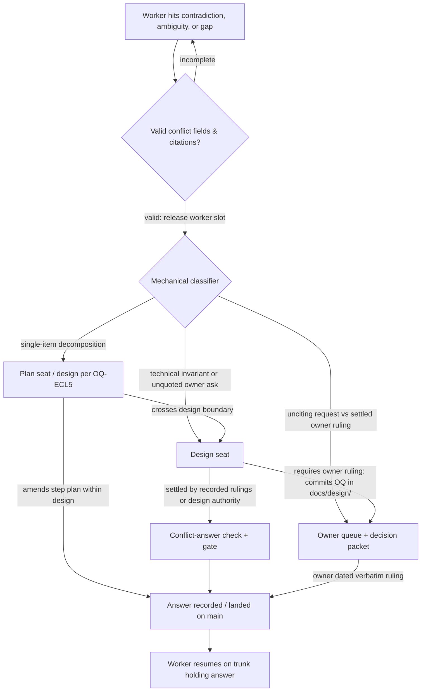

# Route specification conflicts to the authority that owns the rule instead of letting workers reconcile contradictions inside a build run

**Status:** Partly built in a narrower three-level shape, source-verified on 2026-11-27. Built in the tree: the append-only `item.conflict` event stream in [`tools/tillr-item/item/conflict.go`](../../tools/tillr-item/item/conflict.go) (`ReadConflicts`, `RecordConflict`), the closed five-kind `OBSTACLE:` contract in [`tools/tillr-drain/drain/obstacle.go`](../../tools/tillr-drain/drain/obstacle.go) (`ObstacleContract`), and `build -> design -> owner` conflict routing with `NEXT-ACTOR:` and slot release in [`tools/tillr-drain/drain/blocked.go`](../../tools/tillr-drain/drain/blocked.go) (`conflictDecision`, `reportedBlock`). Not built: typed policy-ledger frontmatter and checks `C1`–`C4` (`rg -n 'canonical_source|policies_checked|candidate_resolutions' tools/` returns nothing), typed policy parameters on plans (`rg -n 'follow-ref' tools/` returns nothing), and a precedent casebook (`fd casebook docs/ tools/` returns nothing). Standing owner rulings quoted verbatim in [Section 1.3](#13-standing-owner-rulings-that-govern-this-design) belong to their source ledgers; [`D1`](#D1) through [`D14`](#D14) in the [Decision Ledger](#13-decision-ledger) are the designer's decisions, which the owner may overturn; [`OQ-ECL1`](#OQ-ECL1) through [`OQ-ECL7`](#OQ-ECL7) await the owner's ruling.

> **In short.** When a worker discovers that its brief, its plan, a recorded policy, or the codebase disagree, no amount of prompt craft inside that build run can fix the contradiction — because the worker lacks authority to amend either side. Instead of guessing or rewriting invariants to match the brief, the worker stops with a structured conflict record and frees its execution slot so other items keep moving. Tillr routes the conflict mechanically to the lowest authority level permitted to settle it (`plan`, `design`, or `owner`), enforces parameterised policies with deterministic checks before any reviewer runs, and turns owner corrections into durable rules.

**Why it matters.** In a real run ([Section 1.1](#11-the-motivating-case)), a brief saying *"stay evergreen, base on upstream's latest"* met an existing policy requiring forks to track cut release tags rather than upstream's unreleased `main`. Having no lawful exit when the brief and the invariant collided, the worker rebased onto upstream `HEAD`, changed `follow` to `"head"`, and passed a reviewer whose context held the diff and the brief rather than the policy. Every silent self-amendment of that kind turns an unwritten ambiguity into an unapproved policy change on `main`.

**The shape.** [Section 1](#1-problem-and-goals) states the motivating failure, what is built today, and the standing owner rulings that bound the design. [Section 2](#2-vocabulary-and-principles) defines the terms and principles. [Section 3](#3-authority-model) defines the four authority levels (`worker`, `plan`, `design`, `owner`) and how criteria freeze binds downward without locking higher seats. [Section 4](#4-the-conflict-record) specifies the conflict record, and [Section 5](#5-escalation-routing) gives the deterministic routing tests. [Section 6](#6-policy-representation-and-checks) and [Section 7](#7-reviewer-and-worker-context-discipline) cover the policy ledger, deterministic checks `C1`–`C4`, and narrow brief/reviewer context. [Section 8](#8-the-owner-interface) and [Section 9](#9-institutional-memory) cover owner decision packets, precedent, and trajectory feedback. [Section 10](#10-failure-modes-of-the-ladder-itself), [Section 11](#11-alternatives-considered), and [Section 12](#12-the-motivating-case-replayed) cover ladder failure modes, rejected alternatives, and the replayed motivating case.

**Cost.** Touching an area governed by a parameterised policy adds one typed frontmatter block per policy file ([Section 6.1](#61-the-policy-ledger-d6-d7)), four fast deterministic checks `C1`–`C4` before review ([Section 6.2](#62-four-deterministic-checks-before-review-d8)), and three structured fields on `item.conflict` (`policies_checked`, `candidate_resolutions`, `recommended`). Worker prompts do not grow by the policy corpus ([`D10`](#D10)), and held items occupy zero running-agent slots ([`D5`](#D5)).

**Start at [Section 3](#3-authority-model)** for the authority boundary between frozen criteria and policy owners, **[Section 5](#5-escalation-routing)** for how conflicts route without worker guesswork, **[Section 6](#6-policy-representation-and-checks)** for the policy ledger and `C1`–`C4`, and **[Open Questions](#open-questions)** for the seven owner choices ([`OQ-ECL1`](#OQ-ECL1)–[`OQ-ECL7`](#OQ-ECL7)).

**Needs your ruling:** [`OQ-ECL1`](#OQ-ECL1), [`OQ-ECL2`](#OQ-ECL2), [`OQ-ECL3`](#OQ-ECL3), [`OQ-ECL4`](#OQ-ECL4), [`OQ-ECL5`](#OQ-ECL5), [`OQ-ECL6`](#OQ-ECL6), and [`OQ-ECL7`](#OQ-ECL7).

**Reads with:** [Authority, not approval](../reference/authority-not-approval.md), [Decision provenance review](../tillr/decision-provenance-review.md), [Judge and lifecycle](./tillr-judge-and-lifecycle.md), [Settled-decision conflicts](./tillr-settled-decision-conflicts.md), [Conflict answer check](./tillr-conflict-answer-check.md), [The compliance officer](./tillr-design-document-check.md), [Criterion repair](./criterion-repair.md), [Operator decisions inside tillr](./operator-decisions-inside-tillr.md), and [Plan step and seat selection](./tillr-plan-step-and-seat-selection.md).

---

## 1. Problem and Goals

### 1.1 The motivating case

A worker was briefed to keep a patched fork *"evergreen, based on upstream's latest."* Project policy — written down in prose and partially encoded in a gate check — was to follow upstream's newest release tag, never its unreleased `HEAD`. Faced with the superlative *"latest,"* the worker rebased onto `HEAD` and changed `follow` to `"head"` so the gate check agreed with its reading. A reviewer, whose context was the diff and the brief rather than the policy, signed off. The owner caught it by hand.

Nothing in that sequence was a model capability failure. Each agent optimised locally against the text in front of it:

- the brief used an ambiguous word that pointed away from policy;
- the policy was prose in a document the worker was not required to read, plus a check whose configuration the worker was allowed to edit;
- the worker had no clean move when *"what the brief seems to ask"* and *"what an existing configuration asserts"* disagreed — finishing the task meant picking a side, and the brief was louder;
- the reviewer was asked *"does this diff satisfy this brief?"* rather than *"does this diff satisfy this brief without violating recorded policy?"*

The structural defect is that **a worker encountering a contradiction, ambiguity, or policy collision has no lawful move other than to resolve it locally and keep going.** Frozen acceptance criteria rightly stop a worker from quietly weakening its own assignment, and without an upward escalation channel that same freeze leaves no legitimate path to report *"my assignment is at war with an invariant."* Making criteria editable by workers would collapse verification; leaving workers with no upward channel turns every specification defect into silent policy invention.

### 1.2 What is built today versus what remains proposed

Between the original 2026-11-03 draft of this design and 2026-11-27, a narrower three-level conflict path landed in `tillr-item` and `tillr-drain`, while typed policy checks and precedent indexing remain unbuilt:

| Capability | Built in the tree today | Remaining in this design ([`D1`](#D1)–[`D14`](#D14), [`OQ-ECL1`](#OQ-ECL1)–[`OQ-ECL7`](#OQ-ECL7)) |
| :--- | :--- | :--- |
| **Worker exit on contradiction** | Closed five-kind `OBSTACLE:` contract (`definition`, `trunk`, `tooling`, `seat`, `owner`) in [`tools/tillr-drain/drain/obstacle.go`](../../tools/tillr-drain/drain/obstacle.go) (`ObstacleContract`); missing or malformed obstacles return to the worker session uncounted. | Distinguishing `contradiction`, `ambiguity`, and `gap` sub-kinds with structured `policies_checked` and `candidate_resolutions` ([Section 4](#4-the-conflict-record), [`D3`](#D3)). |
| **Conflict persistence** | Append-only `item.conflict` transitions (`raised`, `awaiting`, `owner`, `question`, `answered`, `closed`) in [`tools/tillr-item/item/conflict.go`](../../tools/tillr-item/item/conflict.go) (`RecordConflict`, `ReadConflicts`). | Recording `policies_checked`, `candidate_resolutions`, `recommended`, and post-resolution trajectory metadata ([`D3`](#D3), [`D13`](#D13)). |
| **Authority routing** | Three active levels (`build -> design -> owner`) in [`tools/tillr-drain/drain/blocked.go`](../../tools/tillr-drain/drain/blocked.go) (`reportedBlock`, `conflictDecision`, `NEXT-ACTOR: build \| owner`). Generated repair items with no design block escalate directly to `owner` (`generatedQuestion`). | Four-level authority model including `plan` ([`OQ-ECL5`](#OQ-ECL5)), mechanical routing by policy `authority` ([Section 5](#5-escalation-routing), [`D2`](#D2), [`D4`](#D4)), and settled-decision bypass ([`tillr-settled-decision-conflicts.md`](./tillr-settled-decision-conflicts.md)). |
| **Slot release and resume** | Held items claim no running-agent slot (`conflictDecision` returns `ActionHold`); design amendments land on `main` (`AnswerHead`) or return `NEXT-ACTOR: build` (`AnswerDetail`) and re-queue the item (`in-queue`). | Injecting structured conflict answers alongside typed policy parameters when resuming ([`D5`](#D5), [`D7`](#D7)). |
| **Policy ledger & pre-review checks** | Not built (`rg -n 'canonical_source' tools/` returns nothing). | Parameterised policy frontmatter, typed plan parameters, and deterministic checks `C1`–`C4` ([Section 6](#6-policy-representation-and-checks), [`D6`](#D6)–[`D8`](#D8), [`OQ-ECL1`](#OQ-ECL1)–[`OQ-ECL3`](#OQ-ECL3), [`OQ-ECL6`](#OQ-ECL6), [`OQ-ECL7`](#OQ-ECL7)). |
| **Precedent memory** | Decisions live in document `Decision Ledger` tables and standalone `docs/design/tillr-watch/*.md` records; `drain-repeated-item-conflicts` watches repeated conflicts ([`D-TW-RIC1`](./tillr-watch/repeated-item-conflicts-distinct-id.md#D-TW-RIC1)). | Retrievable casebook entries indexed by policy ID and path glob ([Section 9](#9-institutional-memory), [`D12`](#D12)). |

### 1.3 Standing owner rulings that govern this design

Subsequent dated rulings by the owner bound how the escalation ladder operates and retire two assumptions from the 2026-11-03 draft (temporary permission grants and unanswered defaults):

1. **Product and repository trade-offs go to the owner; engineering detail is marked as the agent's (2026-11-19, [`OQ-PR21`](../tillr/decision-provenance-review.md#decision-ledger)).** Quoted verbatim: *"A: it matches what you said on 2026-11-18, that you decide product direction and trade-offs and the agent decides engineering detail."* Unruled owner-level questions hold the work that depends on them ([`OQ-PR8`](../tillr/decision-provenance-review.md#OQ-PR8)).
2. **Only a dated verbatim owner quote closes an owner question; agent leanings never count as principles (2026-11-19, [`OQ-PR22`](../tillr/decision-provenance-review.md#decision-ledger)).** Quoted verbatim: *"A: it keeps what you wanted, not being asked the same thing twice, and stops an agent's own leaning from counting as a principle."* Designer recommendations (`_Leaning:_` or `recommended` on a packet) never take effect automatically when unanswered.
3. **Authority belongs to the workflow step, never to a temporary grant (2026-11-20, [`OQ-PR17`](../tillr/decision-provenance-review.md#decision-ledger) and [judge and lifecycle Section 6](./tillr-judge-and-lifecycle.md#6-the-judge-is-a-step-in-the-flow)).** Quoted verbatim: *"It's not a temporary grant. It's not a thing that will change on a whim. It's encoded for a purpose. ... here is the flow. There is a judge at this point, and they judge based on this."* In addition, per-item path allow-list fences were retired on 2026-11-19 in favor of the global deny-list (`ObstacleKinds` comment in [`tools/tillr-drain/drain/obstacle.go`](../../tools/tillr-drain/drain/obstacle.go)). No conflict resolution ever issues a temporary fence or temporary permission grant.
4. **Non-owner problems escalate inside tillr, never to the operator (2026-11-21, `R-OD1` in [operator decisions inside tillr Section 1](./operator-decisions-inside-tillr.md#1-the-ruling)).** Quoted verbatim: *"I guess a working principle should be that if you ever feel that you as [the operator] could solve some problem, and it wouldn't need to be escalated to me, then that problem should escalate to... a similarly responsible agent, process, ticket, whatever, within Tiller, rather than popping up to you."*
5. **No attempt counts, retry budgets, or exhausted states (2026-11-17, [`OQ-PT6`](./tillr-planning-node-model-tiering.md#decision-ledger)).** Quoted verbatim: *"No attempt counts, retry budgets or 'exhausted' states."* Identical repeats route to diagnosis or an owner hold (`D-JL10` in [judge and lifecycle Section 4.4](./tillr-judge-and-lifecycle.md#44-how-a-worker-runs-ending-moves-its-item-d-jl10)); aggregate stop rates in [Section 10](#10-failure-modes-of-the-ladder-itself) are observability signals for tightening briefs, never per-item retry caps.
6. **Builder-led execution, item-owned worktrees, and early design landing ([`OQ-PSS2`](./tillr-plan-step-and-seat-selection.md#OQ-PSS2) on 2026-11-20; `R-GP2` on 2026-11-23 and [`OQ-GP6`](./tillr-graph-is-the-path.md#OQ-GP6) on 2026-11-17 in [the item graph is the whole path](./tillr-graph-is-the-path.md); `D-PSS1` on 2026-11-19 in [plan step and seat selection Section 5](./tillr-plan-step-and-seat-selection.md#5-recorded-ruling-same-model-review-and-verification)).** Ordinary items start directly on `build` without an upfront `plan` run; items own their worktrees while releasing worker slots when held (`D-JL13`); design amendments and newly filed owner questions land on `main` ahead of the held item; and reviewer independence comes from a fresh session and review brief rather than a ban on matching the writer's model.

### 1.4 Goals, non-goals, and boundaries

**Goals:**

1. Give every worker a first-class, cheap, structured stop when its instructions collide with reality or policy, so **stopping is easier and safer than inventing.**
2. Route each conflict to the **lowest authority level** permitted to settle it, reserving the owner's attention for decisions that genuinely cross design boundaries or set repository-wide / product rules, and formatting those as compact decision packets rather than open-ended investigations.
3. Make policies **machine-checkable at the boundary where violations occur**, so deterministic checks catch policy drift before a reviewer LLM is ever invoked.
4. Keep reviewer and worker contexts **narrow and role-appropriate** — neither stuffing every policy document into every prompt nor leaving reviewers blind to the invariants they enforce.
5. Turn every owner correction and non-obvious escalation into **durable institutional memory** so the same class of mistake cannot recur silently.

**Non-goals and boundaries (what this document does not cover):**

- **Merge conflicts and red trunk checks.** Git three-way merge conflicts during landing belong to [`tools/tillr-land`](../../tools/tillr-land/) and [conflict avoidance and repair](./tillr-conflict-avoidance-and-repair.md); red checks on `base_sha` use `OBSTACLE: trunk` ([judge and lifecycle Section 4.5](./tillr-judge-and-lifecycle.md#45-what-a-worker-may-end-with-d-jl11)), not specification conflict routing.
- **Model capability escalation.** When a task's implementation complexity exceeds the current model without any flaw in the specification, `OBSTACLE: seat` steps the seat's escalation list (`SeatEscalation` in [`tools/tillr-drain/internal/policy/seat_escalation.go`](../../tools/tillr-drain/internal/policy/seat_escalation.go)) rather than amending policy.
- **Settled-decision bypass mechanics and conflict-answer verification.** When a filed request collides directly with a settled `D-*` or `OQ-*` record that the request did not cite, [settled-decision conflicts](./tillr-settled-decision-conflicts.md) (`D-SDC1`–`D-SDC6`) governs bypassing a wasted `design` turn; [conflict answer check](./tillr-conflict-answer-check.md) (`D-CA1`–`D-CA6`) governs verifying a designer's factual tree claims before the answer lands.
- **Immutable history of superseded criterion rows.** The store schema for `criterion.supersede` is owned by [criterion repair](./criterion-repair.md); this document governs *who has authority* to order that amendment and how the conflict reaches them.

---

## 2. Vocabulary and Principles

### 2.1 Defined terms

- **Owner, operator (whale), worker, and judge:** used as defined in [Authority, not approval](../reference/authority-not-approval.md#terms). The **owner** is the human repository and product authority; the **operator** (the whale) coordinates the drain on the owner's behalf and is *not* a destination for non-owner escalations (`R-OD1`).
- **Obstacle:** one of the five closed reasons (`definition`, `trunk`, `tooling`, `seat`, `owner`) for which a worker run may end `RESULT: blocked` without a commit ([judge and lifecycle Section 4.5](./tillr-judge-and-lifecycle.md#45-what-a-worker-may-end-with-d-jl11)).
- **Specification conflict** *(coined here)*: a recorded contradiction, material ambiguity, or policy gap between an item's brief/criteria, a recorded policy, and the codebase (`item.conflict` in [`tools/tillr-item/item/conflict.go`](../../tools/tillr-item/item/conflict.go)). *Excludes:* ordinary coding errors, failing tests caused by the worker's own edits, Git merge conflicts, broken tools (`OBSTACLE: tooling`), red trunk checks (`OBSTACLE: trunk`), and model-capacity limits (`OBSTACLE: seat`).
- **Authority ladder** *(coined here)*: the ordered hierarchy of four decision scopes — `worker` < `plan` < `design` < `owner` — where each level may settle choices inside its scope and must escalate choices owned by a higher level. *Excludes:* backend model escalation lists (`SeatEscalation` in [`tools/tillr-drain/internal/policy/seat_escalation.go`](../../tools/tillr-drain/internal/policy/seat_escalation.go)), which swap models within one seat without changing authority over criteria or policy.
- **Policy ledger** *(coined here)*: the proposed set of Markdown policy files carrying structured YAML frontmatter (`id`, `authority`, `applies_to`, `invariants`, `parameter`) that deterministic checks `C1`–`C4` evaluate without an LLM. *Excludes:* backend model policies (`config/tillr/backend-policy*.json`) and prose-only narrative docs that declare no machine-checked frontmatter.
- **Decision packet** *(coined here)*: the one-screen structured presentation of an owner-routed conflict — naming the question, the governing policy or gap, bounded options with concrete trade-offs, and a non-binding designer leaning. *Excludes:* raw run transcripts or open-ended prompts asking the owner to investigate the tree.
- **Casebook** *(coined here)*: the proposed collection of precedent-setting conflict resolutions indexed by policy ID and path glob so planners and designers retrieve prior boundary rulings. *Excludes:* ephemeral run logs and routine defect fixes that set no precedent.

### 2.2 Governing principles

1. **Freeze binds down, not up.** Acceptance criteria and policy invariants are immutable to the seat executing against them, and remain amendable — with recorded provenance — by the authority level above ([`D1`](#D1), [`OQ-CR7`](./criterion-repair.md#decision-ledger)).
2. **Authority is distinct from capability.** A frontier build worker still lacks authority to overturn a product or cross-cutting architectural policy; a small deterministic check has full authority to refuse a landing that edits a protected policy parameter without its owner's resolution.
3. **Deterministic checks precede LLM review.** Anything expressible as a parameter comparison, a path guard, or a lexicon scan runs as code in milliseconds (`C1`–`C4`, [`D8`](#D8)). Reviewers check residual semantic compliance ([`D9`](#D9)).
4. **Escalate structured conflicts, never transcripts.** A higher authority receives the contradiction, the citations on both sides, the candidate options, and a non-binding recommendation — never *"read 40 turns of logs and tell me what to do."*
5. **Every escalation tests the specification layer.** When a conflict reaches `design` or `owner`, recording its trajectory asks *why* it was not caught earlier — missing policy parameter, vague brief word, or missing check — so the system tightens over time ([`D13`](#D13)).

---

## 3. Authority Model

*Designer's decisions [`D1`](#D1) and [`D2`](#D2); the owner may overturn them.*

### 3.1 The four authority levels

| Level | Seat / role | Owns | May amend | Must escalate |
| :--- | :--- | :--- | :--- | :--- |
| **`worker`** | `build` worker (and in-session Tier 1/2 subagents under [`D-PSS4`](./tillr-plan-step-and-seat-selection.md#33-the-three-tier-fan-out-structure-and-who-enforces-it-d-pss4-d-pss7-oq-pss3)) | Code and tests within the item's scope that satisfy its criteria | Implementation choices left open by the item and plan | Any contradiction with criteria, plan, or policy; any material ambiguity whose resolution alters observable behaviour or touches a policy-governed surface |
| **`plan`** | Companion-plan author or planning seat (see [`OQ-ECL5`](#OQ-ECL5) when no separate `plan` node runs) | Decomposition of a settled design into items, interfaces between sibling steps, and per-step acceptance criteria | Step boundaries, ordering, and step criteria **within** the settled design's invariants | Anything that bends a design invariant, alters cross-module architecture, or touches an `owner`- or `design`-authority policy |
| **`design`** | `design` seat | Cross-cutting architecture, technical policy entries (`authority: design`), item-block / companion-plan amendments, and owner-question drafting | Design-level decisions, `design`-authority policies, and item criteria on evidence ([`OQ-CR7`](./criterion-repair.md#decision-ledger)) | Product direction, repository-wide rules, spend/model policy, external contract changes, and every `authority: owner` policy ([`OQ-PR21`](../tillr/decision-provenance-review.md#decision-ledger), [`OQ-ECL3`](#OQ-ECL3)) |
| **`owner`** | The human repository owner | Product intent, external contracts, risk posture, spend/model ceilings, and `authority: owner` policies | Anything in the repository, recorded as a dated verbatim ruling ([`OQ-PR22`](../tillr/decision-provenance-review.md#decision-ledger)) | — |

Two structural rules keep this hierarchy honest:

1. **Every policy and criterion has an explicit authority owner.** An item's acceptance criteria are owned by `plan` (or `design` on a single-item design/request); a design's technical invariants are owned by `design`; a policy entry in the ledger declares `authority: design` or `authority: owner` explicitly (`worker` and `plan` do not own standing repository policies).
2. **Nobody self-amends.** When a `worker` changes `follow` from `"newest-release-tag"` to `"head"` to make a check pass, it is acting at `owner` authority without holding it. Even if `design` agrees with the change, an `authority: owner` policy requires the owner's dated ruling before the amendment takes effect ([`OQ-PR21`](../tillr/decision-provenance-review.md#decision-ledger), [`OQ-ECL3`](#OQ-ECL3)).

### 3.2 Separating criteria freeze from policy authority (`D1`)

Criteria freeze solves one specific failure: *an executing agent moving its own goalposts to claim completion.* That rule binds downward:

- A `worker` cannot weaken, delete, or reinterpret a criterion it was handed, nor edit a policy file or check configuration to match its code. This downward bind is what other documents cite as the ladder's fence; it is a standing rule on the `build` step, distinct from the per-item path allow-lists (also called fences) retired on 2026-11-19 ([Section 1.3](#13-standing-owner-rulings-that-govern-this-design)).
- When a `worker` proves with tree evidence that a criterion contradicts reality or a higher-authority rule (`OBSTACLE: definition` or `OBSTACLE: owner`), `design` (or `plan` under [`OQ-ECL5`](#OQ-ECL5)) holds upward authority to supersede the criterion on the record ([criterion repair](./criterion-repair.md)) or publish an owner question in `docs/design/` whose commit lands on `main` ahead of the held item ([`OQ-GP6`](./tillr-graph-is-the-path.md#OQ-GP6)).

---

## 4. The Conflict Record

*Designer's decision [`D3`](#D3); the owner may overturn it.*

### 4.1 What is stored today and what `D3` extends

Today [`tools/tillr-item/item/conflict.go`](../../tools/tillr-item/item/conflict.go) (`Conflict`) stores `conflict_id`, `item_id`, `run_id`, `body_ref`, `text`, `blocked_criteria`, `waiting_on`, `status` (`raised`, `awaiting`, `owner`, `question`, `answered`, `closed`), `design_run_id`, `question_ref`/`question_head`/`question_run_id`, `answer_head`/`answer_detail`, and `triage_version` as an append-only `item.conflict` event stream, driven by a worker's `OBSTACLE: definition` (`CRITERIA`, `EVIDENCE`) or `OBSTACLE: owner` (`QUESTION`) report ([`tools/tillr-drain/drain/obstacle.go`](../../tools/tillr-drain/drain/obstacle.go)).

`D3` extends specification conflicts with structured classification and option fields so routing checks (`C1`–`C4`), designers, and owner decision packets read typed fields rather than free-text `text` alone:

| Field | Built today? | Contents |
| :--- | :--- | :--- |
| `conflict_id`, `item_id`, `run_id`, `body_ref` | Yes (`item.Conflict`) | Stable conflict identity (`"conflict-" + run_id`), item, originating run, and governing document block reference |
| `raised_by` | Derived from `run_id` | Authority level of the raising run (`worker`, `plan`, or `design`) |
| `subkind` | Proposed (`D3`) | `contradiction` (two cited sources disagree), `ambiguity` (a phrase admits `>= 2` incompatible readings that affect behaviour or policy), or `gap` (an unanticipated case no source covers) |
| `blocked_criteria` | Yes (`item.Conflict`) | Criterion IDs held by this conflict |
| `sources_in_tension` / `evidence` | Free-text `EVIDENCE` today; structured citations proposed | Exact quotes and file/anchor citations — e.g. brief phrase vs policy `id` vs `path#symbol` |
| `policies_checked` | Proposed (`D3`) | Policy IDs (`upstream.follow-ref`, `D-*`, `OQ-*`) consulted before raising (verified against the closed index under [settled-decision conflicts Section 4.1](./tillr-settled-decision-conflicts.md#41-optional-decisions-field-plus-closed-index-verification-d-sdc4)) |
| `question` | `QUESTION:` on `owner` obstacles today | Single sharp sentence stating what must be decided |
| `candidate_resolutions` & `recommended` | Proposed (`D3`) | `2`–`3` concrete options, each naming what changes, which authority level owns it, and its cost/risk, plus a non-binding leaning and one-paragraph argument |
| `status` & `waiting_on` | Yes (`item.Conflict`) | `raised -> awaiting -> owner \| question \| answered -> closed`, naming the active waiter (`design` or `owner`) |

### 4.2 Raising discipline and slot release (`D5`)

1. **Evidence before stopping.** A conflict without citations for **both** sides of a `contradiction`, or without at least two concrete readings for an `ambiguity`, is incomplete and returns to the raising session under `ObstacleContract` — preventing lazy *"unclear spec"* stops that dump investigation onto `design`.
2. **Zero idle slot consumption (`D5`, aligned with `R-GP2` and `D-JL13`).** Recording a conflict transitions the item to `blocked` (or `in-queue` held on `question-open` once a document question lands) and releases the running-agent slot immediately so another queued item runs. The item's worktree (`<lane-root>/<item-id>/worktree`) stays the item's: under `R-GP2` it is idle, not free, and may be collected and later restored from the pinned item branch.
3. **Resume with the landed answer (`D-JL32`).** When the deciding authority lands an amended block/design (`AnswerHead`) or answers `NEXT-ACTOR: build` (`AnswerDetail`), the worker resumes from a trunk containing that answer ([judge and lifecycle Section 4.19](./tillr-judge-and-lifecycle.md#419-a-worker-returned-by-a-design-answer-starts-from-a-trunk-that-holds-the-answer-d-jl32)) with the resolution injected into its brief, rather than re-discovering the problem cold.

---

## 5. Escalation Routing

*Designer's decision [`D4`](#D4); the owner may overturn it.*

### 5.1 Deterministic classification tests (evaluated top-down, first match wins)

The worker **never** chooses which seat receives its conflict: a worker cannot see the whole policy ledger or design graph well enough to judge routing reliably. Instead, the drain classifies a valid specification conflict mechanically from recorded facts:

1. **Direct policy or settled-decision citation.** If `policies_checked` or `sources_in_tension` cites a policy ledger entry or settled decision record (`D-*` / answered `OQ-*`):
   - When a filed request collides with a settled decision it did not name, [settled-decision conflicts](./tillr-settled-decision-conflicts.md) (`D-SDC1`, [`OQ-SDC1`](./tillr-settled-decision-conflicts.md#OQ-SDC1), [`OQ-SDC2`](./tillr-settled-decision-conflicts.md#OQ-SDC2)) bypasses `design` directly to the filer/owner with an immediate alert, because `design` has no authority to silently overturn a settled ruling for an unciting request.
   - Otherwise, route to the `authority` declared on that policy (`design` or `owner`; if multiple policies are cited, take `max(authority)`).
2. **Protected surface touch.** If any candidate resolution modifies a file matched by a policy's `applies_to` or `canonical_source`, route to `max(authority)` of the matched policies — catching conflicts where the worker noticed a code collision without knowing a policy governed that file.
3. **Public contract, product behaviour, spend, or model choice.** Under [`OQ-PR21`](../tillr/decision-provenance-review.md#decision-ledger), if the conflict alters user-visible CLI/UI behaviour, external wire/file formats, repository history policy, model selection, or spend, route to `design` to draft the owner question (or directly to `owner` when raised by `design`).
4. **Cross-item or architectural invariant.** If resolving the conflict alters interfaces across sibling items in a companion plan or amends a design's `Decision Ledger`, route to `design`.
5. **Single-item specification or decomposition defect.** Route to `plan` when an item has an active planning owner, or directly to `design` under [`OQ-ECL5`](#OQ-ECL5) when the item runs under builder-led execution (`single-worker@v1`) with no separate `plan` seat.

### 5.2 Escalation flow across seats



### 5.3 What each authority level does on receipt

- **`plan` (or `design` on planner-less items per [`OQ-ECL5`](#OQ-ECL5)):** checks whether the conflict is resolvable within the settled design's invariants. If yes, amends the companion plan or item criteria and returns the item to `build`. If no — because every clean fix bends a design invariant or touches a policy — escalates upward with its sharper framing attached. No temporary fence or permission grant is ever issued ([`OQ-PR17`](../tillr/decision-provenance-review.md#decision-ledger)).
- **`design`:** checks whether the conflict is technical/architectural (`authority: design`) or already answered by a dated owner ruling in `docs/`.
  - If yes, amends the design/item block (checked before landing by the [conflict answer check](./tillr-conflict-answer-check.md) and the gate) or returns `NEXT-ACTOR: build` when the existing specification already stands as written (`designObjectionBuild` in [`tools/tillr-drain/drain/blocked.go`](../../tools/tillr-drain/drain/blocked.go)).
  - If the conflict requires a new or amended `owner` ruling, `design` does **not** decide: it sharpens the trade-off, verifies both options against the codebase, and commits an open `<!-- vantage: question -->` in `docs/design/` (landing early on `main` under [`OQ-GP6`](./tillr-graph-is-the-path.md#OQ-GP6)) or objects with `NEXT-ACTOR: owner`. Thus `design` acts as **counsel preparing the brief**, never a bottleneck pretending to be the owner.
- **`owner`:** reads the one-screen decision packet or Vantage question, picks an option or writes a dated ruling in own words, and triggers two effects: the held item resumes against the landed answer, and any implied standing policy is ratified in the ledger ([`OQ-ECL3`](#OQ-ECL3)).

---

## 6. Policy Representation and Checks

*Designer's decisions [`D6`](#D6), [`D7`](#D7), and [`D8`](#D8); the owner may overturn them.*

### 6.1 The policy ledger (`D6`, `D7`)

Prose rules buried in long documents fail twice: workers do not know which prose applies to the file they are editing, and deterministic gates cannot compare prose against a diff. `D6` represents standing operational and architectural rules as small Markdown files with typed YAML frontmatter (converting existing prose rules in the order chosen in [`OQ-ECL7`](#OQ-ECL7)):

| Frontmatter key | Purpose and specimen (`upstream.follow-ref`) |
| :--- | :--- |
| `id` | Stable dotted slug (`upstream.follow-ref`) cited by plans, `C1`–`C4`, conflict records, and casebook entries |
| `authority` | `design` or `owner` — the minimum authority level permitted to amend or grant an exception to this policy |
| `applies_to` | Path globs and/or item tags selecting when the policy is in scope (e.g. `bin/pi-forks*`, `tools/tillr-land/land/fork_*`, tag `fork-rebase`; the `bin/pi-forks` path is a specimen from the repository of the motivating case — `fd pi-forks bin` returns nothing in this repository) |
| `invariants` | Short falsifiable statements read by the compliance reviewer ([`D9`](#D9)) |
| `parameter` | Optional typed parameter: `name`, allowed `type`/enum, ratified `value`, and `canonical_source` naming the code/config symbol (`follow`, value pending [`OQ-ECL1`](#OQ-ECL1), canonical source pending [`OQ-ECL2`](#OQ-ECL2)) |
| `triggers` | Optional lexicon of ambiguous brief words (`latest`, `head`, `tip`, `evergreen`) that `C3` flags when paired with `applies_to` |

Where an applicable policy defines a `parameter`, a companion plan or item specification declares the parameter value it engages as a typed field rather than free prose (`D7`). In the motivating case, `"latest"` is not even a valid enum member of `upstream.follow-ref`'s `follow` parameter, and `"branch-head"` fails equality against `"newest-release-tag"` before any build worker starts.

### 6.2 Four deterministic checks before review (`D8`)

All four checks are pure code with zero LLM calls:

1. **`C1` — Plan-against-policy parameter check (at plan / staging time).** Selects every policy whose `applies_to` matches the item's target paths or tags. Any declared `parameter` value that mismatches the policy's ratified `value` — without a recorded exception from `policy.authority` — refuses staging and opens a conflict directly.
2. **`C2` — Canonical-source drift check (in the deterministic gate).** For every policy with a `canonical_source` (watching one or both locations per [`OQ-ECL2`](#OQ-ECL2)), parses the candidate tree and asserts the code/config value still equals the ledger's `parameter.value`. Editing `follow` to `"head"` inside a build run fails `C2` deterministically in milliseconds — **catching the motivating failure with zero tokens.**
3. **`C3` — Brief trigger-lexicon scan (at intake / planning).** Scans new request and brief text against matched policies' `triggers` lists (vague superlatives such as `latest`, `current`, `default`, `standard`, `as usual`, complementing intake screening in [request amendment](./tillr-request-amendment.md)). Hits require the plan or intake step to bind the typed parameter explicitly before a build run starts.
4. **`C4` — Policy-ledger modification guard (in the deterministic gate, rollout governed by [`OQ-ECL6`](#OQ-ECL6)).** Refuses any diff that adds, deletes, or alters `authority`, `parameter`, or `invariants` on a policy file without provenance matching `policy.authority` (for `authority: owner`, a dated verbatim owner quote matching [`D-PR1`–`D-PR3`](../tillr/decision-provenance-review.md#6-how-this-stops-happening); for `authority: design`, a `design`-seat resolution). Authority is enforced as a gate rule on commit provenance, never as a temporary permission grant ([`OQ-PR17`](../tillr/decision-provenance-review.md#decision-ledger)).

---

## 7. Reviewer and Worker Context Discipline

*Designer's decisions [`D9`](#D9) and [`D10`](#D10); the owner may overturn them.*

### 7.1 Reviewers check residual semantic compliance after `C1`–`C4` (`D9`)

Once `C1`–`C4` and the deterministic gate pass, a fresh-session post-gate reviewer ([diff review](./tillr-diff-review.md) `D-DR4`, [the compliance officer](./tillr-design-document-check.md) `D-DP1`–`D-DP6`, and [same-model review](./tillr-plan-step-and-seat-selection.md#5-recorded-ruling-same-model-review-and-verification) `D-PSS1`) receives only:

- the diff and the item's frozen criteria;
- the `{id, invariants}` summaries of policies selected by `applies_to` over the changed paths — typically two to five one-liners rather than full documents;
- any conflict resolutions recorded on the item.

The reviewer answers two bounded questions: *(1) does the diff satisfy every criterion, and (2) does it violate any listed invariant?* If the reviewer discovers that satisfying a criterion *requires* violating a listed invariant, the reviewer raises a conflict rather than failing the worker for obeying one side over the other.

### 7.2 Workers receive narrow stop triggers, not the policy corpus (`D10`)

Workers do **not** read the policy corpus (`D10`). Stuffing dozens of policy files into every `build` prompt wastes context and invites workers to weigh competing policies themselves. Instead, staging injects:

1. the standing `ObstacleContract` ([`tools/tillr-drain/drain/obstacle.go`](../../tools/tillr-drain/drain/obstacle.go)); and
2. one-line derived stop triggers for any policy matching the item's paths — e.g., *"Protected parameter: `bin/pi-forks` `follow` is governed by `upstream.follow-ref` (`newest-release-tag`); if your task requires changing it, stop with `OBSTACLE: definition` or `OBSTACLE: owner`."*

---

## 8. The Owner Interface

*Designer's decision [`D11`](#D11), governed by [`OQ-ECL4`](#OQ-ECL4); the owner may overturn it.*

When a conflict genuinely reaches `owner` (either as a `<!-- vantage: question -->` committed in `docs/design/` or an owner-held conflict card in the Observatory), it arrives as a **one-screen decision packet**:

```text
CONFLICT conflict-run-item-fork-sync-a1  [blocks: item-fork-sync]  [authority: owner]
Policy: upstream.follow-ref  (currently: newest-release-tag)
Origin: brief says "stay evergreen, base on upstream's latest"

Question: Should the pi fork follow upstream's newest release tag or upstream main?

  [A] Keep newest-release-tag; rebase this item onto v0.14.2.
      Scope: this item's plan only. Zero policy change; unreleased main churn stays out.

  [B] Amend upstream.follow-ref to branch-head (main) for all rebases.
      Scope: repository-wide policy change. Picks up upstream fixes immediately, and imports unreleased breaks.

  [C] One-off exception: rebase onto main@<sha> for this item only; keep policy at newest-release-tag.
      Scope: recorded single-item exception; next release rebase returns to tags.

Designer leaning (non-binding under OQ-PR22): [A] — "evergreen" is satisfied by prompt release-tag
rebases without importing unreleased upstream breakage; pick [C] only if a specific unreleased commit is required.
```

Three rules govern owner packets:

1. **Non-binding leaning, zero timeout defaults ([`OQ-PR21`](../tillr/decision-provenance-review.md#decision-ledger), [`OQ-PR22`](../tillr/decision-provenance-review.md#decision-ledger)).** Every packet states a recommended option and why, so clear calls take seconds, and **no leaning ever auto-applies if unanswered**.
2. **Delivery cadence ([`OQ-ECL4`](#OQ-ECL4)).** Non-blocking questions wait in the Vantage / Observatory review queue; lane-blocking holds notify according to the owner's ruling on [`OQ-ECL4`](#OQ-ECL4) (with settled-decision collisions alerting immediately under [settled-decision conflicts](./tillr-settled-decision-conflicts.md)).
3. **Structured capture.** Answering in Vantage (`**Answer:**` blockquote or review comment) or via `tillr drain retry` records the owner's words verbatim, closes or updates the conflict, and — when an option amends a policy — commits the updated policy frontmatter in the same design turn.

---

## 9. Institutional Memory

*Designer's decisions [`D12`](#D12), [`D13`](#D13), and [`D14`](#D14); the owner may overturn them.*

### 9.1 The precedent casebook (`D12`)

Every conflict resolution that sets precedent — especially every case where the owner overrules or sharpens a designer leaning — records a compact casebook entry alongside the policy ledger, indexed by policy `id` and `applies_to` globs:

- **Situation:** the brief/request words, the policy or tree fact in tension, and the wrong local move(s) that tempted the lower seat;
- **Ruling:** the deciding authority's answer (quoting the owner verbatim when `authority: owner`);
- **Distilled rule:** the general boundary lesson (e.g., *an ambiguous superlative in a brief never amends a parameterised policy*, and *editing a checked parameter to match a brief is policy invention*).

Planners and designers retrieve matching casebook entries by policy ID and path glob; workers never carry the casebook in context (`D10`).

### 9.2 Escalation trajectory feedback (`D13`) and replay drills (`D14`)

Every resolved conflict records its trajectory (`origin_level -> resolved_by_level`) in `events` (building on `item.conflict` in [`tools/tillr-item/item/conflict.go`](../../tools/tillr-item/item/conflict.go) and `drain-repeated-item-conflicts` in [`D-TW-RIC1`](./tillr-watch/repeated-item-conflicts-distinct-id.md#D-TW-RIC1)) plus a root-cause tag naming which earlier defence missed it:

| Trajectory signature | What it diagnoses | Mechanical remedy |
| :--- | :--- | :--- |
| `worker -> owner` on an existing prose rule | Policy was never parameterised into `C1`/`C2` | Parameterise the policy in the ledger ([`OQ-ECL7`](#OQ-ECL7)) |
| `worker -> plan/design` on a vague brief word | Trigger word missing from `C3` | Add the word to the policy's `triggers` lexicon |
| Repeated `worker -> design` rejected as `NEXT-ACTOR: build` | Worker stop trigger is too broad or brief is unclear | Tighten the stop trigger phrasing ([Section 10](#10-failure-modes-of-the-ladder-itself)) |

Before turning `C4` into a hard gate refusal ([`OQ-ECL6`](#OQ-ECL6)), `D14` runs one end-to-end replay drill per policy class (`owner`-authority parameterised policy, `design`-authority invariant, and ambiguous-brief `C3` trigger), starting with the motivating `upstream.follow-ref` case.

---

## 10. Failure Modes of the Ladder Itself

| Failure mode | Symptom | Structural guard |
| :--- | :--- | :--- |
| **Over-escalation (learned helplessness)** | Workers stop on routine implementation choices that violate no criterion or policy | Incomplete conflicts without citations on both sides return to the worker (`ObstacleContract`); `design` answers false alarms with `NEXT-ACTOR: build`; high false-alarm rates in watch telemetry trigger brief/stop-trigger tightening (never per-item retry caps, per [`OQ-PT6`](./tillr-planning-node-model-tiering.md#decision-ledger)) |
| **Under-escalation (quiet invention)** | Worker edits a policy-governed setting or bends an invariant without stopping | `C2` catches canonical-source drift deterministically; `C4` guards policy files; post-gate compliance review (`D9`) checks residual invariants |
| **Mis-routing upward or downward** | Owner gets paged on engineering detail, or `plan` settles an `owner` trade-off | Routing is computed mechanically from policy `authority` and [`OQ-PR21`](../tillr/decision-provenance-review.md#decision-ledger) rules ([Section 5.1](#51-deterministic-classification-tests-evaluated-top-down-first-match-wins)), never chosen by the worker; `C4` refuses policy edits lacking matching authority provenance |
| **Queue stall while owner is away** | Several items hit `owner` questions overnight | Held items release their worker slots immediately (`D5`, `D-JL13`) so all unaffected items keep draining; when only owner-held items remain, the drain idles honestly naming the open questions ([`OQ-OD2`](./operator-decisions-inside-tillr.md#OQ-OD2)) |
| **Policy sprawl** | Too many low-value policy entries create maintenance friction | Policies enter the ledger only from owner rulings, settled design invariants, or precedent-setting conflicts ([`OQ-ECL3`](#OQ-ECL3), [`OQ-ECL7`](#OQ-ECL7)); entries that never match `applies_to` are flagged for retirement |

---

## 11. Alternatives Considered

*Designer's comparisons; the owner may overturn any choice here.*

| Alternative | What it does | Verdict and why |
| :--- | :--- | :--- |
| **Chosen: typed conflict records + mechanical authority routing + parameterised policy checks (`D1`–`D14`)** | Workers stop cleanly and release slots; deterministic checks `C1`–`C4` guard parameters; conflicts route to `plan` / `design` / `owner` by authority. | **Chosen.** Catches parameter drift in milliseconds (`C2`), keeps worker prompts small (`D10`), and preserves criteria freeze (`D1`) without trapping workers in contradictions. |
| **Put the full policy corpus into every worker and reviewer prompt** | Every `build` and `review` session loads all policy and design docs in context. | **Rejected.** Token cost scales with repository history, attention degrades as policies accumulate, and when a brief contradicts a policy the worker still lacks authority to amend the brief. |
| **Let workers amend criteria or choose which seat to ask** | Workers edit broken criteria directly with a commit note, or pick `plan` vs `design` vs `owner` themselves. | **Rejected.** Worker-editable criteria destroy independent verification (`D1`, [`OQ-CR7`](./criterion-repair.md#decision-ledger)), and workers lack the repository-wide policy map needed to classify authority accurately (`D4`). |
| **Issue temporary fence or permission grants when a conflict answer widens scope** | `plan` or `design` attaches a one-run temporary permission token letting a worker edit protected files. | **Rejected (retired by owner ruling [`OQ-PR17`](../tillr/decision-provenance-review.md#decision-ledger), 2026-11-20).** Authority belongs to the workflow step and seat encoded in the flow, never to expiring or ad-hoc permission grants; per-item path allow-lists were also retired on 2026-11-19. |
| **Auto-apply designer leanings after a timeout when owner questions sit unanswered** | Each `OQ-*` carries a `"Default if unanswered"` that unblocks build automatically. | **Rejected (forbidden by owner rulings [`OQ-PR21`](../tillr/decision-provenance-review.md#decision-ledger) and [`OQ-PR22`](../tillr/decision-provenance-review.md#decision-ledger), 2026-11-19).** Agent leanings never count as principles, and owner-level decisions hold dependent work until the owner rules in dated words. |

---

## 12. The Motivating Case, Replayed

With `D1`–`D14` in place (assuming Option **A** on [`OQ-ECL1`](#OQ-ECL1) for illustration):

1. **Intake and planning (`C3`, `C1`, `D7`).** A request arrives saying *"stay evergreen, base on upstream's latest."* `C3` matches the trigger word `"latest"` alongside fork paths and requires the plan/staging step to bind `upstream.follow-ref`'s `follow` parameter explicitly. `C1` compares that typed parameter against `newest-release-tag`: `"latest"` is not a valid enum member, and `"branch-head"` fails equality. In the routine case, the plan binds `newest-release-tag` and rebases onto the latest cut release tag — zero escalation, zero designer run, zero owner interruption.
2. **Genuine exception path (`D3`, `D4`, `D11`).** Suppose the brief explicitly cites an unreleased upstream fix that only exists on `main`. `C1` refuses `"branch-head"` against `newest-release-tag` and opens a conflict citing `upstream.follow-ref` (`authority: owner`). Mechanical routing (`D4`) sends it to `design` to verify the upstream commit and publish the one-screen owner packet (`D11`) with options **A** (wait for release tag), **B** (amend policy to `main`), and **C** (one-off SHA exception), releasing the worker slot meanwhile (`D5`).
3. **Defense in depth if a worker still edits the setting (`C2`, `C4`).** Even if a worker bypassed planning and edited `follow` to `"head"` in code, `C2` fails the gate deterministically on canonical-source drift, and `C4` refuses any unratified edit to the policy file itself. There is no path from *"vague brief"* to *"silent policy change on `main`."*

---

<a id="13-decision-ledger"></a>

## Decision Ledger

**Who decided each row.** Standing owner rulings that bound this design ([`OQ-PR17`](../tillr/decision-provenance-review.md#decision-ledger), [`OQ-PR21`](../tillr/decision-provenance-review.md#decision-ledger), [`OQ-PR22`](../tillr/decision-provenance-review.md#decision-ledger), [`OQ-PT6`](./tillr-planning-node-model-tiering.md#decision-ledger), [`OQ-PSS2`](./tillr-plan-step-and-seat-selection.md#OQ-PSS2), `D-PSS1`, `R-OD1`, `R-GP2`, [`OQ-GP6`](./tillr-graph-is-the-path.md#OQ-GP6)) are quoted and cited in [Section 1.3](#13-standing-owner-rulings-that-govern-this-design) and remain owned by their source documents' ledgers. Every row below (`D1` through `D14`) is **the designer's decision, never an owner ruling, and the owner may overturn any of them** ([`D-PR2`](../tillr/decision-provenance-review.md#6-how-this-stops-happening)).

| ID | Ruling / Decision | Date | Settled in | Built |
| :--- | :--- | :--- | :--- | :--- |
| <a id="D1"></a>[`D1`](#D1) | **Designer's decision; the owner may overturn this.** Separate policy authority from criteria freeze: acceptance criteria and policies are immutable to the seat executing against them and amendable with recorded provenance by the authority level above (`plan`, `design`, or `owner`, aligned with [`OQ-CR7`](./criterion-repair.md#decision-ledger)). | 2026-11-03; aligned 2026-11-27 | [Section 2.2](#22-governing-principles), [Section 3.2](#32-separating-criteria-freeze-from-policy-authority-d1) | Partly: workers cannot self-amend criteria, and `design` amends item blocks on `OBSTACLE: definition` (`blocked.go`); `criterion.supersede` is not built |
| <a id="D2"></a>[`D2`](#D2) | **Designer's decision; the owner may overturn this.** Four-level authority ladder (`worker` < `plan` < `design` < `owner`), distinct from within-seat model escalation (`SeatEscalation` in [`tools/tillr-drain/internal/policy/seat_escalation.go`](../../tools/tillr-drain/internal/policy/seat_escalation.go)) and excluding the operator (`R-OD1`); how `plan`-level conflicts route on single-worker items is [`OQ-ECL5`](#OQ-ECL5). | 2026-11-03; aligned 2026-11-27 | [Section 3.1](#31-the-four-authority-levels) | Partly: `build -> design -> owner` is built (`obstacle.go`, `blocked.go`); no separate `plan` conflict stop is built |
| <a id="D3"></a>[`D3`](#D3) | **Designer's decision; the owner may overturn this.** Replace ad-hoc `blocked` strings with an append-only structured `item.conflict` record carrying conflict subkind (`contradiction`, `ambiguity`, `gap`), cited sources/policies, candidate resolutions, and non-binding leaning. | 2026-11-03; aligned 2026-11-27 | [Section 4.1](#41-what-is-stored-today-and-what-d3-extends) | Partly: `item.conflict` (`tools/tillr-item/item/conflict.go`) and closed `OBSTACLE:` kinds (`tools/tillr-drain/drain/obstacle.go`) are built; `subkind`, `policies_checked`, and `candidate_resolutions` are not |
| <a id="D4"></a>[`D4`](#D4) | **Designer's decision; the owner may overturn this.** Route specification conflicts mechanically from cited policy `authority`, protected path matches, and [`OQ-PR21`](../tillr/decision-provenance-review.md#decision-ledger) scope rules — never by the raising worker's guess — with `design` preparing owner packets rather than deciding `owner`-authority questions, and temporary permission/fence grants retired under [`OQ-PR17`](../tillr/decision-provenance-review.md#decision-ledger). | 2026-11-03; aligned 2026-11-27 | [Section 5](#5-escalation-routing) | Partly: obstacle-kind and item-provenance routing (`reportedBlock` in `blocked.go`) is built; policy-authority lookup and settled-decision bypass ([`tillr-settled-decision-conflicts.md`](./tillr-settled-decision-conflicts.md)) are not |
| <a id="D5"></a>[`D5`](#D5) | **Designer's decision; the owner may overturn this.** On conflict, release the running-agent slot immediately while preserving the item's worktree and session handle (`R-GP2`, `D-JL13`), land design/question commits on `main` ahead of the item ([`OQ-GP6`](./tillr-graph-is-the-path.md#OQ-GP6)), and resume the worker on a trunk holding the answer (`D-JL32`). | 2026-11-03; aligned 2026-11-27 | [Section 4.2](#42-raising-discipline-and-slot-release-d5) | Yes (`conflictDecision` and `reportedBlock` in `tools/tillr-drain/drain/blocked.go`) |
| <a id="D6"></a>[`D6`](#D6) | **Designer's decision; the owner may overturn this.** Represent machine-checked policies as Markdown files with typed YAML frontmatter (`id`, `authority`, `applies_to`, `invariants`, optional `parameter` with `canonical_source`, and optional `triggers`), governed by [`OQ-ECL1`](#OQ-ECL1)–[`OQ-ECL3`](#OQ-ECL3) and [`OQ-ECL7`](#OQ-ECL7). | 2026-11-03 | [Section 6.1](#61-the-policy-ledger-d6-d7) | No |
| <a id="D7"></a>[`D7`](#D7) | **Designer's decision; the owner may overturn this.** Require plans/staging to bind applicable policy `parameter` values as typed fields rather than free prose so invalid or drifting values fail before `build`. | 2026-11-03 | [Section 6.1](#61-the-policy-ledger-d6-d7) | No |
| <a id="D8"></a>[`D8`](#D8) | **Designer's decision; the owner may overturn this.** Run four deterministic zero-LLM checks before review: `C1` (plan parameter vs policy), `C2` (canonical-source code/config drift), `C3` (brief trigger-lexicon scan), and `C4` (policy-ledger modification provenance guard, rollout per [`OQ-ECL6`](#OQ-ECL6)). | 2026-11-03; aligned 2026-11-27 | [Section 6.2](#62-four-deterministic-checks-before-review-d8) | No |
| <a id="D9"></a>[`D9`](#D9) | **Designer's decision; the owner may overturn this.** Run post-gate compliance review in a fresh session (`D-PSS1`) over `{id, invariants}` summaries of path-matched policies after `C1`–`C4` pass, aligned with [the compliance officer](./tillr-design-document-check.md) and [diff review](./tillr-diff-review.md). | 2026-11-03; aligned 2026-11-27 | [Section 7.1](#71-reviewers-check-residual-semantic-compliance-after-c1c4-d9) | No (tracked with [`tillr-design-document-check.md`](./tillr-design-document-check.md) and [`tillr-diff-review.md`](./tillr-diff-review.md)) |
| <a id="D10"></a>[`D10`](#D10) | **Designer's decision; the owner may overturn this.** Keep the policy corpus and casebook out of worker prompts; inject only `ObstacleContract` plus one-line derived stop triggers for path-matched policies. | 2026-11-03 | [Section 7.2](#72-workers-receive-narrow-stop-triggers-not-the-policy-corpus-d10) | Partly: `ObstacleContract` is injected (`obstacle.go`); per-policy derived stop triggers are not |
| <a id="D11"></a>[`D11`](#D11) | **Designer's decision; the owner may overturn this.** Present owner-routed conflicts as one-screen decision packets with bounded options and a non-binding designer leaning ([`OQ-PR22`](../tillr/decision-provenance-review.md#decision-ledger) forbids auto-applying unanswered leanings), delivered per [`OQ-ECL4`](#OQ-ECL4). | 2026-11-03; aligned 2026-11-27 | [Section 8](#8-the-owner-interface) | Partly: Vantage `question` directives (`status = "question"`) and `NEXT-ACTOR: owner` holds are built; structured multi-option conflict cards are not |
| <a id="D12"></a>[`D12`](#D12) | **Designer's decision; the owner may overturn this.** Store precedent-setting conflict resolutions and owner corrections in a casebook indexed by policy `id` and `applies_to` globs for planners and designers. | 2026-11-03 | [Section 9.1](#91-the-precedent-casebook-d12) | No |
| <a id="D13"></a>[`D13`](#D13) | **Designer's decision; the owner may overturn this.** Record each conflict's escalation trajectory (`origin_level -> resolved_by_level` and missed earlier check) so recurring paths tighten `C1`–`C3` and stop triggers. | 2026-11-03; aligned 2026-11-27 | [Section 9.2](#92-escalation-trajectory-feedback-d13-and-replay-drills-d14) | Partly: `item.conflict` transitions (`conflict.go`) and `drain-repeated-item-conflicts` ([`D-TW-RIC1`](./tillr-watch/repeated-item-conflicts-distinct-id.md#D-TW-RIC1)) are built; missed-defence root-cause tags are not |
| <a id="D14"></a>[`D14`](#D14) | **Designer's decision; the owner may overturn this.** Prove the ladder with one end-to-end replay drill per policy class (`owner` parameter, `design` invariant, and `C3` ambiguous brief), starting with `upstream.follow-ref`, and gate `C4` hard refusal per [`OQ-ECL6`](#OQ-ECL6). | 2026-11-03 | [Section 9.2](#92-escalation-trajectory-feedback-d13-and-replay-drills-d14), [Section 12](#12-the-motivating-case-replayed) | No |

---

## Open Questions

1. 💬 **OQ-ECL1: When a repository maintains a patched fork of an upstream project such as `earendil-works/pi`, should that fork follow the newest upstream release tag or upstream `main`?**

   A worker told to *"base on upstream's latest"* faces two incompatible targets: the newest cut release tag, or the moving tip of `main`. Tillr's fork-rebase lander already supports release-following forks, whereas tracking a branch tip requires rebasing outside automated release requests. Settling `upstream.follow-ref` fixes both the standing fork rule and the first proving policy in the ledger; leaving it unset leaves fork rebases without a ratified target.

   - **A — Follow the newest upstream release tag.** Automated rebase items advance only when upstream cuts a release, keeping unreleased `main` churn out of the fork; pulling an unreleased upstream commit takes an explicit one-off exception from you.
   - **B — Follow upstream `main`.** The fork tracks upstream's tip directly and picks up upstream changes immediately, at the cost of rebasing and resolving conflicts against unreleased commits whenever `main` moves.

   <!-- vantage: question id=OQ-ECL1 leaning="A — release tags move intentionally and match the release-following rebase path already built in the lander, whereas tracking main imports every unreleased upstream break." -->

   _Leaning:_ A — release tags move intentionally and match the release-following rebase path already built in the lander, whereas tracking `main` imports every unreleased upstream break.

   **Answer:**
   > _(empty — fill in when decided)_

2. 💬 **OQ-ECL2: When a policy's setting currently lives in two places in the code, how should the canonical-source check guard it before the duplicate is consolidated?**

   Suppose a setting such as which upstream ref a fork follows is read in two places — one in the gate and one in a helper script — and no refactor has merged them into a single shared resolver yet. The canonical-source drift check needs to know whether to guard what exists today or wait for consolidation. Leaving both unguarded lets a worker edit either copy silently; blocking policy registration until a refactor lands delays mechanical protection.

   - **A — Name the gate's copy as canonical now and watch both locations until consolidated.** An unapproved edit to either file fails the check immediately, and consolidating the duplicate into one shared resolver runs as normal follow-up work.
   - **B — Refuse to register the policy check until one canonical location exists.** Every checked policy watches at most one file, making deduplication a mandatory prerequisite before the policy gets mechanical drift protection.

   <!-- vantage: question id=OQ-ECL2 leaning="A — watching both copies closes the silent-drift gap immediately instead of leaving the rule unguarded while waiting on a refactor." -->

   _Leaning:_ A — watching both copies closes the silent-drift gap immediately instead of leaving the rule unguarded while waiting on a refactor.

   **Answer:**
   > _(empty — fill in when decided)_

3. 💬 **OQ-ECL3: When resolving a conflict reveals an unrecorded owner-level rule, should the designer only draft the policy for your ratification or enact it provisionally?**

   During conflict resolution, a designer sometimes uncovers a repository-wide or product trade-off that no existing policy records and can state the general rule clearly. Your standing provenance rulings reserve product direction to you and forbid agent leanings from counting as principles; still open for the policy ledger is whether a newly drafted owner-level policy sits strictly inert until you ratify it or governs dependent items provisionally while queued for your review.

   - **A — Draft only; an owner-authority policy takes effect only after you ratify it.** The designer commits the draft policy and an open question, and items depending on that rule wait on your answer so nothing lands under an unratified owner policy.
   - **B — Enact provisionally and queue for your review.** Dependent items proceed immediately under the designer's draft policy and are reworked if you overturn it, trading zero wait time for the risk of landing work under a rule you reject.

   <!-- vantage: question id=OQ-ECL3 leaning="A — matches your 2026-11-19 provenance rulings that agent leanings never count as principles and unruled owner choices hold dependent work." -->

   _Leaning:_ A — matches your 2026-11-19 provenance rulings that agent leanings never count as principles and unruled owner choices hold dependent work.

   **Answer:**
   > _(empty — fill in when decided)_

4. 💬 **OQ-ECL4: How should conflicts waiting on your ruling notify you?**

   When an item hits a genuine owner-level conflict, tillr releases its execution slot immediately so other queued items keep running while the held item waits for your call. You can review held questions asynchronously when you open Vantage or the Observatory, or tillr can push an active alert when work blocks on you. Pushing on every question risks interrupting you for low-priority items; never pushing risks urgent holds sitting unseen.

   - **A — Batch non-blocking questions quietly in your review queue, and push an immediate alert only when an active item or its dependents stall on your answer.** Routine questions wait for your next review pass, while holds that block active work surface immediately.
   - **B — Push an immediate alert for every owner-routed conflict.** You hear about every owner question as soon as it is filed, at the cost of alerts on low-urgency items while plenty of other work is still running.
   - **C — Never push notifications; show all owner holds only in Vantage and the Observatory.** Zero push interruptions, at the cost of urgent holds waiting until you check the queue.

   <!-- vantage: question id=OQ-ECL4 leaning="A — keeps routine review asynchronous while still alerting immediately when ordered work stalls on your answer." -->

   _Leaning:_ A — keeps routine review asynchronous while still alerting immediately when ordered work stalls on your answer.

   **Answer:**
   > _(empty — fill in when decided)_

5. 💬 **OQ-ECL5: Who answers a plan-level conflict when an item runs without a separate planner step?**

   Under builder-led execution, ordinary items start directly on the build seat without an upfront planning run, while multi-step designs decompose tasks in companion plan documents. When a builder on a single-worker item hits a task-shaping or interface ambiguity that sits above `worker` authority, tillr needs to choose whether to send that conflict straight to the `design` seat or introduce a mid-tier `plan` seat for conflict resolution.

   - **A — Route directly to the design seat whenever an item has no separate plan owner.** One seat handles both task-shaping and architectural conflicts on single-worker items, paying design-seat model rates without adding an extra routing hop.
   - **B — Dispatch a dedicated mid-tier plan seat first, escalating to the design seat only if the fix crosses design invariants.** Saves design-seat tokens on narrow task-shaping conflicts, at the cost of an extra run and handoff whenever a conflict turns out to be architectural.

   <!-- vantage: question id=OQ-ECL5 leaning="A — avoids a two-hop handoff and matches how single-worker items already route definition and exhausted-seat obstacles to the design seat." -->

   _Leaning:_ A — avoids a two-hop handoff and matches how single-worker items already route definition and exhausted-seat obstacles to the design seat.

   **Answer:**
   > _(empty — fill in when decided)_

6. 💬 **OQ-ECL6: When should the policy-ledger modification guard switch from a warning to a hard gate refusal?**

   Once policies live in machine-checked files, the modification guard refuses any diff that alters a policy's protected rule or authority without matching provenance from that authority level. Enforcing hard refusal on day one blocks unauthorized policy edits immediately, whereas starting in warning mode during the replay drills tests whether routine formatting or link updates trigger false positives.

   - **A — Warn during the initial replay drills, then switch to hard gate refusal once the drills pass with zero false positives.** Verifies that normal document maintenance passes cleanly before giving the check power to refuse landings.
   - **B — Enforce hard gate refusal from the moment the first policy file lands.** No unauthorized policy edit can slip through even during rollout, and any false positive is fixed forward as a gate defect.

   <!-- vantage: question id=OQ-ECL6 leaning="A — proves the guard against real maintenance commits during the replay drills before letting a false positive block unrelated landings." -->

   _Leaning:_ A — proves the guard against real maintenance commits during the replay drills before letting a false positive block unrelated landings.

   **Answer:**
   > _(empty — fill in when decided)_

7. 💬 **OQ-ECL7: In what order should existing prose rules in design and reference documents be converted into typed policy-ledger entries?**

   Settled rules currently live in prose sections and Decision Ledger tables across dozens of design and reference documents. Converting a prose rule into a typed policy entry unlocks fast pre-review parameter checks, and tillr can either convert rules incrementally where live work touches them or run a dedicated migration sweep upfront.

   - **A — Convert on first touch, starting with `upstream.follow-ref` as the proving case.** Whenever an item's scope touches an area governed by a prose rule, parameterising that rule becomes part of planning or designing that item; untouched areas pay zero upfront migration cost.
   - **B — Convert existing settled ledgers in an upfront migration batch before enabling the policy checks.** Gives broad check coverage from day one, at the cost of a large documentation sweep before live build items benefit and risk of encoding rules for areas that never change.

   <!-- vantage: question id=OQ-ECL7 leaning="A — pays migration cost only where live work touches a rule and proves the policy format on one concrete case before scaling it." -->

   _Leaning:_ A — pays migration cost only where live work touches a rule and proves the policy format on one concrete case before scaling it.

   **Answer:**
   > _(empty — fill in when decided)_
