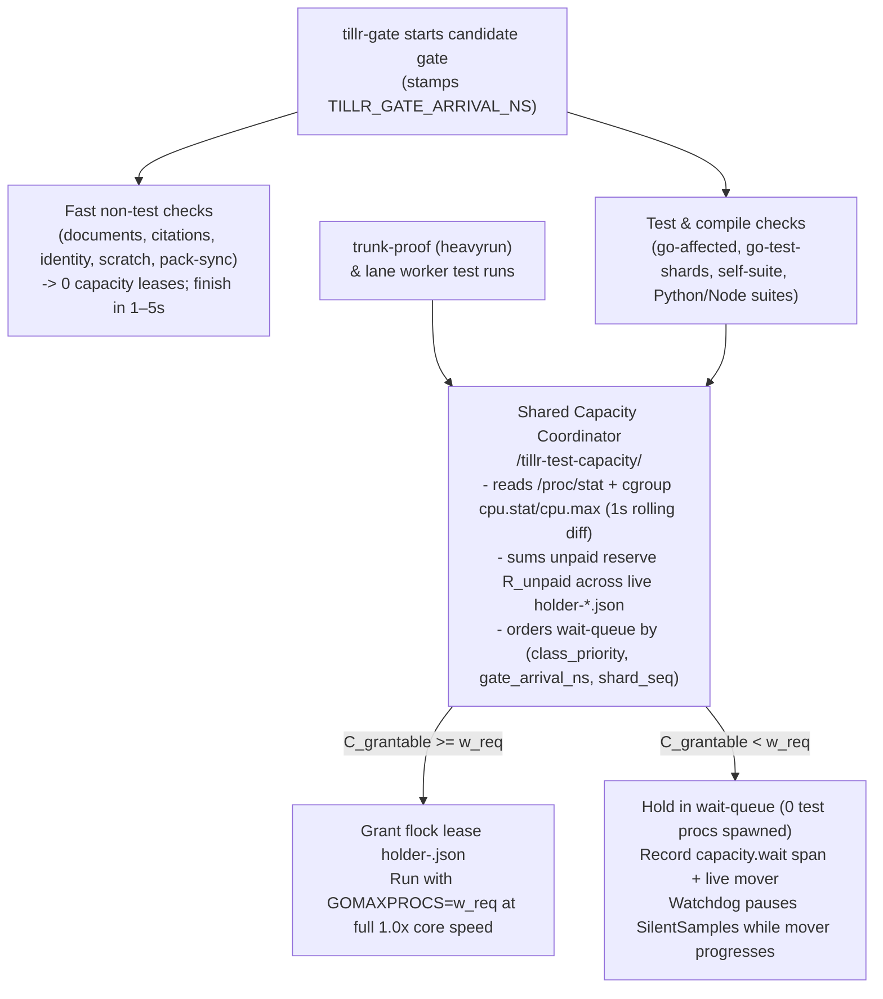

# Gate test processes wait for observed processor headroom and run one gate's test batch ahead of the next

**Status:** 2026-11-24. Nothing here is built, and no implementation plan is seeded yet. Repository behavior is verified at `eeadc8fdda`, joined with the 2026-11-23 evening run measurements (`17:19`–`20:09 ET`), the 2026-11-22 fork-rate profile, and two live 1-second `/proc/stat` vs `/sys/fs/cgroup/cpu.stat` differentials sampled on 2026-11-24. Standing owner rulings are quoted verbatim in [Section 1.3](#13-standing-owner-rulings-that-govern-this-design) (`R-GTC1` through `R-GTC4`); the observation model, admission order, and enforcement boundary (`D-GTC1` through `D-GTC7`) are the designer's decisions from an operator request of 2026-11-23 and may be overturned by the owner; choices trading landing speed against lane count are left open to the owner in [`OQ-GTC1`](#OQ-GTC1) through [`OQ-GTC3`](#OQ-GTC3).

> **In short.** A static 22-slot pool sized from `os.cpu_count() = 32` cannot know when 22 of those processors are already busy outside tillr's container — and turning that pool off (`ENFORCE_SLOT_LIMITS = False` in `f633b5fb81`) let seven gates launch ~100 concurrent test binaries at once (`slot_wait 1ms`), stretching 3-minute suites past 25 minutes. Instead of guessing a fixed slot count, one machine-wide capacity coordinator reads real processor headroom from `/proc/stat`, `/sys/fs/cgroup/cpu.stat`, and live holder CPU ticks, and orders waiters by **whole-gate arrival** rather than per-shard striping so admitted gate tests always get full processor speed while later gates wait cleanly with a named cause.

- **Why it matters:** On 2026-11-23, `30` of `30` gates passed in `253–580 s` when external CPU was quiet and at most three gates ran at once (`17:19–18:49 ET`). An hour later (`18:56–19:49 ET`), with `16–23` processors busy outside tillr's container, gates stretched to `1,595–1,868 s`, `drain` shards slowed **7.5×–10.1×** (`1,343–1,823 s` vs `~180 s`), `4` of `7` gates failed, and `trunk-proof` ran `65 min` and ended red. At `20:09 ET`, `7` gates ran simultaneously at roughly a fifth of normal speed.
- **The shape:** Every gate/proof compile and test runner (both Go shards in [`tools/gate/go_affected.py`](../../tools/gate/go_affected.py) / [`tools/go-test-shards.py`](../../tools/go-test-shards.py) and non-Go suites in [`tools/fork-check.py`](../../tools/fork-check.py)) acquires processor weight from one shared coordinator directory (`<shared_cache_dir>/tillr-test-capacity/`). Admission checks observed free processors minus active holders' unpaid ramp-up weight over a rolling 1-second differential window, ordered lexicographically by `(class_priority, gate_arrival_ns, shard_seq)`.
- **Cost:** Replaces [`tools/go-test-shards.py`](../../tools/go-test-shards.py)'s static `default_*_shard_limit()` counts (`D-GR20`, `D-GR43`, `D-GR48`) and removes `ENFORCE_SLOT_LIMITS = False`, adding ~300 lines of Linux `/proc` + cgroup v2 differential accounting and `watchdog.go` wait-state integration. Fast non-test gates (`documents`, `citations`, `commit-identity`, `scratch`, `pack-sync`) acquire zero test capacity and continue landing in seconds.
- **Start at:** [Section 2](#2-how-gate-wall-time-changes-with-concurrent-gates-and-processor-use-outside-tillr) for the empirical wall-time relationship, [Section 3](#3-what-bounds-gate-test-processes-across-all-gates-and-what-it-observes) for what the bound reads and how it orders gates, and [Section 4](#4-where-the-bound-is-enforced-failure-handling-and-observability) for enforcement and watchdog behavior.
- **Needs your ruling:** [`OQ-GTC1`](#OQ-GTC1) (dividing scarce processors between landing gates and lane workers' tests), [`OQ-GTC2`](#OQ-GTC2) (whether waiting gates pause new ordinary agent starts once backlog reaches the agent limit), and [`OQ-GTC3`](#OQ-GTC3) (whether 1 minimum progress slot still runs when external host CPU consumes all 32 processors).
- **Awaits your review (designer's decisions; you may overturn any of them):** `D-GTC1` through `D-GTC7` in the [Decision Ledger](#decision-ledger).
- **Reads with:** [`gate-rework.md`](./gate-rework.md) (owns `go-affected`, the existing sharded slot pool of `D-GR20` / `D-GR43` / `D-GR48` that this design amends, and the stall watchdog of `D-GR15` / `D-GR16`), [`landing-principles.md`](./landing-principles.md) (owns gate-once squashing, non-verdict holds, and named movers), [`tillr-vocabulary.md`](./tillr-vocabulary.md) (owns item-owned worktrees and `running_agents`), [`tillr-judge-and-lifecycle.md`](./tillr-judge-and-lifecycle.md) (owns the no-fallbacks ruling and uncounted returns), and [`tillr-scheduling-and-notifications.md`](./tillr-scheduling-and-notifications.md) (owns the detached `gate` coordinator outside the scheduling lock).

---

## 1. Scope, non-goals, vocabulary, and standing owner rulings

### 1.1 Scope and candidate note on out-of-scope gaps

This document designs one mechanism: **what bounds the number of gate test processes across all concurrent gates (and trunk proof / repair runs) on a machine whose processors are also used outside tillr, what kernel signals that bound reads, and where it is enforced.** No code is changed in this commit.

Per the filed request, three adjacent subjects are explicitly **out of scope** here, and gaps on them are recorded as this candidate note rather than addressed in this design:

1. **Load-sensitive tests' own wall-clock limits (out of scope; tracked by their own items).** Tests that assert elapsed wall time or carry internal wall-clock timeouts fail when CPU scheduling is slow (`4` of `7` gates and the `65 min` `trunk-proof` during `18:56–19:49 ET` on 2026-11-23). Separate items are removing those wall-clock limits (`D-GR15`, `D-GR17`); this design addresses the capacity half so gates wait for processors instead of starving each other to a fifth of normal speed.
2. **Trunk proof reuse / coalescing across rapid landings (out of scope).** How `heavyrun` schedules, batches, or reuses after-merge proofs across multiple trunk commits remains governed by [`gate-rework.md`](./gate-rework.md) and [`tillr-scheduling-and-notifications.md`](./tillr-scheduling-and-notifications.md); here `trunk-proof` appears only as a consumer of the same machine-wide test-capacity coordinator (`SLOT_CLASS_PROOF`).
3. **The running-agent limit for workers (out of scope).** What value `running_agents` (`--max-agents` / `--lanes`, [`tillr-vocabulary.md` Section 3.5](./tillr-vocabulary.md#35-what-limits-how-many-agents-run-at-once)) is set to, and how the operator steps it up or holds it on check-ins, stays outside this design; where gate-capacity waiting interacts with whether finished workers release slots to start new items, that trade-off is left to the owner in [`OQ-GTC2`](#OQ-GTC2).

### 1.2 Defined terms

Item, node, run, candidate, gate, lander, trunk, and running-agent limit keep their meanings in [`tillr-vocabulary.md`](./tillr-vocabulary.md). Five capacity terms are defined for this document:

| Term | Meaning | What it is not |
| :--- | :--- | :--- |
| **Outside processor use ($C_{\text{outside}}$)** *(coined here)* | Logical-core equivalents consumed over a sampling interval by host processes outside tillr's cgroup: $\max(0,\, C_{\text{host\_busy}} - C_{\text{cgroup\_busy}})$, measured from `/proc/stat` against `/sys/fs/cgroup/cpu.stat`. | Not Linux `/proc/loadavg`, and not processes spawned by tillr workers or gates inside the container. |
| **Observed free processors ($C_{\text{free}}$)** *(coined here)* | Unused logical-core equivalents currently available to tillr's container: $\min(C_{\text{host\_idle}},\, C_{\text{cgroup\_ceiling}} - C_{\text{cgroup\_busy}})$, where `iowait` and `steal` are excluded from `idle` so disk- or hypervisor-stalled cores are never counted as free. | Not `os.cpu_count()` minus a guessed fraction. |
| **Unpaid ramp-up reserve ($R_{\text{unpaid}}$)** *(coined here)* | The sum across active test-capacity holders $\sum_{h \in H_{\text{active}}} \max(0,\, w_h - c_h)$ of leased processor weight $w_h$ not yet reflected in holder $h$'s measured CPU rate $c_h$ over the current 1-second window. | Not a guessed safety margin; drops to `0` automatically once a running shard burns its leased core. |
| **Gate arrival stamp (`gate_arrival_ns`)** *(coined here)* | The monotonic timestamp stamped once by `tillr-gate` when a candidate gate begins, inherited by every compile and test lease inside that gate so an earlier gate's full shard batch orders ahead of later-arriving gates. | Not per-shard thread start time, which interleaves shards across concurrent gates. |
| **Test-capacity lease** *(coined here)* | An `flock`-backed reservation of processor weight $w \ge 1$ under `<shared_cache_dir>/tillr-test-capacity/` held for the lifetime of one test shard, compile warm-up, or non-Go test suite execution. | Not a static numbered slot file (`slot-0..11.lock`), and not held by fast non-test checks (`documents`, `citations`, `commit-identity`). |

### 1.3 Standing owner rulings that govern this design

Four dated owner statements fix the boundaries within which every engineering choice below is made. Only these quoted words are owner rulings (`R-GTC1` through `R-GTC4` in the [Decision Ledger](#decision-ledger)):

1. **No fallbacks (`R-GTC1`, owner, 2026-11-20, recorded in [`tillr-judge-and-lifecycle.md` Section 4.15](./tillr-judge-and-lifecycle.md#415-no-automatic-move-to-another-model-d-jl24-to-d-jl27) and [`drain-timed-checkin`](../../.agents/skills/drain-timed-checkin/SKILL.md#model-policy-owner-2026-11-21)):**
   > "why does Terra having some error mean that we automatically flip to Sol? I don't like that. I hate fallbacks. Fallbacks are almost always wrong. We need deliberate choices, not fallbacks. We need to fix what's wrong. We don't need to just randomly try something else."

   And on the same day, confirming the rule applies across all machinery rather than models alone:
   > "That is everything. ... If something fails, you fix it. If it fails loudly, you fix it. You don't hide it with a fallback."

   *How it binds this design:* If `/proc/stat`, `/sys/fs/cgroup/cpu.stat`, `/sys/fs/cgroup/cpu.max`, or the capacity coordinator directory is missing, unreadable, or unparseable, the gate check fails loudly with exit code `4` (`result = "error"`, naming the broken path), never falling back to `os.cpu_count()`, static slot counts, or `slot = "unlimited"`.

2. **Lane count is judged by wasted work (`R-GTC2`, owner, 2026-11-21, recorded in [`drain-timed-checkin`](../../.agents/skills/drain-timed-checkin/SKILL.md#lane-steps)):**
   > "the reason why we have fewer lanes is because we're wasting a lot of work by having Lots of conflicts, rework, red trunks, all that stuff ... the amount of time waiting was sort of a proxy for that, but not the primary thing I care about."

   *How it binds this design:* Running seven gates concurrently at a fifth of normal speed turns 3-minute gates into 25-minute gates, widening the trunk-drift window during which sibling commits land (producing avoidable `squash-conflict` rework), starving `trunk-proof` into 65-minute red runs, and triggering load-induced test failures. Waiting cleanly in a queue before spawning test processes burns zero tokens and wastes zero work; where gate queueing trades landing speed against lane dispatch, the choice goes to the owner ([`OQ-GTC1`](#OQ-GTC1), [`OQ-GTC2`](#OQ-GTC2)).

3. **Every pause is a bug with a cause (`R-GTC3`, owner, 2026-11-20, recorded in [`drain-timed-checkin`](../../.agents/skills/drain-timed-checkin/SKILL.md#the-bar-owner-2026-11-20)):**
   > "You should be able to operate this drain in a way such that changes land in nearly the same speed as if you were running yourself as sub-agents. There shouldn't be random pauses, and if there is, that's a bug that you fix."

   *How it binds this design:* Paired with [`landing-principles.md` Section 7](./landing-principles.md#7-a-surface-that-hides-parked-work-is-a-false-report) and [Section 13](./landing-principles.md#13-a-held-state-names-a-mover-that-can-still-act), a gate held for processor capacity must never sit silently: every wait records and surfaces the live numerical cause (`outside_busy_cores`, `cgroup_busy_cores`, `host_idle_cores`, active holder runs, and queue position) and only suppresses stall detection while a verified live mover is making CPU progress.

4. **Budgets are targets, stalls end checks, and high load must not fail valid work (`R-GTC4`, owner, 2026-11-17 and 2026-11-21, `D-GR15` in [`gate-rework.md` Section 6.5](./gate-rework.md#65-ten-seconds-is-a-failing-test) and `D-GR38` in [`gate-rework.md` Section 6.12](./gate-rework.md#612-a-change-to-a-tillr-go-module-runs-its-affected-test-packages-before-it-lands)):**
   > "target budgets, watch for stalls, but don't let 'load is high' cause failures that would otherwise finish just fine."

   And on pre-merge affected Go tests (2026-11-21, `D-GR38`):
   > "if you think drain suite selected tests are 40 seconds, let's do that, and monitor how it goes, just make sure we have perf monitoring all over it. 10 seconds was apsirational"

   *How it binds this design:* Waiting for processor capacity is excluded from check timeouts and stall-watchdog failure counts, and is recorded separately (`capacity_wait_ms` vs `exec_ms`) so performance monitoring sees both queue delay and true execution speed.

---

## 2. How gate wall time changes with concurrent gates and processor use outside tillr

### 2.1 Measurements from 2026-11-22 through 2026-11-24 on the 32-processor host

All measurements below come from the same 32-processor Linux host (`os.cpu_count() = 32`, `SC_CLK_TCK = 100`, unified cgroup v2 `0::/`, `/sys/fs/cgroup/cpu.max = "max 100000"`, meaning the container has no static cgroup CPU quota ceiling and shares all 32 physical/logical processors dynamically with work outside the container):

| Window / Sample | Lanes configured | Concurrent gates ($G$) + proof | Processor use outside tillr ($C_{\text{outside}}$) | Processors left for container ($32 - C_{\text{outside}}$) | Measured gate / shard wall time | Outcome & slowdown vs `~180 s` `drain` / `330 s` gate baseline |
| :--- | :--- | :--- | :--- | :--- | :--- | :--- |
| **Single-gate reference** ([`gate-rework.md`](./gate-rework.md) `D-GR43` & request baseline) | `1` gate | `1` gate | `~0–2` cores | `~30–32` cores | `drain` shards **`~180 s`** (`~110–180 s` uncached 8-slot LPT); gate budget **`330 s`** | **`1.0×` baseline** (each shard gets `~1.0` core) |
| **2026-11-23 `17:19–18:49 ET`** (`90 min`) | `10` ordinary + `1` express | **`1–3` gates** | Low (`~0–4` cores) | **`~28–32` cores** | Whole gates **`253–580 s`** (`4.2–9.7 min`) | **`30 / 30` passed (`100%`)**; **`0.8×–1.8×`** of `330 s` budget (`1.0×–2.3×` of `253 s` floor) |
| **2026-11-23 `18:56–19:49 ET`** (`53 min`) | `10` ordinary + `1` express | **`3–4` gates** + `1` `trunk-proof` | **`16–23` cores** (`/proc/stat` minus cgroup `cpu.stat`) | **`9–16` cores** total (including loop & workers) | Gates **`1,595–1,868 s`** (`26.6–31.1 min`); `drain` shards **`1,343–1,823 s`**; `trunk-proof` **`3,900 s` (`65 min`)** | **`4 / 7` gates failed** (`57%`), proof **red**; gates **`4.8×–5.7×`** budget; `drain` shards **`7.5×–10.1×` slower** (`10%–13%` normal speed) |
| **2026-11-23 `20:09 ET`** (live snapshot) | `10` ordinary + `1` express | **`7` gates** at once (`slot_wait 1ms`) | Moderate / variable | Shared across **7 unthrottled gates** (~84–112 shards) + workers | **`600–900+ s` (`10–15+ min`)** elapsed and still running | Running at **`~1/5` (`~20%`) of normal speed** (`~5×` stretch in progress) |
| **2026-11-22 `18:31 ET` fork profile** ([`drain-cpu-and-forks-2026-11-22.md`](../pi/drain-cpu-and-forks-2026-11-22.md)) | Active drain (`loadavg 160–172`) | **`2` `drain` gates** (`21` `drain.test` processes + `go-affected.test.py`) | Measured alongside `1.73`-core loop + `5.67`-core Python test | Overcommitted (`21` shards + `5.7` py + loop/workers) | **`2,601.9` forks/s**, **`392,361` ctxt/s**; each `drain.test` got only **`0.31–0.56` cores** | **`1.8×–3.2×` per-shard CPU dilution** already visible at `21` shards (`101–219` `git` procs/s per shard) |
| **2026-11-24 `01:36Z` live sample A** (`1.002 s` diff) | Live container (`0::/`) | Active container (`10.17` cores inside) | **`21.52` cores** (`host_busy = 31.69`, `cgroup_busy = 10.17`) | **`10.48` cores** (`host_idle = 0.31` cores) | Direct kernel sample | Confirms **`67.3%`** of the 32-core host busy outside tillr with `0.31` idle cores |
| **2026-11-24 `01:48Z` live sample B** (`1.001 s` diff, `loadavg 69.12`) | Live container (`0::/`) | Active container (`21.78` cores inside) | **`6.50` cores** (`host_busy = 28.28`, `cgroup_busy = 21.78`) | **`25.50` cores** (`host_idle = 3.73` cores) | Direct kernel sample | Confirms $C_{\text{outside}}$ swings by **`15+` cores** (`21.52 -> 6.50`) within `12` minutes |

### 2.2 Why `slot_wait 1ms` happened at `20:09 ET`, and why [`gate-rework.md`](./gate-rework.md)'s existing pool still starves tests

Inspecting [`tools/go-test-shards.py`](../../tools/go-test-shards.py), [`tools/gate/go_affected.py`](../../tools/gate/go_affected.py), [`tools/fork-check.py`](../../tools/fork-check.py), and [`tools/tillr-drain/drain/plan.go`](../../tools/tillr-drain/drain/plan.go) at `eeadc8fdda` establishes four exact causes:

1. **Commit `f633b5fb81` turned the machine-wide slot pool off at `11:10 ET` on 2026-11-23.** Earlier that day, `f633b5fb81` set `ENFORCE_SLOT_LIMITS = False` in [`tools/go-test-shards.py`](../../tools/go-test-shards.py). When `ENFORCE_SLOT_LIMITS` is `False`, `acquire_shard_slot` returns immediately without opening `lock_dir`, acquiring any `slot-*`, `gate-*`, or `proof-*` lock, enforcing `DEFAULT_GATE_MAX_SLOTS = 8` or `DEFAULT_GATE_RESERVED_CAP = 4`, or registering a wait ticket, and records `waited_ms = 0, slot = "unlimited"`. Meanwhile [`tools/gate/go_affected.py`](../../tools/gate/go_affected.py) executes shards inside `ThreadPoolExecutor(max_workers=min(16, len(invocations)))`. Every gate at `20:09 ET` therefore logged `slot_wait 1ms` (thread dispatch overhead) while up to `16` Go test binaries per gate — **`84` to `112` simultaneous test processes across the seven gates**, plus `trunk-proof` and lane workers — fought over 32 processors.
2. **Even with `ENFORCE_SLOT_LIMITS = True`, [`gate-rework.md`](./gate-rework.md)'s 22-slot pool (`D-GR20`, `D-GR43`, `D-GR48`) is blind to $C_{\text{outside}}$.** In [`tools/go-test-shards.py`](../../tools/go-test-shards.py), `default_shard_limit()` (`12` `ordinary`), `default_gate_shard_limit()` (`6` `gate`), and `default_proof_shard_limit()` (`4` `proof`) compute **22 fixed slots** from `os.cpu_count() = 32` (`18` usable by gates, `16` by proof). Neither `/proc/stat` nor `/sys/fs/cgroup/cpu.stat` is read. During `18:56–19:49 ET` and live Sample A (`C_outside = 21.52`), only `9–16` cores remained for the *entire* container (including `1.7–3.4` cores for `tillr-drain loop` and active workers), leaving `~6–13` cores for tests — yet a static 22-slot pool still admits `18–22` heavy Go test shards onto those `6–13` cores (`2×–3.5×` CPU overcommitment before counting non-Go suites).
3. **Unlimited concurrent gates stripe shards across gates instead of finishing one gate fast.** Under [`gate-rework.md`](./gate-rework.md) `D-GR43` (`841cb63bed`), `ProcessSteps.Gate` runs detached and non-blocking across all candidates (`Pass.GatesInFlight` in [`tools/tillr-drain/drain/plan.go`](../../tools/tillr-drain/drain/plan.go) explicitly notes *"GatesInFlight is the planning pass's observation, not a concurrency cap"*). Even with `D-GR48` enabled, `acquire_shard_slot` serves shards in per-ticket arrival order across all running gates (`max_slots = 8` each). When `7` Go gates run concurrently against a small pool, slots fragment across multiple half-staffed gates that all crawl forward together instead of completing the earliest gate at `1.0×` speed.
4. **Heavy non-Go landing checks bypass the slot pool completely.** In [`tools/fork-check.py`](../../tools/fork-check.py), `TIER_LANDING` schedules Python and Node test suites (`self-suite` at `141 s` serial, `go-affected-suite` measured at **`5.67` cores** of child CPU in [`drain-cpu-and-forks-2026-11-22.md`](../pi/drain-cpu-and-forks-2026-11-22.md), `go-test-shards-suite`, `tillr-docs`, `tillr-backends`, `tillr-roll`, `tillr-loop`, and `observatory-web`) under `ThreadPoolExecutor(max_workers=min(8, len(wanted)))` without calling `acquire_shard_slot`. Seven concurrent gates touching Python/gate files can spawn up to `56` uncounted test runners on top of the Go shards.

### 2.3 Quantitative scaling of gate wall time with $G$ and $C_{\text{outside}}$

Let $N_{\text{cpu}} = 32$ be host logical processors, $Q_{\text{cgroup}}$ be the cgroup quota ceiling (`32` when `cpu.max` is `max`), $C_{\text{outside}}$ be processors busy outside tillr's container, and $C_{\text{non\_test}}$ be non-test CPU inside the container (`tillr-drain loop`, agent harnesses, `tillr-view`, `tillr-watch`, typically `3–5` cores). The effective processor supply remaining for gate and proof tests is:

$$C_{\text{avail}}(C_{\text{outside}}) = \max\!\Big(0,\; \min\!\big(N_{\text{cpu}} - C_{\text{outside}},\, Q_{\text{cgroup}}\big) - C_{\text{non\_test}}\Big)$$

If $G$ concurrent test-bearing gates (plus $P \in \{0, 1\}$ active `trunk-proof`) spawn total runnable test demand $D = \sum_{i=1}^{G+P} k_i w_i$ processor-equivalents, gate wall time follows two regimes separated by the saturation knee $D = C_{\text{avail}}$:

$$T_{\text{gate}}(G,\, C_{\text{outside}}) \;\approx\; \begin{cases} T_{\text{crit},0} \cdot \big(1 + \alpha_{\text{io}} \frac{D}{N_{\text{cpu}}}\big) & \text{when } D \le C_{\text{avail}} \quad \text{(Regime 1: unsaturated)} \\[8pt] T_{\text{non\_cpu}} + T_{\text{cpu},0} \cdot \dfrac{D}{C_{\text{avail}}(C_{\text{outside}})} \cdot \eta\!\left(\dfrac{D}{C_{\text{avail}}(C_{\text{outside}})}\right) & \text{when } D > C_{\text{avail}} \quad \text{(Regime 2: overcommitted)} \end{cases}$$

Every window on 2026-11-23 maps directly onto these two regimes:

1. **Regime 1 ($D \le C_{\text{avail}}$, `17:19–18:49 ET`):** With $C_{\text{outside}} \approx 0\text{–}4$ ($C_{\text{avail}} \approx 24\text{–}28$ cores) and $G = 1\text{–}3$ gates (many hitting warm Go test caches or running $\le 8\text{–}12$ shards each, $D \approx 8\text{–}28$), each test process gets $\approx 1.0$ dedicated processor. Gate wall time grows only gently from `253 s` (`G = 1`) to `580 s` (`G = 3` uncached overlap) from shared disk/cache I/O ($\alpha_{\text{io}}$), and `30` of `30` pass.
2. **Regime 2 ($D > C_{\text{avail}}$ via external load, `18:56–19:49 ET`):** Raising $C_{\text{outside}}$ to `16–23` cores collapses $C_{\text{avail}}$ from `~26` cores down to **`~5–12` cores**. Running `3–4` unthrottled gates plus `trunk-proof` ($D \approx 40\text{–}60$ concurrent test processes) pushes the overcommit ratio $D / C_{\text{avail}}$ to **`4.5×–8×`**. Worse, contention factor $\eta > 1$ is **superlinear** (`~1.25×–1.4×` on top of raw CPU division): as measured on 2026-11-22 (`2,601.9` forks/s and `392,361` context switches/s at just `21` `drain.test` processes), packing `40–60` `git`-spawning test binaries onto `5–12` remaining cores thrashes Linux `clone3`/`execve` task locks, CFS runqueues, L3 caches, and SQLite WAL fsyncs — turning a `5–8×` processor shortfall into the measured **`7.5×–10.1×` `drain` shard slowdown (`1,343–1,823 s` vs `180 s`)**.
3. **Regime 2 ($D > C_{\text{avail}}$ via gate fan-out, `20:09 ET`):** Even with moderate $C_{\text{outside}}$ ($C_{\text{avail}} \approx 18\text{–}24$ cores), running $G = 7$ unthrottled Go gates at once ($D \approx 7 \times 12\text{..}16 = 84\text{..}112$) yields $D / C_{\text{avail}} \approx 4.5\text{–}5.5\times$, immediately dropping every gate to **`~1/5` of normal speed (`15–25+ min` per gate)**.

**Why queueing gates beats sharing processors thinly (Little's Law + contention elimination):**
Suppose $C_{\text{avail}} = 10$ cores (because `18` cores are busy outside tillr and `4` inside), enough to run **one** `drain` gate's shards at `1.0×` speed in $T_1 = 3.0\text{ min}$, and $G = 5$ such gates arrive together at $t = 0$:

| Strategy on $C_{\text{avail}} = 10$ cores for $G = 5$ gates | Gate 1 lands at | Gate 5 lands at | Mean gate completion (start -> verdict) | Per-process CPU speed (starvation risk) |
| :--- | :--- | :--- | :--- | :--- |
| **Share thinly across all 5 gates (`20:09 ET` behavior)** | `~19–21 min` | `~20–22 min` | **`~20.5 min`** (all 5 held open for 20 min) | **`0.15×–0.20×` (`5×–6.5×` slower)**; maximum conflict window & load failures |
| **Static 22-slot pool ([`gate-rework.md`](./gate-rework.md) `D-GR43`, blind to `C_outside = 18`)** | `~10–13 min` | `~17–19 min` | **`~14.5 min`** (`18` slots crammed onto `10` cores across 2–3 striped gates) | **`0.45×–0.55×` (`~2×` slower)**; still overcommitted `1.8×` |
| **Observed headroom ($10$ cores) + whole-gate FIFO (`D-GTC1` + `D-GTC2`)** | **`3.0 min`** | **`15.0 min`** | **`9.0 min`** (`3, 6, 9, 12, 15 min`; $\eta = 1.0$) | **`1.00×` full single-core speed** on every running test; zero starvation |

Concentrating observed processors on the earliest gate lands the first candidate **`6.7×` sooner**, lowers mean gate turnaround by **`> 2×`**, finishes even the *fifth* gate **`5–7 minutes` earlier** by eliminating superlinear fork/ctxt overhead ($\eta$), and ensures no running test process is ever starved below `1.0` processor.

---

## 3. What bounds gate test processes across all gates, and what it observes

### 3.1 What the bound reads: differential kernel CPU accounting (`D-GTC1`)

*Designer's decision (from an operator request of 2026-11-23); the owner may overturn this (`D-GTC1`).*

To avoid any guessed processor count, the capacity coordinator reads **three kernel-maintained monotonic counters** over a rolling `1.0 s` window composed of four `250 ms` sub-samples:

1. **Host-wide processor ticks and runqueue (`/proc/stat`):**
   From the aggregate `cpu ` line (`user, nice, system, idle, iowait, irq, softirq, steal` at `SC_CLK_TCK` Hz, `100` Hz on Linux) over elapsed monotonic wall interval $\Delta t$:
   $$\Delta C_{\text{host\_total}} = \frac{\Delta(\text{user}+\text{nice}+\text{system}+\text{idle}+\text{iowait}+\text{irq}+\text{softirq}+\text{steal})}{\text{CLK\_TCK} \cdot \Delta t}$$
   $$C_{\text{host\_idle}} = \frac{\Delta(\text{idle})}{\text{CLK\_TCK} \cdot \Delta t}, \qquad C_{\text{host\_busy}} = \Delta C_{\text{host\_total}} - C_{\text{host\_idle}}$$
   Counting only pure `idle` as free (treating `iowait` and hypervisor `steal` as busy) is deliberate: if external or local I/O saturates NVMe so cores sit in `iowait`, admitting more `git`- and SQLite-heavy test shards worsens starvation rather than using "idle" compute. The coordinator also reads `procs_running` from `/proc/stat` as an instantaneous runqueue sanity check.
2. **Container cgroup processor consumption and quota (`/proc/self/cgroup`, `/sys/fs/cgroup/cpu.stat`, `/sys/fs/cgroup/cpu.max`):**
   Resolving the container's cgroup v2 directory from `/proc/self/cgroup` (`0::<relpath>`):
   $$C_{\text{cgroup\_busy}} = \frac{\Delta \text{usage\_usec}}{10^6 \cdot \Delta t}, \qquad C_{\text{cgroup\_ceiling}} = \begin{cases} \Delta C_{\text{host\_total}} & \text{if } \texttt{cpu.max} = \texttt{"max …"} \\ \min\!\big(\Delta C_{\text{host\_total}},\, \text{quota\_usec} / \text{period\_usec}\big) & \text{otherwise} \end{cases}$$
   From (1) and (2), processor use outside tillr's container and true unused processor headroom available to tillr right now are:
   $$C_{\text{outside}} = \max\!\big(0,\; C_{\text{host\_busy}} - C_{\text{cgroup\_busy}}\big), \qquad C_{\text{free}} = \min\!\big(C_{\text{host\_idle}},\; C_{\text{cgroup\_ceiling}} - C_{\text{cgroup\_busy}}\big)$$
3. **Per-holder live process-group CPU rate ($c_h$):**
   Each active test-capacity holder $h \in H_{\text{active}}$ records its process-group leader `pgid` and leased processor weight $w_h \ge 1$ in its `flock`-held `holder-<id>.json` file. Using the same `/proc/<pid>/stat` process-group walk already implemented in [`tools/tillr-gate/cpu_linux.go`](../../tools/tillr-gate/cpu_linux.go) (`utime + stime + cutime + cstime` across live members + reaped children of `pgid`), the sampler measures each holder's actual CPU rate $c_h = \Delta \text{cpu\_ticks}(h) / (\text{CLK\_TCK} \cdot \Delta t)$ over the same `1.0 s` window.

### 3.2 The admission inequality with zero guessed constants (`D-GTC1`)

Why can't a coordinator look at $C_{\text{free}}$ alone? Because `/proc/stat` and `cpu.stat` measure the *past* 1 second: if $C_{\text{free}} = 24.0$ cores and seven gates arrive within `2 ms`, checking $C_{\text{free}} \ge 1$ without accounting for just-granted leases would admit `112` shards before the next `250 ms` tick sees any CPU burn — recreating the `20:09 ET` stampede. Conversely, why can't a coordinator just cap $\sum w_h$ at a static number? Because `C_outside` and `C_non_test` vary minute by minute (`21.52` cores -> `6.50` cores in [Section 2.1](#21-measurements-from-2026-11-22-through-2026-11-24-on-the-32-processor-host)).

Joining $C_{\text{free}}$ with each active holder's **unpaid ramp-up reserve** solves both with **zero guessed constants**:

$$R_{\text{unpaid}}(t) = \sum_{h \in H_{\text{active}}(t)} \max\!\big(0,\; w_h - c_h(t)\big), \qquad C_{\text{grantable}}(t) = C_{\text{free}}(t) - R_{\text{unpaid}}(t)$$

Under the coordinator's exclusive `capacity.lock`, the head-of-line waiter requesting weight $w_{\text{req}}$ is admitted at time $t$ when:

$$C_{\text{grantable}}(t) \;\ge\; w_{\text{req}} \qquad \text{and} \qquad \Big(\texttt{procs\_running}(t) \le \Delta C_{\text{host\_total}} \;\text{ or }\; C_{\text{host\_idle}}(t) \ge w_{\text{req}}\Big)$$

*(Subject to [`OQ-GTC3`](#OQ-GTC3): under Option A, when $H_{\text{active}}(t) = \emptyset$ — zero tillr test processes are running across the entire machine — the single head-of-line `repair`, `proof`, or `gate` waiter with $w_{\text{req}} = 1$ is still admitted even if external load drives $C_{\text{free}}(t) < 1$, guaranteeing non-zero forward progress; under Option B, even the first process waits until $C_{\text{grantable}}(t) \ge 1$.)*

Check how $C_{\text{grantable}}(t) = C_{\text{free}}(t) - \sum \max(0, w_h - c_h)$ behaves across every operating case without a single magic number:

- **Zero-millisecond burst safety:** At $t = 0$ on a host with `10.0` idle processors (`C_outside = 18.0`, `C_non_test = 4.0`, `H_active = ∅`), $C_{\text{grantable}} = 10.0$. As Shards `1..10` acquire leases in the same millisecond ($w_h = 1, c_h = 0$), each adds `1.0` to $R_{\text{unpaid}}$, stepping $C_{\text{grantable}}$ down `10 -> 9 -> ... -> 0` instantaneously. Shard `11` sees $C_{\text{grantable}} = 0.0 < 1$ and waits immediately.
- **No double-counting once running:** One second later, Shards `1..10` are each burning `1.0` core ($c_h \approx 1.0 = w_h$). Now $C_{\text{free}}$ has dropped from `10.0` to `0.0` in `/proc/stat`, while $\max(0, w_h - c_h)$ has simultaneously dropped from `1.0` to `0.0` — so $C_{\text{grantable}}$ stays `0.0` seamlessly, with zero double subtraction.
- **Protection during brief sub-second `git` / I/O pauses:** If a running `drain.test` shard dips to $c_h = 0.5$ for `250 ms` between subtests, $\max(0, 1.0 - 0.5) = 0.5$ stays reserved in $R_{\text{unpaid}}$ matching the `0.5` rise in $C_{\text{free}}$, so a second shard is **not** falsely spawned onto its processor right before the next subtest wakes up.
- **Automatic accounting for multi-core child bursts:** If a suite declared $w_h = 1$ yet bursts to $c_h = 4.0$ cores via child processes, $\max(0, 1 - 4) = 0$ while the extra `3.0` cores are immediately observed in `cpu.stat` and `/proc/stat`, lowering $C_{\text{free}}$ by `4.0` cores automatically.
- **Graceful shedding when external load rises mid-gate:** Running test processes are **never** killed when $C_{\text{outside}}$ spikes (`R-GTC4` / `D-GR15`). Instead, $C_{\text{grantable}}$ becomes $\le 0$, so as running shards complete every few seconds (`~10–30 s` per shard), freed leases are withheld until active test concurrency matches the new smaller processor supply.

### 3.3 Why alternative signals fail when used alone

| Candidate signal | Behavior on 2026-11-23 scenarios | Verdict |
| :--- | :--- | :--- |
| **Differential `/proc/stat` + cgroup `cpu.stat`/`cpu.max` + holder $R_{\text{unpaid}}$ (`D-GTC1`, chosen)** | Reacts within `250–1000 ms` to `C_outside` swings (`6.5 <-> 21.5` cores), prevents `0 ms` burst stampedes via $R_{\text{unpaid}}$, distinguishes external load from tillr's own tests, and uses zero guessed processor counts | **Chosen (`D-GTC1`)** |
| **Static `os.cpu_count()` slot counts ([`gate-rework.md`](./gate-rework.md) `D-GR20` / `D-GR43`: `12 + 6 + 4 = 22`)** | Admits `18–22` shards onto `9–16` remaining cores when `C_outside = 16–23`, and caps a lone gate at `8` shards when `28` cores sit idle | **Rejected:** blind to external CPU use and underuses idle hosts |
| **Linux `/proc/loadavg` (1 / 5 / 15 min exponential moving average)** | `1 min` time constant lags sudden external CPU spikes by `30–60 s` (admitting dozens of shards before `load1` crosses threshold), then stays artificially high for minutes *after* load clears (violating `R-GTC3` with idle pauses while 30 cores sit empty) | **Rejected:** exponential lag causes both overshoot and post-load stalls |
| **Measured gate progress alone (`completed_tests/s` or shard runtime stretch)** | Purely reactive: cannot detect `C_outside = 22` *before* spawning shards, and individual Go test durations span `1 ms` to `25 s` so slow progress is indistinguishable from a long test until tens of seconds of starvation have already occurred | **Rejected as primary bound** (used only in per-check timing telemetry) |

### 3.4 Whole-gate arrival ordering instead of per-shard striping (`D-GTC2`)

*Designer's decision (from an operator request of 2026-11-23); the owner may overturn this (`D-GTC2`).*

Bounding total test processes across the machine to $C_{\text{avail}}$ prevents processor overcommitment, **and** how those processes are assigned across concurrent gates determines whether one gate finishes in `3 min` or seven gates crawl together for `21 min`.

1. **Gate-stamped arrival key `(class_priority, gate_arrival_ns, shard_seq)`:**
   When `tillr-gate` starts a run, it records one monotonic 64-bit nanosecond timestamp `TILLR_GATE_ARRIVAL_NS` (`clock_gettime(CLOCK_MONOTONIC)`) in the environment inherited by every check subprocess of that gate (`trunk-proof` and standalone `go-test-shards.py` runs stamp their own run-level `TILLR_GATE_ARRIVAL_NS` once at invocation start). Wait tickets in `<shared_cache_dir>/tillr-test-capacity/` sort lexicographically by:
   $$\big(\texttt{class\_priority},\; \texttt{gate\_arrival\_ns},\; \texttt{shard\_seq}\big)$$
   Within `gate` class, **every** compile and test shard of Gate 1 (`gate_arrival_ns = T_1`) sorts ahead of **every** compile and test shard of Gate 2 (`gate_arrival_ns = T_2 > T_1`). *(How `ordinary` worker test runs order relative to `gate` and `proof` when external load shrinks capacity is left to the owner in [`OQ-GTC1`](#OQ-GTC1); `repair > proof > gate` from `D-GR48` stays intact so trunk reverts/fixers and green-pointer proofs never starve behind candidate gates.)*
2. **Retiring artificial per-gate caps (`DEFAULT_GATE_MAX_SLOTS = 8`, `DEFAULT_GATE_RESERVED_CAP = 4`):**
   `D-GR43` capped a gate at `8` shards (`4` reserved) only to keep one gate from taking all static slots away from a second gate. Under `(class_priority, gate_arrival_ns, shard_seq)` + `D-GTC1`:
   - On an idle host (`C_free = 28` cores), Gate 1 runs all `12` of its LPT `drain` shards simultaneously (cutting uncached wall time by a third) **and** Gate 2 immediately uses the remaining `16` free cores in parallel!
   - On a busy host (`C_free = 7` cores), Gate 1 gets all `7` available cores (`7` shards running at `1.0×` speed, `5` shards queued at the head of Gate 1), while Gates 2..7 hold **zero** processes until Gate 1 enters its final tail (`< 7` remaining shards), at which point Gate 2 seamlessly backfills each freed core with zero idle gap.
3. **Fast non-test gates never wait behind test capacity (`D-GR2` preserved):**
   A gate touching only Markdown, configuration, or patch refs (`documents`, `citations`, `design-citations`, `scratch`, `commit-identity`, `pack-sync`) requests **zero** test-capacity leases, finishes in `1–5 s`, and lands immediately even while five Go gates wait in the test-capacity queue.

### 3.5 Unified coverage across Go and non-Go suites, and binding `GOMAXPROCS` (`D-GTC3`)

*Designer's decision (from an operator request of 2026-11-23); the owner may overturn this (`D-GTC3`).*

Every gate or proof subprocess that compiles code or executes a test suite must draw from the same observed pool and honor the processor weight it leased:

1. **Remove `ENFORCE_SLOT_LIMITS = False`; isolate self-tests by directory, never by global off-switch:**
   `ENFORCE_SLOT_LIMITS` in [`tools/go-test-shards.py`](../../tools/go-test-shards.py) is removed; capacity enforcement is unconditionally on. Unit tests of `go-test-shards.py`, `go_affected.py`, and `capacity.py` pass an isolated temporary coordinator directory via `TILLR_TEST_CAPACITY_DIR` (with injected synthetic `/proc/stat` and `cpu.stat` readers for deterministic tests) so self-tests never contend with or disable production enforcement.
2. **Route Go warm-up compilation, Go shards, and non-Go test suites through the one coordinator:**
   - [`tools/gate/go_affected.py`](../../tools/gate/go_affected.py): both package compile warm-ups (`go test -trimpath -run '^$'`, leasing $w = \min(2, \text{ceil}(C_{\text{free}}/4))$ or $w = 1$) and every `go test` shard invocation (`w = 1` per `-parallel 1` shard).
   - [`tools/go-test-shards.py`](../../tools/go-test-shards.py): package binary compilation (`go test -c`) and every shard execution (`w = 1`).
   - [`tools/fork-check.py`](../../tools/fork-check.py) and [`tools/gate/checks/`](../../tools/gate/checks/): every multi-test check kind (`self-suite`, `go-affected-suite`, `go-test-shards-suite`, `gate-runner`, `tillr-backends`, `tillr-docs`, `tillr-roll`, `tillr-loop`, `observatory-web`, `change-checks-test`, `tree-checks-test`, `fork-build`) acquires a lease matching its worker count ($w = 1$ when run single-worker, or $w = k$ when spawning $k$ parallel sub-runners).
3. **Bind `GOMAXPROCS` and eliminate the `4×` `git` shim fork multiplier:**
   - Every leased Go command (`go list`, `go build`, `go test`) sets `GOMAXPROCS=<w>` and `-p <w>` (`GOMAXPROCS=1 -p 1` on a `w = 1` shard) in its child environment (excluded from Go's test-cache env invalidation because Go does not record `GOMAXPROCS` in `testlog` when tests do not call `os.Getenv("GOMAXPROCS")`, verified before rollout). Without `GOMAXPROCS=1`, every `go` tool and child `go build` defaults to `os.cpu_count() = 32` OS threads and parallel compiler workers inside a 1-core lease.
   - [`tools/gate/go_affected.py`](../../tools/gate/go_affected.py) matches [`tools/go-test-shards.py`](../../tools/go-test-shards.py) in setting real-git shim bypass (`YOLO_BYPASS_SHIMS=1` / clean `git` symlink) and `maintenance.auto = false` / `gc.auto = 0` in private `GIT_CONFIG_GLOBAL`, eliminating the `3` extra `/bin/sh` forks per `git` call measured on 2026-11-22 ([`drain-cpu-and-forks-2026-11-22.md`](../pi/drain-cpu-and-forks-2026-11-22.md)).

---

## 4. Where the bound is enforced, failure handling, and observability

### 4.1 Enforcement point: one machine-wide filesystem coordinator (`D-GTC4`)

*Designer's decision (from an operator request of 2026-11-23); the owner may overturn this (`D-GTC4`).*

Where should the bound live — inside `tillr-drain`'s Go loop (`gatesInFlight`), inside `tillr-gate`, or in a shared filesystem-locked coordinator entered by check/shard runners?

- **Why `tillr-drain` in-memory `gatesInFlight` alone is the wrong boundary:** `tillr-drain` neither sees `C_outside` when individual shards launch minutes later, nor controls `heavyrun` subprocesses, detached `tillr-gate` processes surviving `tillr-drain` `syscall.Exec` ([`tillr-scheduling-and-notifications.md` Section 5.5](./tillr-scheduling-and-notifications.md#55-step-4--starting-and-running-a-gate-gate)), lane workers running `go-test-shards.py`, or manual CLI checks — and holding whole `tillr-gate` processes before planning would needlessly delay 2-second Markdown/config gates behind Go test suites.
- **Why `tillr-gate` + `<shared_cache_dir>/tillr-test-capacity/` together is exact (`D-GTC4`):**
  1. `tillr-gate` stamps `TILLR_GATE_ARRIVAL_NS` once per gate run so all checks inside one gate share a single whole-gate queue position (`D-GTC2`), while running fast non-test checks immediately.
  2. One shared coordinator module (`tools/gate/capacity.py`, callable as a Python API by `go_affected.py`, `go-test-shards.py`, and `fork-check.py` and as `python3 tools/gate/capacity.py exec --weight <w> -- <cmd>` by standalone JSON checks) coordinates every test/compile process across the machine under `<shared_cache_dir>/tillr-test-capacity/`:
     - `capacity.lock` (`flock` exclusive, held for `< 1 ms` during sample refresh and ticket/lease transitions, never across test execution).
     - `sampler.json` (the rolling four-point `250 ms` ring of `/proc/stat`, `cpu.stat`, and holder CPU ticks, refreshed lazily by whichever caller acquires `capacity.lock` when `now - last_sample_ns >= 250 ms` — **zero** background daemon to leak or supervise).
     - `holders/holder-<pid>-<seq>.json` (`LOCK_SH` held by the live test runner; kernel releases the lock automatically on `SIGKILL` or crash, making leaked leases impossible).
     - `wait-rules/<PROTOCOL_VERSION>/tickets/<prio>-<gate_arrival_ns>-<shard_seq>-<pid>.json` (`LOCK_SH` held by each waiting thread/process).

### 4.2 Loud failure on unreadable kernel accounting — zero fallbacks (`R-GTC1`, `D-GTC5`)

*Designer's decision enforcing [`R-GTC1`](#decision-ledger); the owner may overturn the mechanics (`D-GTC5`).*

Under `R-GTC1` (*"If something fails, you fix it. If it fails loudly, you fix it. You don't hide it with a fallback"*):

- **Forbidden:** Catching `OSError` / `ValueError` on `/proc/stat`, `/proc/self/cgroup`, `/sys/fs/cgroup/cpu.stat`, `/sys/fs/cgroup/cpu.max`, or `<shared_cache_dir>/tillr-test-capacity/` and substituting `os.cpu_count()`, `22` slots, or `slot = "unlimited"`.
- **Required:** Any failure to read or parse those kernel files or acquire/write the coordinator directory immediately aborts lease acquisition and exits `4` (`checkresult` machinery `error`, **never** candidate `fail` per [`landing-principles.md` Section 1](./landing-principles.md#1-a-refusal-must-be-a-verdict) and [Section 8](./landing-principles.md#8-a-gate-that-cannot-answer-must-say-which)), printing the exact path, syscall error, and offending content to stderr so `tillr-drain` holds on `gate-no-verdict` / machinery repair rather than either convicting the candidate or unleashing an unthrottled fork storm.
- Note that a transient `ESRCH` / `FileNotFoundError` on `/proc/<holder_pid>/stat` when a sibling test process exits mid-scan is **normal process exit**, not a missing kernel interface: if `flock(LOCK_EX | LOCK_NB)` on that `holder-*.json` succeeds, the holder is reaped cleanly; if `LOCK_EX` blocks yet `/proc/<pid>` is unreadable (e.g., strict `hidepid=2` mount), the coordinator fails loudly naming `/proc/<pid>/stat` (`hidepid`).

### 4.3 Stall-watchdog integration and cause-named waits (`R-GTC3`, `R-GTC4`, `D-GTC5`, `D-GTC7`)

*Designer's decision enforcing [`R-GTC3`](#decision-ledger) and [`R-GTC4`](#decision-ledger); the owner may overturn the mechanics (`D-GTC5`, `D-GTC7`).*

Today [`tools/tillr-gate/watchdog.go`](../../tools/tillr-gate/watchdog.go) kills a check process group (`ExitStalled = 6`) after `WatchdogSilentSamples = 60` consecutive 1-second samples with zero stdout/stderr growth and zero CPU growth, and `tools/go-test-shards.py` works around it by printing a `"waiting for a test slot"` line every `30 s`. Printing blind heartbeat lines has a subtle defect: if a bug ever wedged the wait queue with zero live movers, the `30 s` print would keep resetting `SilentSamples` forever!

Instead, wait visibility and stall detection check **real mover liveness**:

1. **Structured `capacity-state.json` verified by `watchdog.go` (`D-GTC5`):**
   While a check inside `tillr-gate` has zero running shards of its own and is blocked in `capacity.py`, it writes atomic `<check_scratch>/capacity-wait.json` (`TILLR_GATE_CAPACITY_WAIT_FILE` passed by `tillr-gate`) every `1 s` containing the latest observed `sampler.json` snapshot: `sample_seq`, `outside_busy_cores`, `cgroup_busy_cores`, `host_idle_cores`, `active_holders` (run IDs + cumulative holder CPU ticks), and `queue_pos`.
   `watchCommand` in [`tools/tillr-gate/watchdog.go`](../../tools/tillr-gate/watchdog.go) resets `SilentSamples = 0` during a capacity wait **if and only if** `capacity-wait.json` proves a live external or internal mover: either (a) cumulative CPU ticks across `active_holders` advanced since the prior sample, or (b) `outside_busy_cores` accounts for the unavailable host processors (`C_free < w_req` while `C_outside > 0`). If the host has free processors (`C_free >= w_req`), no holder's CPU is advancing, and the waiter still makes zero progress for `60` samples, `watchCommand` fires `ExitStalled = 6` naming the stuck queue state!
2. **Separated `capacity_wait_ms` vs `exec_ms` and live operator surfaces (`D-GTC7`):**
   - Every check timing span (`TILLR_GATE_SPANS_OUT`, `verdict.json`, `TILLR_GO_AFFECTED_EVIDENCE_OUT`, and `slot-waits.jsonl`) records `capacity_wait_ms` separately from `exec_ms`, along with mean/max `outside_busy_cores`, `host_idle_cores`, and `ahead_runs` observed during the wait.
   - `fast-gate-run-slow` (`D-TW52`) evaluates `exec_ms` for check-speed regressions while a separate capacity-wait telemetry field shows queue wait caused by concurrent gates or external CPU load.
   - While a detached candidate gate has `capacity-wait.json` active, `tillr drain why` and Observatory render the candidate's sub-status as `gate (waiting for processors: 21.5/32 busy outside tillr, behind gate run-item-...)` rather than an opaque multi-minute `gate` spinner (`R-GTC3`).

### 4.4 Safe protocol upgrades without disabling limits (`D-GTC6`)

*Designer's decision amending `D-GR48` in [`gate-rework.md`](./gate-rework.md); the owner may overturn this (`D-GTC6`).*

Commit `f633b5fb81` disabled slot limits globally (`ENFORCE_SLOT_LIMITS = False`) to get past cross-version wait-queue interactions during rollout, directly causing the `20:09 ET` 7-gate pileup nine hours later. Preserving [`gate-rework.md`](./gate-rework.md) `D-GR48`'s insight cleanly:

- Active lease records (`holders/holder-*.json`, holding `w_h`, `pgid`, `run`, `class`, `gate_arrival_ns`) live in one flat version-independent directory under `<shared_cache_dir>/tillr-test-capacity/holders/` with a minimal frozen 5-field JSON schema, so old and new binaries straddling a commit always account for 100% of running test processes' CPU weight $w_h$ and $R_{\text{unpaid}}$.
- Wait-ticket ordering rules live under `wait-rules/<PROTOCOL_VERSION>/` so a change to priority/yield rules never causes mutual deadlock between straddling processes, **without** ever turning capacity enforcement off.

### 4.5 Replay against the three 2026-11-23 windows

| 2026-11-23 Window | What happened at `eeadc8fdda` (`ENFORCE_SLOT_LIMITS = False`) | What happens under `D-GTC1`–`D-GTC7` |
| :--- | :--- | :--- |
| **`17:19–18:49 ET`** ($G \le 3$, $C_{\text{outside}} \approx 0\text{–}4$, $C_{\text{avail}} \approx 26\text{–}28$) | `30 / 30` passed in `253–580 s` | **Unchanged or faster (`~180–420 s`):** when $G = 1$, Gate 1 uses all `12` LPT shards instead of being capped at `8`; when $G = 2\text{–}3$, `26–28` grantable cores comfortably run Gate 1 in full (`8–12` cores) plus Gate 2 (`8–12` cores) plus fast non-test gates (`0` leases) concurrently. |
| **`18:56–19:49 ET`** ($G = 3\text{–}4$ + proof, $C_{\text{outside}} = 16\text{–}23$, $C_{\text{avail}} \approx 6\text{–}12$) | Gates took `1,595–1,868 s`, `drain` shards `1,343–1,823 s` (`7.5×–10.1×` slow), `4/7` failed, proof `65 min` red | **Zero processor overcommitment:** `sampler.json` directly reads `outside_busy = 16–23` cores and grants only the **`6–12` truly free processors**. `trunk-proof` (or Gate 1 when proof is idle) runs `6–12` shards at **`1.0×` single-core speed (`~180–270 s` per `drain` run)** while the other `2–3` Go gates wait at `0` processes with `outside_busy_cores` named. All `4` gates + proof finish sequentially in `~15–20 min` total instead of every gate taking `27–31 min` and failing. |
| **`20:09 ET`** ($G = 7$ at once, `slot_wait 1ms`, `~84–112` shards on 32 cores) | All `7` gates ran simultaneously at `~1/5` speed (`15–25+ min` each) | **Concentrated whole-gate execution:** Markdown/config gates in the `7` bypass `capacity.py` and land in `< 5 s`; the Go gates sort by `TILLR_GATE_ARRIVAL_NS`, filling `C_avail` (`~20–26` cores) with **Gate 1 + Gate 2 at full `1.0×` speed** (`~2.5–3 min` wave) while Gates 3..N wait cleanly (`capacity.wait` recorded) and complete in `~6–10 min` instead of all `7` dragging past `20 min`. |

---

## 5. Checked against the Landing Principles

| Principle in [`landing-principles.md`](./landing-principles.md) | How this design satisfies it |
| :--- | :--- |
| **[Section 1: A refusal must be a verdict](./landing-principles.md#1-a-refusal-must-be-a-verdict)** & **[Section 8: A gate that cannot answer must say which](./landing-principles.md#8-a-gate-that-cannot-answer-must-say-which)** | Waiting for processor capacity never fails or refuses a candidate, and unreadable `/proc/stat` or `cpu.stat` exits `4` (`result = "error"`, machinery fault naming the broken path), never recording a candidate refusal. |
| **[Section 2: Re-application preserves the change](./landing-principles.md#2-re-application-preserves-the-change-not-the-patch)** & **[Section 3: Gate what will be the tip, once](./landing-principles.md#3-gate-what-will-be-the-tip-once)** | A gate that waited `4 min` in the capacity queue evaluates `base_sha..head_sha` **once** when admitted and lands onto the moved `main` via `Trunk.Squash` with **zero** second gate. |
| **[Section 7: A surface that hides parked work is a false report](./landing-principles.md#7-a-surface-that-hides-parked-work-is-a-false-report)** | Capacity waits publish live `capacity-wait.json` snapshots surfaced in `tillr drain why`, Observatory, and check timing spans (`capacity_wait_ms`, `outside_busy_cores`, `ahead_runs`). |
| **[Section 11: A failure is diagnosed, not waited out](./landing-principles.md#11-a-failure-is-diagnosed-not-waited-out)** & **[Section 13: A held state names a mover that can still act](./landing-principles.md#13-a-held-state-names-a-mover-that-can-still-act)** | Every capacity wait names its live mover (specific active holder runs and/or measured `outside_busy_cores`), and `watchdog.go` only suspends `SilentSamples` while that mover is demonstrably active. |
| **[Section 12: A principle cites the measurement that produced it](./landing-principles.md#12-a-principle-cites-the-measurement-that-produced-it)** | Built directly from the three 2026-11-23 evening windows, the 2026-11-22 21-shard fork profile, and the two 2026-11-24 `/proc/stat` vs `cpu.stat` samples in [Section 2.1](#21-measurements-from-2026-11-22-through-2026-11-24-on-the-32-processor-host). |
| **[Section 14: Convict a run on what it did, not on what happened while it ran](./landing-principles.md#14-convict-a-run-on-what-it-did-not-on-what-happened-while-it-ran)** | External jobs consuming 22 host cores delay gate admission cleanly instead of starving running gate shards into load-induced test failures. |
| **[Section 15: Land the smallest functional change](./landing-principles.md#15-land-the-smallest-functional-change)** | Once [`OQ-GTC1`](#OQ-GTC1)–[`OQ-GTC3`](#OQ-GTC3) are ruled, implementation splits cleanly into standalone slices: (1) `capacity.py` kernel sampler + lease/ticket engine with unit tests; (2) `TILLR_GATE_ARRIVAL_NS` + `watchdog.go` `capacity-wait.json` verification; (3) routing `go_affected.py` and `go-test-shards.py` (`GOMAXPROCS` + `YOLO_BYPASS_SHIMS=1`) onto `capacity.py` and retiring `ENFORCE_SLOT_LIMITS`; (4) routing `fork-check.py` / `tools/gate/checks/` non-Go suites + `why`/Observatory display; (5) optional scheduler gate-backlog hold if [`OQ-GTC2`](#OQ-GTC2) chooses Option B or C. |
| **[Section 16: What the operator can settle is settled inside tillr](./landing-principles.md#16-what-the-operator-can-settle-is-settled-inside-tillr)** | Replaces manual operator `--lanes` dialing or ad-hoc `ENFORCE_SLOT_LIMITS` toggles during host CPU spikes with automatic kernel-observed admission. |

---

## Open Questions

1. 💬 **OQ-GTC1: When external processor use leaves too few processors for both landing gates and lane workers' own tests, how should the remaining processors be divided?**

   On 2026-11-23 between 18:56 and 19:49 ET, 16 to 23 of the 32 processors were busy outside tillr, leaving 9 to 16 processors for the whole container while ten ordinary lanes and one express lane were active. Both landing gates (plus the trunk proof) and workers inside lanes run Go builds and targeted tests through the shared runner. Giving all remaining processors to landing gates and the trunk proof clears finished work onto `main` as fast as the machine allows, while lane workers pause whenever they run a test command; reserving a floor for lane workers keeps in-lane test commands responsive across ten lanes, while each landing gate runs on fewer processors and takes proportionally longer to land.

   - **A — Give landing repairs, the trunk proof, and candidate gates priority on all available test processors ahead of ordinary lane workers' test runs.** Finished candidates land as fast as the remaining processors allow (shrinking the window for merge conflicts), while lane workers that are reading files, editing code, or waiting on model responses continue undisturbed and only workers executing test subprocesses wait behind active gates.
   - **B — Reserve one quarter of observed container processor supply (at least one processor whenever two or more are available) for ordinary lane workers' targeted tests, and give the rest to repairs, proof, and gates.** A worker running a single targeted `go test -run` on a busy lane never waits behind a multi-gate backlog, at the cost of each landing gate running ~25% slower when external host load makes processors scarce.
   - **C — Serve lane workers' targeted tests and candidate gates in arrival order from one flat pool (keeping priority only for trunk repairs and the trunk proof).** Treats in-lane verification and pre-merge gating equally, at the cost of ten active lanes competing directly with candidate gates and slowing landings whenever several workers run tests at the same time.

   <!-- vantage: question id=OQ-GTC1 leaning="A — your 2026-11-21 measure judges lane count by wasted work from conflicts, rework, and red trunks; landing already-finished candidates first closes the conflict window fastest without blocking lane workers that are reading, editing, or waiting on model turns." -->

   _Leaning:_ A — your 2026-11-21 measure judges lane count by wasted work from conflicts, rework, and red trunks; landing already-finished candidates first closes the conflict window fastest without blocking lane workers that are reading, editing, or waiting on model turns.

   **Answer:**
   > _(empty — fill in when decided)_

2. 💬 **OQ-GTC2: When candidate gates queue up waiting for processor capacity, should finished workers still free their agent slots to start new items on all configured lanes, or should new ordinary starts pause once waiting gates reach a bound?**

   When a worker finishes its commit, its running-agent slot frees up so the next queued item can start while the finished candidate runs its gate. On a quiet 32-core machine, gates keep pace with ten lanes easily. On a host where 20 processors are busy outside tillr, only one Go gate's shards fit at full speed (~3 minutes per `drain` gate); if ten lanes finish Go changes faster than one every three minutes, waiting gates accumulate. Starting new items immediately keeps all ten lanes utilized, at the risk that newly started items branch from an older trunk and suffer more merge conflicts when the queued gates finish landing; pausing new ordinary starts once waiting gates pile up throttles effective lane concurrency to match current landing speed, leaving some ordinary lanes idle during external CPU spikes.

   - **A — Never hold new agent starts on waiting gate count; let all configured lanes keep starting ready work.** Maximizes work done across the configured lanes during brief external CPU spikes and relies on three-way squash merge (plus shared-path holds once built) to land queued candidates cleanly, at the cost of a growing gate backlog and older branch bases if ten lanes outrun landing capacity for a sustained hour.
   - **B — Pause starting new ordinary items whenever the number of candidates waiting on gate test capacity reaches the configured `running_agents` limit, resuming starts automatically as gates finish (express items still start immediately).** Bounds how far uncommitted work can get ahead of `main` during sustained external CPU load so branch age and conflict rework cannot snowball as lane count grows, at the cost of idling ordinary agent slots whenever host CPU starves gate throughput below worker output.
   - **C — Scale active ordinary agent slots down directly in proportion to external processor use (`outside_busy_cores / 32`), even before gates queue up.** Couples active lane count directly to host CPU availability at all times, at the cost of holding back read-only scouts, designers, and LLM-bound builders that consume almost zero local processor time until they reach their gate.

   <!-- vantage: question id=OQ-GTC2 leaning="B (or A once exact-file shared-path holds are live) — holding new ordinary starts only when waiting gates already equal running_agents never slows LLM-bound lanes when gates keep up, while putting a hard ceiling on branch staleness and wasted conflict rework during prolonged host CPU spikes." -->

   _Leaning:_ B (or A once exact-file shared-path holds are live) — holding new ordinary starts only when waiting gates already equal `running_agents` never slows LLM-bound lanes when gates keep up, while putting a hard ceiling on branch staleness and wasted conflict rework during prolonged host CPU spikes.

   **Answer:**
   > _(empty — fill in when decided)_

3. 💬 **OQ-GTC3: When work outside tillr saturates all 32 processors (`< 1.0` idle processor available), should tillr still run one minimum gate test process or hold all gate tests until one processor frees up?**

   On 2026-11-24 at 01:36 UTC, a 1-second kernel sample measured `31.69` of `32` processors busy (`21.52` outside tillr's container, `0.31` idle). If external workloads saturate all 32 cores continuously for twenty minutes while lanes have candidates ready to land, strict headroom admission (`C_grantable >= 1.0`) admits zero test processes and drops Go landing speed to zero for the whole twenty minutes. Allowing a single `GOMAXPROCS=1` progress slot when zero tillr test processes are running keeps one repair, proof, or gate moving forward via Linux fair scheduling alongside the external workload, at the cost of that single process getting less than a full core until external CPU drops.

   - **A — Grant a 1-process minimum progress floor (`w = 1`, `GOMAXPROCS=1`) to the single earliest highest-priority `repair`, `proof`, or `gate` waiter whenever zero tillr test processes are running, while holding every other waiter until observed free headroom exceeds one processor.** Landing and trunk repair never freeze at zero throughput during sustained 100% external CPU spikes, and one single-threaded test process cannot trigger the multi-gate contention collapse of 2026-11-23, though that one shard runs slower while all 32 cores remain externally saturated.
   - **B — Require at least `1.0` observed free processor (`floor = 0`) for every test process, holding all gates and proofs as `capacity-held` (naming external processor saturation) until external load leaves one core free.** Guarantees every admitted test process receives a full processor even before all load-sensitive test limits are removed, at the cost of zero Go landings across all lanes for as long as external jobs keep the host 100% busy.

   <!-- vantage: question id=OQ-GTC3 leaning="A — one GOMAXPROCS=1 process adds negligible host contention compared with 112 shards, prevents external batch jobs from completely halting trunk repairs and landings, and pairs cleanly with the sibling items removing wall-clock limits from individual tests." -->

   _Leaning:_ A — one `GOMAXPROCS=1` process adds negligible host contention compared with `112` shards, prevents external batch jobs from completely halting trunk repairs and landings, and pairs cleanly with the sibling items removing wall-clock limits from individual tests.

   **Answer:**
   > _(empty — fill in when decided)_

---

## Decision Ledger

Two sections, kept strictly separate so the owner's dated words are never presented as designer choices and every designer decision is clearly marked as subject to the owner's overturn.

### The owner's rulings

| ID | Ruling | Date | Settled in | Built |
| :--- | :--- | :--- | :--- | :--- |
| `R-GTC1` | **No fallbacks — fail loudly and fix the root cause instead of masking errors behind a fallback.** Owner, 2026-11-20, verbatim ([`tillr-judge-and-lifecycle.md` Section 4.15](./tillr-judge-and-lifecycle.md#415-no-automatic-move-to-another-model-d-jl24-to-d-jl27) and [`drain-timed-checkin`](../../.agents/skills/drain-timed-checkin/SKILL.md#model-policy-owner-2026-11-21)): *"why does Terra having some error mean that we automatically flip to Sol? I don't like that. I hate fallbacks. Fallbacks are almost always wrong. We need deliberate choices, not fallbacks. We need to fix what's wrong. We don't need to just randomly try something else."* And the same day on all non-model machinery: *"That is everything. ... If something fails, you fix it. If it fails loudly, you fix it. You don't hide it with a fallback."* | 2026-11-20 | [Section 1.3](#13-standing-owner-rulings-that-govern-this-design), [Section 4.2](#42-loud-failure-on-unreadable-kernel-accounting--zero-fallbacks-r-gtc1-d-gtc5) | — |
| `R-GTC2` | **Lane count is judged by wasted work (conflicts, rework, red trunks), with wait time only a secondary proxy.** Owner, 2026-11-21, verbatim ([`drain-timed-checkin`](../../.agents/skills/drain-timed-checkin/SKILL.md#lane-steps)): *"the reason why we have fewer lanes is because we're wasting a lot of work by having Lots of conflicts, rework, red trunks, all that stuff ... the amount of time waiting was sort of a proxy for that, but not the primary thing I care about."* | 2026-11-21 | [Section 1.3](#13-standing-owner-rulings-that-govern-this-design), [Section 2.3](#23-quantitative-scaling-of-gate-wall-time-with-g-and-c_textoutside) | — |
| `R-GTC3` | **Every unexplained pause is a bug to fix; landings should flow without random silent pauses.** Owner, 2026-11-20, verbatim ([`drain-timed-checkin`](../../.agents/skills/drain-timed-checkin/SKILL.md#the-bar-owner-2026-11-20)): *"You should be able to operate this drain in a way such that changes land in nearly the same speed as if you were running yourself as sub-agents. There shouldn't be random pauses, and if there is, that's a bug that you fix."* | 2026-11-20 | [Section 1.3](#13-standing-owner-rulings-that-govern-this-design), [Section 4.3](#43-stall-watchdog-integration-and-cause-named-waits-r-gtc3-r-gtc4-d-gtc5-d-gtc7) | — |
| `R-GTC4` | **Budgets are targets with performance monitoring, stalls end checks, and high machine load must not fail valid work.** Owner, 2026-11-17 (`D-GR15` in [`gate-rework.md`](./gate-rework.md#decision-ledger)), verbatim: *"target budgets, watch for stalls, but don't let 'load is high' cause failures that would otherwise finish just fine."* And 2026-11-21 (`D-GR38` in [`gate-rework.md`](./gate-rework.md#decision-ledger)), verbatim: *"if you think drain suite selected tests are 40 seconds, let's do that, and monitor how it goes, just make sure we have perf monitoring all over it. 10 seconds was apsirational"*. | 2026-11-17; 2026-11-21 | [Section 1.3](#13-standing-owner-rulings-that-govern-this-design), [Section 4.3](#43-stall-watchdog-integration-and-cause-named-waits-r-gtc3-r-gtc4-d-gtc5-d-gtc7) | `watchdog.go` (`D-GR15`); capacity-wait extensions here unbuilt |

### The designer's decisions

Each `D-GTC` row below is the design seat's engineering decision answering the operator's 2026-11-23 request. None is an owner ruling, and the owner may overturn any of them.

| ID | Decision | Date | Settled in | Built |
| :--- | :--- | :--- | :--- | :--- |
| `D-GTC1` | **Observation-driven processor bound with zero guessed constants (amending `D-GR20` and `D-GR43` in [`gate-rework.md`](./gate-rework.md)):** bound total test-process weight across the machine by differential kernel CPU accounting over a rolling `1.0 s` window (`4 × 250 ms` sub-samples) of `/proc/stat` (counting only pure `idle` as free so `iowait` and `steal` reduce capacity, plus `procs_running`), `/sys/fs/cgroup/cpu.stat` (`usage_usec`) + `/sys/fs/cgroup/cpu.max`, and active holders' process-group CPU rates $c_h$, admitting a head-of-line waiter of weight $w_{\text{req}}$ when $C_{\text{grantable}}(t) = \min(C_{\text{host\_idle}}, C_{\text{cgroup\_ceiling}} - C_{\text{cgroup\_busy}}) - \sum_{h \in H_{\text{active}}} \max(0, w_h - c_h) \ge w_{\text{req}}$ and $(\texttt{procs\_running} \le \Delta C_{\text{host\_total}} \text{ or } C_{\text{host\_idle}} \ge w_{\text{req}})$ (subject to [`OQ-GTC3`](#OQ-GTC3) when $H_{\text{active}} = \emptyset$). **Rejected:** static `os.cpu_count()` slot counts (`12 + 6 + 4 = 22`), `/proc/loadavg` exponential averages, and reactive gate-progress-only throttling. The owner may overturn this. | 2026-11-24 | [Section 3.1](#31-what-the-bound-reads-differential-kernel-cpu-accounting-d-gtc1), [Section 3.2](#32-the-admission-inequality-with-zero-guessed-constants-d-gtc1), [Section 3.3](#33-why-alternative-signals-fail-when-used-alone) | — |
| `D-GTC2` | **Whole-gate arrival ordering `(class_priority, gate_arrival_ns, shard_seq)` (amending `D-GR43` and `D-GR48` in [`gate-rework.md`](./gate-rework.md)):** `tillr-gate` stamps one monotonic `TILLR_GATE_ARRIVAL_NS` per gate run so every compile and shard inside Gate 1 preempts Gate 2..N within the `gate` class, retiring `DEFAULT_GATE_MAX_SLOTS = 8`, `DEFAULT_GATE_RESERVED_CAP = 4`, and static `slot-*`/`gate-*`/`proof-*` file counts while letting fast non-test gates (`0` leases) land in seconds without waiting. (`ordinary` worker ordering relative to `gate`/`proof` awaits [`OQ-GTC1`](#OQ-GTC1).) **Rejected:** flat per-shard FIFO across concurrent gates (stripes slots across 7 slow gates) and global 1-gate serialization including Markdown/config gates (violates `D-GR2`). The owner may overturn this. | 2026-11-24 | [Section 3.4](#34-whole-gate-arrival-ordering-instead-of-per-shard-striping-d-gtc2) | — |
| `D-GTC3` | **Unified coverage across Go and non-Go suites, enforced `GOMAXPROCS`, and shim-free `git`:** delete `ENFORCE_SLOT_LIMITS = False` (`f633b5fb81`, isolating self-tests via `TILLR_TEST_CAPACITY_DIR` instead); route Go warm-up compiles, Go shards (`go_affected.py`, `go-test-shards.py`), and multi-test non-Go suites (`fork-check.py` / `tools/gate/checks/`) through the same coordinator; set `GOMAXPROCS=<w>` and `-p <w>` on leased Go commands so 1-core shards do not spawn 32 compiler/runtime threads; and apply `YOLO_BYPASS_SHIMS=1` + `maintenance.auto=false` / `gc.auto=0` in `go_affected.py` to remove the `4×` `block/git` fork multiplier. **Rejected:** leaving Python/Node suites outside the pool, leaving `ENFORCE_SLOT_LIMITS` toggleable in production code, or letting 1-weight Go subprocesses default to `GOMAXPROCS=32`. The owner may overturn this. | 2026-11-24 | [Section 3.5](#35-unified-coverage-across-go-and-non-go-suites-and-binding-gomaxprocs-d-gtc3) | — |
| `D-GTC4` | **Enforcement point at `<shared_cache_dir>/tillr-test-capacity/`:** enforce capacity in one shared `flock`-coordinated directory (`tools/gate/capacity.py`, lazy `250 ms` on-demand sampler in `sampler.json` with zero background daemon, `LOCK_SH` crash-safe `holders/holder-*.json` records) paired with `tillr-gate`'s `TILLR_GATE_ARRIVAL_NS`. **Rejected:** an in-memory integer inside `tillr-drain` alone (misses `trunk-proof`, detached gates across `syscall.Exec`, worker tests, and per-check fast/heavy differences) or a persistent capacity daemon process that can die or leak in tests. The owner may overturn this. | 2026-11-24 | [Section 4.1](#41-enforcement-point-one-machine-wide-filesystem-coordinator-d-gtc4) | — |
| `D-GTC5` | **Loud failure (`exit 4`) on missing kernel files and mover-verified watchdog waits:** any unreadable or malformed `/proc/stat`, `/proc/self/cgroup`, `/sys/fs/cgroup/cpu.stat`, `/sys/fs/cgroup/cpu.max`, or coordinator directory fails immediately with exit `4` (`result = "error"`, naming the path, zero fallback per `R-GTC1`); `watchdog.go` resets `SilentSamples` during a capacity wait only when `capacity-wait.json` proves either active holder CPU growth or external `outside_busy_cores` saturation, catching genuinely wedged queues after 60 silent samples. **Rejected:** falling back to `os.cpu_count()` or `unlimited`, and blind `30 s` stderr keepalive prints that mask deadlocked queues. The owner may overturn this. | 2026-11-24 | [Section 4.2](#42-loud-failure-on-unreadable-kernel-accounting--zero-fallbacks-r-gtc1-d-gtc5), [Section 4.3](#43-stall-watchdog-integration-and-cause-named-waits-r-gtc3-r-gtc4-d-gtc5-d-gtc7) | — |
| `D-GTC6` | **Flat crash-safe holder directory + version-namespaced wait rules:** keep `holders/holder-*.json` in one version-independent directory with a minimal frozen schema while namespacing wait tickets under `wait-rules/<PROTOCOL_VERSION>/` (`D-GR48`), so rolling a rule update neither deadlocks straddling waiters nor loses sight of already-running test processes' CPU leases. The owner may overturn this. | 2026-11-24 | [Section 4.4](#44-safe-protocol-upgrades-without-disabling-limits-d-gtc6) | — |
| `D-GTC7` | **Separate `capacity_wait_ms` from `exec_ms` and surface live wait causes in `why` and Observatory:** record `capacity_wait_ms`, `exec_ms`, `outside_busy_cores`, `host_idle_cores`, and `ahead_runs` across `verdict.json`, `TILLR_GO_AFFECTED_EVIDENCE_OUT`, and `slot-waits.jsonl`, and render `gate (waiting for processors: ...)` in `tillr drain why` and Observatory (`R-GTC3`, `R-GTC4`). The owner may overturn this. | 2026-11-24 | [Section 4.3](#43-stall-watchdog-integration-and-cause-named-waits-r-gtc3-r-gtc4-d-gtc5-d-gtc7) | — |
