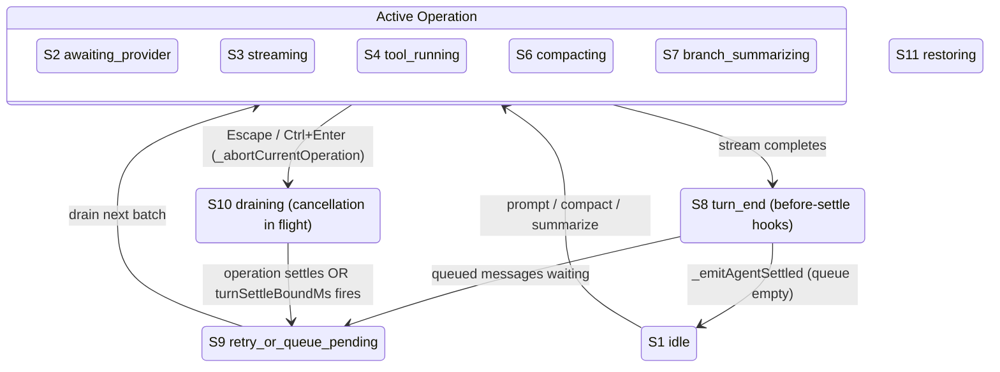
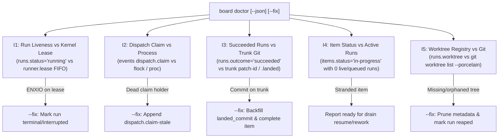

# Self-introspection, deterministic liveness, and fleet visibility without timeouts

**Status:** 2026-10-24. Settled design for session liveness, self-introspection, and coordinator modularity; verified against the repository tree at `4751f558d`.

> **In short.** A timeout is a guess that elapsed time implies death. Replace every liveness guess with a kernel fact (open file descriptors and process exit signals) or an explicit state-machine transition, and give the board a deterministic self-audit (`board doctor`) that cross-checks SQLite, Git worktrees, and kernel leases on demand.

**Why it matters.** Four liveness specs in [`tools/session-liveness/`](../../tools/session-liveness/) were red against the Pi fork because compaction aborts and timed-out turn settlements left `_idleWaitPromise` and `_immediatePromptPromise` permanently wedged; meanwhile, under 10-lane load, heuristic timeouts (`DEFAULT_TIMEOUT_MS = 15_000`, `RUNNER_SILENCE_MS = 60_000`, `RunLivenessStaleness = 2m`) misfire on healthy work while `board-runs.ts` spawns a child process every 10 seconds even when nothing is running.

**What has been built.** The session-side half has landed: patch 0149 bounded every abandonment and named a stalled turn, patch 0169 closed the second `Ctrl+Enter` wedge, and the abandonment now performs the whole of [§3.2](#32-leak-2-timed-out-settle-leaves-_idlewaitpromise-unresolved-stuck-operationtestts)'s barrier — the three compaction/branch-summary controllers are cleared, so `isCompacting` returns to false and a manual compaction stops refusing prompts, not merely the idle wait being released. Both `just session-liveness` (7 specs) and `just queued-message-states` (42 specs) are green. The fleet half has landed too — `board-runs.ts` is driven by `<store-dir>/board.wakeup` with a one-minute fallback, and its age timer runs only while a row is drawn. The drain-side half of the wakeup and liveness pair has landed too: `board drain` wakes on `<store-dir>/board.wakeup` with a poll fallback, and a lane's liveness is its `runner.lease` FIFO, with heartbeat age kept as the fallback for a run row that has no lease. `board doctor` does not exist yet, and the drain's suite still takes about 85 seconds rather than the sub-ten-second figure the plan set.

**The shape.** Three layers: a total 11-state session machine in the Pi fork that bounds every cancellation path and surfaces truthful UI indicators, a `board doctor` introspection command and `board.wakeup` watch that drive TUI visibility with zero idle polling, and a structural decomposition of the 20,239-line `work-control.ts` coordinator into focused domain modules.

**Cost.** Requires a new Pi fork patch to close the four `session-liveness` leaks, a `board doctor` subcommand in `tools/board-cli/`, an `fs.watch` wakeup bridge in the Pi board extensions, and extracting four submodules out of `work-control.ts`.

**Start at [§2](#2-replacing-timeout-heuristics-with-deterministic-facts)** — the table of every timeout heuristic in the stack and the exact kernel or state-machine primitive that replaces it.

**Needs your ruling:** None.

**Reads with:** `board-unified-architecture.md` (the store, drain, and merge-queue design), `board-rebuild-plan.md` (the build hand-off grounded at `4751f558d`), `whale-interaction-collector.md` (the historical event collector this complements), and `turn-stall-watchdog.md` (why open-run stream auto-aborts were removed).

---

## 1. Verdict and Principles

The 2026-10-20 owner ruling in `turn-stall-watchdog.md` established a foundational rule: never abort an active model turn merely because the stream is quiet, because deep reasoning and overloaded systems look identical to a timer. Yet the rest of the coordination stack still relies on timers to infer whether processes, database calls, and cancellations are alive.

Four principles complete that shift:

- **P1. Timeouts bound explicit cancellation waits, never healthy execution.** An open model run, a running worker lane, or a queued capacity slot is never killed because a clock ticked past 15s, 60s, or 120s. Only when an operator or supervisor has *already requested* cancellation (`AbortSignal` or `SIGTERM`) does a hard settle bound fire to reclaim the session or process.
- **P2. Every runtime state is named and indicated (`INV-INDICATED`).** If the session is not in `S1 (idle)`, the UI must display which of the 10 non-idle states it occupies, and pressing `Ctrl+Enter` (`sendAllQueuedNow`) must report the actual blocking state rather than a hardcoded guess.
- **P3. Self-introspection compares independent ground truths.** Fault detection (`board doctor`) does not read a status column and trust it; it joins the SQLite `runs` and `items` tables against kernel `flock` / FIFO descriptors, `git worktree list --porcelain`, and `.landed` claim receipts to prove whether state is consistent.
- **P4. Visibility is push-triggered, never busy-polled.** TUI widgets (`work-board.ts`, `board-runs.ts`) refresh when `board.wakeup` changes on disk or a session turn boundary fires—never on a blind 10-second child-process timer.

### 1.1 Non-Goals

- **No reintroduction of the open-run turn-stall watchdog.** Quiet provider streams during normal turns remain unbounded until the user presses Escape (`turn-stall-watchdog.md`).
- **No behavioral changes to coordinator tool fences or approver rubrics.** Splitting `work-control.ts` into modules is a pure structural refactor that preserves every existing test in `yolo-packs/matt/tests/work-control*.test.mjs`.

---

## 2. Replacing Timeout Heuristics with Deterministic Facts

Verified against the tree at `4751f558d` on 2026-10-24, here is every load-sensitive timeout or polling loop in the coordination stack and its deterministic replacement:

| Component | Current Heuristic / Timer | Failure Under Load or Crash | Deterministic Replacement |
| :--- | :--- | :--- | :--- |
| **`board drain` worker liveness** (`store.go`) | `RunLivenessStaleness = 2 * time.Minute` | Marks busy workers `interrupted` if heartbeats lag; waits 120s to detect an actual crash. | **POSIX FIFO `runner.lease`**: non-blocking `O_WRONLY` probe returns `ENXIO` the instant the worker process group exits, and never misfires under 100% CPU load. |
| **`pi-subagents` slot reclamation** (`active-async-capacity.ts`) | `RUNNER_SILENCE_MS = 60_000` & `DEFAULT_ABANDONED_SLOT_RELEASE_AFTER_MS = 20m` | Dead runner without lease check holds capacity slot for up to 20 minutes; silent runner flagged after 60s. | **Immediate FIFO lease sweep**: `observeRunnerLease` (`ENXIO`) reclaims dead slots immediately on queue pump without waiting 20 minutes, and ignores heartbeat silence while `runner.lease` is `held`. |
| **`board/client.ts` CLI calls** (`board/client.ts`) | `DEFAULT_TIMEOUT_MS = 15_000` + 6-process shell digest per call | Under 12-way process load, shell digest + SQLite WAL pragma contention exceeds 15s and aborts pile syncs. | **Zero-fork binary cache + `OpenRead` fast path** (`board-unified-architecture.md` section 3.3) + 60s safety ceiling aligned with SQLite's `busy_timeout`. |
| **`board-runs.ts` observer widget** (`board-runs.ts`) | `BOARD_RUNS_POLL_MS = 10_000` (`setInterval` spawning `board run list`) | Spawns 360 child processes/hour per idle terminal; lags up to 10s after a run starts or finishes. | **`fs.watch` on `<store-dir>/board.wakeup`** (debounced at 50ms) with a 60s fallback only if the watcher errors. |
| **Pi `AgentSession` compaction abort** (`.forks/pi`) | `_abortCurrentOperation` only arms `turnSettleBoundMs` when `_isAgentRunActive` is true | Manual compaction with a hung stream ignores `Ctrl+Enter` and blocks `waitForIdle()` forever. | **Unified operation settle bound**: arm `turnSettleBoundMs` on *any* operation abort (`_isAgentRunActive \|\| isCompacting \|\| isBranchSummarizing`). |

---

## 3. Closing the Four Session-Liveness Gaps in the Pi Fork

The headless diagnostic suite in [`tools/session-liveness/`](../../tools/session-liveness/) formalizes four failure modes where an interactive Pi session wedges permanently. All four trace to incomplete state transitions in `.forks/pi/packages/coding-agent/src/core/agent-session.ts` and `interactive-mode.ts`.

### 3.1 Leak 1: Compaction-Only Abort Never Settles (`stuck-operation.test.ts`)

- **What happens today.** When manual compaction is running (`isCompacting === true`, `_isAgentRunActive === false`) and the user presses `Ctrl+Enter` (`sendAllQueuedNow()`), `_abortCurrentOperation()` calls `abortCompaction()`, which signals `_compactionAbortController.abort()`. However, `_agentRunAbortRequested` is only set when `_isAgentRunActive` is true. Consequently, `waitForIdle()` enters its unbounded branch (`await this._idleWaitPromise`) with no settle timer. If the compaction stream ignores `AbortSignal`, the session hangs forever.
- **The fix.** Introduce `_operationAbortRequested` covering agent runs, manual/auto compaction, and branch summarization. Whenever `_abortCurrentOperation()` is invoked while `this.isBusy()` is true, arm the `turnSettleBoundMs` timer in `waitForIdle()` and `_waitForInterruptedOperation()`.

### 3.2 Leak 2: Timed-Out Settle Leaves `_idleWaitPromise` Unresolved (`stuck-operation.test.ts`)

- **What happens today.** When an agent run is cancelled and retires just before `turnSettleBoundMs` expires, but auto-compaction is still active (`isCompacting === true`), the watchdog timer fires and calls `_releaseTimedOutTurn()`. `_releaseTimedOutTurn()` checks `if (!this._activeAgentRunToken && !this._isAgentRunActive) return;` and exits early without clearing `_autoCompactionAbortController`, without resetting `isCompacting`, and without resolving `_idleWaitPromise`. The next call to `waitForIdle()` inherits that permanently unresolved `_idleWaitPromise`.
- **The fix.** Unify `_releaseTimedOutTurn()` and `_abandonStuckOperation()` into a single abandonment barrier that:
  1. Aborts and detaches any active agent run token (`_activeAgentRunToken = undefined`, `_isAgentRunActive = false`).
  2. Aborts and detaches any stuck compaction or branch summarization (`_compactionAbortController = undefined`, `_autoCompactionAbortController = undefined`).
  3. Calls `_resolveIdleWaitIfIdle()` (which now sees all busy flags cleared and resolves `_idleWaitPromise`).
  4. Emits `agent_settled` so held queues flush deterministically.

### 3.3 Leak 3: Cached `_immediatePromptPromise` Freezes Subsequent `Ctrl+Enter` (`stuck-operation.test.ts`)

- **What happens today.** `sendAllQueuedNow()` begins with `if (this._immediatePromptPromise) return this._immediatePromptPromise;`. If an immediate send hangs or times out during `_waitForInterruptedOperation`, `_immediatePromptPromise` remains assigned or resolves without draining the newly arrived messages, turning every subsequent `Ctrl+Enter` into a no-op.
- **The fix.** Pair `_immediatePromptPromise` with the settlement barrier: when the settle bound fires or a new `sendAllQueuedNow()` arrives after `_operationAbortRequested` has already timed out, force-abandon the wedged operation via `_abandonStuckOperation("send_now_cancel")` and execute the queue drain in a fresh `finally`-cleared promise scope.

### 3.4 Leak 4: Misleading Send-Now Status and the 11-State Indicator Mapping (`send-now-status.test.ts`)

- **What happens today.** `InteractiveMode` collapses 11 runtime states (`tools/queued-message-states/session-state.ts`) into 4 `StatusIndicatorKind` values (`"working" | "retry" | "compaction" | "branchSummary"`), clears `"working"` at `agent_end` before `agent_settled` (leaving `S8 turn_end` visually indistinguishable from `S1 idle`), and prints `"Sending queued messages now: waiting for the current turn to cancel"` on a second `Ctrl+Enter` even when waiting on compaction.
- **The fix (`INV-INDICATED`).** The suite is the specification, and its constraint is narrower than "name the busy flag": the status for a **stuck** send must not claim a cancellation is running (`/abort|cancel/i` must not match it, because nothing is in flight), the status for an **abort in flight** must claim one, and the two must differ. A compaction-only hang has no abort running, so naming compaction in that state would repeat the original lie in a new sentence. `sendNowStatus(streaming, inFlight)` in `interactive-mode.ts` therefore has four arms, keyed on whether a run is streaming and whether a send is already in flight:
    - streaming, a send already in flight — `"A send-now is already in flight: waiting for the current turn to cancel"`
    - streaming, no send in flight — `"Sending queued messages now: waiting for the current turn to cancel"`
    - not streaming, a send in flight — `"A send-now is already in flight: no turn is running, so it is waiting for the session to settle"`
    - not streaming, no send in flight — `"Sending queued messages now: no turn is running; waiting for the session to settle"`
  - Keep the status indicator visible through `S8 (turn_end)` (`"finishing turn…"`) and `S10 (draining)` (`"cancelling…"`), clearing it only when `agent_settled` transitions the session to `S1 (idle)`.

---

## 4. Self-Introspection: `board doctor`

To evolve safely without human babysitting, the board must be able to introspect its own state and report—or repair—inconsistencies between SQLite, the filesystem, kernel process leases, and Git.

**Self-audit invariant** *(coined here)* — a decidable predicate joining at least two independent state stores (such as SQLite rows vs. kernel file locks, or SQLite rows vs. Git commit objects) whose violation proves a state leak without consulting wall-clock elapsed time. Not a heuristic warning (such as "this item has been in progress for 3 hours") and not a schema constraint check inside SQLite alone.

### 4.1 The Five Self-Audit Invariants (`board doctor`)

`board doctor [--json] [--fix]` evaluates five invariants in a single pass and exits `0` when all invariants hold or `1` when any fault is found:

| Invariant ID | Ground Truth A (SQLite) | Ground Truth B (Kernel / Git / Disk) | Fault Condition | Automatic Repair (`board doctor --fix`) |
| :--- | :--- | :--- | :--- | :--- |
| **`I1: dead-running-lane`** | `runs` row with `status = 'running'` | `runner.lease` FIFO in run directory (`O_WRONLY \| O_NONBLOCK`) + `kill(pid, 0)` fallback for legacy rows | Lease probe returns `ENXIO` (or legacy PID is dead and no `dispatch.lock` is held) | Transitions run to `status = 'terminal'`, `outcome = 'interrupted'`, records `run.finish`, and — in the same transaction — the lane's one terminal event, `lane.interrupted` with `reason = 'heartbeat'`, unless the run already carries one. A repaired run is then indistinguishable from one the drain closed. |
| **`I2: stale-dispatch-claim`** | Latest `dispatch.claim` event unclosed by `dispatch.release` | `dispatch.lock` `flock(2)` probe and `/proc/<pid>/environ` `YOLO_SESSION_ID` match | Claiming session process is gone or belongs to a recycled PID with a different session ID | Appends `dispatch.claim-stale` event, releasing the workspace for `board drain`. |
| **`I3: unrecorded-landing`** | `runs` row with `outcome = 'succeeded'` and `landed_commit IS NULL` | `<common-git-dir>/land-queue/*.landed` receipts and `trunk_patches` index | Candidate commit's patch-id or receipt is already on the target branch | Backfills `runs.landed_commit`, records `done` verdict, and transitions item to `completed`. |
| **`I4: stranded-in-progress`** | `items` row with `status = 'in-progress'` | `runs` table for `item_id` | Item has zero `running` runs and zero `succeeded` unlanded runs | Reports item as `stranded` with its recovery mode (`resume`, `rework`, or `rebrief`); `--fix` resets status to `not-started` if zero runs ever existed. |
| **`I5: worktree-drift`** | `runs` row with `reaped_at IS NULL` and non-empty `worktree` | `git worktree list --porcelain` and filesystem `stat(worktree)` | Worktree directory is missing on disk or unregistered in Git while `reaped_at IS NULL` | Sets `reaped_at = now()` on the run row and runs `git worktree prune`. |

`board drain` runs invariants `I2` and `I3` automatically on startup before admitting new lanes, ensuring that restarting a drain after a crash or container restart self-heals the store before spawning a single child process. `I1` is deliberately not in that pass: a dead stored-running row is the resume sweep's (`resume.go`), which continues the lane's own session, and closing the row first would throw away the work resume exists to preserve. Closing dead rows in bulk is `board doctor --fix`, with a human or the whale asking for it.

---

## 5. Fleet Visibility and Decomposing `work-control.ts`

### 5.1 Push-Driven TUI Visibility (`work-board.ts` and `board-runs.ts`)

Today, `board-runs.ts` polls `board run list --json` every 10 seconds (`BOARD_RUNS_POLL_MS = 10_000`) and ticks a UI repaint timer every 1 second (`BOARD_RUNS_REPAINT_MS = 1_000`), while `work-control.ts` refreshes `BoardPileCache` only at turn boundaries.

With `<store-dir>/board.wakeup` (`board-unified-architecture.md` section 3.3):
- A single shared watcher (`BoardStoreWatcher` in `board/client.ts`) uses `fs.watch` on the store directory filtering for `board.wakeup`, coalescing bursts with a 50ms trailing debounce.
- Whenever `board.wakeup` changes, `BoardStoreWatcher` triggers both `BoardPileCache.refresh()` and `board-runs.ts`'s run-list refresh.
- While no runs are active (`runs.length === 0`), `board-runs.ts` stops its 1-second elapsed-time repaint ticker completely; the ticker runs only while at least one lane is actively `running`.

The fleet half of this is built. The pile half is not: `BoardPileCache` in `work-control.ts` still refreshes at turn boundaries only, so a session can draw a fleet row for a lane the pile has not listed yet. That is the open question below.

1. ✅ **OQ-SLF1: Does the board pile refresh on a store wakeup, or keep refreshing at turn boundaries?**

   _Closed 2026-11-16:_ moot: the pile cache it concerned lived in the deleted work-control extension.

   The fleet refreshes when `<store-dir>/board.wakeup` changes. The pile is the other reader of the same store, and it refreshes at turn boundaries, so the two views can disagree for up to a turn. Implementing it means giving the pile the same watcher; leaving it means the pile stays a turn behind by design.

   _Leaning:_ Refresh on the wakeup — the fleet already does, and a pile that lags a turn behind shows work the board has already filed.

   **Answer:**
   > _(empty — fill in when decided)_

### 5.2 Modularizing `work-control.ts`

At 20,239 lines, `yolo-packs/matt/files/extensions/work-control.ts` is the largest single file in the repository. While `command-classification.ts` and `tool-fence.ts` were already extracted into `files/extensions/work-control/`, four cohesive subsystems remain embedded inside the monolith and should be extracted into pure, independently testable modules under `yolo-packs/matt/files/extensions/work-control/`:

| New Module under `files/extensions/work-control/` | Extracted Responsibility | Key Symbols Moved |
| :--- | :--- | :--- |
| `receipts-and-git.ts` | Git commit inspection, diffstat parsing, `DERIVED_RECEIPT_SLACK_MS`, candidate ancestry verification | `resolveCommitReceipt`, `scanRecentCommits`, `verifyLandedAncestry` |
| `item-judge.ts` | Item Judge prompt assembly, verdict schema validation, `ItemJudgeCallRecorder`, verdict routing | `judgePileItemsBody`, `parseJudgeResponse`, `ItemJudgeCallRecorder` |
| `goal-evaluator.ts` | Objective goal evaluation pass, `stalledRounds` tracking, exponential quiet-retry scheduling | `startGoalEvaluation`, `scheduleQuietRetry`, `QUIET_RETRY_INITIAL_DELAY_MS` |
| `live-runs-ledger.ts` | Subagent event bus subscriptions (`SUBAGENT_ASYNC_*`), capacity queue orphan reconciliation (`reconcileCapacityQueuedRuns`) | `LiveRuns`, `reconcileCapacityQueuedRuns`, `observeSubagentEvents` |

**Constraint:** Every extracted module is registered in `yolo-packs/matt/pack.json` under `contributes` (`into: ".pi/agent/extensions/work-control/<name>.ts"`), and `work-control.ts` re-exports any symbol imported by existing tests in `yolo-packs/matt/tests/`.

---

## 6. Alternatives Considered

| Alternative | Why it was considered | Verdict |
| :--- | :--- | :--- |
| **Keep `BOARD_RUNS_POLL_MS` at 10s instead of `fs.watch`** | Avoids managing an `fs.watch` handle in Node.js. | **Rejected.** Spawning a subprocess every 10 seconds across multiple open terminals wastes CPU, clutters strace/audit logs, and still leaves a 10-second blind spot after a run starts or finishes. |
| **Auto-abort open model runs after 5 minutes of silence** | Would catch dead TCP sockets when a provider hangs mid-stream. | **Rejected.** Violates the 2026-10-20 owner ruling (`turn-stall-watchdog.md`). Provider socket deadlocks belong to HTTP/TCP keepalive at the transport layer, not a synthetic turn abort that kills extended thinking. |
| **Rewrite `work-control.ts` from scratch** | Would allow a cleaner greenfield coordinator design. | **Rejected.** `work-control.ts` encodes dozens of hard-won edge cases pinned by 45+ test suites. Incremental extraction of pure submodules preserves 100% behavioral parity while cutting the root file down to orchestration wiring. |

---

## 7. Risks and Mitigations

| Risk | Consequence | Mitigation |
| :--- | :--- | :--- |
| **`fs.watch` on a non-existent store directory** | Watching `<store-dir>` before `board init` has ever run throws `ENOENT`. | `BoardStoreWatcher` only attaches once `<store-dir>` exists, or re-checks on turn boundaries until the directory is created. |
| **Missing `pack.json` entry when extracting a submodule from `work-control.ts`** | Works in repo-local tests that import from `yolo-packs/matt/files/extensions/`, but fails in deployed `~/.pi/agent/extensions/` with `ERR_MODULE_NOT_FOUND`. | Every new file under `files/extensions/work-control/` must be added to `yolo-packs/matt/pack.json` and verified with `yolo pack lint yolo-packs/matt`. |
| **Pi fork patch series conflicts** | Editing `.forks/pi` directly instead of a lane checkout corrupts the shared fork cache. | Follow the mandatory `bin/pi-forks setup --lane <lane> --fork pi` → commit → `export` → `check` workflow (`docs/pi/forks.md`). |

---

## 8. Decision Ledger

| ID | Ruling / Decision | Date | Settled in | Built |
| :--- | :--- | :--- | :--- | :--- |
| OQ-SL1 | Bound all cancelled operations (compaction, branch summary, agent run) under one unified abandonment barrier that always resolves `_idleWaitPromise` and clears `_immediatePromptPromise` | 2026-10-24 | [§3 Closing the Four Session-Liveness Gaps](#3-closing-the-four-session-liveness-gaps-in-the-pi-fork) | — |
| OQ-SL2 | Enforce `INV-INDICATED` across all 11 session states, keeping the indicator active through `S8 (turn_end)` and `S10 (draining)` and naming the exact active operation on `Ctrl+Enter` | 2026-10-24 | [§3.4 Leak 4: Misleading Send-Now Status](#34-leak-4-misleading-send-now-status-and-the-11-state-indicator-mapping-send-now-statustestts) | — |
| OQ-SL3 | Add `board doctor [--json] [--fix]` to audit and repair drift across SQLite, FIFO leases, `flock`, and Git worktrees | 2026-10-24 | [§4 Self-Introspection: `board doctor`](#4-self-introspection-board-doctor) | — |
| OQ-SL4 | Replace 10s polling in `board-runs.ts` and turn-only cache refreshes with a debounced `fs.watch` on `board.wakeup` | 2026-10-24 | [§5.1 Push-Driven TUI Visibility](#51-push-driven-tui-visibility-work-boardts-and-board-runsts) | — |
| OQ-SL5 | Extract `receipts-and-git.ts`, `item-judge.ts`, `goal-evaluator.ts`, and `live-runs-ledger.ts` from `work-control.ts` | 2026-10-24 | [§5.2 Modularizing `work-control.ts`](#52-modularizing-work-controlts) | — |
