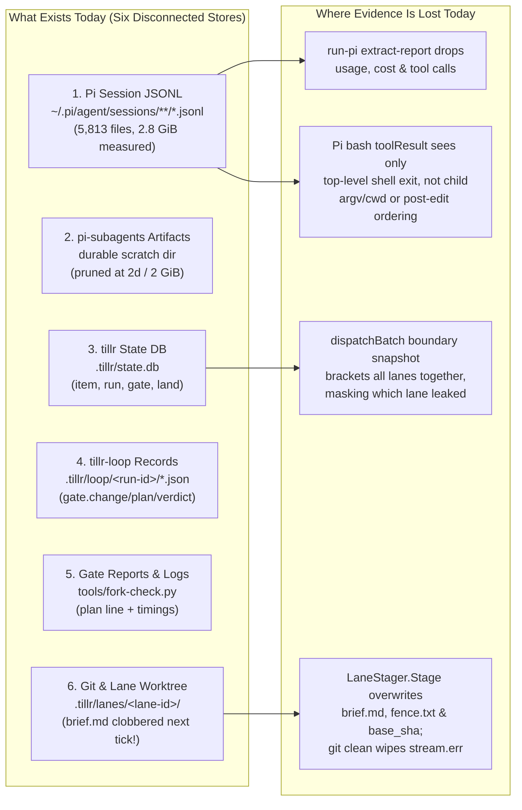
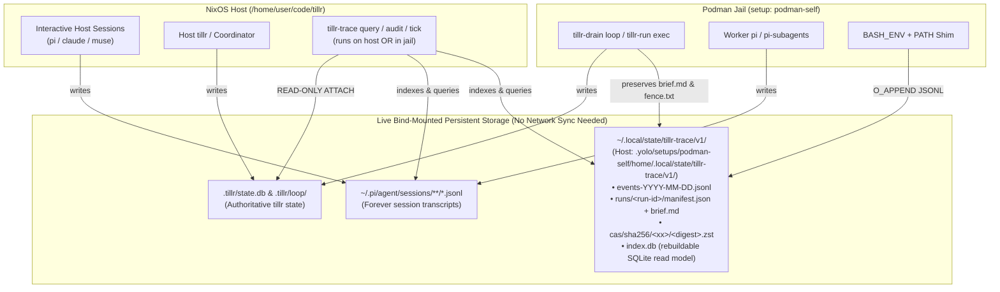
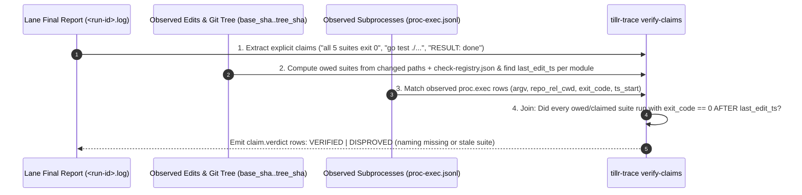

# Session Recording — How Do We Record Agent Work Once and Query Every Claim, Cost, and Tick Later?

**Status:** 2026-11-15 — in review. Store journal-mode and recovery claims amended. Settled technical architecture across all ten design questions ([§2](#2-seam-analysis-shim-proxy-collector-or-all-three)–[§11](#11-what-makes-this-fail-and-how-the-design-prevents-each)); three operational policy bounds ruled by the owner ([the ledger](#122-decision-ledger)).

> **Ruling, 2026-11-18: the persistent trace index is removed.** The owner ruled "remove it if it is cached derived data. once we show a performance issue, we can cache it." Every table in `index.db` (`obs_events`, `runs_index`, `claim_checks`, and the bookkeeping tables `ingested_files` and `index_meta`) was rebuildable from the store and the run artifacts, and the index deleted a run's rows once that run's source files were gone, so it never kept anything the artifacts did not. The drain loop no longer runs `tillr-trace ingest`; the command is gone, and nothing creates `index.db`. `tillr-trace` and `tillr-view` read the artifacts a question needs on demand, with nothing cached: one run's artifacts for a run, the 100 most recent runs by default for an aggregate (`--runs N`, or `0` for all). Measured wall times are in the [tillr-trace README](../../tools/tillr-trace/README.md#no-index-every-answer-is-read-from-the-artifacts). Where the sections below describe `index.db`, its ingest, its watermark or a rebuild, they record the design as first written and are superseded by this ruling.

> **Ruling, 2026-11-17: git trace2 recording is removed.** The owner ruled "I never asked for this git log ... cap it, get rid of it." The `GIT_TRACE2_EVENT` variable the run adapters set was inherited by every test suite a run started, so one run recorded 918,054 git commands, 906 runs held about 82 GB of `git-trace2.jsonl`, and the index built from them was 32 GB. `run-pi` and `run-claude` no longer set `GIT_TRACE2_EVENT` or `GIT_TRACE2_PARENT_SID` and unset any the loop carries; `tillr-trace` no longer reads `git-trace2.jsonl` or writes a `git.trace2` row. The shell-command record (`proc.exec`, through `BASH_ENV`) stays. Where the sections below still describe the git stream, the `git.trace2` kind, or `GIT_TRACE2_*`, they record the design as first written and are superseded by this ruling: nothing builds or reads them. A `git-trace2.jsonl` already on disk is a leftover for the operator to delete. The `claim_check` rows read `proc.exec` only; no claim check ever depended on a `git.trace2` row.
> **In short.** We do not build a heavyweight network MITM proxy or duplicate the event stores that `pi`, `tillr`, and `git` already write. Instead, we build **`tillr-trace`** — a three-seam recording and indexing layer that propagates a single hierarchical correlation key (`trace_key`) across `tillr-drain`, `tillr-run`, `pi`, `pi-subagents`, and child shells; fills the two missing observation seams with a fail-open `BASH_ENV` command shim and per-run staging preservation; and indexes all six stores into a rebuildable SQLite read model (`index.db`) that answers cost, timeline, and report-veracity queries in milliseconds without touching `.tillr/state.db`'s write lock.

**Why it matters.** An eight-lane session built and landed nine Go modules in six hours, yet left the coordinator unable to see that a lane claimed five passing test suites after running only four, that `tillr-drain` clobbered staged briefs on lane reuse, that `run-pi` discarded token and tool-call records from `pi --mode json`, or what each worker lane cost.
**The shape.** Three lightweight seams — an **indexer over existing logs**, a **fail-open subprocess shim** (`BASH_ENV`; the git half was removed 2026-11-17), and **in-process provider usage capture** — join into a read-only SQLite query surface (`tools/tillr-trace`) keyed by `tick_id/item_id/run_id/session_id/span_id`.
**Cost.** Slice 1 is `ESTIMATE: 3–4 hours` (~430 LoC across [`tools/tillr-drain/`](../../tools/tillr-drain/), [`tools/tillr-run/`](../../tools/tillr-run/), and `tools/tillr-trace/`). Steady-state storage is `ESTIMATE: 1.5–4.5 MiB/day` of normalized JSONL plus `5–25 MiB/day` of windowed compressed command blobs. Runtime overhead is `< 1.5 ms` per shell invocation (`ESTIMATE`) and `0 ms` on `tillr` database transactions.
**Start at [§2](#2-seam-analysis-shim-proxy-collector-or-all-three)** for the seam trade-offs, **[§4](#4-event-schema-and-the-cross-boundary-correlation-key)** for the event schema and correlation key, **[§8](#8-how-a-recording-becomes-evidence-and-verifies-lane-claims)** for mechanical claim verification, and **[§9](#9-query-cookbook-answering-the-seven-acceptance-questions)** for the seven acceptance queries.
**Ruled:** a disproved report claim is advisory rather than a pre-gate rejection; the command shim covers every agent-spawned shell and no human shell; one index per workspace. See [the ledger](#122-decision-ledger) (which also records designer decision [`D-SR1`](#44-worker-test-slot-wait-recording-run-wall-time-split-and-chronological-scheduling-decisions-d-sr1) from an operator-filed request).
**Reads with:** [`board-utilities.md`](./board-utilities.md) (the seven-utility contract and `record.Envelope`), [`tillr-muse-backend.md`](../reference/tillr-muse-backend.md) (the `run-muse` / `run-pi` adapter pattern), `bounded-agent-storage.md` (forever-session vs pruned-scratch retention tiers), `whale-interaction-collector.md` (prior rulings on JSONL normalization + rebuildable SQLite indexing), and `tok-stats.md` (per-request token/latency ledger).
**Terms.** `item`, `lane`, `run`, `candidate`, `verdict`, `route`, `record`, and `event` carry their exact meanings from [`board-utilities.md`](./board-utilities.md). Three terms are new:
- **`trace_key`** *(coined here)* — the five-segment hierarchical correlation string `tick_id/item_id/run_id/session_id/span_id` (using `~` for absent segments in interactive runs) propagated via `TILLR_TRACE_KEY`. It identifies where an observation sits in a workflow; it excludes content digests and SQLite row IDs.
- **`obs.event`** *(coined here)* — an immutable, schema-versioned observation record emitted by a shim or normalized by the collector into daily JSONL shards. It describes what was *observed* across a process, tool, git, or provider seam; it excludes authoritative workflow state transitions, which belong exclusively to `.tillr/state.db`.
- **`claim_check`** *(coined here)* — a derived verification row comparing an explicit or extracted assertion in a lane's output report (such as `"all five suites exit 0"`) against the observed `proc.exec` records under the same `run_id`, taking into account whether files in a suite's directory were edited *after* the last test execution.

---

## 1. Diagnosis: Why Today's Six Stores Cannot Answer Seven Basic Questions

Today, a single unattended tick or parallel coordinator session scatters its history across six disconnected stores. Inspecting the live codebase and session directories on `2026-11-13` UTC reveals five structural blind spots where information is either dropped in transit or overwritten before a human can ask a question.



### 1.1 Measured State of the Existing Stores

1. **Pi session transcripts (`~/.pi/agent/sessions/<cwd-slug>/*.jsonl`) already capture far more than `tillr` reads.**
   Measured on `2026-11-13` UTC (`du -sh ~/.pi/agent/sessions/` and `fd -t f '\.jsonl$' ~/.pi/agent/sessions/ | wc -l`), the workspace holds `2.8 GiB` across `5,813` JSONL files (`1,373` top-level sessions and `4,440` subagent child sessions totaling `1,768.7 MiB`). Inspecting the latest session JSONL confirms that every `assistant` message already persists `provider`, `model`, `responseModel`, `responseId`, `thinkingLevel`, `requestStartedAt`, `durationMs`, `usage` (`input`, `output`, `cacheRead`, `cacheWrite`, `reasoning`, `totalTokens`, `provider.raw`, and `cost.total`), plus the fields attached by `usage-capture.ts` (`providerResponse` status/allowlisted headers and `credential` `sha256:8` fingerprint) and `or-route.ts`. Every `toolResult` message persists `toolCallId`, `toolName`, `content`, `isError`, `durationMs`, and `timestamp`.
2. **`run-pi` and `tillr-drain` throw that telemetry away.**
   When [`tillr-drain`](../../tools/tillr-drain/main.go) dispatches a worker via [`exec.go`](../../tools/tillr-run/run/exec.go), [`run-pi`](../../tools/tillr-run/backends/pi/run-pi) runs `pi --print --mode json` and [`exec.go`](../../tools/tillr-run/run/exec.go#L118-L135) redirects stdout and stderr into `<lane-root>/<lane-id>/<run-id>.log`. However, [`failover.go`](../../tools/tillr-drain/drain/failover.go) (`ClassifyAttempt`) only scans the last `64 KiB` of `<run-id>.log` for a `RESULT:` line. Even [`report.py`](../../tools/tillr-run/backends/report.py) (used by [`extract-report`](../../tools/tillr-run/backends/pi/extract-report)) parses only `message_end` text and session IDs, discarding `usage`, `cost`, `model`, and all `toolCall`/`toolResult` events.
3. **`LaneStager.Stage` overwrites the evidence of what a run saw whenever a lane is reused.**
   In [`stage.go`](../../tools/tillr-drain/drain/stage.go#L103-L143), `Stage` writes `brief.md`, `fence.txt`, and `base_sha` directly into `<lane-root>/<lane-id>/`, and `ensureWorktree` runs `git reset --hard <baseSHA>` followed by `git clean -fd` inside `<lane-root>/<lane-id>/worktree`. Worse, [`run-pi`](../../tools/tillr-run/backends/pi/run-pi#L66-L87) writes `err=$(lane_path "$brief" stream.err)` and redirects `2>"$err"` inside `<lane-root>/<lane-id>/`. The moment `lane-1` is reused on a later tick, the previous run's rendered `brief.md`, `fence.txt`, `base_sha`, `stream.err`, and any uncommitted worktree diff are destroyed.
4. **Top-level `bash` tool results cannot prove which suites actually ran or in what order.**
   In Pi's `session.jsonl`, a `bash` tool call records the raw shell string (`arguments.command`) and whether the top-level shell exited non-zero (`isError`). If a worker runs a loop or compound command that skips one directory, masks a failure with a pipeline or `|| true`, or runs `go test ./...` at minute 10 and then edits a schema constant at minute 14 without re-running that module's suite, the top-level `toolResult` cannot directly answer *"Which module suites ran to exit 0 after the last edit to that module?"*
5. **Batch boundary snapshots cannot attribute a leak to a single lane.**
   In [`loop.go`](../../tools/tillr-drain/drain/loop.go#L202-L263), `dispatchBatch` calls [`boundary.go`](../../tools/tillr-drain/drain/boundary.go)'s `TakeBoundary` once before launching up to `--lanes` concurrent runs and `Compare` once after the entire batch returns. When two lanes run concurrently and one touches a path or ref outside its worktree, the boundary check fails the batch without knowing which `run_id` performed the write.

---

## 2. Seam Analysis: Shim, Proxy, Collector, or All Three?

> **Answers Mandatory Question 1:** *Shim, proxy, collector, or all three — and what each would catch that the others cannot across the provider HTTP call, agent tool invocations, PTY/process boundary, filesystem, subprocess spawns, and git operations.*

No single mechanism can observe all six seams in our environment. Re-collecting what `pi`, `tillr`, and `git` already write is waste; conversely, relying purely on a post-hoc collector leaves subprocess executions, git plumbing mutations, and overwritten staging files invisible.

### 2.1 Capability Matrix Across the Six Concrete Seams

| Seam | What Must Be Captured | Post-Hoc Collector / Indexer (reads existing files/DBs) | Process & Command Shim (`BASH_ENV` + `tillr-run` wrapper; `GIT_TRACE2_EVENT` removed 2026-11-17) | In-Process Agent Hook (`usage-capture.ts` + `or-route.ts`) | Standalone HTTP MITM Proxy (out-of-process reverse proxy) |
|---|---|---|---|---|---|
| **1. Provider HTTP call** | Tokens (`in`, `out`, `cacheRead`, `reasoning`), USD cost, OpenRouter upstream route, 2xx headers, 429 retries, credential fingerprint | **Partial** — reads persisted 2xx usage/cost/route from `session.jsonl` and `tok-stats.md` after turn ends; misses aborted turns and intermediate 429s | **Blind** — sees neither TLS payload nor auth token | **Complete (with 1 patch)** — sees normalized usage, headers, credential `sha256:8`, upstream route; a 20-line `yolo-packs/pi-fork/` patch adds intermediate 429 retry events | **Overkill & fragile** — sees wire bytes, but breaks OAuth broker sockets, requires custom CA trust in every runtime, and sits on the critical path |
| **2. Agent tool invocations** | `toolCallId`, `toolName` (`bash`, `edit`, `write`, `read`, `subagent`), structured args, `durationMs`, `isError` | **Complete for `pi`** — already in `session.jsonl` and `<run-id>.log` (`--mode json`), once indexed instead of dropped | **Partial** — sees `bash` and `git` spawns, but not in-process `edit`, `write`, or `read` calls | **Complete** — sees `tool_execution_start` / `tool_execution_end` in real time | **Only via wire parsing** — must re-parse SSE chunks across Anthropic, OpenAI, and Bedrock formats; misses local tool execution duration |
| **3. PTY / process boundary** | `run_id` argv, cwd, env keys, PID/PGID, start/end timestamps, exit code, timeout signal, stdout/stderr digest | **Partial** — `run.record` in `.tillr/state.db` has timestamps and exit code, but not stream digests or subagent child PTYs | **Complete** — wraps `tillr-run exec` and `run-pi`, hashing stdout/stderr streams as they flow | **Blind** — if the agent process OOMs or is `SIGKILL`ed by timeout, in-process hooks never fire | **Blind** — knows nothing about local process exit codes or timeouts |
| **4. Filesystem & staging** | Exact `brief.md`, `fence.txt`, `base_sha` given to run; files read/edited; pre/post `tree_sha`; out-of-lane writes | **Misses overwritten files** — `Stage` clobbers `brief.md`/`fence.txt` on next tick; `git clean -fd` deletes `stream.err` | **Complete** — snapshots staging inputs into `<run-id>/` before launch and computes `git write-tree` (`tree_sha`) immediately on exit | **Partial** — sees `read`/`edit`/`write` tool paths, but not files modified by a `bash` script | **Blind** — no visibility into local disk state |
| **5. Subprocess spawns** | Every child command inside `bash` (`go test`, `pytest`, `node --test`, `uvx`), its real `cwd`, `argv`, `exit_code`, and `duration_ms` | **Blind** — `session.jsonl` only has the outer `bash -c` string and final shell exit code | **Complete** — `BASH_ENV` command trap + test-runner wrapper logs every command statement and child test binary with `cwd` and `exit_code` | **Blind** — Pi only spawns the outer `/bin/bash`, not the subcommands inside it | **Blind** — no visibility into local subprocesses |
| **6. Git operations** | Every `git commit`, `reset`, `checkout`, `cherry-pick`, `worktree`, `status`, ref update, and duration | **Partial** — `git reflog` and commit history exist, but reflog is pruned/rewritten on worktree reset and lacks caller correlation | **Not recorded (ruled 2026-11-17)** — the `GIT_TRACE2_EVENT` stream captured every git invocation but was inherited by test suites and grew to 82 GB, so it was removed; a worker's own `git` shell commands still appear as `proc.exec` rows | **Blind** — git runs out-of-process | **Blind** — local git operations never touch HTTP |

### 2.2 Architectural Ruling: Collector, Command/Git Shim, and In-Process Hook (No Network Proxy)

We use **three cooperating mechanisms** and explicitly **reject an out-of-process HTTP MITM proxy**:

1. **The Collector & Indexer (`tillr-trace ingest`, ~70% of the data):** Indexes what is already written on disk without re-capturing it — `.tillr/state.db` (`item`, `run`, `drain`, `gate`, `land` tables), `.tillr/loop/<run-id>/gate.*.json`, `<lane-root>/<lane-id>/<run-id>.log` (`pi --mode json` output), `~/.pi/agent/sessions/**/*.jsonl`, `~/.local/state/tok-stats/v1/**/*.jsonl`, and `pi-subagents` handoff/diff artifacts.
2. **The Process, Shell & Git Shim (~25% of the data):** A zero-dependency, fail-open wrapper at two points:
   - **Per-run staging & exit capture in `tillr-drain` / `run-pi`:** Copies staged `brief.md`, `fence.txt`, and `base_sha` into a per-run directory (`<lane-root>/<lane-id>/runs/<run-id>/`), redirects `stream.err` there instead of the git-cleaned worktree, and records the post-run worktree `tree_sha` and `git status --porcelain -z` immediately after the child exits.
   - **Subprocess tracing via `BASH_ENV`:** (The first design also set `GIT_TRACE2_EVENT` and `GIT_TRACE2_PARENT_SID`; that half was removed on 2026-11-17, see the ruling at the top.) Sets `BASH_ENV=<repo>/tools/tillr-trace/bash-shim.sh` (plus a `PATH` wrapper directory for direct `execve` calls to `go`, `pytest`, `node`, `uvx`, `just`, and `sh`) so every subcommand execution inside a non-interactive shell or script appends a `proc.exec` JSONL line with its actual `cwd`, `argv`, `exit_code`, and `duration_ms`.
   - *Why `BASH_ENV` + `PATH` shim instead of `strace`, `LD_PRELOAD`, or eBPF?* Inside our `podman-self` jail ([§3](#3-placement-across-host-and-podman-jails)), we run unprivileged with no `sudo` and no `CAP_BPF`/`CAP_SYS_ADMIN` (ruling out eBPF). `LD_PRELOAD` is silently ignored by static Go binaries (`CGO_ENABLED=0` in `tools/tillr-*` and `go test`) and Nix-wrapped binaries. `strace -f` serializes every syscall across ptrace stops, adding 2×–5× slowdown to compile/test workloads and breaking process-group signal delivery. By contrast, `BASH_ENV` + a 6-binary `PATH` wrapper covers 100% of shell commands and test runners regardless of static linking, with `< 1.5 ms` overhead and zero ptrace fragility.
3. **The In-Process Provider Hook (~5% of the data):** Uses the existing `usage-capture.ts` and `or-route.ts` extensions, plus a small patch in `yolo-packs/pi-fork/` to emit a `provider_retry` event when the SDK catches a transient `429`/`5xx` before `after_provider_response`. This captures wire-level retry counts and rate-limit headers without putting a network proxy on the critical path or breaking `openai-auth-broker` / AWS Bedrock credentials.

---

## 3. Placement Across Host and Podman Jails

> **Answers Mandatory Question 2:** *Where it sits given this environment: a NixOS host running agents in `podman` jails (a container per workspace, bridged networking, credentials brokered from the host, no sudo in-jail), with the owner's own interactive sessions on the host as well as agents.*

### 3.1 Respecting the Jail Storage Classes and Boundary Invariants

Every process in this environment runs either on the NixOS host or inside a `podman-self` container where:
- `/workspace` is a live bind-mount of the host's repository (`/home/user/code/tillr` here), watched by `tillr-drain`'s write-boundary check (`git status --porcelain -z`).
- `/home/agent` is mostly read-only, except for per-workspace persistent directories backed by the host at `/workspace/.yolo/setups/<setup>/home/` (including `~/.local`, `~/.pi`, `~/.config`, `~/.claude`).
- `/tmp` and `/run` are per-launch `tmpfs` mounts destroyed on jail exit.
- The durable scratch directory is per-workspace but retention-managed, and [`fork-check.py`](../../tools/fork-check.py) (step `8`, `SCRATCH-CITATION`) forbids citing paths inside it as evidence in tracked documents.



### 3.2 Concrete Directory Layout

All recorder outputs live under `$XDG_STATE_HOME/tillr-trace/v1/` (defaulting to `$HOME/.local/state/tillr-trace/v1/`), directly sibling to `$HOME/.local/state/tok-stats/v1/` (`tok-stats.md`):

```text
~/.local/state/tillr-trace/v1/
├── events/
│   └── 2026-11-12/
│       └── <writer-host-or-jail>-<pid>.jsonl     # Normalized obs.event shards (append-only)
├── runs/
│   └── <run-id>/
│       ├── manifest.json                         # Run correlation header, digests, and summary
│       ├── brief.md                              # Exact staged brief (preserved before lane reuse)
│       ├── fence.txt                             # Exact staged path fence
│       ├── proc-exec.jsonl                       # Raw BASH_ENV / PATH wrapper events for this run
│       └── diff.patch.zst                        # Post-run git diff <base_sha>..<tree_sha>
├── cas/
│   └── sha256/
│       └── <2-hex>/
│           └── <64-hex>.zst                      # Content-addressed stdout/stderr blobs
└── index.db                                      # Rebuildable SQLite 3 read-model + FTS5 index
```

Why this placement works across both host and jail:
1. **Survives jail restarts and never pollutes `git status`:** Inside the jail, `~/.local/state/tillr-trace/v1/` sits in the per-workspace persistent home (`/workspace/.yolo/setups/podman-self/home/.local/state/tillr-trace/v1/`). Because `.yolo/` is gitignored at the repository root, writing there at high frequency during a run never triggers a false positive in `tillr-drain`'s write-boundary check ([`boundary.go`](../../tools/tillr-drain/drain/boundary.go)).
2. **Zero-copy visibility from the host:** Because `/workspace` is bind-mounted live from `/home/user/code/tillr`, a host process reading `/home/user/code/tillr/.yolo/setups/*/home/.local/state/tillr-trace/v1/` sees every in-jail shard the instant `write(2)` completes — with no network daemon, no port forwarding, and no container-to-host socket required.
3. **Same code path for host interactive sessions:** When the owner runs `pi` or `tillr` directly on the host, `$HOME/.local/state/tillr-trace/v1/` resolves to `/home/user/.local/state/tillr-trace/v1/`. `tillr-trace` on the host scans both its own `$HOME/.local/state/tillr-trace/v1/` and any `/workspace/.yolo/setups/*/home/.local/state/tillr-trace/v1/` directories present in the repository (see [the index ruling](#122-decision-ledger)).

---

## 4. Event Schema and the Cross-Boundary Correlation Key

> **Answers Mandatory Question 3:** *What an event is. Propose a schema and a correlation key that survives across processes, across the jail boundary, and across a resumed session. Naming is load-bearing: state whether you are coining terms.*

### 4.1 Terminology: What We Keep vs What We Coin

To stay strictly aligned with [`board-utilities.md`](./board-utilities.md):
- We **keep** `record.Envelope` (`record_version`, `kind`, `id`, `producer`, `created_at`, `subject`, `correlation_id`, `idempotency_key`, `payload`), `item`, `lane`, `run`, `candidate`, `verdict`, and `route`.
- We **coin three terms** (`trace_key`, `obs.event`, and `claim_check`, defined in the header block above) so that observation rows are never confused with authoritative `tillr` state-transition events in `.tillr/state.db`.

### 4.2 The Five-Part Hierarchical `trace_key`

Every observation carries a structured correlation object `trace` whose canonical string form is `trace_key`:

```text
<tick_id>/<item_id>/<run_id>/<session_id>/<span_id>
```

| Segment | Source | Value in Unattended `tillr-drain` Run | Value in Interactive / Coordinator Session | Survives Process / Subprocess? | Survives Jail Boundary? | Survives Resumed Session (`--resume` / `BOARD_DRAIN_SESSION`)? |
|---|---|---|---|---|---|---|
| `tick_id` | `drain.tick.tick_id` | `tick-20261112-190001` | `~` (or parent coordinator tick) | Via `TILLR_TICK_ID` env | Via `run.request.env_refs` & bind-mounted files | Advances on each new tick while `session_id` stays constant |
| `item_id` | `run.request.item_id` | `574` | `~` (or active board item) | Via `TILLR_ITEM_ID` env | Via `run.request.env_refs` | Constant across retries of the same item |
| `run_id` | `run.request.run_id` | `run-574-lane-1-1` | `interactive-<uuid8>` | Via `TILLR_RUN_ID` | Identical UUID in host & jail bind mount | **New `run_id` per attempt/resume**, isolating what happened in *this* execution window |
| `session_id` | Pi header `id` / `BOARD_DRAIN_SESSION` | `01a1c78c-43bb-719f-...` (`<parent_sid>:<child_sid>` for subagents) | `01a1c78c-43bb-719f-...` | Via `TILLR_SESSION_ID` & `pi-subagents` `handoff.json` | Persisted in `~/.pi/agent/sessions/` | **Stays constant across resume**, joining all turns and runs that shared one model context |
| `span_id` | Emitter counter / `toolCallId` / git `sid` | `call-9787c87b` or `sh-00042` | `call-9787c87b` | Nested via `parent_span_id` | Written to JSONL | Unique per tool call, subprocess, or LLM turn |

How propagation works across every boundary without losing the thread:
1. **`tillr-drain` → `tillr-run` → `run-pi`:** When `LaneStager` and `ProcessSteps` construct the `run.request` record ([`steps.go`](../../tools/tillr-drain/drain/steps.go)), they populate `correlation_id: tick.TickID` on the envelope and pass `TILLR_TICK_ID`, `TILLR_ITEM_ID`, `TILLR_RUN_ID`, `TILLR_LANE_ID`, and `TILLR_ROUTE_ID` (from `decision.Route.Backend + ":" + decision.Route.Model + ":" + decision.Route.Effort`) in `env_refs`.
2. **`run-pi` → `pi` → `bash` → child processes:** [`run-pi`](../../tools/tillr-run/backends/pi/run-pi) exports `TILLR_TRACE_DIR="$HOME/.local/state/tillr-trace/v1/runs/$TILLR_RUN_ID"`, and `BASH_ENV="/workspace/tools/tillr-trace/bash-shim.sh"`. Every child process spawned by `pi`'s `bash` tool inherits these environment variables automatically.
3. **Parent `pi` → `pi-subagents` child:** When a coordinator or worker invokes the `subagent` tool, `pi-subagents` already writes `<session>/<uuid>/run-N/handoff.json` and `session.jsonl`. Passing `TILLR_PARENT_SESSION_ID` and `TILLR_PARENT_SPAN_ID=<toolCallId>` in the subagent spawn environment links every subagent turn, tool call, and worktree diff patch back to the exact `toolCallId` in the parent session.
4. **Across a resumed session:** When a session is resumed (`pi --resume` or `run-pi` with `BOARD_DRAIN_SESSION`), `session-lifecycle.ts` appends a `session-lifecycle-v1` entry (`action: "resumed"`, `at: <ms>`), and `tillr-run` assigns a fresh `run_id`. Queries grouping by `session_id` see the entire multi-run conversation; queries filtering by `run_id` see only the turns, tool calls, and commands executed after that resume boundary.

### 4.3 `obs.event` JSONL Schema

Every normalized row in `events/<YYYY-MM-DD>/*.jsonl` (and the `obs_events` table in `index.db`) conforms to a single flat-header + typed-payload schema:

```json
{
  "obs_version": 1,
  "obs_id": "obs-019321a4-8c10-7b22-9f1a-40e2918a0042",
  "kind": "proc.exec",
  "ts_start": "2026-11-12T19:04:12.104Z",
  "ts_end": "2026-11-12T19:04:14.892Z",
  "duration_ms": 2788,
  "mono_ns": 849201948201,
  "seam": "bash-shim",
  "host_or_jail": "jail:podman-self",
  "trace": {
    "trace_key": "tick-04/574/run-574-lane-1-1/01a1c78c-43bb/sh-00019",
    "tick_id": "tick-04",
    "item_id": "574",
    "lane_id": "lane-1",
    "run_id": "run-574-lane-1-1",
    "route_id": "pi:anthropic/claude-sonnet-4-5:high",
    "session_id": "01a1c78c-43bb-719f-8b61-9c7ddac158ea",
    "parent_span_id": "call-9787c87b-2736-4d54-94dd-7568388ac312",
    "span_id": "sh-00019"
  },
  "payload": {
    "argv": ["go", "test", "./..."],
    "cwd": "/workspace/.tillr/lanes/lane-1/worktree/tools/tillr-gate",
    "repo_rel_cwd": "tools/tillr-gate",
    "exit_code": 0,
    "stdout_bytes": 412,
    "stderr_bytes": 0,
    "stdout_sha256": "e3b0c44298fc1c149afbf4c8996fb92427ae41e4649b934ca495991b7852b855",
    "tail_excerpt": "ok  \tgithub.com/mschulkind-oss/tillr-gate\t2.412s\n"
  }
}
```

The thirteen `obs.event` kinds and their origins are — twelve observed, plus `unreadable`, which exists so that an artifact nobody could read is a recorded fact rather than an absence:

| `kind` | Seam Origin | Primary Payload Fields |
|---|---|---|
| `tick.stage` | `tillr-drain` stager | `base_sha`, `brief_sha256`, `fence_sha256`, `fence_paths[]`, `worktree_path` |
| `tick.decision` | `.tillr/state.db` (`dispatches`) | `outcome` (`dispatch` \| `hold`), `reason`, `route` (`backend`, `model`, `effort`) |
| `run.lifecycle` | `.tillr/state.db` (`runs`) + exit hook | `state`, `exit_code`, `base_sha`, `head_sha`, `tree_sha`, `dirty_paths[]`, `log_sha256` |
| `llm.turn` | `pi` `session.jsonl` / `<run-id>.log` | `provider`, `model`, `response_model`, `upstream_route`, `thinking_level`, `tokens` (`in`, `out`, `cache_read`, `cache_write`, `reasoning`), `cost_usd`, `credential_fp`, `stop_reason` |
| `llm.retry` | `pi-fork` retry hook | `provider`, `model`, `attempt`, `http_status` (`429` \| `5xx`), `retry_after_ms`, `error_code` |
| `tool.call` | `pi` `session.jsonl` / `<run-id>.log` | `tool_call_id`, `tool_name`, `target_path`, `command_preview`, `is_error`, `result_sha256`, `result_bytes` |
| `proc.exec` | `BASH_ENV` / `PATH` shim | `argv[]`, `cwd`, `repo_rel_cwd`, `exit_code`, `signal`, `stdout_sha256`, `stderr_sha256`, `tail_excerpt` |
| `git.trace2` | **removed 2026-11-17**: was `GIT_TRACE2_EVENT`; no emitter sets it and the indexer writes no such row | none; a worker's own `git` commands are `proc.exec` rows |
| `boundary.check` | `tillr-drain` boundary | `scope` (`run` \| `batch`), `clean` (`bool`), `first_violation` (`kind`, `target`, `detail`) |
| `gate.plan` | `.tillr/loop/<run-id>/gate.plan.json` | `plan_id`, `base_sha`, `tree_sha`, `registry_digest`, `checks_count`, `check_ids[]` |
| `gate.verdict` | `.tillr/loop/<run-id>/gate.verdict.json` | `verdict` (`pass` \| `fail`), `plan_id`, `failed_check_ids[]`, `check_timings_ms{}` |
| `unreadable` | `tillr-trace` indexer | `artifact`, `reason` (`missing` \| `truncated` \| `unparseable`), `rows_kept` — the row that says a record could not be read, so a missing artifact is never a silent zero |
| `claim.verdict` | `tillr-trace verify-claims` | `claim_id`, `claim_kind`, `claim_text`, `observed_status` (`verified` \| `disproved` \| `unverified`), `evidence_span_ids[]`, `discrepancy_reason` |
| `slot.wait` | [`tools/go-test-shards.py`](../../tools/go-test-shards.py) (`$TILLR_TRACE_DIR/slot-waits.jsonl`, queued under [`D-SR1`](#44-worker-test-slot-wait-recording-run-wall-time-split-and-chronological-scheduling-decisions-d-sr1)) | `ts_start_ms`, `ts_end_ms`, `waited_ms`, `slot`, `class` (`ordinary` \| `proof`), `run`, `label`, `acquired` |

### 4.4 Worker Test-Slot Wait Recording, Run Wall-Time Split, and Chronological Scheduling Decisions (`D-SR1`)

On 2026-11-20 a two-line trunk fix took a 35-minute worker run of which 93 seconds was model time and 33 minutes were a worker tool waiting for a test slot in [`tools/go-test-shards.py`](../../tools/go-test-shards.py), and `#/run/<id>` could not show where that wall time went or how the drain scheduled the run. On the current trunk (`ba0fe8f64`), commit `9f468ca23` already added the Claude backend's `assistant` and `user` stream messages, `tool_use` / `tool_result` entries (timing `tool_result` from call-to-result timestamps), closing summary notice (`num_turns`, total `duration_ms`, and `duration_api_ms` model time), and `unparsed` log-source gap reporting in [`tools/tillr-view/transcript.go`](../../tools/tillr-view/transcript.go); commit `57fb8867f` already added per-run `seat`, `workflow`, and `node` recording and display across [`tools/tillr-view/serveread.go`](../../tools/tillr-view/serveread.go) (`storeRun`), [`tools/tillr-view/serve.go`](../../tools/tillr-view/serve.go) (`runSummary`, `runDetail`, and `dispatchSeats` fallback), [`tools/tillr-view/usage.go`](../../tools/tillr-view/usage.go), CLI read faces, [`tools/tillr-view/web/src/models/types.ts`](../../tools/tillr-view/web/src/models/types.ts), and [`tools/tillr-view/web/src/components/ItemRunPages.tsx`](../../tools/tillr-view/web/src/components/ItemRunPages.tsx) (`ItemTimeline` and `RunPage`); commit `f430a6123` added `drain.obstacle-hold` / `drain.obstacle-cleared` reading in [`tools/tillr-view/dispatchable.go`](../../tools/tillr-view/dispatchable.go) and [`tools/tillr-view/waiting.go`](../../tools/tillr-view/waiting.go); commit `9160c9c48` added shard process-group guards (`--shard-guard`) in [`tools/go-test-shards.py`](../../tools/go-test-shards.py); and `gate_spans.waited_ms_json` records post-run gate slot waits via `TILLR_GATE_SPANS_OUT`. What is still missing on `ba0fe8f64` is structured worker test-slot wait recording (because `acquire_shard_slot` in [`tools/go-test-shards.py`](../../tools/go-test-shards.py) from `e1a5d8dca` emits nothing on uncontended acquisitions, emits no duration for waits shorter than `WAIT_REPORT_INTERVAL` (`30.0` seconds), writes only untimestamped 30-second stderr notices per concurrent worker thread with no completion record when contended, and drops stderr from `<run-id>.log` whenever a command redirects stderr to a file), the per-run wall-time split, and the run's chronological scheduling-decision ledger.

From an operator-filed request on 2026-11-20 — not an owner's ruling; the design seat wrote the mechanism (the `$TILLR_TRACE_DIR/slot-waits.jsonl` format, the field names, and the rejected alternatives), and the owner may overturn it — `D-SR1` (cross-referenced as [`D-OR7`](../reference/observatory-redesign.md#why-its-this-way)) specifies three requirements, still unbuilt on the trunk at `ba0fe8f64` and to be built strictly on top of the landed `9f468ca23`, `57fb8867f`, `f430a6123`, and `9160c9c48` trunk code without dropping trunk lines:

1. **Fail-open worker slot-wait spans in `$TILLR_TRACE_DIR/slot-waits.jsonl` ([`tools/go-test-shards.py`](../../tools/go-test-shards.py) and [`tests/go-test-shards.test.py`](../../tests/go-test-shards.test.py)).** Both [`run-pi`](../../tools/tillr-run/backends/pi/run-pi) and [`run-claude`](../../tools/tillr-run/backends/claude/run-claude) already export `TILLR_TRACE_DIR` (`<loop-dir>/<run-id>`) and `TILLR_RUN_ID`. Whenever `acquire_shard_slot` finishes waiting — whether it acquires a slot immediately (`waited_ms: 0`, `acquired: true`), acquires after contention (`waited_ms > 0`, `acquired: true`), or exits early on interruption (`acquired: false`) — and `$TILLR_TRACE_DIR` names an existing directory, [`tools/go-test-shards.py`](../../tools/go-test-shards.py) appends one newline-terminated JSON line (`O_WRONLY | O_CREAT | O_APPEND`) to `$TILLR_TRACE_DIR/slot-waits.jsonl` carrying `kind` (`"slot.wait"`), `ts` and `ts_end` (ISO-8601 UTC), `ts_start_ms` and `ts_end_ms` (epoch milliseconds), monotonic `waited_ms`, `slot` (`"slot-0"`, `"proof-0"`, or `null`), `class` (`"ordinary"` or `"proof"`), `run` (`holder_name`), optional shard `label`, and `acquired`. Any `OSError` is swallowed so tracing is strictly fail-open ([Section 7.1](#71-four-mechanical-fail-open-guarantees)). Recording `waited_ms: 0` on immediate acquisition distinguishes an observed zero wait from an unrecorded run, while preserving `--shard-guard` process-group cleanup from `9160c9c48`.
2. **Per-run wall-time split on `#/run/<id>` and `GET /api/v1/runs/{id}` ([`tools/tillr-view/`](../../tools/tillr-view/)).** Read on demand without opening `.tillr/state.db` writable or reintroducing a persistent trace index (per the 2026-11-18 ruling above) and without dollar prices ([`OQ-OR1`](../reference/observatory-redesign.md#why-its-this-way)), preserving the `seat`, `workflow`, and `node` fields on `storeRun`, `runSummary`, `runDetail`, `RunDetail`, and `RunPage` from `57fb8867f` and the Claude stream parser in `transcript.go` from `9f468ca23`, `tillr-view` computes and serves:
   - **Total wall time (`wall_ms`):** `runs.finished_at_ms - runs.started_at_ms` when finished (`observed`), or viewer-clock elapsed (`~`, `derived_clock`) while open.
   - **Model time (`model_ms`):** Unioned model-turn intervals (or summed non-overlapping turn `durationMs`, and `result.duration_api_ms` with assistant-turn fallback on Claude `stream-json` logs from `9f468ca23`), marked `not recorded` (`absent`) when no stream or usage turn durations exist.
   - **Test-slot wait time (`slot_wait_ms`):** Union of `[ts_start_ms, ts_end_ms]` intervals in `<loop-dir>/<run-id>/slot-waits.jsonl` clipped to the run window — never the raw sum across `ThreadPoolExecutor` shard threads waiting concurrently in [`tools/go-test-shards.py`](../../tools/go-test-shards.py). Provenance follows [`D-OR4`](../reference/observatory-redesign.md#six-distinct-marks-for-zero-missing-and-derived-facts): `0 ms` (`observed`) when `slot-waits.jsonl` records only zero-wait acquisitions or when observed tool/`proc-exec.jsonl` records show `go-test-shards.py` never ran; `≥ <ms>` (`lower_bound` / `derived`, taking per-tool-call maximum `after <elapsed>s` across legacy `go-test-shards: … waiting for a test slot after <elapsed>s` notices in `<run-id>.log`) for pre-emitter runs such as the 2026-11-20 35-minute run; and `not recorded` (`absent`) when `go-test-shards.py` ran with neither `slot-waits.jsonl` nor `after <elapsed>s` notices.
   - **Tool time (`tool_ms` and active non-slot-wait `tool_active_ms`):** Unioned tool-call intervals from `<run-id>.log` (Pi `tool_execution_end.durationMs`; Claude `tool_use` to `tool_result` timestamps from `9f468ca23`; or `proc-exec.jsonl` intervals when stream tool durations are absent), subtracting the overlap with `slot-waits.jsonl` intervals so `model`, `tool (active)`, `waiting for test slot`, and remaining uncovered/harness run time partition wall time without double-counting, while exposing `slot.wait` spans on the run waterfall (`GET /api/v1/runs/{id}/timeline`).
3. **Chronological drain scheduling decisions for the run on `#/run/<id>` ([`tools/tillr-view/`](../../tools/tillr-view/)).** Assembled read-only on `GET /api/v1/runs/{id}` (and matching CLI read output per [`D-OR5`](../reference/observatory-redesign.md#why-its-this-way)) and rendered in timestamp and event `seq` order on `RunPage` with `EntityLink` navigation ([`D-OR1`](../reference/observatory-redesign.md#why-its-this-way)):
   - **Allocation and launch:** `dispatches` (`drain.dispatch`, `drain.dispatch.started`: pass stamp, lane, resolved `seat` and `seat_source`, `workflow` / `node` from `57fb8867f`, backend/model route, `base_sha`, dispatch reason) and `run.allocate` / `run.resume` / `run.finish` events in `.tillr/state.db`.
   - **Gate start and end:** `pipeline_spans` / `gate_spans` and `<loop-dir>/<run-id>/{pipeline.jsonl,steps.jsonl,gate.plan.json,gate.verdict.json}` (gate start, planned checks, gate check slot-wait total from `waited_ms_json`, gate finish, verdict, and failing checks).
   - **Refusal and landing outcome:** `drain.refusal` events (step, refusal kind, detail, pinned `head_sha` / `base_sha`), obstacle and conflict holds (`drain.obstacle-hold` from `f430a6123`, `item.conflict`), and `landings` outcomes (`landed`, `conflict`, `superseded`, `reverted`).
   - **Retry and continuation:** `retries` (`drain.retry`, `drain.retry.ack`, `drain.retry.design`), failover/restart continuation records, and superseding run links (`supersedes_run_id` and superseded-by run).

*(Answering the two 2026-11-20 `fence` conflicts and the operator's retry on this filed request: first, on `a1cdcebb2`, `n1` reported `OBSTACLE: fence` naming `tools/go-test-shards.py` and `tests/go-test-shards.test.py`, answered in `78836ca18`; second, on `78836ca18`, `a3-n1` hit the same `OBSTACLE: fence` on `c5` because `recordBlockAnswerThen` answers a filed request (`body_ref == ""`) without widening `items.allowed_paths` in `.tillr/state.db`, a pre-`f430a6123` running loop routed that `fence` obstacle to `design`, design run `a4` (`38004deb4`) objected `NEXT-ACTOR: owner`, and the operator re-raised the conflict via `tillr drain retry` with instructions to start from the current trunk after two earlier squash conflicts in `tools/tillr-view/`, read what already landed (`9f468ca23` transcript changes and `57fb8867f` seat/workflow/node display), and build only what is still missing on top by keeping the trunk's version and never dropping trunk lines. Building `D-SR1` is authorized to edit `tools/go-test-shards.py` and `tests/go-test-shards.test.py` alongside `tools/tillr-view/` and its derived `fencePaths` companions (`yolo-packs/tillr/files/local/share/tillr/tillr-view/` mirrored via `just pack-sync`, `yolo-packs/tillr/skills/tillr-operating/SKILL.md`, and `tests/tillr-docs.test.py`), with deterministic `tests/go-test-shards.test.py` cases that assert no wall-clock timing thresholds. On the returned `planned-build@v1` run per [`D-PT8`](./tillr-planning-node-model-tiering.md#54-when-the-planner-cannot-plan) (`ba0fe8f64`), once `items.allowed_paths` includes `tools/go-test-shards.py` and `tests/go-test-shards.test.py`, `plan` must either leave `work` unsplit (`write_scope: "inherit"`) or keep every `tools/tillr-view/` writer scoped with `yolo-packs/tillr/` (running `just pack-sync` in the same commit) and keep the final writing piece's `write_scope` wide enough to cover the implementation paths (`tools/go-test-shards.py`, `tests/go-test-shards.test.py`, `tools/tillr-view/`, `yolo-packs/tillr/`) with no standalone `pack-sync` or narrowed trailing `piece-docs` writer; if `items.allowed_paths` still omits `tools/go-test-shards.py` and `tests/go-test-shards.test.py`, post-`f430a6123` `reportedBlock` records `obstacle-fence` directly for `tillr item apply` rather than re-dispatching `design`.)*

---

## 5. Redaction Boundary: What "EVERYTHING" Must Not Include

> **Answers Mandatory Question 4:** *What "EVERYTHING" must not include. Prompts and tool results carry credentials, private file contents and third-party conversation. State the redaction boundary, where it is enforced (not merely intended), and what the record deliberately cannot answer because of it.*

Recording "everything" without a mechanical redaction boundary turns the trace store into a plaintext credential cache and privacy leak.

### 5.1 What Is Excluded and How It Is Enforced at Two Mechanical Gates

Redaction is enforced **first at the emitter before `write(2)`** (so raw secrets never touch disk in `proc-exec.jsonl` or `cas/`) and **second at `tillr-trace ingest`** before rows enter `index.db`:

| Category | Redaction Rule | Where Mechanically Enforced | What Is Stored Instead |
|---|---|---|---|
| **1. Credentials, tokens, and API keys** | Never store `Authorization`, `Cookie`, `x-api-key`, OAuth tokens, AWS secret keys, GitHub `ghp_`/`gho_`/`ghs_` tokens, OpenAI/Anthropic `sk-` keys, or `.env` values. | (a) `usage-capture.ts` `isStorableHeader()` + `credentialFingerprint()` (`sha256:8`); (b) `bash-shim.sh` and `tillr-trace ingest` scrub any argv/output token matching `(Bearer\s+\S+\|sk-[A-Za-z0-9_-]{16,}\|gh[pousr]_[A-Za-z0-9_]{20,}\|AKIA[0-9A-Z]{16}\|(--token\|--api-key\|--password\|--secret)[= ]\S+)`. | `[REDACTED:sha256:<8-hex>]` (preserves equality grouping across runs without exposing key material). |
| **2. Process environment variables** | Never dump raw `os.Environ()`. Only an explicit structural allowlist (`TILLR_*`, `BOARD_DRAIN_*`, `YOLO_*`, `PI_*`, `CGO_ENABLED`, `GOFLAGS`, `NODE_OPTIONS`, `PWD`, `HOME`) has its values recorded. | `tillr-run` and `bash-shim.sh` filter against `ALLOWED_ENV_PREFIXES` in memory before serializing `proc.exec`. | Allowlisted key-value pairs plus `env_keys_present: string[]` (names only, never values, for all other env vars). |
| **3. Secret files and paths outside `/workspace`** | Never copy file contents or store inline `read`/`write`/`cat` snippets for paths matching `*.env`, `*secret*`, `*credentials*`, `*token*`, `*key*`, `~/.ssh/*`, `~/.pi-shared-credentials/*`, or read-only context mounts outside `/workspace` (such as `/ctx/stories`, `/ctx/earwell`, `/ctx/potato-music-lab`, `/ctx/gamedev`). | `tillr-trace` path classifier checks canonicalized realpath before CAS blob write or snippet extraction. | Path, operation (`read` \| `write`), `byte_len`, `line_count`, and `sha256` digest of the file/output (`content_redacted: "outside-workspace"` or `"secret-path-glob"`). |
| **4. Third-party conversation & browser DOM dumps** | Never index raw message bodies from external chat/email/browser MCP tools (`chrome-devtools` `take_snapshot` / `evaluate_script` over authenticated pages) into `index.db` or CAS. | `tillr-trace ingest` matches `mcp__chrome-devtools__*` and external messaging tool names, stripping `content` bodies at ingestion. | Tool call timing, URL domain (origin only, query string hashed), byte size, and `result_sha256`. |

### 5.2 What the Record Deliberately Cannot Answer Because of Redaction

Because these exclusions happen before persistence, the recorder **cannot** answer:
1. *"What was the literal value of the expired OAuth token or `.env` variable in this run?"* — It can only answer **which credential fingerprint (`sha256:8`)** and **which auth source** was used, and **whether** a variable name was present in `env_keys_present`.
2. *"What exact prose did the agent read from `/ctx/stories/...` or an external web page in Chrome?"* — It can only answer **which path or origin** was read, **when**, **how many bytes** were returned, and whether the file changed between two runs (**via `sha256`**).
3. *"What secret value did a command print to stdout before failing?"* — Any token matching the credential regex in `tail_excerpt` or CAS blobs is replaced with `[REDACTED:sha256:<8-hex>]`.

---

## 6. Storage, Retention, Compaction, and Store Authority

> **Answers Mandatory Question 5:** *Storage and retention. Where the record lives, how big a day is, how it is compacted, how a query is served without the record becoming a second source of truth beside tillr's event log. Say which store is authoritative for which fact.*

### 6.1 Measured Baseline and Daily Volume Budget

Measured on `2026-11-13` UTC across `/workspace` and `/home/agent`:

| Store | Measured Total Today (`2026-11-13` UTC) | Measured / Estimated Daily Rate | Measurement Command / Basis |
|---|---|---|---|
| **Pi session transcripts** (`~/.pi/agent/sessions/**/*.jsonl`) | `2.8 GiB` across `5,813` files (`4,440` subagent files = `1,768.7 MiB`) | `15.0 MiB`–`58.8 MiB/day` (`2026-11-10`: `357` files, `58.8 MiB`; `2026-11-12`: `105` files, `56.7 MiB`) | `MEASURED`: `du -sh ~/.pi/agent/sessions/` and per-UTC-day `mtime` aggregation over all `5,813` `.jsonl` files |
| **Token stats ledger** (`~/.local/state/tok-stats/v1/`) | `104 MiB` across `4,379` files | `0.9 MiB`–`7.2 MiB/day` (`2026-11-04`: `7.2 MiB`; `2026-11-12`: `1.5 MiB`) | `MEASURED`: `du -sh ~/.local/state/tok-stats/v1/*` |
| **New `tillr-trace` JSONL shards + per-run manifests** (`events/` + `runs/<id>/{manifest.json,brief.md,fence.txt}`) | New store | `ESTIMATE: 1.5 MiB–4.5 MiB/day` uncompressed (`~0.4–1.0 MiB/day` zstd) for an 8-lane, 40-run day (~5,000 `obs.event` rows at ~450 B/row + 40 × 12 KiB briefs) | `ESTIMATE`: 40 runs × (100 tool/proc/git spans × 450 B + 15 KiB staging/manifest) |
| **New `tillr-trace` CAS command output blobs** (`cas/sha256/**/*.zst`) | New store | `ESTIMATE: 5 MiB–25 MiB/day` zstd-compressed | `ESTIMATE`: ~1,500 distinct subprocess stdout/stderr streams/day at ~10 KiB compressed average after deduplication |
| **New `tillr-trace` SQLite read model** (`index.db`) | New store | `ESTIMATE: 0.5 MiB–1.2 MiB/day` (`~15–35 MiB/month`) | `ESTIMATE`: ~5,000 indexed rows/day across `obs_events`, `runs_view`, `proc_execs`, and `claim_checks` |

### 6.2 Three-Tier Retention and Compaction Policy

Following `bounded-agent-storage.md` (`D-BS-17` and `D-BS-18`: session histories are kept forever; scratch artifacts are bounded), `tillr-trace compact` enforces three tiers:

1. **Tier 1 — Forever (Never Pruned):**
   - `.tillr/state.db` and `git` history.
   - `~/.pi/agent/sessions/**/*.jsonl` and `~/.local/state/tok-stats/v1/`.
   - `~/.local/state/tillr-trace/v1/events/<YYYY-MM-DD>/*.jsonl` and `runs/<run-id>/{manifest.json,brief.md,fence.txt,diff.patch.zst}`. After `7 days`, raw per-run `proc-exec.jsonl` (which is already normalized into `events/<YYYY-MM-DD>/*.jsonl`) are compacted with `zstd -19`, shrinking by ~85% (`ESTIMATE`) while remaining lossless.
   - **Pinned failure blobs:** Any CAS blob (`cas/sha256/...`) referenced by a non-zero `proc.exec` (`exit_code != 0`), a failed `gate.verdict`, or a `disproved` `claim_check` is marked `pinned = 1` and retained in Tier 1 forever so the evidence behind a failure never expires.
2. **Tier 2 — Windowed CAS Blobs (30 Days or `2 GiB` Cap):**
   - Raw stdout/stderr blobs of *passing* subprocess commands (`exit_code == 0`, not referenced by any discrepancy) in `cas/sha256/` are pruned oldest-first after `30 days` or when `cas/` exceeds `2 GiB`. Even after a passing blob is pruned, its `obs.event` row in Tier 1 permanently retains `argv`, `cwd`, `exit_code`, `duration_ms`, `stdout_sha256`, `stdout_bytes`, and the 512-byte `tail_excerpt`.
3. **Tier 3 — Ephemeral / Rebuildable Index (`index.db`), removed 2026-11-18 (see the ruling at the top):**
   - `index.db` carries a `schema_version` pragma and an `ingested_files(path PRIMARY KEY, mtime_ns, size_bytes, sha256)` watermarking table. Running `tillr-trace rebuild` drops `index.db` and reconstructs it from Tier 1 stores in `< 10 seconds` per month of data (`ESTIMATE`).

### 6.3 Single Source of Truth: Which Store Is Authoritative for Which Fact

`tillr-trace` **never competes with `.tillr/state.db`**. Every fact has exactly one authoritative store; `index.db` is strictly a derived read model that joins them:

| Domain Fact | Authoritative Store (Source of Truth) | Role of `tillr-trace` (`index.db` & Shards) |
|---|---|---|
| **Item lifecycle, lease state, dispatch decisions, run terminal state (`run.record`), land queue, item verdicts** | **`.tillr/state.db`** ([`schema.go`](../../tools/tillr/store/schema.go)) | Opens `.tillr/state.db` read-only via `ATTACH DATABASE 'file:.tillr/state.db?mode=ro' AS tillr;`. Never duplicates or mutates workflow state. |
| **Gate change, gate plan (`plan_id`), and gate verdict records** | **`.tillr/loop/<run-id>/gate.{change,plan,verdict}.json`** (and `.tillr/state.db` `events`) | Indexes `plan_id`, `check_ids`, and per-check timings for fast joins by `run_id` and `tick_id`. |
| **Committed code trees, parent-child lineage, and landed commits** | **Git object database (`.git/objects`)** | Records ephemeral pre-commit/unlanded worktree `tree_sha` (`git write-tree`) and `diff.patch.zst` when a run exits without committing or fails the gate. |
| **LLM messages, prompts, assistant text, tool call arguments, normalized token usage, and credential fingerprints** | **Pi session JSONL (`~/.pi/agent/sessions/**/*.jsonl`)** & `<run-id>.log` | Extracts summary rows (`llm.turn`, `tool.call`) with file path + byte offset pointers (`session_file`, `byte_offset`, `byte_len`) into `session.jsonl` rather than copying megabytes of prompt text into `index.db`. |
| **Staged `brief.md` and `fence.txt` per `run_id`, subprocess `proc.exec` (`argv`, `cwd`, `exit_code`), and `claim_check` rows** | **`~/.local/state/tillr-trace/v1/` (`runs/<run-id>/` & `events/`)** | **Authoritative here** because no other store preserves per-run staged briefs across lane reuse or records child subprocess spawns. |

---

## 7. Never on the Critical Path: Fail-Open Mechanics and Overhead Budget

> **Answers Mandatory Question 6:** *Never on the critical path. The recorder must not be able to fail a launch, a run or a landing; say how that is enforced and measured, including the overhead you accept.*

### 7.1 Four Mechanical Fail-Open Guarantees

1. **No daemon, no IPC socket, no blocking pipe:**
   Emitters (`bash-shim.sh`, `tillr-drain` staging copy) write directly to regular files under `$HOME/.local/state/tillr-trace/v1/runs/<run-id>/` opened with `O_WRONLY | O_CREAT | O_APPEND`. Each `proc.exec` JSONL record is capped at `< 2,048 bytes` (well under POSIX `PIPE_BUF` / page-cache atomic append size of `4,096 bytes`), so concurrent subprocesses in the same run append atomically with no lock file. If the directory cannot be created or the filesystem returns `ENOSPC` or `EROFS`, the write fails silently in `< 50 µs`.
2. **Shell and wrapper isolation (exit-code preservation):**
   In `tools/tillr-trace/bash-shim.sh`, the trap saves `$?` on entry as its very first instruction, runs the append inside a subshell `{ ...; } 2>/dev/null || true`, and explicitly restores `return $_trace_saved_rc`. A broken shim binary, full disk, or missing `jq`/`python3` cannot alter the exit code, `stdout`, `stderr`, or signal mask of the user's command.
3. **Zero lock contention on `.tillr/state.db`:**
   Nothing in the recording path ever opens `.tillr/state.db` during a run. When `tillr-trace query`, `tick`, or `audit` runs, it opens `.tillr/state.db` using SQLite URI `mode=ro` (or `store.OpenRead`), retaining SQLite's normal locks. WAL (SQLite's write-ahead log, which keeps committed changes separate from the main database file) is selected and verified by every writable `store.Open` in [`open.go`](../../tools/tillr/store/open.go); read-only opens preserve the mode they find. Under WAL a reader does not block ordinary writer commits, and a killed writer's uncommitted changes are invisible. Existing rollback-mode stores can require explicit recovery before they can be read: `tillr-store recover --store <path>` rolls back an interrupted transaction under SQLite's locks, without migrating or changing journal mode; the next normal writable open selects WAL. The read-only coordination-file requirements and same-process retry behavior are specified in [the observatory's concurrency contract](tillr-observatory.md#33-live-drain-concurrency-sqlite-wal-and-point-in-time-request-snapshots).
4. **Bounded memory and byte capture:**
   The `PATH` wrapper for test runners (`go`, `pytest`, `node`, `uvx`) streams stdout/stderr through an in-memory rolling `512-byte` tail buffer + streaming `sha256` hash (`crypto/sha256` in Go). It never buffers full test output in RAM.

```bash
# Specimen of the fail-open shell trap in tools/tillr-trace/bash-shim.sh:
__tillr_trace_cmd_exit() {
  local _rc=$?
  {
    if [ -n "${TILLR_TRACE_DIR:-}" ] && [ -w "${TILLR_TRACE_DIR:-}" ]; then
      printf '{"kind":"proc.exec","ts":"%s","run_id":"%s","pid":%d,"ppid":%d,"cwd":"%s","rc":%d,"cmd":%s}\n' \
        "$(date -u +%Y-%m-%dT%H:%M:%SZ)" "${TILLR_RUN_ID:-}" "$$" "$PPID" "$PWD" "$_rc" \
        "$(printf '%s' "$BASH_COMMAND" | head -c 512 | jq -Rs .)" \
        >> "${TILLR_TRACE_DIR}/proc-exec.jsonl"
    fi
  } 2>/dev/null || true
  return "$_rc"
}
```

### 7.2 Accepted Overhead Budget and Fault-Injection Verification

| Operation | Accepted Overhead Budget | How It Is Measured and Enforced |
|---|---|---|
| **Single shell command / test wrapper spawn** | `ESTIMATE: ≤ 1.5 ms` wall time per command | Measured by a benchmark loop running `100` no-op `true` invocations with and without `BASH_ENV` (`hyperfine` / Go test benchmark). |
| **Per-run staging snapshot (`brief.md`, `fence.txt`, `tree_sha`)** | `ESTIMATE: ≤ 15 ms` once per `tillr-run exec` | Two file copies (< `32 KiB`) + one `git write-tree` at run exit. |
| ** SQLite write contention on `.tillr/state.db`** | **`0.0 ms`** (strictly zero) | Architectural invariant: emitters never open `.tillr/state.db`. |
| **Fail-open under storage failure (`ENOSPC` / `EROFS` / `EACCES`)** | **`0` failed launches, runs, or landings** | Enforced by `tests/tillr-trace-failopen.test.sh`, which runs `tillr-run exec` and `bash-shim.sh` with `TILLR_TRACE_DIR=/dev/full` and a `0000`-mode directory, asserting exit `0` and identical candidate commits. |

---

## 8. How a Recording Becomes Evidence and Verifies Lane Claims

> **Answers Mandatory Questions 7 & 8:** *Replay and determinism (what can be replayed exactly, what only approximately, and what cannot be replayed at all)* and *How a recording becomes evidence (how a recorded claim is verified — digests, signatures, the tillr store's own hashes, or something else).*

### 8.1 Replay and Determinism Matrix

We do not promise determinism where the underlying system is stochastic. The recorder classifies every operation into one of three replay tiers:

| Tier | What Belongs Here | Why It Has This Replay Property | Exact Command to Replay from the Record |
|---|---|---|---|
| **Tier 1: Exact Deterministic Replay** (byte-identical output) | 1. **Gate planning** (`tillr-gate plan` over recorded `gate.change.json` and `registry_digest`)<br/>2. **Drain planning** (`tillr-drain plan` over `.tillr/state.db` at recorded `event_seq`, `drain.tick`, and `policy_ref`)<br/>3. **Candidate tree & patch verification** (`git diff <base_sha> <tree_sha>` and `git patch-id --stable`)<br/>4. **Claim verification** (`tillr-trace verify-claims <run-id>`) | Pure functions of recorded, digest-bound inputs ([`plan.go`](../../tools/tillr-gate/plan.go#L88-L143) derives `plan_id = sha256(registry_digest \| base_sha \| tree_sha \| changed_paths)` with no clock input). | `tillr-gate plan --registry <reg> --root <wt> --input .tillr/loop/<run-id>/gate.change.json` |
| **Tier 2: Bounded / Approximate Replay** (reproduces initial state & harness; execution has bounded variance) | 1. **Re-running a planned gate suite** (`tillr-gate run` or `fork-check.py --since <base_sha>`) against a checkout of recorded `tree_sha`<br/>2. **Re-running an agent turn** from preserved `runs/<run-id>/brief.md`, `fence.txt`, `base_sha`, and `route` (`model`, `thinking_level`) | Unit suites reproduce pass/fail unless dependent on wall-clock load budgets ([`fork-check.py`](../../tools/fork-check.py) step `6a` quarantine) or moved host binaries (`node`/`yolo`). Model turns see the **exact same prompt and worktree**, but LLM token sampling and MoE routing are non-deterministic even at `temperature = 0`. | `tillr-trace replay-stage <run-id> --into <scratch-wt>` (restores `base_sha`, `brief.md`, and `fence.txt` for inspection or re-dispatch) |
| **Tier 3: Non-Replayable (Observation Only)** | 1. **Provider wire transients** (429 rate-limit windows, TTFT latency spikes, OpenRouter upstream failovers)<br/>2. **Wall-clock interleaving** between concurrent processes<br/>3. **Interactive TUI keystroke timing** | Governed by external multi-tenant infrastructure and real-time clocks outside the machine. | Queryable as historical facts in `index.db` (`llm.retry`, `llm.turn.duration_ms`); never re-simulated. |

### 8.2 Cryptographic and Structural Provenance Chain

A prose summary at the end of a worker run (`RESULT: done — all five suites exit 0`) is an **untrusted claim**. The recording becomes **checkable evidence** because four independent digests bind every layer from the database down to the process exit:

1. **Database anchor (`.tillr/state.db`):** `runs.run_id` records `event_seq`, `started_at`, `finished_at`, and `exit_code`.
2. **Run manifest digest (`runs/<run-id>/manifest.json`):** Written by the runner wrapper outside the LLM's context; binds `run_id`, `store_event_seq`, `brief_sha256`, `fence_sha256`, `base_sha`, `head_sha`, `tree_sha` (computed via `git write-tree`), `log_sha256` (over `<run-id>.log`), and `proc_exec_sha256` (over `proc-exec.jsonl`).
3. **Out-of-band process observation:** The LLM can write whatever text it likes in its assistant message, and it could even write fake text to stdout, **but `proc-exec.jsonl` is written by the shell runtime and `PATH` wrapper in `$HOME/.local/state/tillr-trace/`, keyed by OS PID and monotonic timestamps** — with the limit that this is what separates an *honest* lane's prose from its record and not a hostile one's: that file is an ordinary file the run's own shell can append a well-formed row to, which `verify-claims` reads as written, and no nonce can close that, because the environment a guess would have to be kept from is the one the run already has.
4. **Post-edit temporal ordering (`last_edit_ts < last_test_pass_ts`):** A test suite execution only attests to a directory's code if no file in that directory (or its dependencies) was modified *after* the test ran.

### 8.3 Mechanical Claim Verification (`tillr-trace verify-claims`)

To answer **Acceptance Questions 2 and 7** without human archaeology, `tillr-trace verify-claims <run-id>` executes a deterministic four-step verification over every run:



Specifically, `verify-claims` checks three classes of claims:
1. **Implied Owed-Suite Claims (from the diff + check registry):** Given `changed_paths` between `base_sha` and `tree_sha` (plus any paths in `fence.txt`), `tillr-gate`'s registry rules ([`plan.go`](../../tools/tillr-gate/plan.go)) name which module suites are owed (e.g., if files under five `tools/tillr-*` directories were touched or staged in scope, those five `go test ./...` suites are owed). For each owed directory `D`, `verify-claims` queries `obs_events`:
   - Let `T_edit(D)` be the maximum `ts_end` of any `tool.call` (`edit` or `write`) or `proc.exec` that modified files under `D`.
   - Let `E_test(D)` be the latest `proc.exec` row where `repo_rel_cwd == D`, `argv` matches `go test ./...` (or the registry's command), and `ts_start > T_edit(D)`.
   - If `E_test(D)` is absent → `disproved: suite_never_ran_after_last_edit` (catches both the skipped 5th suite and a suite that only ran *before* a final edit!).
   - If `E_test(D).exit_code != 0` → `disproved: suite_exited_nonzero`.
2. **Explicit Prose Quantifier Claims (from the worker report):** Parses the worker's final assistant message for count and command assertions:
   - Pattern `"all (<N>|two|three|four|five|six|seven|eight|nine) (suites|tests|packages|modules) (pass|exit 0|succeeded|green)"`: compares `N` against `COUNT(DISTINCT repo_rel_cwd)` of passing test suites observed in `proc.exec`. When the report says `"all five suites exit 0"` and `COUNT(DISTINCT repo_rel_cwd)` is `4`, `verify-claims` emits `claim.verdict = disproved` (`claimed_count: 5, observed_passing_count: 4, missing_cwd: "tools/tillr-store"`).
   - Backticked command claims (e.g., `` `go test ./...` ``, `` `uvx vantage-check ...` ``, `` `pytest ...` `` near `pass`/`exit 0`/`green`): verifies that a matching `proc.exec` row exists with `exit_code == 0`.
3. **Candidate & Boundary Claims (`RESULT: done`):**
   - If a worker reports `RESULT: done` on a code lane where `Stage` expects a committed candidate (`head_sha != base_sha`), but `head_sha == base_sha` while `tree_sha != base_tree_sha` (the worker edited files and followed a contradictory `"do not commit"` instruction in the brief!), `verify-claims` immediately flags `disproved: uncommitted_worktree_with_result_done` — catching the exact brief-vs-candidate contradiction from today's session on the very first run!

---

## 9. Query Cookbook: Answering the Seven Acceptance Questions

> **Acceptance Tests 1–7:** Every question the owner asked in the brief is answered below by a concrete CLI command (`tillr-trace`) backed by a single SQL query against `index.db` (with `.tillr/state.db` attached read-only as `tillr`).

### 9.1 Acceptance Q1: *"What did this session cost, per lane, per model, per route?"*

- **CLI:** `tillr-trace cost --since 2026-11-12T13:00:00Z --by lane,route`
- **How it works:** Joins `llm.turn` and `llm.retry` events from both `<run-id>.log` (`pi --mode json`) and `~/.pi/agent/sessions/**/*.jsonl` with `runs_view`, without reading handoff files by hand.

```sql
SELECT
  COALESCE(lane_id, 'coordinator/subagent') AS lane,
  route_id                                  AS route,
  model,
  COUNT(DISTINCT run_id)                    AS runs,
  SUM( CASE WHEN kind = 'llm.retry' THEN 1 ELSE 0 END )
    + COUNT(DISTINCT CASE WHEN attempt_num > 1 THEN run_id END) AS retries,
  ROUND(SUM(duration_ms) / 1000.0, 1)       AS llm_wall_s,
  SUM(tokens_in)                            AS tok_in,
  SUM(tokens_cache_read)                    AS tok_cache_r,
  SUM(tokens_out)                           AS tok_out,
  SUM(tokens_reasoning)                     AS tok_think,
  ROUND(SUM(cost_usd), 4)                   AS cost_usd
FROM llm_turns_view
WHERE ts_start >= '2026-11-12T13:00:00Z'
GROUP BY lane, route_id, model
ORDER BY cost_usd DESC;
```

### 9.2 Acceptance Q2: *"Which claims in a lane's report were true?"*

- **CLI:** `tillr-trace audit --run run-574-lane-1-1`
- **How it works:** Displays every `claim_check` row alongside the exact `proc.exec` commands, working directories, exit codes, and whether any file in that directory was edited *after* the test ran.

```sql
SELECT
  c.claim_kind,
  c.claim_text,
  c.observed_status,          -- 'verified' | 'disproved'
  c.discrepancy_reason,       -- e.g. 'claimed 5 suites; only 4 ran (missing tools/tillr-store)'
  p.repo_rel_cwd,
  p.argv_json,
  p.exit_code,
  p.ts_end                    AS test_finished_at,
  c.last_dir_edit_at
FROM claim_checks c
LEFT JOIN proc_execs p ON p.span_id = c.primary_evidence_span_id
WHERE c.run_id = 'run-574-lane-1-1'
ORDER BY c.claim_id;
```

### 9.3 Acceptance Q3: *"Why did this test pass when the code was wrong?"*

- **CLI:** `tillr-trace timeline --run run-574-lane-1-1 --kinds tool.call,proc.exec`
- **How it works:** Reconstructs the exact monotonic sequence of file reads, edits (`tool.edit`/`tool.write`), git resets/reverts and test executions (both `proc.exec`) inside that lane, showing that a guard was edited/reverted before the passing test run.

```sql
SELECT
  ts_start,
  kind,
  COALESCE(tool_name, repo_rel_cwd)         AS target,
  COALESCE(command_preview, argv_text)      AS action,
  exit_code,
  duration_ms,
  tail_excerpt
FROM obs_events
WHERE run_id = 'run-574-lane-1-1'
  AND kind IN ('tool.call', 'proc.exec')
ORDER BY ts_start ASC, mono_ns ASC;
```

### 9.4 Acceptance Q4: *"What happened in an unattended tick, minute by minute?"*

- **CLI:** `tillr-trace tick tick-04` (or `tillr-trace tick --last`)
- **How it works:** Follows a single `tick_id` across `tick.stage`, `tick.decision`, `run.lifecycle`, `tool.call`, `proc.exec`, `boundary.check`, `gate.plan`, `gate.verdict`, and `.tillr/state.db`'s `land_queue` and `events` (`item.verdict`).

```sql
SELECT
  strftime('%H:%M:%f', ts_start) AS utc_time,
  lane_id,
  item_id,
  run_id,
  kind,
  summary_line,
  duration_ms,
  exit_code
FROM unified_tick_timeline_view
WHERE tick_id = 'tick-04'
ORDER BY ts_start ASC, mono_ns ASC;
```

### 9.5 Acceptance Q5: *"What did the model actually see?"*

- **CLI:** `tillr-trace inspect-run run-574-lane-1-1`
- **How it works:** Reads the preserved `runs/<run-id>/brief.md` and `fence.txt` (saved before `lane-1` could be reused), lists every `tool.call` with `tool_name = 'read'` (with file `sha256` at read time), extracts `runs/<run-id>/diff.patch.zst` (`base_sha..tree_sha`), and checks `boundary.check` + `proc.exec` for any path touched outside `<lane-root>/<lane-id>/worktree`.

```sql
SELECT
  m.run_id,
  m.base_sha,
  m.head_sha,
  m.tree_sha,
  m.brief_path,               -- ~/.local/state/tillr-trace/v1/runs/<run-id>/brief.md
  m.diff_patch_path,          -- ~/.local/state/tillr-trace/v1/runs/<run-id>/diff.patch.zst
  (SELECT json_group_array(target_path) FROM obs_events
    WHERE run_id = m.run_id AND kind = 'tool.call' AND tool_name = 'read') AS files_read,
  m.out_of_lane_writes_json   -- empty array [] if clean; exact leaked paths/refs if dirty
FROM run_manifests m
WHERE m.run_id = 'run-574-lane-1-1';
```

### 9.6 Acceptance Q6: *"What did we spend on a run that found nothing?"*

- **CLI:** `tillr-trace wasted-runs --since 2026-11-12T00:00:00Z`
- **How it works:** Filters for runs where `head_sha == base_sha` (no candidate commit produced) or where `tree_sha != base_tree_sha` was left uncommitted, grouped by `item_id`, `route_id`, and the failure reason (`uncommitted_dirty_worktree`, `no_edits_made`, `timed_out`, `model_blocked`).

```sql
SELECT
  r.item_id,
  r.run_id,
  r.lane_id,
  r.route_id,
  CASE
    WHEN r.head_sha = r.base_sha AND r.tree_sha != r.base_tree_sha
      THEN 'dirty-uncommitted (brief/candidate mismatch!)'
    WHEN r.head_sha = r.base_sha
      THEN 'no-candidate-produced'
    ELSE r.terminal_state
  END                         AS waste_reason,
  ROUND(r.wall_ms / 1000.0, 1) AS wall_s,
  COALESCE(SUM(t.tokens_in + t.tokens_out), 0) AS total_tokens,
  ROUND(COALESCE(SUM(t.cost_usd), 0.0), 4)     AS wasted_usd
FROM run_manifests r
LEFT JOIN llm_turns_view t ON t.run_id = r.run_id
WHERE r.head_sha = r.base_sha OR r.terminal_state != 'exited'
GROUP BY r.run_id
ORDER BY wasted_usd DESC, wall_s DESC;
```

### 9.7 Acceptance Q7: *"Show me every time a lane's report disagreed with the record."*

- **CLI:** `tillr-trace discrepancies --since 2026-11-01T00:00:00Z`
- **How it works:** Queries `claim_checks` across all recorded runs where `observed_status = 'disproved'`.

```sql
SELECT
  c.ts_checked,
  c.tick_id,
  c.item_id,
  c.lane_id,
  c.run_id,
  c.route_id,
  c.claim_kind,               -- 'suite_count' | 'owed_suite' | 'command_exit' | 'candidate_commit'
  c.claim_text,               -- e.g. 'all five suites exit 0'
  c.discrepancy_reason        -- e.g. 'tools/tillr-store: no go test run after edit at 19:14:02Z'
FROM claim_checks c
WHERE c.observed_status = 'disproved'
ORDER BY c.ts_checked DESC;
```

---

## 10. The Smallest First Slice (Slice 1)

> **Answers Mandatory Question 9:** *The smallest first slice that answers questions 2 and 4 above (a lane's claims, and one unattended tick), with an estimate and what it explicitly does not cover.*

### 10.1 Scope and Files Touched (`ESTIMATE: 3–4 hours`, ~430 LoC)

Slice 1 delivers immediate value on the next `tillr-drain loop` run by answering **Acceptance Question 2** (verifying a lane's claims against observed commands) and **Acceptance Question 4** (reconstructing one unattended tick minute by minute, plus catching the uncommitted-candidate contradiction and per-lane token costs):

| Step | Component & Path | What It Does | Size (`ESTIMATE`) |
|---|---|---|---|
| **1** | **Staging preservation & trace env in `tillr-drain`** ([`stage.go`](../../tools/tillr-drain/drain/stage.go), [`steps.go`](../../tools/tillr-drain/drain/steps.go), [`loop.go`](../../tools/tillr-drain/drain/loop.go)) | Copies staged `brief.md`, `fence.txt`, and `base_sha` into `$HOME/.local/state/tillr-trace/v1/runs/<run-id>/` before `run exec`; records `tree_sha` (`git write-tree`) and per-run worktree status immediately after `run exec`; passes `TILLR_TICK_ID`, `TILLR_ITEM_ID`, `TILLR_RUN_ID`, `TILLR_LANE_ID`, and `TILLR_ROUTE_ID` in `run.request.env_refs`. | ~85 LoC Go (`ESTIMATE: 60 min`) |
| **2** | **Fail-open command & git shim in `run-pi`** ([`run-pi`](../../tools/tillr-run/backends/pi/run-pi) + `tools/tillr-trace/bash-shim.sh`) | Redirects `stream.err` into `$TILLR_TRACE_DIR/stream.err` (so `git clean -fd` on the next tick never deletes it); exports `BASH_ENV="/workspace/tools/tillr-trace/bash-shim.sh"`. | ~65 LoC bash (`ESTIMATE: 45 min`) |
| **3** | **`tools/tillr-trace` indexer & query CLI** (`tools/tillr-trace/`) | Parses `<run-id>.log` (`pi --mode json`, recovering the token usage, cost, and tool calls that `extract-report` currently drops), `proc-exec.jsonl`, and `.tillr/loop/<run-id>/gate.*.json`; attaches `.tillr/state.db` read-only; implements `tillr-trace tick <id\|--last>`, `tillr-trace audit <run-id>`, `tillr-trace discrepancies`, and `tillr-trace cost`. | ~280 LoC Go or Python + unit & fail-open tests (`ESTIMATE: 90–120 min`) |

### 10.2 What Slice 1 Explicitly Does Not Cover

To keep Slice 1 small and shippable in a single afternoon, four items are explicitly deferred to Slices 2 and 3:
1. **Interactive coordinator / host sessions outside `tillr-run`:** Slice 1 indexes all `tillr-drain` / `tillr-run` dispatches; indexing standalone interactive `~/.pi/agent/sessions/` and `pi-subagents` runs into the same `index.db` lands in Slice 2 (`ESTIMATE: 2 hours`).
2. **Content-addressed zstd blob store (`cas/sha256/`) for full passing test stdout:** Slice 1 stores `stdout_sha256`, `exit_code`, `duration_ms`, and the 512-byte `tail_excerpt` in `proc-exec.jsonl` alongside `<run-id>.log`; full CAS deduplication and 30-day compaction land in Slice 2.
3. **In-process `yolo-packs/pi-fork/` patch for intermediate HTTP 429 retry events:** Slice 1 captures all completed turns and attempt-level retries; sub-turn SDK 429 retry events before `onResponse` land in Slice 3 (`ESTIMATE: 1 hour`).
4. **Cross-workspace host federation (`--all-workspaces`):** Slice 1 queries the current workspace's `.tillr/state.db` and `~/.local/state/tillr-trace/v1/`.

---

## 11. What Makes This Fail (and How the Design Prevents Each)

> **Answers Mandatory Question 10:** *What makes this fail. The honest list: the ways a recorder rots into an unused pile, and what in your design prevents each.*

| # | How a Recorder Rots in Practice | How It Would Manifest Here | Structural Prevention in This Design |
|---|---|---|---|
| **1** | **The Write-Only JSONL Graveyard** | Shards accumulate in `~/.local/state/` while answering a question still requires writing a one-off Python script across six directories, so nobody queries it during an incident. | **Query CLI ships in Slice 1 alongside the emitter.** `tillr-trace tick --last` and `tillr-trace discrepancies` are the primary interface, and `tillr-drain loop` prints a one-line `tillr-trace` command hint on every non-clean stop or rejected candidate. |
| **2** | **Next-Tick Clobber & Scratch Expiry Deleting the Evidence** | `LaneStager.Stage` overwrites `brief.md`/`fence.txt` and `git clean -fd` wipes `stream.err` when `lane-1` is reused; `pi-subagents` prunes scratch after 2 days. | **Per-run immutable directory (`runs/<run-id>/`) in Tier 1 workspace state.** Staging inputs and `diff.patch.zst` are copied to `$HOME/.local/state/tillr-trace/v1/runs/<run-id>/` before launch and immediately on exit, outside the reused lane root and outside retention-pruned scratch. |
| **3** | **The Stale-Green Trap (False Verification)** | A worker runs `go test ./...` at 19:10, edits a constant at 19:14, skips re-running `go test`, and claims `"all five suites exit 0"`. A naive checker that only asks *"Did `go test` exit 0 during this run?"* marks the lie as true. | **Post-edit temporal join (`ts_start > last_dir_edit_at`).** `verify-claims` compares each suite's execution timestamp against the latest `tool.edit`, `tool.write`, or file-modifying `proc.exec` under that module's directory ([§8.3](#83-mechanical-claim-verification-tillr-trace-verify-claims)). |
| **4** | **Compound Shell Masking** | A worker runs `cd tools/a && go test ./...; cd ../b && go test ./... || true`, or runs tests inside a shell script where Pi's top-level `bash` `toolResult` sees only `exit 0`. | **`BASH_ENV` command trap + `PATH` test-runner wrapper.** Every child command statement and `go`/`pytest`/`node` execution records its own `(cwd, argv, exit_code)` row independent of the outer shell's exit status. |
| **5** | **Multi-Lane Batch Attribution Blindness** | Two lanes run concurrently in `dispatchBatch`; one mutates a git ref or untracked file outside its worktree, and the batch boundary check blames both. | **Per-run `TILLR_RUN_ID` tagging on every `proc.exec` row plus per-run exit `tree_sha`.** Even during concurrent batch execution, any out-of-lane command or git ref update carries the exact `run_id` that performed it. |
| **6** | **Critical-Path Coupling** | A full disk, read-only mount, or SQLite lock in the recorder causes `tillr-run`, `pi`, or `just done` to fail or hang. | **Stateless `O_APPEND` writes, `{ ... } 2>/dev/null \|\| true` wrappers, read-only SQLite `ATTACH`, and mandatory `ENOSPC`/`EROFS` fault-injection tests ([§7](#7-never-on-the-critical-path-fail-open-mechanics-and-overhead-budget)).** |
| **7** | **Backend Schema Drift** | Adding `run-muse` ([`tillr-muse-backend.md`](../reference/tillr-muse-backend.md)) or `claude` breaks recording because the collector only knew Pi's JSONL format. | **Agent-agnostic OS boundary.** `tillr-drain` staging preservation, `BASH_ENV`, and `PATH` wrappers sit in the runner environment below the agent binary, so `pi`, `muse`, and `claude` automatically produce identical `tick.stage`, `proc.exec`, and `claim.verdict` records. |

---

## 12. Open Questions and Decision Ledger

### 12.1 Owner Rulings

The three questions this design opened are ruled as the design recommended, on 2026-11-12, with
the reasoning kept short here and the full consequences in the ledger below.

### 12.2 Decision Ledger

[`OQ-SR1`](#122-decision-ledger)–[`OQ-SR3`](#122-decision-ledger) record the three 2026-11-12 policy bounds above, and [`OQ-SR4`](#122-decision-ledger)–[`OQ-SR7`](#122-decision-ledger) record the initial 2026-11-12 architecture. `D-SR1` is a designer's decision written from an operator-filed request (corrected on 2026-11-20 from `78836ca18` and `434facc93`, which misattributed it to `owner` and `owner / operator`); it is not an owner's ruling, and the owner may overturn it.

| ID | Ruling / Decision | Date | Settled in | Built |
| :--- | :--- | :--- | :--- | :--- |
| OQ-SR4 | **Three-seam observer (`tillr-trace` collector/indexer + `BASH_ENV` process shim (its `GIT_TRACE2_EVENT` half removed 2026-11-17) + in-process `usage-capture.ts` hook); no standalone HTTP MITM proxy.** Avoids breaking OAuth broker sockets and TLS pinning while keeping the provider path off any proxy critical path. | 2026-11-12 | [§2.2](#22-architectural-ruling-collector-commandgit-shim-and-in-process-hook-no-network-proxy) | — |
| OQ-SR5 | **Trace child commands and git operations via `BASH_ENV` (`DEBUG`/`EXIT` trap), a 6-binary `PATH` wrapper (`go`, `pytest`, `node`, `uvx`, `just`, `sh`), and (removed 2026-11-17) `GIT_TRACE2_EVENT` with `GIT_TRACE2_PARENT_SID=$TILLR_RUN_ID`.** Works in unprivileged Podman containers with no `CAP_BPF`/`ptrace` and traces static `CGO_ENABLED=0` Go binaries where `LD_PRELOAD` is ignored. | 2026-11-12 | [§2.2](#22-architectural-ruling-collector-commandgit-shim-and-in-process-hook-no-network-proxy) | — |
| OQ-SR6 | **Preserve `brief.md`, `fence.txt`, `base_sha`, `stream.err`, and post-run `diff.patch.zst` under `~/.local/state/tillr-trace/v1/runs/<run-id>/`.** Prevents `LaneStager.Stage` and `run-pi` from clobbering the previous run's inputs and stderr when a lane is reused on the next tick. | 2026-11-12 | [§1.1](#11-measured-state-of-the-existing-stores), [§3.2](#32-concrete-directory-layout) | — |
| OQ-SR7 | **Store trace shards, manifests, and rebuildable `index.db` under `$HOME/.local/state/tillr-trace/v1/`, and join `.tillr/state.db` strictly read-only (`mode=ro`).** Keeps `.tillr/state.db` as the sole source of truth for workflow state and keeps high-frequency trace writes outside both the git worktree and retention-pruned durable scratch. | 2026-11-12 | [§6.3](#63-single-source-of-truth-which-store-is-authoritative-for-which-fact) | — |
| OQ-SR1 | `claim.verdict` is **advisory** in Slice 1: a disproved report claim is recorded beside the verdict, never used to reject a candidate before the gate. Promotion to a pre-gate fast-fail waits on a measured 0 false positives over 20 runs, because a parser heuristic that blocks a valid candidate is worse than a gate that takes twelve minutes | 2026-11-12 | [Section 8.3](#83-mechanical-claim-verification-tillr-trace-verify-claims) | — |
| OQ-SR2 | The `BASH_ENV` shim (and, until 2026-11-17, `GIT_TRACE2_EVENT`) is enabled for **every agent-spawned shell** — `tillr-run` workers, `pi-subagents` children and interactive agent sessions — and never for a shell the owner opens himself. A command an agent runs is evidence; a command a person types in their own terminal is their own | 2026-11-12 | [Section 2.2](#22-architectural-ruling-collector-commandgit-shim-and-in-process-hook-no-network-proxy) | — |
| OQ-SR3 | One `index.db` **per workspace** under `~/.local/state/tillr-trace/v1/`, with host-side `--all-workspaces` attaching each read-only. No shared writable SQLite file across containers: workspace isolation is worth more than a single-file query | 2026-11-12 | [Section 3.2](#32-concrete-directory-layout) | — |
| D-SR1 | **Designer's decision; the owner may overturn this** *(operator-filed request; the design seat wrote the `$TILLR_TRACE_DIR/slot-waits.jsonl` format, the field names, and the rejected alternatives; corrected from `78836ca18` and `434facc93`)*. Record worker test-slot waits fail-open in `$TILLR_TRACE_DIR/slot-waits.jsonl` from `acquire_shard_slot` in [`tools/go-test-shards.py`](../../tools/go-test-shards.py) (including `waited_ms: 0` on immediate acquisition so observed zero waits stay distinct from unrecorded runs), and surface on `#/run/<id>` and `GET /api/v1/runs/{id}` (plus matching CLI read output and `slot.wait` waterfall spans on `GET /api/v1/runs/{id}/timeline`) both (1) a per-run wall-time split into `model_ms`, active `tool_ms` (`tool_active_ms`), unioned `slot_wait_ms` (never summed across concurrent shard threads; falling back to a `≥` lower bound from legacy `waiting for a test slot after <elapsed>s` log lines on pre-emitter runs and `not recorded` when unmeasured), and uncovered run time, and (2) the drain's chronological scheduling decisions for that run (allocation/dispatch, gate start/end, refusal/landing, retry/continuation) read on demand from `.tillr/state.db` and `<loop-dir>/<run-id>/`, built strictly on top of the landed `9f468ca23` Claude transcript stream parser, `57fb8867f` per-run `seat` / `workflow` / `node` display, `f430a6123` obstacle holds, and `9160c9c48` `--shard-guard` cleanup without dropping trunk lines; authorized build scope covers `tools/go-test-shards.py`, `tests/go-test-shards.test.py`, `tools/tillr-view/`, and its `just pack-sync` mirror (`yolo-packs/tillr/`, keeping `work` unsplit or keeping the final writing piece wide enough to cover implementation paths and `yolo-packs/tillr/` per [`D-PT8`](./tillr-planning-node-model-tiering.md#54-when-the-planner-cannot-plan)). **Rejected:** scraping untimestamped stderr notices as the primary slot-wait source; summing concurrent per-thread shard waits into an inflated multi-thread total; displaying `0 ms` when slot waits were not recorded; reintroducing a persistent trace index or writable store handle in `tillr-view`; dropping trunk lines from `9f468ca23` or `57fb8867f` when rebasing or resolving conflicts; scheduling a standalone `pack-sync` or narrowed trailing `piece-docs` writer. | 2026-11-20, designer (operator request) | [Section 4.4](#44-worker-test-slot-wait-recording-run-wall-time-split-and-chronological-scheduling-decisions-d-sr1) | Partly: `9f468ca23` Claude transcript entries/closing summary and `57fb8867f` run `seat` / `workflow` / `node` display landed; `slot-waits.jsonl` emitter, wall-time split, and run scheduling-decision ledger are queued |
