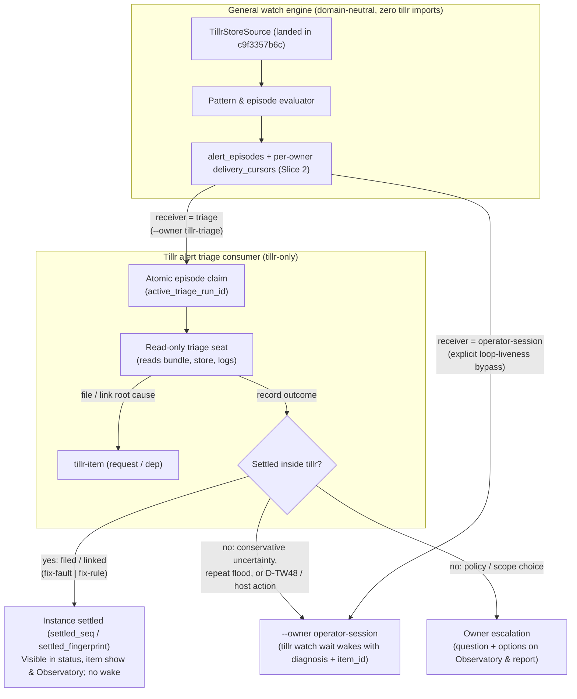

# Alert triage happens in a seat inside tillr, and only what it cannot settle reaches the operating session

**Status:** 2026-11-23. Accepted (`DECIDED`); all owner questions ([OQ-AT1](#OQ-AT1)–[OQ-AT3](#OQ-AT3) and companion [OQ-AW1](./tillr-watch-alert-workflow.md#OQ-AW1)–[OQ-AW3](./tillr-watch-alert-workflow.md#OQ-AW3)) were ruled by the owner on 2026-11-23 and compacted into the [Decision Ledger](#decision-ledger), and all seven build slices of this design (`item-request-100ea9b269` through `item-request-12ef582a85`) are filed as `--blocked-by`-chained ordinary queue items behind `item-request-d4e06efb9b`–`item-request-37c66283c7` ([§9](#9-the-build-in-slices-that-each-land-alone)). Read at `ff3f38b0e3`, Slice 1 of [the general agent watch design](./general-agent-watch.md) (`Observation`, `ObservationSource`, and `TillrStoreSource` in [`source.go`](../../tools/tillr/watch/source.go) and [`tillr_source.go`](../../tools/tillr/watch/tillr_source.go)) landed in `c9f3357b6c`, [`eval.go`](../../tools/tillr/watch/eval.go) reserves `active_triage_run_id TEXT` unused on `alert_episodes`, all 26 rules across the 23 files in `config/tillr/watch/` still set `receiver = "foreground"`, and `rg -n 'alert_episodes|watch\.alert' tools/tillr-drain tools/tillr-view` returns nothing. Only the owner's dated words quoted in [§1](#1-what-the-owner-said) are owner rulings ([R-AT1](#R-AT1)–[R-AT7](#R-AT7), [OQ-AT1](#OQ-AT1)–[OQ-AT3](#OQ-AT3)); every other choice (including seat/policy wiring, conservative escalation triggers, command shims, schema columns, and slice boundaries) is the designer's decision (`D-AT1`–`D-AT11`, from an operator request) and is marked so in prose and in the [Decision Ledger](#decision-ledger) for the owner to overturn.

> **In short.** Route standing `tillr-watch` episodes first to a dedicated, remedy-free `triage` seat on the cheap `scout` tier dispatched by `tillr-drain` ([OQ-AT1](#OQ-AT1)) that reads the evidence, settles clear single-instance cases by linking an existing item or filing one deduplicated `fix-fault` or `fix-rule` item (never dismissing benign triggers without a `fix-rule` item, [OQ-AT2](#OQ-AT2)), and escalates conservatively to `--owner operator-session` or `owner` whenever cause or item match is uncertain, when repeats flood an already-linked item without a silence, or when a host action or owner ruling is required — while loop-liveness rules route explicitly to `operator-session` with no timer promotion ([OQ-AT3](#OQ-AT3)).

**Why it matters.** On 2026-11-22 and 2026-11-23 every newly opened alert woke the operating session (the whale) to perform mechanical triage — reading event fields and timing or conflict logs, checking whether an item already tracked the cause, and filing or linking an item — spending foreground context on work a cheap `scout`-tier seat inside `tillr` can settle, while manual `ack` and `track` accumulated 14 episodes in `state = 'acknowledged'`.

**The shape.** A `tillr`-side triage consumer in `tillr-drain` dispatching a dedicated `triage` seat (`scout` tier, `policy.escalate["triage"] = []`, `max_concurrent_triage = 2`, no Git worktree) above [the general agent watch design](./general-agent-watch.md)'s domain-neutral watch engine and per-owner `delivery_cursors`, claiming each unsettled episode (active or auto-resolved per [OQ-AW2](./tillr-watch-alert-workflow.md#OQ-AW2)) at most once per observed instance via `active_triage_run_id`, enforcing a hard read-and-file-only boundary (zero remedies, zero `expected` dismissals), and escalating conservatively to `--owner operator-session` or `owner` with its diagnosis and `item_id` attached ([§2](#2-how-this-relates-to-the-general-agent-watch-design)–[§7](#7-how-every-triage-outcome-is-visible)).

**Cost.** One short `scout`-tier read-only triage run per newly opened or reopened `triage` instance, plus structured triage columns, conservative escalation wiring, and status/Observatory views so quiet in-`tillr` settlements remain auditable ([§4](#4-who-reads-each-new-alert-inside-tillr), [§7](#7-how-every-triage-outcome-is-visible)).

**Start at** [§1](#1-what-the-owner-said)–[§2](#2-how-this-relates-to-the-general-agent-watch-design) for the owner's rulings and the exact split with the general watcher, then [§4](#4-who-reads-each-new-alert-inside-tillr)–[§6](#6-what-must-be-handed-upward-to-whom-and-how) for the `scout`-tier `triage` seat, strict three-outcome boundary, and conservative escalation rules.

**Owner rulings:** all settled ([R-AT1](#R-AT1)–[R-AT7](#R-AT7), [OQ-AT1](#OQ-AT1)–[OQ-AT3](#OQ-AT3)).

**Designer's decisions (the owner may overturn any of them):** `D-AT1` to `D-AT11` in the [Decision Ledger](#decision-ledger) (built on once product-direction rulings are in per [`OQ-PR21`](../tillr/decision-provenance-review.md#OQ-PR21)).

**Reads with:** [the alert investigation and outcome workflow](./tillr-watch-alert-workflow.md) (whose single-instance `ack` and `settle`, mandatory investigation record, closed `silence` / `fix-rule` / `fix-fault` outcome set, item-linked bounded `watch_silences`, and [OQ-AW2](./tillr-watch-alert-workflow.md#OQ-AW2) unsettled auto-resolutions this triage consumer calls), [the general agent watch design](./general-agent-watch.md) (whose source-neutral engine and multi-owner `delivery_cursors` this builds on without duplicating), [the tillr-watch design](./tillr-watch.md) (whose deferred [OQ-TW4](./tillr-watch.md#OQ-TW4) seat-routing step this carries out under [OQ-TW2](./tillr-watch.md#OQ-TW2)'s no-remedy rule), and [what the operator settled without the owner is settled inside tillr](./operator-decisions-inside-tillr.md) (which defines the seven hand-action takers and what stays reserved for the owner).

**Words.** **Item**, **criterion**, **candidate**, **lane**, **seat**, and **verdict** keep their meanings from [the vocabulary](./tillr-vocabulary.md#5-the-words). **Episode**, **subject key**, **condition fingerprint**, and **`TimelineBundle`** keep their meanings from [the tillr-watch design](./tillr-watch.md#61-one-record-per-condition-never-per-pass-the-alert-episode-state-machine-d-tw5). **Observation**, **observation source**, and **watch state file** keep their meanings from [the general agent watch design](./general-agent-watch.md). **The whale** (the foreground operating agent session) keeps its meaning from [what the operator settled without the owner is settled inside tillr](./operator-decisions-inside-tillr.md). Three terms are coined here:

- **Alert triage** *(coined here)*: the remedy-free investigation of one newly opened, reopened, or unsettled auto-resolved alert instance inside `tillr` — reading its bundle and read-only store or log evidence, linking an existing tracking item or filing one deduplicated `fix-fault` or `fix-rule` request, and either settling that instance inside `tillr` or escalating it conservatively upward. It is not a repair run and never mutates worktrees, processes, holds, silences, or rules.
- **Triage settlement** *(coined here)*: recording on an unsettled episode that `tillr` has accounted for its current observed instance (`settled_seq`, `settled_fingerprint`, `settled_lag_pair`) by linking an existing item or filing a new `fix-fault` or `fix-rule` request (`filed` or `linked`; never an evidence-only `expected` note under [OQ-AT2](#OQ-AT2)), transitioning that instance out of pending triage without waking `--owner operator-session`.
- **Upward escalation** *(coined here)*: promoting an alert episode that alert triage cannot or should not settle alone inside `tillr` — because a host/manual action is needed, because cause or item match is uncertain under conservative escalation (`D-AT11`), because repeats are flooding an open item that only an operator may silence, or because an owner policy decision is required — to `--owner operator-session` or `owner`, carrying the triage run's evidence summary and any filed or linked `item_id`.

---

## 1. What the owner said

Two dated 2026-11-21 owner rulings frame this design verbatim:

1. **Problems the whale could settle without the owner belong inside `tillr` (2026-11-21, quoted in the filed request and in [what the operator settled without the owner is settled inside tillr](./operator-decisions-inside-tillr.md#1-the-ruling), `R-AT1`):**

   > "if you ever feel that you as the whale could solve some problem, and it wouldn't need to be escalated to me, then that problem should escalate to... a similarly responsible agent, process, ticket, whatever, within Tiller, rather than popping up to you."

2. **Watching finds and fixes root causes; it applies no remedies ([OQ-TW2](./tillr-watch.md#OQ-TW2), 2026-11-21, `R-AT2`):**

   > "Every single one of these sounds like a fallback to cover an issue. We don't cover issues. We use this to find the issues and fix them."

Three other standing 2026-11-20 through 2026-11-22 owner rulings bind how this seat works:

- **Seat dispatch is designed from live foreground triage experience, not guessed beforehand ([OQ-TW4](./tillr-watch.md#OQ-TW4), 2026-11-21, `R-AT3`).** When `tillr-watch` was first specified, [OQ-TW4](./tillr-watch.md#OQ-TW4) deferred `drain:<seat>` dispatch so every alert went first to the foreground agent while the system proved itself in use (`D-TW7` in [the tillr-watch design](./tillr-watch.md#63-mode-a-mechanical-answers-inside-tillr-and-non-wasting-drain-triage-d-tw7-oq-tw2-oq-tw4) was set aside until then). On 2026-11-22 that foreground record ran across the live rule set: nearly every wakeup was a mechanical check of event fields, logs, and existing queue items. This design fulfills [OQ-TW4](./tillr-watch.md#OQ-TW4)'s deferred second step.
- **Leftover work in a lane stays manual cleanup ([D-TW48](./tillr-watch.md#D-TW48), 2026-11-21, `R-AT4`):** *"this sweeper should actually be part of tiller watch because this should just be an alert that there's work left over. You can like then manually clean it and file the root cause, but there should not just be like work left over at a random time."* Triage may diagnose who left the work and file the root-cause defect, and must still hand the physical save-and-clean step to the operating session.
- **No silent fallbacks (2026-11-20, [the judge and lifecycle design](./tillr-judge-and-lifecycle.md#415-no-automatic-move-to-another-model-d-jl24-to-d-jl27), `R-AT5`), no work caps ([D-TW2](./tillr-watch.md#D-TW2)), and the closed three-outcome alert rule (2026-11-22, [`R-AW1`](./tillr-watch-alert-workflow.md#R-AW1), `R-AT6`).** Alerts settle only via a parameterized silence, `fix-rule`, or `fix-fault` (*"There shouldn't be a know about and don't file. There also shouldn't be an alert that we don't know why it fired, so we need an investigation and action."*), and if triage itself fails or cannot read its inputs, the alert surfaces loudly to the operating session rather than vanishing or retrying in a loop.

On 2026-11-23 (about 01:02 ET), the owner ruled on acknowledgement, item-linked silences, [OQ-AW1](./tillr-watch-alert-workflow.md#OQ-AW1)–[OQ-AW3](./tillr-watch-alert-workflow.md#OQ-AW3), and [OQ-AT1](#OQ-AT1)–[OQ-AT3](#OQ-AT3) verbatim (`R-AT7`):

> "Being able to acknowledge an alert just seems wrong. I mean, like, yes, you should be able to acknowledge it, but it shouldn't ignore it like you go and fix it. And it's only you should be able to acknowledge one instance of that event, although I guess you don't want to get flooded by... A million things, but we need to be able to parameterize what is ignored and that needs to then be linked to an item. And then that needs, once that item is in, that alert needs to be automatically, you know, unignored."
>
> "How do we have 14 things that are in this state right now?"
>
> "aw1. A. aw2. B. aw3. yes, they ahve to work the same way otherwise they have all the issues of unsilencable, they will be ignroed. at1. A. with conservative escalate options. at2. B. at3. A"

Three binding triage rules follow directly from those words:

1. **Dedicated `triage` seat on the cheap `scout` tier, dispatched by `tillr-drain` with conservative escalation options ([OQ-AT1](#OQ-AT1) = Option A).** `tillr-drain` dispatches a dedicated `triage` seat on the `scout` tier outside build lanes, and triage escalates conservatively upward whenever diagnosis or item matching is uncertain, when a single triage attempt fails, or when repeated instances need an operator-created silence (`D-AT11`).
2. **No `expected` / evidence-only settlement ([OQ-AT2](#OQ-AT2) = Option B).** A benign event that fires a rule is settled only by filing or linking a `fix-rule` item to fix the rule (or escalating upward when an item-linked silence is needed); there is no fourth `expected` outcome.
3. **Explicit loop-liveness routing with no timer promotion ([OQ-AT3](#OQ-AT3) = Option A).** Loop-liveness rules route explicitly to `receiver = "operator-session"`, with no untriaged-timeout timer promoting `triage` alerts.

Everything beyond these quoted owner rulings — the charter/policy entries, conservative escalation triggers (`D-AT11`), command allowlist shim, store columns, and build-slice boundaries — is the designer's decision (`D-AT1`–`D-AT11`, from an operator request) that the owner may overturn.

---

## 2. How this relates to the general agent watch design

[The general agent watch design](./general-agent-watch.md) separates the watch engine from `tillr` so any agent in any workspace can watch JSONL streams, plain-text logs, Git refs, or local processes without `.tillr/state.db` or `tillr-drain`. This document **does not re-specify** `ObservationSource`, non-`tillr` input adapters, `--state` SQLite tables, `agent_watches`, or cross-harness `wait`/`seen` mechanics; [the general agent watch design](./general-agent-watch.md) owns all of them.

Instead, alert triage builds strictly **above** that engine on the `tillr` side (`D-AT1`), preserving `D-GW9` (zero `tillr` imports and zero `tillr` domain concepts in the general watch engine):



Three exact seams connect the two designs without overlap:

1. **Built on landed Slice 1 (`c9f3357b6c`).** Read at `bba4ba277e`, [`source.go`](../../tools/tillr/watch/source.go) and [`tillr_source.go`](../../tools/tillr/watch/tillr_source.go) already extract `Observation`, `SourceCursor`, `ObservationSource` (`ReadWindow`, `Project`, `WatchTargets`), `prepareSourceRule`, and `TillrStoreSource` (reading `.tillr/state.db` `events` and `items` / `charter` / `workflow_selections` projections). Alert triage adds nothing to `ObservationSource`; it consumes the episodes and `<= 8 KiB` `TimelineBundle` records that `Evaluator` already produces from `TillrStoreSource`.
2. **Built on Slice 2's multi-owner `delivery_cursors` ([§6 of the general agent watch design](./general-agent-watch.md#6-where-episodes-cursors-and-overrides-live)).** Today [`delivery.go`](../../tools/tillr/watch/delivery.go) and [`status.go`](../../tools/tillr/watch/status.go) track per-owner `seen_seq`/`shown_seq` rows in `foreground_delivery(owner_handle)` (`63c241ec5b`), while still filtering rules to `r.Delivery.Receiver == "foreground"` (and in-memory `memoryState` in [`source.go`](../../tools/tillr/watch/source.go) does the same). Once Slice 2 generalizes `delivery_cursors` so each `--owner <handle>` receives episodes matching its `receiver`, `tillr` separates two distinct watch receivers with zero `tillr`-specific code inside the watch engine:
   - `--owner tillr-triage` consumes standing rules with `receiver = "triage"`;
   - `--owner operator-session` consumes direct liveness rules (`receiver = "operator-session"`) plus episodes explicitly promoted to `operator-session` by triage escalation ([§6](#6-what-must-be-handed-upward-to-whom-and-how)).
3. **Compatible with either answer to [OQ-GW3](./general-agent-watch.md#OQ-GW3) (sidecar `watch.db` vs `.tillr/state.db`).** Because the triage consumer claims episodes, reads pending bundles, and records triage outcomes through `tillr-watch`'s contracted faces ([the tillr-watch contract](./tillr-utility-contracts/tillr-watch.md)) while writing defect requests and item links through `tillr-item` into `.tillr/state.db`, moving watch tables to a sidecar `.tillr/watch.db` (Option A of [OQ-GW3](./general-agent-watch.md#OQ-GW3)) or keeping them in `.tillr/state.db` (Option B) changes zero triage behavior. An agent outside `tillr` using `--state` never sees triage seats, queue items, or `escalated_to` targets; `tillr` layers them cleanly on top.

---

<a id="3-sorting-the-23-live-rules-by-what-settles-them"></a>
## 3. Sorting the 26 live rules by what settles them

Read at `ff3f38b0e3`, `config/tillr/watch/` holds 23 TOML files defining 26 rules, every one currently setting `receiver = "foreground"`. Sorting all 26 rules against the owner's rulings ([§1](#1-what-the-owner-said)) assigns every rule an explicit receiver (`D-AT2` — designer's decision; the owner may overturn it):

| Group | Live rules (`config/tillr/watch/`) | What triage does inside `tillr` | Reaches `operator-session` or `owner`? |
| :--- | :--- | :--- | :--- |
| **A. Settleable inside `tillr` (`receiver = "triage"`, 15 rules)** | `fast-gate-run-slow`, `fast-gate-median-slow` ([`fast-gate-slow.toml`](../../config/tillr/watch/fast-gate-slow.toml)); `gate-repeated-stall` ([`gate-repeated-stall.toml`](../../config/tillr/watch/gate-repeated-stall.toml)); `land-squash-conflict` ([`land-squash-conflict.toml`](../../config/tillr/watch/land-squash-conflict.toml)); `drain-repeated-item-conflicts` ([`drain-repeated-item-conflicts.toml`](../../config/tillr/watch/drain-repeated-item-conflicts.toml)); `drain-repeated-verifier-refusals` ([`drain-repeated-verifier-refusals.toml`](../../config/tillr/watch/drain-repeated-verifier-refusals.toml)); `drain-plan-output-unparseable` ([`drain-plan-output-unparseable.toml`](../../config/tillr/watch/drain-plan-output-unparseable.toml)); `drain-repeated-step-dispatches` ([`drain-repeated-step-dispatches.toml`](../../config/tillr/watch/drain-repeated-step-dispatches.toml)); `drain-dispatch-declined` ([`drain-dispatch-declined.toml`](../../config/tillr/watch/drain-dispatch-declined.toml)); `drain-item-fault` ([`drain-item-fault.toml`](../../config/tillr/watch/drain-item-fault.toml)); `drain-judge-unreadable` ([`drain-judge-unreadable.toml`](../../config/tillr/watch/drain-judge-unreadable.toml)); `drain-store-busy` ([`drain-store-busy.toml`](../../config/tillr/watch/drain-store-busy.toml)); `drain-trunk-fixer-filed` ([`drain-trunk-fixer-filed.toml`](../../config/tillr/watch/drain-trunk-fixer-filed.toml)); `drain-landing-reverted` ([`drain-revert.toml`](../../config/tillr/watch/drain-revert.toml)); `run-model-timeout` ([`run-model-timeout.toml`](../../config/tillr/watch/run-model-timeout.toml)) | Reads the `TimelineBundle`, `tillr drain why`, and named timing/run/heavy logs; checks open and recently landed items; links the instance to the existing item that owns the exact cause or files one deduplicated `fix-fault` / `fix-rule` request; settles that instance. | **No** when cause and item ownership are unambiguous. Escalates conservatively (`D-AT11`) whenever cause or item match is uncertain, when `reopen_count_for_item >= 3` needs an operator-created silence, or when a live external blockage (`run-model-timeout` wedging a lane, external SQLite lock in `drain-store-busy`) needs hand intervention. |
| **B. Diagnose + file inside `tillr`, then escalate live action, backend check, or policy (`receiver = "triage"`, 9 rules)** | `drain-lane-refused` ([`drain-lane-refused.toml`](../../config/tillr/watch/drain-lane-refused.toml)); `drain-trunk-core-worktree` ([`drain-trunk-core-worktree.toml`](../../config/tillr/watch/drain-trunk-core-worktree.toml)); `drain-revert-not-possible` ([`drain-revert.toml`](../../config/tillr/watch/drain-revert.toml)); `drain-heavy-fault` ([`drain-heavy-fault.toml`](../../config/tillr/watch/drain-heavy-fault.toml)); `trunk-proof-lag`, `trunk-proof-stalled` ([`trunk-proof-lag.toml`](../../config/tillr/watch/trunk-proof-lag.toml)); `drain-obstacle-hold` ([`drain-obstacle-hold.toml`](../../config/tillr/watch/drain-obstacle-hold.toml)); `drain-backend-closed` ([`drain-backend-closed.toml`](../../config/tillr/watch/drain-backend-closed.toml)); `drain-unrequested-start` ([`drain-unrequested-start.toml`](../../config/tillr/watch/drain-unrequested-start.toml)) | Reads the fault, proof directory, goroutine stacks, `left_by` run, backend error, restart provenance, or hold record; files or links the root-cause `fix-fault` or `fix-rule` item first ([OQ-AT2](#OQ-AT2) = Option B: even a benign `just tillr-restart` triggering `drain-unrequested-start` files or links `fix-rule` rather than dismissing as `expected`); settles quietly **only** when an in-`tillr` mover already owns the condition with no host action needed, and otherwise escalates with diagnosis and `item_id` attached. | **Yes, whenever live intervention, backend/credential recovery, or an owner ruling is needed:** `operator-session` for [D-TW48](./tillr-watch.md#D-TW48) manual lane cleanup, `.git/config` `core.worktree` corruption, unrevertable trunk breakage, stuck proof worktrees, unexpected duplicate loop starts, or closed core backends; `owner` when `drain-obstacle-hold` names `mover == "owner"` or `drain-backend-closed` stems from expired credentials/quota. |
| **C. Loop-liveness alerts (`receiver = "operator-session"`, 2 rules)** | `drain-loop-no-pass` ([`drain-loop-no-pass.toml`](../../config/tillr/watch/drain-loop-no-pass.toml)); `drain-loop-fault` ([`drain-loop-fault.toml`](../../config/tillr/watch/drain-loop-fault.toml)) | `drain-loop-no-pass` and `drain-loop-fault` fire precisely when `tillr-drain loop` is stopped or faulted, so an in-drain triage seat cannot wake for them ([§4.3](#43-explicit-loop-liveness-routing-with-no-timer-promotion)). | **Direct to `operator-session` ([OQ-AT3](#OQ-AT3) = Option A)** with no timer promotion, so a dead loop wakes the whale immediately. |

Even on Group B alerts that still wake the operating session (`drain-lane-refused`, `drain-trunk-core-worktree`, `drain-backend-closed`, or a stuck proof), the whale no longer wakes cold: triage has already read `left_by`, the backend error, or the goroutine stack, deduplicated and filed the root-cause defect item, and attached `item_id` to the notice so the whale performs only the physical host or preservation step.

---

## 4. Who reads each new alert inside tillr

### 4.1 The `triage` seat on the `scout` tier and its isolation

Standing `tillr` rules in Groups A and B declare `receiver = "triage"`, while Group C loop-liveness rules declare `receiver = "operator-session"` (`D-AT2`).

Under the owner's 2026-11-23 ruling on [OQ-AT1](#OQ-AT1) (*"at1. A. with conservative escalate options."*), alert triage runs on a **dedicated `triage` seat mapped to the cheap `scout` tier and dispatched by `tillr-drain` outside build lanes** (`D-AT3`, `D-AT11` — charter/policy wiring and concurrency limits are the designer's decisions; the owner may overturn them):

1. **Charter and backend-policy seat declaration ([OQ-AT1](#OQ-AT1) = Option A).**
   - [`tools/tillr/definition/landing.json`](../../tools/tillr/definition/landing.json) adds `"triage"` to `seats` as an internal read-and-file alert-investigation seat.
   - [`config/tillr/backend-policy.json`](../../config/tillr/backend-policy.json) (and its sibling policy files [`config/tillr/backend-policy.mixed.json`](../../config/tillr/backend-policy.mixed.json), [`config/tillr/backend-policy.claude.json`](../../config/tillr/backend-policy.claude.json), [`config/tillr/backend-policy.claude-copilot.json`](../../config/tillr/backend-policy.claude-copilot.json), [`config/tillr/backend-policy.copilot.json`](../../config/tillr/backend-policy.copilot.json), [`config/tillr/backend-policy.gemini.json`](../../config/tillr/backend-policy.gemini.json), and [`config/tillr/backend-policy.bedrock.json`](../../config/tillr/backend-policy.bedrock.json)) maps `"seats": { ..., "triage": "scout" }` and sets `"escalate": { ..., "triage": [] }` — **zero automatic model-tier retries**. If the `scout`-tier triage seat is uncertain, hits an unreadable input, or finds its `scout` backend closed, it escalates the episode upward to `operator-session` rather than silently retrying or burning higher tiers ([R-AT5](#R-AT5), `D-AT11`).
2. **No Git lane worktree and zero build-lane contention.** Triage edits no tracked repository files and produces no Git commit candidate. It runs against a read-only view of `--root` with its working writes restricted to its own run scratch directory (`TILLR_RUN_SCRATCH`), never occupying `lane-1..N` or `express-1..2` and never leaving dirty worktrees behind.
3. **Bounded triage concurrency, independent of jammed build lanes.** Up to `max_concurrent_triage` runs (default `2`) may run in parallel inside `tillr-drain` so a burst of alerts is drained promptly even when every ordinary and express build lane is busy with long worker turns, without spawning an unbounded storm if 20 episodes open on one pass.
4. **One unsettled episode instance per run.** Each triage run receives one claimed episode's `alert_id`, `rule_id`, `subject_key`, `variables_json`, `condition_fingerprint`, `reopen_count_for_item`, and `<= 8 KiB` `TimelineBundle` (plus recent active episodes and active `watch_silences` for cross-episode correlation) and must terminate with one structured triage record for that `alert_id`.

### 4.2 Transition-driven trigger and the `active_triage_run_id` invariant

Reactivating and completing the precondition reserved on `alert_episodes` in [`eval.go`](../../tools/tillr/watch/eval.go) (`D-TW7`, [§6.1 of the tillr-watch design](./tillr-watch.md#61-one-record-per-condition-never-per-pass-the-alert-episode-state-machine-d-tw5)) and aligning with single-instance settlement ([`D-AW5`](./tillr-watch-alert-workflow.md#D-AW5)) and unsettled auto-resolutions ([`OQ-AW2`](./tillr-watch-alert-workflow.md#OQ-AW2) = Option B), triage is strictly **transition-driven** (`D-AT4`):

- **Eligible for claim:** An episode is eligible for triage if and only if:
  1. the rule's effective `receiver` is `"triage"`;
  2. `state = 'open'` **or** (`state = 'resolved'` and `settlement_state = 'uninvestigated'`, covering episodes that auto-resolved via `condition-cleared` or `item-<state>` before triage claimed them under [`OQ-AW2`](./tillr-watch-alert-workflow.md#OQ-AW2) = Option B);
  3. `active_triage_run_id IS NULL`; and
  4. `triage_state` is `'untriaged'` (newly opened on `watch.alert.opened`, or reopened on `watch.alert.reopened` with `cause = "new-instance"`, `"silence-item-*"`, `"silence-expired"`, `"fingerprint-changed"`, or `"recurred-after-item-*"`).
- **Atomic single-claim (`IMMEDIATE` transaction):** Before starting a triage run, `tillr-drain` claims the episode in one atomic write (`UPDATE alert_episodes SET active_triage_run_id = ?, triage_state = 'triaging', settlement_state = CASE WHEN settlement_state = 'uninvestigated' THEN 'investigating' ELSE settlement_state END WHERE alert_id = ? AND active_triage_run_id IS NULL AND triage_state = 'untriaged' AND (state = 'open' OR (state = 'resolved' AND settlement_state = 'uninvestigated'))`). Two passes racing on the same episode cannot both claim it.
- **Zero repeat runs on the same already-settled window.** While evaluation re-reads the exact same settled event sequence (`newest.Seq == settled_seq`), `condition_fingerprint == triaged_fingerprint`, and unchanged `lag_behind` pair, `triage_state` stays `'settled'` (or `'escalated'`).
- **Re-triage on a new instance (when unsilenced).** When a newer matching event (`newest.Seq > settled_seq`), changed `condition_fingerprint`, or changed `lag_behind` pair arrives with **no active `watch_silences` row**, `Evaluator` reopens the episode (`cause = "new-instance"`) and resets `triage_state = 'untriaged'` so the new instance is checked rather than silently ignored ([`R-AW4`](./tillr-watch-alert-workflow.md#R-AW4)).

<a id="43-why-loop-liveness-alerts-never-wait-on-a-stopped-loop"></a>
### 4.3 Explicit loop-liveness routing with no timer promotion

Because `tillr-drain` claims and dispatches triage runs ([OQ-AT1](#OQ-AT1) = Option A), routing `drain-loop-no-pass` or `drain-loop-fault` to `receiver = "triage"` would deadlock: when the drain loop is down, nothing inside `tillr-drain` is alive to triage the alert saying the drain loop is down.

Under the owner's 2026-11-23 ruling on [OQ-AT3](#OQ-AT3) (*"at3. A"*), loop-liveness routing is **explicit on the rules with zero timer-based promotion** (`D-AT5`):

- Rules whose subject is the liveness of `tillr-drain` itself (`drain-loop-no-pass` and `drain-loop-fault`) explicitly set `receiver = "operator-session"`.
- `tillr watch lint` enforces a static rule check (`watch-lint-liveness-receiver`): any rule watching `drain.loop-pass` absence or `drain.loop-ended` with `receiver = "triage"` is rejected at lint and load time.
- **No untriaged-timeout promotion timer is added ([OQ-AT3](#OQ-AT3) = Option A).** Non-liveness `receiver = "triage"` episodes wait cleanly for `tillr-drain` to claim them rather than introducing an arbitrary 5-minute fallback timer, while the operating session's `tillr watch wait ... --owner operator-session` wakes directly on `drain-loop-no-pass` and `drain-loop-fault` whenever the loop stops.

---

## 5. What the triage seat may do — and what it must never do

The owner's ruling on [OQ-TW2](./tillr-watch.md#OQ-TW2) (*"We don't cover issues. We use this to find the issues and fix them"*) is enforced on the triage seat as a **mechanical command and filesystem boundary**, not merely as prompt advice (`D-AT6`).

### 5.1 Permitted actions

A triage run has exactly four capabilities:

1. **Read the alert and read-only repository/store evidence.**
   - Inspects the episode's `TimelineBundle` (provided in its brief).
   - Runs read-only `tillr` inspection commands: `tillr view` (`events`, `status`, `waiting`, `passes`, `lanes`, `running`, `trace`), `tillr item` (`list`, `show`, `verdict`), `tillr run status`, `tillr drain why`, and `tillr watch status`.
   - Reads run logs (`.tillr/lanes/<lane>/<run>.log`), gate timing records (`gate.timing.jsonl`), after-merge heavy proof verdicts (`.git/tillr-gate/heavy.json`), and read-only Git history (`git log`, `git show`, `git diff`, `git rev-parse` with `GIT_OPTIONAL_LOCKS=0`).
2. **Deduplicate against open and recently landed queue items.**
   - Searches active items (`in-queue`, `running`, `blocked`) and recent landings to check whether an item already owns the root cause — for instance, an open `fixer-main-*` item for `drain-trunk-fixer-filed` or `drain-landing-reverted`, an active split/conflict-repair item, or a defect request already filed by an earlier alert or worker `tooling` obstacle ([§5.1 of operator decisions inside tillr](./operator-decisions-inside-tillr.md#51-a-hold-answered-with-a-technical-decision)).
   - Deduplication requires matching **evidence of the same cause** (the same failing check ID, conflicting path pair, fault reason and step, or adapter error), never a vague title similarity ([§5.3 of operator decisions inside tillr](./operator-decisions-inside-tillr.md#53-an-item-whose-fix-already-landed)).
3. **File one defect request or link an existing item.**
   - **Link (`tillr item` / episode link):** Associates `alert_id` with the existing `item_id` that already tracks the cause. Where the alert reveals that a held item is waiting on that open defect and lacks the dependency edge, triage may record `tillr item dep --add <defect-item>` when the store events establish the wait.
   - **File (`tillr item request`):** When no item tracks the root cause, files **one** defect request carrying:
     - what happened, with timestamps, event sequences, and log or check evidence;
     - the single defect to fix ("change nothing else");
     - actor provenance (`filed_by = "tillr-triage"`, `source_alert_id = <alert_id>`, `dedup_key = <rule_id>:<cause_key>`) so two concurrent triage runs diagnosing the same underlying bug coalesce onto one item rather than filing duplicates.
     Express vs ordinary routing follows the repository's standing defect rules: loop-stopping or trunk-blocking defects file as express (`--to first` only when blocking active work); non-blocking regressions such as a 62-second fast gate file as ordinary requests.
4. **Record the structured triage finding on the episode.**
   - Concludes by invoking the single outcome-recording face on `tillr-watch`, writing one of the outcomes in [§5.3](#53-the-structured-triage-outcomes) and advancing `--owner tillr-triage`'s `seen_seq`.

### 5.2 Forbidden actions (hard mechanical boundary)

The triage seat **must never apply a remedy, clear a state, or alter work scope**:

| Category | Explicitly forbidden to the triage seat | Why |
| :--- | :--- | :--- |
| **Worktree & Git state** | Editing tracked files; `git commit`, `git reset`, `git checkout`, `git clean`; `git worktree add/remove/unlock/prune`; `git config` writes (including unsetting `core.worktree`). | Cleaning a lane ([D-TW48](./tillr-watch.md#D-TW48)), unlocking a worktree ([OQ-OD1](./operator-decisions-inside-tillr.md#OQ-OD1)), or editing code from triage either destroys evidence or bypasses gated item workflows. |
| **Process & loop control** | `kill`, `pkill`, `killall`; `tillr drain stop`, `tillr drain loop`, `tillr drain scale`; `tillr-keep --stop`; `tillr run release`. | Stopping workers, scaling lanes, or restarting daemons is operational control, not finding and filing root causes ([OQ-TW2](./tillr-watch.md#OQ-TW2)). |
| **Hold, fault & item lifecycle** | `tillr drain retry`, `tillr drain clear-fault`; `tillr item close`, `tillr item reopen`, `tillr item state`, `tillr item place`, `tillr item verdict`. | Answering holds, clearing faults, and closing items belong to the dedicated takers and closing checks of [what the operator settled without the owner is settled inside tillr](./operator-decisions-inside-tillr.md#5-the-seven-kinds), never to an alert watcher. |
| **Watch suppression** | `tillr watch silence`, `tillr watch resolve`, `tillr watch rule disable/tune/set/reset`, `tillr watch drop`. | Muting or retuning rules from triage would let the seat silence its own alerts instead of fixing their causes. |

**Enforcement:** The triage seat's execution environment mounts/binds repository checkouts read-only (outside its run scratch directory) and wraps `tillr` / `git` through a restricted command shim (sharing the mechanism of [preventative shell shims for lane workers](./tillr-lane-shims.md)) that rejects every mutating subcommand above with exit code `2`.

### 5.3 The structured triage outcomes

Under the owner's 2026-11-23 ruling on [OQ-AT2](#OQ-AT2) (*"at2. B."*), there is **no fourth `expected` / evidence-only settlement**. Every triage run ends by recording one of **three** structured outcomes on `alert_id` (`D-AT7` — schema and CLI shape are the designer's decisions; the owner may overturn them), writing into the shared investigation and `tracking_item_id` schema of [the alert investigation and outcome workflow](./tillr-watch-alert-workflow.md#33-step-2--the-closed-set-of-three-outcomes) ([D-TW65](./tillr-watch.md#D-TW65)):

| Outcome | Required fields | Episode transition | Wakes `operator-session`? |
| :--- | :--- | :--- | :--- |
| **`filed`** | `item_id` (newly created defect or rule-fix item), `outcome_kind` (`"fix-fault"` or `"fix-rule"`), `finding` (citing event `seq` / log evidence) | `state` -> `acknowledged` (unless already `'resolved'`, `acked_by = "tillr-triage"`), `triage_state = "settled"`, `settlement_state = "settled"`, `tracking_item_id = item_id`, `settled_seq = last_observed_seq`, `triaged_fingerprint = condition_fingerprint`, `active_triage_run_id = NULL` | **No** |
| **`linked`** | `item_id` (existing open or post-observation landed item that owns this exact cause), `outcome_kind` (`"fix-fault"` or `"fix-rule"`), `finding` (citing concrete proof why `item_id` covers this instance) | Same as `filed` | **No** *(unless conservative repeat-flood escalation also sets `escalate_to = "operator-session"`, see `D-AT11`)* |
| **`escalated`** | `escalate_to` (`"operator-session"` or `"owner"`), `finding`, `action_needed` (or `question` + `options` for `"owner"`), optional `item_id` + `outcome_kind` (required whenever a concrete root-cause code or rule defect was identified) | `state` stays `open` (or `'resolved'` if auto-resolved under [`OQ-AW2`](./tillr-watch-alert-workflow.md#OQ-AW2)), `triage_state = "escalated"`, `settlement_state = "settled"` if `item_id` is attached else `"investigated"` (unsettled), `triaged_fingerprint = condition_fingerprint`, `active_triage_run_id = NULL`; appends `watch.alert.escalated` | **Yes** — immediately pending on `--owner operator-session` |

**Benign triggers settle via `fix-rule`, never `expected` ([OQ-AT2](#OQ-AT2) = Option B).** When a rule fires on a routine operation such as `just tillr-restart` firing `drain-unrequested-start`, the rule itself is missing the predicate or signal needed to distinguish requested restarts from unexpected starts. Triage either links an existing open `fix-rule` item (such as `item-request-2f9dd43db2`) or files a `fix-rule` item to fix the rule — never dismissing the alert with prose alone.

---

## 6. What must be handed upward, to whom, and how

Under the owner's 2026-11-23 ruling on [OQ-AT1](#OQ-AT1) (*"at1. A. with conservative escalate options."*), the cheap `scout`-tier `triage` seat settles only clear, high-confidence single-instance `fix-fault` or `fix-rule` matches inside `tillr` and **escalates conservatively** whenever confidence, authority, or host reachability is missing (`D-AT8`, `D-AT11` — the specific conservative trigger rules below are the designer's decisions; the owner may overturn them).

### 6.1 Handed to the operating session (`escalate_to = "operator-session"`)

The triage seat hands an episode to `--owner operator-session` in five situations (`D-AT8`, `D-AT11`):

1. **Conservative diagnosis, item-match, or silence-choice uncertainty (`D-AT11`).**
   - *Ambiguous root cause or item match:* whenever log/event evidence is incomplete, two distinct causes remain plausible, or it is uncertain whether a new instance shares the exact root cause of an open queue item, triage records its `finding` (`settlement_state = 'investigated'`) and escalates (`escalate_to = "operator-session"`) rather than guessing `linked` or filing a speculative ticket.
   - *Rule-intent or silence vs fix ambiguity:* whenever suppressing a noisy binding requires choosing an item-linked `tillr watch silence` ([`R-AW5`](./tillr-watch-alert-workflow.md#R-AW5), forbidden to triage under `D-AT6`) or judging whether a rule threshold reflects intended policy, triage escalates with concrete options.
   - *Repeat flood on an already-linked open item (`reopen_count_for_item >= 3`):* because `settle` covers one instance rather than muting future instances ([`R-AW4`](./tillr-watch-alert-workflow.md#R-AW4), [`D-AW5`](./tillr-watch-alert-workflow.md#D-AW5)) and triage cannot create silences (`D-AT6`), once an open `tracking_item_id` reopens `>= 3` times with no active `watch_silences` row, triage links the instance and escalates to `operator-session` with the exact `tillr watch silence <alert-id> --item <item-id> --until <dur>` template so the operator decides whether to place a bounded silence.
2. **Manual preservation and workspace hygiene reserved for the operator.**
   - `drain-lane-refused`: under owner ruling [D-TW48](./tillr-watch.md#D-TW48), leftover work in a lane must be inspected, saved if needed, and cleaned by hand. Triage first inspects `left_by`, files or links the root-cause defect `item_id` explaining *how* the work was left behind, and then escalates to `operator-session` naming the lane, `left_by`, and `item_id`.
   - `drain-trunk-core-worktree`: shared `.git/config` has `core.worktree` set, halting the loop on `"trunk checkout unsafe"`. Triage identifies the offending run directory from the event, files or links the defect item against the leaky test/runner, and escalates to `operator-session` to back up `.git/config` and unset `core.worktree`.
3. **Live process, backend, or external lock/proof blockage that stops progress now.**
   - `drain-loop-no-pass` and `drain-loop-fault` (delivered straight to `operator-session` via [§4.3](#43-explicit-loop-liveness-routing-with-no-timer-promotion) under [OQ-AT3](#OQ-AT3) = Option A).
   - `drain-backend-closed` or `drain-unrequested-start` when a core backend is closed or an unexpected duplicate loop process may be running on the host.
   - `trunk-proof-lag`, `trunk-proof-stalled`, `drain-heavy-fault`, or `drain-revert-not-possible` **when** no active trunk fixer or running proof is advancing the trunk — for example, a missing-but-locked proof worktree or a wedged process outside automatic recovery. Triage reads the goroutine stack or fault detail, files/links the defect item, and escalates the live blockage.
   - `run-model-timeout` or `drain-store-busy` **when** the run or external lock holder is still actively wedging a lane or the SQLite store with zero progress; triage files/links the root-cause defect first and escalates the live PID/run details.
4. **An operator-addressed hold on a pre-migration path.**
   - Until every slice of [what the operator settled without the owner is settled inside tillr](./operator-decisions-inside-tillr.md#12-the-build-in-slices-that-each-land-alone) has landed, if `drain-obstacle-hold` fires with `mover == "operator"`, triage checks whether the hold still awaits an operator retry and escalates it with the relevant code/store context gathered. Once those slices land, `mover == "operator"` disappears ([§7 of operator decisions inside tillr](./operator-decisions-inside-tillr.md#7-what-the-operator-still-does)) and any residual `mover == "operator"` event is filed as a drain defect and escalated.
5. **Single-attempt triage failure or closed `scout` backend (loud escalation, zero retries, zero silent drop).**
   - With `policy.escalate["triage"] = []` (`D-AT11`), if the `scout`-tier backend is closed, or the triage run exits non-zero, times out, fails to record a valid outcome, crashes, or hits an unreadable store/log error, `tillr-drain` clears `active_triage_run_id`, records `triage_outcome = "triage-failed"`, and **immediately appends `watch.alert.escalated` to `operator-session`** carrying the original `TimelineBundle` plus the triage run's error (`D-AT8`). A broken or unreachable triage seat degrades immediately to waking the whale — never to model fallback or silence.

### 6.2 Handed to the owner (`escalate_to = "owner"`)

Following the exact seven-item boundary in [§6 of what the operator settled without the owner is settled inside tillr](./operator-decisions-inside-tillr.md#6-what-is-the-owners), triage escalates to `owner` when and only when settling the alert requires:

- weakening, narrowing, or dropping what the owner asked for;
- resolving a contradiction between two owner statements;
- reordering queue work other than a recorded `blocked_by` blocker;
- choosing new work when ordered work is exhausted ([OQ-OD2](./operator-decisions-inside-tillr.md#OQ-OD2));
- credentials, subscriptions, spend limits, or host permissions outside the repository;
- an irreversible destructive or external-publishing act; or
- changing seat existence or model-to-seat policy (including `drain-obstacle-hold` where `mover == "owner"`).

Neither the triage seat nor the whale guesses an owner decision (`c4`): `escalate_to = "owner"` requires a structured `question` and concrete `options` (or links the open `owner` hold already carrying them so duplicate questions are never minted).

### 6.3 The upward delivery wire

Upward escalation reuses the exact harness-neutral `wait` + `seen` protocol from [§7 of the general agent watch design](./general-agent-watch.md#7-how-an-agent-in-any-harness-is-woken) (`D-AT8`):

1. **Same background watcher for the whale.** The operating session keeps running one `tillr watch wait --store .tillr/state.db --root /workspace --rules config/tillr/watch --owner operator-session` watcher ([the timed drain check-in skill](../../.agents/skills/drain-timed-checkin/SKILL.md#start-or-resume)).
2. **Filtered to unsettled upward notices (no timer promotion per [OQ-AT3](#OQ-AT3) = Option A).** For `--owner operator-session`, `Pending` returns only:
   - unsettled episodes of rules with `receiver = "operator-session"` (loop liveness); and
   - episodes of `receiver = "triage"` rules where `watch.alert.escalated` has `seq > seen_seq("operator-session")` (whether `escalated_to` is `"operator-session"` or `"owner"`, plus `unsettled_remind_after` reminders if still unsettled per [§6 of `tillr-watch-alert-workflow.md`](./tillr-watch-alert-workflow.md#6-making-unsettled-alerts-unmistakable--and-showing-every-alert-transition-and-linked-item-in-the-observatory)).
   Episodes still `untriaged` or `triaging` and instances `settled` inside `tillr` do **not** wake `operator-session`.
3. **Enriched `<= 8 KiB` notice bundle.** When `watch.alert.escalated` wakes `operator-session`, `buildBundle` includes a `triage` block at the top of the JSON notice and human summary (ahead of raw event lines in the `8 KiB` truncation ladder so triage conclusions are never truncated before raw events):
   - `triage_run_id`, `outcome` (`"escalated"` or `"triage-failed"`), and `escalated_to` (`"operator-session"` | `"owner"`);
   - `item_id` (the root-cause defect item already filed or linked by triage, if any);
   - `finding` (the evidence read and root cause established);
   - `action_needed` (for `"operator-session"`) or `question` + `options` (for `"owner"`).
4. **Crash-safe confirmation.** As with all `wait` notices ([D-TW11](./tillr-watch.md#D-TW11)), printing advances `shown_seq` only; `seen_seq` for `operator-session` advances only when the whale re-arms with `--seen-through <seq>` or runs `tillr watch seen`, so a lost turn or compaction never drops an escalated alert.

---

## 7. How every triage outcome is visible

Settling mechanical alerts inside `tillr` removes noisy wakeups, **not** visibility. An operator at a 15-minute check-in or the owner opening the Observatory can inspect every alert, the evidence read, and what became of it across four surfaces (`D-AT9`):

1. **`tillr watch status` (text and `--json`).**
   - Each episode row in `Alerts` (`status.go`) gains structured triage fields:
     ```json
     {
       "alert_id": "alrt-01950a2c",
       "rule_id": "fast-gate-run-slow",
       "subject": "go-affected",
       "state": "acknowledged",
       "settlement_state": "settled",
       "severity": "warning",
       "opened": "2026-11-23T05:10:04Z",
       "observed": 4,
       "by": "tillr-triage",
       "triage": {
         "state": "settled",
         "outcome": "linked",
         "outcome_kind": "fix-fault",
         "run_id": "run-triage-alrt-01950a2c-1",
         "item_id": "item-request-8f21bc04d1",
         "finding": "gate.timing.jsonl in run-item-request-44a1 shows go-affected at 64.2s; already tracked by open item-request-8f21bc04d1."
       }
     }
     ```
   - Text output appends concise key-value pairs (`triage=settled outcome=linked kind=fix-fault item="item-request-8f21bc04d1" run="run-triage-alrt-01950a2c-1"`, or `triage=escalated to=operator-session item="item-request-..."`), plus a one-line summary roll-up (`triage_summary: active=3 untriaged=0 triaging=0 settled=2 escalated=1`) and optional `--recent <window>` so episodes that opened, were triaged, and auto-resolved between check-ins are visible in one command without digging through raw event logs.
2. **Event log (`watch.alert.triage-started`, `watch.alert.triaged`, `watch.alert.escalated`).**
   - Every claim, settlement, failure, and upward escalation writes an immutable event carrying `alert_id`, `rule_id`, `subject_key`, `condition_fingerprint`, `run_id`, `outcome`, `outcome_kind`, `item_id`, `escalated_to`, and `finding`, readable via `tillr view events` and `tillr store events` (or `watch_events` under `--state`).
3. **Item cross-reference (`tillr item show` and `tillr drain why`).**
   - Filing (`filed`) or linking (`linked` / `escalated` with `item_id`) writes an alert-to-item link on the item record (`linked_alerts`: `[{alert_id, rule_id, subject_key, opened_at, outcome, outcome_kind}]`). Running `tillr item show <item_id>` or `tillr drain why <item_id>` shows every watch episode that pointed to that item, and `tillr watch status` links straight back to `<item_id>`.
4. **Observatory (`tillr-view`).**
   - Adds an **Alerts** strip and view consuming `tillr-watch`'s contracted status/event records (unified with [§6 of `tillr-watch-alert-workflow.md`](./tillr-watch-alert-workflow.md#6-making-unsettled-alerts-unmistakable--and-showing-every-alert-transition-and-linked-item-in-the-observatory)):
     - *Unsettled & Needs attention* at the top shows unsettled and `escalated` episodes (`to: owner` with their question and options; `to: operator-session` with `action_needed` and clickable `item_id`);
     - *Settled in tillr* shows quiet `filed` / `linked` (`fix-fault` / `fix-rule`) instances and *Active Silences* (`watch_silences` rows with rule, variable binding, linked `item_id`, and bound), with one-click links to the triage run transcript and the tracking queue item.

---

## 8. Edge cases, concurrency, and failure modes

| Case | Deterministic behavior |
| :--- | :--- |
| **Zero open or unsettled alerts** | Zero triage runs dispatch; `tillr-drain` sleeps on event/WAL advances with zero model spend. |
| **Burst of 25 episodes opening in one pass** | Episodes already deduplicate per `(rule_id, subject_key)`. Up to `max_concurrent_triage` (default `2`) episodes are claimed in `opened_seq` order; the rest stay visibly `triage_state = "untriaged"` and dispatch as each short `scout`-tier triage run finishes, without touching build lanes. |
| **Two alerts open simultaneously for the same underlying bug** (e.g. `fast-gate-run-slow` and `fast-gate-median-slow`) | Each run computes or supplies `dedup_key = <rule_id_or_domain>:<cause_key>` and `tillr item request` checks open triage-filed items in an `IMMEDIATE` transaction before inserting; the second run links to the item the first run just created rather than creating a duplicate. |
| **Episode auto-resolves (`condition-cleared` or `item-landed`) before or during triage** | Under [`OQ-AW2`](./tillr-watch-alert-workflow.md#OQ-AW2) = Option B, auto-resolved episodes still require investigation and one recorded outcome. Triage claims (or finishes) reading the captured `TimelineBundle` and records `filed`, `linked`, or `escalated` onto the `resolved` episode without falsely reopening `state` to `'open'`. |
| **New instance arrives (`newest.Seq > settled_seq`) while `tracking_item_id` is open and no silence exists** | Under [`R-AW4`](./tillr-watch-alert-workflow.md#R-AW4) and [`D-AW5`](./tillr-watch-alert-workflow.md#D-AW5), `settle` covers one instance rather than muting future instances. `reconcile` increments `reopen_count_for_item` and reopens `triage_state = 'untriaged'`. Triage checks whether the new instance shares the open item's root cause (catching new causes immediately) and, once `reopen_count_for_item >= 3`, conservatively escalates to `operator-session` (`D-AT11`) so the operator can decide whether to place a bounded item-linked `watch_silences` row. |
| **Root cause or item match is ambiguous on the `scout` tier** | Under conservative escalation (`D-AT11`), triage records its evidence (`settlement_state = 'investigated'`) and escalates (`escalate_to = "operator-session"`) instead of guessing `linked` or dismissing the episode. |
| **Linked defect item lands or closes while the condition recurs on a newer event** | Any firing observation after `item_terminal_seq` reopens `state = 'open'`, `triage_state = 'untriaged'` (`cause = "recurred-after-item-" + item.state`) and dispatches triage again with `prior_tracking_item_id` in history — proving the landed fix was incomplete. |
| **Triage run crashes, times out, hits a closed `scout` backend, or exits without calling `record-triage`** | With `policy.escalate["triage"] = []`, zero model retries run: `tillr-drain` clears `active_triage_run_id`, records `triage_outcome = "triage-failed"`, and **immediately escalates to `operator-session`** (`watch.alert.escalated`) with the run error attached ([§6.1](#61-handed-to-the-operating-session-escalate_to--operator-session)), plus one deduplicated defect item if caused by a tool/harness fault. |
| **`tillr-drain` crashes leaving a stale `active_triage_run_id`** | Startup and pass-settlement invariant check ([§5.5 of operator decisions inside tillr](./operator-decisions-inside-tillr.md#55-a-stuck-state-cleared-by-hand)) verifies `tillr run status` for every non-null `active_triage_run_id`; a dead run promotes the episode to `operator-session` and files one defect item for the unrecorded exit. |
| **Existing open alerts and rules during rollout** | Rules keeping `receiver = "foreground"` behave identically to `--owner operator-session` until Slice 6 (`item-request-773bfee114`) cuts Group A/B rules over to `receiver = "triage"` and Group C rules over to `receiver = "operator-session"`, so rollout requires no flag day. |

---

## 9. The build, in slices that each land alone

All seven build slices of this design are filed in `.tillr/state.db` as ordinary queue items (`tillr item request --ordinary`), chained sequentially via `--blocked-by` directly behind Slice 8 (`item-request-37c66283c7`) of [the alert investigation and outcome workflow §8](./tillr-watch-alert-workflow.md#8-the-build-in-slices-that-each-land-alone) (`D-AT10` — slice boundaries are the designer's decision; the owner may overturn them):

| Slice | Filed item | What lands (one behavior per slice) | Done when | `--blocked-by` |
| :--- | :--- | :--- | :--- | :--- |
| **1** | `item-request-100ea9b269` | **Atomic alert triage claim (`claim-triage`), three-outcome `record-triage` (`filed` \| `linked` \| `escalated`), and `tillr watch status --recent` (`D-AT4`, `D-AT7`, [OQ-AT2](#OQ-AT2) = Option B).** Add `triage_state`, `triage_outcome`, `triaged_fingerprint`, and `active_triage_run_id` claim/outcome faces on `tillr-watch` (refusing `expected`), emit `watch.alert.triage-started` / `triaged` / `escalated`, prepend `triage` headers inside `<= 8 KiB` escalated bundles, and add `--recent <window>` to `tillr watch status`. | Fast unit tests verify single-claim serialization (`active_triage_run_id`) across open and unsettled auto-resolved episodes, refusal of `expected`, `settled` suppression vs `escalated` pending delivery for `--owner operator-session`, `8 KiB` bundle `triage` header priority, and read-only `status --recent`. | `item-request-37c66283c7` *(Workflow Slice 8)* |
| **2** | `item-request-250fbd6571` | **Explicit `triage` and `operator-session` receiver routing without timer promotion (`D-AT2`, `D-AT5`, [OQ-AT3](#OQ-AT3) = Option A).** Accept `delivery.receiver` values `"triage"` and `"operator-session"` alongside `"foreground"` and `"subscribers"`, generalize per-owner `delivery_cursors` for `--owner tillr-triage` and `--owner operator-session` with zero untriaged-timeout timer promotion, and add `watch-lint-liveness-receiver` to `tillr watch lint`. | Unit tests verify `--owner tillr-triage` receives only `receiver = "triage"` episodes, `--owner operator-session` receives only `receiver = "operator-session"` and `escalated` episodes (never promoting untriaged `triage` alerts on a timer), and `tillr watch lint` rejects `receiver = "triage"` on `drain.loop-pass` / `drain.loop-ended` rules. | `item-request-100ea9b269` |
| **3** | `item-request-ce2be1208f` | **Triage provenance, `dedup_key` idempotence, and `linked_alerts` cross-references on queue items (`D-AT6`, `D-AT9`).** Extend `tillr item request` (and an item-link face for `linked` outcomes) with `--filed-by`, `--source-alert`, and `--dedup-key` idempotence across open triage-filed items, and render `linked_alerts` in `tillr item show` and `tillr drain why`. | Unit tests verify concurrent duplicate-cause filings coalesce onto the single open item and attach both `alert_id`s, while `tillr item show` and `tillr drain why` display `linked_alerts`. | `item-request-250fbd6571` |
| **4** | `item-request-ae2f38c7d3` | **`scout`-tier `triage` seat declaration, brief, and read-and-file command shim ([OQ-AT1](#OQ-AT1) = Option A, `D-AT3`, `D-AT6`, `D-AT11`).** Add `"triage"` to `tools/tillr/definition/landing.json` and map `"triage": "scout"` with `"escalate": {"triage": []}` across `config/tillr/backend-policy*.json`; run triage without a Git lane worktree under a restricted `tillr` / `git` command shim refusing all mutating and silencing subcommands with exit `2`; author the conservative-escalation triage brief (`filed`, `linked`, `escalated` only). | Policy/charter validation and shim integration tests prove `"triage"` maps to `"scout"` with empty escalation list and that `git clean`, `git worktree unlock`, `tillr drain clear-fault`, `tillr item close`, `tillr watch silence`, and `tillr watch resolve` are refused with exit `2`. | `item-request-ce2be1208f` |
| **5** | `item-request-22a29a8742` | **Transition-driven triage dispatch and conservative failure/repeat escalation in `tillr-drain` ([OQ-AT1](#OQ-AT1) = Option A, `D-AT4`, `D-AT8`, `D-AT11`).** Claim eligible `triage` episodes in `tillr-drain` (`max_concurrent_triage = 2`, independent of build lanes), dispatch the `scout`-tier `triage` seat, escalate immediately to `operator-session` on any closed `scout` backend, crash, timeout, stale `active_triage_run_id`, or `reopen_count_for_item >= 3` repeat flood without an active silence. | Drain unit/integration tests verify concurrency cap `2` outside busy build lanes, zero repeat dispatch on an unchanged settled instance, immediate escalation to `operator-session` on run failure or closed `scout` backend with zero model retries, and conservative escalation on repeat floods. | `item-request-ae2f38c7d3` |
| **6** | `item-request-773bfee114` | **Cut standing `config/tillr/watch/*.toml` rules over to `triage` and `operator-session` receivers (`D-AT2`).** Switch all 24 Group A and Group B rules in `config/tillr/watch/` to `receiver = "triage"` and the 2 Group C loop-liveness rules (`drain-loop-no-pass`, `drain-loop-fault`) to `receiver = "operator-session"`, updating rule tests and [`.agents/skills/drain-timed-checkin/SKILL.md`](../../.agents/skills/drain-timed-checkin/SKILL.md). | `tillr watch lint` and all `tools/tillr-watch` rule tests pass across all 26 rules (23 files), waking `operator-session` only on loop-liveness alerts, conservative/Group B escalations, and unsettled reminders. | `item-request-22a29a8742` |
| **7** | `item-request-12ef582a85` | **Observatory (`tillr-view`) unsettled alerts, active silences, and triage outcomes (`D-AT9`, [`D-AW6`](./tillr-watch-alert-workflow.md#D-AW6)).** Render *Unsettled & Needs attention*, *Settled in tillr* (`filed` / `linked`), and *Active Silences* (`watch_silences`) panels plus item-page `linked_alerts` badges in `tillr-view`. | `tillr-view` contract and UI tests verify rendering of unsettled ages, auto-resolved unsettled states, `escalated` operator/owner actions, `fix-rule` / `fix-fault` item cross-links, and active silences. | `item-request-773bfee114` |

---

## 10. What this does not do

- **It does not duplicate or coupled-import `tillr` into the general watch engine.** `ObservationSource`, `--state`, non-`tillr` adapters (`jsonl`, `log`, `git`, `process`, `command`), and `agent_watches` remain 100% owned by [the general agent watch design](./general-agent-watch.md) with zero `tillr` dependencies.
- **It does not apply remedies ([OQ-TW2](./tillr-watch.md#OQ-TW2)) or silence alerts (`D-AT6`).** The triage seat never cleans a worktree, unlocks a Git registration, kills a process, clears a fault, answers a hold, closes an item, or invokes `tillr watch silence`.
- **It does not allow evidence-only `expected` dismissals ([OQ-AT2](#OQ-AT2) = Option B) or untriaged timeout timers ([OQ-AT3](#OQ-AT3) = Option A).** Benign false-fires settle via `fix-rule` items, and loop-liveness routing is explicit on the rules.
- **It does not guess owner decisions (`c4`) or gamble on low-confidence `scout` calls (`D-AT11`).** Uncertain diagnoses escalate conservatively to `operator-session`, and policy/scope questions go straight to `owner` with explicit options ([§6.2](#62-handed-to-the-owner-escalate_to--owner)).
- **It does not replace the deterministic takers of [what the operator settled without the owner is settled inside tillr](./operator-decisions-inside-tillr.md).** When a worker reports `OBSTACLE: tooling` or `definition`, or a fault clears on a recorded clearing fact, the drain and design seat handle those transitions directly; alert triage watches cross-event anomalies and verifies that every anomaly either has an owner item inside `tillr` or escalates.
- **It edits zero watch rule TOML files in this design commit.** Rule-receiver cutover lands in Slice 6 (`item-request-773bfee114`), and rule-content improvements (such as `item-request-2f9dd43db2` on `drain-unrequested-start.toml`) land in their own items.

---

## 11. Alternatives considered

| Alternative | Verdict |
| :--- | :--- |
| **Teach the general watch engine (`tools/tillr/watch`) about `tillr` seats, lanes, and queue items** | **Rejected:** violates `D-GW9` of [the general agent watch design](./general-agent-watch.md#8-how-the-general-watcher-and-tillr-depend-on-each-other) and re-introduces the `tillr-drain` / `tillr-item` reach-ins (`RI-42`) that Slice 1 (`c9f3357b6c`) and [every tillr utility has a written contract](./tillr-utility-contracts.md) remove. Layering triage above multi-owner `delivery_cursors` keeps the engine domain-general. |
| **Allow a fourth `expected` outcome so triage settles benign triggers with evidence and no item** | **Rejected by the owner ([OQ-AT2](#OQ-AT2) = Option B, 2026-11-23):** a benign action that fires an alert proves the rule needs improvement (`fix-rule`) rather than an item-free dismissal. |
| **Add an untriaged-timeout timer (e.g. 5m) promoting `triage` alerts to `operator-session`** | **Rejected by the owner ([OQ-AT3](#OQ-AT3) = Option A, 2026-11-23):** explicit `receiver = "operator-session"` on loop-liveness rules wakes the whale directly when `tillr-drain` stops without introducing an arbitrary time-threshold fallback. |
| **Escalate failed or uncertain `scout` triage runs up to `workhorse` / `lead` model tiers** | **Rejected (`D-AT11`):** setting `policy.escalate["triage"] = []` and escalating uncertain or failed triage runs straight to `operator-session` honors both `"at1. A. with conservative escalate options"` and the 2026-11-20 no-silent-fallback ruling (`R-AT5`). |
| **Let the triage seat run safe-looking cleanup commands (`git worktree unlock`, `tillr drain clear-fault`, `tillr watch silence`)** | **Rejected:** directly violates the owner's rulings on [OQ-TW2](./tillr-watch.md#OQ-TW2) (*"We don't cover issues. We use this to find the issues and fix them"*) and [D-TW48](./tillr-watch.md#D-TW48) (manual lane cleanup). |
| **Run alert triage on ordinary build lanes (`lane-1..N` or `express-1..2`)** | **Rejected:** triage edits no tracked files and makes no commits; queueing it behind occupied build lanes would delay alert triage by 20–40 minutes whenever all lanes are busy — including alerts *about* wedged runs on those very lanes. |
| **Poll `tillr watch status` from a recurring LLM cron turn inside `tillr` every few minutes** | **Rejected:** burns tokens when nothing is wrong, reacts late when an alert opens, and ignores `tillr-watch`'s transition-driven episode state machine (`watch.alert.opened` / `reopened` + `active_triage_run_id`). |

---

## 12. Risks

| Risk | Mitigation |
| :--- | :--- |
| **The cheap `scout`-tier `triage` seat misreads two distinct bugs as the same item (`linked`) and under-files** | Linking requires citing the matching check ID, path, or fault signature in `finding` ([§5.1](#51-permitted-actions)); conservative escalation (`D-AT11`) requires escalating to `operator-session` whenever root-cause identity is uncertain; `tillr watch status --recent` and Observatory show every `linked` decision for audit; and any post-landing recurrence reopens fresh ([§8](#8-edge-cases-concurrency-and-failure-modes)). |
| **Single-instance `settle` causes noisy repeat triage runs while a slow fix item is queued** | Once an open `tracking_item_id` reopens `>= 3` times (`reopen_count_for_item >= 3`) with no active silence, conservative escalation (`D-AT11`) hands the episode to `operator-session` with the exact item-linked bounded `tillr watch silence` template so the operator can silence further repeats cleanly. |
| **Triage files noisy duplicate defect requests during an alert burst** | Episodes deduplicate per `(rule_id, subject_key)` first, triage concurrency is capped (`default 2`), and `tillr item request` deduplicates open triage-filed items by `dedup_key` inside an `IMMEDIATE` transaction ([§5.1](#51-permitted-actions), [§8](#8-edge-cases-concurrency-and-failure-modes)). |
| **`tillr-drain` stops or hangs, stranding in-drain triage** | Loop-liveness rules (`drain-loop-no-pass`, `drain-loop-fault`) enforce `receiver = "operator-session"` via `watch-lint-liveness-receiver` ([OQ-AT3](#OQ-AT3) = Option A) so they wake the whale directly without `tillr-drain` ([§4.3](#43-explicit-loop-liveness-routing-with-no-timer-promotion)). |
| **Triage writes to `.tillr/state.db` contend with `tillr-drain` or `tillr-land`** | Steady-state evaluation reads snapshots first, triage runs only on unsettled episode transitions (never per event), and if [OQ-GW3](./general-agent-watch.md#OQ-GW3) chooses Option A (`.tillr/watch.db` sidecar), episode claims and triage records do not touch `.tillr/state.db`'s writer lock at all. |

---

## Open Questions

None. [OQ-AT1](#OQ-AT1), [OQ-AT2](#OQ-AT2), and [OQ-AT3](#OQ-AT3) were ruled by the owner on 2026-11-23 and compacted into the [Decision Ledger](#decision-ledger).

---

## Decision Ledger

**Who decided each row.** Rows `R-AT1` to `R-AT7` and [`OQ-AT1`](#OQ-AT1) to [`OQ-AT3`](#OQ-AT3) quote dated statements of the owner verbatim and are the only owner rulings here. Every `D-AT*` row is the designer's decision (made from an operator-filed request without the owner), and the owner may overturn any of them. Build slices `item-request-100ea9b269` through `item-request-12ef582a85` are filed in `.tillr/state.db` behind `item-request-d4e06efb9b`–`item-request-37c66283c7` and are not yet landed.

| ID | Ruling / Decision | Date | Settled in | Built |
| :--- | :--- | :--- | :--- | :--- |
| <a id="R-AT1"></a>**R-AT1** | **Owner ruling.** A problem the operating session (the whale) could solve without the owner escalates to a similarly responsible agent, process, or ticket inside `tillr`, rather than popping up to the operating session (*"if you ever feel that you as the whale could solve some problem, and it wouldn't need to be escalated to me, then that problem should escalate to... a similarly responsible agent, process, ticket, whatever, within Tiller, rather than popping up to you."*). Quoted in [§1](#1-what-the-owner-said). | 2026-11-21, owner | [§1](#1-what-the-owner-said) | — |
| <a id="R-AT2"></a>**R-AT2** | **Owner ruling ([OQ-TW2](./tillr-watch.md#OQ-TW2)).** Watch rules and watch triage apply no remedies (*"Every single one of these sounds like a fallback to cover an issue. We don't cover issues. We use this to find the issues and fix them."*). | 2026-11-21, owner | [§1](#1-what-the-owner-said), [§5](#5-what-the-triage-seat-may-do--and-what-it-must-never-do) | — |
| <a id="R-AT3"></a>**R-AT3** | **Owner ruling ([OQ-TW4](./tillr-watch.md#OQ-TW4)).** Routing `tillr-watch` alerts to a seat inside `tillr` was deferred until `tillr-watch` had been run in the foreground and live triage patterns were recorded; designed from that 2026-11-22 and 2026-11-23 record here. | 2026-11-21, owner | [§1](#1-what-the-owner-said), [§3](#3-sorting-the-26-live-rules-by-what-settles-them) | — |
| <a id="R-AT4"></a>**R-AT4** | **Owner ruling ([D-TW48](./tillr-watch.md#D-TW48)).** Leftover work holding a lane out of rotation (`drain-lane-refused`) is an alert for manual preservation and cleanup plus root-cause filing, never an automatic sweeper (*"this sweeper should actually be part of tiller watch because this should just be an alert that there's work left over. You can like then manually clean it and file the root cause, but there should not just be like work left over at a random time."*). | 2026-11-21, owner | [§1](#1-what-the-owner-said), [§3](#3-sorting-the-26-live-rules-by-what-settles-them), [§6.1](#61-handed-to-the-operating-session-escalate_to--operator-session) | — |
| <a id="R-AT5"></a>**R-AT5** | **Owner ruling.** No silent fallbacks (*"I hate fallbacks... We need deliberate choices, not fallbacks"*, [the judge and lifecycle design](./tillr-judge-and-lifecycle.md#415-no-automatic-move-to-another-model-d-jl24-to-d-jl27)), and alerts never cap, bench, or fail work ([D-TW2](./tillr-watch.md#D-TW2), [the momentum principle](./momentum-principle.md)). | 2026-11-20 & 2026-11-21, owner | [§1](#1-what-the-owner-said), [§6.1](#61-handed-to-the-operating-session-escalate_to--operator-session) | — |
| <a id="R-AT6"></a>**R-AT6** | **Owner ruling ([`R-AW1`](./tillr-watch-alert-workflow.md#R-AW1)).** Every alert gets an investigation and settles through one of three real dispositions — parameterized silence, `fix-rule`, or `fix-fault` — with no "know about and don't file" disposition (*"There shouldn't be a know about and don't file. There also shouldn't be an alert that we don't know why it fired, so we need an investigation and action."*). | 2026-11-22, owner | [§1](#1-what-the-owner-said), [§5.3](#53-the-structured-triage-outcomes) | — |
| <a id="R-AT7"></a>**R-AT7** | **Owner ruling ([`R-AW4`](./tillr-watch-alert-workflow.md#R-AW4), [`R-AW5`](./tillr-watch-alert-workflow.md#R-AW5)).** Acknowledging an alert covers one instance only and never ignores later instances; continuing suppression to avoid flooding is parameterized, linked to an open queue item, and automatically unignored once that item is in (*"Being able to acknowledge an alert just seems wrong. I mean, like, yes, you should be able to acknowledge it, but it shouldn't ignore it like you go and fix it. And it's only you should be able to acknowledge one instance of that event, although I guess you don't want to get flooded by... A million things, but we need to be able to parameterize what is ignored and that needs to then be linked to an item. And then that needs, once that item is in, that alert needs to be automatically, you know, unignored."* / *"How do we have 14 things that are in this state right now?"*). | 2026-11-23, owner | [§1](#1-what-the-owner-said), [§4.2](#42-transition-driven-trigger-and-the-active_triage_run_id-invariant), [§6.1](#61-handed-to-the-operating-session-escalate_to--operator-session) | — (`item-request-d4e06efb9b`, `item-request-02013eeb74`) |
| <a id="OQ-AT1"></a>[`OQ-AT1`](#OQ-AT1) | **Owner ruling (Option A, with conservative escalation options).** A dedicated `triage` seat on the cheap `scout` tier is dispatched by `tillr-drain` outside build lanes, with conservative upward escalation options (*"at1. A. with conservative escalate options."*). | 2026-11-23, owner | [§1](#1-what-the-owner-said), [§4.1](#41-the-triage-seat-on-the-scout-tier-and-its-isolation), [§6.1](#61-handed-to-the-operating-session-escalate_to--operator-session) | — (`item-request-ae2f38c7d3`, `item-request-22a29a8742`) |
| <a id="OQ-AT2"></a>[`OQ-AT2`](#OQ-AT2) | **Owner ruling (Option B).** No `expected` / evidence-only settlement: a benign event that fires an alert is settled only by filing or linking a `fix-rule` item to fix the rule (or escalating upward when an item-linked silence is needed) (*"at2. B."*). | 2026-11-23, owner | [§1](#1-what-the-owner-said), [§3](#3-sorting-the-26-live-rules-by-what-settles-them), [§5.3](#53-the-structured-triage-outcomes), [§11](#11-alternatives-considered) | — (`item-request-100ea9b269`, `item-request-ae2f38c7d3`) |
| <a id="OQ-AT3"></a>[`OQ-AT3`](#OQ-AT3) | **Owner ruling (Option A).** Explicit rule routing only (`receiver = "operator-session"` on loop-liveness rules) with no untriaged-timeout timer promotion (*"at3. A"*). | 2026-11-23, owner | [§1](#1-what-the-owner-said), [§4.3](#43-explicit-loop-liveness-routing-with-no-timer-promotion), [§6.3](#63-the-upward-delivery-wire), [§11](#11-alternatives-considered) | — (`item-request-250fbd6571`, `item-request-773bfee114`) |
| <a id="D-AT1"></a>**D-AT1** | **Designer's decision (from an operator request); the owner may overturn it.** Build alert triage strictly **above** [the general agent watch design](./general-agent-watch.md) (landed Slice 1 `ObservationSource` / `TillrStoreSource` in `c9f3357b6c`, plus multi-owner `delivery_cursors`) as a `tillr`-side consumer with zero `tillr` imports or seat/item concepts inside the general watch engine (`D-GW9`), compatible with either answer to [OQ-GW3](./general-agent-watch.md#OQ-GW3). **Rejected:** embedding `tillr` seat or queue-item logic in `tools/tillr/watch`. | 2026-11-22, designer | [§2](#2-how-this-relates-to-the-general-agent-watch-design), [§11](#11-alternatives-considered) | — |
| <a id="D-AT2"></a>**D-AT2** | **Designer's decision (from an operator request); the owner may overturn it.** Split `tillr` watch receivers into `receiver = "triage"` (consumed first by `--owner tillr-triage` across all 24 Group A and Group B rules) and `receiver = "operator-session"` (the 2 Group C loop-liveness rules `drain-loop-no-pass` and `drain-loop-fault`), sorting all 26 live rules across the 23 files in `config/tillr/watch/` by whether they settle inside `tillr` or require upward handoff. | 2026-11-22 & 2026-11-23, designer | [§3](#3-sorting-the-26-live-rules-by-what-settles-them), [§4.1](#41-the-triage-seat-on-the-scout-tier-and-its-isolation) | — (`item-request-250fbd6571`, `item-request-773bfee114`) |
| <a id="D-AT3"></a>**D-AT3** | **Designer's decision; the owner may overturn it.** Declare `"triage"` in `tools/tillr/definition/landing.json` and map `"triage": "scout"` across `config/tillr/backend-policy*.json` under [OQ-AT1](#OQ-AT1) = Option A, running triage with **no Git lane worktree** (read-only `--root`, scratch writes confined to run scratch) and bounded concurrency (`max_concurrent_triage = 2`) in `tillr-drain` independent of ordinary and express build-lane caps. **Rejected:** queueing triage runs on build lanes. | 2026-11-22 & 2026-11-23, designer | [§4.1](#41-the-triage-seat-on-the-scout-tier-and-its-isolation), [§11](#11-alternatives-considered) | — (`item-request-ae2f38c7d3`, `item-request-22a29a8742`) |
| <a id="D-AT4"></a>**D-AT4** | **Designer's decision; the owner may overturn it.** Reactivate `active_triage_run_id` (`D-TW7`) as an atomic `IMMEDIATE`-transaction claim on unsettled `triage` episodes (both `state = 'open'` and auto-resolved `state = 'resolved' AND settlement_state = 'uninvestigated'` under [`OQ-AW2`](./tillr-watch-alert-workflow.md#OQ-AW2) = Option B), running at most once per observed instance (`settled_seq` / `triaged_fingerprint`) and resetting `triage_state = 'untriaged'` when an unsilenced new instance reopens the episode. **Rejected:** periodic cron polling of `tillr watch status`. | 2026-11-22 & 2026-11-23, designer | [§4.2](#42-transition-driven-trigger-and-the-active_triage_run_id-invariant), [§8](#8-edge-cases-concurrency-and-failure-modes), [§11](#11-alternatives-considered) | — (`item-request-100ea9b269`, `item-request-22a29a8742`) |
| <a id="D-AT5"></a>**D-AT5** | **Designer's decision; the owner may overturn it.** Enforce `watch-lint-liveness-receiver` in `tillr watch lint` so loop-liveness rules (`drain-loop-no-pass`, `drain-loop-fault`) cannot route to an in-drain `receiver = "triage"` and deadlock when the loop stops, with zero untriaged-timeout timer promotion under [OQ-AT3](#OQ-AT3) = Option A. | 2026-11-22 & 2026-11-23, designer | [§4.3](#43-explicit-loop-liveness-routing-with-no-timer-promotion) | — (`item-request-250fbd6571`) |
| <a id="D-AT6"></a>**D-AT6** | **Designer's decision (from an operator request); the owner may overturn it.** Restrict the triage seat mechanically (read-only checkout + command allowlist shim) to reading evidence, deduplicating against open/landed items by concrete cause, filing one `tillr item request` (with `filed_by = "tillr-triage"`, `source_alert_id`, and `dedup_key`) or linking an existing item (`tillr item dep` where a recorded wait exists), and recording the episode outcome — refusing all Git, process, drain, item-lifecycle, and rule-silencing mutations with exit `2`. | 2026-11-22, designer | [§5.1](#51-permitted-actions), [§5.2](#52-forbidden-actions-hard-mechanical-boundary) | — (`item-request-ce2be1208f`, `item-request-ae2f38c7d3`) |
| <a id="D-AT7"></a>**D-AT7** | **Designer's decision; the owner may overturn it.** Require every triage run to record one of three structured outcomes (`filed` or `linked` paired with `fix-fault` \| `fix-rule` on shared `tracking_item_id`, or `escalated`, with `expected` forbidden under [OQ-AT2](#OQ-AT2) = Option B; [the alert investigation and outcome workflow §3.4](./tillr-watch-alert-workflow.md#34-alignment-with-the-alert-triage-seat-and-benign-triggers)); `filed` and `linked` settle the observed instance (`settled_seq` / `triaged_fingerprint`) without waking `operator-session`, and triage on an auto-resolved episode records its finding and outcome without reopening `state`. | 2026-11-22 & 2026-11-23, designer | [§5.3](#53-the-structured-triage-outcomes), [§8](#8-edge-cases-concurrency-and-failure-modes) | — (`item-request-100ea9b269`) |
| <a id="D-AT8"></a>**D-AT8** | **Designer's decision (from an operator request); the owner may overturn it.** Escalate upward only to `operator-session` (for conservative uncertainty or repeat floods under `D-AT11`, [D-TW48](./tillr-watch.md#D-TW48) manual lane cleanup, `.git/config` `core.worktree` corruption, live process/backend/proof deadlocks, or **any failed/crashed triage run**) or to `owner` (for the seven owner-reserved decisions of [operator decisions inside tillr §6](./operator-decisions-inside-tillr.md#6-what-is-the-owners), with explicit question and options), delivered over `tillr watch wait --owner operator-session` with a `triage` summary and `item_id` prepended to the `<= 8 KiB` bundle. | 2026-11-22 & 2026-11-23, designer | [§6](#6-what-must-be-handed-upward-to-whom-and-how) | — (`item-request-100ea9b269`, `item-request-22a29a8742`) |
| <a id="D-AT9"></a>**D-AT9** | **Designer's decision (from an operator request); the owner may overturn it.** Make every settled and escalated triage outcome visible across four surfaces: `tillr watch status` (per-alert `triage` object, summary counts, and `--recent` window), `watch.alert.triage-started` / `triaged` / `escalated` events, bidirectional `linked_alerts` on `tillr item show` and `tillr drain why`, and Observatory (`tillr-view`) *Unsettled & Needs attention*, *Settled in tillr*, and *Active Silences* views. | 2026-11-22 & 2026-11-23, designer | [§7](#7-how-every-triage-outcome-is-visible) | — (`item-request-100ea9b269`, `item-request-ce2be1208f`, `item-request-12ef582a85`) |
| <a id="D-AT10"></a>**D-AT10** | **Designer's decision; the owner may overturn it.** Decompose implementation into the seven single-behavior ordinary queue items of [§9](#9-the-build-in-slices-that-each-land-alone) (`item-request-100ea9b269` through `item-request-12ef582a85`), chained via `--blocked-by` directly behind Slice 8 (`item-request-37c66283c7`) of [tillr-watch-alert-workflow.md](./tillr-watch-alert-workflow.md#8-the-build-in-slices-that-each-land-alone). | 2026-11-23, designer | [§9](#9-the-build-in-slices-that-each-land-alone) | — |
| <a id="D-AT11"></a>**D-AT11** | **Designer's decision (implementing [OQ-AT1](#OQ-AT1)'s *"with conservative escalate options"*); the owner may overturn it.** Keep `policy.escalate["triage"] = []` (zero automatic model-tier retries) and require the `scout`-tier `triage` seat to escalate to `operator-session` whenever (1) cause or existing-item match is ambiguous, (2) choosing between `fix-rule` and an item-linked `silence` requires operator judgment, (3) an open `tracking_item_id` reopens `reopen_count_for_item >= 3` times without an active `watch_silences` row (attaching a concrete `tillr watch silence` template), or (4) the single `scout` triage attempt fails, times out, or hits a closed backend. | 2026-11-23, designer | [§4.1](#41-the-triage-seat-on-the-scout-tier-and-its-isolation), [§6.1](#61-handed-to-the-operating-session-escalate_to--operator-session), [§8](#8-edge-cases-concurrency-and-failure-modes) | — (`item-request-ae2f38c7d3`, `item-request-22a29a8742`) |
