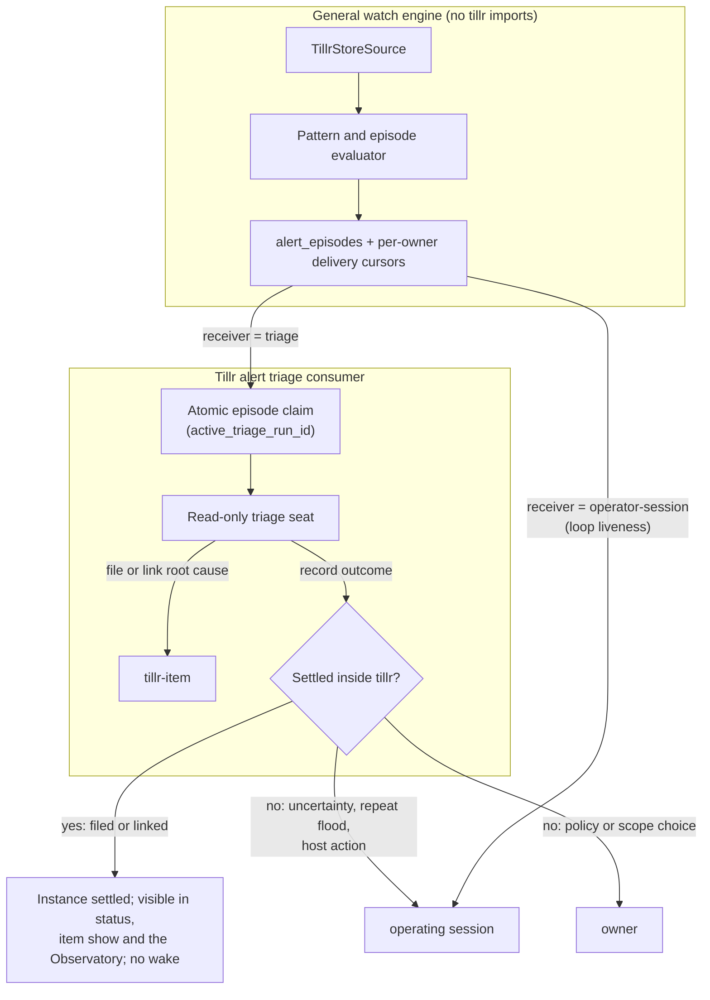

# Alert triage happens in a seat inside tillr, and only what it cannot settle reaches the operating session

**Status:** Every question is ruled; Slices 1 and 2 of [§9](#9-the-build-in-slices-that-each-land-alone) (atomic triage claim, three-outcome `record-triage`, triage events, escalated bundle `triage` header, `tillr watch status --recent`, the `triage` and `operator-session` receivers, per-owner delivery for both, and `watch-lint-liveness-receiver`) are built, while slices 3 to 7 are not. `rg -n 'triage' tools/tillr/definition/landing.json config/tillr` returns nothing, and every rule in `config/tillr/watch/` still sets `receiver = "foreground"`.

> **In short.** A standing `tillr-watch` episode goes first to a dedicated, remedy-free `triage` seat on the cheap `scout` tier. The seat reads the evidence and settles a clear single instance by linking an existing item or filing one deduplicated `fix-fault` or `fix-rule` item. It escalates to the operating session or the owner whenever the cause or the item match is uncertain, when repeats need a silence, or when a host action or an owner ruling is required.

**Why it matters.** Most alert wakeups are mechanical: read the event fields and logs, check whether an item already tracks the cause, file or link one. That work costs foreground context in the operating session and can be done by a cheap seat inside `tillr`.

**The shape.** A consumer in `tillr-drain` claims each unsettled episode instance at most once through `active_triage_run_id`, dispatches one `triage` run for it outside the build lanes, and enforces a read-and-file-only boundary on that run. The consumer sits above the domain-neutral watch engine of [the general agent watch design](./general-agent-watch.md) and adds nothing to it.

**Cost.** One short `scout`-tier run per newly opened or reopened instance, plus triage columns, escalation wiring and status views so settlements made inside `tillr` stay auditable.

**Start at** [§4](#4-who-reads-each-new-alert-inside-tillr) to [§6](#6-what-must-be-handed-upward-to-whom-and-how).

**Needs your ruling:** None.

**Reads with:** [the alert investigation and outcome workflow](./tillr-watch-alert-workflow.md) (the single-instance `ack` and `settle`, the investigation record, the closed outcome set and the item-linked silences this seat calls), [the general agent watch design](./general-agent-watch.md) (the engine and per-owner delivery cursors), [the tillr-watch design](./tillr-watch.md) (whose deferred seat routing, [OQ-TW4](./tillr-watch.md#OQ-TW4), this carries out under the no-remedy rule of [OQ-TW2](./tillr-watch.md#OQ-TW2)), and [operator decisions inside tillr](./operator-decisions-inside-tillr.md) (what stays reserved for the owner).

**Words.** **Item**, **criterion**, **candidate**, **lane**, **seat** and **verdict** keep their meanings from [the vocabulary](./tillr-vocabulary.md#5-the-words). **Episode**, **subject key**, **condition fingerprint** and **`TimelineBundle`** keep their meanings from [the tillr-watch design](./tillr-watch.md#61-one-record-per-condition-never-per-pass-the-alert-episode-state-machine-d-tw5). **The operating session** is the foreground agent session that watches the drain and acts for the owner. Three terms are coined here:

- **Alert triage** *(coined here)*: the remedy-free investigation of one newly opened, reopened or unsettled auto-resolved alert instance inside `tillr`. It is not a repair run: it never changes worktrees, processes, holds, silences or rules.
- **Triage settlement** *(coined here)*: recording on an episode that `tillr` has accounted for its current observed instance by linking an existing item or filing a new one, without waking the operating session. It is not a dismissal: there is no settlement without an item.
- **Upward escalation** *(coined here)*: handing an episode that triage cannot or should not settle alone to the operating session or the owner, with the triage finding and any filed or linked item attached.

---

## 1. What the owner said

The owner rulings this design rests on, each recorded in the [Decision Ledger](#decision-ledger):

- A problem the operating session could settle without the owner belongs to a similarly responsible agent, process or ticket inside `tillr` ([R-AT1](#R-AT1)).
- Watching finds and fixes root causes; it applies no remedies ([R-AT2](#R-AT2), [OQ-TW2](./tillr-watch.md#OQ-TW2)).
- Seat routing for alerts is designed from the record of foreground triage rather than guessed beforehand ([R-AT3](#R-AT3), [OQ-TW4](./tillr-watch.md#OQ-TW4)).
- Leftover work in a lane is an alert for manual cleanup plus a filed root cause, never an automatic sweeper ([R-AT4](#R-AT4), [D-TW48](./tillr-watch.md#D-TW48)).
- No silent fallbacks, and an alert never caps, benches or fails work ([R-AT5](#R-AT5), [D-TW2](./tillr-watch.md#D-TW2)).
- Every alert gets an investigation and one of three outcomes: a parameterized silence, `fix-rule` or `fix-fault` ([R-AT6](#R-AT6), [R-AW1](./tillr-watch-alert-workflow.md#R-AW1)).
- Acknowledging covers one instance; continuing suppression is a parameterized, item-linked silence that lifts when the item is in ([R-AT7](#R-AT7)).
- The seat is a dedicated `triage` seat on the `scout` tier dispatched by `tillr-drain`, with conservative escalation ([OQ-AT1](#OQ-AT1)).
- There is no evidence-only `expected` settlement ([OQ-AT2](#OQ-AT2)).
- Loop-liveness rules route explicitly to the operating session, and no timer promotes untriaged alerts ([OQ-AT3](#OQ-AT3)).

Everything else in this document is the designer's decision (`D-AT1` to `D-AT11`), which the owner may overturn.

---

## 2. How this relates to the general agent watch design

[The general agent watch design](./general-agent-watch.md) keeps the watch engine free of `tillr` imports and `tillr` concepts (`D-GW9`). Alert triage is built strictly above that engine, on the `tillr` side (`D-AT1`):

Three seams connect the two designs:

1. **The observation source.** `ObservationSource` and `TillrStoreSource` ([`source.go`](../../tools/tillr/watch/source.go), [`tillr_source.go`](../../tools/tillr/watch/tillr_source.go)) are built. Triage adds nothing to them; it consumes the episodes and `TimelineBundle` records (at most 8 KiB each) the evaluator already produces.
2. **Per-owner delivery.** [`delivery.go`](../../tools/tillr/watch/delivery.go) tracks `seen_seq` and `shown_seq` per owner handle in `foreground_delivery`, and delivers only rules whose receiver is `"foreground"`. Once delivery cursors are generalized so each `--owner <handle>` receives the episodes matching its receiver ([§6 of the general agent watch design](./general-agent-watch.md#6-where-episodes-cursors-and-overrides-live)), two receivers exist with no `tillr`-specific code in the engine: `--owner tillr-triage` for `receiver = "triage"`, and `--owner operator-session` for `receiver = "operator-session"` plus escalated episodes.
3. **Where watch tables live.** Triage reads and writes episodes through the contracted faces of [`tillr-watch`](./tillr-utility-contracts/tillr-watch.md) and files items through `tillr-item`, so either answer to [OQ-GW3](./general-agent-watch.md#OQ-GW3) (a sidecar watch database or `.tillr/state.db`) leaves triage behavior unchanged.

---

## 3. Sorting the 26 live rules by what settles them

Each rule gets an explicit receiver (`D-AT2`). The table sorts 26 rules. `config/tillr/watch/` holds 36 rules in 33 files (`rg -c '^id *=' config/tillr/watch`); the ten not sorted here are listed under the table and keep `receiver = "foreground"` until they are sorted.

| Group | Rules | What triage does | Reaches the operating session or the owner? |
| :--- | :--- | :--- | :--- |
| **A. Settleable inside `tillr`** (`receiver = "triage"`, 15 rules) | `fast-gate-run-slow`, `fast-gate-median-slow`, `gate-repeated-stall`, `land-squash-conflict`, `drain-repeated-item-conflicts`, `drain-repeated-verifier-refusals`, `drain-plan-output-unparseable`, `drain-repeated-step-dispatches`, `drain-dispatch-declined`, `drain-item-fault`, `drain-judge-unreadable`, `drain-store-busy`, `drain-trunk-fixer-filed`, `drain-landing-reverted`, `run-model-timeout` | Reads the bundle, `tillr drain why` and the named logs; checks open and recently landed items; links the instance to the item that owns the exact cause or files one deduplicated request; settles the instance. | No, when cause and item ownership are unambiguous. Escalates when either is uncertain, when repeats need a silence, or when a live blockage (a wedged run, an external store lock) needs hand intervention. |
| **B. Diagnose and file inside `tillr`, then escalate the live action** (`receiver = "triage"`, 9 rules) | `drain-lane-refused`, `drain-trunk-core-worktree`, `drain-revert-not-possible`, `drain-heavy-fault`, `trunk-proof-lag`, `trunk-proof-stalled`, `drain-obstacle-hold`, `drain-backend-closed`, `drain-unrequested-start` | Reads the fault, proof directory, stacks, backend error or hold record; files or links the root-cause item first; settles quietly only when a mover inside `tillr` already owns the condition and no host action is needed. | Yes, whenever a live intervention, a backend or credential recovery, or an owner ruling is needed. The operating session receives the diagnosis and the item, and performs only the physical step. |
| **C. Loop liveness** (`receiver = "operator-session"`, 2 rules) | `drain-loop-no-pass`, `drain-loop-fault` | Nothing: these fire when the drain loop is stopped or faulted, so a seat dispatched by the drain cannot run ([§4.3](#43-explicit-loop-liveness-routing-with-no-timer-promotion)). | Directly to the operating session. |

Not yet sorted: `drain-checkpoint-not-restarted`, `drain-item-fifth-attempt`, `drain-lane-kept`, `drain-pi-build-stale`, `drain-repeated-refusal`, `drain-restart-unanswered`, `drain-test-slots-free-with-waiters`, `gate-drain-stalls`, `gate-verdict-overdue`, `land-repeated-squash-conflicts`.

---

## 4. Who reads each new alert inside tillr

### 4.1 The `triage` seat on the `scout` tier and its isolation

Alert triage runs on a dedicated `triage` seat mapped to the `scout` tier and dispatched by `tillr-drain` outside the build lanes ([OQ-AT1](#OQ-AT1), `D-AT3`, `D-AT11`):

1. **Seat declaration.** [`tools/tillr/definition/landing.json`](../../tools/tillr/definition/landing.json) lists `"triage"` in `seats`. Every backend policy file in `config/tillr/` (`backend-policy*.json`) maps `"triage": "scout"` and sets `"escalate": {"triage": []}`: no automatic move to a higher model tier. An uncertain run, an unreadable input or a closed `scout` backend escalates the episode to the operating session instead.
2. **No lane worktree.** Triage edits no tracked file and produces no candidate. It runs against a read-only view of the root, writes only to its own run scratch directory, and never occupies an ordinary or express lane.
3. **Bounded concurrency.** Up to `max_concurrent_triage` runs (default `2`) run in parallel, independent of how busy the build lanes are.
4. **One instance per run.** Each run receives one claimed episode (its ids, variables, fingerprint, repeat count and bundle, plus recent active episodes and active silences for correlation) and must end with one structured triage record for it.

### 4.2 Transition-driven trigger and the `active_triage_run_id` invariant

Triage is driven by episode transitions, never by polling (`D-AT4`).

- **Eligible.** An episode is eligible when its rule's receiver is `"triage"`, its `triage_state` is `'untriaged'`, `active_triage_run_id` is null, and it is either `open` or `resolved` with `settlement_state = 'uninvestigated'` (an auto-resolved episode still owes an investigation under [OQ-AW2](./tillr-watch-alert-workflow.md#OQ-AW2)).
- **Claim.** `tillr-drain` claims the episode in one `IMMEDIATE` transaction that sets `active_triage_run_id` and `triage_state = 'triaging'` only where both still hold their unclaimed values. Two passes racing on one episode cannot both claim it.
- **No repeat on a settled instance.** While evaluation re-reads the same settled event sequence, fingerprint and lag pair, the episode stays `settled` or `escalated`.
- **Re-triage on a new instance.** A newer matching event, a changed fingerprint or a changed lag pair, with no active silence, reopens the episode and resets `triage_state = 'untriaged'` ([R-AW4](./tillr-watch-alert-workflow.md#R-AW4), [D-AW5](./tillr-watch-alert-workflow.md#D-AW5)).

### 4.3 Explicit loop-liveness routing with no timer promotion

Routing `drain-loop-no-pass` or `drain-loop-fault` to the triage seat would deadlock: when the loop is down, nothing in `tillr-drain` is alive to triage the alert that says so. Routing is therefore explicit on the rules ([OQ-AT3](#OQ-AT3), `D-AT5`):

- Rules whose subject is the liveness of `tillr-drain` set `receiver = "operator-session"`.
- `tillr watch lint` rejects any rule that watches the absence of `drain.loop-pass`, or `drain.loop-ended`, with `receiver = "triage"` (check id `watch-lint-liveness-receiver`).
- No timer promotes an untriaged episode. Other `triage` episodes wait for `tillr-drain` to claim them.

---

## 5. What the triage seat may do — and what it must never do

The no-remedy ruling ([OQ-TW2](./tillr-watch.md#OQ-TW2)) is enforced on the seat as a command and filesystem boundary, not as prompt advice (`D-AT6`).

### 5.1 Permitted actions

1. **Read.** The episode bundle; the read-only faces of `tillr view`, `tillr item` (`list`, `show`), `tillr run status`, `tillr drain why` and `tillr watch status`; run logs, gate timing records and proof verdicts; read-only Git history.
2. **Deduplicate.** Search open and recently landed items for one that already owns the root cause. A match needs evidence of the same cause (the same failing check, conflicting paths, fault reason and step, or adapter error), never title similarity.
3. **File or link one item.** Link the alert to the existing item, or file one request that states what happened with its evidence and the single defect to fix. The request carries `filed_by = "tillr-triage"`, the source alert id, and `dedup_key = <rule_id>:<cause_key>` so two runs diagnosing one bug land on one item. Where store events establish that a held item waits on the defect, triage may record that dependency. Express or ordinary filing follows the repository's standing rules for defects.
4. **Record the outcome** on the episode through the single outcome face of `tillr-watch` ([§5.3](#53-the-structured-triage-outcomes)).

### 5.2 Forbidden actions (hard mechanical boundary)

| Category | Forbidden to the triage seat | Why |
| :--- | :--- | :--- |
| **Worktree and Git state** | Editing tracked files; `git commit`, `reset`, `checkout`, `clean`; any `git worktree` change; any `git config` write. | Cleaning a lane or editing code from triage destroys evidence or bypasses the gated item workflow ([D-TW48](./tillr-watch.md#D-TW48)). |
| **Process and loop control** | Killing processes; `tillr drain stop`, `loop`, `scale`; `tillr-keep --stop`; `tillr run release`. | Operational control is not finding and filing a root cause. |
| **Hold, fault and item lifecycle** | `tillr drain retry`, `clear-fault`; `tillr item close`, `reopen`, `state`, `place`, `verdict`. | These belong to the takers and closing checks of [operator decisions inside tillr](./operator-decisions-inside-tillr.md#5-the-seven-kinds). |
| **Watch suppression** | `tillr watch silence`, `resolve`, `drop`, and every `rule` change. | A seat that can mute or retune a rule can silence its own alerts instead of fixing their causes. |

**Enforcement.** The seat's environment mounts the checkout read-only outside its scratch directory and wraps `tillr` and `git` in a restricted command shim (the mechanism of [the lane shims design](./tillr-lane-shims.md)) that refuses every command above with exit `2`.

### 5.3 The structured triage outcomes

Every run ends by recording one of three outcomes (`D-AT7`), written into the shared investigation and `tracking_item_id` schema of [the alert workflow](./tillr-watch-alert-workflow.md#33-step-2--the-closed-set-of-three-outcomes) ([D-TW65](./tillr-watch.md#D-TW65)). There is no `expected` outcome ([OQ-AT2](#OQ-AT2)).

| Outcome | Required fields | Effect on the episode | Wakes the operating session? |
| :--- | :--- | :--- | :--- |
| **`filed`** | The new item's id, `outcome_kind` (`fix-fault` or `fix-rule`), a `finding` that cites event sequences or log evidence | The observed instance is settled against the item; the claim is released. | No |
| **`linked`** | The existing item's id, `outcome_kind`, a `finding` that proves the item covers this instance | Same as `filed`. | No, unless a repeat flood also escalates ([§6.1](#61-handed-to-the-operating-session-escalate_to--operator-session)) |
| **`escalated`** | `escalate_to` (`operator-session` or `owner`), `finding`, `action_needed` (or `question` and `options` for the owner); an item id and `outcome_kind` whenever a concrete defect was identified | `triage_state = 'escalated'`; settled if an item is attached, otherwise investigated and still unsettled; appends `watch.alert.escalated`. | Yes |

A benign operation that fires a rule shows the rule lacks the predicate to tell the benign case apart. Triage links or files a `fix-rule` item for it; it never dismisses the alert in prose.

---

## 6. What must be handed upward, to whom, and how

The seat settles only clear, high-confidence single-instance matches and escalates whenever confidence, authority or host reach is missing (`D-AT8`, `D-AT11`).

### 6.1 Handed to the operating session (`escalate_to = "operator-session"`)

1. **Uncertainty.** The evidence is incomplete, two causes remain plausible, or it is unclear whether a new instance shares the cause of an open item. Triage records its finding and escalates rather than guessing.
2. **A silence decision.** Suppressing a noisy binding needs `tillr watch silence`, which triage may not run. That includes the repeat flood: once an open tracking item has reopened three times (`reopen_count_for_item >= 3`) with no active silence, triage links the instance and escalates with the exact silence command for the operator to decide on.
3. **Manual preservation and workspace hygiene.** For `drain-lane-refused`, triage reads who left the work, files or links the root-cause item, then escalates the cleanup ([D-TW48](./tillr-watch.md#D-TW48)). For `drain-trunk-core-worktree`, it identifies the run that set `core.worktree`, files or links the defect, then escalates the config repair.
4. **A live blockage.** A closed core backend, an unexpected second loop process, a proof or revert that nothing inside `tillr` is advancing, or a run or lock holder still wedging a lane or the store. Triage files or links the defect first and escalates the live details.
5. **A hold addressed to the operator.** If `drain-obstacle-hold` names `mover == "operator"`, triage gathers the context and escalates it.
6. **Triage itself failed.** If the run exits non-zero, times out, records no valid outcome, or the `scout` backend is closed, `tillr-drain` clears the claim, records `triage_outcome = "triage-failed"`, and escalates immediately with the original bundle and the run's error. There is no retry and no silent drop.

### 6.2 Handed to the owner (`escalate_to = "owner"`)

Triage escalates to the owner only for the decisions [operator decisions inside tillr](./operator-decisions-inside-tillr.md#6-what-is-the-owners) reserves: weakening or dropping what the owner asked for, a contradiction between two owner statements, reordering queue work beyond a recorded blocker, choosing new work when ordered work runs out ([OQ-OD2](./operator-decisions-inside-tillr.md#OQ-OD2)), credentials or spend outside the repository, an irreversible or externally published act, and seat or model policy (including `drain-obstacle-hold` with `mover == "owner"`).

An escalation to the owner carries a structured `question` and concrete `options`, or links the open owner hold that already carries them. Neither triage nor the operating session guesses an owner decision.

### 6.3 The upward delivery wire

Escalation reuses the `wait` and `seen` protocol of [the general agent watch design](./general-agent-watch.md#7-how-an-agent-in-any-harness-is-woken) (`D-AT8`):

1. The operating session runs one `tillr watch wait ... --owner operator-session` watcher (the timed drain check-in skill (an operating skill kept outside this repository)).
2. For that owner, pending notices are the unsettled episodes of `receiver = "operator-session"` rules, the episodes of `triage` rules with a `watch.alert.escalated` event newer than the owner's `seen_seq`, and the unsettled reminders of [the alert workflow](./tillr-watch-alert-workflow.md#6-making-unsettled-alerts-unmistakable--and-showing-every-alert-transition-and-linked-item-in-the-observatory). Episodes still untriaged, being triaged, or settled inside `tillr` do not wake it.
3. An escalated notice leads with a `triage` block (run id, outcome, `escalated_to`, item id, finding, and `action_needed` or `question` with `options`), placed ahead of raw event lines so truncation to 8 KiB never drops the triage conclusion.
4. Printing a notice advances `shown_seq` only. `seen_seq` advances when the operating session re-arms with `--seen-through` or runs `tillr watch seen` ([D-TW11](./tillr-watch.md#D-TW11)), so a lost turn never drops an escalated alert.

---

## 7. How every triage outcome is visible

Settling alerts inside `tillr` removes wakeups, not visibility (`D-AT9`):

1. **`tillr watch status`.** Each episode row carries a `triage` object (`state`, `outcome`, `outcome_kind`, `run_id`, `item_id`, `finding`), the text output a one-line roll-up of triage states, and `--recent <window>` shows episodes that opened, were triaged and resolved within the window.
2. **Events.** `watch.alert.triage-started`, `watch.alert.triaged` and `watch.alert.escalated` record every claim, settlement, failure and escalation.
3. **Item cross-reference.** `tillr item show` and `tillr drain why` list the alerts linked to an item (`linked_alerts`).
4. **The Observatory.** Unsettled and escalated episodes lead; episodes settled inside `tillr` and active silences follow, each linking to the triage run and the tracking item ([§6 of the alert workflow](./tillr-watch-alert-workflow.md#6-making-unsettled-alerts-unmistakable--and-showing-every-alert-transition-and-linked-item-in-the-observatory)).

---

## 8. Edge cases, concurrency, and failure modes

| Case | Behavior |
| :--- | :--- |
| **No open or unsettled alerts** | No triage run is dispatched and no model is called. |
| **A burst of episodes in one pass** | Up to `max_concurrent_triage` are claimed in `opened_seq` order; the rest stay visibly `untriaged` and dispatch as runs finish. |
| **Two alerts for one underlying bug** | `tillr item request` checks open triage-filed items by `dedup_key` in an `IMMEDIATE` transaction; the second run links to the item the first created. |
| **Episode auto-resolves before or during triage** | Triage still records `filed`, `linked` or `escalated` on the resolved episode, without reopening it. |
| **New instance while the tracking item is open and no silence exists** | The episode reopens as `untriaged` and the repeat count rises. Triage checks whether the new instance shares the item's cause, and escalates at the third reopen. |
| **Cause or item match is ambiguous** | Triage records its evidence and escalates to the operating session. |
| **The linked item lands or closes and the condition recurs** | The episode reopens with the prior item in its history: the fix was incomplete. |
| **Triage run fails or records nothing** | The claim is cleared and the episode escalates immediately ([§6.1](#61-handed-to-the-operating-session-escalate_to--operator-session)), with one deduplicated defect item if a tool fault caused it. |
| **`tillr-drain` dies holding a claim** | At startup and at pass settlement, each non-null `active_triage_run_id` is checked against `tillr run status`; a dead run escalates the episode and files one defect item. |
| **Rules not yet cut over** | A rule that keeps `receiver = "foreground"` behaves as it does today, so the cutover needs no flag day. |

---

## 9. The build, in slices that each land alone

Seven slices, in order, after the eight slices of [the alert workflow](./tillr-watch-alert-workflow.md#8-the-build-in-slices-that-each-land-alone) (`D-AT10`). Slices 1 and 2 are built; slices 3 to 7 are not.

| Slice | What lands | Done when | Built |
| :--- | :--- | :--- | :--- |
| **1** | The atomic triage claim, the three-outcome record face (refusing `expected`), the triage events, the `triage` header in escalated bundles, and `tillr watch status --recent` (`D-AT4`, `D-AT7`). | Tests show single-claim serialization across open and auto-resolved episodes, the refusal of `expected`, that a settled instance does not wake the operating session while an escalated one does, and header priority under truncation. | Yes |
| **2** | The `triage` and `operator-session` receivers, per-owner delivery for both, and the `watch-lint-liveness-receiver` check (`D-AT2`, `D-AT5`). | Tests show each owner receives only its episodes, no timer promotes an untriaged alert, and lint rejects a liveness rule routed to `triage`. | Yes |
| **3** | Triage provenance and `dedup_key` idempotence on `tillr item request`, and `linked_alerts` on `tillr item show` and `tillr drain why` (`D-AT6`, `D-AT9`). | Tests show concurrent filings for one cause land on one item carrying both alert ids. | No |
| **4** | The `triage` seat declaration, its `scout` mapping with an empty escalation list, the brief, and the read-and-file command shim (`D-AT3`, `D-AT6`, `D-AT11`). | Policy validation and shim tests show each forbidden command refused with exit `2`. | No |
| **5** | Transition-driven dispatch in `tillr-drain` with the concurrency cap, and escalation on failure, a stale claim or a repeat flood (`D-AT4`, `D-AT8`, `D-AT11`). | Tests show the cap holds while build lanes are busy, no repeat dispatch on an unchanged settled instance, and immediate escalation on failure with no model retry. | No |
| **6** | The rules in `config/tillr/watch/` cut over to their receivers (`D-AT2`), with the check-in skill updated. | `tillr watch lint` and the rule tests pass; the operating session wakes only on loop-liveness alerts, escalations and unsettled reminders. | No |
| **7** | The Observatory panels for unsettled alerts, settlements inside `tillr` and active silences, and linked-alert badges on item pages (`D-AT9`, [D-AW6](./tillr-watch-alert-workflow.md#D-AW6)). | `tillr-view` contract and UI tests cover each panel. | No |

---

## 10. What this does not do

- It puts no `tillr` concept into the general watch engine.
- It applies no remedy and creates no silence.
- It allows no evidence-only dismissal and adds no untriaged-timeout timer.
- It guesses no owner decision and does not gamble on a low-confidence `scout` call.
- It does not replace the takers of [operator decisions inside tillr](./operator-decisions-inside-tillr.md): a worker's reported obstacle or a fault cleared on a recorded fact is handled by the drain and the design seat. Triage watches cross-event anomalies and checks that each has an owning item or an escalation.

---

## 11. Alternatives considered

| Alternative | Verdict |
| :--- | :--- |
| Teach the general watch engine about seats, lanes and queue items | Rejected: breaks `D-GW9` of [the general agent watch design](./general-agent-watch.md#8-how-the-general-watcher-and-tillr-depend-on-each-other). |
| A fourth `expected` outcome for benign triggers | Rejected by the owner ([OQ-AT2](#OQ-AT2)): a benign action that fires an alert shows the rule needs fixing. |
| A timer promoting untriaged alerts to the operating session | Rejected by the owner ([OQ-AT3](#OQ-AT3)): explicit routing on loop-liveness rules covers the stopped-loop case without an arbitrary threshold. |
| Move a failed or uncertain triage run to a higher model tier | Rejected (`D-AT11`): it is an automatic fallback ([R-AT5](#R-AT5)). |
| Let the seat run safe-looking cleanup commands | Rejected: violates [OQ-TW2](./tillr-watch.md#OQ-TW2) and [D-TW48](./tillr-watch.md#D-TW48). |
| Run triage on the build lanes | Rejected: triage would queue behind long worker turns, including when the alert is about a wedged run on those lanes. |
| Poll `tillr watch status` from a recurring model turn | Rejected: spends tokens when nothing is wrong and reacts late when something is. |

---

## 12. Risks

| Risk | Mitigation |
| :--- | :--- |
| The `scout` seat links two distinct bugs to one item | A link must cite the matching check, path or fault signature; uncertainty escalates; every `linked` decision is visible in status and the Observatory; a recurrence after landing reopens the episode. |
| Single-instance settlement causes repeat triage runs while a slow fix is queued | The third reopen escalates with a silence command for the operator. |
| Triage files duplicate requests during a burst | Episodes deduplicate per rule and subject, concurrency is capped, and `tillr item request` deduplicates by `dedup_key`. |
| `tillr-drain` stops, stranding triage | Loop-liveness rules wake the operating session directly ([§4.3](#43-explicit-loop-liveness-routing-with-no-timer-promotion)). |
| Triage writes contend with the drain or the lander on the store | Triage writes only on episode transitions, never per event. |

---

## Open Questions

None.

---

## Decision Ledger

Rows `R-AT1` to `R-AT7` and [OQ-AT1](#OQ-AT1) to [OQ-AT3](#OQ-AT3) are owner rulings. Every `D-AT` row is the designer's decision, and the owner may overturn it.

| ID | Ruling / Decision | Date | Settled in | Built |
| :--- | :--- | :--- | :--- | :--- |
| **R-AT1** | **Owner ruling.** A problem the operating session could solve without the owner escalates to a similarly responsible agent, process or ticket inside `tillr`, not to the operating session. | 2026-11-21 | [§1](#1-what-the-owner-said) | No |
| **R-AT2** | **Owner ruling ([OQ-TW2](./tillr-watch.md#OQ-TW2)).** Watch rules and watch triage apply no remedies: watching finds issues so they are fixed, it does not cover them. | 2026-11-21 | [§5](#5-what-the-triage-seat-may-do--and-what-it-must-never-do) | No |
| **R-AT3** | **Owner ruling ([OQ-TW4](./tillr-watch.md#OQ-TW4)).** Routing alerts to a seat inside `tillr` is designed from the record of foreground triage. | 2026-11-21 | [§3](#3-sorting-the-26-live-rules-by-what-settles-them) | No |
| **R-AT4** | **Owner ruling ([D-TW48](./tillr-watch.md#D-TW48)).** Leftover work holding a lane out of rotation is an alert for manual preservation and cleanup plus a filed root cause, never an automatic sweeper. | 2026-11-21 | [§6.1](#61-handed-to-the-operating-session-escalate_to--operator-session) | No |
| **R-AT5** | **Owner ruling.** No silent fallbacks ([the judge and lifecycle design](./tillr-judge-and-lifecycle.md#415-no-automatic-move-to-another-model-d-jl24-to-d-jl27)), and alerts never cap, bench or fail work ([D-TW2](./tillr-watch.md#D-TW2), [the momentum principle](./momentum-principle.md)). | 2026-11-20, 2026-11-21 | [§6.1](#61-handed-to-the-operating-session-escalate_to--operator-session) | No |
| **R-AT6** | **Owner ruling ([R-AW1](./tillr-watch-alert-workflow.md#R-AW1)).** Every alert gets an investigation and settles through a parameterized silence, `fix-rule` or `fix-fault`; there is no "known about, not filed" disposition. | 2026-11-22 | [§5.3](#53-the-structured-triage-outcomes) | No |
| **R-AT7** | **Owner ruling ([R-AW4](./tillr-watch-alert-workflow.md#R-AW4), [R-AW5](./tillr-watch-alert-workflow.md#R-AW5)).** Acknowledging covers one instance and never ignores later ones; continuing suppression is parameterized, linked to an open item, and lifted automatically once that item is in. | 2026-11-23 | [§4.2](#42-transition-driven-trigger-and-the-active_triage_run_id-invariant), [§6.1](#61-handed-to-the-operating-session-escalate_to--operator-session) | No |
| [OQ-AT1](#OQ-AT1) | **Owner ruling.** A dedicated `triage` seat on the `scout` tier, dispatched by `tillr-drain` outside the build lanes, with conservative upward escalation. | 2026-11-23 | [§4.1](#41-the-triage-seat-on-the-scout-tier-and-its-isolation), [§6.1](#61-handed-to-the-operating-session-escalate_to--operator-session) | No |
| [OQ-AT2](#OQ-AT2) | **Owner ruling.** No `expected` or evidence-only settlement: a benign event that fires an alert is settled by filing or linking a `fix-rule` item, or escalated when a silence is needed. | 2026-11-23 | [§5.3](#53-the-structured-triage-outcomes) | Yes |
| [OQ-AT3](#OQ-AT3) | **Owner ruling.** Loop-liveness rules route explicitly to `operator-session`; no timer promotes untriaged alerts. | 2026-11-23 | [§4.3](#43-explicit-loop-liveness-routing-with-no-timer-promotion) | No |
| **D-AT1** | Build triage above the general watch engine as a `tillr`-side consumer, with no `tillr` imports or concepts in the engine, compatible with either answer to [OQ-GW3](./general-agent-watch.md#OQ-GW3). | 2026-11-22 | [§2](#2-how-this-relates-to-the-general-agent-watch-design) | No |
| **D-AT2** | Split receivers into `triage` (Groups A and B) and `operator-session` (Group C loop liveness), sorting each rule by whether it settles inside `tillr`. | 2026-11-23 | [§3](#3-sorting-the-26-live-rules-by-what-settles-them) | No |
| **D-AT3** | Declare the `triage` seat, map it to `scout`, run it with no lane worktree and a concurrency cap of `2` independent of the build lanes. | 2026-11-23 | [§4.1](#41-the-triage-seat-on-the-scout-tier-and-its-isolation) | No |
| **D-AT4** | Use `active_triage_run_id` as an atomic claim on unsettled `triage` episodes, open or auto-resolved, at most once per observed instance. Rejected: polling. | 2026-11-23 | [§4.2](#42-transition-driven-trigger-and-the-active_triage_run_id-invariant) | Yes |
| **D-AT5** | Enforce `watch-lint-liveness-receiver` so loop-liveness rules cannot route to the in-drain seat. | 2026-11-23 | [§4.3](#43-explicit-loop-liveness-routing-with-no-timer-promotion) | Yes |
| **D-AT6** | Restrict the seat mechanically (read-only checkout plus command shim) to reading evidence, deduplicating by concrete cause, filing or linking one item with triage provenance, and recording the outcome. | 2026-11-22 | [§5.1](#51-permitted-actions), [§5.2](#52-forbidden-actions-hard-mechanical-boundary) | No |
| **D-AT7** | Require one of three structured outcomes per run (`filed`, `linked`, `escalated`); `filed` and `linked` settle the observed instance without a wake. | 2026-11-23 | [§5.3](#53-the-structured-triage-outcomes) | Yes |
| **D-AT8** | Escalate only to `operator-session` or `owner`, delivered over `tillr watch wait` with the triage summary and item id leading the bundle; any failed triage run escalates. | 2026-11-23 | [§6](#6-what-must-be-handed-upward-to-whom-and-how) | No |
| **D-AT9** | Make every settled and escalated outcome visible in `tillr watch status`, the triage events, item cross-references and the Observatory. | 2026-11-23 | [§7](#7-how-every-triage-outcome-is-visible) | No |
| **D-AT10** | Build in the seven slices of [§9](#9-the-build-in-slices-that-each-land-alone), after the alert-workflow slices. | 2026-11-23 | [§9](#9-the-build-in-slices-that-each-land-alone) | No |
| **D-AT11** | Conservative escalation: no model-tier retry for `triage`; escalate on an ambiguous cause or item match, on a choice between `fix-rule` and a silence, at the third reopen of an open tracking item without a silence, and on any failed triage attempt. | 2026-11-23 | [§4.1](#41-the-triage-seat-on-the-scout-tier-and-its-isolation), [§6.1](#61-handed-to-the-operating-session-escalate_to--operator-session) | No |
