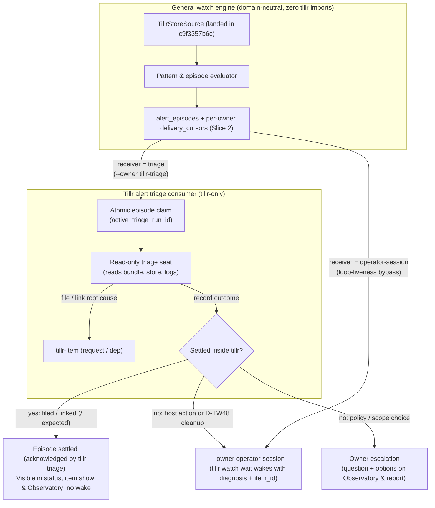

# Alert triage happens in a seat inside tillr, and only what it cannot settle reaches the operating session

**Status:** 2026-11-22. Nothing in this triage layer is built. Read at `bba4ba277e`, Slice 1 of [the general agent watch design](./general-agent-watch.md) (`Observation`, `ObservationSource`, and `TillrStoreSource` in [`source.go`](../../tools/tillr/watch/source.go) and [`tillr_source.go`](../../tools/tillr/watch/tillr_source.go)) landed in `c9f3357b6c`, [`eval.go`](../../tools/tillr/watch/eval.go) reserves `active_triage_run_id TEXT` unused on `alert_episodes`, all 23 rules across the 20 files in `config/tillr/watch/` still set `receiver = "foreground"`, and `rg -n 'alert_episodes|watch\.alert' tools/tillr-drain tools/tillr-view` returns nothing. Only the owner's dated words quoted in [§1](#1-what-the-owner-said) are owner rulings; every other choice is the designer's and is marked so in the [Decision Ledger](#decision-ledger). No companion `-plan.md` seed is opened while [OQ-AT1](#OQ-AT1)–[OQ-AT3](#OQ-AT3) are open.

> **In short.** Route standing `tillr-watch` episodes first to a remedy-free triage seat inside `tillr` that reads the evidence, links an existing queue item or files one deduplicated defect request, and records its finding on the episode — waking the foreground operating session only when an alert requires an external host action, manual lane preservation, or an owner ruling.

**Why it matters.** On 2026-11-22 every newly opened alert woke the operating session (the whale) to perform mechanical triage — reading the event and timing or conflict log, checking that an item already tracked the cause, and noting the match — spending foreground context and human-facing check-in attention on work `tillr` can settle internally.

**The shape.** A `tillr`-side triage consumer layered above [the general agent watch design](./general-agent-watch.md)'s domain-neutral watch engine and per-owner `delivery_cursors`, claiming each open episode at most once per `condition_fingerprint` via `active_triage_run_id`, running under a hard read-and-file-only boundary (zero remedies), and promoting unsettled operational or policy episodes to `--owner operator-session` or `owner` with its diagnosis and `item_id` already attached ([§2](#2-how-this-relates-to-the-general-agent-watch-design)–[§7](#7-how-every-triage-outcome-is-visible)).

**Cost.** One short read-only triage run per newly opened `triage` episode, plus structured triage columns and status fields so quiet in-`tillr` settlements remain auditable ([§4](#4-who-reads-each-new-alert-inside-tillr), [§7](#7-how-every-triage-outcome-is-visible)).

**Start at** [§2](#2-how-this-relates-to-the-general-agent-watch-design) for the exact split with the general watcher, then [§4](#4-who-reads-each-new-alert-inside-tillr)–[§7](#7-how-every-triage-outcome-is-visible) for who reads each alert, what the seat may do, what crosses upward, and how outcomes are visible.

**Needs your ruling:** [OQ-AT1](#OQ-AT1), [OQ-AT2](#OQ-AT2), [OQ-AT3](#OQ-AT3).

**Awaits your review:** the designer's decisions `D-AT1` to `D-AT10` in the [Decision Ledger](#decision-ledger).

**Reads with:** [the alert investigation and outcome workflow](./tillr-watch-alert-workflow.md) (whose mandatory investigation record, closed `silence` / `fix-rule` / `fix-fault` outcome set, and shared `tracking_item_id` store seam this triage consumer calls), [the general agent watch design](./general-agent-watch.md) (whose source-neutral engine and multi-owner `delivery_cursors` this builds on without duplicating), [the tillr-watch design](./tillr-watch.md) (whose deferred [OQ-TW4](./tillr-watch.md#OQ-TW4) seat-routing step this carries out under [OQ-TW2](./tillr-watch.md#OQ-TW2)'s no-remedy rule), and [what the operator settled without the owner is settled inside tillr](./operator-decisions-inside-tillr.md) (which defines the seven hand-action takers and what stays reserved for the owner).

**Words.** **Item**, **criterion**, **candidate**, **lane**, **seat**, and **verdict** keep their meanings from [the vocabulary](./tillr-vocabulary.md#5-the-words). **Episode**, **subject key**, **condition fingerprint**, and **`TimelineBundle`** keep their meanings from [the tillr-watch design](./tillr-watch.md#61-one-record-per-condition-never-per-pass-the-alert-episode-state-machine-d-tw5). **Observation**, **observation source**, and **watch state file** keep their meanings from [the general agent watch design](./general-agent-watch.md). **The whale** (the foreground operating agent session) keeps its meaning from [what the operator settled without the owner is settled inside tillr](./operator-decisions-inside-tillr.md). Three terms are coined here:

- **Alert triage** *(coined here)*: the remedy-free investigation of one newly opened or reopened alert episode inside `tillr` — reading its bundle and read-only store or log evidence, linking an existing tracking item or filing one deduplicated defect request, and either settling the episode inside `tillr` or escalating it upward. It is not a repair run and never mutates worktrees, processes, holds, or rules.
- **Triage settlement** *(coined here)*: recording on an open episode that `tillr` has accounted for its current `condition_fingerprint` (by linking an open or landed item, filing a new defect request, or — if [OQ-AT2](#OQ-AT2) chooses Option A — verifying a documented benign trigger), transitioning the episode out of pending triage without waking `--owner operator-session`.
- **Upward escalation** *(coined here)*: promoting an alert episode that alert triage cannot settle inside `tillr` to `--owner operator-session` (for live host/process supervision or manual lane preservation) or to `owner` (for an owner-reserved policy or scope decision), carrying the triage run's evidence summary and any filed or linked `item_id`.

---

## 1. What the owner said

Two dated owner rulings frame this design verbatim:

1. **Problems the whale could settle without the owner belong inside `tillr` (2026-11-21, quoted in the filed request and in [what the operator settled without the owner is settled inside tillr](./operator-decisions-inside-tillr.md#1-the-ruling)):**

   > "if you ever feel that you as the whale could solve some problem, and it wouldn't need to be escalated to me, then that problem should escalate to... a similarly responsible agent, process, ticket, whatever, within Tiller, rather than popping up to you."

2. **Watching finds and fixes root causes; it applies no remedies ([OQ-TW2](./tillr-watch.md#OQ-TW2), 2026-11-21):**

   > "Every single one of these sounds like a fallback to cover an issue. We don't cover issues. We use this to find the issues and fix them."

Three other standing owner rulings bind how this seat works:

- **Seat dispatch is designed from live foreground triage experience, not guessed beforehand ([OQ-TW4](./tillr-watch.md#OQ-TW4), 2026-11-21).** When `tillr-watch` was first specified, [OQ-TW4](./tillr-watch.md#OQ-TW4) deferred `drain:<seat>` dispatch so every alert went first to the foreground agent while the system proved itself in use (`D-TW7` in [the tillr-watch design](./tillr-watch.md#63-mode-a-mechanical-answers-inside-tillr-and-non-wasting-drain-triage-d-tw7-oq-tw2-oq-tw4) was set aside until then). On 2026-11-22 that foreground record ran across 23 live rules: nearly every wakeup was a mechanical check of event fields, logs, and existing queue items. This design fulfills [OQ-TW4](./tillr-watch.md#OQ-TW4)'s deferred second step.
- **Leftover work in a lane stays manual cleanup ([D-TW48](./tillr-watch.md#D-TW48), 2026-11-21):** *"this sweeper should actually be part of tiller watch because this should just be an alert that there's work left over. You can like then manually clean it and file the root cause, but there should not just be like work left over at a random time."* Triage may diagnose who left the work and file the root-cause defect, and must still hand the physical save-and-clean step to the operating session.
- **No silent fallbacks (2026-11-20, [the judge and lifecycle design](./tillr-judge-and-lifecycle.md#415-no-automatic-move-to-another-model-d-jl24-to-d-jl27)) and no attempt counts or wall caps that fail or bench work ([D-TW2](./tillr-watch.md#D-TW2), [the momentum principle](./momentum-principle.md)).** If triage itself fails or cannot read its inputs, the alert surfaces loudly to the operating session rather than vanishing or silently retrying in a loop.

What the owner's words do not settle is either left open for him in [OQ-AT1](#OQ-AT1)–[OQ-AT3](#OQ-AT3) or recorded as a designer's decision (`D-AT1`–`D-AT10`) that he may overturn.

---

## 2. How this relates to the general agent watch design

[The general agent watch design](./general-agent-watch.md) separates the watch engine from `tillr` so any agent in any workspace can watch JSONL streams, plain-text logs, Git refs, or local processes without `.tillr/state.db` or `tillr-drain`. This document **does not re-specify** `ObservationSource`, non-`tillr` input adapters, `--state` SQLite tables, `agent_watches`, or cross-harness `wait`/`seen` mechanics; [the general agent watch design](./general-agent-watch.md) owns all of them.

Instead, alert triage builds strictly **above** that engine on the `tillr` side (`D-AT1`), preserving `D-GW9` (zero `tillr` imports and zero `tillr` domain concepts in the general watch engine):



Three exact seams connect the two designs without overlap:

1. **Built on landed Slice 1 (`c9f3357b6c`).** Read at `bba4ba277e`, [`source.go`](../../tools/tillr/watch/source.go) and [`tillr_source.go`](../../tools/tillr/watch/tillr_source.go) already extract `Observation`, `SourceCursor`, `ObservationSource` (`ReadWindow`, `Project`, `WatchTargets`), `prepareSourceRule`, and `TillrStoreSource` (reading `.tillr/state.db` `events` and `items` / `charter` / `workflow_selections` projections). Alert triage adds nothing to `ObservationSource`; it consumes the episodes and `<= 8 KiB` `TimelineBundle` records that `Evaluator` already produces from `TillrStoreSource`.
2. **Built on Slice 2's multi-owner `delivery_cursors` ([§6 of the general agent watch design](./general-agent-watch.md#6-where-episodes-cursors-and-overrides-live)).** Today [`delivery.go`](../../tools/tillr/watch/delivery.go) and [`status.go`](../../tools/tillr/watch/status.go) track per-owner `seen_seq`/`shown_seq` rows in `foreground_delivery(owner_handle)` (`63c241ec5b`), while still filtering rules to `r.Delivery.Receiver == "foreground"` (and in-memory `memoryState` in [`source.go`](../../tools/tillr/watch/source.go) does the same). Once Slice 2 generalizes `delivery_cursors` so each `--owner <handle>` receives episodes matching its `receiver`, `tillr` separates two distinct watch receivers with zero `tillr`-specific code inside the watch engine:
   - `--owner tillr-triage` consumes standing rules with `receiver = "triage"`;
   - `--owner operator-session` consumes direct liveness rules (`receiver = "operator-session"`) plus episodes explicitly promoted to `operator-session` by triage escalation ([§6](#6-what-must-be-handed-upward-to-whom-and-how)).
3. **Compatible with either answer to [OQ-GW3](./general-agent-watch.md#OQ-GW3) (sidecar `watch.db` vs `.tillr/state.db`).** Because the triage consumer claims episodes, reads pending bundles, and records triage outcomes through `tillr-watch`'s contracted faces ([the tillr-watch contract](./tillr-utility-contracts/tillr-watch.md)) while writing defect requests and item links through `tillr-item` into `.tillr/state.db`, moving watch tables to a sidecar `.tillr/watch.db` (Option A of [OQ-GW3](./general-agent-watch.md#OQ-GW3)) or keeping them in `.tillr/state.db` (Option B) changes zero triage behavior. An agent outside `tillr` using `--state` never sees triage seats, queue items, or `escalated_to` targets; `tillr` layers them cleanly on top.

---

## 3. Sorting the 23 live rules by what settles them

Read at `bba4ba277e`, `config/tillr/watch/` holds 20 TOML files defining 23 rules, every one currently setting `receiver = "foreground"`. Sorting all 23 rules against the owner's two boundaries ([§1](#1-what-the-owner-said)) shows why a single foreground receiver is the wrong default (`D-AT2`):

| Group | Live rules (`config/tillr/watch/`) | What triage does inside `tillr` | Reaches `operator-session` or `owner`? |
| :--- | :--- | :--- | :--- |
| **A. Settleable inside `tillr` (13 rules)** | `fast-gate-run-slow`, `fast-gate-median-slow` ([`fast-gate-slow.toml`](../../config/tillr/watch/fast-gate-slow.toml)); `land-squash-conflict` ([`land-squash-conflict.toml`](../../config/tillr/watch/land-squash-conflict.toml)); `drain-repeated-item-conflicts` ([`drain-repeated-item-conflicts.toml`](../../config/tillr/watch/drain-repeated-item-conflicts.toml)); `drain-repeated-verifier-refusals` ([`drain-repeated-verifier-refusals.toml`](../../config/tillr/watch/drain-repeated-verifier-refusals.toml)); `drain-plan-output-unparseable` ([`drain-plan-output-unparseable.toml`](../../config/tillr/watch/drain-plan-output-unparseable.toml)); `drain-repeated-step-dispatches` ([`drain-repeated-step-dispatches.toml`](../../config/tillr/watch/drain-repeated-step-dispatches.toml)); `drain-dispatch-declined` ([`drain-dispatch-declined.toml`](../../config/tillr/watch/drain-dispatch-declined.toml)); `drain-item-fault` ([`drain-item-fault.toml`](../../config/tillr/watch/drain-item-fault.toml)); `drain-store-busy` ([`drain-store-busy.toml`](../../config/tillr/watch/drain-store-busy.toml)); `drain-trunk-fixer-filed` ([`drain-trunk-fixer-filed.toml`](../../config/tillr/watch/drain-trunk-fixer-filed.toml)); `drain-landing-reverted` ([`drain-revert.toml`](../../config/tillr/watch/drain-revert.toml)); `run-model-timeout` ([`run-model-timeout.toml`](../../config/tillr/watch/run-model-timeout.toml)) | Reads the `TimelineBundle`, `tillr drain why`, and named timing/run/heavy logs; checks open and recently landed items; links the episode to the active tracking item (such as an open `fixer-main-*`, split, or conflict repair) or files one deduplicated defect request; settles the episode. | **No** in the ordinary case. Escalates **only** if a live external blockage needs hand intervention (for example, `run-model-timeout` wedging a lane with zero progress, or an external process still holding the SQLite write lock in `drain-store-busy`). |
| **B. Diagnose + file inside `tillr`, then escalate live action or policy (7 rules)** | `drain-lane-refused` ([`drain-lane-refused.toml`](../../config/tillr/watch/drain-lane-refused.toml)); `drain-trunk-core-worktree` ([`drain-trunk-core-worktree.toml`](../../config/tillr/watch/drain-trunk-core-worktree.toml)); `drain-revert-not-possible` ([`drain-revert.toml`](../../config/tillr/watch/drain-revert.toml)); `drain-heavy-fault` ([`drain-heavy-fault.toml`](../../config/tillr/watch/drain-heavy-fault.toml)); `trunk-proof-lag`, `trunk-proof-stalled` ([`trunk-proof-lag.toml`](../../config/tillr/watch/trunk-proof-lag.toml)); `drain-obstacle-hold` ([`drain-obstacle-hold.toml`](../../config/tillr/watch/drain-obstacle-hold.toml)) | Reads the fault, proof directory, goroutine stacks, `left_by` run, or hold record; files or links the root-cause defect item first; settles quietly **only** when an in-`tillr` mover already owns the condition (such as a design-seat hold or active trunk fixer making progress), and otherwise escalates with the diagnosis and `item_id` attached. | **Yes, whenever live intervention or an owner ruling is needed:** `operator-session` for [D-TW48](./tillr-watch.md#D-TW48) manual lane cleanup, `.git/config` `core.worktree` corruption, unrevertable trunk breakage, or a deadlocked/locked proof worktree; `owner` when `drain-obstacle-hold` names `mover == "owner"`. |
| **C. Loop-liveness alerts (3 rules)** | `drain-loop-no-pass` ([`drain-loop-no-pass.toml`](../../config/tillr/watch/drain-loop-no-pass.toml)); `drain-loop-fault` ([`drain-loop-fault.toml`](../../config/tillr/watch/drain-loop-fault.toml)); `drain-unrequested-start` ([`drain-unrequested-start.toml`](../../config/tillr/watch/drain-unrequested-start.toml)) | `drain-loop-no-pass` and `drain-loop-fault` fire precisely when `tillr-drain loop` is stopped or faulted, so an in-drain triage seat cannot be relied on to wake for them ([§4.3](#43-why-loop-liveness-alerts-never-wait-on-a-stopped-loop)). `drain-unrequested-start` fires after a new loop is running and can run through triage (subject to [OQ-AT2](#OQ-AT2)). | **Direct to `operator-session`** for `drain-loop-no-pass` and `drain-loop-fault` ([OQ-AT3](#OQ-AT3)) so a dead loop wakes the whale immediately. |

Even on Group B alerts that still wake the operating session (`drain-lane-refused`, `drain-trunk-core-worktree`, or a stuck proof), the whale no longer wakes cold: triage has already read `left_by` or the goroutine stack, deduplicated and filed the root-cause defect item, and attached `item_id` to the notice so the whale performs only the physical host or preservation step.

---

## 4. Who reads each new alert inside tillr

### 4.1 The triage actor and its isolation

Standing `tillr` rules whose first reader is `tillr` declare `receiver = "triage"` (replacing [`OQ-TW4`](./tillr-watch.md#OQ-TW4)'s temporary ban on non-`"foreground"` receivers in `tillr` mode, while `receiver = "operator-session"` remains explicit for direct-to-whale rules) (`D-AT2`, `D-AT3`).

Which seat and process hosts that reader is [OQ-AT1](#OQ-AT1) (leaning: a dedicated read-only `triage` seat on the cheap `scout` model tier, dispatched by `tillr-drain` outside the ordinary build-lane cap). Under any option of [OQ-AT1](#OQ-AT1), every triage run shares four structural invariants (`D-AT3`):

1. **No Git lane worktree and zero build-lane contention.** Triage edits no tracked repository files and produces no Git commit candidate. It runs against a read-only view of `--root` with its working writes restricted to its own run scratch directory (`TILLR_RUN_SCRATCH`), never occupying `lane-1..N` or `express-1..2` and never leaving dirty worktrees behind.
2. **Bounded triage concurrency, independent of jammed build lanes.** Up to `max_concurrent_triage` runs (default `2`) may run in parallel so a burst of alerts is drained promptly even when every ordinary and express build lane is busy with long worker turns, without spawning an unbounded storm if 20 episodes open on one pass.
3. **One episode per run.** Each triage run receives one claimed episode's `alert_id`, `rule_id`, `subject_key`, `condition_fingerprint`, and `<= 8 KiB` `TimelineBundle` (plus recent active episodes for cross-episode correlation) and must terminate with one structured triage record for that `alert_id`.

### 4.2 Transition-driven trigger and the `active_triage_run_id` invariant

Reactivating and completing the precondition reserved on `alert_episodes` in [`eval.go`](../../tools/tillr/watch/eval.go) (`D-TW7`, [§6.1 of the tillr-watch design](./tillr-watch.md#61-one-record-per-condition-never-per-pass-the-alert-episode-state-machine-d-tw5)), triage is strictly **transition-driven** (`D-AT4`):

- **Eligible for claim:** An episode is eligible for triage if and only if:
  1. the rule's effective `receiver` is `"triage"`;
  2. `state = 'open'`;
  3. `active_triage_run_id IS NULL`; and
  4. `triage_state` is `'untriaged'` (newly opened on `watch.alert.opened`, or reopened on `watch.alert.reopened` with a `condition_fingerprint` different from `triaged_fingerprint`).
- **Atomic single-claim (`IMMEDIATE` transaction):** Before starting a triage run, the coordinator claims the episode in one atomic write (`UPDATE alert_episodes SET active_triage_run_id = ?, triage_state = 'triaging' WHERE alert_id = ? AND state = 'open' AND active_triage_run_id IS NULL AND triage_state = 'untriaged'`). Two passes racing on the same episode cannot both claim it.
- **Zero repeat runs on sustained conditions (`open -> open`).** While a condition remains true across subsequent passes with the same `condition_fingerprint`, `Evaluator` increments `observation_count` and `last_observed_seq` without changing `triage_state` or clearing `triaged_fingerprint`. One condition produces **at most one** triage run per distinct `condition_fingerprint`.
- **Re-triage on signature change.** If a settled or silenced episode later reopens because its `condition_fingerprint` changed (or resolves and later opens `episode_num + 1`), `Evaluator` resets `triage_state = 'untriaged'` so the new failure signature gets a fresh triage pass.

### 4.3 Why loop-liveness alerts never wait on a stopped loop

If `tillr-drain` is the process that claims and dispatches triage runs ([OQ-AT1](#OQ-AT1) Options A and B), routing `drain-loop-no-pass` or `drain-loop-fault` to `receiver = "triage"` would deadlock: the drain loop is down, so nothing inside `tillr-drain` is alive to triage the alert saying the drain loop is down.

To make that deadlock impossible (`D-AT5`, with timeout promotion left to [OQ-AT3](#OQ-AT3)):

- Rules whose subject is the liveness of the triage host itself (`drain-loop-no-pass` and `drain-loop-fault`) set `receiver = "operator-session"`.
- `tillr watch lint` enforces a static rule check (`watch-lint-liveness-receiver`): any rule watching `drain.loop-pass` absence or `drain.loop-ended` with `receiver = "triage"` is rejected at lint and load time unless a loop-independent triage runner ([OQ-AT1](#OQ-AT1) Option C) is configured.
- The operating session's `tillr watch wait ... --owner operator-session` process evaluates `drain-loop-no-pass` and `drain-loop-fault` directly against the store/source and wakes the whale the moment either threshold crosses, with zero dependency on `tillr-drain` being alive.

---

## 5. What the triage seat may do — and what it must never do

The owner's ruling on [OQ-TW2](./tillr-watch.md#OQ-TW2) (*"We don't cover issues. We use this to find the issues and fix them"*) is enforced on the triage seat as a **mechanical command and filesystem boundary**, not merely as prompt advice (`D-AT6`).

### 5.1 Permitted actions

A triage run has exactly four capabilities:

1. **Read the alert and read-only repository/store evidence.**
   - Inspects the episode's `TimelineBundle` (provided in its brief).
   - Runs read-only `tillr` inspection commands: `tillr view` (`events`, `status`, `waiting`, `passes`, `lanes`, `running`, `trace`), `tillr item` (`list`, `show`, `verdict`), `tillr run status`, `tillr drain why`, and `tillr watch status`.
   - Reads run logs (`.tillr/lanes/<lane>/<run>.log`), gate timing records (`gate.timing.jsonl`), after-merge heavy proof verdicts (`.git/tillr-gate/heavy.json`), and read-only Git history (`git log`, `git show`, `git diff`, `git rev-parse` with `GIT_OPTIONAL_LOCKS=0`).
2. **Deduplicate against open and recently landed queue items.**
   - Searches active items (`in-queue`, `running`, `blocked`) and recent landings to check whether an item already owns the root cause — for instance, an open `fixer-main-*` item for `drain-trunk-fixer-filed` or `drain-landing-reverted`, an active split/conflict-repair item, or a defect request already filed by an earlier alert or worker `tooling` obstacle ([§5.1 of operator decisions inside tillr](./operator-decisions-inside-tillr.md#51-a-hold-answered-with-a-technical-decision)).
   - Deduplication requires matching **evidence of the same cause** (the same failing check ID, conflicting path pair, fault reason and step, or adapter error), never a vague title similarity ([§5.3 of operator decisions inside tillr](./operator-decisions-inside-tillr.md#53-an-item-whose-fix-already-landed)).
3. **File one defect request or link an existing item.**
   - **Link (`tillr item` / episode link):** Associates `alert_id` with the existing `item_id` that already tracks the cause. Where the alert reveals that a held item is waiting on that open defect and lacks the dependency edge, triage may record `tillr item dep --add <defect-item>` when the store events establish the wait.
   - **File (`tillr item request`):** When no item tracks the root cause, files **one** defect request carrying:
     - what happened, with timestamps, event sequences, and log or check evidence;
     - the single defect to fix ("change nothing else");
     - actor provenance (`filed_by = "tillr-triage"`, `source_alert_id = <alert_id>`, `dedup_key = <rule_id>:<cause_key>`) so two concurrent triage runs diagnosing the same underlying bug coalesce onto one item rather than filing duplicates.
     Express vs ordinary routing follows the repository's standing defect rules: loop-stopping or trunk-blocking defects file as express (`--to first` only when blocking active work); non-blocking regressions such as a 62-second fast gate file as ordinary requests.
4. **Record the structured triage finding on the episode.**
   - Concludes by invoking the single outcome-recording face on `tillr-watch`, writing one of the outcomes in [§5.3](#53-the-structured-triage-outcomes) and advancing `--owner tillr-triage`'s `seen_seq`.

### 5.2 Forbidden actions (hard mechanical boundary)

The triage seat **must never apply a remedy, clear a state, or alter work scope**:

| Category | Explicitly forbidden to the triage seat | Why |
| :--- | :--- | :--- |
| **Worktree & Git state** | Editing tracked files; `git commit`, `git reset`, `git checkout`, `git clean`; `git worktree add/remove/unlock/prune`; `git config` writes (including unsetting `core.worktree`). | Cleaning a lane ([D-TW48](./tillr-watch.md#D-TW48)), unlocking a worktree ([OQ-OD1](./operator-decisions-inside-tillr.md#OQ-OD1)), or editing code from triage either destroys evidence or bypasses gated item workflows. |
| **Process & loop control** | `kill`, `pkill`, `killall`; `tillr drain stop`, `tillr drain loop`, `tillr drain scale`; `tillr-keep --stop`; `tillr run release`. | Stopping workers, scaling lanes, or restarting daemons is operational control, not finding and filing root causes ([OQ-TW2](./tillr-watch.md#OQ-TW2)). |
| **Hold, fault & item lifecycle** | `tillr drain retry`, `tillr drain clear-fault`; `tillr item close`, `tillr item reopen`, `tillr item state`, `tillr item place`, `tillr item verdict`. | Answering holds, clearing faults, and closing items belong to the dedicated takers and closing checks of [what the operator settled without the owner is settled inside tillr](./operator-decisions-inside-tillr.md#5-the-seven-kinds), never to an alert watcher. |
| **Watch suppression** | `tillr watch silence`, `tillr watch resolve`, `tillr watch rule disable/tune/set/reset`, `tillr watch drop`. | Muting or retuning rules from triage would let the seat silence its own alerts instead of fixing their causes. |

**Enforcement:** The triage seat's execution environment mounts/binds repository checkouts read-only (outside its run scratch directory) and wraps `tillr` / `git` through a restricted command shim (sharing the mechanism of [preventative shell shims for lane workers](./tillr-lane-shims.md)) that rejects every mutating subcommand above with exit code `2`.

### 5.3 The structured triage outcomes

Every triage run ends by recording one of three (or four, under [OQ-AT2](#OQ-AT2) Option A) outcomes on `alert_id` (`D-AT7`), writing into the shared investigation and `tracking_item_id` schema of [the alert investigation and outcome workflow](./tillr-watch-alert-workflow.md#33-step-2--the-closed-set-of-three-outcomes) ([D-TW65](./tillr-watch.md#D-TW65)):

| Outcome | Required fields | Episode transition | Wakes `operator-session`? |
| :--- | :--- | :--- | :--- |
| **`filed`** | `item_id` (newly created defect item), `outcome_kind` (`"fix-fault"` or `"fix-rule"`), `finding` (citing event `seq` / log evidence) | `state` -> `acknowledged` (`acked_by = "tillr-triage"`), `triage_state = "settled"`, `settlement_state = "settled"`, `tracking_item_id = item_id`, `triaged_fingerprint = condition_fingerprint`, `active_triage_run_id = NULL` | **No** |
| **`linked`** | `item_id` (existing open or pre-observation landed item that owns the cause), `outcome_kind` (`"fix-fault"` or `"fix-rule"`), `finding` (citing why `item_id` covers this exact cause) | Same as `filed` | **No** |
| **`expected`** *(only if [OQ-AT2](#OQ-AT2) chooses A)* | `verified_seq` or `verified_ref` (recorded event/commit proving a documented benign trigger, such as an explicit `just tillr-restart` or a conflict repair that already landed), `finding` | Same as `filed` (`tracking_item_id = NULL`) | **No** |
| **`escalated`** | `escalate_to` (`"operator-session"` or `"owner"`), `finding`, `action_needed` (or `question` + `options` for `"owner"`), optional `item_id` + `outcome_kind` (required whenever a root-cause code or rule defect was also identified) | `state` stays `open`, `triage_state = "escalated"`, `settlement_state = "settled"` if `item_id` is attached else `"investigated"` (unsettled), `triaged_fingerprint = condition_fingerprint`, `active_triage_run_id = NULL`; appends `watch.alert.escalated` | **Yes** — immediately pending on `--owner operator-session` |

---

## 6. What must be handed upward, to whom, and how

An alert crosses upward **only** when settling it requires an action or a choice that no remedy-free seat or ticket inside `tillr` is permitted or able to make (`D-AT8`).

### 6.1 Handed to the operating session (`escalate_to = "operator-session"`)

The triage seat hands an episode to `--owner operator-session` in exactly four situations:

1. **Manual preservation and workspace hygiene reserved for the operator.**
   - `drain-lane-refused`: under owner ruling [D-TW48](./tillr-watch.md#D-TW48), leftover work in a lane must be inspected, saved if needed, and cleaned by hand. Triage first inspects `left_by`, files or links the root-cause defect `item_id` explaining *how* the work was left behind, and then escalates to `operator-session` naming the lane, `left_by`, and `item_id`.
   - `drain-trunk-core-worktree`: shared `.git/config` has `core.worktree` set, halting the loop on `"trunk checkout unsafe"`. Triage identifies the offending run directory from the event, files or links the defect item against the leaky test/runner, and escalates to `operator-session` to back up `.git/config` and unset `core.worktree`.
2. **Live process or external lock/proof blockage that stops progress now.**
   - `drain-loop-no-pass` and `drain-loop-fault` (delivered straight to `operator-session` via [§4.3](#43-why-loop-liveness-alerts-never-wait-on-a-stopped-loop)).
   - `trunk-proof-lag`, `trunk-proof-stalled`, `drain-heavy-fault`, or `drain-revert-not-possible` **when** no active trunk fixer or running proof is advancing the trunk — for example, a missing-but-locked proof worktree (while [OQ-OD1](./operator-decisions-inside-tillr.md#OQ-OD1) remains unbuilt or if Option B is chosen) or a wedged process outside automatic recovery. Triage reads the goroutine stack or fault detail, files/links the defect item, and escalates the live blockage.
   - `run-model-timeout` or `drain-store-busy` **when** the run or external lock holder is still actively wedging a lane or the SQLite store with zero progress; triage files/links the root-cause defect first and escalates the live PID/run details.
3. **An operator-addressed hold on a pre-migration path.**
   - Until every slice of [what the operator settled without the owner is settled inside tillr](./operator-decisions-inside-tillr.md#12-the-build-in-slices-that-each-land-alone) has landed, if `drain-obstacle-hold` fires with `mover == "operator"`, triage checks whether the hold still awaits an operator retry and escalates it with the relevant code/store context gathered. Once those slices land, `mover == "operator"` disappears ([§7 of operator decisions inside tillr](./operator-decisions-inside-tillr.md#7-what-the-operator-still-does)) and any residual `mover == "operator"` event is filed as a drain defect and escalated.
4. **Triage failure itself (loud escalation, zero silent drop).**
   - If the triage run exits non-zero, fails to record a valid outcome, crashes, or hits an unreadable store/log error, the coordinator clears `active_triage_run_id`, records `triage_outcome = "triage-failed"`, and **automatically appends `watch.alert.escalated` to `operator-session`** carrying the original `TimelineBundle` plus the triage run's error (`D-AT8`). A broken triage seat degrades to waking the whale — never to silence.

### 6.2 Handed to the owner (`escalate_to = "owner"`)

Following the exact seven-item boundary in [§6 of what the operator settled without the owner is settled inside tillr](./operator-decisions-inside-tillr.md#6-what-is-the-owners), triage escalates to `owner` when and only when settling the alert requires:

- weakening, narrowing, or dropping what the owner asked for;
- resolving a contradiction between two owner statements;
- reordering queue work other than a recorded `blocked_by` blocker;
- choosing new work when ordered work is exhausted ([OQ-OD2](./operator-decisions-inside-tillr.md#OQ-OD2));
- credentials, subscriptions, spend limits, or host permissions outside the repository;
- an irreversible destructive or external-publishing act; or
- changing seat existence or model-to-seat policy (including `drain-obstacle-hold` where `mover == "owner"`).

Neither the triage seat nor the whale guesses an owner decision (`c4`): `escalate_to = "owner"` requires a structured `question` and concrete `options` (or links the open `owner` hold already carrying them so duplicate questions are never minted).

### 6.3 The upward delivery wire

Upward escalation reuses the exact harness-neutral `wait` + `seen` protocol from [§7 of the general agent watch design](./general-agent-watch.md#7-how-an-agent-in-any-harness-is-woken) (`D-AT8`):

1. **Same background watcher for the whale.** The operating session keeps running one `tillr watch wait --store .tillr/state.db --root /workspace --rules config/tillr/watch --owner operator-session` watcher ([the timed drain check-in skill](../../.agents/skills/drain-timed-checkin/SKILL.md#start-or-resume)).
2. **Filtered to unsettled upward notices.** For `--owner operator-session`, `Pending` returns only:
   - open episodes of rules with `receiver = "operator-session"` (loop liveness); and
   - open episodes of `receiver = "triage"` rules where `watch.alert.escalated` has `seq > seen_seq("operator-session")` (whether `escalated_to` is `"operator-session"` or `"owner"`).
   Episodes still `untriaged` or `triaging` (unless promoted under [OQ-AT3](#OQ-AT3) Option B) and episodes `settled` inside `tillr` do **not** wake `operator-session`.
3. **Enriched `<= 8 KiB` notice bundle.** When `watch.alert.escalated` wakes `operator-session`, `buildBundle` includes a `triage` block at the top of the JSON notice and human summary (ahead of raw event lines in the `8 KiB` truncation ladder so triage conclusions are never truncated before raw events):
   - `triage_run_id`, `outcome` (`"escalated"` or `"triage-failed"`), and `escalated_to` (`"operator-session"` | `"owner"`);
   - `item_id` (the root-cause defect item already filed or linked by triage, if any);
   - `finding` (the evidence read and root cause established);
   - `action_needed` (for `"operator-session"`) or `question` + `options` (for `"owner"`).
4. **Crash-safe confirmation.** As with all `wait` notices ([D-TW11](./tillr-watch.md#D-TW11)), printing advances `shown_seq` only; `seen_seq` for `operator-session` advances only when the whale re-arms with `--seen-through <seq>` or runs `tillr watch seen`, so a lost turn or compaction never drops an escalated alert.

---

## 7. How every triage outcome is visible

Settling mechanical alerts inside `tillr` removes noisy wakeups, **not** visibility. An operator at a 15-minute check-in or the owner opening the Observatory can inspect every alert, the evidence read, and what became of it across four surfaces (`D-AT9`):

1. **`tillr watch status` (text and `--json`).**
   - Each active episode row in `Alerts` (`status.go`) gains structured triage fields:
     ```json
     {
       "alert_id": "alrt-01950a2c",
       "rule_id": "fast-gate-run-slow",
       "subject": "go-affected",
       "state": "acknowledged",
       "severity": "warning",
       "opened": "2026-11-22T15:10:04Z",
       "observed": 4,
       "by": "tillr-triage",
       "triage": {
         "state": "settled",
         "outcome": "linked",
         "run_id": "run-triage-alrt-01950a2c-1",
         "item_id": "item-request-8f21bc04d1",
         "finding": "gate.timing.jsonl in run-item-request-44a1 shows go-affected at 64.2s; already tracked by open item-request-8f21bc04d1."
       }
     }
     ```
   - Text output appends concise key-value pairs (`triage=settled outcome=linked item="item-request-8f21bc04d1" run="run-triage-alrt-01950a2c-1"`, or `triage=escalated to=operator-session item="item-request-..."`), plus a one-line summary roll-up (`triage_summary: active=3 untriaged=0 triaging=0 settled=2 escalated=1`) and optional `--recent <window>` so episodes that opened, were triaged, and auto-resolved between check-ins are visible in one command without digging through raw event logs.
2. **Event log (`watch.alert.triage-started`, `watch.alert.triaged`, `watch.alert.escalated`).**
   - Every claim, settlement, failure, and upward escalation writes an immutable event carrying `alert_id`, `rule_id`, `subject_key`, `condition_fingerprint`, `run_id`, `outcome`, `item_id`, `escalated_to`, and `finding`, readable via `tillr view events` and `tillr store events` (or `watch_events` under `--state`).
3. **Item cross-reference (`tillr item show` and `tillr drain why`).**
   - Filing (`filed`) or linking (`linked` / `escalated` with `item_id`) writes an alert-to-item link on the item record (`linked_alerts`: `[{alert_id, rule_id, subject_key, opened_at, outcome}]`). Running `tillr item show <item_id>` or `tillr drain why <item_id>` shows every watch episode that pointed to that item, and `tillr watch status` links straight back to `<item_id>`.
4. **Observatory (`tillr-view`).**
   - Adds an **Alerts** strip and view consuming `tillr-watch`'s contracted status/event records:
     - *Needs attention* at the top shows `escalated` episodes (`to: owner` with their question and options; `to: operator-session` with `action_needed` and clickable `item_id`);
     - *Settled in tillr* shows quiet `filed` / `linked` (/ `expected`) episodes with one-click links to the triage run transcript and the tracking queue item, so the human or whale can audit triage quality at a glance.

---

## 8. Edge cases, concurrency, and failure modes

| Case | Deterministic behavior |
| :--- | :--- |
| **Zero open alerts** | Zero triage runs dispatch; the coordinator sleeps on event/WAL advances with zero model spend. |
| **Burst of 25 episodes opening in one pass** | Episodes already deduplicate per `(rule_id, subject_key)`. Up to `max_concurrent_triage` (default `2`) episodes are claimed in `opened_seq` order; the rest stay visibly `triage_state = "untriaged"` and dispatch as each short triage run finishes, without touching build lanes. |
| **Two alerts open simultaneously for the same underlying bug** (e.g. `fast-gate-run-slow` and `fast-gate-median-slow`) | Each run computes or supplies a structured cause reference and `tillr item request` checks open triage-filed items in an `IMMEDIATE` transaction before inserting; the second run links to the item the first run just created rather than creating a duplicate. |
| **Episode auto-resolves (`clear_when` holds) while its triage run is in flight** | Under [OQ-TW2](./tillr-watch.md#OQ-TW2), a transient fault that cleared on its own may still be a real bug to fix. The in-flight triage run finishes reading the captured `TimelineBundle` and records its `finding` and any `filed`/`linked` `item_id` onto the resolved episode (`triage_state = "settled"`), while keeping `state = "resolved"` and skipping operational `operator-session` wakeup if the live blockage is already gone. |
| **Settled episode stays open for an hour while its linked defect item is queued** | `triaged_fingerprint == condition_fingerprint` holds and `state = 'acknowledged'` (`acked_by = "tillr-triage"`). Subsequent evaluations increment `observation_count` silently; zero repeat triage runs start and zero operator wakes fire. |
| **Settled episode changes `condition_fingerprint` or reopens after resolving** | New fingerprint != `triaged_fingerprint` resets `triage_state = 'untriaged'` and `state = 'open'`, triggering a fresh triage run for the new signature. |
| **Linked defect item is closed without landing, or lands while the condition persists** | If the linked item lands and a **new** occurrence crosses the rule's threshold after `landed_seq`, `Evaluator` opens a new episode (or fingerprint) and dispatches triage again with the prior item in history — matching [§5.4 of operator decisions inside tillr](./operator-decisions-inside-tillr.md#54-a-fault-cleared-and-an-item-whose-fault-returned) (a fault returning after its fix landed proves the diagnosis was incomplete). |
| **Triage run crashes, times out, or exits without calling the outcome face** | Reclaimed when the run exits (`active_triage_run_id` cleared, `triage_outcome = "triage-failed"`), and **promoted immediately to `operator-session`** (`watch.alert.escalated`) with the run error attached ([§6.1](#61-handed-to-the-operating-session-escalate_to--operator-session)), plus one deduplicated defect item filed against the triage failure if caused by a tool/harness fault. Never silently retried in an endless loop. |
| **Triage coordinator crashes leaving a stale `active_triage_run_id`** | Startup and pass-settlement invariant check ([§5.5 of operator decisions inside tillr](./operator-decisions-inside-tillr.md#55-a-stuck-state-cleared-by-hand)) verifies `tillr run status` for every non-null `active_triage_run_id`; a dead run promotes the episode to `operator-session` and files one defect item for the unrecorded exit. |
| **Existing open alerts and rules on the day the first slice ships** | Existing `alert_episodes` rows migrate additively (`triage_state = 'untriaged'`, nullable triage columns). Rules keeping `receiver = "foreground"` behave identically to today (mapped to direct foreground delivery) until switched to `receiver = "triage"` or `receiver = "operator-session"`, so rollout requires no flag day. |

---

## 9. The build, in slices that each land alone

In keeping with the request (*"Design only; file no build work"*), **no queue items are filed by this run**. When accepted (and immediately for Slices 1 and 2, which do not depend on [OQ-AT1](#OQ-AT1)–[OQ-AT3](#OQ-AT3)), the build decomposes into six independently landable slices (`D-AT10`):

| Slice | What lands | Done when | Follows |
| :--- | :--- | :--- | :--- |
| **1** | **Episode triage schema, atomic claim/outcome faces, and `tillr watch status --recent`.** Add `triage_state`, `triage_outcome`, `triaged_fingerprint`, shared `tracking_item_id`, `escalated_to`, and investigation/finding columns alongside `active_triage_run_id` on `alert_episodes` (unified with [Slice 2 of tillr-watch-alert-workflow.md](./tillr-watch-alert-workflow.md#8-the-build-in-slices-that-each-land-alone)); emit `watch.alert.triage-started`, `watch.alert.triaged`, and `watch.alert.escalated`; expose atomic `claim-triage` / `record-triage` faces on `tillr-watch` and render triage fields + `--recent` rollups in `tillr watch status` (text and `--json`). | Fast unit tests verify single-claim serialization (`active_triage_run_id`), fingerprint-change reset, `settled` suppression vs `escalated` pending delivery for `--owner operator-session`, `8 KiB` bundle `triage` header priority, and read-only `status --recent`. | [General agent watch Slice 2](./general-agent-watch.md#9-the-build-in-slices-that-each-land-alone) (multi-owner `delivery_cursors`) |
| **2** | **Provenance and alert-to-item linking on `tillr-item` and `tillr drain why`.** Extend `tillr item request` (and an item-link face for `linked` outcomes) with `filed_by`, `source_alert_id`, and `dedup_key` idempotence across open triage-filed items, and display `linked_alerts` in `tillr item show` and `tillr drain why`. | Unit tests verify concurrent duplicate-cause filings return the single open item and attach both `alert_id`s, and `tillr item show` / `tillr drain why` render the linked alert metadata. | — |
| **3** | **Restricted read-and-file triage seat and brief.** Configure the seat chosen by [OQ-AT1](#OQ-AT1) with no Git lane worktree, read-only repo access, the mutating-command shim refusal ([§5.2](#52-forbidden-actions-hard-mechanical-boundary)), and the structured outcome contract ([OQ-AT2](#OQ-AT2)). | Integration tests prove the triage runner can read bundles/logs, file or link an item, and record an outcome, while any attempt to run `git clean`, `git worktree unlock`, `tillr drain clear-fault`, `tillr item close`, or `tillr watch silence` is refused with exit `2`. | 1, 2, [OQ-AT1](#OQ-AT1), [OQ-AT2](#OQ-AT2) |
| **4** | **Transition-driven triage coordinator and failure escalation.** Wire automatic episode claiming (`max_concurrent_triage = 2`, outside build-lane caps) into the host chosen by [OQ-AT1](#OQ-AT1), implement crash/non-zero escalation to `operator-session` ([§6.1](#61-handed-to-the-operating-session-escalate_to--operator-session)), and implement the liveness rule lint check + [OQ-AT3](#OQ-AT3) behavior. | Tests verify one triage run per episode fingerprint, no repeat run on `open -> open`, automatic promotion to `operator-session` when a triage run faults, and `watch-lint-liveness-receiver` rejecting `receiver = "triage"` on `drain-loop-no-pass`. | 3, [OQ-AT1](#OQ-AT1), [OQ-AT3](#OQ-AT3) |
| **5** | **Migrate `config/tillr/watch/*.toml` receivers and update operator check-in skill.** Switch Group A and Group B rules in `config/tillr/watch/` to `receiver = "triage"` and Group C liveness rules (`drain-loop-no-pass`, `drain-loop-fault`) to `receiver = "operator-session"`, updating rule tests and [the timed drain check-in skill](../../.agents/skills/drain-timed-checkin/SKILL.md) to read `tillr watch status --recent` and act on pre-triaged escalations. | All `tools/tillr-watch` rule tests pass; `operator-session` wakes only on liveness rules and `escalated` episodes while Group A alerts settle in-`tillr` with visible `filed`/`linked` items. | 4 |
| **6** | **Observatory alert triage view (`tillr-view`).** Add the *Needs attention* (`escalated` to `owner` / `operator-session`) and *Settled in tillr* alert panels and item-page alert badges to `tillr-view`, pinned by contract examples. | `tillr-view` contract and UI tests verify rendering of `settled` and `escalated` episodes, item cross-links, and owner question banners. | 1, 2 |

---

## 10. What this does not do

- **It does not duplicate or coupled-import `tillr` into the general watch engine.** `ObservationSource`, `--state`, non-`tillr` adapters (`jsonl`, `log`, `git`, `process`, `command`), and `agent_watches` remain 100% owned by [the general agent watch design](./general-agent-watch.md) with zero `tillr` dependencies.
- **It does not apply remedies ([OQ-TW2](./tillr-watch.md#OQ-TW2)).** The triage seat never cleans a worktree, unlocks a Git registration, kills a process, clears a fault, answers a hold, closes an item, or silences a rule.
- **It does not guess owner decisions (`c4`).** Policy, priority, scope, and seat/model questions go straight to `owner` with explicit options ([§6.2](#62-handed-to-the-owner-escalate_to--owner)).
- **It does not replace the deterministic takers of [what the operator settled without the owner is settled inside tillr](./operator-decisions-inside-tillr.md).** When a worker reports `OBSTACLE: tooling` or `definition`, or a fault clears on a recorded clearing fact, the drain and design seat handle those transitions directly; alert triage watches cross-event anomalies (`fast-gate-slow`, `repeated-step-dispatches`, `store-busy`, `lane-refused`, `trunk-proof-stalled`) and verifies that every anomaly either has an owner item inside `tillr` or escalates.
- **It does not hide settled alerts.** Every settled episode remains visible in `tillr watch status`, the event log, `tillr item show`, and Observatory ([§7](#7-how-every-triage-outcome-is-visible)).
- **It files no build work in this document.** Per the request's explicit instruction, this run produces only the design.

---

## 11. Alternatives considered

| Alternative | Verdict |
| :--- | :--- |
| **Teach the general watch engine (`tools/tillr/watch`) about `tillr` seats, lanes, and queue items** | **Rejected:** violates `D-GW9` of [the general agent watch design](./general-agent-watch.md#8-how-the-general-watcher-and-tillr-depend-on-each-other) and re-introduces the `tillr-drain` / `tillr-item` reach-ins (`RI-42`) that Slice 1 (`c9f3357b6c`) and [every tillr utility has a written contract](./tillr-utility-contracts.md) remove. Layering triage above multi-owner `delivery_cursors` keeps the engine domain-general. |
| **Let the triage seat run safe-looking cleanup commands (`git worktree unlock`, `tillr drain clear-fault`, `tillr watch silence`)** | **Rejected:** directly violates the owner's rulings on [OQ-TW2](./tillr-watch.md#OQ-TW2) (*"We don't cover issues. We use this to find the issues and fix them"*) and [D-TW48](./tillr-watch.md#D-TW48) (manual lane cleanup). |
| **Run alert triage on ordinary build lanes (`lane-1..N` or `express-1..2`)** | **Rejected:** triage edits no tracked files and makes no commits; queueing it behind occupied build lanes would delay alert triage by 20–40 minutes whenever all lanes are busy — including alerts *about* wedged runs on those very lanes. |
| **Poll `tillr watch status` from a recurring LLM cron turn inside `tillr` every few minutes** | **Rejected:** burns tokens when nothing is wrong, reacts late when an alert opens, and ignores `tillr-watch`'s transition-driven episode state machine (`watch.alert.opened` / `reopened` + `active_triage_run_id`). |
| **Swallow or silently retry failed triage runs** | **Rejected:** violates the owner's 2026-11-20 no-fallback ruling and risks hiding a live drain or proof failure when the triage seat itself breaks; promoting failed triage runs straight to `operator-session` fails loud and safe ([§6.1](#61-handed-to-the-operating-session-escalate_to--operator-session)). |

---

## 12. Risks

| Risk | Mitigation |
| :--- | :--- |
| **The triage seat misreads two distinct bugs as the same item (`linked`) and under-files** | Linking requires citing the matching check ID, path, or fault signature in `finding` ([§5.1](#51-permitted-actions)); `tillr watch status --recent` and Observatory show every `linked` decision for quick audit; and if the linked item lands while the underlying fault recurs, the new episode opens fresh with the prior link shown as incomplete ([§8](#8-edge-cases-concurrency-and-failure-modes)). |
| **Triage files noisy duplicate defect requests during an alert burst** | Episodes deduplicate per `(rule_id, subject_key)` first, triage concurrency is capped (`default 2`), and `tillr item request` deduplicates open triage-filed items by `(rule_id, cause_key)` inside an `IMMEDIATE` transaction ([§5.1](#51-permitted-actions), [§8](#8-edge-cases-concurrency-and-failure-modes)). |
| **`tillr-drain` stops or hangs, stranding in-drain triage** | Loop-liveness rules (`drain-loop-no-pass`, `drain-loop-fault`) enforce `receiver = "operator-session"` via `watch-lint-liveness-receiver` so they wake the whale directly without `tillr-drain` ([§4.3](#43-why-loop-liveness-alerts-never-wait-on-a-stopped-loop)), and [OQ-AT3](#OQ-AT3) lets the owner decide whether non-liveness alerts also promote on an untriaged window. |
| **Triage writes to `.tillr/state.db` contend with `tillr-drain` or `tillr-land`** | Steady-state evaluation reads snapshots first, triage runs only on episode open/reopen transitions (never per event), and if [OQ-GW3](./general-agent-watch.md#OQ-GW3) chooses Option A (`.tillr/watch.db` sidecar), episode claims and triage records do not touch `.tillr/state.db`'s writer lock at all. |

---

## Open Questions

1. 💬 **OQ-AT1: Which seat and process should run alert triage?**

   A fast-gate timing alert opens at 3 AM. Someone inside `tillr` must read the bundle and timing log, check open items, and file or link one defect item without applying remedies.

   - **A — A dedicated `triage` seat on the cheap `scout` tier, dispatched by `tillr-drain` outside build lanes.** Mechanical checks run cheaply; loop-down rules go straight to the operating session so a stopped drain never hides its own death.

   - **B — Reuse a higher-judgment seat (`design` or `verify`) dispatched by `tillr-drain`.** Stronger root-cause judgment on subtle faults with no new seat, at higher model spend per alert.

   - **C — A standalone triage runner inside `tillr-watch`, independent of `tillr-drain`.** Triage keeps running even while `tillr-drain` is stopped, at the cost of a second process dispatching runs.

   <!-- vantage: question id=OQ-AT1 leaning="A (A dedicated triage seat on the cheap scout tier, dispatched by tillr-drain outside build lanes) — 2026-11-22's triage was mechanical evidence-reading and deduplication suited to the scout tier, and keeping tillr-drain as the sole run dispatcher avoids a second runner while loop-down rules still wake the operating session directly." -->

   _Leaning:_ A (A dedicated `triage` seat on the cheap `scout` tier, dispatched by `tillr-drain` outside build lanes) — 2026-11-22's triage was mechanical evidence-reading and deduplication suited to the `scout` tier, and keeping `tillr-drain` as the sole run dispatcher avoids a second runner while loop-down rules still wake the operating session directly.

   **Answer:**
   > _(empty — fill in when decided)_

2. 💬 **OQ-AT2: When an alert fires on a verified benign event, may the triage seat settle it with recorded evidence and no item?**

   Running `just tillr-restart` fires `drain-unrequested-start`. Later on 2026-11-22 ([tillr-watch-alert-workflow.md §1](./tillr-watch-alert-workflow.md#1-what-the-owner-said)), the owner ruled that alerts take `silence`, `fix-rule`, or `fix-fault` with no "know about and don't file".

   - **A — Yes: allow a `settled (expected)` exception citing the verifying event and no item.** Routine restarts add no tickets while staying auditable in `status` and Observatory.

   - **B — No: keep the strict three-outcome closed set (`fix-rule`, `fix-fault`, or upward escalation for `silence`).** Routine restarts that false-fire a rule file `fix-rule` to refine the rule.

   <!-- vantage: question id=OQ-AT2 leaning="A (Yes: allow a settled (expected) outcome that cites the verifying event and files no item) — several rule files explicitly note expected triggers, and requiring the verifying event sequence in status and Observatory keeps the call auditable without covering faults." -->

   _Leaning:_ A (Yes: allow a `settled (expected)` outcome that cites the verifying event and files no item) — several rule files explicitly note expected triggers, and requiring the verifying event sequence in `status` and Observatory keeps the call auditable without covering faults.

   **Answer:**
   > _(empty — fill in when decided)_

3. 💬 **OQ-AT3: When `tillr-drain` is down or slow, should non-liveness alerts wait for the loop or promote to the operating session after a timeout?**

    Under [OQ-AT1](#OQ-AT1) Options A and B, loop-down rules (`drain-loop-no-pass`, `drain-loop-fault`) already bypass triage and wake the operating session directly, while other `triage` rules wait for `tillr-drain` to claim them.

   - **A — Explicit rule routing only (`operator-session` on loop-liveness rules; no timer promotion).** Loop-down alerts wake the operating session directly, queued `triage` alerts run once the loop recovers, and no arbitrary timeout threshold is added.

   - **B — Explicit rule routing plus automatic promotion to `operator-session` if an alert stays `untriaged` past a fixed window (such as 5 minutes).** Any stalled triage queue wakes the operating session even before `drain-loop-no-pass` fires, at the cost of a time threshold.

   <!-- vantage: question id=OQ-AT3 leaning="A (Explicit rule routing only, with no timer promotion) — drain-loop-no-pass and drain-loop-fault already wake the operating session directly when the loop stops, avoiding a second time-based fallback threshold." -->

   _Leaning:_ A (Explicit rule routing only, with no timer promotion) — `drain-loop-no-pass` and `drain-loop-fault` already wake the operating session directly when the loop stops, avoiding a second time-based fallback threshold.

   **Answer:**
   > _(empty — fill in when decided)_

---

## Decision Ledger

**Who decided each row.** Rows `R-AT1` to `R-AT5` quote dated statements of the owner and are the only owner rulings here. Every `D-AT*` row is the designer's decision of 2026-11-22, made from an operator-filed request without the owner, and he may overturn any of them. Nothing in `D-AT1` to `D-AT10` is built.

| ID | Ruling / Decision | Date | Settled in | Built |
| :--- | :--- | :--- | :--- | :--- |
| R-AT1 | **Owner ruling.** A problem the operating session (the whale) could solve without the owner escalates to a similarly responsible agent, process, or ticket inside `tillr`, rather than popping up to the operating session (*"if you ever feel that you as the whale could solve some problem, and it wouldn't need to be escalated to me, then that problem should escalate to... a similarly responsible agent, process, ticket, whatever, within Tiller, rather than popping up to you."*). Quoted in [§1](#1-what-the-owner-said). | 2026-11-21, owner | [§1](#1-what-the-owner-said) | — |
| R-AT2 | **Owner ruling ([OQ-TW2](./tillr-watch.md#OQ-TW2)).** Watch rules and watch triage apply no remedies (*"Every single one of these sounds like a fallback to cover an issue. We don't cover issues. We use this to find the issues and fix them."*). | 2026-11-21, owner | [§1](#1-what-the-owner-said), [§5](#5-what-the-triage-seat-may-do--and-what-it-must-never-do) | — |
| R-AT3 | **Owner ruling ([OQ-TW4](./tillr-watch.md#OQ-TW4)).** Routing `tillr-watch` alerts to a seat inside `tillr` was deferred until `tillr-watch` had been run in the foreground and live triage patterns were recorded; designed from that 2026-11-22 record here. | 2026-11-21, owner | [§1](#1-what-the-owner-said), [§3](#3-sorting-the-23-live-rules-by-what-settles-them) | — |
| R-AT4 | **Owner ruling ([D-TW48](./tillr-watch.md#D-TW48)).** Leftover work holding a lane out of rotation (`drain-lane-refused`) is an alert for manual preservation and cleanup plus root-cause filing, never an automatic sweeper (*"this sweeper should actually be part of tiller watch because this should just be an alert that there's work left over. You can like then manually clean it and file the root cause, but there should not just be like work left over at a random time."*). | 2026-11-21, owner | [§1](#1-what-the-owner-said), [§3](#3-sorting-the-23-live-rules-by-what-settles-them), [§6.1](#61-handed-to-the-operating-session-escalate_to--operator-session) | — |
| R-AT5 | **Owner ruling.** No silent fallbacks (*"I hate fallbacks... We need deliberate choices, not fallbacks"*, [the judge and lifecycle design](./tillr-judge-and-lifecycle.md#415-no-automatic-move-to-another-model-d-jl24-to-d-jl27)), and alerts never cap, bench, or fail work ([D-TW2](./tillr-watch.md#D-TW2), [the momentum principle](./momentum-principle.md)). | 2026-11-20 & 2026-11-21, owner | [§1](#1-what-the-owner-said), [§6.1](#61-handed-to-the-operating-session-escalate_to--operator-session) | — |
| D-AT1 | **Designer's decision (from an operator request); the owner may overturn it.** Build alert triage strictly **above** [the general agent watch design](./general-agent-watch.md) (landed Slice 1 `ObservationSource` / `TillrStoreSource` in `c9f3357b6c`, plus Slice 2 multi-owner `delivery_cursors`) as a `tillr`-side consumer with zero `tillr` imports or seat/item concepts inside the general watch engine (`D-GW9`), compatible with either answer to [OQ-GW3](./general-agent-watch.md#OQ-GW3). **Rejected:** embedding `tillr` seat or queue-item logic in `tools/tillr/watch`. | 2026-11-22, designer | [§2](#2-how-this-relates-to-the-general-agent-watch-design), [§11](#11-alternatives-considered) | — |
| D-AT2 | **Designer's decision (from an operator request); the owner may overturn it.** Split `tillr` watch receivers into `receiver = "triage"` (consumed first by `--owner tillr-triage` across Group A and Group B rules) and `receiver = "operator-session"` (direct-to-whale loop-liveness rules), sorting all 23 live rules in `config/tillr/watch/` by whether they settle inside `tillr` or require upward handoff. | 2026-11-22, designer | [§3](#3-sorting-the-23-live-rules-by-what-settles-them), [§4.1](#41-the-triage-actor-and-its-isolation) | — |
| D-AT3 | **Designer's decision; the owner may overturn it.** Run alert triage with **no Git lane worktree** (`worktree: none`, read-only `--root`, scratch writes confined to run scratch) and bounded concurrency (`max_concurrent_triage = 2`) independent of ordinary and express build-lane caps; leave seat/model selection and host process to [OQ-AT1](#OQ-AT1). **Rejected:** queueing triage runs on build lanes. | 2026-11-22, designer | [§4.1](#41-the-triage-actor-and-its-isolation), [§11](#11-alternatives-considered) | — |
| D-AT4 | **Designer's decision; the owner may overturn it.** Reactivate `active_triage_run_id` (`D-TW7`) as an atomic `IMMEDIATE`-transaction claim on `state = 'open' AND active_triage_run_id IS NULL AND triage_state = 'untriaged'`, guaranteeing at most one triage run per `(alert_id, condition_fingerprint)` (`open -> open` repeats never re-dispatch; fingerprint changes reset `triage_state = 'untriaged'`). **Rejected:** periodic cron polling of `tillr watch status`. | 2026-11-22, designer | [§4.2](#42-transition-driven-trigger-and-the-active_triage_run_id-invariant), [§8](#8-edge-cases-concurrency-and-failure-modes), [§11](#11-alternatives-considered) | — |
| D-AT5 | **Designer's decision; the owner may overturn it.** Enforce `watch-lint-liveness-receiver` in `tillr watch lint` so loop-liveness rules (`drain-loop-no-pass`, `drain-loop-fault`) cannot route to an in-drain `receiver = "triage"` and deadlock when the loop stops; leave non-liveness timeout promotion to [OQ-AT3](#OQ-AT3). | 2026-11-22, designer | [§4.3](#43-why-loop-liveness-alerts-never-wait-on-a-stopped-loop) | — |
| D-AT6 | **Designer's decision (from an operator request); the owner may overturn it.** Restrict the triage seat mechanically (read-only checkout + command allowlist shim) to reading evidence, deduplicating against open/landed items by concrete cause, filing one `tillr item request` (with `filed_by = "tillr-triage"`, `source_alert_id`, and `dedup_key`) or linking an existing item (`tillr item dep` where a recorded wait exists), and recording the episode outcome — refusing all Git, process, drain, item-lifecycle, and rule-silencing mutations with exit `2`. | 2026-11-22, designer | [§5.1](#51-permitted-actions), [§5.2](#52-forbidden-actions-hard-mechanical-boundary) | — |
| D-AT7 | **Designer's decision; the owner may overturn it.** Require every triage run to record a structured outcome (`filed` or `linked` paired with `fix-fault` \| `fix-rule` on shared `tracking_item_id`, `escalated`, plus `expected` only if [OQ-AT2](#OQ-AT2) chooses Option A; [the alert investigation and outcome workflow §3.4](./tillr-watch-alert-workflow.md#34-alignment-with-the-alert-triage-seat-and-benign-triggers)); `filed` and `linked` acknowledge/settle the episode for `triaged_fingerprint` without waking `operator-session`, and an in-flight triage run whose episode auto-resolved still records its finding and `tracking_item_id` without reopening the episode. | 2026-11-22, designer | [§5.3](#53-the-structured-triage-outcomes), [§8](#8-edge-cases-concurrency-and-failure-modes) | — |
| D-AT8 | **Designer's decision (from an operator request); the owner may overturn it.** Escalate upward only to `operator-session` (for [D-TW48](./tillr-watch.md#D-TW48) manual lane cleanup, `.git/config` `core.worktree` corruption, live process/proof deadlocks, or **any failed/crashed triage run**) or to `owner` (for the seven owner-reserved decisions of [operator decisions inside tillr §6](./operator-decisions-inside-tillr.md#6-what-is-the-owners), with explicit question and options), delivered over the existing `tillr watch wait --owner operator-session` channel with a `triage` summary and `item_id` prepended to the `<= 8 KiB` bundle. | 2026-11-22, designer | [§6](#6-what-must-be-handed-upward-to-whom-and-how) | — |
| D-AT9 | **Designer's decision (from an operator request); the owner may overturn it.** Make every settled and escalated triage outcome visible across four surfaces: `tillr watch status` (per-alert `triage` object, summary counts, and `--recent` window), `watch.alert.triage-started` / `triaged` / `escalated` events, bidirectional `linked_alerts` on `tillr item show` and `tillr drain why`, and Observatory (`tillr-view`) *Needs attention* and *Settled in tillr* views. | 2026-11-22, designer | [§7](#7-how-every-triage-outcome-is-visible) | — |
| D-AT10 | **Designer's decision; the owner may overturn it.** Sequence the future build into the six independently landable slices of [§9](#9-the-build-in-slices-that-each-land-alone), where Slices 1 and 2 wait on none of [OQ-AT1](#OQ-AT1)–[OQ-AT3](#OQ-AT3) and zero build items are filed during this design run. | 2026-11-22, designer | [§9](#9-the-build-in-slices-that-each-land-alone) | — |
