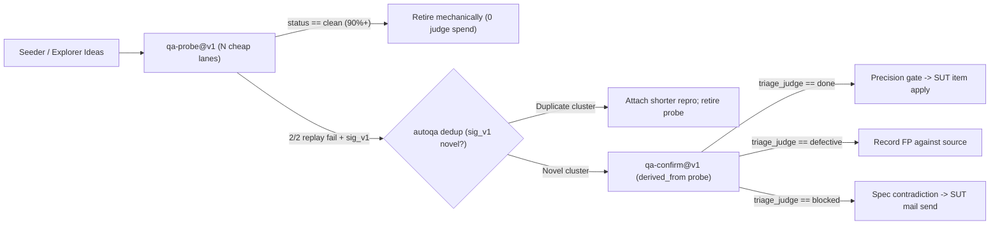

# Standalone AutoQA on the Tillr Contracts

**Status:** 2026-11-18. **Iceboxed by the owner** on 2026-11-17: "ice box this autoqa on the roadmap for now. I don't want to design this yet." It is parked on [the tillr roadmap's Icebox](../tillr/roadmap.md#icebox), neither abandoned nor accepted, and nothing below is being built. No AutoQA code exists (`rg -i autoqa tools --glob '*.go'` on 2026-11-18 finds only the code and tests that retire the old store vocabulary). The owner has ruled on nothing in this document: every row of its [ledger](#decision-ledger) is a designer's decision and says so.

> **In short.** Do not embed AutoQA inside `tillr` and do not rewrite a second queue, runner, or UI beside `tillr`. Build AutoQA as a standalone, self-gated tool (`autoqa`) that runs its **own** isolated `tillr` store and lane pool over pre-approved [tillr-item-graphs.md](../reference/tillr-item-graphs.md) workflows and [tillr-judge-and-lifecycle.md](./tillr-judge-and-lifecycle.md) verdicts, banging cheap floor-model agents against read-only snapshots of any System Under Test (SUT) — starting with `tillr` itself — and exporting only deduplicated, deterministically reproducible, independently judged bugs under a hard false-positive precision governor.

**Why it matters.** Turning cheap agents loose against a system under test only pays off if three failure modes are structurally impossible:
- **Core debt leak:** QA-specific actors, claim classes, and prompts leaking into `tools/tillr*` and `yolo-packs/tillr` (which already happened once between `4fa6dbe36c` and `472440341c`).
- **Self-licking queue noise:** Explorer agents refilling the queue endlessly with trivial flag permutations or touching a live repository while `tillr-drain` holds `TakeBoundary`.
- **False-positive flooding:** Treating *"an agent said it found a bug"* as a bug, filing duplicate crashes from concurrent lanes, or burning expensive build lanes on hallucinated expectations.

**The shape.** A standalone `autoqa` CLI and optional pack (`yolo-packs/autoqa`) with zero reverse dependencies from `tools/tillr*`; dual-store isolation (AutoQA's private `tillr` store + `autoqa.db` dedup/precision ledger vs the SUT's untouched work board); a two-workflow funnel (`qa-probe@v1` for cheap fan-out + mechanical replay, promoting unique hits into `qa-confirm@v1` for minimization + grant-backed W2 `evaluator_slot` triage); surface-saturation refill hysteresis; and a closed-loop precision circuit breaker.

**Cost.** A second tillr store and a second tool to keep working, and the cleanup of what AutoQA left inside tillr ([§5](#5-disposition-of-existing-autoqa-artifacts)). It adds no state, no graph primitive and no judge or grant rule to tillr itself.

**Needs your ruling:** None while the design is iceboxed. [OQ-AQ2](#OQ-AQ2) is blocked until the owner picks the design up.

**Its one queue item is not in the queue.** `item-design-autoqa-slices` is `not-started`: it was never admitted, and that is what keeps it from dispatch. On 2026-11-18 `tillr drain why` printed `not-ready` for it, with the operator as mover.

**Reads with:** [tillr-item-graphs.md](../reference/tillr-item-graphs.md) ([workflows](../reference/tillr-item-graphs.md#workflows-selection-and-expansion), [producer-bound artifacts](../reference/tillr-item-graphs.md#producer-bound-artifacts), and [evaluator routing](../reference/tillr-item-graphs.md#workflow-evaluator), fixed upstream graph and `evaluator_slot` contract), [tillr-judge-and-lifecycle.md](./tillr-judge-and-lifecycle.md) ([§2.1](./tillr-judge-and-lifecycle.md#21-topology-relative-to-gate-and-land-d-jl1) and [§5](./tillr-judge-and-lifecycle.md#5-core-boundary-for-external-autoqa-d-jl7), fixed upstream judge contract and `D-JL7` retirement of `ActorAutoQA`), [board-utilities.md](./board-utilities.md) ([§5](./board-utilities.md#5-independent-use-the-boundary-made-concrete), standalone utility boundaries), [tillr-distribution.md](./tillr-distribution.md) ([§3](./tillr-distribution.md#3-documentation-split-and-the-honesty-rule) and [§5](./tillr-distribution.md#5-the-autoqa-handoff-through-the-pack)), and [tillr-idea-pipeline.md](./tillr-idea-pipeline.md) ([§1](./tillr-idea-pipeline.md#1-item-kinds-states-and-edges)–[§2](./tillr-idea-pipeline.md#2-the-pipeline-and-one-writer-rules), `derived_from` lineage).

**Words.** A **System Under Test (SUT)** is the program AutoQA probes; the first is tillr. **W1** and **W2** are short names for the two designs AutoQA runs on: W1 is [item graphs](../reference/tillr-item-graphs.md), which supplies workflows of read-only nodes, and W2 is [the judge and lifecycle](./tillr-judge-and-lifecycle.md), which supplies the judge and its grants. An **evaluator slot** is the place in a workflow where a judge node sits. [The vocabulary](./tillr-vocabulary.md#5-the-words) defines item, node, judge, gate and lane.

---

## 1. Existing Machinery and the Accidental Leak

### 1.1 What Already Exists at HEAD

Read on 2026-11-14 at `6851b49015`; the last row was read again on 2026-11-18.

| Capability | Existing code or document | Status |
| :--- | :--- | :--- |
| **Standalone queue, runner, and read UI** | `tools/tillr-{store,item,run,drain,gate,land,view}` ([board-utilities.md](./board-utilities.md) [§5](./board-utilities.md#5-independent-use-the-boundary-made-concrete)) | **Built.** Every binary takes explicit `--store` / `--lane-root` / record inputs with zero global board coupling; AutoQA can drive its own private `tillr` instance directly over `PATH`. |
| **Standalone seams (`D-AQA2`–`D-AQA4`)** | [events.go](../../tools/tillr-drain/drain/events.go) (`2050271d4a`); [tools/tillr-run/main.go](../../tools/tillr-run/main.go) & [change.go](../../tools/tillr-gate/change.go) (`defecac1de`) | **Built.** `ProcessSteps` publishes `boundary.check`, `gate.plan`, and `gate.verdict`; `tillr-run exec` propagates child exit codes while reserving `2/3/4/5`; `tillr-gate change` and `tillr-run request` exist as CLI faces. |
| **Fresh-store DDL registration** | [tools/tillr-store/main.go](../../tools/tillr-store/main.go) ([autoqa-tillr-seams.md](./autoqa-tillr-seams.md) [§1.3](./autoqa-tillr-seams.md#13-the-real-coupling-the-stores-schema-is-a-function-of-who-opened-it)) | **Built (`item-def-tables-at-init`).** `tillr-store init` now creates the full schema matching every owner and the loop (`tools/tillr-store/init_schema_test.go`), so read-only faces (`view waiting`, `view status`, `drain why`, `run lanes`) exit `0` on a freshly initialized store without waiting for each owning utility to open it for writing. |
| **Pre-approved workflows & `evaluator_slot`** | [tillr-item-graphs.md](../reference/tillr-item-graphs.md), [tillr-judge-and-lifecycle.md](./tillr-judge-and-lifecycle.md) | **Built upstream (`stage: CURRENT` / `BUILT`).** W1/W2 contracts supply `no_commit` read-only agent nodes, `command` nodes, typed run artifacts, and grant-backed `evaluator_slot` judging. |
| **AutoQA runner, idea refill, or bug dedup** | *(none across `tools/`, `yolo-packs/`, `config/`)* | **Absent.** Every `autoqa` match in the tree is prose, a doc comment, or the code and tests that refuse the retired store vocabulary. |

### 1.2 Why Embedding AutoQA in Tillr Failed

AutoQA began as an external reviewer of tillr's early binaries and, within two days of 2026-11-12, had leaked into tillr three ways:

- **A handoff brief in the tillr pack.** [autoqa-handoff.md](../../yolo-packs/tillr/tasks/autoqa-handoff.md) first shipped as a pack briefing, which told every agent in every workspace that selected the tillr pack to return design comments instead of doing its job. It was moved to `tasks/` and is still there.
- **Client-specific vocabulary in the item store.** An `autoqa` actor kind, a `qa-verification` claim class and an `autoqa` decider were added to `tools/tillr-item/`. They are now refused on new writes ([the judge design, section 5](./tillr-judge-and-lifecycle.md#5-core-boundary-for-external-autoqa-d-jl7)).
- **A warning in every module README** that an unbuilt `tillr-autoqa` skill is missing. All eight still carry it.

AutoQA is sectioned off completely below (`D-AQ1`).

---

## 2. The Sectioned-Off Boundary

### 2.1 Own Code, Own Pack, Own Gate, Zero Reverse Dependencies

AutoQA obeys a strict one-way dependency rule (`D-AQ1`): **AutoQA knows how to invoke `tillr` binaries on `PATH`; `tools/tillr*` and `yolo-packs/tillr` contain zero imports, enums, prompts, flags, or tests mentioning AutoQA.**

```text
yolo-packs/autoqa/                 (optional pack — never bundled into yolo-packs/tillr)
  pack.json                        (declares program `autoqa` + skill `autoqa-operating`)
  programs/autoqa/run              (digest-cached Go source launcher, same pattern as mq/tillr)
tools/autoqa/                      (own go.mod — ZERO `replace` links into ../tillr*)
  cmd/autoqa/                      (faces: init, seed, campaign, refill, dedup, export, status)
  workflows/                       (qa-probe@v1.json, qa-confirm@v1.json)
  targets/tillr/                   (first SUT target config + sandbox preparer)
  registry.json                    (AutoQA's own tillr-gate check registry)
```

- **Lives by itself ([OQ-AQ1](#decision-ledger)):** `tools/autoqa/go.mod` has no `replace` edge into `tools/tillr*`. Every interaction with `tillr` crosses documented CLI faces (`tillr-store`, `tillr-item`, `tillr-drain`, `tillr-run`, `tillr-view`) and versioned JSON envelopes. Extracting `tools/autoqa/` + `yolo-packs/autoqa/` into a standalone git repository at any point is a zero-code-change `git subtree split`.
- **Gated by itself:** When incubating in this repository, [tools/fork-check.py](../../tools/fork-check.py) plans `Check("autoqa", ...)` watching only `tools/autoqa/**` and `yolo-packs/autoqa/**`, while `PACK_SYNC_WATCHES` and `TILLR_DOCS_WATCHES` ignore both directories. Inside `tools/autoqa/`, `tillr-gate plan` + `tillr-gate run` over `tools/autoqa/registry.json` gates AutoQA's own changes (`go test ./...`, workflow validation, and `yolo pack lint yolo-packs/autoqa`) with no store required ([OQ-AQA2](./autoqa-tillr-seams.md#OQ-AQA2) settled: `tillr-gate` stays store-free).
- **No core changes:** AutoQA adds **zero** item states, DAG node kinds, or judge/grant exceptions to `tillr`.

### 2.2 Two Stores and Sandboxed SUT Snapshots

AutoQA never shares a SQLite database, lane pool, or working tree with the System Under Test (`D-AQ2`):

| Surface | AutoQA's private runtime (`$XDG_STATE_HOME/autoqa/<campaign>/`) | SUT's live workspace (e.g. `/workspace`) |
| :--- | :--- | :--- |
| **Queue & execution store** | `state.db` (`tillr` store holding `qa-probe` and `qa-confirm` items, runs, and local QA judge grants) + `autoqa.db` (dedup signatures, surface saturation, precision ledger) | `/workspace/.tillr/state.db` — untouched during probing; written **only** on confirmed-bug export via `tillr item` |
| **Working tree & git refs** | Read-only SUT snapshot `<state_dir>/sut/<sut_sha>/` + throwaway per-probe scratch dirs | Live `/workspace` + `refs/heads/main` — **zero** reads/writes by QA lanes; `TakeBoundary` ([boundary.go](../../tools/tillr-drain/drain/boundary.go)) never trips |
| **Observability** | Separate `tillr view serve --store <state_dir>/state.db` instance showing active probes and confirmations | Owner's main `tillr view serve` remains clean of unconfirmed QA noise |

**Store initialization.** Since `tillr-store init` now registers the full schema matching every owner and the loop (`item-def-tables-at-init`), read-only faces (`show`, `lanes`, `list`) no longer fail on a freshly initialized store; `autoqa init` initializes `<state_dir>/state.db` with `tillr-store init` and `tillr-item grant` (issuing AutoQA's local `verification-only` judge grant), without needing a dummy `tillr-drain once` + `/bin/true` `tillr-run exec` pass solely to create tables.

**Dogfooding against `tools/tillr*` safely.** `autoqa target prepare --sut tillr --rev <sut_sha>` exports `<sut_sha>` via `git archive` and compiles all eight `tillr*` binaries once into `<state_dir>/sut-bin/<sut_sha>/` (digest-cached). Every cheap probe receives `PATH=<state_dir>/sut-bin/<sut_sha>:$PATH`, `BOARD_DB=""`, and a fresh empty `XDG_STATE_HOME` inside its probe sandbox, letting agents corrupt scratch SQLite files, kill leases mid-transaction, and fuzz CLI envelopes with zero path to `/workspace` or `/workspace/.tillr/state.db`.

**Crossing into the SUT board.** Per [tillr-judge-and-lifecycle.md](./tillr-judge-and-lifecycle.md) `D-JL7`, AutoQA proposes crossing into the SUT's `tillr` store exclusively through four standard faces (note: in the current tree, sync from landed-document blocks is the only intake for `/workspace/.tillr/state.db`, so filing confirmed bugs via `tillr item apply` vs document blocks is open as [OQ-FQ8](./tillr-separable-parts.md#OQ-FQ8) in [tillr-separable-parts.md](./tillr-separable-parts.md), blocked until AutoQA is picked up):
- `tillr item apply` (`item.record`) to file a confirmed, deduplicated bug item (proposed here; see [OQ-FQ8](./tillr-separable-parts.md#OQ-FQ8));
- `tillr item verdict record` (`actor_kind: "mechanical"`, `actor: "autoqa/replay"`, `claim_class: "verification-only"`) when re-running a stored reproducer against a landed fix;
- `tillr item verdict record` (`actor_kind: "agent"`, `actor: "autoqa/triage"`, `judged_actor: "<producer>"`, `claim_class: "verification-only"`, backed by an unexpired `grant_id` in the SUT's `item_grants`) when delegated QA sign-off is explicitly granted; and
- `tillr item mail send` to escalate genuine spec contradictions to the owner.

---

## 3. Queue, Fan-Out, and Refill Policy

### 3.1 Test-Idea Items and the Two-Workflow Funnel

If every cheap probe ran an expensive minimizer and independent LLM judge inside one workflow, AutoQA would waste judge tokens on the `90%+` of probes that find no bug and pay `K` times whenever `K` concurrent lanes hit the same panic. Instead, AutoQA runs **two pre-approved [tillr-item-graphs.md](../reference/tillr-item-graphs.md) workflows** inside `<state_dir>/state.db` (`D-AQ3`), both using `requires_candidate: "no_commit"` so all `--lanes N` workers fan out concurrently without git fence contention (note: the child-spawning edge below assumes `derived_from` and child creation from a `no_commit` workflow, which are not built in the current tree — see [tillr-separable-parts.md](./tillr-separable-parts.md) [§4 item 4](./tillr-separable-parts.md#4-where-the-documents-disagree) and [tillr-idea-pipeline.md](./tillr-idea-pipeline.md) [§1](./tillr-idea-pipeline.md#1-item-kinds-states-and-edges)):



1. **`qa-probe@v1` (cheap exploration + zero-token replay, `evaluator_slot: nil`):**
   - **`probe` (`agent`, cheap floor route, `access: "read_only"`, `timeout_ms: 300000`):** Exercises one falsifiable hypothesis against a named `(sut_module, sut_face, contract_ref)` inside the isolated SUT sandbox. Writes typed outputs under `.tillr/loop/<run_id>/artifacts/` ([producer-bound artifacts](../reference/tillr-item-graphs.md#producer-bound-artifacts)): `probe_result.json` (`clean | suspect`, plus `<= 3` optional `proposed_ideas[]`) and, when `suspect`, a self-contained regression script `repro.sh`.
   - **`verify_repro` (`command`, `command_ref: "autoqa-replay"`, `access: "read_only"`, `timeout_ms: 60000`):** Zero model spend. If `clean`, exits `0` immediately. If `suspect`, executes `repro.sh` twice in fresh clean directories against `<sut_sha>`, extracts deterministic failure signature `sig_v1`, and records the outcome in `autoqa.db`. Only novel `2/2` deterministic reproducers are proposed to spawn a child `qa-confirm@v1` item linked via `derived_from` ([tillr-idea-pipeline.md](./tillr-idea-pipeline.md) [§1](./tillr-idea-pipeline.md#1-item-kinds-states-and-edges); neither `derived_from` edges nor child creation from a `no_commit` workflow is built in the current tree, where child blocks are introduced through a landed document after `tillr-land pass`).
2. **`qa-confirm@v1` (minimization + independent W2 contract judge, `evaluator_slot: "triage_judge"`):**
   - **`minimize` (`agent`, `access: "read_only"`):** Shrinks `repro.sh` and fixture inputs to the smallest failing command sequence while preserving `sig_v1`.
   - **`replay_check` (`command`, `access: "read_only"`):** Verifies the minimized `repro.sh` fails `3/3` times deterministically with scrubbed environment and injected `--now` clock.
   - **`triage_judge` (`agent`, `seat: "review"`, `access: "read_only"`, `evaluator_slot`):** Fresh session on an independent judge route, backed by `<state_dir>/state.db`'s `verification-only` `item.grant` (`checkIndependence` enforced per [tillr-judge-and-lifecycle.md](./tillr-judge-and-lifecycle.md) [§2.1](./tillr-judge-and-lifecycle.md#21-topology-relative-to-gate-and-land-d-jl1); W1 agent nodes name a `seat` rather than a `role` per [stage kinds](../reference/tillr-item-graphs.md#schema-stage-kinds-and-static-expansion)). Emits `eval.output` (`done` = confirmed contract violation; `defective` = false positive / valid refusal; `blocked` = spec contradiction).

Notice that both workflows use pure static flattening (`D-IG4`), so AutoQA requires neither cycles nor bounded in-fog proposals ([OQ-IG2](../reference/tillr-item-graphs.md#why-its-this-way)) to ship.

### 3.2 Seeding, Explorer Proposals, and Refill Throttling

Test ideas enter `<state_dir>/state.db` from two sources under strict **saturation hysteresis** *(coined here)* — a refill rule that bounds queue depth, lineage depth, and per-surface probe count relative to SUT code movement (`D-AQ4`):

- **Source A — Contract & Diff Seeder (`autoqa seed`):** Inspects SUT design docs, `--help` outputs, state schemas, and `git diff <last_tested_sha>..<sut_sha>`, seeding concrete hypotheses ranked `a..m` (prioritizing surfaces touched since `last_tested_sha`).
- **Source B — Explorer Side-Proposals (`proposed_ideas[]`):** Adjacent edge cases noticed during `probe` runs, admitted at lower rank `n..z` only after passing four mechanical filters in `autoqa refill`:
  1. **Watermark bounds:** Refill runs only when dispatchable `qa-probe@v1` items drop below `low_watermark = 2 * lanes` and caps admissions at `high_watermark = 6 * lanes`.
  2. **Tuple dedup & source mix:** Normalizes `(sut_module, sut_face, perturbation_class, hypothesis_tokens)` against `autoqa.db` to drop near-duplicates, and caps explorer proposals at `<= 50%` of any refill batch and `generation <= 2` (preventing multi-hop prompt drift).
  3. **Surface-saturation cooldown:** Once `(sut_module, sut_face)` accumulates `K = 15` consecutive `clean` probes at `<sut_sha>` with zero confirmed bugs, that surface enters **cooldown** until a new SUT commit modifies its watched paths.
  4. **Explicit campaign ceiling ([OQ-AQ3](#decision-ledger)):** Unlike an engineering backlog where the item pile is the sole throttle ([tools/tillr-drain/README.md](../../tools/tillr-drain/README.md)), `autoqa campaign` enforces explicit `max_probes` and `max_wall_minutes` bounds (stopping early with `sut-saturated` when all target surfaces are in cooldown).

---

## 4. Confirmed Bugs, Deduplication, and False-Positive Economics

### 4.1 Four Gates Before a Finding Is a Confirmed Bug

An agent claiming *"I found a bug"* in prose has zero weight (`D-AQ5`). Cheap models routinely mistake documented negative-decision exits (`exit 1` rejection, `exit 2` usage error, `exit 3` schema incompatibility per [board-utilities.md](./board-utilities.md) [§5.1](./board-utilities.md#51-the-common-contract)) for defects, or violate stated preconditions such as `tillr-store init`'s three-table store. A finding becomes a **confirmed bug** only after clearing four gates:

1. **Regression-polarity executable reproducer:** `repro.sh` runs hermetically (no LLM calls, no network, fixed `--now` clock, throwaway dir), exiting `1` when the bug is present on `<sut_sha>`, `0` once the SUT satisfies its contract, and `125` on harness setup error. When exported to the SUT board, `repro.sh` **is** the ready-made negative control for the eventual fix.
2. **Deterministic `3/3` replay (`replay_check`):** Any `0` exit, `125` setup error, wall timeout, or shifting failure locus across three fresh runs rejects the finding mechanically as `flaky-or-unreproduced`.
3. **Novel cluster check (`autoqa dedup`):** Must not match any open, confirmed, or previously rejected false-positive cluster in `autoqa.db` or the SUT store.
4. **Independent W2 contract triage (`triage_judge`):** Verifies that `repro.sh` respected all documented preconditions of the SUT face and violated an explicit invariant in code, `--help`, or an accepted design doc. Valid refusals and invented expectations are ruled `defective`; genuine doc-vs-binary contradictions are ruled `blocked` and routed to `tillr item mail send` rather than filed as code bugs.

### 4.2 Two-Stage Cross-Agent Deduplication

Concurrent cheap agents frequently trigger the same underlying defect via different inputs. `autoqa.db` deduplicates at two points before touching the SUT board (`D-AQ5`):

- **Stage 1 — Pre-confirmation mechanical signature (`sig_v1` in `verify_repro`):** Hashes `(sut_binary, sut_face, failure_kind, locus_key)` after stripping dynamic values, temp paths, timestamps, UUIDs, and commit SHAs:
  - *Go panic / crash (`exit 2` runtime panic or `exit 5`):* top three in-repo stack frames (`pkg.Func` + file basename, line numbers stripped).
  - *Structured `tillr` refusal/envelope defect:* `(record.kind, payload.rule, exit_code)` or normalized first stderr template line.
  - *Store/view invariant mismatch:* `(invariant_name, table_or_field)`.
  Concurrent hits sharing `sig_v1` collapse into **one** cluster before `qa-confirm@v1` spawns, retaining the shortest `repro.sh` by byte length.
- **Stage 2 — Post-minimization locus & tombstone check (`autoqa export`):** After `minimize` and `triage_judge`, `autoqa.db` keys the cluster by `(sut_module, implicated_symbol_or_rule)` alongside `sig_v1`, checks both active exports and **false-positive tombstones** (so a rejected non-bug is never re-filed by a later campaign at the same `<sut_sha>`), and queries the SUT store (`tillr view status`) to guarantee **at most one SUT item per root defect**.

### 4.3 Precision Accounting and the Throttling Ladder

Every false positive exported onto `/workspace/.tillr/state.db` costs human triage or wastes a `15–30m` build lane plus a full `just done` cycle. AutoQA therefore governs itself by **board precision** *(coined here)* — the rolling fraction of exported AutoQA items on the SUT board that resolve as real fixes rather than `defective` closures (`D-AQ6`):

$$P_{\text{board}} = \frac{N_{\text{landed}} + N_{\text{resolved-elsewhere}}}{N_{\text{landed}} + N_{\text{resolved-elsewhere}} + N_{\text{closed-defective}}}$$

`autoqa status` polls exported `item_id`s on the SUT store over a rolling window of the last `20` resolved items (alongside internal judge pass rate $P_{\text{internal}}$ per seeder/prompt template) and enforces a three-rung automatic throttle:

| Rung | Condition on SUT outcomes | Automatic mechanical action |
| :--- | :--- | :--- |
| **1. Normal** | $P_{\text{board}} \ge 0.80$ (and $< 2$ consecutive `FP` closures) | Refill and export proceed under the target state of the moment: `not-started` while AutoQA is unproven, `in-queue` at the back of the queue once its precision is established ([OQ-AQ2](#OQ-AQ2)). |
| **2. Tighten** | $0.60 \le P_{\text{board}} < 0.80$ **or** `2` consecutive `FP` closures | Disables explorer-generated refill (Source B off), forces all new exports to `state: "not-started"`, and injects the rejected `FP` cases as negative examples into `triage_judge`'s brief. |
| **3. Circuit-Breaker Halt** | $P_{\text{board}} < 0.60$ (over $\ge 5$ resolved exports) **or** `3` consecutive `FP` closures | Halts SUT exports and pauses `autoqa campaign` (`autoqa-precision-halt`), sending **one** `tillr item mail send` summary naming the rejected items until recalibrated. |

**Every number in this section and in [§3.2](#32-seeding-explorer-proposals-and-refill-throttling) is a designer's starting guess.** None is measured, because no finding has ever been exported. When the design is picked up they are read again against the owner's rulings of 2026-11-17 and 2026-11-18: no count or time limit fails work, and there is no spend target. A throttle on what AutoQA files is not a count that fails an item, but the campaign's wall-time ceiling and the halts after consecutive false positives are the ones to argue again.

---

## 5. Disposition of Existing AutoQA Artifacts

### 5.1 Artifact Disposition Ledger

Every accidental AutoQA artifact in this repository gets a ruling (`D-AQ7`). The last column was read from the tree on 2026-11-18.

| Artifact | Ruling | Done |
| :--- | :--- | :--- |
| The pack handoff brief, [autoqa-handoff.md](../../yolo-packs/tillr/tasks/autoqa-handoff.md) | **Delete.** Its one-time review finished on 2026-11-13. | No: the file is still in `yolo-packs/tillr/tasks/`. |
| The tillr pack's description in [pack.json](../../yolo-packs/tillr/pack.json) | **Keep the pack; delete the AutoQA text.** | No: the description still ends "and the AutoQA design-review handoff". |
| The unbuilt `tillr-autoqa` skill of [tillr-distribution.md](./tillr-distribution.md) [§5](./tillr-distribution.md#5-the-autoqa-handoff-through-the-pack) | **Supersede.** The tillr pack ships only its operating skill; AutoQA ships in a pack of its own. | Partly: [OQ-TD2](./tillr-distribution.md#open-questions) is marked settled there and not yet compacted. |
| Known Gap #1 in the eight module READMEs | **Delete it** under one shared stamp, so that [tests/tillr-docs.test.py](../../tests/tillr-docs.test.py) still passes, and regenerate the pack copy. | No: `rg -c 'AutoQA handoff skill is not shipped' tools/*/README.md` answers 1 for each of the eight. |
| The seam document and its `D-AQA1` | **Supersede the document; retire `D-AQA1`.** | Yes: [autoqa-tillr-seams.md](./autoqa-tillr-seams.md) is superseded by this document. |
| The standalone seams `D-AQA2` to `D-AQA4` (loop-emitted gate events, exit-code propagation, `gate change` and `run request`) | **Keep in tillr.** They are general-purpose. | Yes: built before this design. |
| The store's `autoqa` actor kind, `qa-verification` claim class and `autoqa` decider | **Retire from what can be written**, keeping old rows readable. | Yes: new writes are refused with the rule `actor-retired`. |

### 5.2 Dogfood Rollout Against Tillr

1. **Slice 1 — Core cleanup:** Finish the rows of [§5.1](#51-artifact-disposition-ledger) that are not done: the handoff brief, the pack description, and the README gap. The store vocabulary is already retired.
2. **Slice 2 — Standalone `autoqa` skeleton & self-gate (`tools/autoqa/`, `yolo-packs/autoqa/`):** Land `autoqa init`, `autoqa target prepare --sut tillr`, `autoqa-replay`, `sig_v1` deduplication in `autoqa.db`, `qa-probe@v1` / `qa-confirm@v1` workflows, and `tools/autoqa/registry.json`.
3. **Slice 3 — First bounded campaign against `tools/tillr*`:** Seed 25 contract hypotheses across `tillr-{store,item,land,drain,run,gate,view}` (carrying carry-conflict, lease-expiry, rank, and malformed-envelope probes), run one `50`-probe campaign against a pinned `<sut_sha>` snapshot, and review exported `not-started` findings in Vantage / Observatory.
4. **Slice 4 — Precision graduation:** Once `20` judged findings sustain $P_{\text{board}} \ge 0.85$ ([OQ-AQ2](#OQ-AQ2)), enable autonomous `in-queue` filing at the back of the queue.

---

## 6. Decisions, Open Questions, and Amendments Owed

<a id="61-decision-ledger"></a>

### Decision Ledger

**Who decided each row.** The owner has ruled on nothing here: he iceboxed the design before reviewing it. Every row is a designer's decision, and he may overturn any of them. `D-AQ1` to `D-AQ7` are the design as written on 2026-11-14.

| ID | Ruling / Decision | Date | Settled in | Built |
| :--- | :--- | :--- | :--- | :--- |
| `D-AQ1` | Build AutoQA as a standalone CLI and optional pack (`yolo-packs/autoqa`) with zero Go `replace` imports, zero schema/enum couplings, and disjoint gate `watches` from `tools/tillr*` and `yolo-packs/tillr`. Reason: Satisfies *"lives by itself, gated by itself, develops by itself"* and makes later repository extraction a zero-code-change move ([OQ-AQ1](#decision-ledger)). | 2026-11-14, designer | [§2.1](#21-own-code-own-pack-own-gate-zero-reverse-dependencies) | — |
| `D-AQ2` | Run AutoQA over its own private `tillr` store and `autoqa.db` ledger against read-only, digest-cached SUT snapshots, crossing into the SUT's `tillr` store solely via `item apply`, `mechanical` or grant-backed `agent` `verdict record`, and `mail send`. Reason: Reuses `tillr`'s queue, runner, and observatory without polluting the SUT's `QueueRail` or tripping `TakeBoundary`, honoring [tillr-judge-and-lifecycle.md](./tillr-judge-and-lifecycle.md) `D-JL7`. *(Note: in the current tree, sync from landed-document blocks is the only intake for `/workspace/.tillr/state.db`; whether AutoQA files bugs via `tillr item apply` or document blocks is open as [OQ-FQ8](./tillr-separable-parts.md#OQ-FQ8).)* | 2026-11-14, designer | [§2.2](#22-two-stores-and-sandboxed-sut-snapshots) | — |
| `D-AQ3` | Split execution into two static `no_commit` W1 workflows in AutoQA's store: `qa-probe@v1` (cheap fan-out + zero-token `2/2` replay + `sig_v1` dedup) promoting novel reproducers via `derived_from` into `qa-confirm@v1` (minimization + `3/3` replay + W2 `evaluator_slot` `triage_judge`). Reason: Eliminates judge/minimizer token spend on clean probes (`90%+`) and concurrent duplicate crashes. *(Note: the W1 command-node, output, `no_commit`, and evaluator contracts are now built; `derived_from` and child creation from a `no_commit` workflow are not built in the current tree.)* | 2026-11-14, designer | [§3.1](#31-test-idea-items-and-the-two-workflow-funnel) | — |
| `D-AQ4` | Govern queue refill by low/high watermarks (`2 * lanes` / `6 * lanes`), tuple dedup, explorer caps (`<= 50%` batch share, `generation <= 2`), per-surface saturation cooldown (`15` clean probes until SUT paths move), and explicit campaign ceilings. Reason: Prevents cheap explorer agents from turning the test-idea queue into an unbounded self-licking token sink ([OQ-AQ3](#decision-ledger)). | 2026-11-14, designer | [§3.2](#32-seeding-explorer-proposals-and-refill-throttling) | — |
| `D-AQ5` | Require four gates for a confirmed bug — regression-polarity `repro.sh`, `3/3` hermetic replay, two-stage signature/locus deduplication (`sig_v1` + post-minimization tombstone check), and an independent grant-backed `triage_judge` ruling — routing spec contradictions to `mail send`. Reason: Rejects prose-only claims, flaky failures, valid exit-`1/2/3` refusals, and duplicate multi-lane hits before any item reaches the SUT board. | 2026-11-14, designer | [§4.1](#41-four-gates-before-a-finding-is-a-confirmed-bug) | — |
| `D-AQ6` | Track rolling SUT board precision $P_{\text{board}}$ in `autoqa.db` and enforce a three-rung throttle (`>= 0.80` normal; `0.60..0.80` or `2` FPs pause explorer refill + force `not-started`; `< 0.60` or `3` FPs halt exports and campaign). Reason: Protects expensive SUT build lanes and human attention from miscalibrated prompts without manual babysitting ([OQ-AQ2](#OQ-AQ2)). | 2026-11-14, designer | [§4.3](#43-precision-accounting-and-the-throttling-ladder) | — |
| `D-AQ7` | Delete [autoqa-handoff.md](../../yolo-packs/tillr/tasks/autoqa-handoff.md), the unbuilt `tillr-autoqa` skill ([OQ-TD2](./tillr-distribution.md#open-questions)), and README Known Gap #1; supersede [autoqa-tillr-seams.md](./autoqa-tillr-seams.md) while keeping `D-AQA2`–`D-AQA4` in `tillr` core; retire `ActorAutoQA` / `qa-verification` / `DecidedByAutoQA`; and close `item-decided-by-autoqa`. Reason: Disposes of every accidental AutoQA artifact in `tillr` while preserving the general standalone CLI contracts already built at `6851b49015`. | 2026-11-14, designer | [§5.1](#51-artifact-disposition-ledger) | Partly: see [§5.1](#51-artifact-disposition-ledger) |
| OQ-AQ1 | **Designer's decision, 2026-11-15; not ruled by the owner; the owner may overturn it.** AutoQA starts in this repository, in its own tool and pack directories with no shared Go module, and is split out once dogfooding settles. **Rejected:** a separate repository from the first commit. The reason given: the owner builds tools for one user but shaped so they could be shared, and tillr itself was incubated here the same way. | 2026-11-15, designer | [§2.1](#21-own-code-own-pack-own-gate-zero-reverse-dependencies) | — |
| OQ-AQ3 | **Designer's decision, 2026-11-15; not ruled by the owner; the owner may overturn it.** A campaign is a bounded pass by default: it stops at its probe count, its time limit, or when the surfaces are saturated. Running continuously is an option a repository turns on. **Rejected:** a daemon that wakes on every trunk move by default. The reason given: every tillr option that spends or publishes unasked is off by default ([the restart reference](../reference/tillr-restart.md#the-settings-file)). | 2026-11-15, designer | [§3.2](#32-seeding-explorer-proposals-and-refill-throttling) | — |

### 6.2 Open Questions

1. 🔒 **OQ-AQ2: May AutoQA put a bug it has confirmed straight into the build queue, or must a person admit it first?**

   <!-- vantage: question id=OQ-AQ2 blocked-on="the owner taking this design out of the Icebox" leaning="A — a person admits each finding until AutoQA's findings have proved accurate, because a wrong finding filed as admitted costs a build run and a full gate before anyone has looked at it." -->

   Blocked on the owner picking this design up. He iceboxed it on 2026-11-17 ("I don't want to design this yet"), no AutoQA code exists, and nothing can file a finding. It becomes a question to answer when the design leaves [the Icebox](../tillr/roadmap.md#icebox).

   What it will ask: AutoQA confirms a bug in tillr and files an item for it in this repository's queue. Filed as admitted, the drain starts a build run on it unasked, and a wrong finding costs that run and a full gate. Filed as a draft, it waits until a person admits it with one command.

   - **A — A person admits each finding at first.** You see confirmed bugs listed as drafts and admit the ones you believe. Once enough have proved real, new ones are admitted automatically at the back of the queue. The design's starting figure, a guess, is 20 judged findings of which 85% were real.
   - **B — Admitted from the first finding.** Bugs are fixed with nobody in the loop from day one. If too many prove false, AutoQA falls back to filing drafts.

   _Leaning:_ A — a person admits each finding until AutoQA's findings have proved accurate, because a wrong finding filed as admitted costs a build run and a full gate before anyone has looked at it.

   **Answer:**

   > _(empty — fill in when decided)_

### 6.3 Amendments Owed

Three tracked documents owed updates. Read on 2026-11-18:

1. **[autoqa-tillr-seams.md](./autoqa-tillr-seams.md):** made. It is superseded by this document and records `D-AQA1` as retired.
2. **[tillr-distribution.md](./tillr-distribution.md):** partly made. [OQ-TD2](./tillr-distribution.md#open-questions) is marked settled as superseded by `D-AQ1` and `D-AQ7`, and is not yet compacted into that document's ledger.
3. **The eight `tools/tillr-*/README.md` banners:** owed. Known Gap #1 is removed under one shared stamp, with the pack copy regenerated, as part of Slice 1 ([§5.2](#52-dogfood-rollout-against-tillr)).

## Queue item

This design is in [the tillr roadmap's Icebox](../tillr/roadmap.md#icebox), and it keeps one item for
the work of cutting it into build items. The item is `not-started`: it has not been admitted to the
queue, so the drain never dispatches it. Picking the design up means admitting the item; its first
criterion then requires [OQ-AQ2](#OQ-AQ2) to be answered, which only the owner can do.

### Add a build order for AutoQA

The AutoQA design needs a clear handoff before implementation can begin. When the
owner resumes the design, settle its remaining questions and turn the agreed
behavior into small, testable build items. Start with the smallest working path
through the system so later items can build on something that has already been
proved, and make each item's dependencies explicit so workers know what must land
first. This work prepares the build order; it does not implement AutoQA or resume
the parked design on its own.

**Outcomes:**

- Settle the design's questions and record the decisions for future workers.
- Order small, testable build items around a working end-to-end starting point.
- Update the roadmap so it no longer holds the design for a ruling.

**Agent Details:**

- **Ref:** [Decisions and open questions](#6-decisions-open-questions-and-amendments-owed)
  and [dogfood rollout](#52-dogfood-rollout-against-tillr).
- **Where:** This document's frontmatter, decision ledger, and closing item blocks;
  [the tillr roadmap](../tillr/roadmap.md).
- **Verify:** Check the four criteria below, including each build item's path fence,
  testable criteria, and `blocked_by` dependencies. Run `uvx vantage-check` on this
  document after settling the questions.

<!-- tillr: item id="item-design-autoqa-slices" seat="design" paths="docs/design/tillr-autoqa.md,docs/tillr/roadmap.md" prose="2" -->

- **c1:** Every question in this document is answered and folded into its body and decision ledger, its frontmatter says `status: accepted` and `stage: DECIDED`, and `uvx vantage-check` on it reports nothing.
- **c2:** The document ends with a build order of item blocks, each small enough for one run inside one path fence, each with criteria a test can check, and each naming the items it waits on in `blocked_by`.
- **c3:** The first block proves the smallest end-to-end slice of the design and waits on nothing in this document.
- **c4:** [The tillr roadmap](../tillr/roadmap.md) no longer lists this design as waiting on a ruling.

