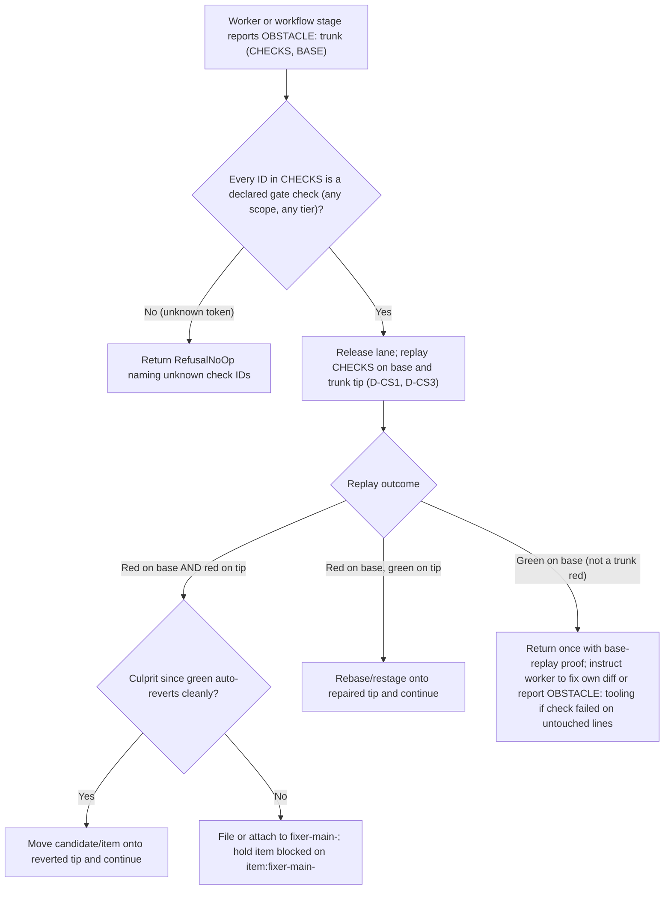

# When a check run by the change gate fails on trunk content the candidate did not touch

**Status:** Nothing here is built. In [`tree_common.py`](../../tools/gate/checks/tree_common.py), `design_citation_findings` still checks `(root / candidate).is_file()` against the working tree (`rg -n 'is_file\(\)' tools/gate/checks/tree_common.py` matches that predicate); `selectHeavyDeclarations` in [`checks.go`](../../tools/tillr-gate/checks.go) and `heavyCheckDeclarations` in [`heavy_steps.go`](../../tools/tillr-drain/drain/heavy_steps.go) still select only `check.Scope == "tree" && check.Tier == "heavy"`; and `rg -n 'TILLR_REPLAY_PATHS|replay-change' tools` returns nothing. Decisions `D-CS1` through `D-CS5` in the [Decision Ledger](#decision-ledger) are designer's decisions from a filed operator request and may be overturned by the owner.

> **In short.** On 2026-11-25 a consumer repository saw a design item land a `depends-on` citation to an untracked file, pass its own gate, and pass the trunk proof. Seven minutes later an unrelated documentation item failed `design-citations` on that untouched trunk line, reported `OBSTACLE: trunk` naming `design-citations`, and was bounced back twice (`$1.07` over three runs) with `"The run's trunk obstacle did not name only trunk check IDs: design-citations."` One cause is a plain defect in [`tree_common.py`](../../tools/gate/checks/tree_common.py) that reads the working-tree filesystem instead of Git's `HEAD` tree. Two structural gaps turned that slip into a queue trap: the after-merge trunk proof omits `tier: "fast"` whole-tree checks that every later change gate enforces across unchanged files, and the drain splits `OBSTACLE: trunk` between single-run `build` items and workflow or request items while lacking single-revision replay for `scope: "change"` declarations.

**Why it matters.** When `refs/tillr/green` advances past a commit that violates a check every later candidate runs on unchanged trunk lines, `lane_base: green` (`D-GR24` in [the gate reference](../reference/gate.md#why-its-this-way)) stages every new lane onto a broken base, and refusing `OBSTACLE: trunk` for that check id charges unrelated workers in a loop they cannot exit inside their allowed paths.

**The shape.** One plain defect fix ([Build item 1](#5-build-items-that-follow-from-this-design)) and five designer's decisions (`D-CS1` through `D-CS5`):

- **Plain defect ([Section 1.1](#11-plain-defect-design-citations-reads-the-working-tree-filesystem-instead-of-head)):** `design_citation_findings` and `scratch_citations` in [`tree_common.py`](../../tools/gate/checks/tree_common.py) read tracked membership and file bytes from Git's `HEAD` tree rather than the working directory.
- **Trunk proof coverage ([Section 2.3](#23-the-trunk-proof-covers-every-whole-tree-declaration-d-cs1)):** the after-merge proof includes every `scope: "tree"` declaration (`tier: "fast"` as well as `tier: "heavy"`), reusing remembered passes when `landed_tree == gated_tree`, and `tillr-gate checks` runs any single `scope: "tree"` declaration directly without calling [`tree-check.py`](../../tools/gate/tree-check.py) (`D-CS1`).
- **Check scope and change-check replay ([Section 3.2](#32-check-scope-contract-and-replaying-a-change-scoped-check-d-cs2-d-cs3)):** whole-tree invariants declare `scope: "tree"`, while `scope: "change"` checks can be replayed on a single revision with candidate-scoped paths so pre-existing base failures are acquitted (`D-CS2`, `D-CS3`).
- **Worker obstacle and drain routing ([Section 3.3](#33-what-a-worker-names-when-a-check-fails-outside-its-change-d-cs4), [Section 3.4](#34-where-the-item-goes-across-every-item-shape-and-seat-d-cs5)):** a worker names `OBSTACLE: trunk` for any declared gate check already red on `base` (and `OBSTACLE: tooling` only when the check passes on `base` yet fails on untouched lines or crashes), and the drain runs one unified replay-and-hold path across single-run, workflow, and request items (`D-CS4`, `D-CS5`).

**Cost.** Zero extra check executions in the proof when a single candidate lands with `landed_tree == gated_tree` (fingerprint hit in `<git-common-dir>/tillr-gate/results/`), and at most the 4.7 s declared fast-tree budget when concurrent landings produce a new merged tree.

**Awaits your review:** five designer's decisions (`D-CS1` through `D-CS5`) in the [Decision Ledger](#decision-ledger), any of which the owner may overturn; no open question blocks engineering detail.

**Reads with:** [Landing principles](./landing-principles.md) ([§1](./landing-principles.md#1-a-refusal-must-be-a-verdict), [§3](./landing-principles.md#3-gate-what-will-be-the-tip-once), [§4](./landing-principles.md#4-every-outcome-is-state-changing), [§11](./landing-principles.md#11-a-failure-is-diagnosed-not-waited-out), [§13](./landing-principles.md#13-a-held-state-names-a-mover-that-can-still-act), [§16](./landing-principles.md#16-what-the-operator-can-settle-is-settled-inside-tillr)), [the gate reference](../reference/gate.md), [gate check rules](../reference/gate-check-rules.md), [the judge and lifecycle design](./tillr-judge-and-lifecycle.md), [the roadmap](../tillr/roadmap.md#3-a-gate-that-names-what-failed), and [the decision provenance review](../tillr/decision-provenance-review.md#6-how-this-stops-happening).

---

## 1. Why the design item's own gate passed or skipped `design-citations`

Reading [`design-citations.json`](../../tools/gate/checks/design-citations.json), [`tree_common.py`](../../tools/gate/checks/tree_common.py), [`change-gate.py`](../../tools/gate/change-gate.py), [`checks.go`](../../tools/tillr-gate/checks.go), [`memory.go`](../../tools/tillr-gate/memory.go), and [`trunk.go`](../../tools/tillr-land/land/trunk.go) establishes three ways a design item lands a document whose `depends-on` names an untracked path while its own gate passes: two where `design-citations` runs and passes, and one where `--scope-to-change` skips it.

### 1.1 Plain defect: `design-citations` reads the working-tree filesystem instead of `HEAD`

In this repository, [`design-citations.json`](../../tools/gate/checks/design-citations.json) declares:

```json
{
  "id": "design-citations",
  "scope": "tree",
  "tier": "fast",
  "budget_ms": 400,
  "reads": ["."],
  "tools": ["python3", "git"]
}
```

`remember` is omitted, so `parseCheckDeclaration` in [`checkfiles.go`](../../tools/tillr-gate/checkfiles.go) defaults result memory to `true`. When the drain gates a candidate, [`change-gate.py`](../../tools/gate/change-gate.py) invokes `tillr-gate checks --fast-tree --scope-to-change`. In `checksFace` ([`checks.go`](../../tools/tillr-gate/checks.go)), the admission filter `check.Scope == "change" || *fastTree && check.Scope == "tree" && check.Tier == "fast"` selects `design-citations`, and `"reads": ["."]` covers every path in `change.ChangedPaths` (`coversPath` in [`memory.go`](../../tools/tillr-gate/memory.go)), so `readsChanged` is true on every non-empty candidate diff.

`design-citations` therefore runs, and passes because of a plain defect in `design_citation_findings` ([`tree_common.py`](../../tools/gate/checks/tree_common.py)):

1. **Citing files come from Git, but target resolution reads the filesystem.** `tracked_markdown(root)` lists citing documents with `git -C <root> ls-files "*.md"`, yet `design_citation_findings` resolves each cited `depends-on`, `superseded-by`, or `supersedes` target on disk with `if (root / candidate).is_file():` and reads target headings with `(root / relative).read_text(...)`, even though its own failure message states `"names no tracked document"`. (`scratch_citations` in the same file likewise reads `(root / path).read_text(...)` from disk rather than from `HEAD`.)
2. **Git-ignored files on disk pass both lane cleanliness checks and gate memory binding.** Any file present at `(root / candidate)` in the lane worktree satisfies `.is_file()` without being committed. When that file matches `.gitignore`, `git status --porcelain --untracked-files=all` omits it, so the drain's cleanliness checks (`finishWorkflow` in [`workflow_exit.go`](../../tools/tillr-drain/drain/workflow_exit.go) and `uncommittedPaths` in [`loop.go`](../../tools/tillr-drain/drain/loop.go)), the pi landing tool ([`land.ts`](../../tools/tillr-run/backends/pi/land.ts)), and `readBinding` in [`memory.go`](../../tools/tillr-gate/memory.go) (`// Git-ignored inputs are deliberately not covered`) all treat the checkout as clean and bound to `HEAD^{tree}`. `tillr-gate` even records a remembered pass keyed only on `git ls-tree -r -z` tracked blobs, until a later candidate changes any tracked file in a clean lane worktree that lacks the ignored file on disk.

By contrast, `unreachable_citations` and `document_keys` in [`change_common.py`](../../tools/gate/checks/change_common.py) read committed blobs from `HEAD` (`git show HEAD:<path>`, `git ls-tree -r -t -z HEAD`, and `git cat-file blob`), and `document_keys` explicitly refuses to remember a pass when an absent-at-`HEAD` link target exists on disk (`os.path.lexists(root / candidate)`). Fixing `design_citation_findings` and `scratch_citations` to read `HEAD`'s tree and blobs is a plain defect with an obvious fix, named alone as [Build item 1](#5-build-items-that-follow-from-this-design).

### 1.2 Concurrent landing onto a moved trunk

Even without an untracked file on disk, `design-citations` can run and pass truthfully on a design candidate and still leave a dangling `depends-on` on `main`. Under [Landing Principle 3](./landing-principles.md#3-gate-what-will-be-the-tip-once), the landing gate runs once against `(base_sha, head_sha)` before `land.lock`, and `Trunk.Squash` in [`trunk.go`](../../tools/tillr-land/land/trunk.go) three-way merges `base_sha..head_sha` onto `trunkBefore` with no second fast gate. If a target document existed at `base_sha` while a sibling candidate staged from the same `base_sha` deleted or renamed that target and landed first, both candidates pass `design-citations` in their own gates and merge cleanly onto `main` because they touch disjoint paths.

### 1.3 Narrowed `reads` or commits outside the candidate gate

In a consumer repository's declaration directory, `design-citations` is skipped altogether on the added document in two cases:

- **Narrowed `reads` under `--scope-to-change`.** When a consumer declaration narrows `reads` (for example to `["docs/design/"]`) while its check script still scans all tracked Markdown files, adding a document outside `docs/design/` makes `readsChanged` in [`checks.go`](../../tools/tillr-gate/checks.go) skip the check (`"skipped: no changed path is read"`). Seven minutes later, an unrelated item editing any file under `docs/design/` triggers the check across the whole repository and fails on the earlier document.
- **Direct commits on `main` or a check added after the document.** [`pre-commit`](../../hooks/pre-commit) checks only commit identity on `refs/heads/main` and runs no gate checks, so any out-of-band commit reaches `main` un-gated by [`change-gate.py`](../../tools/gate/change-gate.py).

---

## 2. Why the trunk proof goes green while every later change gate is refused

### 2.1 The check-set gap between `change-gate.py` and `JudgeHeavy`

Across the 39 JSON declarations in [`tools/gate/checks/`](../../tools/gate/checks/), the candidate gate and the after-merge trunk proof select non-overlapping tiers:

| Caller | Selector in code | Declarations selected in `tools/gate/checks/` | Evaluates unchanged trunk lines? |
| :--- | :--- | :--- | :--- |
| **Candidate change gate** ([`change-gate.py`](../../tools/gate/change-gate.py) -> `tillr-gate checks --fast-tree --scope-to-change` in [`checks.go`](../../tools/tillr-gate/checks.go)) | `check.Scope == "change" \|\| *fastTree && check.Scope == "tree" && check.Tier == "fast"`, filtered by `readsChanged` | **8 `scope: "change"` checks:** `citations`, `commit-identity`, `documents`, `elapsed-time`, `file-size`, `gate-budget`, `go-affected`, `workflows`.<br>**5 `scope: "tree", tier: "fast"` checks** (sum `4,700 ms`): `design-citations` (`reads: ["."]`), `pack-sync` (`reads: ["."]`), `scratch` (`reads: ["."]`), `format` (`reads: [".justfile", "tools/", ...]`), `go-build` (`reads: ["tools/tillr/", ...]`). | **Yes.** `design-citations`, `pack-sync`, and `scratch` match every diff (`reads: ["."]`) and scan the whole tree; `format` and `go-build` scan whole subtrees; `documents`, `elapsed-time`, `gate-budget`, `workflows`, and `go-affected` read whole touched files, sibling declarations, or selected Go packages; and a consumer check mis-declared `scope: "change"` can scan the whole tree. |
| **After-merge trunk proof** (`heavyCheckDeclarations` in [`heavy_steps.go`](../../tools/tillr-drain/drain/heavy_steps.go) and `selectHeavyDeclarations` in [`checks.go`](../../tools/tillr-gate/checks.go)) | `check.Scope == "tree" && check.Tier == "heavy"` (plus `RollingProgram`, which `DefaultRollingProgram` in [`trunk.go`](../../tools/tillr-drain/drain/trunk.go) sets to `""`) | **26 `scope: "tree", tier: "heavy"` checks:** Go module suites (`go-test-*`), adapter and script suites (`change-checks-test`, `tree-checks-test`, `tillr-docs`, `pack-sync-test`, `format-test`, etc.).<br>**0 `scope: "tree", tier: "fast"` checks.**<br>**0 `scope: "change"` checks.** | Only for invariants duplicated by a heavy test (`go-build` via `go-test-*`, `pack-sync` via `pack-sync-test`). Neither `design-citations` nor `scratch` nor `format` is run against the live tree by any heavy check (`tree-checks-test` and `format-test` test synthetic fixtures in temp directories). |

### 2.2 How the gap poisons `refs/tillr/green`

`selectHeavyDeclarations` and `heavyCheckDeclarations` treat `fast` and `heavy` as a partition: `fast` before merge, `heavy` after merge. That partition is sound only if pre-merge candidate gates make a red `tier: "fast"` check on `main` impossible. Sections [1.1](#11-plain-defect-design-citations-reads-the-working-tree-filesystem-instead-of-head) through [1.3](#13-narrowed-reads-or-commits-outside-the-candidate-gate) show three ways `main` violates a fast tree check anyway (lane-worktree disk state, concurrent squash merges under Principle 3, and narrowed `reads` or direct commits), and a consumer check mis-declared `scope: "change"` while scanning the whole tree creates a fourth.

When any of those happens, `JudgeHeavy` runs the 26 `tier: "heavy"` checks on the detached trunk checkout, sees every one pass, and advances `refs/tillr/green` to the broken commit. Under `lane_base: green` (`D-GR24`), every new lane is then staged from that broken `refs/tillr/green` commit, and every later candidate whose diff intersects `reads` (`["."]` = every candidate) fails [`change-gate.py`](../../tools/gate/change-gate.py) on unchanged trunk content.

### 2.3 The trunk proof covers every whole-tree declaration (`D-CS1`)

**`D-CS1` (designer's decision; the owner may overturn this):** Every `scope: "tree"` declaration — `tier: "fast"` and `tier: "heavy"` alike — belongs to the trunk proof's check list and to single-check revision execution in `tillr-gate checks`.

1. **`tier` governs pre-merge admission, not whether the trunk proof enforces a whole-tree invariant.** A `tier: "fast"` tree check runs before merge (within `FastTierCapMS = 9,000 ms`) *and* in the after-merge trunk proof; a `tier: "heavy"` tree check runs in the after-merge proof (and in a trunk fixer's named-check gate).
2. **Result memory keeps steady-state proof cost at zero extra runs.** `treeFingerprint` in [`memory.go`](../../tools/tillr-gate/memory.go) hashes the declaration bytes, planned command, tracked Git blobs under `reads`, tool versions, and `needs` refs into `<git-common-dir>/tillr-gate/results/` (`D-GR8` in [the gate reference](../reference/gate.md#why-its-this-way)). Whenever a single candidate lands without concurrent movement (`landed_tree == gated_tree`) in a bound checkout, its pre-merge fast gate has already stored the pass for that exact fingerprint, so the trunk proof records a remembered pass without spawning the check. The proof executes a fast tree check only when `main`'s input fingerprint was never proved (concurrent squash merge, unbound lane checkout, or direct commit on `main`), where all five fast tree checks in this repository budget 4.7 s combined and immediately trigger culprit bisection and `auto_revert` (`D-GR6`) or `fixer-main-<sha>` instead of advancing `refs/tillr/green`.
3. **`tillr-gate checks` runs any single `scope: "tree"` check natively.** Today `checksFace` in [`checks.go`](../../tools/tillr-gate/checks.go) refuses `--only` without `--heavy-tree` (`"--only requires --heavy-tree"`), forcing `revision_check` in [`tillr-loop`](../../tools/tillr-loop/tillr-loop) to shell out to `tools/gate/tree-check.py` for `tier: "fast"` checks — a script under `tools/gate/` that [`yolo-packs/tillr/`](../../yolo-packs/tillr/) does **not** ship to consumer repositories ([`design-status.md`](../tillr/design-status.md#how-the-pieces-fit)). Supporting `--tree` (all `scope: "tree"` declarations, fast + heavy) with optional `--only <id>` inside `tillr-gate checks` lets `JudgeHeavy`, `tillr-loop replay`, and `tillr-loop fixer-gate` judge every whole-tree check in any repository with no unshipped wrapper script.

---

## 3. Why the drain refused the obstacle, what a worker should name, and where the item should go

### 3.1 Why the unrelated documentation item was sent back twice

Tracing the consumer repository's sequence through [`steps.go`](../../tools/tillr-drain/drain/steps.go), [`trunk.go`](../../tools/tillr-drain/drain/trunk.go), [`tillr-loop`](../../tools/tillr-loop/tillr-loop), [`obstacle_route.go`](../../tools/tillr-drain/drain/obstacle_route.go), [`workflow.go`](../../tools/tillr-drain/drain/workflow.go), [`blocked.go`](../../tools/tillr-drain/drain/blocked.go), and [`obstacle_hold.go`](../../tools/tillr-drain/drain/obstacle_hold.go) exposes two sequential failures:

1. **Run 1 committed a valid change, and `settleGateFailure` failed to acquit it.** When `Steps.Gate` fails in [`loop.go`](../../tools/tillr-drain/drain/loop.go), `settleGateFailure` -> `settleTrunkAlreadyRed` -> `trunkAlreadyRed` calls `ProcessSteps.Replay` (`tillr-loop replay --only design-citations`). In `revision_check` ([`tillr-loop`](../../tools/tillr-loop/tillr-loop)):
   - If the consumer repository declared `design-citations` with `"scope": "change"`, `revision_check` raises `Refusal(EXIT_EXTERNAL, "named check could not judge: design-citations is not a whole-tree declaration")` (exit `4`).
   - Even if the consumer repository declared `"scope": "tree", "tier": "fast"`, `revision_check` execs `tools/gate/tree-check.py`, which is absent in consumer repositories that install tillr from the pack without copying `tools/gate/`.
   In both cases `ProcessSteps.Replay` ([`steps.go`](../../tools/tillr-drain/drain/steps.go)) classifies the non-`0`/non-`1` exit as `Unknown`, returns `ReplayOutcome{Known: false}`, leaves `reading.Confirmed == false` in `settleTrunkAlreadyRed`, and records `RefusalGate` against the innocent candidate, sending it back to its worker.
2. **Runs 2 and 3 reported `OBSTACLE: trunk` naming `design-citations`, and `recordObstacleHold` rejected the check ID.** The drain has two incompatible code paths for `OBSTACLE: trunk`:
   - `routeObstacle` in [`obstacle_route.go`](../../tools/tillr-drain/drain/obstacle_route.go) runs **only** for single-run, non-request `build`-seat items: `workerContract` requires `d.Seat == "" || d.Seat == "build"`, `routeObstacle` returns `false` whenever `requestWordsFor` is non-nil (every filed request), and workflow stages in [`workflow.go`](../../tools/tillr-drain/drain/workflow.go) call `l.reportedBlock(ctx, d, log)` directly without calling `routeObstacle` at all. (Even when `routeObstacle` runs, it calls `trunkAlreadyRed`, which fails for the same replay reason above and returns `RefusalNoOp` to the worker.)
   - Every workflow run, filed request, and `docs` or `design` seat run therefore enters `reportedBlock` ([`blocked.go`](../../tools/tillr-drain/drain/blocked.go)) -> `recordObstacleHold` ([`obstacle_hold.go`](../../tools/tillr-drain/drain/obstacle_hold.go)) when `BodyRef == ""` (or raises a `conflict-design` when `BodyRef != ""`). `recordObstacleHold` calls `l.trunkProofLists(ctx, checks)`, which accepts **only** `heavyCheckDeclarations` (`scope == "tree" && tier == "heavy"`) and legacy `rolling` checks. Both `scope: "tree", tier: "fast"` checks and `scope: "change"` checks fail `trunkProofLists` and return `invalidTrunkObstacleDetail(obs)` via `RefusalNoOp`:

     ```text
     The run's trunk obstacle did not name only trunk check IDs: design-citations.
     ```

   - Worse, even when `trunkProofLists` accepts a heavy check ID, `recordObstacleHold` neither replays `base` nor files a trunk fixer; `releaseTrunkObstacleHolds` waits passively for `readCheckProofs` to observe a future proof pass, violating [Landing Principle 13](./landing-principles.md#13-a-held-state-names-a-mover-that-can-still-act) whenever `refs/tillr/green` has already caught up to `main`.

### 3.2 Check scope contract and replaying a change-scoped check (`D-CS2`, `D-CS3`)

In [`tools/gate/checks/`](../../tools/gate/checks/), two distinct check shapes run during a candidate's change gate:

1. **Whole-tree checks scoped to changed reads (`scope: "tree", tier: "fast"` under `--scope-to-change`):** `design-citations`, `pack-sync`, `scratch`, `format`, and `go-build`. `--scope-to-change` decides only whether to schedule the check; once scheduled, the check receives no `BASE HEAD` arguments and judges one tree.
2. **Range checks (`scope: "change"`):**
   - *Strictly differential checks* — `citations`, `commit-identity`, and `file-size` ([`change_common.py`](../../tools/gate/checks/change_common.py)) — inspect only commits in `base..head`, lines added in `base..head` (exempting tokens already in `base`), or files added in `base..head`. They cannot fail on untouched trunk content.
   - *Touched-unit or directory checks* — `documents` ([`change_common.py`](../../tools/gate/checks/change_common.py)), `elapsed-time` ([`elapsed-time.py`](../../tools/gate/checks/elapsed-time.py)), `gate-budget` ([`gate-budget.py`](../../tools/gate/checks/gate-budget.py)), `workflows` ([`workflows.py`](../../tools/gate/checks/workflows.py)), and `go-affected` ([`go_affected.py`](../../tools/gate/go_affected.py)) — select units from `base..head` (or inspect a coupled config directory) and validate each selected file, directory, or Go package as a whole, so a pre-existing broken anchor elsewhere in a touched Markdown file, a stale entry in [`gate-timing-declarations.json`](../../tools/gate-timing-declarations.json), or a broken test in a selected Go package fails the candidate on lines it did not touch.

**`D-CS2` (designer's decision; the owner may overturn this) — Check scope contract:**

- A check that inspects repository-wide conventions or files outside `diff(base, head)` without comparing `base` and `head` **must** be declared `scope: "tree"` (`tier: "fast"` or `tier: "heavy"`), never `scope: "change"`, with `reads` covering every path it reads (`D-GR10`). Under `D-CS1`, every `scope: "tree"` check is proved on `main` and replayable on one revision.
- A `scope: "change"` check judges `base..head`. Where a `scope: "change"` check intentionally validates whole touched units rather than added lines alone, it must participate in single-revision replay (`D-CS3`) so a failure already present at `base` never convicts an unrelated edit.

**`D-CS3` (designer's decision; the owner may overturn this) — Replaying a `scope: "change"` check on a single revision ([Roadmap entry 8](../tillr/roadmap.md#3-a-gate-that-names-what-failed)):**

Neither naive replay strategy works for all `scope: "change"` checks:

- Passing `<rev> <rev>` alone gives `git diff <rev> <rev>` an empty path list, so diff-filtered checks (`documents`, `elapsed-time`, `go-affected`, or a consumer check gated on `if not changed_docs: return 0`) exit `0` on `<rev> <rev>` and miss a file that is already broken at `<rev>`.
- Diffing a synthetic tree with the candidate's paths deleted (`<rev_without_P>..<rev>`) makes every line and file in `P` appear newly added, causing strictly differential checks (`citations`, `file-size`, `commit-identity`) to convict historical content on `<rev>` that they deliberately exempt on incremental edits.

Instead, `tillr-gate checks` and `tillr-loop replay` replay a `scope: "change"` declaration `<id>` at revision `<rev>` (`base` or `tip`) by invoking the check command on `<rev> <rev>` with `TILLR_REPLAY_PATHS` set to the null-separated repository-relative paths under test filtered to paths present at `<rev>` (for a gate failure, `candidate.CandidateChangedPaths`; for an uncommitted worker obstacle, the lane's uncommitted paths or `PATHS:` on the obstacle). No silent fallback runs a path-dependent check with empty `TILLR_REPLAY_PATHS`: when neither a candidate diff nor lane/obstacle paths exist and the check reads touched paths, replay exits `4` (`Known == false`, cannot judge) rather than claiming `<rev>` passed:

| Check class | Behavior under `<rev> <rev>` + `TILLR_REPLAY_PATHS` | Why it is exact |
| :--- | :--- | :--- |
| Strictly differential (`commit-identity`, `citations`, `file-size`) | Ignores `TILLR_REPLAY_PATHS`; `base..head` is `<rev>..<rev>` (empty), exits `0` (`pass`). | These checks cannot fail on untouched trunk content; any `base..head` failure was introduced by the candidate. |
| Whole-touched-file (`documents`, `elapsed-time`) | When `base == head` and `TILLR_REPLAY_PATHS` is non-empty, inspects the named paths at `HEAD` (`<rev>`) (plus `gate-timing-declarations.json` for `elapsed-time`). | Reproduces pre-existing document or timing-declaration failures at `<rev>` without treating existing lines as newly added. |
| Coupled-directory (`gate-budget`, `workflows`) and consumer `scope: "change"` checks that scan whole trees | Already ignore `base..head` (or read `TILLR_REPLAY_PATHS` when diff-gated) and validate `<rev>` directly, exiting `1` when `<rev>` is broken. | Acquits candidates immediately even before a mis-scoped consumer check is migrated to `scope: "tree"`. |
| `go-affected` | Keeps `replayGoCheck` (`go test -run` on named failing tests from triage logs) and falls back to running affected packages for `TILLR_REPLAY_PATHS` at `<rev>`; fix `goAffectedCheckID` in [`trunk.go`](../../tools/tillr-drain/drain/trunk.go) to match the declared ID `"go-affected"` as well as the legacy slash ID ([Roadmap entry 5](../tillr/roadmap.md#2-a-core-that-carries-only-its-own-code)). | Reuses fast test-level replay when triage named tests and still judges unnamed package build/init failures on `<rev>`. |

### 3.3 What a worker names when a check fails outside its change (`D-CS4`)

**`D-CS4` (designer's decision; the owner may overturn this):**

1. **Do not edit unrelated files to appease a check.** Criterion 1 on request items (*"nothing the words do not ask for is changed"*) and `write_scope` on piece workflows forbid touching unrelated files just to clear a pre-existing failure.
2. **Name `OBSTACLE: trunk` (`CHECKS: <check-id>`, `BASE: <base_sha>`, plus `PATHS: <touched-paths>` when stopping uncommitted on a `scope: "change"` check) whenever any declared gate check fails on content that is already broken on `BASE` outside the worker's change.** The worker never inspects `tools/gate/checks/<id>.json` to branch on `scope` or `tier`: every check ID in `tools/gate/checks/*.json` is valid in `CHECKS:`. (When the worker's own edits are finished and no workflow `verify` stage blocks committing, committing the candidate directly is also valid and lets `settleTrunkAlreadyRed` promote disjoint `reads` to `pass-inherited` under [`OQ-GP7`](./tillr-graph-is-the-path.md#OQ-GP7) without holding the item; when the worker stops before committing or inside a workflow stage, `OBSTACLE: trunk` is the obstacle.)
3. **Name `OBSTACLE: tooling` (`COMMAND:`, `EVIDENCE:`, `PATHS:`) only when the check itself is defective rather than `BASE` being red** — specifically when the check crashes or stalls (`error` / exit `4`), misses a tool, or **passes on `BASE` yet fails on `BASE..HEAD` citing only lines outside `BASE..HEAD`** (a diff-scoping bug in the check script itself, naming `tools/gate/checks/<id>.*` in `PATHS:`).

### 3.4 Where the item goes across every item shape and seat (`D-CS5`)

**`D-CS5` (designer's decision; the owner may overturn this):** Retire the split between `routeObstacle` ([`obstacle_route.go`](../../tools/tillr-drain/drain/obstacle_route.go)) and `recordObstacleHold` ([`obstacle_hold.go`](../../tools/tillr-drain/drain/obstacle_hold.go)) for `OBSTACLE: trunk` and `OBSTACLE: tooling` so single-run items, filed requests, planned or scouted workflows, and non-`build` seats (`docs`, `design`, `plan`, `verify`) all take one state-changing route:



Five invariants govern this routing:

1. **`CHECKS:` validates against all declared gate checks, not `tier == "heavy"` alone.** Replace `trunkProofLists` in [`obstacle_hold.go`](../../tools/tillr-drain/drain/obstacle_hold.go) with a registry lookup over `tools/gate/checks/*.json` (any `scope`, any `tier`, plus legacy `rolling` while present).
2. **Confirmed red on `base` and `tip` always leaves an active mover (`item:fixer-main-<sha>`).** Whether triggered by `Steps.Gate` (`settleTrunkAlreadyRed`) or by `OBSTACLE: trunk` from a single-run, workflow, or filed-request run, a confirmed red on `tip` runs `acquitRedWithPaths`: bisecting and auto-reverting when possible (`D-GR6`), and otherwise filing or attaching to one deduplicated `fixer-main-<sha>` at rank `000`, capturing the replay check logs, preserving any lane work (`abandonFromBase`), releasing the lane, and setting the item to `blocked` waiting on `item:fixer-main-<sha>` (replacing passive `drain.obstacle-hold` trunk waits that filed no fixer).
3. **Gate-code recursion remains blocked.** If a mis-scoped consumer check's defect lies inside `GateCodePaths` (`tools/gate/`, `tools/tillr-gate/`, `tools/tillr-loop/`), `trunkFixerPaths` in [`trunk.go`](../../tools/tillr-drain/drain/trunk.go) keeps `GateCodePaths` out of `fixer-main-<sha>`'s allowed paths so a trunk fixer never passes by weakening the judge. When the trunk's documents are at fault (as in the consumer's `depends-on` incident), `fixer-main-<sha>` fixes the tracked document; when the check program itself is broken and reported via `OBSTACLE: tooling`, `fileDefectItem` files `defect-...` targeting `PATHS:` and holds the item behind `item:defect-...`.
4. **`OBSTACLE: tooling` on requests and workflows files a defect item instead of parking on `Mover = "operator"`.** Extending `routeObstacle`'s `ObstacleTooling` branch to workflow stages and filed requests removes the `"operator"` mover in [`read.go`](../../tools/tillr-drain/obstacles/read.go) for tooling obstacles, satisfying [Landing Principle 16](./landing-principles.md#16-what-the-operator-can-settle-is-settled-inside-tillr).
5. **Unconfirmed replay (`Known == false`) is a gate/machinery hold, never a false conviction of the worker.** When `Replay` exits `4` (`could not judge`), `routeObstacle` must not tell the worker *"the loop found none of them red, so the failure is not the trunk's"* (its current message in [`obstacle_route.go`](../../tools/tillr-drain/drain/obstacle_route.go) when `len(red) == 0` and `err == nil`!). Distinguishing `Known == false` from `Known == true && len(Red) == 0` satisfies [Landing Principle 8](./landing-principles.md#8-a-gate-that-cannot-answer-must-say-which).

---

## 4. Check against Landing Principles

| Principle in [landing-principles.md](./landing-principles.md) | How this design satisfies it |
| :--- | :--- |
| **[§1 A refusal must be a verdict](./landing-principles.md#1-a-refusal-must-be-a-verdict)** | A pre-existing failure on `base` acquits the candidate (`pass-inherited` when `reads` are disjoint, `trunk-already-red` behind `fixer-main-<sha>` when `reads` intersect) instead of recording `RefusalGate` or `RefusalNoOp` against innocent work. |
| **[§2](./landing-principles.md#2-re-application-preserves-the-change-not-the-patch) and [§3](./landing-principles.md#3-gate-what-will-be-the-tip-once)** | Pre-merge gating still runs once per candidate; `D-CS1` catches cross-candidate fast-check interactions in the asynchronous after-merge proof, with zero re-runs when `landed_tree == gated_tree`. |
| **[§4 Every outcome is state-changing](./landing-principles.md#4-every-outcome-is-state-changing)** | Eliminates the 3-run, `$1.07` loop where `OBSTACLE: trunk` naming `design-citations` returned `RefusalNoOp` on the same tip. |
| **[§8 A gate that cannot answer must say which](./landing-principles.md#8-a-gate-that-cannot-answer-must-say-which)** | `D-CS5` separates `ReplayOutcome{Known: false}` ("replay could not judge") from `Known: true, Red: nil` ("check passed on base"), never telling a worker that `base` passed when replay could not run. |
| **[§11](./landing-principles.md#11-a-failure-is-diagnosed-not-waited-out) and [§13](./landing-principles.md#13-a-held-state-names-a-mover-that-can-still-act)** | Every held item waits on a concrete queued item (`item:fixer-main-<sha>` or `item:defect-...`) rather than a passive `obstacle-trunk` hold with no filed repair. |
| **[§15 Land the smallest functional change](./landing-principles.md#15-land-the-smallest-functional-change)** | Decomposes into four small, independently testable build items, starting with the standalone plain defect fix in [`tree_common.py`](../../tools/gate/checks/tree_common.py). |
| **[§16 What the operator can settle is settled inside tillr](./landing-principles.md#16-what-the-operator-can-settle-is-settled-inside-tillr)** | Both `OBSTACLE: trunk` and `OBSTACLE: tooling` on requests and workflows file their repair items inside tillr instead of naming `operator` as mover. |

---

## 5. Build items that follow from this design

Each item below lands alone with its tests (and `just pack-sync` wherever `tools/tillr*` changes). This design document adds no item directive block.

1. **Build item 1 (plain defect fix, standalone — outranks builds under [Roadmap ordering rule 2](../tillr/roadmap.md#ordering-basis)): Read Git's `HEAD` tree instead of the working-tree filesystem in `design-citations` and `scratch`.**
   - **Where:** [`tools/gate/checks/tree_common.py`](../../tools/gate/checks/tree_common.py) and [`tools/gate/checks/tree_checks_test.py`](../../tools/gate/checks/tree_checks_test.py).
   - **Change:** Replace `(root / candidate).is_file()` and `(root / ...).read_text()` in `design_citation_findings` and `scratch_citations` with tracked path lookup and blob reads from `HEAD` (`git ls-tree -r -z HEAD` and `git cat-file --batch`, matching `tree_entries` in [`change_common.py`](../../tools/gate/checks/change_common.py)). Add regression tests proving that an untracked or `.gitignore`-matched file on disk fails `design-citations` as `"names no tracked document"`, and that uncommitted working-tree edits neither hide nor invent findings against `HEAD`.
   - **Depends on:** nothing.

2. **Build item 2 (`D-CS1`): Include `scope: "tree", tier: "fast"` declarations in the trunk proof and support single-check tree execution in `tillr-gate checks`.**
   - **Where:** [`tools/tillr-gate/checks.go`](../../tools/tillr-gate/checks.go) (and `tillr-gate` tests), [`tools/tillr-drain/drain/heavy_steps.go`](../../tools/tillr-drain/drain/heavy_steps.go) (and `heavy_steps_test.go`), [`tools/tillr-loop/tillr-loop`](../../tools/tillr-loop/tillr-loop) (`revision_check`), [`docs/reference/gate.md`](../reference/gate.md), plus `just pack-sync`.
   - **Change:** Admit both `tier == "fast"` and `tier == "heavy"` `scope == "tree"` declarations in the trunk proof (`JudgeHeavy` / `tillr-gate checks`), reusing remembered passes from `<git-common-dir>/tillr-gate/results/` when `landed_tree == gated_tree`; allow `--only <id>` in `tillr-gate checks` for any `scope == "tree"` declaration (`fast` or `heavy`); and update `tillr-loop` (`replay` and `fixer-gate`) to call `tillr-gate checks` directly instead of `tools/gate/tree-check.py` so pack-installed consumer repositories need no unshipped script.
   - **Depends on:** nothing (independent of Item 1).

3. **Build item 3 (`D-CS2`, `D-CS3` — [Roadmap entry 8](../tillr/roadmap.md#3-a-gate-that-names-what-failed)): Replay `scope: "change"` checks on a single revision via `TILLR_REPLAY_PATHS`.**
   - **Where:** [`tools/tillr-gate/checks.go`](../../tools/tillr-gate/checks.go), [`tools/tillr-loop/tillr-loop`](../../tools/tillr-loop/tillr-loop), [`tools/tillr-drain/drain/steps.go`](../../tools/tillr-drain/drain/steps.go), [`tools/tillr-drain/drain/trunk.go`](../../tools/tillr-drain/drain/trunk.go) (`goAffectedCheckID`), [`tools/gate/checks/change_common.py`](../../tools/gate/checks/change_common.py), [`tools/gate/checks/elapsed-time.py`](../../tools/gate/checks/elapsed-time.py), [`tools/gate/checks/change_checks_test.py`](../../tools/gate/checks/change_checks_test.py), plus `just pack-sync`.
   - **Change:** Allow `tillr-loop replay --only <id>` and `fixer-gate --only <id>` to execute `scope: "change"` declarations on `<rev> <rev>` with `TILLR_REPLAY_PATHS` populated from the candidate's changed paths (filtered to paths present at `<rev>`). Teach `documents` and `elapsed-time` to judge `TILLR_REPLAY_PATHS` when `base == head`, recognize declared `"go-affected"` alongside the legacy slash ID, and verify that strictly differential checks (`citations`, `commit-identity`, `file-size`) answer pass on `<rev> <rev>` while pre-existing document, timing-declaration, budget, workflow, and whole-tree consumer failures answer fail and acquit the candidate.
   - **Depends on:** Item 2 (shares `tillr-gate checks` `--only` and `tillr-loop` `revision_check`).

4. **Build item 4 (`D-CS4`, `D-CS5`): Unify `OBSTACLE: trunk` and `OBSTACLE: tooling` routing across workflows, filed requests, and all seats.**
   - **Where:** [`tools/tillr-drain/drain/obstacle_route.go`](../../tools/tillr-drain/drain/obstacle_route.go), [`tools/tillr-drain/drain/obstacle_hold.go`](../../tools/tillr-drain/drain/obstacle_hold.go), [`tools/tillr-drain/drain/blocked.go`](../../tools/tillr-drain/drain/blocked.go), [`tools/tillr-drain/drain/workflow.go`](../../tools/tillr-drain/drain/workflow.go), [`tools/tillr-drain/drain/stage.go`](../../tools/tillr-drain/drain/stage.go), [`tools/tillr-drain/obstacles/read.go`](../../tools/tillr-drain/obstacles/read.go), and drain obstacle tests, plus `just pack-sync`.
   - **Change:** Validate `OBSTACLE: trunk` `CHECKS:` against all declared gate checks in `tools/gate/checks/*.json` rather than `heavyCheckDeclarations` alone; route workflow stages, filed requests, and non-`build` seats through `trunkAlreadyRed` replay and `acquitRedWithPaths` (filing or joining `fixer-main-<sha>`, releasing the lane, and holding on `item:fixer-main-<sha>`) and through `fileDefectItem` for `OBSTACLE: tooling`; separate `Known == false` replay errors from green base replays (`Landing Principle 8`); and clarify the staged worker brief's `trunk` vs `tooling` rows.
   - **Depends on:** Items 2 and 3 so every declared check ID accepted in `CHECKS:` can be replayed on `base` and `tip`.

---

## Open Questions

None. Every decision below is engineering detail within the owner's settled rulings (`D-GR6`, `D-GR8`, `D-GR24`, `D-JL10`, [OQ-GP7](./tillr-graph-is-the-path.md#OQ-GP7), [OQ-PR21](../tillr/decision-provenance-review.md#6-how-this-stops-happening), and [Landing principles](./landing-principles.md)), and is recorded as a designer's decision that the owner may overturn.

---

## Decision Ledger

Every row here is a designer's decision made on a filed request; none is an owner ruling, and the owner may overturn any of them.

| ID | Decision | Date | Settled in | Built |
| :--- | :--- | :--- | :--- | :--- |
| <a id="D-CS1"></a>`D-CS1` | **Designer's decision; the owner may overturn this.** Include every `scope: "tree"` declaration (`tier: "fast"` and `tier: "heavy"`) in the after-merge trunk proof, relying on `treeFingerprint` result memory so single landings with `landed_tree == gated_tree` re-execute nothing, and support `--only <id>` for any `scope: "tree"` check natively in `tillr-gate checks` so `tillr-loop replay` and `fixer-gate` never shell out to the unshipped `tools/gate/tree-check.py`. **Rejected:** keeping `tier: "fast"` checks out of the trunk proof (lets concurrent squash merges, lane disk skew, and direct commits advance `refs/tillr/green` onto a fast-red tree); re-running the fast gate inside `land.lock` on every moved trunk (violates [Landing Principle 3](./landing-principles.md#3-gate-what-will-be-the-tip-once)). | 2026-11-25 | [Section 2.3](#23-the-trunk-proof-covers-every-whole-tree-declaration-d-cs1) | — |
| <a id="D-CS2"></a>`D-CS2` | **Designer's decision; the owner may overturn this.** Require checks that evaluate repository-wide invariants or untouched files without diffing `base..head` to declare `scope: "tree"` with complete `reads`, while `scope: "change"` checks judge `base..head` and participate in single-revision replay when they validate whole touched units. **Rejected:** allowing whole-tree guards under `scope: "change"` (hides them from the trunk proof while still blocking every candidate). | 2026-11-25 | [Section 3.2](#32-check-scope-contract-and-replaying-a-change-scoped-check-d-cs2-d-cs3) | — |
| <a id="D-CS3"></a>`D-CS3` | **Designer's decision; the owner may overturn this.** Replay a `scope: "change"` check on a single revision `<rev>` by running `<cmd> <rev> <rev>` with `TILLR_REPLAY_PATHS` naming the candidate's changed or obstacle-named paths (filtered to `<rev>`), exiting `4` (`cannot judge`) rather than silently passing when a path-dependent check receives no paths, so strictly differential checks (`citations`, `commit-identity`, `file-size`) pass on the empty range while whole-touched-unit checks (`documents`, `elapsed-time`, `gate-budget`, `workflows`, `go-affected`) test `<rev>` on those units and acquit pre-existing trunk failures. **Rejected:** bare `<rev> <rev>` with no path list (diff-filtered checks like `documents` exit `0` and miss broken files at `<rev>`); synthetic parent trees deleting `P` (falsely treats existing files and lines as newly added in `citations` and `file-size`). | 2026-11-25 | [Section 3.2](#32-check-scope-contract-and-replaying-a-change-scoped-check-d-cs2-d-cs3) | — |
| <a id="D-CS4"></a>`D-CS4` | **Designer's decision; the owner may overturn this.** Instruct workers never to edit out-of-scope files to clear an unrelated failure, to report `OBSTACLE: trunk` (`CHECKS: <id>`, `BASE: <base_sha>`, plus `PATHS:` when uncommitted on a change-scoped check) whenever any declared gate check fails on content already broken at `BASE`, and to report `OBSTACLE: tooling` (`COMMAND:`, `EVIDENCE:`, `PATHS: tools/gate/checks/<id>.*`) only when the check crashes or passes on `BASE` yet fails on untouched lines in `BASE..HEAD`. **Rejected:** making workers inspect `tools/gate/checks/<id>.json` to choose different obstacle kinds by `scope` or `tier`; routing broken trunk documents to `OBSTACLE: tooling` (targets protected gate code instead of the broken document). | 2026-11-25 | [Section 3.3](#33-what-a-worker-names-when-a-check-fails-outside-its-change-d-cs4) | — |
| <a id="D-CS5"></a>`D-CS5` | **Designer's decision; the owner may overturn this.** Unify `OBSTACLE: trunk` and `OBSTACLE: tooling` across single-run items, filed requests, workflow stages, and all seats: validate `CHECKS:` against all declared gate checks, replay on `base` and `tip`, file or attach to `fixer-main-<sha>` (or `defect-...` for `tooling`), release the lane, hold behind `item:<repair-id>`, and treat `ReplayOutcome{Known: false}` as "could not judge" rather than a passing base replay. **Rejected:** `trunkProofLists` accepting only `tier == "heavy"` checks and returning `RefusalNoOp` on fast or change checks; passive `obstacle-trunk` holds that file no fixer; parking request `tooling` obstacles on `Mover = "operator"`. | 2026-11-25 | [Section 3.4](#34-where-the-item-goes-across-every-item-shape-and-seat-d-cs5) | — |
