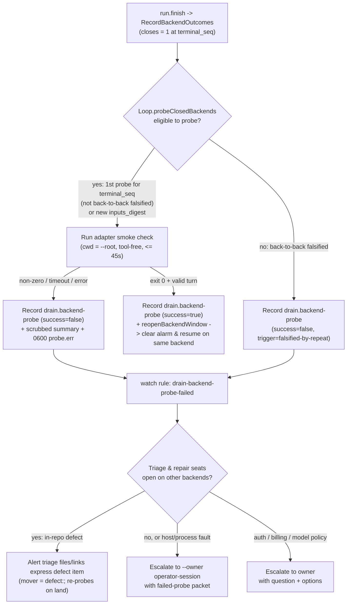

# A closed backend is probed and reopened inside tillr, and only a failed probe escalates

**Status:** Nothing in `D-BP1` to `D-BP8` is built and no build items are filed; [OQ-BP1](#OQ-BP1)–[OQ-BP3](#OQ-BP3) are open. Until automatic probing is ruled and built, `config/tillr/watch/drain-backend-closed.toml` ([`D-TW69`](./tillr-watch.md#D-TW69) and `D-BP9` below) opens a `severity = "high"` alert as soon as a backend closes. Only the owner's dated statements quoted verbatim in [§1.2](#12-dated-owner-rulings) (`R-BP1` to `R-BP5`) are owner rulings; every mechanism, trigger, event field, mover spelling, slice boundary, and rejected alternative (`D-BP1` to `D-BP9`) is the designer's decision from an operator-filed request, marked so in prose and in the [Decision Ledger](#decision-ledger), and the owner may overturn any of them.

> **In short.** When an infrastructure run outcome closes a backend, `tillr-drain loop` itself tests that same backend once with a minimal single-turn model prompt inside the backend's exact adapter environment. If the smoke check exits `0`, the drain records `drain.backend-probe` (`success: true`) and reopens that backend immediately without waking the operating session. If the smoke check fails (or if a reopened backend immediately closes again with no non-infrastructure run in between), the backend stays closed on an active alarm, its sanitized failure evidence is recorded, and `tillr` either files one deduplicated repair item (when the seats needed to land it are open) or escalates upward to `operator-session` or `owner`.

**Why it matters.** On 2026-11-22 at 11:30 AM ET one planner run exited `1` and closed `pi` — halting every `plan`, `review`, and `verify` node — with mover `"operator: repair the backend and record a successful tillr-drain probe-backend"`. Six minutes of queue time were lost waiting for the foreground operating session to type a mechanical one-word `probe-backend` check at 11:36 AM ET.

**The shape.** Five parts answering the request directly: **who** probes (`tillr-drain loop`, [§3](#3-who-inside-tillr-probes-a-closed-backend)), **with what smoke check** (an adapter-executed, tool-free single-turn model prompt on the configured route, [§4](#4-what-smoke-check-runs)), **when** (event-ordered on closing `terminal_seq` and changed `inputs_digest`, never on a clock or retry count, [§5](#5-when-the-smoke-probe-runs--and-when-it-refuses-to-repeat)), **how results are recorded and shown** (structured `drain.backend-probe` events, scrubbed probe logs, and truthful movers across `why`, `waiting`, `alarms`, and Observatory, [§6](#6-how-the-probe-result-is-recorded-and-shown)), and **what is handed upward when the probe fails** (self-repair reachability check, alert-triage linkage, and structured escalation to `operator-session` or `owner`, [§7](#7-what-is-handed-upward-when-the-probe-fails)).

**Cost.** One minimal single-word model turn per backend-closing event (and one per backend input change while closed), zero Git worktrees, zero build-lane occupancy, and zero tokens spent during normal operation.

**Start at** [§3](#3-who-inside-tillr-probes-a-closed-backend)–[§7](#7-what-is-handed-upward-when-the-probe-fails), then check the replays in [§8](#8-worked-replays).

**Needs your ruling:** [OQ-BP1](#OQ-BP1) (when automatic probing runs on `closes = 1`), [OQ-BP2](#OQ-BP2) (adapter `--probe` derivation vs policy `probe` argv), and [OQ-BP3](#OQ-BP3) (alert-triage routing vs direct `operator-session` wakeup on every failed probe).

**Awaits your review:** the designer's decisions `D-BP1` to `D-BP9` in the [Decision Ledger](#decision-ledger).

**Reads with:** [what the operator settled without the owner is settled inside tillr](./operator-decisions-inside-tillr.md) (whose three-taker framework and owner reservation list govern who acts), [the alert triage seat design](./tillr-alert-triage-seat.md) (whose remedy-free triage boundary and `--owner operator-session` escalation wire carry unrecovered closures upward), [a failure is diagnosed, not waited out](./failure-diagnosed-not-waited-out.md) (whose immediate empirical measurement vs cooldown distinction governs when a probe is lawful), [the judge and lifecycle design](./tillr-judge-and-lifecycle.md#415-no-automatic-move-to-another-model-d-jl24-to-d-jl27) (`D-JL24` and `D-JL25`, whose same-backend hold and alarm surfaces this updates), and [the tillr-watch design](./tillr-watch.md) ([`OQ-TW2`](./tillr-watch.md#OQ-TW2), [`D-TW64`–`D-TW65`](./tillr-watch.md#68-alert-investigation-mandatory-outcomes-tracking-item-links-and-variable-scoped-silences-d-tw64-d-tw65), [`D-TW66`](./tillr-watch.md#69-rule-load-baselines-judging-only-events-from-a-rules-first-load-onward-d-tw66), [`D-TW69`](./tillr-watch.md#511-backend-closed-by-the-drain-d-tw69)).

**Words.** **Item**, **criterion**, **candidate**, **lane**, **seat**, and **verdict** keep their meanings from [the vocabulary](./tillr-vocabulary.md#5-the-words). **The operating session** (the foreground agent session that watches the drain), **hand action**, **fault**, and **clearing fact** keep their meanings from [what the operator settled without the owner is settled inside tillr](./operator-decisions-inside-tillr.md). **Alert triage**, **triage settlement**, and **upward escalation** keep their meanings from [the alert triage seat design](./tillr-alert-triage-seat.md). Three terms are used with exact meanings here:

- **Backend smoke probe** *(refined here)*: a bounded, tool-free, sessionless single-turn model invocation executed against one named backend in that backend's exact adapter environment and model configuration, recorded as a `drain.backend-probe` event.
- **Backend `inputs_digest`** *(coined here)*: a non-secret SHA-256 digest of the inputs that govern whether a closed backend's smoke check can behave differently — its policy entry (`adapter`, `model`/`models`, `effort`, `account`, `harness_args`, and optional `probe`), the adapter scripts' content digest, and (for `pi*` backends) the resolved `pi` harness series key and `pi-agent-dir` extension-set key.
- **Self-repair reachability** *(coined here)*: whether every seat needed to plan, build, review, and verify an in-repository repair item is currently mapped to an open backend. When the closed backend itself serves one of those seats (as `pi` serves `plan`, `review`, and `verify`), `tillr` cannot land its own repair item and must escalate upward immediately.

---

## 1. What happened on 2026-11-22, and what the owner ruled

### 1.1 The 11:30 AM incident

On 2026-11-22 at 11:30 AM ET, one `plan` run on the `pi` backend exited `1` without writing a `RESULT:` report footer. Under [`ClassifyAttempt`](../../tools/tillr-drain/drain/failover.go) and [`RecordBackendOutcomes`](../../tools/tillr-drain/drain/backend_outcomes.go), that terminal event was saved with `class = "infrastructure"` and `closes = 1`, closing `pi`.

In [`config/tillr/backend-policy.gemini.json`](../../config/tillr/backend-policy.gemini.json) (the active profile), `pi` serves `plan`, `review`, and `verify`. Closing `pi` immediately held all planning, reviewing, and verification across the queue with mover `"operator: repair the backend and record a successful tillr-drain probe-backend"`. At 11:36 AM ET, during its timed check-in, the operating session ran a one-word prompt through `tillr drain probe-backend`, got exit `0`, and reopened `pi`. Nothing in the repository, policy, or credentials had changed; the step was purely mechanical.

### 1.2 Dated owner rulings

Five dated statements of the owner bind this design verbatim; nothing else in this document is presented as his ruling:

1. **What the operating session can settle without the owner belongs inside `tillr` (2026-11-21, quoted in [operator decisions inside tillr §1](./operator-decisions-inside-tillr.md#1-the-ruling) and [landing principles §16](./landing-principles.md#16-what-the-operator-can-settle-is-settled-inside-tillr)):**

   > "I guess a working principle should be that if you ever feel that you as [the operating session] could solve some problem, and it wouldn't need to be escalated to me, then that problem should escalate to... a similarly responsible agent, process, ticket, whatever, within Tiller, rather than popping up to you."

2. **No fallbacks to another model or backend (2026-11-20, quoted in [the judge and lifecycle design §4.15](./tillr-judge-and-lifecycle.md#415-no-automatic-move-to-another-model-d-jl24-to-d-jl27)):**

   > "why does Terra having some error mean that we automatically flip to Sol? I don't like that. I hate fallbacks. Fallbacks are almost always wrong. We need deliberate choices, not fallbacks. We need to fix what's wrong. We don't need to just randomly try something else."

3. **Unavailable backends and judges raise a visible alarm and get fixed (2026-11-20, quoted in [the judge and lifecycle design §4.15](./tillr-judge-and-lifecycle.md#415-no-automatic-move-to-another-model-d-jl24-to-d-jl27)):**

   > "What does it mean for a judge's model to be unavailable? We have never had that. If it's unavailable, you raise a giant alarm and we fix it."

4. **`tillr-watch` and alert triage apply no remedies ([OQ-TW2](./tillr-watch.md#OQ-TW2), 2026-11-21, quoted in [the alert triage seat design §1](./tillr-alert-triage-seat.md#1-what-the-owner-said)):**

   > "Every single one of these sounds like a fallback to cover an issue. We don't cover issues. We use this to find the issues and fix them."

5. **Every alert gets an investigation and a recorded action — never uninvestigated and never "understood, chose not to file" ([D-TW64](./tillr-watch.md#68-alert-investigation-mandatory-outcomes-tracking-item-links-and-variable-scoped-silences-d-tw64-d-tw65), 2026-11-22):**

   > "There shouldn't be a know about and don't file. There also shouldn't be an alert that we don't know why it fired, so we need an investigation and action."

### 1.3 Why probing the same backend is neither a fallback nor a cooldown

Two boundaries must stay sharp:

- **Zero model or backend fallback (`R-BP2`).** No item, workflow node, or judge moves off its configured backend. When `pi` closes, `pi` is the backend probed. If `pi` answers the smoke check with exit `0`, `pi` reopens and the held work resumes on `pi`. If `pi` fails the smoke check, `pi` stays closed with an active alarm and every item needing `pi` stays held on `pi`.
- **Zero timer loop, cooldown, or retry count ([a failure is diagnosed, not waited out §1](./failure-diagnosed-not-waited-out.md#1-what-the-cooldown-actually-was)–[§3](./failure-diagnosed-not-waited-out.md#3-the-decision-procedure--read-the-failure-do-not-classify-it), rule `T4` of [operator decisions inside tillr](./operator-decisions-inside-tillr.md#4-the-rules)).** A closing `run.finish` came from a full worker or judge session (large context, tool calls, session state). Running **one** minimal smoke check against that backend's adapter and model is an immediate empirical measurement (the immediate test and tier-0 probe in [failure-diagnosed-not-waited-out §3.2](./failure-diagnosed-not-waited-out.md#32-the-unknown-case-and-the-one-permitted-retry) and [§4.1](./failure-diagnosed-not-waited-out.md#41-the-three-tiers-cheapest-first)): it tests whether the backend itself cannot answer at all right now (`probe-failed`) or whether the backend is alive and answering (`probe-succeeded`). Once a smoke probe fails under a given `inputs_digest`, **no second automatic probe runs** until `inputs_digest` changes. Elapsed time never triggers a probe.

This updates step 2 of [`D-JL24`](./tillr-judge-and-lifecycle.md#a-failed-run-holds-with-its-cause-d-jl24) (a designer's decision of 2026-11-20 written before the owner's 2026-11-21 `R-BP1` ruling, which had assigned `"operator"` as the sole mover of `backend-closed` and banned automatic probing in [`tools/tillr-drain/README.md`](../../tools/tillr-drain/README.md)). Where the owner prefers a stricter or narrower trigger on `closes = 1`, [OQ-BP1](#OQ-BP1) leaves that choice explicitly to him.

---

## 2. What exists on the trunk today

Across `tools/tillr-drain/`, `tools/tillr-run/`, `tools/tillr-view/`, and `config/tillr/`:

| Surface | Current behavior | Gap exposed on 2026-11-22 |
| :--- | :--- | :--- |
| **Closure recording** ([`backend_outcomes.go`](../../tools/tillr-drain/drain/backend_outcomes.go)) | `RecordBackendOutcomes` classifies each non-`command` `run.finish` via `ClassifyAttempt` and inserts `backend_outcomes(terminal_seq, class, closes)` plus `drain.backend-outcome` (`terminal_seq`, `class`, `closes`, `cause`). `closes` is `true` when `class == AttemptInfrastructure && !answeredByAnotherRule(...)`. | Records the closure cleanly, then stops; nothing inside `tillr` tests whether the backend is actually down. |
| **Closed projection** ([`backend_availability.go`](../../tools/tillr-drain/drain/backend_availability.go), [`alarms.go`](../../tools/tillr-drain/alarms/alarms.go)) | `readInfrastructureClosedFrom` and `alarms.infrastructure` mark `<backend>` closed when its newest non-interrupted `backend_outcomes` row has `closes = 1` and no `drain.backend-probe` with `object_id = <backend>`, `seq > terminal_seq`, and `$.success = 1` (nor `call.offered` for `terminal_seq`) exists. | `drain.backend-probe` payloads store only `{"success": bool}` — no actor, no triggering `terminal_seq`, no `inputs_digest`, no exit code, and no failure summary. |
| **Manual probe CLI** ([`backend_probe.go`](../../tools/tillr-drain/backend_probe.go), `ProbeBackend` in [`backend_availability.go`](../../tools/tillr-drain/drain/backend_availability.go)) | Requires caller-supplied argv after `--`, runs with `Stdout = io.Discard` and `Stderr = io.Discard`, appends `drain.backend-probe`, and on exit `0` calls `reopenBackendWindow(tx, backend, seq, at)`. | Caller must invent the smoke command by hand; `io.Discard` throws away diagnostic stderr when a probe fails; `run.Backend` ([`request.go`](../../tools/tillr-run/run/request.go)) has `Quota []string` for [`quota_probe.go`](../../tools/tillr-drain/drain/quota_probe.go) and no smoke-probe derivation. |
| **Adapter environment setup** ([`run-pi`](../../tools/tillr-run/backends/pi/run-pi), [`run-claude`](../../tools/tillr-run/backends/claude/run-claude), [`run-agy`](../../tools/tillr-run/backends/agy/run-agy), [`run-muse`](../../tools/tillr-run/backends/muse/run-muse)) | Every `run-*` script requires `preflight_brief` (a 10-section worker brief) and resolves critical runtime state: [`pi-harness.sh`](../../tools/tillr-run/backends/pi/pi-harness.sh) + [`pi-agent-dir.sh`](../../tools/tillr-run/backends/pi/pi-agent-dir.sh) select the rebuilt `pi` binary and extension dir; `run-claude` scrubs Bedrock env vars under `--account subscription`; `run-agy` sets `YOLO_NO_LAUNCH_FLAGS=1`; `run-muse` runs sandboxed `muse exec`. | An ad-hoc `pi --print` run by hand tests the ambient `pi` binary and `~/.pi/agent`, which can pass while lane workers still fail on a broken rebuilt `pi-agent-dir` or adapter script. |
| **Movers & UI** ([`holdrules.go`](../../tools/tillr-drain/holdrules/holdrules.go), [`backend_availability.go`](../../tools/tillr-drain/drain/backend_availability.go), [`tools/tillr-view/alarms.go`](../../tools/tillr-view/alarms.go), [`BackendAlarms.tsx`](../../tools/tillr-view/web/src/components/BackendAlarms.tsx)) | All four hardcode `"operator"` (`"operator: repair the backend and record a successful tillr-drain probe-backend"`, `Mover: "operator; " + a.Command`, `operator: <code>{alarm.command}</code>`), one of the six residual operator rows noted in [operator decisions inside tillr §3](./operator-decisions-inside-tillr.md#3-what-exists-today). | Violates [landing principle 13](./landing-principles.md#13-a-held-state-names-a-mover-that-can-still-act) and [§16](./landing-principles.md#16-what-the-operator-can-settle-is-settled-inside-tillr): names `"operator"` while the operating session is asleep between check-ins. |
| **Watch coverage** (`config/tillr/watch/`) | `config/tillr/watch/drain-backend-closed.toml` ([`D-TW69`](./tillr-watch.md#D-TW69), `D-BP9`) opens a `tillr-watch` episode on a closing `drain.backend-outcome` and on a failed `drain.backend-probe`. | The alert wakes the operating session for every closure, including one a single smoke probe would reopen; `Loop.probeClosedBackends` is unbuilt. |

---

## 3. Who inside tillr probes a closed backend

**Designer's decision (`D-BP1`, from an operator request; the owner may overturn it).** The actor that probes and reopens a closed backend is **`tillr-drain loop` itself** — specifically a deterministic process step (`Loop.probeClosedBackends`) alongside [`Loop.refreshQuotas`](../../tools/tillr-drain/drain/quota_probe.go) and [`RecordBackendOutcomes`](../../tools/tillr-drain/drain/backend_outcomes.go), serialized per backend outside SQLite write transactions.



Why `tillr-drain loop` is the only sound actor under the standing rulings:

1. **Matches rule `T1` of [operator decisions inside tillr](./operator-decisions-inside-tillr.md#4-the-rules).** Whether a backend's configured adapter and model answer a minimal prompt with exit `0` is a recorded empirical fact, not a judgment of item prose (`design` seat) and not yet a confirmed code bug (`defect` item). Under `T1`, *"A recorded fact decides it: the drain acts, and records the fact it acted on."*
2. **Respects `tillr-watch`'s and alert triage's no-remedy boundary (`R-BP4`, [`D-AT6`](./tillr-alert-triage-seat.md#52-forbidden-actions-hard-mechanical-boundary)).** `tillr-watch` evaluates observations and opens episodes; the alert-triage seat reads evidence and files or links items under a read-only command shim. Neither may execute a state-changing `probe-backend` remedy.
3. **Avoids the closed-backend bootstrap deadlock ([failure-diagnosed-not-waited-out §4.3](./failure-diagnosed-not-waited-out.md#43-when-diagnosis-itself-cannot-run)).** Any model seat dispatched to test a closed backend could itself be mapped to that closed backend (for example, when a single-backend profile routes `scout`, `plan`, `build`, and `verify` to `pi`, as [`config/tillr/backend-policy.json`](../../config/tillr/backend-policy.json) does). `tillr-drain loop` is a Go process: it needs no open model seat and no Git lane worktree to run an OS subprocess.
4. **Keeps the manual CLI intact (`T6` of [operator decisions inside tillr](./operator-decisions-inside-tillr.md#4-the-rules), [landing principle 14](./landing-principles.md#14-convict-a-run-on-what-it-did-not-on-what-happened-while-it-ran)).** `tillr drain probe-backend` remains available for explicit human or operator use — for example, after refreshing an external OAuth login or API token whose change lives outside repository files — and records `actor = "cli"` so manual vs automatic probes are always distinguishable in the store.

---

## 4. What smoke check runs

**Designer's decision (`D-BP2`, from an operator request; the owner may overturn it, and [OQ-BP2](#OQ-BP2) leaves the configuration surface to the owner).** A backend smoke check must test **the exact binary, agent directory, environment scrubbing, model route, effort, account, and harness flags that a real worker run on that backend uses**, while doing zero repository writes and spending minimal tokens.

### 4.1 Why a bare CLI command or local lookup is wrong

The four shipped adapters show why a smoke check cannot be a local config check or a bare `pi --print` / `claude -p` on ambient `PATH`:

- **Local lookups exit `0` when the provider is dead.** As [`config/tillr/backend-policy.json`](../../config/tillr/backend-policy.json) records from 2026-11-12, `muse model-profile show <model> --effort <effort>` exits `0` locally after a subscription lapses while every actual `muse exec` turn refuses. Likewise, `Backend.Quota` ([`quota_probe.go`](../../tools/tillr-drain/drain/quota_probe.go)) reads quota counters without testing the harness or model endpoint. A valid smoke check must complete one real minimal model turn.
- **`run-pi` resolves private rebuilt binaries and trunk-built extension directories based on working directory.** [`pi-harness.sh`](../../tools/tillr-run/backends/pi/pi-harness.sh) resolves the private `PI_HARNESS_BIN` built for `patch/pi` (refusing paths under `<repo>/.yolo/*`), and [`pi-agent-dir.sh`](../../tools/tillr-run/backends/pi/pi-agent-dir.sh) selects the content-keyed trunk-built `PI_CODING_AGENT_DIR` (`build-agent-dir --key`) **only** when `target` is a repository checkout — explicitly falling back to the deployed agent directory (`_pi_use_deployed=1`) when `target` is under `<repo>/.tillr/*`. A smoke probe that bypassed `run-pi` or ran with `target` inside `.tillr/` would test the deployed `pi` setup and falsely reopen `pi` while every lane worker still crashed on a broken trunk extension or `pi` build!
- **`run-claude`, `run-agy`, and `run-muse` each alter the child environment or flags.** [`run-claude`](../../tools/tillr-run/backends/claude/run-claude) scrubs `CLAUDE_CODE_USE_BEDROCK` and `ANTHROPIC_DEFAULT_*` when `--account subscription` is set and passes `--strict-mcp-config` plus `harness_args`; [`run-agy`](../../tools/tillr-run/backends/agy/run-agy) exports `YOLO_NO_LAUNCH_FLAGS=1` so the jail launcher does not inject a conflicting second `--model` flag; [`run-muse`](../../tools/tillr-run/backends/muse/run-muse) keeps sandbox confinement enabled.

### 4.2 The adapter `--probe` contract

Under [OQ-BP2](#OQ-BP2)'s recommended Option A, [`run.Backend`](../../tools/tillr-run/run/request.go) derives the smoke-check argv from the backend's policy definition (`b.ProbeCommand(backendName, route, timeoutSeconds)`), invoking the backend's configured `Adapter` in `--probe` mode (unless an explicit `Backend.Probe []string` override is set in policy for test fixtures):

```sh
<adapter> --probe --backend <name> --model <route> \
  [--effort <effort>] [--account <account>] --timeout 45 [-- <harness_args...>]
```

Every adapter implements `--probe` using the **same** environment and harness resolution code path as a real worker run, differing only in five bounded ways:

1. **Fixed minimal prompt, skipping `preflight_brief`.** Instead of reading a 10-section `../brief.md`, `--probe` feeds the constant prompt `"Reply with the single word ok and nothing else."` on stdin (or via a temporary prompt file inside the probe's own `.tillr/loop/probe-<backend>-<seq>/` scratch directory for `run-muse`).
2. **Executed with working directory at `--root` and tools disabled.** Running with cwd at `--root` ensures `pi-harness.sh` and `pi-agent-dir.sh` resolve the exact repository `PI_HARNESS_BIN` and rebuilt `PI_CODING_AGENT_DIR` that lane workers use, while tool execution is disabled at the harness boundary (`--no-tools` on `pi`, `--tools ""` on `claude`, prompt-only / read-only sandbox on `muse` and `agy`) and `BOARD_DRAIN_RUN=tillr-probe` marks the child non-interactive so extensions never mistake it for a foreground operating session. Zero tracked files or refs in `--root` can be modified.
3. **Sessionless.** `--probe` neither reads nor writes a lane `session-id` (`--no-session` where supported), so it cannot corrupt or advance any paused worker or designer session.
4. **Bounded wall (`probeCommandTimeout = 45s`).** Unlike unbounded worker runs (`D-RW1`), a one-word smoke turn has a known tiny scope; a 45-second timeout prevents a hung provider TCP socket from stalling `probeClosedBackends` indefinitely (paralleling `quotaCommandTimeout = 15s` in [`quota_probe.go`](../../tools/tillr-drain/drain/quota_probe.go)).
5. **Exit `0` plus non-error turn verification.** The adapter exits `0` if and only if the underlying CLI exits `0` **and** its output stream/envelope contains a non-error assistant completion (preventing false positives from harnesses that print an JSON error envelope while exiting `0`).

**Route selection.** When `Backend.Models` has one model or only `Backend.Model` is set (true of every backend in [`config/tillr/backend-policy.gemini.json`](../../config/tillr/backend-policy.gemini.json) and [`config/tillr/backend-policy.json`](../../config/tillr/backend-policy.json)), `--model` receives that exact model ID. When `Backend.Models` holds a multi-route rotation, `--model` receives the closing run's recorded `rec.Route` ([`Request.Route`](../../tools/tillr-run/run/request.go)) if still present in `Backend.Models`, else `Backend.Model` (`Models[0]`), so the probe tests the exact route that failed.

**Shared manual CLI.** `tillr drain probe-backend --store <store> --backend <name> --policy <policy>` (with `-- <argv...>` optional rather than mandatory) invokes the exact same `b.ProbeCommand(...)` derivation when no custom `-- <argv...>` is supplied, so manual confirmation and automatic drain probing run one identical smoke check.

---

## 5. When the smoke probe runs — and when it refuses to repeat

**Designer's decisions (`D-BP3` and `D-BP4`, from an operator request; the owner may overturn them, and [OQ-BP1](#OQ-BP1) leaves the initial-closure policy choice to the owner).** Every probe trigger is a deterministic function of recorded store events and current `inputs_digest` — **never** a timer, sleep, or retry counter (`T4` of [operator decisions inside tillr](./operator-decisions-inside-tillr.md#4-the-rules), [landing principle 11](./landing-principles.md#11-a-failure-is-diagnosed-not-waited-out)).

### 5.1 The three triggers

`Loop.probeClosedBackends(ctx)` runs after `RecordBackendOutcomes` at loop startup and on each pass where `backendAvailabilityChanged` or the active policy/`inputs_digest` moved. For each backend currently closed at `terminal_seq` in `readInfrastructureClosedFrom`:

| Trigger (`trigger` field) | Exact store & input precondition | Why it runs once and stops |
| :--- | :--- | :--- |
| **1. `closing-outcome`** *(Option A of [OQ-BP1](#OQ-BP1); skipped on literal T1 errors under Option B, omitted under Option C)* | Closed at `terminal_seq`, **zero** `drain.backend-probe` events exist for `object_id = <backend>` with `seq > terminal_seq`, `<backend>` is not currently shut by an active `backend_windows` quota reset (`reset_at > now`), and the closure is **not** falsified by back-to-back failure ([§5.2](#52-the-back-to-back-falsification-guard)). | Appending `drain.backend-probe` (whether `success: true` or `success: false`) advances `seq > terminal_seq`. On `success: true` the backend reopens; on `success: false` the precondition `zero probes with seq > terminal_seq` is immediately false, so **no second `closing-outcome` probe ever runs** for `terminal_seq`. |
| **2. `input-change`** | Closed at `terminal_seq`, at least one `drain.backend-probe` with `seq > terminal_seq` and `success = false` exists, `<backend>` is not shut by `backend_windows`, and the backend's current `inputs_digest` differs from **every** `inputs_digest` already probed at `seq > terminal_seq`. | Runs **once** when a relevant input actually changed — for example, a landed repair item updated `run-pi` or rebuilt `pi-agent-dir`, or a deliberate edit to `backend-policy*.json` changed `model`/`effort`/`harness_args` — automatically verifying the fix and reopening `<backend>` on exit `0` ([failure-diagnosed-not-waited-out §4.2](./failure-diagnosed-not-waited-out.md#42-the-product-a-cause-statement-with-a-clearing-condition) and [§5](./failure-diagnosed-not-waited-out.md#5-worked-replay-tonight-under-this-design)). If the new `inputs_digest` also fails, that digest is now recorded and will not be probed again. |
| **3. `cli`** | Explicit `tillr drain probe-backend` command run by a human or the operating session. | Always runs on explicit command (for instance, after refreshing an external credential or host login outside `inputs_digest`) and records `actor = "cli"`, `trigger = "cli"`. |

### 5.2 The back-to-back falsification guard

One subtle failure mode must be blocked mechanically (`D-BP4`): suppose a provider or harness is healthy for a 10-token tool-free `"ok"` prompt while failing 100% of real multi-thousand-token or tool-using worker runs. Without a guard, `run-1` on `item-A` would close `pi` (`terminal_seq_1`), the `"ok"` smoke probe would pass (`probe_seq_1`), `run-2` on `item-B` would immediately fail in infrastructure (`terminal_seq_2`), `"ok"` would pass again, and the drain would burn every queued item one by one.

Following [a failure is diagnosed, not waited out §3.3](./failure-diagnosed-not-waited-out.md#33-the-one-place-a-wait-remains--stated-by-the-failure-verified-on-return) (*"if the same fingerprint returns after the stated condition verified clear, the source's claim is falsified and the failure is diagnosed, not waited out a second time on the same say-so"*) and rule `T4` (comparison of two adjacent records, not a counter):

- Before running a `closing-outcome` probe for `terminal_seq`, the drain inspects the single immediately preceding non-interrupted `backend_outcomes` row (`prev_seq`) for `<backend>`.
- If `prev_seq` **also** had `closes = 1` (meaning **zero** non-infrastructure runs succeeded on `<backend>` between `prev_seq` and `terminal_seq`) **and** `prev_seq` was reopened by an automatic `drain.backend-probe` (`actor = "drain"`, `success = true`) under the **same** `inputs_digest`:
  - The smoke probe's `"ok"` verdict is **empirically falsified** for `<backend>` under `inputs_digest`.
  - The drain runs **no** subprocess; instead it immediately records `drain.backend-probe` with `success = false`, `actor = "drain"`, `trigger = "falsified-by-repeat"`, naming both `prev_run_id` and `closing_run_id`, leaves `<backend>` closed, and routes the unrecovered closure upward ([§7](#7-what-is-handed-upward-when-the-probe-fails)).
- Conversely, if at least one real worker or judge run on `<backend>` completed outside `AttemptInfrastructure` after `prev_seq` before a later run failed, or if the same item repeated an identical infrastructure failure while other items succeeded:
  - In the first case `prev_seq` had `closes = 0`, so the new closure gets its single `closing-outcome` test normally.
  - In the second case (a poison brief or item-specific crash on one item), [`recordInfrastructureFailure`](../../tools/tillr-drain/drain/infrastructure_hold.go) already holds that item as `infrastructure-repeat` on its second identical failure so that item cannot dispatch a third time, while `falsified-by-repeat` prevents a second automatic reopen if no other item ran cleanly in between.

### 5.3 What never triggers an automatic probe

1. **Elapsed wall-clock time.** No `ProbeInterval` or backoff timer exists for `backend-closed`.
2. **Loop restarts.** `backend_outcomes` and `drain.backend-probe` are durable in `.tillr/state.db`. Restarting `tillr-drain loop` sees the recorded `success = false` probe for `(terminal_seq, inputs_digest)` and runs zero probes.
3. **Quota windows (`backend-window`).** A provider quota refusal with a stated `reset_at` is governed by [`D-JL26`](./tillr-judge-and-lifecycle.md#quota-exhaustion-is-not-an-exception-d-jl26), not `backend-closed`. `probeClosedBackends` never fires a model prompt into an active `backend_windows` window; if a backend is simultaneously closed and inside a quota refusal window, its single smoke probe waits until `reset_at` has passed.
4. **Unrelated landings.** Commits that touch neither the backend's policy entry, its adapter scripts, nor (for `pi*`) the `pi` series / extension-set keys leave `inputs_digest` unchanged and trigger nothing.

---

## 6. How the probe result is recorded and shown

**Designer's decision (`D-BP5`, from an operator request; the owner may overturn it).**

### 6.1 Enriched `drain.backend-probe` event and scrubbed artifact

`drain.backend-probe` keeps `ObjectType = "run"`, `ObjectID = &backend`, and top-level boolean `success` so existing SQL readers (`json_extract(payload, '$.success') = 1` in [`backend_availability.go`](../../tools/tillr-drain/drain/backend_availability.go) and [`alarms.go`](../../tools/tillr-drain/alarms/alarms.go)) remain backward-compatible, while adding structured provenance and failure evidence:

```json
{
  "success": false,
  "actor": "drain",
  "trigger": "closing-outcome",
  "terminal_seq": 1402918,
  "closing_run_id": "run-item-request-77bc-a1-n1",
  "inputs_digest": "sha256:4b825dc642cb6eb9a060e54bf8d69288fbee4904",
  "route": "github-copilot/gemini-4-carbon",
  "exit_code": 1,
  "duration_ms": 2840,
  "summary": "exit 1: HTTP 401 unauthorized from provider endpoint",
  "artifact_ref": ".tillr/loop/probe-pi-1402918-1/probe.err"
}
```

**Credential hygiene without diagnostic blindness.** Today `ProbeBackend` pipes `Stdout` and `Stderr` to `io.Discard`, keeping secrets out of `.tillr/state.db` at the cost of destroying every clue when a probe fails. Under `D-BP5`:

- Combined probe diagnostic output is captured up to a `64 KiB` cap (matching `quotaBuffer` in [`quota_probe.go`](../../tools/tillr-drain/drain/quota_probe.go)) and written only to a mode-`0600` file under `.tillr/loop/probe-<backend>-<terminal_seq>-<n>/probe.err` when `success == false` (deleted or omitted on `success == true`).
- Only a single-line, `<= 512`-byte `summary` enters `drain.backend-probe`, passed through a strict redactor that strips `Authorization` / `Bearer` tokens, API key prefixes (`sk-`, `ghp_`, `ghu_`, `github_pat_`, `AKIA`, `ASIA`), URL query credentials, cookies, and `KEY=VALUE` secret assignments.
- When `success == true`, the same `WriteTx` calls `reopenBackendWindow(tx, backend, seq, at)` just as `ProbeBackend` does today, immediately clearing `backend-closed` (and any derived `judge-backend-unavailable` alarm in [`alarms.go`](../../tools/tillr-drain/alarms/alarms.go)) so held items resume on `<backend>` on the next pass.

### 6.2 Truthful state and mover across every CLI and Observatory face

Hardcoded `"operator"` mover strings on `backend-closed` and `judge-backend-unavailable` in [`holdrules.go`](../../tools/tillr-drain/holdrules/holdrules.go), [`describeBackendHold`](../../tools/tillr-drain/drain/backend_availability.go), [`tools/tillr-view/alarms.go`](../../tools/tillr-view/alarms.go), and [`BackendAlarms.tsx`](../../tools/tillr-view/web/src/components/BackendAlarms.tsx) are replaced by the **actual active mover** projected from store events ([landing principle 13](./landing-principles.md#13-a-held-state-names-a-mover-that-can-still-act)):

| Closed-backend phase | Store state (`seq > terminal_seq`) | Alarm `ProbeStatus` & `Cause` | Displayed `Mover` (`why`, `waiting`, `alarms`, `BackendAlarms.tsx`) |
| :--- | :--- | :--- | :--- |
| **1. Probe pending / running** | No `drain.backend-probe` yet for `(terminal_seq, current_digest)` | `probe_status: "pending"` — shows closing run cause + `"smoke probe queued in tillr-drain"` | `drain; automatic smoke probe of <backend> pending` (counted in `DrainNext`, not `OperatorNext`) |
| **2. Probe succeeded (`reopened`)** | `drain.backend-probe` with `success = true` | Active alarm **cleared**; loop logs `alarm cleared: backend-closed:<backend> (reopened by drain.backend-probe seq <seq>)`; event visible in `tillr view events` and Observatory recent backend activity | *(No hold — held items return to `ready` on `<backend>`)* |
| **3. Probe failed, triage pending** *(under [OQ-BP3](#OQ-BP3) Option A when triage is reachable)* | `drain.backend-probe` with `success = false` (`probe.err` saved); alert episode `untriaged` / `triaging` | `probe_status: "failed"` (or `"falsified"`) — shows closing run cause **plus** `"smoke probe failed (<exit_code>): <summary>"` | `triage; classifying failed smoke probe on <backend>` |
| **4. Probe failed, tracked by open repair item** | Linked tracking item `item_id` open in `items` and repair workflow seats are open ([§7.1](#71-the-self-repair-reachability-rule)) | Same, plus `"tracked by <item_id>"` | `drain; <item_id> (re-probes <backend> automatically when fix lands)` |
| **5. Probe failed, escalated upward** | Episode escalated to `operator-session` or `owner` (or direct under [OQ-BP3](#OQ-BP3) Option B) | Same, plus escalation target and action/question | `operator-session; <action_needed>` or `owner; <question>` |

`alarms.Alarm` ([`tools/tillr-drain/alarms/alarms.go`](../../tools/tillr-drain/alarms/alarms.go)) and `BackendAlarm` ([`tools/tillr-view/web/src/models/types.ts`](../../tools/tillr-view/web/src/models/types.ts), [`BackendAlarms.tsx`](../../tools/tillr-view/web/src/components/BackendAlarms.tsx)) add `mover`, `probe_status`, `last_probe_at`, `last_probe_summary`, and `tracking_item_id`, replacing the static `operator: <code>{alarm.command}</code>` label with `{alarm.mover}: {alarm.action}` while keeping `command` populated with `tillr drain probe-backend --store <store> --backend <name> --policy <policy>` for scripts and manual confirmation.

---

## 7. What is handed upward when the probe fails

**Designer's decisions (`D-BP6`, `D-BP7`, and `D-BP9`, from operator requests; the owner may overturn them, and [OQ-BP1](#OQ-BP1) and [OQ-BP3](#OQ-BP3) leave the initial-closure and routing choices to the owner).**

While `Loop.probeClosedBackends` remains unbuilt awaiting [OQ-BP1](#OQ-BP1)–[OQ-BP3](#OQ-BP3) — and permanently if the owner chooses [OQ-BP1](#OQ-BP1) Option C (never probe automatically on `closes = 1`) — `config/tillr/watch/drain-backend-closed.toml` ([`D-TW69`](./tillr-watch.md#D-TW69), `D-BP9`) alerts immediately (`severity = "high"`, `receiver = "foreground"`) when `drain.backend-outcome` records `closes == true` (`group_by = "object_id"`, naming `{{subject}}` and `{{event.cause}}`), clearing when `drain.backend-probe` (`success == true`) or a non-interrupted `drain.backend-outcome` (`closes == false and class != "interrupted"`) reopens that backend. Once [OQ-BP1](#OQ-BP1) Option A or B and Slices 1–3 land, `Loop.probeClosedBackends` tests every eligible closure first: when it records `drain.backend-probe` with `success = false`, the transient hypothesis is falsified (the backend cannot even complete a single-word `"ok"` turn in its configured environment, or its `"ok"` check was falsified by back-to-back worker crashes), and Slice 5 ([§10](#10-the-build-in-slices-that-each-land-alone)) transitions closed-backend alerting onto `config/tillr/watch/drain-backend-probe-failed.toml`, watching `drain.backend-probe` where `event.success == false`, grouped by `object_id` (`<backend>` — exposing `backend` as the parameterized rule variable under [`D-TW64` / `D-TW65`](./tillr-watch.md#68-alert-investigation-mandatory-outcomes-tracking-item-links-and-variable-scoped-silences-d-tw64-d-tw65)), bounded by [`D-TW66`](./tillr-watch.md#69-rule-load-baselines-judging-only-events-from-a-rules-first-load-onward-d-tw66) (`watch_rule_baselines` so pre-load history never back-fires), and auto-clearing (`clear_when`) on the same reopening events (`drain.backend-probe` with `event.success == true`, or non-interrupted `drain.backend-outcome` with `event.closes == false and event.class != "interrupted"`).

### 7.1 The self-repair reachability rule

Before trusting an internal seat or defect ticket to settle a failed backend probe inside `tillr`, `tillr` checks two bootstrap facts (`D-BP6`, applying [a failure is diagnosed, not waited out §4.3](./failure-diagnosed-not-waited-out.md#43-when-diagnosis-itself-cannot-run)):

1. **Can alert triage run?** If [OQ-BP3](#OQ-BP3) chooses Option A (`receiver = "triage"`), the triage coordinator checks whether the seat hosting alert triage ([`OQ-AT1`](./tillr-alert-triage-seat.md#OQ-AT1)) maps to an **open** backend. If the closed backend *is* the triage seat's backend, triage cannot run: the coordinator immediately promotes the episode to `watch.alert.escalated` (`outcome = "triage-backend-closed"`, `escalate_to = "operator-session"`) carrying the failed-probe packet ([§7.3](#73-the-failed-probe-escalation-packet)), matching [`D-AT8`](./tillr-alert-triage-seat.md#61-handed-to-the-operating-session-escalate_to--operator-session).
2. **Can a filed defect item actually land?** Even when triage runs (for example on `pi-scout` while `pi` is closed in [`config/tillr/backend-policy.gemini.json`](../../config/tillr/backend-policy.gemini.json)), an in-repo defect item on `planned-build@v1` needs `plan`, `build`, `review`, and `verify` to be mapped to open backends in order to land! If the closed backend serves **any** seat required to execute and judge that repair item (as `pi` serves `plan`, `review`, and `verify`, or `pi-build` serves `build`), filing a ticket and settling the alert quietly inside `tillr` would **deadlock**: the repair item would immediately hold on `backend-closed` waiting for the very backend it was filed to fix! Therefore, whenever self-repair is unreachable because a required workflow seat's backend is closed, triage still files or links the root-cause `item_id` if an in-repo bug is present, and **must** escalate the episode upward (`escalate_to = "operator-session"` or `"owner"`), never settling quietly.

### 7.2 Routing the three failure classes

Following [what the operator settled without the owner is settled inside tillr §4](./operator-decisions-inside-tillr.md#4-the-rules)–[§6](./operator-decisions-inside-tillr.md#6-what-is-the-owners) and [the alert triage seat design §5](./tillr-alert-triage-seat.md#5-what-the-triage-seat-may-do--and-what-it-must-never-do)–[§6](./tillr-alert-triage-seat.md#6-what-must-be-handed-upward-to-whom-and-how), every failed smoke probe routes to one of three destinations (`D-BP7`):

| Failure class established from `drain.backend-probe` + `probe.err` | Examples | Destination & action |
| :--- | :--- | :--- |
| **1. In-repo adapter, harness, or pack defect with self-repair reachable** | A regression in a secondary adapter script (e.g., `run-agy`), or a config/flag bug affecting `pi-tricky` while `pi` (`plan`/`review`/`verify`) and `pi-build` (`build`) remain open. | **Settled inside `tillr` (`fix-fault` / `filed` or `linked`).** Triage files or links one deduplicated express defect request (`dedup_key = "backend-probe:<backend>:<cause_key>"`), attaches `item_id` to the episode, and settles without waking the operating session. When the fix lands, `inputs_digest` changes, `Loop.probeClosedBackends` re-probes `<backend>` (`trigger = "input-change"`), and `<backend>` reopens automatically. |
| **2. Live host/jail/process state, OR an in-repo defect whose repair seats are blocked by the closed backend** | A dead local proxy/socket, missing host mount, wedged local credential helper, unbuilt `pi-agent-dir` hold, `falsified-by-repeat` where real runs crash despite `"ok"`, or an adapter bug that closed `pi` or `pi-build` so `tillr` cannot land its own fix. | **Handed to `--owner operator-session` (`escalate_to = "operator-session"`).** Wakes the operating session's `tillr watch wait --owner operator-session` watcher immediately with the failed-probe packet ([§7.3](#73-the-failed-probe-escalation-packet)) and any filed `item_id`, so the operating session repairs the live host/runtime state (or lands the unblocked hotfix) and confirms reopening. |
| **3. Credentials, billing, subscriptions, provider outage requiring a model switch, or policy edits** ([operator decisions inside tillr §6](./operator-decisions-inside-tillr.md#6-what-is-the-owners) items 5 & 7) | Expired OAuth/API key requiring human login (`401`/`403`), lapsed subscription (such as `muse` on 2026-11-12), spend limit hit, retired upstream model ID, or prolonged provider outage where moving held seats requires editing `backend-policy*.json`. | **Handed to `owner` (`escalate_to = "owner"`).** Surfaces on Observatory *Needs attention* and over the upward notice wire with the failed-probe packet plus a concrete `question` and `options` (e.g., Option A: restore credentials / wait for provider recovery keeping `<seats>` on `<backend>`; Option B: switch `<backend>` / `<seats>` in policy to `<named alternative>`). Neither the drain, triage, nor the operating session ever switches models on its own (`R-BP2`, `c4`). |

### 7.3 The failed-probe escalation packet

Every upward notice (`watch.alert.escalated`, `tillr watch status`, `tillr drain why`, and Observatory) carries the exact evidence the operating session or owner needs without manual log hunting (`T3` of [operator decisions inside tillr](./operator-decisions-inside-tillr.md#4-the-rules)):

1. **Closed backend & blast radius:** `backend`, configured `adapter`, `route` (`model`, `effort`, `account`), seats mapped to `<backend>`, and counts/IDs of held items and held lanes.
2. **Closing run evidence:** `closing_run_id`, `terminal_seq`, timestamp, and `drain.backend-outcome.cause`.
3. **Failed smoke-probe evidence:** probe `seq`, `trigger` (`closing-outcome` | `input-change` | `falsified-by-repeat`), `inputs_digest`, `exit_code`, `duration_ms`, redacted `summary`, and `artifact_ref` (`.tillr/loop/probe-.../probe.err` for `operator-session`).
4. **Triage & self-repair status:** `triage_run_id` (if triage ran), linked/filed `item_id` (if any), and `self_repair_blocked_by` (listing any repair-workflow seats currently shut by `<backend>`).
5. **Action or owner question:** concrete `action_needed` + `tillr drain probe-backend --store <store> --backend <backend> --policy <policy>` for `operator-session`, or structured `question` + `options` for `owner`.

---

## 8. Worked replays

| Scenario | What happens today | What happens under this design |
| :--- | :--- | :--- |
| **1. Transient single-run `exit 1` on `pi`** *(the 2026-11-22 11:30 AM incident)* | `pi` closes; `plan`, `review`, and `verify` stall for 6 minutes with `mover = "operator"`; the operating session runs `probe-backend` by hand at 11:36 AM ET (until Slices 1–5 land, `drain-backend-closed.toml` under [`D-TW69`](./tillr-watch.md#D-TW69) / `D-BP9` wakes `foreground` immediately instead of waiting on a timed check-in). | Once Slices 1–5 land under [OQ-BP1](#OQ-BP1) Option A/B: `RecordBackendOutcomes` closes `pi` at 11:30:00 AM -> `Loop.probeClosedBackends` immediately runs `run-pi --probe` on Carbon 4 -> exits `0` in ~3s -> appends `drain.backend-probe` (`success: true`, `actor: "drain"`, `trigger: "closing-outcome"`) -> `pi` reopens at 11:30:03 AM, planner resumes on `pi`, and zero alerts wake the operating session. |
| **2. Upstream outage or broken rebuilt `pi` binary closing `pi`** | `pi` closes silently (`config/tillr/watch/` has no backend rule); sits idle until the 15-minute check-in timer fires; `probe-backend` throws away stderr (`io.Discard`). | `Loop.probeClosedBackends` runs `run-pi --probe` at `--root` (hitting the exact rebuilt `pi` and `pi-agent-dir`) -> exits `1` -> saves mode-`0600` `probe.err` and redacted `summary` on `drain.backend-probe` (`success: false`) -> `drain-backend-probe-failed` opens -> self-repair check sees `pi` blocks `plan`/`review`/`verify` -> wakes `--owner operator-session` in <5s with the failed-probe packet, `probe.err` path, and any filed `item_id`. |
| **3. Adapter bug on `pi-tricky` while `pi` and `pi-build` are open** | `pi-tricky` closes with `mover = "operator"`, waiting for a human check-in to read logs, file a bug, wait for landing, and run `probe-backend` by hand. | `run-pi --probe` on `pi-tricky` fails -> triage reads `probe.err`, sees `pi` and `pi-build` are open (self-repair reachable), files one express defect item `item-request-...`, and settles the episode inside `tillr` -> alarm shows `mover = "drain; item-request-..."` -> fix lands -> `inputs_digest` changes -> `Loop.probeClosedBackends` runs `trigger = "input-change"` -> exits `0` -> `pi-tricky` reopens unattended. |
| **4. Expired subscription or API key (`401`/`403`)** | Sits closed with `mover = "operator"` until check-in; operator investigates by hand and then messages the owner. | `Loop.probeClosedBackends` runs once -> fails with redacted `HTTP 401` summary -> triage (or direct escalation) recognizes an external credential/subscription failure ([operator decisions §6](./operator-decisions-inside-tillr.md#6-what-is-the-owners) item 5) -> escalates to `owner` with options (refresh credentials on `<backend>` vs deliberately switch `<seats>` in policy), never falling back to another model. |
| **5. Upstream passes tiny `"ok"` probes while failing real worker turns** | Operator runs one-word `probe-backend`, sees `0`, reopens `pi`, and next worker fails again at the next check-in. | First closure: `"ok"` passes -> `pi` reopens once -> next worker run on `pi` fails immediately in infrastructure with zero intervening non-infrastructure runs -> back-to-back falsification guard ([§5.2](#52-the-back-to-back-falsification-guard)) refuses a second `"ok"` reopen, records `trigger = "falsified-by-repeat"` (`success: false`), keeps `pi` closed, and escalates upward with both run IDs. |

---

## 9. Edge cases and failure modes

| Edge case | Deterministic behavior |
| :--- | :--- |
| **Several items finish in infrastructure on `<backend>` in the same second** | `readInfrastructureClosedFrom` selects the single newest `terminal_seq` for `<backend>`, and `Loop.probeMu` serializes probes per backend. At most one smoke probe runs for that closure, and if `terminal_seq` advances while a probe was in flight (`probe_seq < newest_terminal_seq`), the older probe cannot reopen the newer closure (`seq > sequences[backend]` in [`backend_availability.go`](../../tools/tillr-drain/drain/backend_availability.go) already enforces strict event order). |
| **Smoke probe hangs (network blackhole)** | Bounded by `probeCommandTimeout` (`45s`) via `context.WithTimeout` + `runCheckGroup` (process-group kill), recording `success = false`, `exit_code = 124`, `summary = "probe timed out after 45s"`, and leaving `<backend>` closed. Meanwhile `probeClosedBackends` runs outside SQLite transactions so neither readers nor other backends' lanes block on the store lock. |
| **`tillr-drain loop` stops or restarts mid-probe** | If the child probe process is interrupted by loop shutdown (`ctx.Err() != nil`), `probeClosedBackends` returns `ctx.Err()` **without** appending a bogus `success = false` event (matching `if ctx.Err() != nil { return ctx.Err() }` in [`quota_probe.go`](../../tools/tillr-drain/drain/quota_probe.go)). The next loop start sees `terminal_seq` still unprobed and runs the single owed smoke check cleanly. |
| **Policy reloads while `<backend>` is closed on a failed probe** | Live policy reload updates `b` in `l.currentPolicy()`, changing `inputs_digest`. On the next pass `probeClosedBackends` sees the unprobed `inputs_digest` and runs one `trigger = "input-change"` smoke probe on the newly configured model/flags. |
| **`review` seat's backend closes (`judge-backend-unavailable`)** | `judge-backend-unavailable` in [`alarms.go`](../../tools/tillr-drain/alarms/alarms.go) is projected from `backend-closed` on `review`'s backend (`pi`). Probing and reopening `pi` clears both `backend-closed (pi)` and `judge-backend-unavailable (pi)` in the same transaction, keeping the candidate's lane and inputs intact ([`D-JL27`](./tillr-judge-and-lifecycle.md#the-lane-release-for-judge-waits-is-dropped-d-jl27)). |
| **External credential refreshed without changing any repo/policy file** | Because `inputs_digest` deliberately hashes **never** secret values (only key names/config), refreshing an OAuth token in `~/.pi` or keychain does not change `inputs_digest`. The operator or owner runs `tillr drain probe-backend --store <store> --backend <name> --policy <policy>` (`trigger = "cli"`), which tests and reopens `<backend>` in one command with no manual argv construction. |

---

## 10. The build, in slices that each land alone

Per the request (*"Design only; file no build work"*), **zero queue items are filed by this run**. When accepted, the implementation cuts into six small, independently verifiable slices (`D-BP8`). Every slice touching `tools/tillr*` runs `just pack-sync` and commits the `yolo-packs/tillr/` mirror in the same commit.

| Slice | What lands | Verification | Follows |
| ---: | :--- | :--- | :--- |
| **1** | **Structured `drain.backend-probe` record, credential redactor, and mode-`0600` `probe.err` capture.** Extend `ProbeBackend` (`tools/tillr-drain/drain/backend_availability.go`) to record `actor`, `trigger`, `terminal_seq`, `closing_run_id`, `inputs_digest`, `route`, `exit_code`, `duration_ms`, redacted `summary`, and mode-`0600` `.tillr/loop/probe-.../probe.err` (`64 KiB` cap), keeping `$.success` backward-compatible. | Targeted `go test ./drain` cases verify token/key redaction, `0600` artifact permissions, `64 KiB` truncation, and compatibility with old `{"success":true}` events. | — |
| **2** | **Adapter `--probe` mode and `run.Backend` smoke-check derivation.** Add `--probe` to `run-pi`, `run-claude`, `run-agy`, and `run-muse` (tool-free, sessionless, cwd at `--root`, single-word `"ok"` turn + non-error response check), add `ProbeCommand` / `InputsDigest` on `run.Backend` (with any policy field ruled in [OQ-BP2](#OQ-BP2)), and let `tillr drain probe-backend --policy <file>` invoke it without manual `-- <argv>`. | Adapter shell/Go unit tests verify `run-pi --probe` uses rebuilt `PI_HARNESS_BIN` + `PI_CODING_AGENT_DIR` at `--root` with `--no-tools`, `run-claude --probe` scrubs Bedrock env under `subscription`, `run-agy --probe` sets `YOLO_NO_LAUNCH_FLAGS=1`, and `tillr-docs.test.py` stays green. | [OQ-BP2](#OQ-BP2) |
| **3** | **`Loop.probeClosedBackends` and the back-to-back falsification guard.** Wire event-ordered automatic probing into `tillr-drain loop` for `closing-outcome` ([OQ-BP1](#OQ-BP1)) and `input-change`, skipping active `backend_windows` resets, skipping `ctx.Err()` shutdowns, and recording `falsified-by-repeat` if a smoke-reopened backend immediately closes again with zero non-infrastructure runs in between. | Targeted `go test ./drain` tests prove: (a) transient closure reopens once and resumes same backend; (b) persistent failure runs once and never re-probes across passes or restarts until `inputs_digest` changes; (c) changing `inputs_digest` re-probes once and reopens; (d) back-to-back infrastructure failures after `"ok"` record `falsified-by-repeat` without a second subprocess. | 1, 2, [OQ-BP1](#OQ-BP1) |
| **4** | **Truthful movers and probe status across `alarms`, `holdrules`, `why`, and Observatory.** Replace hardcoded `"operator"` strings on `backend-closed` and `judge-backend-unavailable` across `holdrules.go`, `backend_availability.go`, `alarms/alarms.go`, `tools/tillr-view/alarms.go`, and `BackendAlarms.tsx` with projected `mover`, `probe_status`, `last_probe_summary`, and `tracking_item_id`. | Targeted Go tests in `tools/tillr-drain/alarms`, `tools/tillr-drain/holdrules`, and `tools/tillr-view`, plus `backend-alarms.test.tsx`. | 1, 3 |
| **5** | **Transition `drain-backend-closed` to `drain-backend-probe-failed` (under [OQ-BP1](#OQ-BP1) Option A/B) or update receiver (under Option C).** While Slices 1–3 await [OQ-BP1](#OQ-BP1)–[OQ-BP2](#OQ-BP2), `config/tillr/watch/drain-backend-closed.toml` ([`D-TW69`](./tillr-watch.md#D-TW69), `D-BP9`) already alerts on `drain.backend-outcome` (`closes == true`). Once `Loop.probeClosedBackends` lands under [OQ-BP1](#OQ-BP1) Option A or B, replace/transition it to `config/tillr/watch/drain-backend-probe-failed.toml` watching `drain.backend-probe` (`event.success == false`, `group_by = "object_id"`, `clear_when` on `drain.backend-probe` with `success == true` or non-interrupted `drain.backend-outcome` with `closes == false and class != "interrupted"`) so passing ~3s probes wake nobody, switching `receiver` per [OQ-BP3](#OQ-BP3) once alert triage lands (or, under Option C, keeping `drain-backend-closed.toml` and updating only `receiver`). | Rule evaluation test in `tools/tillr-watch` verifying zero pre-load burst (`D-TW66`), single episode on failed probe, no clear on repeat failed probe or `interrupted` outcome, and auto-resolution on passing probe or non-interrupted non-closing `drain.backend-outcome`. | 1, 3, [OQ-BP1](#OQ-BP1) |
| **6** | **Self-repair reachability check, alert-triage routing, and check-in skill update.** Wire `drain-backend-probe-failed` into [the alert triage seat](./tillr-alert-triage-seat.md) (or direct receiver per [OQ-BP3](#OQ-BP3)) with the triage-backend and repair-workflow reachability bypass ([§7.1](#71-the-self-repair-reachability-rule)), failed-probe escalation packet ([§7.3](#73-the-failed-probe-escalation-packet)), and update [`.agents/skills/drain-timed-checkin/SKILL.md`](../../.agents/skills/drain-timed-checkin/SKILL.md). | Integration tests covering secondary-backend self-repair (`pi-tricky` closed while `pi` + `pi-build` open) vs core-backend immediate escalation (`pi` closed) vs credential escalation to `owner`, plus `uvx vantage-check` on the skill. | 3, 4, 5, [OQ-BP3](#OQ-BP3), [Alert triage Slice 4](./tillr-alert-triage-seat.md#9-the-build-in-slices-that-each-land-alone) |

---

## 11. What this does not do

- **It never falls back to another model or backend (`R-BP2`).** No item, node, or judge is rerouted off its configured backend when a run or a smoke probe fails.
- **It never polls on a timer or retries a failed probe under unchanged inputs.** One closure under one `inputs_digest` runs at most one smoke check.
- **It never probes `backend-window` quota holds automatically.** Quota windows carry provider-stated reset timestamps governed by [`D-JL26`](./tillr-judge-and-lifecycle.md#quota-exhaustion-is-not-an-exception-d-jl26) and [`quota_probe.go`](../../tools/tillr-drain/drain/quota_probe.go).
- **It never gives `tillr-watch` or the alert-triage seat a remedy command (`R-BP4`).** Probing and reopening belong strictly to `tillr-drain`.
- **It never guesses owner-reserved choices (`c4`).** Credentials, subscriptions, spend limits, and model/policy switches escalate to `owner` with explicit options.
- **It adds no `tillr: item` block and files no queue items (`c3`).**

---

## 12. Alternatives considered and risks

| Alternative | Verdict |
| :--- | :--- |
| **Have `tillr-watch` or the alert-triage seat run `tillr drain probe-backend` when `backend-closed` fires** | **Rejected:** violates owner ruling `R-BP4` ([`OQ-TW2`](./tillr-watch.md#OQ-TW2): watcher and triage apply no remedies) and fails whenever the triage seat itself runs on the closed backend. |
| **Dispatch a queued `scout` or `test-run` item on a lane to test the closed backend** | **Rejected:** if the closed backend serves `scout`/`test-run` (or if all lanes are occupied), the probe deadlocks behind the closure it exists to test; it also wastes a Git lane worktree on a zero-write check. |
| **Re-probe closed backends every N minutes (backoff / cooldown) in case an external provider outage recovered** | **Rejected:** violates [landing principle 11](./landing-principles.md#11-a-failure-is-diagnosed-not-waited-out), [a failure is diagnosed, not waited out](./failure-diagnosed-not-waited-out.md), and rule `T4` of [operator decisions inside tillr](./operator-decisions-inside-tillr.md#4-the-rules). Time passing is not a changed input. |
| **Run `pi --print` / `claude -p` directly from Go without going through `run-<adapter>`** | **Rejected:** misses `pi-harness.sh`, `pi-agent-dir.sh`, `run-claude` subscription Bedrock scrubbing, and `run-agy` `YOLO_NO_LAUNCH_FLAGS=1`, reproducing the exact *"resolves by hand, fails in the child's environment"* defect of [failure-diagnosed-not-waited-out §5](./failure-diagnosed-not-waited-out.md#5-worked-replay-tonight-under-this-design). |
| **Use `Backend.Quota` or `muse model-profile show` as the smoke check so zero model tokens are spent** | **Rejected:** measured false positive (`muse model-profile show` exited `0` on 2026-11-12 while every model call refused due to a lapsed subscription). Only a real single-turn completion proves the backend can run work. |

| Risk | Mitigation |
| :--- | :--- |
| **A minimal `"ok"` smoke prompt passes while real tool-using or long-context runs still crash** | Blocked on the very next failure by the back-to-back falsification guard ([§5.2](#52-the-back-to-back-falsification-guard)): two consecutive infrastructure endings with zero intervening non-infrastructure runs mark `falsified-by-repeat`, keep the backend closed, and escalate immediately. |
| **Probe stderr leaks an API key or bearer token into `.tillr/state.db`** | Full probe output goes only to a mode-`0600` `.tillr/loop/probe-.../probe.err` file (`<= 64 KiB`), while `drain.backend-probe.summary` is capped at `512` bytes and scrubbed by a token/header/env redactor tested in Slice 1 ([§6.1](#61-enriched-drainbackend-probe-event-and-scrubbed-artifact)). |
| **Filing a repair ticket for a broken core backend (`pi` or `pi-build`) deadlocks silently** | Blocked by the self-repair reachability rule ([§7.1](#71-the-self-repair-reachability-rule)): whenever the closed backend serves triage or any seat needed to land the repair (`plan`, `build`, `review`, `verify`), `tillr` escalates immediately to `operator-session` with `self_repair_blocked_by` named. |
| **Running `--probe` at `--root` accidentally edits tracked files via a model tool call** | `--probe` disables tools at the harness CLI (`--no-tools` on `pi`, `--tools ""` on `claude`, prompt-only / sandboxed on `muse` and `agy`) and feeds a constant six-word prompt with zero repository instructions ([§4.2](#42-the-adapter---probe-contract)). |

---

## Open Questions

1. 💬 **OQ-BP1: Should `tillr-drain` run one immediate smoke probe on every `backend-closed` outcome, skip literal auth/missing-binary errors, or probe automatically only after backend inputs change?**

   On 2026-11-22 at 11:30 AM ET, one planner run exited `1` with no `RESULT:` footer and closed `pi`; nothing in the repository or policy changed before a one-word probe reopened `pi` at 11:36 AM ET. Meanwhile, some `closes = 1` outcomes fail to start a binary (`StateFailedToStart`) or quote a literal `No API key found` error.

   - **A — Probe once immediately on every `closes = 1` outcome (unless back-to-back falsified), plus once whenever `inputs_digest` changes while closed.** Solves the 2026-11-22 incident automatically with no brittle error-string table; genuine auth or missing-binary errors fail `--probe` in milliseconds, capture `probe.err`, and escalate once.
   - **B — Probe once immediately on `closes = 1` except when the closing run was `StateFailedToStart` or matched a literal T1 auth/config quotation table ([failure-diagnosed-not-waited-out §3.1](./failure-diagnosed-not-waited-out.md#31-the-four-tests)), which go straight to `probe-failed` and probe automatically only when `inputs_digest` changes.** Saves one doomed smoke turn on literal missing-key/binary errors, at the cost of maintaining a literal error table.
   - **C — Never probe immediately on `closes = 1`; escalate every closure immediately and probe automatically only when `inputs_digest` changes.** Strictest reading of *"no immediate retry-as-test"*, at the cost of still waking `operator-session` on transient single-run exits like 2026-11-22 11:30 AM.

   <!-- vantage: question id=OQ-BP1 leaning="A — one immediate minimal smoke turn in the adapter's real environment directly settles transient single-run closures like 2026-11-22 11:30 AM without maintaining an error-string classifier, while the back-to-back falsification guard and single-probe-per-digest invariant prevent loops." -->

   _Leaning:_ A — one immediate minimal smoke turn in the adapter's real environment directly settles transient single-run closures like 2026-11-22 11:30 AM without maintaining an error-string classifier, while the back-to-back falsification guard and single-probe-per-digest invariant prevent loops.

   **Answer:**
   > _(empty — fill in when decided)_

2. 💬 **OQ-BP2: How should a backend's smoke check be configured and derived?**

   `run.Backend` already names `adapter`, `model`/`models`, `effort`, `account`, and `harness_args` (plus optional `quota`), and each `run-*` adapter resolves private harness binaries, extension directories, and environment variables.

   - **A — Adapter-provided `--probe` mode derived automatically from `run.Backend`, with an optional `probe` argv override in policy.** Zero duplicate model or flag configuration in `config/tillr/backend-policy*.json` and zero drift from `run-*`, while still letting lightweight Go test fixtures supply a direct `probe` command if needed.
   - **B — Adapter-provided `--probe` mode derived from `run.Backend` only, with no `probe` key in policy.** One canonical path and impossible to override with a weak non-model command (such as `/bin/true` or `muse model-profile show`); test fixtures implement `--probe` on their fake adapter scripts.
   - **C — Explicit `probe` command argv required on each `backends.<name>` entry in `backend-policy*.json` (like `quota`).** Leaves `run-*` adapters untouched, at the cost of duplicating model IDs and environment setup across policy files.

   <!-- vantage: question id=OQ-BP2 leaning="A (or B if you want zero override surface in policy) — deriving --probe from run.Backend reuses pi-harness.sh, pi-agent-dir.sh, subscription env scrubbing, and model routes automatically so a smoke check cannot drift from real worker runs." -->

   _Leaning:_ A (or B if you want zero override surface in policy) — deriving `--probe` from `run.Backend` reuses `pi-harness.sh`, `pi-agent-dir.sh`, subscription env scrubbing, and model routes automatically so a smoke check cannot drift from real worker runs.

   **Answer:**
   > _(empty — fill in when decided)_

3. 💬 **OQ-BP3: When the drain's smoke probe fails (`probe-failed`), should the alert route through the alert-triage seat first or wake `operator-session` directly every time?**

   Once `--probe` itself fails, transient blips are already ruled out: either an in-repo adapter/extension change broke that backend, a local host/runtime dependency is broken, or an external provider/credential/subscription issue holds the backend shut.

   - **A — Route `drain-backend-probe-failed` through the alert-triage seat (`receiver = "triage"`) when triage and repair-workflow seats are open, with immediate automatic bypass to `operator-session` whenever the closed backend blocks triage or blocks self-repair (`plan`/`build`/`review`/`verify`).** Secondary-backend adapter regressions self-heal inside `tillr` via a deduplicated defect item, while core closures (such as `pi` or `pi-build`) and external/credential failures still wake `operator-session` or `owner` immediately.
   - **B — Route every `drain-backend-probe-failed` episode straight to `operator-session` (`receiver = "operator-session"`), skipping the triage seat.** Treats any backend that failed its own `"ok"` smoke check like `drain-loop-no-pass` — waking the operating session immediately with the failed-probe packet and spending zero triage tokens.

   <!-- vantage: question id=OQ-BP3 leaning="A — matches your 2026-11-21 ruling by letting tillr self-file and self-repair secondary adapter defects when core seats are open, while the self-repair reachability bypass guarantees immediate operator-session wakeup with zero deadlock whenever a core backend like pi or pi-build is closed." -->

   _Leaning:_ A — matches your 2026-11-21 ruling by letting `tillr` self-file and self-repair secondary adapter defects when core seats are open, while the self-repair reachability bypass guarantees immediate `operator-session` wakeup with zero deadlock whenever a core backend like `pi` or `pi-build` is closed.

   **Answer:**
   > _(empty — fill in when decided)_

---

## Decision Ledger

**Who decided each row.** Rows `R-BP1` to `R-BP5` quote dated statements of the owner verbatim and are the only owner rulings in this document. Rows `D-BP1` to `D-BP9` are the designer's decisions of 2026-11-22, written from operator-filed requests without the owner, and the owner may overturn any of them. Nothing in `D-BP1` to `D-BP8` is built; `D-BP9` (`config/tillr/watch/drain-backend-closed.toml`) is queued as `item-request-188c567d7f`.

| ID | Ruling / Decision | Date | Settled in | Built |
| :--- | :--- | :--- | :--- | :--- |
| R-BP1 | **Owner ruling.** A problem the operating session could solve without the owner escalates to a similarly responsible agent, process, or ticket inside `tillr`, rather than popping up to the operating session (*"I guess a working principle should be that if you ever feel that you as [the operating session] could solve some problem, and it wouldn't need to be escalated to me, then that problem should escalate to... a similarly responsible agent, process, ticket, whatever, within Tiller, rather than popping up to you."*). Quoted in [§1.2](#12-dated-owner-rulings). | 2026-11-21, owner | [§1.2](#12-dated-owner-rulings), [§3](#3-who-inside-tillr-probes-a-closed-backend) | — |
| R-BP2 | **Owner ruling.** No fallbacks to another model or backend (*"why does Terra having some error mean that we automatically flip to Sol? I don't like that. I hate fallbacks. Fallbacks are almost always wrong. We need deliberate choices, not fallbacks. We need to fix what's wrong. We don't need to just randomly try something else."*). Quoted in [§1.2](#12-dated-owner-rulings). | 2026-11-20, owner | [§1.2](#12-dated-owner-rulings), [§1.3](#13-why-probing-the-same-backend-is-neither-a-fallback-nor-a-cooldown) | — |
| R-BP3 | **Owner ruling.** An unavailable backend or judge raises a visible alarm and is fixed (*"What does it mean for a judge's model to be unavailable? We have never had that. If it's unavailable, you raise a giant alarm and we fix it."*). Quoted in [§1.2](#12-dated-owner-rulings). | 2026-11-20, owner | [§1.2](#12-dated-owner-rulings), [§6](#6-how-the-probe-result-is-recorded-and-shown) | `D-JL25` alarm faces |
| R-BP4 | **Owner ruling ([OQ-TW2](./tillr-watch.md#OQ-TW2)).** `tillr-watch` and alert triage apply no remedies (*"Every single one of these sounds like a fallback to cover an issue. We don't cover issues. We use this to find the issues and fix them."*). Quoted in [§1.2](#12-dated-owner-rulings). | 2026-11-21, owner | [§1.2](#12-dated-owner-rulings), [§3](#3-who-inside-tillr-probes-a-closed-backend) | — |
| R-BP5 | **Owner ruling ([D-TW64](./tillr-watch.md#68-alert-investigation-mandatory-outcomes-tracking-item-links-and-variable-scoped-silences-d-tw64-d-tw65)).** Every alert gets an investigation and a recorded action — never uninvestigated and never dismissed as understood without filing or silencing a specific variable instance (*"There shouldn't be a know about and don't file. There also shouldn't be an alert that we don't know why it fired, so we need an investigation and action."*). Quoted in [§1.2](#12-dated-owner-rulings). | 2026-11-22, owner | [§1.2](#12-dated-owner-rulings), [§7](#7-what-is-handed-upward-when-the-probe-fails) | — |
| D-BP1 | **Designer's decision (from an operator request); the owner may overturn it.** `tillr-drain loop` (`Loop.probeClosedBackends`) is the actor inside `tillr` that probes and reopens a closed backend, serialized per backend outside SQLite write transactions, while keeping `tillr drain probe-backend` (`actor = "cli"`) for manual use (amending the operator-only mover of `D-JL24` step 2). **Rejected:** probing from `tillr-watch`, from the alert-triage seat, or by dispatching a queued model run on a lane. | 2026-11-22, designer | [§3](#3-who-inside-tillr-probes-a-closed-backend), [§12](#12-alternatives-considered-and-risks) | — |
| D-BP2 | **Designer's decision (from an operator request); the owner may overturn it.** A backend smoke check executes a bounded (`45s`), tool-free, sessionless single-turn `"ok"` prompt at `--root` inside the backend's exact adapter environment (`pi-harness.sh` + `pi-agent-dir.sh`, `run-claude` subscription scrubbing, `run-agy` `YOLO_NO_LAUNCH_FLAGS=1`, `run-muse` sandboxed `muse exec`) on the closing run's route, requiring exit `0` and a non-error model turn; how `--probe` vs policy `probe` is exposed waits on [OQ-BP2](#OQ-BP2). **Rejected:** bare CLI calls on ambient `PATH`, quota probes, or local `muse model-profile show` checks. | 2026-11-22, designer | [§4](#4-what-smoke-check-runs), [§12](#12-alternatives-considered-and-risks) | — |
| D-BP3 | **Designer's decision (from an operator request); the owner may overturn it.** Automatic probing is strictly event- and input-driven: at most one probe on a closing `terminal_seq` (subject to [OQ-BP1](#OQ-BP1)) and at most one probe per new non-secret `inputs_digest` while closed, never on elapsed time, loop restarts, or active `backend-window` quota holds. **Rejected:** periodic timer/cooldown re-probing. | 2026-11-22, designer | [§5.1](#51-the-three-triggers), [§5.3](#53-what-never-triggers-an-automatic-probe) | — |
| D-BP4 | **Designer's decision; the owner may overturn it.** Enforce a back-to-back falsification guard: if `<backend>` closes at `terminal_seq` with zero intervening non-infrastructure runs since a prior closure that was reopened by an automatic smoke probe under the same `inputs_digest`, the drain runs no subprocess, records `drain.backend-probe` (`success = false`, `trigger = "falsified-by-repeat"`), keeps `<backend>` closed, and escalates. | 2026-11-22, designer | [§5.2](#52-the-back-to-back-falsification-guard) | — |
| D-BP5 | **Designer's decision (from an operator request); the owner may overturn it.** Enrich `drain.backend-probe` backward-compatibly with `actor`, `trigger`, `terminal_seq`, `closing_run_id`, `inputs_digest`, `route`, `exit_code`, `duration_ms`, a `<= 512`-byte credential-scrubbed `summary`, and a mode-`0600` `<= 64 KiB` `.tillr/loop/probe-.../probe.err` ref on failure; replace static `"operator"` movers on `backend-closed` and `judge-backend-unavailable` across `holdrules`, `why`, `alarms`, `waiting`, and Observatory `BackendAlarms.tsx` with the projected active mover (`drain`, `triage`, `drain; <item_id>`, `operator-session`, or `owner`). | 2026-11-22, designer | [§6](#6-how-the-probe-result-is-recorded-and-shown) | — |
| D-BP6 | **Designer's decision; the owner may overturn it.** Enforce self-repair reachability before settling a failed probe inside `tillr`: if the closed backend hosts the triage seat itself, or serves any seat required to execute and judge a repair item (`plan`, `build`, `review`, `verify`), `tillr` never settles quietly on an unlandable ticket and instead escalates immediately with `self_repair_blocked_by` named. | 2026-11-22, designer | [§7.1](#71-the-self-repair-reachability-rule) | — |
| D-BP7 | **Designer's decision (from an operator request); the owner may overturn it.** Once `Loop.probeClosedBackends` lands under [OQ-BP1](#OQ-BP1) Option A or B (amending immediate `drain-backend-closed.toml` per `D-BP9`), ship `config/tillr/watch/drain-backend-probe-failed.toml` (`group_by = "object_id"`, `D-TW66` baseline, `clear_when` on `drain.backend-probe` with `success == true` or non-interrupted `drain.backend-outcome` with `closes == false and class != "interrupted"`) and route failed probes (via alert triage or directly per [OQ-BP3](#OQ-BP3)) to: (1) one deduplicated express defect item when in-repo and self-repair is reachable, (2) `--owner operator-session` with the failed-probe packet for host/process faults or blocked self-repair, or (3) `owner` with concrete question and options for credentials, subscriptions, spend limits, or deliberate policy/model switches. | 2026-11-22, designer | [§7.2](#72-routing-the-three-failure-classes), [§7.3](#73-the-failed-probe-escalation-packet) | — |
| D-BP8 | **Designer's decision; the owner may overturn it.** Decompose future implementation into the six independently landable slices of [§10](#10-the-build-in-slices-that-each-land-alone), filing zero build items during this design run. | 2026-11-22, designer | [§10](#10-the-build-in-slices-that-each-land-alone) | — |
| D-BP9 | **Designer's decision (from operator request `item-request-188c567d7f`, answering `conflict-run-item-request-188c567d7f-a1-n1`); the owner may overturn it.** While `Loop.probeClosedBackends` (`D-BP1`–`D-BP8`) awaits owner rulings on [OQ-BP1](#OQ-BP1)–[OQ-BP3](#OQ-BP3) — and permanently if the owner chooses [OQ-BP1](#OQ-BP1) Option C — ship standalone `config/tillr/watch/drain-backend-closed.toml` ([`D-TW69`](./tillr-watch.md#D-TW69): `severity = "high"`, `receiver = "foreground"`, `also_notify = ["subscribers"]`, `reads.events = ["drain.backend-outcome", "drain.backend-probe"]`, `group_by = "object_id"`, unwindowed `predicate_match` on `event.kind == "drain.backend-outcome" and event.closes == true`, `clear_when` on `(event.kind == "drain.backend-probe" and event.success == true) or (event.kind == "drain.backend-outcome" and event.closes == false and event.class != "interrupted")`, naming `{{subject}}` and `{{event.cause}}` with zero `tools/tillr-drain` or `tools/tillr/watch` edits) so backend closures open an alert immediately instead of waiting on a timed check-in; amends `D-BP7` and Slice 5 of `D-BP8`. | 2026-11-22, designer | [§2](#2-what-exists-on-the-trunk-today), [§7](#7-what-is-handed-upward-when-the-probe-fails), [§8](#8-worked-replays), [§10](#10-the-build-in-slices-that-each-land-alone) | — |
