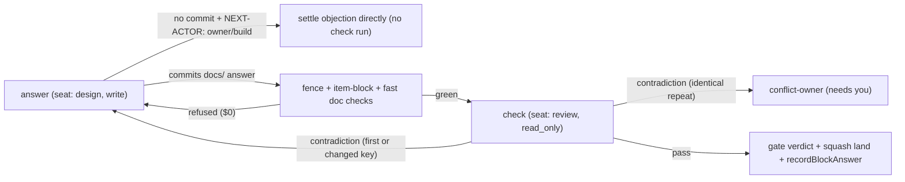

# Before a designer's conflict answer lands, a fresh review checks its code and config claims against the tree

**Status:** 2026-11-22. Nothing is built; verified against the repository at `4ca1a67aab`. Inherited rulings are the owner's verbatim dated statements in [Section 2.2](#22-inherited-owner-rulings-and-principles); `D-CA1` through `D-CA6` are the designer's decisions from an operator request of 2026-11-22 and await the owner's review in the [Decision Ledger](#decision-ledger). No companion `-plan.md` seed is opened until those decisions are reviewed.

> **In short.** Every committing `conflict-design` answer runs through a two-stage conflict workflow (`conflict-answer@v1`: `answer` on `design` followed by `check` on `review`) before the fast gate squashes it onto `main` and unblocks the waiting item. `check` verifies every code symbol, Go type shape, decoder allowlist, hook table, and tracked configuration file the answer relies on; any contradiction blocks landing and returns exact tree proof to the warm `answer` session, stopping for the owner only on an identical repeat.

**Why it matters.** Conflict answers prescribe exact Go types, CLI flags, JSON schemas, and config invariants for a planner or builder that is already blocked waiting on them. Today they land with zero code inspection: on 2026-11-22, commit `55b8d6f67b` answered a `plan` block on `tillr watch lint` in five seconds of document checks while contradicting the codebase in four places, forcing the resumed `plan` step to burn another full run and block a second time eighteen minutes later.

**The shape.** Three decisions:
- **What check, and on which seat** ([Section 3](#3-what-check-a-conflict-answer-gets-and-on-which-seat)): a post-write, read-only `check` stage on a fresh `review` session (`pi-build` backend under [OQ-DR1](./tillr-diff-review.md#decision-ledger)) auditing five closed categories of falsifiable tree and config claims (`D-CA1`, `D-CA3`, `D-CA4`), never design taste or scope ([OQ-RJ4](./tillr-review-rules.md#decision-ledger)).
- **In which workflow** ([Section 4](#4-which-workflow-runs-it-and-how-it-fits-the-blocked-item)): a tracked workflow `conflict-answer@v1` (`answer` -> `check`) attached to `conflict-design` dispatches by `conflict_id` in `Decision.Workflow` and `node_runs`, leaving the blocked item's own `workflow_selections` row untouched (`D-CA2`, `D-CA5`). Non-committing objections (`NEXT-ACTOR: owner` or `NEXT-ACTOR: build`) settle directly after `answer` without running `check`.
- **When a contradiction is found** ([Section 5](#5-what-happens-when-the-check-finds-a-contradiction)): `main` does not move, `item.conflict` stays open on `design` rather than flipping to `answered`, and the structured contradiction table returns uncounted to `answer`'s warm session at its pinned candidate commit; an identical repeat stops on `conflict-owner` for the owner ([OQ-DR2](./tillr-diff-review.md#decision-ledger), `D-CA6`).

**Cost.** Roughly $0.14–$0.17 and one to two minutes on `review` per committing conflict answer, with zero extra runs on non-committing `NEXT-ACTOR` objections, trading pennies of read-only verification against multi-dollar `plan` -> `conflict-design` -> `plan` bounce cycles.

**Start at [Section 1.2](#12-the-2026-11-22-watch-linting-answer-55b8d6f67b)** for the four contradictions in `55b8d6f67b`, then [Section 3](#3-what-check-a-conflict-answer-gets-and-on-which-seat) for the check contract and [Section 4](#4-which-workflow-runs-it-and-how-it-fits-the-blocked-item) for `conflict-answer@v1`.

**Needs your ruling:** None.

**Awaits your review:** the designer's decisions `D-CA1` through `D-CA6` in the [Decision Ledger](#decision-ledger). You may overturn any of them.

**Reads with:** [review rules](./tillr-review-rules.md) ([OQ-RJ4](./tillr-review-rules.md#decision-ledger)'s narrow `review`-seat fact-and-ledger audit), [landing diff review](./tillr-diff-review.md) (`D-DR1`, `D-DR2`, [OQ-DR1](./tillr-diff-review.md#decision-ledger), [OQ-DR2](./tillr-diff-review.md#decision-ledger)), [the judge and lifecycle design](./tillr-judge-and-lifecycle.md) ([`D-JL9`](./tillr-judge-and-lifecycle.md#43-how-a-design-runs-ending-moves-its-conflict-d-jl9) and [`D-JL32`](./tillr-judge-and-lifecycle.md#419-a-worker-returned-by-a-design-answer-starts-from-a-trunk-that-holds-the-answer-d-jl32)), [item graphs](../reference/tillr-item-graphs.md) (workflow stage, edge, and `node_outputs` rules), [designer scouts](./tillr-designer-scouts.md) (in-session `scout` subagents during drafting), and [request amendments](./tillr-request-amendment.md) (when a blocked filed request also edits `docs/`).

---

## 1. The gap and the 2026-11-22 worked case

### 1.1 How a conflict answer lands unchecked today

Verified against [blocked.go](../../tools/tillr-drain/drain/blocked.go), [plan.go](../../tools/tillr-drain/drain/plan.go), [stage.go](../../tools/tillr-drain/drain/stage.go), and [loop.go](../../tools/tillr-drain/drain/loop.go) at `4ca1a67aab`, a raised `definition` obstacle moves through five steps with zero code verification:

1. **Conflict recorded.** When a `plan` or `build` stage stops with `OBSTACLE: definition`, `(*Loop).reportedBlock` in [blocked.go](../../tools/tillr-drain/drain/blocked.go) appends an `item.conflict` event with `status: "raised"` and `waiting_on: "design"`.
2. **Unworkflowed dispatch.** `(*planner).conflictDecision` in [blocked.go](../../tools/tillr-drain/drain/blocked.go) creates a `design` dispatch with `Reason: "conflict-design"` and `BlockConflict != nil`. `Plan` in [plan.go](../../tools/tillr-drain/drain/plan.go) explicitly skips workflow lookup whenever `decision.BlockConflict != nil` so the blocked item's own build workflow (`planned-build@v1` in `workflow_selections`) does not attach to the conflict turn. Consequently, `conflict-design` runs with `Workflow == nil`.
3. **Documents-only fence.** `blockConflictPaths` in [stage.go](../../tools/tillr-drain/drain/stage.go) restricts the candidate's write fence to `docs/` (for filed requests) or the blocked item's design documents (for block-backed items).
4. **Evaluator skipped, fast gate only.** In `(*Loop).verify` in [loop.go](../../tools/tillr-drain/drain/loop.go), `judgeCandidate` runs only when `candidate.BlockConflict == nil`, and because every changed file is Markdown under `docs/`, the gate runs only the five-second document checks (`documents`, `vantage-check`, `citations`, `scratch`, `design-citations`).
5. **Trunk advances and wakes the worker.** `landCandidate` squashes the commit onto `main` and calls `recordBlockAnswer` in [blocked.go](../../tools/tillr-drain/drain/blocked.go), setting `item.conflict` to `status: "answered"`, `waiting_on: "build"` so the blocked item immediately re-enters `plan` or `build`.

Nothing in that path opens a `.go` file or a tracked file under `config/tillr/` to confirm that the functions, struct fields, JSON tags, decoder allowlists, or configuration invariants named in the answer exist. Yet `conflict-design` is the busiest `design` path in the system: across 2026-11-18 and 2026-11-19 ([designer scouts Section 1.2](./tillr-designer-scouts.md#12-where-design-runs-and-tool-calls-went)), `conflict-design` accounted for 97 of 178 UTC `design` runs ($238.09 of $394.56, or 60% of `design` spend).

### 1.2 The 2026-11-22 watch-linting answer (`55b8d6f67b`)

On 2026-11-22 (Eastern), `item-request-39836b3a65` (implementing `tillr watch lint` and its gate check) hit that gap directly:

- **03:04 ET:** `plan` stopped with `OBSTACLE: definition`, reporting underspecified check contracts in [tillr-watch.md](./tillr-watch.md).
- **03:38 ET:** `conflict-design` landed commit `55b8d6f67b` (`docs(tillr-watch): specify tillr watch lint and gate check contract`), adding 135 lines across [tillr-watch.md Section 7.2](./tillr-watch.md#72-tillr-watch-lint-checking-a-workflows-whole-configuration-before-it-runs-d-tw10) and [`D-TW55`](./tillr-watch.md#D-TW55)–[`D-TW61`](./tillr-watch.md#D-TW61). Every Markdown link and section anchor resolved, so the fast document gate passed in ~5 seconds and `recordBlockAnswer` returned the item to `plan`.
- **03:56 ET:** The resumed `plan` step opened the Go loaders and tracked config files named in `55b8d6f67b` and stopped a second time because four concrete requirements in the landed answer contradicted the repository at `4ca1a67aab`:

| # | Claim landed in `55b8d6f67b` ([tillr-watch.md](./tillr-watch.md)) | Actual repository state at `4ca1a67aab` |
| :- | :--- | :--- |
| **1** | **Repeating stages via `kind == "repeat"` and `over_arg`.** [Section 7.2](./tillr-watch.md#72-tillr-watch-lint-checking-a-workflows-whole-configuration-before-it-runs-d-tw10) (`watch-lint-charter-candidate`, `watch-lint-seat-unmapped`, `watch-lint-unbounded-return`, `watch-lint-unknown-stage`) and [`D-TW57`](./tillr-watch.md#D-TW57)–[`D-TW58`](./tillr-watch.md#D-TW58) branch on `stage.Kind == "repeat"`, stating it *"expands `over_arg: \"pieces\"` onto seat `\"build\"` with `access: \"write\"`"*. | In [workflow_check.go](../../tools/tillr-drain/drain/workflow_check.go) (`workflowFields`), [workflow.go](../../tools/tillr-drain/drain/workflow.go) (`decodeWorkflow`), and [workflow_arguments.go](../../tools/tillr-drain/drain/workflow_arguments.go) (`bindWorkflow`), `kind` allows only `"agent"`, `"command"`, and `"workflow"` (`"repeat"` fails `workflow-kind`); `over_arg` is rejected as `workflow-unknown-field` (`rg -n 'over_arg' tools/ config/` returns no matches at `4ca1a67aab`); and repetition is `"repeat": "<arg>"` on an `"agent"` stage, as in [build-pieces@v1.json](../../config/tillr/workflows/build-pieces@v1.json) (`"kind": "agent"`, `"seat": "build"`, `"access": "read_only"`, `"repeat": "pieces"`). |
| **2** | **Hook names `preserve` and `worktree`.** [Section 7.2](./tillr-watch.md#72-tillr-watch-lint-checking-a-workflows-whole-configuration-before-it-runs-d-tw10) (`watch-lint-hook-contract`) and [`D-TW57`](./tillr-watch.md#D-TW57) enumerate *"the 9-entry `hookFlags` contract of `tools/tillr-drain/drain/hooks.go` (`gate`, `land`, `verdict`, `fixer-gate`, `replay`, `rolling`, `preserve`, `worktree`, `complete-item`, with their exact required `--flag` lists)"*. | In [hooks.go](../../tools/tillr-drain/drain/hooks.go) (`hookFlags`), the nine switch cases are `"gate"`, `"land"`, `"verdict"`, `"fixer-gate"`, `"replay"`, `"rolling"`, `"complete-item"`, `"after-completion"`, and `"detail"`. Both `"preserve"` and `"worktree"` return `nil`. |
| **3** | **Strict unknown-key decoding on `backend-policy*.json`.** [Section 7.2](./tillr-watch.md#72-tillr-watch-lint-checking-a-workflows-whole-configuration-before-it-runs-d-tw10) (`watch-lint-seat-unmapped`) requires *"Each policy file must decode strictly (unknown JSON keys rejected) and satisfy every `Policy.Check()` invariant in `tools/tillr-drain/drain/policy.go`"*, while [`D-TW61`](./tillr-watch.md#D-TW61) runs `tillr watch lint` across all `config/tillr/backend-policy*.json` files in the gate. | In [policy.go](../../tools/tillr-drain/drain/policy.go), `drain.Policy` defines JSON tags `read_only_seats`, `seat_purposes`, `default_backend`, `seats`, `overrides`, `escalate`, and `backends` — no `about` field — and `Policy.UnmarshalJSON` calls `json.Unmarshal` without `DisallowUnknownFields()`. All seven tracked policy files ([backend-policy.json](../../config/tillr/backend-policy.json) and its six `backend-policy.*.json` siblings; `rg -c '"about":' config/tillr/backend-policy*.json` returns `1` for all seven) carry top-level `"about"` and fail strict unknown-key decoding against `drain.Policy`. |
| **4** | **`backends` slice and `agent`/`provider`/`thinking` keys.** [Section 7.2](./tillr-watch.md#72-tillr-watch-lint-checking-a-workflows-whole-configuration-before-it-runs-d-tw10) (`watch-lint-seat-unmapped`) and [`D-TW58`](./tillr-watch.md#D-TW58) require `default_backend` mapped to a *"non-empty backend list"*, `len(policy.Backends[chain]) > 0`, and *"every `backends[name]` non-empty with valid `agent`, `model`, `provider`, and `thinking`"*. | In [policy.go](../../tools/tillr-drain/drain/policy.go) (`type Backend = run.Backend`, `Backends map[string]Backend`) and [request.go](../../tools/tillr-run/run/request.go) (`type Backend struct`), each `backends[name]` entry is a struct, not a slice (`len(policy.Backends[chain])` does not compile in Go; lists live on `seats` via `SeatLists`), with JSON keys `quota`, `reserve`, `adapter`, `model`, `models`, `effort`, `account`, `working_dir`, `timeout_seconds`, and `harness_args` (`rg -n 'json:"(agent|provider|thinking)' tools/tillr-drain tools/tillr-run` returns no matches at `4ca1a67aab`). |

Every one of those four defects is purely mechanical to falsify once a reader compares `55b8d6f67b`'s diff against the files it names.

---

## 2. The words and settled rulings

### 2.1 Vocabulary

Node, seat, workflow, ending, evidence key, and identical repeat keep the meanings in [item graphs](../reference/tillr-item-graphs.md) and [landing diff review Section 2](./tillr-diff-review.md#2-the-words). Candidate, gate, lander, and trunk keep the meanings in [tillr-vocabulary.md Section 5.4](./tillr-vocabulary.md#54-checking-and-landing). Three terms are coined here:

| Term | Meaning | What it is not |
| :--- | :--- | :--- |
| **Conflict answer** *(coined here)* | A candidate commit under `docs/` written by a `conflict-design` dispatch to resolve a raised `item.conflict` (`OBSTACLE: definition` on a document block or filed request). | Not a non-committing `NEXT-ACTOR: owner` or `NEXT-ACTOR: build` objection, not `triage-no-block`, and not the blocked item's own code commit. |
| **Conflict-answer check** *(coined here)* | The read-only `check` stage on `review` in `conflict-answer@v1` that verifies every code, type, decoder, hook, and tracked-config claim in a conflict answer against the repository at `head_sha` before landing. | Not `item.RecordJudge` criterion retirement on the blocked item, and not subjective critique of design direction or trade-offs. |
| **Tree contradiction** *(coined here)* | One falsified factual or config-compatibility claim in a conflict answer's diff, carrying a closed category, the quoted claim, the inspected repository path or symbol, and what `head_sha` actually holds. | Not a Markdown or style finding (`vantage-check` / compliance officer), and not an opinion on scope or architecture. |

### 2.2 Inherited owner rulings and principles

Four dated owner rulings already settle the policy boundaries this design builds within:

- **Narrow `review`-seat fact audit on design changes ([OQ-RJ4](./tillr-review-rules.md#decision-ledger), 2026-11-20, Vantage `d0f72e0b`):** *"Selected B: add a narrow fact-and-ledger audit on the `review` seat, not a second opinion on the design."* This narrows the 2026-11-18 scope statement in [`D-DR2`](./tillr-diff-review.md#decision-ledger) (*"doc only landings have no review, no. this is for items that land as commits from a design doc"*) specifically to permit a read-only fact-and-ledger check on `review`.
- **Fresh reader on the named `review` seat (`D-DR1` of 2026-11-18 and [OQ-DR1](./tillr-diff-review.md#decision-ledger) of 2026-11-19):** *"it shouldn't rely on its memory of having made the change … it needs to, at the end, consider everything while looking at the diff"*, running on the named `review` seat mapped to the `build` backend for now (*"it has to be a named seat that we can pick a model for … For review, let's just stick with the implementer seat right now, although we may change this later with more evidence"*).
- **Uncounted return to the previous session (2026-11-17 dictation in [tillr-graph-is-the-path.md Section 1](./tillr-graph-is-the-path.md#1-the-direction-and-the-rules) and [`D-JL9`](./tillr-judge-and-lifecycle.md#43-how-a-design-runs-ending-moves-its-conflict-d-jl9)):** *"sends it either to the landing queue or back to resume the previous session. You can't restart a node, but you can have a resume node that resumes from that previous point and continues it."* Under [`D-JL9`](./tillr-judge-and-lifecycle.md#43-how-a-design-runs-ending-moves-its-conflict-d-jl9), no numeric attempt cap applies to conflict design and only an identical repeat stops the loop.
- **No automatic dismissal on a repeated disagreement ([OQ-DR2](./tillr-diff-review.md#decision-ledger), 2026-11-19):** *"Maybe in principle it could dismiss the objection, but I would like to take a closer look here. So I think for now, let's not do anything. Like if we hit a situation like this, let's step back and evaluate and figure out a better change."*

Within those owner rulings, five principles (`P1`–`P5`, designer's synthesis) govern the mechanism:

- **P1. Verify the committed diff, not pre-draft exploration.** A pre-write scout cannot check names, struct shapes, or strict-decoding rules that the designer invents mid-draft; the check must inspect `base_sha..head_sha` against `head_sha`.
- **P2. Falsifiable tree facts only.** Every finding must cite an inspected path/symbol and actual tree content; subjective design critique is forbidden by brief and rejected by schema.
- **P3. Never touch the blocked item's criteria or workflow selection.** Answering a conflict unblocks an item without finishing it; `check` never calls `item.RecordJudge` and never overwrites `workflow_selections(item_id)`.
- **P4. Never advance `main` or mark `answered` on a contradicted spec.** While any contradiction stands, `item.conflict` stays off `build` so no planner or builder wakes on false premises (`D-JL32`).
- **P5. Resume the warm `answer` session with exact locators; escalate to `owner` on an identical repeat.**

---

## 3. What check a conflict answer gets, and on which seat

### 3.1 Why a post-write check on `review` beats a pre-write `scout` (`D-CA1`)

*Designer's decision (from an operator request of 2026-11-22); the owner may overturn this (`D-CA1`).*

Three shapes were weighed for checking a conflict answer against the codebase:

| Candidate check | Catches claims invented while drafting? | Cross-file Go type & config reasoning | Cost per committing answer | Verdict |
| :--- | :--- | :--- | ---: | :--- |
| **Pre-write `scout` pass (`scout -> answer`)** | **No.** `55b8d6f67b`'s four contradictions were written while drafting 135 lines of new contract prose; a pre-write scout has no draft to check. | N/A before draft exists | ~$0.03 | Rejected as the landing check (designers already have in-session `scout` subagents per [designer scouts](./tillr-designer-scouts.md)). |
| **Post-write `scout` stage (`answer -> scout`)** | Reads the diff, but `scout` maps to the floor triage model (`Flash 3.8` / `Luna`). | Weak on cross-package type aliases (`type Backend = run.Backend` across `tillr-drain` and `tillr-run`) and multi-file config invariants; diverges from [OQ-RJ4](./tillr-review-rules.md#decision-ledger). | ~$0.03 | Rejected. |
| **Post-write `review` stage (`answer -> check` on `review`)** | **Yes.** Fresh session reads `base_sha..head_sha` against the repository at `head_sha`. | Runs on `review` (`pi-build`: Hydrogen 4 / Terra 6.1 per [OQ-DR1](./tillr-diff-review.md#decision-ledger)), matching [OQ-RJ4](./tillr-review-rules.md#decision-ledger)'s exact seat choice. | ~$0.14–$0.17 | **Chosen (`D-CA1`).** |

### 3.2 What `check` is given — and what is withheld (`D-CA3`)

*Designer's decision (from an operator request of 2026-11-22); the owner may overturn this (`D-CA3`).*

`check` runs with `access: "read_only"` in a fresh `review` session on the candidate lane worktree at `answer`'s committed `head_sha`. Its staged inputs are:

- **`conflict.json`:** the raised `item.conflict` payload (`OBSTACLE: definition`, `CRITERIA`, and the worker's `EVIDENCE` explaining why the item stopped), staged automatically by `LaneStager` in [stage.go](../../tools/tillr-drain/drain/stage.go) whenever `spec.BlockConflict != nil`.
- **The blocked item's statement:** the saved `request_words` or `body_ref` section, for scope context only (not for retiring item criteria).
- **The cumulative conflict-answer diff (`item_base_sha..head_sha`) and the live repository tree at `head_sha`:** read directly via read-only tools (`git diff`, file reads, and `rg`).
- **Prior contradiction records on a re-check:** when `answer` repaired an earlier `check` refusal, the prior `contradictions[]` JSON and `answer`'s updated commit diff so the fresh `review` session verifies whether each contradiction was resolved or repeated.

**Withheld:** `answer`'s narrative `node-report.md`. Because `check` declares `outputs: {"verdict": "json"}`, `Workflow.hasNamedFiles()` in [node_outputs.go](../../tools/tillr-drain/drain/node_outputs.go) is `true` and [loop.go](../../tools/tillr-drain/drain/loop.go) automatically omits `PreviousReport` on the `answer -> check` transition, matching the owner's 2026-11-21 rule ([landing diff review Section 3.1](./tillr-diff-review.md#the-workers-report)) that verification reads the candidate and the tree rather than the author's self-report.

### 3.3 The five closed check categories (`D-CA3`)

`check` audits every concrete code, schema, and configuration claim added or relied on by `item_base_sha..head_sha` across five closed categories:

| Category ID | What `check` verifies against `head_sha` | Explicit carve-out |
| :--- | :--- | :--- |
| `missing-path` | Every repository file, directory, Go package path, CLI subcommand path, gate check script, or test file the answer cites as existing or tells the worker to read, call, or edit exists in the tree and respects existing package/deployment boundary tests. | Paths the answer explicitly marks as **new files or subcommands to create** in the blocked item's build. |
| `wrong-symbol-or-type` | Every existing package symbol, struct, type alias (resolved across imports, such as `drain.Backend` -> `run.Backend`), function signature, constant, CLI/hook flag table, or switch enumeration exists with the stated container kind (struct vs slice vs map), field names, and literal cases. | New types, functions, or flags the answer explicitly specifies for the builder to add, provided they do not collide with incompatible existing declarations. |
| `wrong-schema-or-decoder` | Every JSON/TOML field name, stage `kind`, enum literal, allowlist string, or strict unknown-key rule attributed to an existing loader or validator matches that loader's actual code (for example `workflowFields` in [workflow_check.go](../../tools/tillr-drain/drain/workflow_check.go) and `Policy.UnmarshalJSON` in [policy.go](../../tools/tillr-drain/drain/policy.go)). | Schema extensions the answer explicitly instructs the builder to add to that loader in the same build. |
| `breaks-tracked-config` | Whenever the answer specifies a validation, lint, or decoding invariant that existing tracked files must pass (`config/tillr/workflows/*.json`, `config/tillr/backend-policy*.json`, `config/tillr/watch/**`, `config/tillr/commands.json`, `tools/tillr/definition/*.json`), every existing tracked file in scope actually satisfies that rule at `head_sha`. | Tracked config files the answer explicitly instructs the builder to migrate (when within the blocked item's write scope) or explicitly exempts in the rule. |
| `ledger-or-conflict-mismatch` | New or amended `D-*` rows do not silently contradict a settled owner ruling in the same or `depends-on` Decision Ledgers ([OQ-RJ4](./tillr-review-rules.md#decision-ledger)), and no factual error named in `conflict.json`'s `EVIDENCE` remains asserted as true in the amended section. | Explicit `Superseded by` / amendment notes where the owner has ruled, or escalating an owner-only conflict via `NEXT-ACTOR: owner`. |

**Forbidden critiques.** `check` must never object to architectural taste, decomposition granularity, naming style of newly proposed symbols, prose tone, or whether an alternative design would be cleaner ([OQ-RJ4](./tillr-review-rules.md#decision-ledger)).

### 3.4 Verdict artifact contract (`D-CA4`)

*Designer's decision (from an operator request of 2026-11-22); the owner may overturn this (`D-CA4`).*

`check` writes `.tillr/loop/<check-run-id>/artifacts/verdict` (`outputs: {"verdict": "json"}`), checked first by `checkNodeOutputs` (`uniqueJSON` in [node_outputs.go](../../tools/tillr-drain/drain/node_outputs.go)) and then by a Go schema validator before settlement:

```json
{
  "verdict": "contradiction",
  "read_paths": [
    "docs/design/tillr-watch.md",
    "tools/tillr-drain/drain/workflow_check.go",
    "tools/tillr-drain/drain/hooks.go",
    "tools/tillr-drain/drain/policy.go",
    "tools/tillr-run/run/request.go",
    "config/tillr/backend-policy.json"
  ],
  "contradictions": [
    {
      "category": "wrong-symbol-or-type",
      "path": "docs/design/tillr-watch.md",
      "claim": "Section 7.2 (watch-lint-hook-contract) and D-TW57 list hookFlags entries as gate, land, verdict, fixer-gate, replay, rolling, preserve, worktree, complete-item.",
      "checked": "tools/tillr-drain/drain/hooks.go#hookFlags",
      "symbol_or_key": "hookFlags:preserve,worktree",
      "actual": "hookFlags switches on gate, land, verdict, fixer-gate, replay, rolling, complete-item, after-completion, and detail; preserve and worktree return nil."
    }
  ]
}
```

Validation rules enforced in Go on `artifacts/verdict`:
- `verdict` is `"pass"` or `"contradiction"`.
- `read_paths` includes every file changed in `item_base_sha..head_sha` (`D-DR11`); when `verdict == "pass"`, `contradictions` must be empty (`[]`) and `read_paths` must also include at least one non-`docs/` tree path whenever the diff cites repository code or `config/` paths.
- When `verdict == "contradiction"`, `contradictions` must be non-empty, and every element must carry a valid `category` from the five closed values in [Section 3.3](#33-the-five-closed-check-categories-d-ca3) plus non-empty `path`, `claim`, `checked`, `symbol_or_key`, and `actual` strings. An entry without an inspected `checked` locator and `actual` tree state is rejected as a malformed verdict rather than sent to the designer.

---

## 4. Which workflow runs it, and how it fits the blocked item

### 4.1 The `conflict-answer@v1` workflow (`D-CA2`, `D-CA5`)

*Designer's decision (from an operator request of 2026-11-22); the owner may overturn this (`D-CA2`, `D-CA5`).*

Every `ReasonConflictDesign` dispatch (`BlockConflict != nil`, `TriageVersion == ""`, `Status == "raised"`, `WaitingOn == "design"`) runs a tracked two-stage workflow `conflict-answer@v1` under `config/tillr/workflows/`, using only keys already accepted by `workflowFields` and `validateOutputWiring` in [workflow_check.go](../../tools/tillr-drain/drain/workflow_check.go) and [node_outputs.go](../../tools/tillr-drain/drain/node_outputs.go):

```json
{
  "name": "conflict-answer",
  "version": 1,
  "stages": [
    {
      "id": "answer",
      "kind": "agent",
      "seat": "design",
      "access": "write",
      "prompt": "Answer the raised definition conflict in conflict.json. Confirm every existing code symbol, Go type, decoder allowlist, hook flag, and tracked config file your answer relies on before committing; if only the owner can decide or the existing spec already answers the worker, commit nothing and end blocked naming NEXT-ACTOR: owner or NEXT-ACTOR: build."
    },
    {
      "id": "check",
      "kind": "agent",
      "seat": "review",
      "access": "read_only",
      "outputs": {
        "verdict": "json"
      },
      "prompt": "Audit the committed conflict answer against conflict.json and the live repository tree across the five factual categories (missing-path, wrong-symbol-or-type, wrong-schema-or-decoder, breaks-tracked-config, ledger-or-conflict-mismatch). Write artifacts/verdict as strict JSON; never critique design taste or scope."
    }
  ],
  "edges": [
    {
      "from_node": "answer",
      "to_node": "check"
    }
  ],
  "exit": {
    "requires_nodes": ["answer", "check"],
    "requires_candidate": "commit_required"
  }
}
```



Three execution rules in `settleNode` ([workflow.go](../../tools/tillr-drain/drain/workflow.go)) make `conflict-answer@v1` fit conflict resolution cleanly:

- **Non-committing objections bypass `check` (`D-CA5`).** When `answer` commits nothing (`head == nodeBase`) and either ends `RESULT: blocked` or names `NEXT-ACTOR: owner` / `NEXT-ACTOR: build` (or omits an actor on an empty diff), `settleNode` delegates straight to `reportedBlock` / `settleDesignStatement` ([blocked.go](../../tools/tillr-drain/drain/blocked.go), [design_unanswered.go](../../tools/tillr-drain/drain/design_unanswered.go)) and ends the workflow attempt without dispatching `check`. Only a committing answer (`head != nodeBase`) advances to `check`.
- **Zero-token mechanical checks run before `check` (`D-CA5`).** Before advancing from `answer` to `check`, `settleNode` runs the conflict write-fence check (`blockConflictPaths`), the item-block preservation/prohibition guard (`designBlockRemoved` and the filed-request no-comment rule), and the fast document checks (`documents`, `vantage-check`, `citations`, `scratch`, `design-citations`). Any mechanical failure returns immediately to `answer`'s warm session without spending a `review` run, matching [`D-DR4`](./tillr-diff-review.md#43-the-position-after-the-gate)'s rule that zero-token checks filter broken candidates before a paid reviewer runs.
- **`check` never uses `exit.evaluator_slot` or `item.RecordJudge` (`D-CA2`).** In [workflow_evaluator.go](../../tools/tillr-drain/drain/workflow_evaluator.go) and [judge.go](../../tools/tillr-drain/drain/judge.go), `judgeCandidate` checks `ReadEvaluatorBinding(r, c.ItemID)` against `workflow_selections` and calls `item.RecordJudge` to retire the item's own criteria, while `verifyBuildSession` in [verify_return.go](../../tools/tillr-drain/drain/verify_return.go) splices a `seat: "build"` repair node when the writer was not `build`. None of that belongs on a conflict answer: `check` settles through its `verdict` JSON artifact on `d.BlockConflict != nil`, leaving the blocked item's build criteria untouched.

### 4.2 Keeping the blocked item's own workflow intact (`D-CA2`)

In `.tillr/state.db`, `workflow_selections` is keyed by `item_id PRIMARY KEY` and holds the blocked item's own delivery workflow (for example `planned-build@v1` on `item-request-39836b3a65`, bound to evaluator node `verify`). Overwriting `workflow_selections` when a conflict is raised would erase the item's build workflow when the conflict is answered.

Instead (`D-CA2`):
- `Plan` in [plan.go](../../tools/tillr-drain/drain/plan.go) continues to leave `workflow_selections(item_id)` untouched whenever `decision.BlockConflict != nil`.
- When `decision.Reason == ReasonConflictDesign` (`c.TriageVersion == ""`), `Plan` loads `conflict-answer@v1` from `config/tillr/workflows/` and attaches it directly to `decision.Workflow` (keyed in `node_runs` by the conflict attempt's `attempt_id` and `conflict_id` metadata). Because `conflictDecision` is the sole planner entry point for raised `definition` conflicts, no conflict answer can bypass `check` by selecting `single-worker@v1`.
- **Exemptions:** `ReasonTriageNoBlock` (`c.TriageVersion != ""` in [document_prerequisite.go](../../tools/tillr-drain/drain/document_prerequisite.go), which precedes [tillr-queue-mirrors-designs.md](./tillr-queue-mirrors-designs.md) retiring hidden item comments) and the synthetic `ownerMigration` shell command in [blocked.go](../../tools/tillr-drain/drain/blocked.go) keep their existing single-step behavior. In-flight unworkflowed `conflict-design` runs at rollout finish under their recorded `pendingWork` snapshot; any new or re-raised conflict starts `conflict-answer@v1`.
- **Composition with sibling designs:** When a filed-request amendment also edits `docs/` ([tillr-request-amendment.md Section 6.4](./tillr-request-amendment.md#64-when-a-design-document-also-changes)), `conflict-answer@v1` checks both the `docs/` diff and any code/config names in the accompanying amendment text; pure `no_commit` request amendments that touch no code/config claims skip `check` unless the amendment names tree paths or symbols. Once [tillr-review-rules.md](./tillr-review-rules.md)'s post-gate router ([OQ-RJ4](./tillr-review-rules.md#decision-ledger)) ships, a candidate carrying a passing `conflict-answer@v1` `check` artifact on `head_sha` skips a duplicate post-gate `review` fact-audit run while still running `design-document-style` compliance if enabled.

---

## 5. What happens when the check finds a contradiction

### 5.1 Settlement across all `check` outcomes (`D-CA6`)

*Designer's decision (from an operator request of 2026-11-22); the owner may overturn this (`D-CA6`).*

| `check` outcome | Trunk & `item.conflict` state | Next action |
| :--- | :--- | :--- |
| **`verdict == "pass"`** (all changed paths read, `contradictions` empty) | `check` settles `'passed'`. Fast gate records `gate.verdict` on `(base_sha, head_sha^{tree})`, `tillr-land` squashes onto `main` using `answer`'s commit message (`WorkerHeadSHA`), and `recordBlockAnswer` marks `item.conflict` `answered` (`waiting_on: "build"`). | Blocked item resumes `plan` or `build` on a trunk holding the verified answer (`D-JL32`). |
| **`verdict == "contradiction"`, first or changed contradiction key** | `check` settles `'evaluated-fail'`. **Nothing lands**; `main` does not move; `item.conflict` stays `status: "raised"`, `waiting_on: "design"` with `DesignRunID = <answer-run-id>`; `drain.design-unanswered` (`cause: "answer-contradiction"`, `reraised: true`) is recorded. | Next drain pass starts a new `conflict-answer@v1` attempt whose `answer` stage **resumes the warm `design` session** at its pinned `head_sha` with the formatted contradiction table, then runs a **fresh `check` session** over `item_base_sha..head2`. |
| **`verdict == "contradiction"`, identical repeat of an earlier key on this conflict chain** | `check` settles `'evaluated-fail'`. **Nothing lands**; `routeDesignRepeat` ([design_repeat.go](../../tools/tillr-drain/drain/design_repeat.go)) moves `item.conflict` to `status: "owner"`, `waiting_on: "owner"` (`ReasonConflictOwner`, `"needs you"`). | Stops with no retry count ([OQ-DR2](./tillr-diff-review.md#decision-ledger), [`D-JL9`](./tillr-judge-and-lifecycle.md#43-how-a-design-runs-ending-moves-its-conflict-d-jl9)), displaying both `check`'s contradiction proof and `answer`'s response on the Item page for the owner. |
| **Malformed `artifacts/verdict` or unread changed path** | Candidate does **not** land and `answer` is **not** blamed. | `check`'s own session is resumed once naming the schema or unread-path defect; a second malformed output holds on `ReasonJudgeUnreadable` (`D-DR11`). |
| **`check` mutates `HEAD` or leaves dirty files** | Read-only guard in [workflow.go](../../tools/tillr-drain/drain/workflow.go) cleans the worktree back to `answer`'s `head_sha`. | Retries one fresh `check` session; a repeat holds as a tooling defect (`D-DR11`). |

### 5.2 Warm-session return and deterministic repeat key

Two existing mechanisms in [design_continuation.go](../../tools/tillr-drain/drain/design_continuation.go) and [design_repeat.go](../../tools/tillr-drain/drain/design_repeat.go) need one clean invariant each to work under a two-stage workflow:

1. **Preserving `answer`'s session and candidate ref across `check`.** When `answer` (`run-<item>-a<k>-n1`) commits `head1`, `settleNode` pins `refs/tillr/runs/<answer-run-id>` at `head1` and keeps `answer`'s `session-id` in `RunDir(root, answerRunID)`. `check` (`run-<item>-a<k>-n2`) writes its own `session-id` and `artifacts/verdict` under `RunDir(root, checkRunID)` without overwriting `answer`'s run directory. When `check` reports a contradiction, `c.DesignRunID` is set to `<answer-run-id>` (never `<check-run-id>`). On the next pass, `prepareDesignContinuation` in [design_continuation.go](../../tools/tillr-drain/drain/design_continuation.go) resolves `origin = c.DesignRunID`, checks out `head1` on the same lane, sets `KeptItemBaseSHA = item_base_sha` so the subsequent `check` node still diffs the entire conflict answer (`item_base_sha..head2`), and resumes `answer`'s warm conversation with every `contradictions[]` entry formatted verbatim in the turn prompt.
2. **Wording-independent repeat key (`designEndingKey`).** Reviewers reword prose between fresh sessions, so hashing `claim` or `actual` prose would fail to detect an identical repeat (`D-DR10`). For `cause == "answer-contradiction"`, `designEndingKey` in [design_repeat.go](../../tools/tillr-drain/drain/design_repeat.go) canonicalizes the sorted unique tuples `(category, checked, symbol_or_key)` across `contradictions[]`:
   ```text
   answer-contradiction\x00<category>\x00<checked>\x00<symbol_or_key>\n...
   ```
   - If `answer` fixes three contradictions from `55b8d6f67b` and misses one, the tuple set shrinks — **not** an identical repeat, so `answer` gets another turn to fix the remaining one.
   - If `answer` fixes all four and introduces a new typo in another symbol, the tuple set changes — **not** an identical repeat, so `answer` gets a turn on the new symbol.
   - If `answer` leaves the exact same contradicted claims in place (or re-commits an unchanged tree insisting `check` is wrong) and the fresh `check` session emits the identical `(category, checked, symbol_or_key)` set, `designRepeatOf` matches the prior `drain.design-unanswered` event and `routeDesignRepeat` moves the item to `conflict-owner` ([OQ-DR2](./tillr-diff-review.md#decision-ledger)).

---

## 6. Replay of the 2026-11-22 watch-linting answer

Running `item-request-39836b3a65`'s 03:04 ET conflict through `conflict-answer@v1` shows how all four contradictions in `55b8d6f67b` are caught before `main` moves:

1. **03:04 ET — conflict dispatched on `conflict-answer@v1`.** `plan` stops with `OBSTACLE: definition` on [tillr-watch.md](./tillr-watch.md). `Plan` keeps `item-request-39836b3a65`'s `workflow_selections` row (`planned-build@v1`) intact and dispatches `conflict-answer@v1` (`answer` -> `check`).
2. **Node 1 (`answer` on `design`) commits `55b8d6f67b`'s tree.** The designer writes the 135-line contract in [tillr-watch.md Section 7.2](./tillr-watch.md#72-tillr-watch-lint-checking-a-workflows-whole-configuration-before-it-runs-d-tw10) and [`D-TW55`](./tillr-watch.md#D-TW55)–[`D-TW61`](./tillr-watch.md#D-TW61) and commits `head1`. `settleNode` confirms `head1 != base`, write fence inside `docs/`, no item-block violation, and green fast document checks, pins `refs/tillr/runs/<answer-run-id>`, and advances the lane to `check`.
3. **Node 2 (`check` on `review`) audits `base..head1` against `head1`.** In a fresh read-only session with `answer`'s `node-report.md` withheld, `check` reads `conflict.json`, `git diff base..head1`, and every Go loader and config file the new specification relies on: [workflow_check.go](../../tools/tillr-drain/drain/workflow_check.go), [workflow.go](../../tools/tillr-drain/drain/workflow.go), [workflow_arguments.go](../../tools/tillr-drain/drain/workflow_arguments.go), [build-pieces@v1.json](../../config/tillr/workflows/build-pieces@v1.json), [hooks.go](../../tools/tillr-drain/drain/hooks.go), [policy.go](../../tools/tillr-drain/drain/policy.go), [request.go](../../tools/tillr-run/run/request.go), and all seven `config/tillr/backend-policy*.json` files ([backend-policy.json](../../config/tillr/backend-policy.json) and its six siblings).
4. **`check` emits `"verdict": "contradiction"` with all four entries:**
   - **`wrong-schema-or-decoder` (`workflow_check.go#workflowFields`, `kind:repeat,over_arg`):** `55b8d6f67b` specifies `stage.Kind == "repeat"` and `over_arg: "pieces"`; `workflowFields` and `decodeWorkflow` allow only `kind` in `{"agent", "command", "workflow"}`, reject `over_arg` as `workflow-unknown-field`, and represent repetition as `"repeat": "<arg>"` on an `"agent"` stage ([build-pieces@v1.json](../../config/tillr/workflows/build-pieces@v1.json)).
   - **`wrong-symbol-or-type` (`hooks.go#hookFlags`, `hookFlags:preserve,worktree`):** `55b8d6f67b` lists `preserve` and `worktree` among the nine `hookFlags` entries; [hooks.go](../../tools/tillr-drain/drain/hooks.go) defines `gate`, `land`, `verdict`, `fixer-gate`, `replay`, `rolling`, `complete-item`, `after-completion`, and `detail` (`preserve` and `worktree` return `nil`).
   - **`breaks-tracked-config` (`config/tillr/backend-policy*.json`, `Policy:DisallowUnknownFields:about`):** `55b8d6f67b` mandates strict unknown-JSON-key rejection against `drain.Policy` across all `config/tillr/backend-policy*.json` files; `drain.Policy` in [policy.go](../../tools/tillr-drain/drain/policy.go) has no `about` tag while all seven tracked `config/tillr/backend-policy*.json` files declare top-level `"about"`.
   - **`wrong-symbol-or-type` (`policy.go#Policy.Backends`, `Backend:slice,agent,provider,thinking`):** `55b8d6f67b` specifies `len(policy.Backends[chain]) > 0` and fields `agent`, `provider`, and `thinking` on `backends[name]`; `Policy.Backends` is `map[string]run.Backend` where `run.Backend` in [request.go](../../tools/tillr-run/run/request.go) is a struct with JSON tags `quota`, `reserve`, `adapter`, `model`, `models`, `effort`, `account`, `working_dir`, `timeout_seconds`, and `harness_args`.
5. **Refusal returns to the warm `answer` session; `main` never breaks.** `55b8d6f67b` is withheld from `main`, `item.conflict` stays on `design`, and the wasted 03:56 ET `plan` run never starts. `answer` resumes on `head1` with all four exact Go/config locators, rewrites `D-TW57`–`D-TW60` against the real types in one short turn, passes a fresh `check` (`verdict: "pass"`), and lands once so `plan` wakes on an accurate specification.

---

## 7. Alternatives considered

| Alternative | Why rejected |
| :--- | :--- |
| **Pre-write `scout -> answer` workflow without a post-write check** | Fails the worked case: the designer invents concrete symbol names, hook lists, and strict-JSON rules *while drafting* `answer`. Pre-write scouting has no candidate diff to verify against the tree. |
| **Post-write check on the `scout` seat (`Flash` / `Luna`)** | Contradicts [OQ-RJ4](./tillr-review-rules.md#decision-ledger) (which placed design fact-audits on `review`) and [OQ-DR1](./tillr-diff-review.md#decision-ledger) (which mapped `review` to `build`'s backend). Floor models miss cross-package Go type aliases (`drain.Backend = run.Backend`) and multi-file config interactions. |
| **Wiring `check` through `exit.evaluator_slot` / `judgeCandidate`** | `judgeCandidate` in [workflow_evaluator.go](../../tools/tillr-drain/drain/workflow_evaluator.go) validates `ReadEvaluatorBinding` against the item's `workflow_selections` row (failing `ReasonJudgeUnreadable` on a blocked build item) and calls `item.RecordJudge` to retire the blocked item's build criteria; `verifyBuildSession` in [verify_return.go](../../tools/tillr-drain/drain/verify_return.go) also inserts a `seat: "build"` repair stage that cannot edit `docs/design/*.md`. |
| **Loop-only post-gate review keeping `Workflow == nil` on conflicts** | Leaves `conflict-design` as the sole multi-seat flow invisible to workflow graphs (`node_runs` / `node_artifacts` / `tillr drain workflow check`), rather than declaring `answer -> check` explicitly in `config/tillr/workflows/` like `planned-build@v1` and `scouted-design@v1`. |
| **Allowing `answer` to dismiss a `check` contradiction unilaterally** | Directly violates the owner's 2026-11-19 ruling in [OQ-DR2](./tillr-diff-review.md#decision-ledger) to build no dismissal mechanism now and instead stop for the owner on a repeated disagreement. |

---

## 8. What this does not cover and amendments owed

**Not covered here:**
- Fixing the four contradictions inside [tillr-watch.md Section 7.2](./tillr-watch.md#72-tillr-watch-lint-checking-a-workflows-whole-configuration-before-it-runs-d-tw10) itself (owned by `item-request-39836b3a65`'s own conflict resolution).
- Retiring hidden item comments or replacing `ReasonTriageNoBlock` (owned by [tillr-queue-mirrors-designs.md](./tillr-queue-mirrors-designs.md)).
- Settling the permanent rule for repeated reviewer/writer disagreements once live cases accumulate (open for the owner under [OQ-DR3](./tillr-diff-review.md#open-questions)).

**Amendments owed once `D-CA1`–`D-CA6` are reviewed** (none edited in this commit):

| Document | Amendment owed |
| :--- | :--- |
| [tillr-review-rules.md](./tillr-review-rules.md) ([Section 3.1](./tillr-review-rules.md#31-proposed-map-across-this-repositorys-artifact-classes), [Section 6](./tillr-review-rules.md#6-do-design-documents-want-a-review-agent)) | Cross-link `conflict-answer@v1` as the concrete workflow for `conflict-design` answers and note that a passing `check` artifact on `head_sha` satisfies [OQ-RJ4](./tillr-review-rules.md#decision-ledger)'s post-gate fact-and-ledger audit without running `review` twice. |
| [tillr-judge-and-lifecycle.md](./tillr-judge-and-lifecycle.md) ([Section 4.3](./tillr-judge-and-lifecycle.md#43-how-a-design-runs-ending-moves-its-conflict-d-jl9)) | Add `"answer-contradiction"` to `D-JL9`'s conflict-design continuation causes alongside gate refusals and unanswered conflicts, routing first/changed keys back to `answer` and identical repeats to `conflict-owner`. |
| [tillr-designer-scouts.md](./tillr-designer-scouts.md) ([Section 3.2](./tillr-designer-scouts.md#32-applying-the-split-to-conflict-design-60-of-design-spend)) | Note that `conflict-design` runs as the `answer` stage of `conflict-answer@v1`, pairing in-session `scout` subagents during drafting with post-commit `check` on `review`. |
| [tillr-item-graphs.md](../reference/tillr-item-graphs.md) & [tools/tillr-drain/README.md](../../tools/tillr-drain/README.md) | Document `conflict-answer@v1` alongside the shipped workflows once built. |

---

## 9. Risks

| Risk | Mitigation |
| :--- | :--- |
| **False-positive contradiction on newly proposed symbols or files.** `check` flags a function, flag, or file as missing when the conflict answer is intentionally instructing the builder to create it. | [Section 3.3](#33-the-five-closed-check-categories-d-ca3) explicitly carves out paths, symbols, and schema additions marked as new work to build; every contradiction requires quoting `claim` beside `actual`, and if a misread still repeats once, [OQ-DR2](./tillr-diff-review.md#decision-ledger) surfaces both sides cleanly to the owner rather than looping forever. |
| **Reviewer misses an indirect Go type alias or embed.** `check` reads `policy.go` superficially without following `type Backend = run.Backend` into `tools/tillr-run/run/request.go`. | Running `check` on `review` (`pi-build` backend) rather than `scout`, requiring `read_paths` to include inspected source files, and instructing `check` to resolve every cross-package type alias and struct definition to its declaration before passing. |
| **Added cost and latency on every committing conflict answer.** ~$0.14–$0.17 and 1–2 minutes per committing `conflict-design` run. | Non-committing `NEXT-ACTOR` objections and mechanical doc-gate failures skip `check` (`$0`), and catching even one bad conflict answer avoids ~$2–$4+ of wasted `plan` + second `conflict-design` + second `plan` runs. |

---

## Open Questions

None. All policy-level choices — running a narrow `review`-seat fact audit on design changes ([OQ-RJ4](./tillr-review-rules.md#decision-ledger)), mapping `review` to `build`'s backend ([OQ-DR1](./tillr-diff-review.md#decision-ledger)), returning refusals uncounted to the warm designer session ([`D-JL9`](./tillr-judge-and-lifecycle.md#43-how-a-design-runs-ending-moves-its-conflict-d-jl9)), and stopping for the owner rather than auto-dismissing on an identical repeat ([OQ-DR2](./tillr-diff-review.md#decision-ledger)) — have already been ruled by the owner. The architectural choices below (`D-CA1` through `D-CA6`) are the designer's decisions from the 2026-11-22 operator request and await the owner's review.

---

## Decision Ledger

Inherited owner rulings ([OQ-RJ4](./tillr-review-rules.md#decision-ledger), [`D-DR1`](./tillr-diff-review.md#decision-ledger), [OQ-DR1](./tillr-diff-review.md#decision-ledger), [OQ-DR2](./tillr-diff-review.md#decision-ledger), and [`D-JL9`](./tillr-judge-and-lifecycle.md#43-how-a-design-runs-ending-moves-its-conflict-d-jl9)) remain owned by their home ledgers and are quoted in [Section 2.2](#22-inherited-owner-rulings-and-principles). Every `D-CA*` row below is a designer's decision made from an operator request of 2026-11-22; none is an owner ruling, and the owner may overturn any of them.

| ID | Decision | Date & actor | Settled in | Built |
| :--- | :--- | :--- | :--- | :--- |
| `D-CA1` | **Designer's decision (from an operator request of 2026-11-22); the owner may overturn this.** Every committing `conflict-design` answer is checked post-commit before landing by a fresh read-only `review`-seat run (`check`), not by a pre-write `scout` pass alone and not on the `scout` model tier. **Evidence:** `55b8d6f67b`'s four contradictions were introduced while drafting 135 lines of new contract prose; [OQ-RJ4](./tillr-review-rules.md#decision-ledger) and [OQ-DR1](./tillr-diff-review.md#decision-ledger) already place narrow design fact-audits on `review` (`pi-build`). **Rejected:** pre-write `scout -> answer` only; post-write `scout` stage. | 2026-11-22, designer (from operator request) | [Section 3.1](#31-why-a-post-write-check-on-review-beats-a-pre-write-scout-d-ca1) | — |
| `D-CA2` | **Designer's decision (from an operator request of 2026-11-22); the owner may overturn this.** Raised `definition` conflicts (`ReasonConflictDesign`, `TriageVersion == ""`) dispatch a tracked two-stage workflow `conflict-answer@v1` (`answer` on `design` with `write` -> `check` on `review` with `read_only` and `outputs: {"verdict": "json"}`), attached to `Decision.Workflow` and `node_runs` for the conflict attempt without touching `workflow_selections(item_id)` and without calling `exit.evaluator_slot` / `item.RecordJudge`. **Evidence:** `workflow_selections` is keyed by `item_id` for the blocked item's own build workflow (`planned-build@v1`), and `item.RecordJudge` retires item build criteria rather than auditing a conflict answer. **Rejected:** overwriting `workflow_selections`; wiring `check` through `evaluator_slot`; leaving `conflict-design` with `Workflow == nil`. | 2026-11-22, designer (from operator request) | [Section 4.1](#41-the-conflict-answerv1-workflow-d-ca2-d-ca5), [Section 4.2](#42-keeping-the-blocked-items-own-workflow-intact-d-ca2) | — |
| `D-CA3` | **Designer's decision (from an operator request of 2026-11-22); the owner may overturn this.** `check` receives `conflict.json`, the blocked item's statement, the cumulative diff `item_base_sha..head_sha`, the repository tree at `head_sha`, and any prior `contradictions[]` on a re-check, with `answer`'s `node-report.md` withheld; it checks five closed categories (`missing-path`, `wrong-symbol-or-type`, `wrong-schema-or-decoder`, `breaks-tracked-config`, `ledger-or-conflict-mismatch`), carving out explicitly marked new symbols/files and forbidding subjective design critique. **Evidence:** those five categories catch all four contradictions in `55b8d6f67b` while honoring [OQ-RJ4](./tillr-review-rules.md#decision-ledger) and the owner's 2026-11-21 report-exclusion rule. **Rejected:** open-ended design critique; passing `answer`'s self-report as evidence. | 2026-11-22, designer (from operator request) | [Section 3.2](#32-what-check-is-given--and-what-is-withheld-d-ca3), [Section 3.3](#33-the-five-closed-check-categories-d-ca3) | — |
| `D-CA4` | **Designer's decision (from an operator request of 2026-11-22); the owner may overturn this.** `check` emits a strict JSON `artifacts/verdict` file validated in Go before settlement: `verdict` in `{"pass", "contradiction"}`, `read_paths` covering every changed path (plus inspected tree/config paths), and for `"contradiction"` a non-empty `contradictions[]` list where each item states `category`, `path`, `claim`, `checked`, `symbol_or_key`, and `actual`. Malformed or unread-path verdicts resume `check` once and then hold on `ReasonJudgeUnreadable` rather than landing or blaming `answer`. **Evidence:** `checkNodeOutputs` (`uniqueJSON`) and `D-DR11` already enforce artifact uniqueness and read coverage. **Rejected:** free-text prose verdicts; passing or returning unverified claims without a `checked` locator. | 2026-11-22, designer (from operator request) | [Section 3.4](#34-verdict-artifact-contract-d-ca4), [Section 5.1](#51-settlement-across-all-check-outcomes-d-ca6) | — |
| `D-CA5` | **Designer's decision (from an operator request of 2026-11-22); the owner may overturn this.** Non-committing `answer` endings (`head == nodeBase` with `NEXT-ACTOR: owner` or `NEXT-ACTOR: build`, or missing actor) settle immediately after `answer` without running `check`, and zero-token mechanical checks (conflict write fence, item-block guard, and fast document checks) run on `answer`'s commit before advancing to `check`. **Evidence:** [`D-DR4`](./tillr-diff-review.md#43-the-position-after-the-gate) avoids paying a reviewer on mechanically invalid or non-landing turns. **Rejected:** running `check` on non-committing objections or broken Markdown. | 2026-11-22, designer (from operator request) | [Section 4.1](#41-the-conflict-answerv1-workflow-d-ca2-d-ca5) | — |
| `D-CA6` | **Designer's decision (from an operator request of 2026-11-22); the owner may overturn this.** On `"contradiction"`, nothing lands and `item.conflict` stays `raised` on `design` with `DesignRunID = <answer-run-id>` (`check` uses its own run directory so `answer`'s `session-id` and `refs/tillr/runs/<answer-run-id>` stay intact); a first or changed contradiction key (`(category, checked, symbol_or_key)` tuple set) resumes `answer`'s warm session at `head_sha` with `KeptItemBaseSHA = item_base_sha`, whereas an identical repeat routes to `conflict-owner` (`"needs you"`) with both sides shown. **Evidence:** [`D-JL9`](./tillr-judge-and-lifecycle.md#43-how-a-design-runs-ending-moves-its-conflict-d-jl9), [`D-JL32`](./tillr-judge-and-lifecycle.md#419-a-worker-returned-by-a-design-answer-starts-from-a-trunk-that-holds-the-answer-d-jl32), and [OQ-DR2](./tillr-diff-review.md#decision-ledger). **Rejected:** landing before `check` passes; numeric retry caps; fresh cold `answer` sessions on refusal; hashing free-text reviewer prose as the repeat key. | 2026-11-22, designer (from operator request) | [Section 5.1](#51-settlement-across-all-check-outcomes-d-ca6), [Section 5.2](#52-warm-session-return-and-deterministic-repeat-key) | — |
