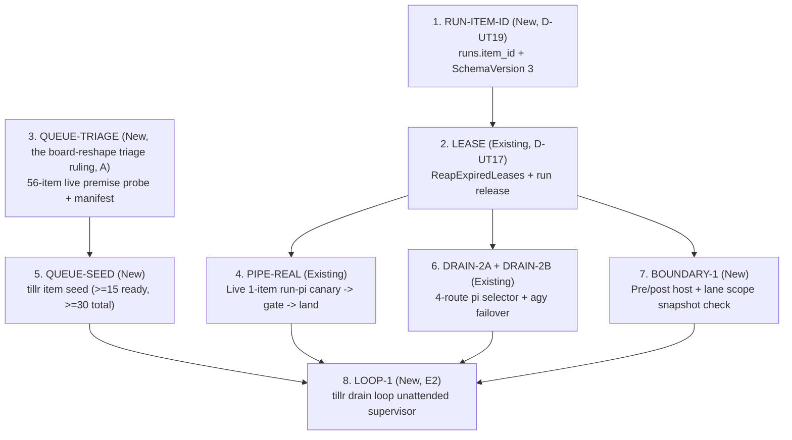

# Tillr Day 2 Plan: Unattended Queue Loop (E2)

This document plans Day 2 of the `tillr` decomposition (`2026-11-12` / `2026-11-13`). Per the owner's instruction—*"unattended loop. I want to see it with our migrated queue continuously burning through stuff"*—the target is **milestone E2** from `docs/design/tillr-chunking-plan.md`: an unattended coordinator loop continuously draining, executing, gating, and landing items migrated from `docs/archive/board-2026-11-12/board-content.json`.

---

## 1. End State

At the end of the day, running `tillr drain loop --root /workspace --lanes 2` against the live store (it ends when the pile is drained or an operator stops it: there is no tick budget — [the momentum principle](momentum-principle.md)) at `/workspace/.tillr/state.db` (`SchemaVersion` 3) executes unattended across multiple ticks without human commands between phases, and a post-run check via `tillr view --root /workspace --json`, `tillr run lanes --root /workspace --json`, and `git -C /workspace log --oneline` verifies all six numerical predicates: (1) `schema_version == 3` with `runs.item_id` populated on `100%` of terminal `run.record` rows (`D-UT19`); (2) at least `30` migrated items registered in `tillr-item` from `docs/archive/board-2026-11-12/board-content.json` with frozen criterion texts (`criterion-frozen`), of which at least `15` started the run in planner state `ready`; (3) at least `5` consecutive unattended loop ticks completed across `2` isolated lane worktrees in the durable scratch directory, producing at least `5` terminal `run.record` entries via `run-pi` (and/or `run-agy` on failover) with per-request DeepSeek route attribution (`:particle`, `:particle-flex`, `:ionstream-flex`, `:deepinfra`, `:deepinfra-flex`, `:stepfun`, `:primeintellect`) recorded on each `pi` run; (4) at least `3` migrated items carried all the way through `run.record` (`exit_code == 0`) → `boundary.check` (`pass`) → `gate.verdict` (`pass`, `just done` exit `0`) → `tillr land pass` (`land.record` advancing `main`, with `carried == true` on any candidate whose sibling lane moved `main` first per `D-UT18`) → `item.verdict` (`pass` on every frozen criterion, item state `completed`); (5) at least `1` non-happy-path outcome (`candidate-gate-fail` or `infra-adapter-stream` failover) isolated automatically according to its failure class without halting the loop or retrying a failed gate candidate; and (6) `0` leaked or expired lane leases (`active_leases == 0`) and `0` dirty tracked or untracked files in `/workspace` outside the store and the durable scratch directory when the loop exits.

```bash
# End-of-day verification command sequence (run from /workspace)
tillr view --root /workspace --json | jq -e '
  .schema_version == 3 and
  (.items | length >= 30) and
  ([.items[] | select(.state == "completed")] | length >= 3) and
  ([.runs[]  | select(.status == "terminal" and (.item_id | length > 0))] | length >= 5) and
  ([.runs[]  | select(.status == "terminal" and (.item_id == null or .item_id == ""))] | length == 0)
'
tillr run lanes --root /workspace --json | jq -e '
  [.lanes[] | select(.lease_state != "idle")] | length == 0
'
test -z "$(git -C /workspace status --porcelain)"
```

---

## 2. Chunk Sequence and Dependencies

Day 2 reuses five existing chunk IDs from `docs/design/tillr-chunking-plan.md` (`LEASE`, `PIPE-REAL`, `DRAIN-2A`, `DRAIN-2B`, plus explicitly deferred `SUB-2` and `MM-2` covered in [Section 6](#6-deferred-and-dropped-scope)) and introduces five honestly new chunks (`RUN-ITEM-ID`, `QUEUE-TRIAGE`, `QUEUE-SEED`, `BOUNDARY-1`, `LOOP-1`) that close the gap between a single-run executor and an unattended loop over the migrated board.



### Summary Table and Estimates

| Order | Chunk ID | Origin | Packages / Files Touched | Depends On | Estimate | Basis for Estimate |
|---|---|---|---|---|---|---|
| 1 | `RUN-ITEM-ID` | **New** (`D-UT19`) | `tools/tillr-store`, `tools/tillr-run`, `tools/tillr-drain`, `tools/tillr-view` | Day-1 `SchemaVersion` 2 additive migration | **45m** (ESTIMATE) | Reuses Day-1 additive column repair in `tillr-store`; `run.request` already has `item_id`, so work is copying to `run.record`, binding `runs.item_id` on insert/read, and updating `run-link-missing` query. |
| 2 | `LEASE` | **Existing** (`D-UT17`) | `tools/tillr-store`, `tools/tillr-run`, `tools/tillr-drain`, `tools/tillr-cli`, `tools/tillr` | `RUN-ITEM-ID` | **60m** (ESTIMATE) | Claim write (`timeout_ms + 300s` grace) already exists. Remaining work is `ReapExpiredLeases(now)` before `drain once` planning, synthetic `lease-expired` terminal record emission, and `tillr run release <lane-id>`. |
| 3 | `QUEUE-TRIAGE` | **New** (the two board-reshape rulings, A) | `docs/design/tillr-seed-triage.md`, `config/tillr/seed-items.json` | `docs/archive/board-2026-11-12/board-content.json` | **60m** (ESTIMATE) | 56 open items total; Day-1 check already proved 4 have missing paths and 3 cite the deleted CLI. Automated shell probes + structured criterion authoring for the remaining 49 items fits in one dedicated lane turn. |
| 4 | `PIPE-REAL` | **Existing** | `tools/tillr-run/backends/pi/run-pi`, `tools/tillr-run/backends/muse/extract-report` | `RUN-ITEM-ID`, `LEASE` | **75m** (ESTIMATE) | Echo rehearsal proved staging, 9-section `brief-template.md` check, `extract-report` exit codes, and `run status`. Estimate includes 1 live turn on DeepSeek `:particle` plus budget for 1–2 stream/report parser fixes on real subagent output. |
| 5 | `QUEUE-SEED` | **New** | `tools/tillr-item`, `tools/tillr-cli`, `config/tillr/seed-items.json` | `QUEUE-TRIAGE` + owner sign-off (the board-reshape triage ruling, A), `RUN-ITEM-ID` | **40m** (ESTIMATE) | `tillr-item` already implements items, frozen criteria (`criterion-frozen`), and edges. `tillr item seed --from <file>` is an idempotent batch loader over existing store methods. |
| 6 | `DRAIN-2A` + `DRAIN-2B` | **Existing** | `tools/tillr-drain`, `tools/tillr-run`, `tools/tillr-run/backends/pi/run-pi`, `tools/tillr-run/backends/agy/run-agy` | `RUN-ITEM-ID`, `LEASE`, `PIPE-REAL` | **90m** (ESTIMATE) | `config/tillr/backend-policy.json` is already in place. Work is round-robin selection across the 4 pinned `pi` routes (`DRAIN-2A`) and the 1-hop failover classifier to `agy` on infrastructure errors (`DRAIN-2B`). |
| 7 | `BOUNDARY-1` | **New** | `tools/tillr-drain`, `tools/tillr-land` | `RUN-ITEM-ID`, `LEASE` | **45m** (ESTIMATE) | ~120 LoC Go helper capturing pre/post `git status --porcelain -z` and `HEAD` sha on `/workspace` plus `allowed_paths` diff check on the lane worktree. |
| 8 | `LOOP-1` | **New** (`E2`) | `tools/tillr-drain`, `tools/tillr-cli`, `tools/tillr` | `PIPE-REAL`, `QUEUE-SEED`, `DRAIN-2A`, `DRAIN-2B`, `BOUNDARY-1` | **105m** (ESTIMATE) | All single-phase primitives (`drain once`, `run exec`, `gate`, `land pass`, `item verdict`) exist. `LOOP-1` wires the tick state machine, serial landing lock, worktree reset, and stopping conditions, followed by a 2-tick rehearsal and 20-tick burn. |
| — | `SUB-2` | **Existing (Deferred)** | `tools/tillr-run`, `tools/tillr-run/backends/*` | — | **75m** (SAVED) | Deferred ([Section 6](#6-deferred-and-dropped-scope)): argv + ambient jail credentials suffice for `pi` and `agy` on Day 2. |
| — | `MM-2` | **Existing (Dropped/Frozen)** | `tools/tillr-run/backends/muse/run-muse` | External Meta subscription | **90m+** (SAVED) | Dropped for Day 2 ([Section 6](#6-deferred-and-dropped-scope)): Meta subscription lapsed on `2026-11-12`; `muse` models refuse with `does not exist or you lack access`. |

### Built Since This Plan Was Written

`RUN-ITEM-ID`, `LEASE`, `QUEUE-TRIAGE`, `PIPE-REAL`, `QUEUE-SEED` and `BOUNDARY-1` are built and
on trunk; `DRAIN-2A`/`DRAIN-2B` were in flight when this was written; `LOOP-1` is next and is the
only chunk whose call sites did not exist yet when the earlier chunks landed.

Four things the build changed, recorded here rather than left for a reader to discover in the
code:

- **`LEASE` states `timed-out`** with a `run.release` event, not the `lease-expired` status and
  `exit_code: 124` this plan proposed, because
  [`board-utilities.md`](./board-utilities.md) [Section 5.6](./board-utilities.md#56-run-alone) already fixes the terminal vocabulary and a
  second one would be a second place a run's state is defined.
- **A legacy `leased` row with a NULL lease is not reaped.** The reaper cannot tell "never
  leased" from "lease lost", so an operator releases it. That is a deliberate hole rather than
  an oversight.
- **The store cannot sit inside a `run exec` bracket.** `run` writes the store inside that
  bracket by design, so `BOUNDARY-1`'s store stat is compared around the tick, not around the
  run.
- **`drain once` cannot host the boundary call site.** It never launches a run and its only
  runner launches nothing, so there is no post-run seam; `LOOP-1`'s tick brackets the run.

`BOUNDARY-1` also reports its own blind spots: a ref move is detected and not prevented, ignored
paths and the contents of untracked directories are invisible, a worktree nobody names is not
observed, and a `refs/stash` written in the target stops the tick. It fails closed throughout —
an untakeable snapshot is a stop, never a pass.

### Detailed Chunk Specifications

#### 2.1. Chunk 1: `RUN-ITEM-ID` (New — implements `D-UT19`)
- **What it is**: Adds `item_id TEXT NOT NULL DEFAULT ''` to the `runs` table in `tools/tillr-store`, increments `SchemaVersion` from `2` to `3` using the additive column repair path landed on Day 1, populates `rec.ItemID = req.ItemID` when `tillr-run` writes a terminal `run.record`, and updates `tillr-drain` and `tillr-view` to join `runs.item_id = items.id` directly when evaluating `run-link-missing` and rendering item run history.
- **What it produces**: `SchemaVersion == 3` in `tools/tillr-store`; `ItemID` on `run.Record` JSON and SQLite row; updated `run-link-missing` planner rule in `tools/tillr-drain`.
- **Depends on**: Day-1 `tillr-store` v2 schema and additive migration helper.
- **How it is verified**:
  1. Unit test in `tools/tillr-store` migrating a populated v2 database to v3 without data loss;
  2. Round-trip test in `tools/tillr-run` asserting `tillr run exec` followed by `tillr run status <run-id> --json` emits `"item_id": "<id>"`;
  3. Planner test in `tools/tillr-drain` confirming a completed run linked via `runs.item_id` satisfies run-link checks;
  4. Coordinator gate run (`just done`).

#### 2.2. Chunk 2: `LEASE` (Existing — completes `D-UT17`)
- **What it is**: Completes the lane lease lifecycle in `tools/tillr-store`, `tools/tillr-run`, `tools/tillr-drain`, and `tools/tillr-cli`. At claim time, `tillr-run` already writes a lease expiring at `claimed_at + timeout_ms + 300_000ms` on the store host's clock and releases it when a terminal `run.record` is written. `LEASE` adds:
  1. `ReapExpiredLeases(ctx, now)` called automatically at the start of every `tillr drain once` (and each tick of `tillr drain loop`) before item planning. Any active lease with `now > expires_at` and no terminal `run.record` is atomically closed by writing a synthetic terminal `run.record` (`run_id`, `item_id`, `lane_id`, `exit_code: 124`, `status: "lease-expired"`, `failure_class: "infra-timeout"`) and marking the lane `idle`.
  2. `tillr run release <lane-id> --reason <string>` CLI subcommand to forcefully release a held lease and record an administrative release event when an operator or supervisor reclaims a lane.
- **What it produces**: `ReapExpiredLeases` in store/run/drain; `tillr run release` subcommand; conformance tests in `tools/tillr`.
- **Depends on**: `RUN-ITEM-ID` (synthetic reaped records must carry `item_id` on the v3 `runs` row). Runs in the **same lane and worktree** immediately after `RUN-ITEM-ID`.
- **How it is verified**:
  1. Deterministic clock test at `t = claimed_at + timeout_ms + 299s` (`ReapExpiredLeases` leaves lease intact; `drain once` reports `no-lane` / `capacity`) and `t = claimed_at + timeout_ms + 301s` (`ReapExpiredLeases` frees the lane, writes `lease-expired` record with `item_id`, and `drain once` schedules the freed lane in the same call);
  2. CLI test for `tillr run release`;
  3. Coordinator gate run (`just done`).

#### 2.3. Chunk 3: `QUEUE-TRIAGE` (New — implements the two board-reshape rulings, A)
- **What it is**: Audits all `56` open items (`35` `not-started`, `14` `in-progress`, `7` `blocked`) in `docs/archive/board-2026-11-12/board-content.json` against `/workspace` `HEAD` and writes the owner-approval triage document `docs/design/tillr-seed-triage.md` plus the machine-readable seed file `config/tillr/seed-items.json`.
- **What it produces**: `docs/design/tillr-seed-triage.md` (carrying probe commands + outputs for every kept item and drop reasons + evidence for every dropped item per the board-reshape triage ruling, A) and `config/tillr/seed-items.json` (carrying frozen criterion texts, `allowed_paths`, and dependency edges).
- **Depends on**: `docs/archive/board-2026-11-12/board-content.json` (already committed). Dispatched in parallel with `RUN-ITEM-ID` + `LEASE`.
- **How it is verified**: Reconciliation check (`keep_ready + keep_blocked + drop == 56`, with all 4 gone-path items and all 3 deleted-board-CLI items in `drop`), JSON schema validation of `config/tillr/seed-items.json`, and owner approval of `docs/design/tillr-seed-triage.md` (the board-reshape triage ruling, A).

#### 2.4. Chunk 4: `PIPE-REAL` (Existing — live canary through `run-pi`)
- **What it is**: Executes the first real model turn through `tools/tillr-run/backends/pi/run-pi` on a single low-risk Tier-1 item in an isolated locked worktree under the durable scratch directory, using `brief-template.md` (all nine `##` sections populated) and `preflight.sh`, pinned to DeepSeek route `deepseek/deepseek-v4.1-flash-1017:floor` (`:particle`). Fixes any formatting mismatch between `run-pi`'s live subagent output and `extract-report`.
- **What it produces**: Verified `run-pi` → `extract-report` → `run.record` (`exit 0`, `item_id` populated, route attributed) → `tillr-gate` (`just done` pass) → `tillr land pass` (`land.record` on `main`) → `item.verdict` (`completed`).
- **Depends on**: `RUN-ITEM-ID`, `LEASE`.
- **How it is verified**: `tillr run status <canary-run-id> --json` shows `exit_code == 0`, populated `item_id`, and route `:particle`; `tillr land pass` advances `main` cleanly; `just done` passes.

#### 2.5. Chunk 5: `QUEUE-SEED` (New — idempotent seed importer)
- **What it is**: Adds `tillr item seed --root <dir> --from config/tillr/seed-items.json` in `tools/tillr-item` and `tools/tillr-cli` to batch-insert the owner-approved items, freeze their criterion texts (`criterion-frozen`), and wire their blocking edges.
- **What it produces**: `tillr item seed` command and populated live store with `>= 15` `ready` Tier-1 items and `>= 30` total migrated items.
- **Depends on**: `QUEUE-TRIAGE`, owner sign-off (the board-reshape triage ruling, A), `RUN-ITEM-ID`.
- **How it is verified**:
  1. `tillr item seed --root /workspace --from config/tillr/seed-items.json` exits `0`;
  2. Re-running `tillr item seed` against the same store exits `0` without attempting to overwrite frozen criterion text (respects `criterion-frozen`);
  3. `tillr drain once --root /workspace --dry-run --json` reports `>= 15` items with reason `ready`.

#### 2.6. Chunk 6: `DRAIN-2A` + `DRAIN-2B` (Existing — route-spreading selector & failover driver)
- **What it is**:
  - `DRAIN-2A`: Reads `config/tillr/backend-policy.json` (`default_backend: "pi"`, `preference: ["pi", "agy"]`, `max_failovers: 1`). When dispatching to `pi`, draws one of the seven pinned DeepSeek routes (`…:particle`, `…:particle-flex`, `…:ionstream-flex`, `…:deepinfra`, `…:deepinfra-flex`, `…:stepfun`, `…:primeintellect`) by hashing the run id (FNV-32a, `models[hash % len]` in `run.Backend.route`), passing the selected route ID in `run.request` and recording it on `run.record` for eval attribution. It is a hash of the run, not a counter over prior dispatches: the same item re-dispatched on a new run id draws again, and a route is never inferred from history. Explicitly refuses `muse` as unreachable.
  - `DRAIN-2B`: Implements failover in `tillr-drain`. When a `pi` execution returns an infrastructure failure class (`infra-adapter-stream` exit `3`/`4` or `infra-timeout` exit `124`), resets the lane worktree to `main` and dispatches one retry (`max_failovers: 1`) on `agy` (`run-agy`). Never triggers failover on `candidate-gate-fail`, `boundary-*`, or `infra-preflight` (exit `2`).
- **What it produces**: Policy-driven selector and 1-hop failover driver in `tools/tillr-drain` and adapter route flags in `tools/tillr-run/backends/pi/run-pi`.
- **Depends on**: `RUN-ITEM-ID`, `LEASE`, `PIPE-REAL`.
- **How it is verified**: Unit tests in `tools/tillr-drain` covering 4-route round-robin attribution, `pi` → `agy` failover on exit `4`, non-failover on `candidate-gate-fail`, and hard cap at `max_failovers == 1`.

#### 2.7. Chunk 7: `BOUNDARY-1` (New — executable boundary check)
- **What it is**: Turns the boundary check design rule into executable code called before and after every `run exec`. Captures `(head_sha, status_porcelain)` of `/workspace` before the run and diffs it after the run; also checks `git -C <lane-worktree> diff --name-only main...HEAD` against the item's `allowed_paths` and forbidden prefixes (`.yolo/`, `.forks/`).
- **What it produces**: `CheckBoundary` in `tools/tillr-drain` producing structured `boundary.check` results (`pass`, `boundary-host-dirty`, `boundary-scope-escape`).
- **Depends on**: `RUN-ITEM-ID`, `LEASE`.
- **How it is verified**: Automated tests injecting (a) an untracked file in `/workspace` (`boundary-host-dirty` → stops tick immediately), (b) an edit outside `allowed_paths` inside the lane worktree (`boundary-scope-escape` → rejects candidate and continues loop), and (c) an in-scope lane commit (`pass`).

#### 2.8. Chunk 8: `LOOP-1` (New — `tillr drain loop`, milestone E2)
- **What it is**: Adds `tillr drain loop --root /workspace [--lanes 2]` to `tools/tillr-drain` and `tools/tillr-cli`. `tillr-run` remains a single-run executor; `tillr drain loop` is the outer coordinator loop that executes the full tick pipeline ([Section 4](#4-unattended-execution-boundary-check-and-failure-classes)): reap expired leases → snapshot host boundary → plan ready items with disjoint `allowed_paths` → claim lanes and run `run exec` (with `DRAIN-2A/2B`) → verify `CheckBoundary` → serially run `tillr-gate` (`just done`), `tillr land pass` (with `D-UT18` carry), and `tillr item verdict` → reset/reclaim lane worktrees → evaluate stopping conditions.
- **What it produces**: `tillr drain loop` command and the unattended Day-2 queue burn.
- **Depends on**: `PIPE-REAL`, `QUEUE-SEED`, `DRAIN-2A`, `DRAIN-2B`, `BOUNDARY-1`.
- **How it is verified**:
  1. Conformance test in `tools/tillr` running a 3-tick loop over mock/echo items including a simulated `D-UT18` carry across 2 lanes and a simulated `candidate-gate-fail`;
  2. Live smoke run of the loop for a couple of ticks (`tillr drain loop --root /workspace --lanes 2`, stopped by an operator signal — there is no `--max-ticks`);
  3. Live unattended run (`tillr drain loop --root /workspace --lanes 2`) meeting all criteria in [Section 1](#1-end-state); it ends when the pile is drained or an operator stops it.

---

## 3. Queue Migration Path

> This section was rewritten after the triage it asked for came back. What it planned and what
> the measurement found disagree, and the measurement wins.

### 3.1. What the Triage Found

The deleted board's archive at `docs/archive/board-2026-11-12/board-content.json`
(committed verbatim) holds `623` items, **`56`** of them open
(`35` `not-started`, `14` `in-progress`, `7` `blocked`). Day 1 measured how many named paths
that were all gone and concluded `49` open items targeted live areas. That measurement counted
a **path that still exists** as a working premise, and the triage's premise-by-premise audit
(`tillr-seed-triage.md`) shows why that was wrong:

| Disposition | Count | What forced it |
|---|---:|---|
| `KEEP-READY` | **5** | Premise re-measured and still bites on `HEAD` |
| `KEEP-BLOCKED` | **0** | Nothing survives that is real *and* waiting on another survivor |
| `DROP` | **51** | `program-deleted` 23, `program-shelved` 16, `path-gone` 1, `premise-resolved` 5, no-judgeable-criterion 6 |

So a board-migrated queue is **five items deep**, not `15–22`. The five are real: they carry
criteria a verdict can name, and each row in the triage document records the command and its
output that kept it. Nothing else was padded in, because padding the seed to a floor would mean
authoring items nobody has written.

### 3.2. The Consequence: a Five-Item Queue Starves, by This Document's Own Arithmetic

Section 3.3 of the first version of this plan said the loop burns `6–10` items an hour and
would starve in under `30` minutes on `4–5` ready items. That is exactly the queue the archive
yields. The `15`-item floor is therefore not a strictness to relax; it is unattainable from a
migrated board, and any `QUEUE-SEED` that enforced it would have to fail, or lie.

The conclusion is structural rather than a number: **an unattended loop needs a producer.** The
archive is evidence about what was once wanted, not a supply of work. Dropping the floor without
naming a producer would just move the starvation later and make it look like a scheduler defect.

### 3.3. The Producer: the Loop's First Queue Is the Work That Finishes the Loop

The queue the loop starts on is the remaining `tillr` work itself, seeded as items alongside the
five survivors:

- the chunks in [Section 2](#2-chunk-sequence-and-dependencies) that are not yet built —
  `DRAIN-2A`, `DRAIN-2B`, `LOOP-1`, and `LAND-3B`;
- the row each one needs before it is dispatchable: a title, `1–3` criterion texts a verdict can
  name, the paths it touches, and its `blocked_by` edges (which follow Section 2's dependency
  graph, so the loop's plan is the plan).

This is self-hosting, and it is a fit rather than a trick: those items are real, unbuilt and
judgeable, they are the work the owner actually wants, and their correctness can be checked by
hand if the loop makes a bad call. It also means the loop's first customers are the chunks that
make the loop trustworthy, which is the cheapest place to discover that a tick is wrong.

New work after that comes from the same place any new work does — a person or a design pass
writing a criterion a verdict can name — and `tillr item seed` is the way it enters. The one
thing this plan does not propose is mining the archive harder: its 51 drops are recorded with
their evidence, and re-opening one is a decision about the work, not a scheduling fix.

### 3.4. What the Seed Carries Today

`config/tillr/seed-items.json` holds the five survivors at `in-queue`, which is the state that
asks the drain to dispatch an item — the approval bit the board-reshape triage ruling (A)
puts in the owner's hands. Seeding is idempotent and atomic (`tillr item seed`, see
`tools/tillr-item/item/seed.go`), so re-running it is a report rather than a rewrite, and a
changed definition is refused naming the id and the field that differs.

Three gaps are recorded in the triage document rather than smuggled into the JSON: the item
schema has no `allowed_paths` field for a path-disjoint planner to read, no provenance field,
and no way to express a question hold or a program hold. Section 5's two-lane path-disjointness
therefore rests on the planner reading paths from the item's `paths` rather than an explicit
allowed set, until that field is designed.

## 4. Unattended Execution, Boundary Check, and Failure Classes

### 4.1. Per-Tick Pipeline in `tillr drain loop`
`tillr-run` remains a single-turn executor with no internal scheduler. `tillr drain loop` in `tools/tillr-drain` drives each tick through eight deterministic steps:

1. **Reap (`LEASE`, `D-UT17`)**: Calls `ReapExpiredLeases(now)` using the store host clock. Any lane lease with `now > claimed_at + timeout_ms + 300_000ms` and no terminal `run.record` receives a synthetic `run.record` (`exit_code: 124`, `status: "lease-expired"`, `failure_class: "infra-timeout"`, `item_id` populated per `D-UT19`) and its lane is freed.
2. **Pre-Tick Host Snapshot (`BOUNDARY-1`)**: Reads `/workspace` `HEAD` sha and `git -C /workspace status --porcelain -z` (ignoring the store path and the durable scratch directory). If `/workspace` is dirty or `main` moved outside `tillr land pass` since the previous tick, the loop aborts immediately (`stop_reason = "host-boundary-violation"`).
3. **Plan (`tillr-drain`)**: Runs the planner over all items using the closed reason set (`blocked`, `not-ready`, `run-link-missing`, `no-policy`, `capacity`, `no-lane`, `ready`, `question-open`, `design-doc-missing`). From the `ready` set, picks up to `--lanes 2` items whose `allowed_paths` do not overlap (`path-disjoint` pairing).
4. **Claim & Provision Worktree**: For each selected `(item, lane)`, writes the lane lease (`timeout_ms + 300s` grace), creates or resets the locked lane worktree in the durable scratch directory (`git -C <lane-wt> checkout -B tillr/<lane_id> main && git -C <lane-wt> reset --hard main`), renders the 9-section brief from `tools/tillr-run/backends/brief-template.md`, and runs `preflight.sh`.
5. **Execute & Failover (`tillr-run` + `DRAIN-2A/2B`)**: Dispatches `run-pi` with the next round-robin DeepSeek route (`:particle`, `:particle-flex`, `:ionstream-flex`, `:deepinfra`, `:deepinfra-flex`, `:stepfun`, `:primeintellect`). When `run exec` writes a terminal `run.record` (`with item_id`), classifies the exit outcome (table below). On `infra-adapter-stream` or `infra-timeout` with `failover_count == 0`, resets the lane worktree to `main` and retries once (`max_failovers: 1`) on `run-agy`.
6. **Post-Run Boundary Check (`BOUNDARY-1`)**: Diffs `/workspace` against Step 2's snapshot and verifies that `git -C <lane-wt> diff --name-only main...HEAD` is non-empty and every modified path matches the item's `allowed_paths`.
   - The tick's dispatches are one batch in flight together, so the bracket is one span whose **targets are every lane worktree the batch dispatched onto**, and its comparison excuses exactly those worktrees' own working trees plus each one's own checked-out branch — a commit on `tillr/<lane>` is the candidate, and any other ref move (the trunk, a sibling's branch, a tag) is still a violation. Everything outside the targets — the main checkout, and any worktree the batch does not name — stays strict.
   - What concurrency costs is attribution: a bracket around `N` runs names the path that changed and cannot name the run that wrote it, so a `host-boundary-violation` stop from a batch says so in its own detail.
7. **Serial Coordinator Gate & Land (`tillr-gate` → `tillr-land` → `tillr-item`)**: Enters the single-writer coordinator mutex:
   - Runs `tillr-gate` (`just done`) against the candidate tree (`0` pass / `1` fail / `4` error).
   - On `gate.verdict == pass` (`exit 0`), runs `tillr land pass`. If the sibling lane landed a commit onto `main` while this lane was running (`gated_tree != current main tree`), `tillr-land` **carries** the candidate onto the new `main` (`gated_tree`, `landed_tree`, `carried: true` per `D-UT18` and Section 3 of `docs/design/landing-principles.md`) and re-authors the landed commit to the repository's configured `user.name` and `user.email`.
   - On `land.record` success, records `item.verdict = pass` across the item's frozen criteria, transitioning the item to `completed` and unblocking any Tier-2 items waiting on it.
8. **Reclaim & Stop Check**: Releases the lane lease, resets the lane worktree to the new `main`, and evaluates stopping conditions before starting the next tick.

### 4.2. Failure Classes and Automated Disposition
Infrastructure failures and bad candidates have opposite remedies and must never share a code path:

| Failure Class | Exact Trigger | Failover (`DRAIN-2B` to `agy`)? | Item State & Record | Lane & Worktree Action | Loop Action |
|---|---|---|---|---|---|
| `infra-preflight` | `preflight.sh` or missing/malformed 9-section brief (`exit 2`) | **No** (local template/invocation error) | Item remains `not-started` | Release lease; leave worktree for inspection | **HALT LOOP** (`stop_reason: "preflight-invalid"`) |
| `infra-adapter-stream` | `extract-report` exit `4`, adapter exit `3`, HTTP 429/5xx, or upstream disconnect on pinned route | **Yes**, once (`max_failovers: 1`) after resetting worktree to `main` | If failover also fails: item held with question/reason `run-infra-exhausted`; criterion states **untouched** | Release lease after terminal attempt; reset worktree to `main` | **Continue**: consecutive `infra-*` failures are reported and backed off, never a stop ([the momentum principle](momentum-principle.md)) |
| `infra-timeout` | Subagent exceeds `timeout_ms` (`exit 124`) or reaped by `ReapExpiredLeases` at `timeout_ms + 300s` | **Yes**, once if caught live on `pi`; **No** if reaped as a stale lease on startup | If exhausted/reaped: item held (`run-infra-exhausted`); criterion states **untouched** | Release lease; force-reset worktree to `main` | **Continue** (counted toward the infrastructure backoff) |
| `boundary-host-dirty` | `/workspace` outside store and durable scratch modified or `main` moved externally | **No** | Item held (`boundary-violation`) | Release lease; preserve worktree | **HALT LOOP IMMEDIATELY** (`stop_reason: "host-boundary-violation"`) |
| `boundary-scope-escape` | Candidate commit in lane worktree modifies files outside item's `allowed_paths` | **No** (candidate is wrong, not infra) | Save ref `refs/tillr/failed/<run_id>`; record `item.verdict = fail` (`boundary-scope-escape`); item state `blocked` | Reset lane worktree to `main`; release lease | **Continue** to next `ready` item |
| `candidate-no-op` | Model exits `0` with valid report but produces empty diff / zero commits on worktree | **No** (model did not solve item) | Record `item.verdict = fail` (`candidate-empty`); item state `blocked` | Release lease; worktree already at `main` | **Continue** to next `ready` item |
| `candidate-gate-fail` | `tillr-gate` (`just done`) returns `exit 1` (`gate.verdict = fail`) | **No** (violates `no-retry-budget` rule; candidate code is wrong) | Save ref `refs/tillr/failed/<run_id>`; record `gate.verdict = fail` and `item.verdict = fail` (`gate-failed`); item state `blocked` | Reset lane worktree to `main`; release lease | **Continue** to next `ready` item |
| `candidate-gate-error` | `tillr-gate` returns `exit 4` (`gate.verdict = error`, gate harness malfunction) | **No** | Record `gate.verdict = error`; item criteria **untouched** | Release lease; preserve worktree | **HALT LOOP** (`stop_reason: "gate-harness-error"`) |
| `land-reapply-conflict` | `tillr-land` carry onto moved `main` hits 3-way conflict (`reapply-conflict`) | **No** | Save ref `refs/tillr/conflict/<run_id>`; item marked `blocked` (`reapply-conflict`) | Reset lane worktree to `main`; release lease | **Continue** to next `ready` item |

### 4.3. Complete Stopping Conditions for `tillr drain loop`
The set below is scoped by [the momentum principle](momentum-principle.md): there is no tick
budget, no spend ceiling and no token ceiling, and a repeated infrastructure fault is a
backoff rather than a stop. A drained queue is the service **waiting**, not the service
finishing.
- **Clean Exit (`exit 0`)**:
  1. `queue-drained`: `drain once` finds `0` items with reason `ready` and `0` active leases remain.
  2. `operator-stop`: `.tillr/STOP` sentinel file present or `SIGINT`/`SIGTERM` received (finishes in-flight step and releases all leases cleanly before exiting).
- **Hard Abort (`exit != 0`)**:
  1. `host-boundary-violation`: `/workspace` dirtied or `main` moved outside `tillr land pass` (the `tillr-today` landing ruling, A).
  2. `preflight-invalid`: Adapter exit `2` (`brief-template.md` or `preflight.sh` contract broken).
  3. `gate-harness-error`: `tillr-gate` exit `4`.
  4. `store-invariant-error`: SQLite transaction failure, `SchemaVersion != 3`, or `criterion-frozen` violation.

A repeated infrastructure fault — `infra-adapter-stream`, `infra-timeout`, a staging step
that cannot render a brief — is **not** in this list: the loop reports it, waits with an
exponential backoff (1s doubling, capped at 5 minutes) and re-plans, because the pile still
holds the work and the fault is the machinery's. The backoff applies only to a tick that
dispatched nothing; it never rations a tick that could run something.

---

## 5. Parallelism and Binding Resources

### 5.1. Why the Binding Resource is the Coordinator's Serial `gate` + `land` Critical Section
Model inference is not the bottleneck: seven independent DeepSeek provider routes (`:particle`, `:particle-flex`, `:ionstream-flex`, `:deepinfra`, `:deepinfra-flex`, `:stepfun`, `:primeintellect`) plus `agy` can run concurrently without contending on upstream quota. Instead, **the binding resource is the single-writer verification and landing path on `/workspace`** for three structural reasons:
1. **`just done` is a coordinator-only singleton**: Lanes never run `just done`; `tillr-gate` runs it on the coordinator. Concurrent `just done` invocations contend on `.forks/candidate/<name>` and repo-level checks.
2. **`.forks/` is a single shared directory**: `.forks/` at the root of `/workspace` is absent from worktrees and read by the gate. A fork-series lane (`bin/pi-forks`) must never run alongside a landing gate that replays `.forks/<name>`.
3. **`main` advances serially ([`D-UT18`](board-utilities.md#14-decision-ledger))**: Only `tillr land pass` moves `main`, and each landing must carry its gated tree onto whatever `main` commit just landed before it.

### 5.2. Concurrency Rules for Both Phases of Day 2

| Phase | What May Run in Parallel (Max `2` Worker Lanes + Coordinator) | What Must Never Run in Parallel |
|---|---|---|
| **Morning Build Phase** (Chunks 1–8) | **Wave 1**: Lane 1 builds `RUN-ITEM-ID` + `LEASE` (`tools/tillr-*`) while Lane 2 builds `QUEUE-TRIAGE` (`docs/design/tillr-seed-triage.md`, `config/tillr/seed-items.json`).<br/>**Wave 2**: Coordinator runs `PIPE-REAL` canary + `QUEUE-SEED` while Lane 1 builds `DRAIN-2A/2B` + `BOUNDARY-1`.<br/>**Wave 3**: Lane 1 builds `LOOP-1`, then coordinator runs `tillr drain loop`. | Two lanes editing `tools/tillr-drain` or `tools/tillr-run` at the same time; two `just done` gates running at once; more than one writer per worktree. |
| **Afternoon Unattended Loop** (`tillr drain loop --lanes 2`) | Up to **`2` concurrent `tillr run exec` turns** in separate locked worktrees (`lane-1`, `lane-2` in the durable scratch directory), **only when**: (a) their items' `allowed_paths` are disjoint, (b) neither item touches `.forks/` or `yolo-packs/*/patches/`, and (c) each `pi` turn uses a different DeepSeek route ID (e.g., `:particle` on `lane-1`, `:ionstream-flex` on `lane-2`). | Two `tillr-gate` (`just done`) or `tillr land pass` executions; two items with overlapping `allowed_paths` in the same tick; any fork-series item alongside another active lane; any manual commit/push on `/workspace` `main` while the loop runs. |

---

## 6. Deferred and Dropped Scope

To build and run `LOOP-1` over the migrated queue in a single day, five items from `docs/design/tillr-chunking-plan.md` and the retired board-reshape design are explicitly deferred or dropped:

| Dropped / Deferred Item | Decision | Why It Is Cut Today | Concrete Cost Paid |
|---|---|---|---|
| **`SUB-2`** (Structured `env_refs` secret/env channel in `tillr-run`) | **Defer** | `run-pi` and `run-agy` take route, worktree, and brief paths on argv and read ambient jail credentials. Building an env-broker today adds `75m` to `tools/tillr-run` + all adapter scripts without changing a single Day-2 run. | `run.request.env_refs` stays empty (`[]`); adapters cannot receive per-item secret overrides until `SUB-2` is built. |
| **`MM-2`** (`muse` live canary & `run-muse` recovery) | **Drop / Freeze** | Meta subscription lapsed on `2026-11-12`; every `muse` model fails with `does not exist or you lack access`. | `tools/tillr-run/backends/muse/run-muse` stays dormant in the tree (`extract-report` remains shared/tested). Failover depth is strictly `1` (`pi` → `agy`). |
| **Standalone E1 Supervised Drain CLI/UI** (`tillr-today` sequencing) | **Drop intermediate ceremony** | Superseded by the owner's instruction to go straight to the unattended loop burning through the migrated queue. | No interactive step-by-step confirmation prompt between phases; safety relies entirely on `PIPE-REAL` (1-item canary), a short canary run of `tillr drain loop`, `BOUNDARY-1`, and the infrastructure backoff (the tick budget and the 3-failure circuit breaker are gone — [the momentum principle](momentum-principle.md)). |
| **Bulk Import of `567` Closed/Completed/Abandoned Board Items** (`tillr-board-reshape`) | **Drop** | `docs/archive/board-2026-11-12/board-content.json` is committed verbatim. Importing `567` historical items into `tillr-store` provides zero runnable work and would require inventing retroactive criteria. | `tillr view` displays only the `30–42` migrated active items; historical lookups query `docs/archive/board-2026-11-12/board-content.json` via `jq`. |
| **Automated Self-Healing / Re-Run of `candidate-gate-fail` or `reapply-conflict`** | **Defer** | Automatically spawning a repair turn inside the unattended loop violates the `no-retry-budget` rule and risks burning ticks on a flawed item specification. | Failed candidates are saved to `refs/tillr/failed/<run_id>` or `refs/tillr/conflict/<run_id>`, the item is marked `blocked`, and the loop moves on to the next `ready` item. |

---

## 7. First Three Actions

The day starts immediately with two parallel lane dispatches and the canary worktree staging—no further planning round is needed.

### Action 1: Provision and Dispatch Lane 1 (`d2-store-lease`) for `LEASE` (`D-UT17`)

> **Corrected before dispatch, 2026-11-12.** `RUN-ITEM-ID` (`D-UT19`) landed while this document
> was being written (`5a73e0111e`): the record carries `item_id`, copied from the request, and
> `run status` prints it. So this action is **LEASE only**, and the row column is nullable with
> the key omitted when no item is named — never `''`, which would read as an id the record failed
> to fill.

Create the locked worktree in the durable scratch directory and dispatch Lane 1 to implement `ReapExpiredLeases` and `tillr run release`:

```bash
git worktree add --lock "$YOLO_DURABLE_DIR/worktrees/d2-store-lease" -b lane/d2-store-lease main
```

- **Dispatch brief target**: `tools/tillr-store`, `tools/tillr-run`, `tools/tillr-drain`, `tools/tillr-view`, `tools/tillr-cli`, `tools/tillr`.
- **Deliverables**:
  1. ~~Additive migration bumping `SchemaVersion` from `2` to `3` with `runs.item_id TEXT NOT NULL DEFAULT ''`~~ — landed in `5a73e0111e`, nullable, key omitted when absent;
  2. ~~`run.Record.ItemID` populated from `run.Request.ItemID`~~ — landed in the same commit;
  3. `ReapExpiredLeases(now)` invoked at the start of `tillr drain once` before planning (`timeout_ms + 300s` grace on store host clock) plus `tillr run release <lane-id> --reason <str>`;
  4. All module `go test ./...` suites green in the lane worktree, ready for coordinator `just done` and `tillr land pass`.

### Action 2: Provision and Dispatch Lane 2 (`d2-queue-triage`, in Parallel with Action 1) for `QUEUE-TRIAGE` (the board-reshape triage ruling, A)
Extract the `56` open items from `docs/archive/board-2026-11-12/board-content.json` and dispatch Lane 2 to run the live premise probes against `/workspace` `HEAD`:

```bash
git worktree add --lock "$YOLO_DURABLE_DIR/worktrees/d2-queue-triage" -b lane/d2-queue-triage main
jq '[.items[] | select(.status == "not-started" or .status == "in-progress" or .status == "blocked")]' \
  /workspace/docs/archive/board-2026-11-12/board-content.json \
  > "$YOLO_DURABLE_DIR/worktrees/d2-queue-triage/open-56.json"
```

- **Deliverables**:
  1. `docs/design/tillr-seed-triage.md` accounting for all `56` open items (`KEEP-READY` with command + output proving the premise bites today, `KEEP-BLOCKED` with command + output + edges, and `DROP` with closed reason code + evidence, including the `4` gone-path and `3` deleted-CLI items) ready for owner approval under the board-reshape triage ruling (A);
  2. `config/tillr/seed-items.json` containing `>= 15` `KEEP-READY` leaf items (with disjoint `allowed_paths` and frozen criterion texts) and `>= 30` total items.

### Action 3: Stage the `PIPE-REAL` Live Canary Worktree (`lane-1`) and Preflight Verification
While Lanes 1 and 2 run, provision the first persistent loop worktree (`lane-1`) and verify `preflight.sh` and `brief-template.md` so `run-pi` executes its first live turn on `:particle` the moment Action 1 lands on `main`:

```bash
git worktree add --lock "$YOLO_DURABLE_DIR/worktrees/tillr-lane-1" -b tillr/lane-1 main
git worktree add --lock "$YOLO_DURABLE_DIR/worktrees/tillr-lane-2" -b tillr/lane-2 main
/workspace/tools/tillr-run/backends/preflight.sh
```

---

## 8. Day-2 Failure Criteria

Stated before execution begins, Day 2 has **failed** if any one of the following seven conditions holds at end-of-day check-in:

1. **Human-Driven Glue Instead of an Unattended Loop**: `tillr drain loop` did not execute **at least `5` consecutive ticks and land at least `3` items unattended** in a single invocation without a human or coordinator chat turn manually running commands between ticks.
2. **Unproven Live Adapter (`PIPE-REAL` Failure)**: `run-pi` fails to produce real `run.record` (`exit 0`) + extracted reports + clean candidate commits from live DeepSeek turns, resulting in fewer than `3` items reaching `land.record` on `main`.
3. **Queue Starvation or Unapproved Seed Set**: Fewer than `15` `ready` items (or fewer than `30` total items) with owner-approved premise probes (the board-reshape triage ruling, A) and frozen criteria (`criterion-frozen`) are loaded into the store, or the loop starves after `< 5` ticks because all remaining items are `blocked`.
4. **Failure Class Conflation**: A candidate that failed `tillr-gate` (`candidate-gate-fail`, exit `1` from `just done`) is failed over to `agy` as if it were an infrastructure error, OR an adapter/network error (`exit 3`/`4`/`124`) records `item.verdict = fail` on frozen criteria instead of routing through `DRAIN-2B` failover and infrastructure holding.
5. **Missing `item_id` or Leaked Lease (`D-UT19` / `D-UT17` Regression)**: Any terminal `run.record` in the v3 store has an empty/null `item_id`, or `tillr run lanes` shows an expired or orphaned lease after `tillr drain loop` exits.
6. **Host Boundary Violation**: `/workspace` (`main` checkout) has dirty tracked or untracked files outside the store and the durable scratch directory during or after the loop, or `main` was moved by anything other than `tillr land pass` (the `tillr-today` landing ruling, A).
7. **Lost Eval Attribution**: `pi` runs fail to record which of the seven pinned DeepSeek routes (`:particle`, `:particle-flex`, `:ionstream-flex`, `:deepinfra`, `:deepinfra-flex`, `:stepfun`, `:primeintellect`) served each request, or silently fall back across providers instead of respecting `allow_fallbacks = false`.

---

## 9. Decision Ledger and Open Questions

### 9.1. Decision Ledger

| ID | Decision | Rationale | Enforced By |
|---|---|---|---|
| `D-D2-1` | **`RUN-ITEM-ID` (`D-UT19`) + `LEASE` (`D-UT17`) land before `PIPE-REAL` canary.** | Running the first live canary on `SchemaVersion` 2 would write a `run.record` without `runs.item_id` and leave lease reaping untested. Pairing `RUN-ITEM-ID` and `LEASE` in Wave 1 Lane 1 takes ~105m and gives `PIPE-REAL` the final v3 store contract. | `tools/tillr-store` (`SchemaVersion == 3`), `tools/tillr-run`, `tools/tillr-drain` |
| `D-D2-2` | **Outer loop lives in `tillr drain loop` (`tools/tillr-drain`), keeping `tillr-run` scheduler-free.** | Preserves `tillr-run`'s single-run boundary while giving E2 a single deterministic supervisor process that owns lease reaping, host boundary snapshots, 2-lane dispatch, and serial `gate` → `land pass` → `item verdict`. | `tools/tillr-drain`, `tools/tillr-cli` |
| `D-D2-3` | **Strict separation of `infra-*` failure classes from `candidate-*` failure classes.** | `DRAIN-2B` fails over to `agy` (`max_failovers: 1`) only on `infra-adapter-stream` (`exit 3`/`4`) and `infra-timeout` (`exit 124`). `candidate-gate-fail` (`just done` exit `1`), `boundary-scope-escape`, and `candidate-no-op` never fail over and immediately mark the item `blocked`. | `tools/tillr-drain` failover classifier |
| `D-D2-4` | **Path-disjoint 2-lane scheduling with serial coordinator landing.** | Two concurrent lanes (`lane-1`, `lane-2`) are scheduled in the same tick only when their `allowed_paths` are disjoint and neither touches `.forks/`. Landing (`tillr-gate` + `tillr land pass` with `D-UT18` carry) runs inside a single-writer mutex. | `tools/tillr-drain` planner & loop coordinator |
| `D-D2-5` | **Minimum seeded queue floor of `15` `KEEP-READY` leaf items and `30` total migrated items.** | Prevents unattended loop starvation across a 20-tick burn even when ~30% of candidates fail their gate on first contact. | `QUEUE-SEED` (`tillr item seed` validation check) |
| `D-D2-6` | **Defer `SUB-2` and freeze `MM-2` (`muse`) for Day 2.** | `pi` and `agy` require only argv + ambient jail credentials (`SUB-2` not needed today), and `muse` is unreachable after the `2026-11-12` subscription lapse (`MM-2` blocked externally). Saves ~165m on Day 2's critical path. | `config/tillr/backend-policy.json` (`preference: ["pi", "agy"]`) |
| `D-D2-7` | **The queue is seeded from both supplies: Section 3.3's unbuilt chunks and the observatory's `OBS-1`–`OBS-5` rows.** | Owner-decided 2026-11-13 without a designer pass. The chunks are already designed and main-tree; the observatory rows are what the 2026-11-13 acceptance run measured missing, so each supply is a night of work the loop can actually finish. | `config/tillr/seed-items.json`, `tillr item seed` |
| OQ-QS1 | The queue's producer is both supplies: the unbuilt chunks of Section 3.3 and the observatory's remaining rows are authored as items. Recorded in full as `D-D2-7`. | Owner's ruling, 2026-11-13. |  |

### 9.2. Open Questions

[`OQ-QS1`](#91-decision-ledger) is new: it is the queue's supply, and the 2026-11-13 handoff measured the seed short
enough that it needs the owner rather than a lane. No other ruling in this document's
open-question family is required to start execution ([Section 7](#7-first-three-actions)). The
single human checkpoint during the day is already governed by
**the board-reshape triage ruling (A)**: owner review and approval of
`docs/design/tillr-seed-triage.md` when Lane 2 finishes `QUEUE-TRIAGE`, before `QUEUE-SEED` loads
the live store for `LOOP-1`.
