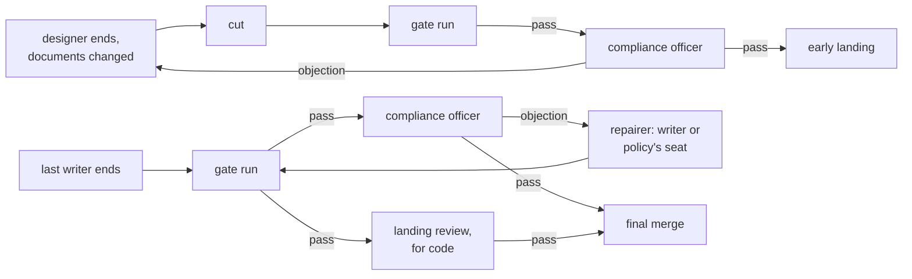

# One compliance officer checks what an item is about to commit against written policies, and design-document style is the first policy

**Status:** None of it is built: `rg -n -i 'compliance' tools config -g '!*.md'` prints nothing. Every owner question is ruled. The [Decision Ledger](#decision-ledger) says which rows are the owner's rulings and which are a designer's decisions. Every cost in this document is unmeasured.

> **In short.** Programs lint what a pattern can match; nothing lints what has to be read. One compliance officer, at each point where an item is about to commit, reads what the commit changes against the written policies that apply to it, and can only object by quoting both the rule and the line.

**Why it matters.** `uvx vantage-check` passes a design document whose question nobody can read: it checks links, anchors and directive syntax, and not whether an option says what a person would see ([Section 1.1](#11-what-the-mechanical-checker-passes)).

**The shape.** Registered compliance policies each name the files they apply to and the text that holds their rules. At each commit point, after the gate passes and before the landing, one read-only compliance officer checks every changed file a policy applies to. Its outcomes are pass, an objection, and cannot judge.

**Cost.** A check is one run of the cheapest model over a policy's text and the changed files. The real cost is the repair when the officer objects. Under the first policy that can be large: an item that adds a line to an old design document must see the whole document brought to the skills, on a designer's turn, before it lands.

**Start at [Section 3](#3-commit-points-policies-and-the-one-officer)**, the commit points and what a policy is. [Section 4](#4-one-rulebook-and-what-keeps-the-officer-from-nitpicking) is how authors and officer read the same rules, and [Section 6](#6-where-it-sits) places it beside the judge and the landing review.

**Needs your ruling:** None.

**Reads with:** [the landing review](./tillr-diff-review.md) (the review of an item's code, which this is in addition to; [Section 6.2](#62-in-addition-to-the-judge-and-the-landing-review)), [early design landing](./tillr-early-design-landing.md) (the designer's early commit, the first commit point), [the graph design](./tillr-graph-is-the-path.md) (node kinds, rules, the identical repeat), [the vocabulary](./tillr-vocabulary.md) (judge, check, refusal, return), [designer sessions](../reference/tillr-designer-sessions.md) (how a Vantage comment reaches a document's designer). No implementation plan is seeded.

---

## 1. The requirement and what happens today

The owner's rulings ([Decision Ledger](#decision-ledger)) set six requirements:

- **One compliance officer, for whatever an item produces:** a new design, a revision of one, a code change, or a code change that also revises a design.
- **It runs where a commit is about to be made:** at the designer's early commit, and again at the item's final merge.
- **It checks compliance with written policies, not logic.** It is in addition to the judge; the purposes differ.
- **The cheapest model, straightforward instructions, a clear task.**
- **A failure goes back,** as a refused change does.
- **Design-document style is the first policy** and will not be the last.

### 1.1 What the mechanical checker passes

The gate runs `uvx vantage-check` on changed documents. It checks links, anchors, frontmatter, directive syntax and the declared stage words. It does not read prose.

A question whose options are the bare labels "Keep.", "Overturn." and "Ask properly.", whose story cites another document's decision codes, and which carries a paragraph of history breaks three rules of the `design-doc` skill and passes `uvx vantage-check` with nothing to fix. That is the gap: most of the skill's rules about a question, a header and a term need a reader.

### 1.2 Who changes design documents

By the owner's ruling (`D-DP2`), only an item's designer changes design documents:

- **The loop's own edits to a document** are not an item's commit and get no officer.
- **Sessions outside the drain** are not items and get no officer.
- **Rulings the owner gives in Vantage** go to the item's designer ([Section 7](#7-a-ruling-given-in-vantage)).
- **A commit that changes code and a design document together**, where it is an item's, is covered at the item's final merge: the officer checks whatever the item changed, whoever wrote it.

## 2. The words

Node, seat, ending, objection, producer, chain, evidence key and identical repeat keep the meanings of [the graph design](./tillr-graph-is-the-path.md#2-the-words). Candidate, gate, judge, refusal, return and trunk keep those of [the vocabulary](./tillr-vocabulary.md#5-the-words). Cut, early landing and document paths keep those of [early design landing](./tillr-early-design-landing.md#2-the-words). Landing review keeps that of [the landing review design](./tillr-diff-review.md#2-the-words). These are added.

| Term | Meaning | What it is not |
| :--- | :--- | :--- |
| **Compliance officer** *(the owner's name for it)* | The one read-only agent node at a commit point that checks the candidate's changed files against the compliance policies that apply to them. It is a node of the vocabulary's judge kind: it evaluates a candidate it did not write | Not the landing review or an item's judge, which ask whether the work is right. Not a gate check, which is a program. Not a person |
| **Commit point** *(coined here)* | A moment at which an item is about to put a commit on the trunk: a candidate has passed the gate and has not landed. There are two: a cut's early landing, and the item's final merge | Not a commit on the item's own branch, which nothing checks |
| **Compliance policy** *(coined here)* | A registered entry that names which files it applies to and which text holds the rules. The vocabulary never uses "policy" bare, so this is always the two words | Not the backend policy, the gate policy or the graph design's policy function. Not the rules themselves, which live in the text it names |
| **Policy text** *(coined here)* | The files a compliance policy names as its rules, read whole by the officer | Not a checklist derived from those files |
| **Design-document style** *(coined here)* | The first compliance policy: design documents, held to the `design-doc` and `vantage-docs` skills | Not a policy about whether a design is right |
| **Design document** *(narrowed here for that policy)* | A Markdown file under the document paths whose frontmatter `stage` is a live proposal: a word this repository maps to `open`, `ready` or `built` | Not a roadmap, not a document whose stage maps to `done`, and not an item's definition inside a document |
| **Finding** *(the landing review's word, with a different shape here)* | One objection: the rule, quoted from the policy text under its heading; the line of the file that breaks it, quoted; and one sentence saying why | Not a preference, a rewrite, or an opinion about the work |

## 3. Commit points, policies and the one officer

### 3.1 The two commit points

The officer runs where an item is about to commit to the trunk, and nowhere else.

| Commit point | The candidate | What the officer sees |
| :--- | :--- | :--- |
| **A designer's early commit** | A cut: the documents a design answer changed, or that carry a question for the owner | Those documents |
| **The item's final merge** | The item's candidate, after its last writer | Everything the item changes on the trunk: code, documents, or both, whoever wrote each file |

A design item and a comment item have only the second: their document is their deliverable. A document that landed early and was not changed again is not in the final candidate, so it is not checked twice.

**The trigger is exact:**

- a gate run on a candidate ended pass;
- the candidate changes at least one file that a registered compliance policy applies to;
- no compliance officer of that candidate has ended.

The policy function then adds one compliance officer before the land attempt, and the land attempt after it passes. An officer runs because an item reached a commit point, which the graph knows. Nothing re-runs because a policy text, a hash or the trunk changed. A candidate the lander replays onto a moved trunk is not checked again, as it is not gated again.

**Which items get no officer** follows from the policies that are registered, with no list of exemptions:

- **An item whose candidate changes no file any registered policy applies to.** With only the first policy registered, that is every item that touches no design document. They gain an officer run when a policy that covers their files is registered.
- **An item that commits nothing:** a comment item that only answers.
- **An automatic revert.** It is not an item's commit: the loop makes it, it is the exact inverse of a landing, and no session wrote it.
- **A candidate whose diff is empty,** which the lander refuses as already on the trunk.

A triage or a rewrite that writes an item's definition is checked only if a policy applies to the file it wrote. Under the first policy an item's definition is not design prose, but one added inside a design document changes that document, and the document is then checked.

### 3.2 What a compliance policy supplies

A compliance policy is a small tracked entry beside tillr's other settings. It supplies five things and no code.

| It supplies | For design-document style |
| :--- | :--- |
| **A name** | `design-document-style` |
| **Which files it applies to:** path patterns, and optionally a condition on the file's frontmatter | The document paths, with a `stage` that is a live proposal |
| **Its policy text:** the files that hold the rules, and where they are read from | The `design-doc` and `vantage-docs` skill files, from the directory the design seat's harness loads |
| **Who repairs an objection:** the session that last wrote the file, or a named seat | The `design` seat ([OQ-DP5](#decision-ledger)) |
| **Two specimens:** a file that must draw an objection and one that must pass, kept as a standing test | A question with bare-label options, and the same question rewritten so each option says what the person would see |

Everything else is the same for every policy: the commit points, the seat, the brief, the shape of a finding, the record. That is all "more than one policy" needs, and nothing more is built for it.

**What a second policy would have to supply** is those five things. As an example of the shape only: a policy for code would name source files by pattern and name, as its text, whatever written conventions the authors of that code already work from. None is designed or proposed here. A policy must be one an officer can apply from the file, its diff and the text alone: a rule that needs the tree, the item or the tests to judge is the judge's and the landing review's ground, and no specimen can show it.

**Degenerate cases.** No policy registered: no officer ever runs. Two policies that apply to one file: the file is checked against each. A policy edited while an officer runs: the running officer keeps what it was claimed with, and the next claim reads the new entry.

### 3.3 One officer for each commit point

The requirement is one officer for anything that flows through it, on the cheapest model, with a very clear task. Those pull apart when one commit holds files under several policies, and this is how they are reconciled.

- **One node.** The item's path shows one compliance officer at each commit point, with one verdict.
- **One policy at a time inside it.** The officer works in parts *(coined here: one fresh session of the officer that holds one policy's text)*. A part is given one policy text and the files of the candidate that policy applies to, and applies only that policy. A cheap model is never asked to hold two rulebooks at once.
- **A part is split again by size.** When one policy's files do not fit the seat's model with its text beside them, they are divided among more parts; a single file too large is read in sections, each with the file's header and outline.
- **The verdict joins the parts.** The officer passes when every part has. Parts are read-only and run together.

With one policy registered, an ordinary commit point is one part.

| Alternative | Verdict |
| :--- | :--- |
| One node, one policy text per part | **Chosen.** One officer in the graph, and each model call has one rulebook and a clear task |
| One session holding every applicable policy and file | Rejected. It is the cheapest model's hardest version of the task, and it grows with every policy registered |
| One node for each policy, or for each file | Rejected. The owner asked for one officer, and a commit point would show a row of them |

### 3.4 What the officer is given

Everything is in the brief or beside it as a file, so the officer needs no search of the tree. Each part is given:

| Given | How |
| :--- | :--- |
| **One policy's text, whole** | Every file the policy names, read at dispatch |
| **Each file, whole** | Its final state, as it stands at the candidate's head |
| **The diff of each file** | The difference in that file between the candidate's base and its head: what the item changed. For a new file it is the whole file |
| **What the gate already checked** | The list of checks that passed, so the officer does not repeat them |
| **Earlier checks of these files in this item** | Each earlier objection and what was answered, when this is not the first |

It is not given the item, its criteria, the rest of the tree, or any author's transcript. Those are for a reader of logic.

**The whole file is held to the policy, every time.** The owner ruled this for design documents ([OQ-DP2](#decision-ledger)), and it is the rule for every policy. An old fault is a finding like a new one, and either keeps the candidate from landing. [Section 4.4](#44-what-the-whole-file-rule-costs) says what that costs.

**The diff is for knowing what just happened, not for narrowing the check.** It serves three ends:

- **The officer reads the change with care.** It knows which lines the item just wrote, and can see what a diff alone shows: a ruling recorded without its question being compacted, or history added where a leaning was replaced.
- **Each finding is marked new or standing.** The loop marks it, by whether the quoted line is one the diff added. The officer's word is not needed for that.
- **A returned objection says where to start.** Findings in the change come first, then the standing ones.

**A fresh session each time.** No part is the session of any author, or a fork of one. A second check of the same candidate's successor starts new and reads the first one's objection and the answer as files.

**Read-only is checked after the fact,** as it is for the judge step: the loop compares the worktree with the head the officer started from, and an officer that changed anything has its verdict discarded.

### 3.5 Which rules, under design-document style

The officer holds the document to what a reader can see on the page. The skills also hold rules about how the author worked and about facts in the tree, and those are not the officer's.

| The officer checks | The officer does not check |
| :--- | :--- |
| A question's shape: the story, a title a person would ask, options that say what the person would see, no internal codes in the story or options, a leaning, no history | Whether the question is the right question, or the leaning is right |
| The header: a thesis in **In short**, the slots, one screen, and a ruling line that names the questions the page really holds | Whether the stage is true of the code |
| Terms: each coined term marked and defined, one word per thing | Whether a term's stated origin is correct |
| Residue: review minutes, track-changes prose, an answered question left in question form, a leaning in several versions | Whether the author ran the searches the skill asks for before compacting |
| Density and structure: lists and tables where the content is one, a section on what is not covered, alternatives with verdicts | Whether a claim about the tree is correct, or the ledger's built column is honest |

The right-hand column stays the designer's duty and the judge's, the landing review's and the audit's ground.

## 4. One rulebook, and what keeps the officer from nitpicking

### 4.1 The policy text is the authors' own rulebook

A designer writes to the `design-doc` and `vantage-docs` skills. Under design-document style the officer is given those same two files, whole, and nothing that restates them. The same holds for any policy: its text is the file the authors already work from.

| Way to give the officer its rules | Verdict |
| :--- | :--- |
| **The authors' own files, whole, in the brief** | **Chosen.** One rulebook. A change to a skill reaches authors and officer together, with no second file to keep true |
| A checklist derived from the skills, kept in this repository | Rejected. It is a second statement of the same rules, and it drifts |
| The checklist at the end of the `design-doc` skill only | Rejected. It is a reminder list for someone who has read the skill. Many of its lines are about how the author worked |
| Rules written into the officer's brief | Rejected. That is the derived checklist under another name |

**Where the first policy's text comes from.** The two skills are not in this repository. They are delivered to every agent's skill directory by a pack the operator's configuration names. The loop reads them, at dispatch, from the directory the design seat's harness loads. A policy text that cannot be read refuses the dispatch and names the file.

**A policy text that changes** changes the next check and nothing else. No file is checked again because the text moved. Each check records the content hash of the text it read, as a record and never as a trigger.

**When the officer cannot apply a rule from the text,** the fix is in the text, where authors gain from it too.

### 4.2 The programs go first

The gate's checks run before the officer and are unchanged. A document with a dead link or a malformed directive is refused there, in seconds, with no model. The officer is told which checks passed and does not look for what they look for. A rule that proves mechanical should move into a program, and then the officer stops looking for it.

### 4.3 What keeps it from nitpicking

A cheap model asked to find faults will find them. Five rules bound what counts, for every policy.

1. **A finding quotes the rule and the line.** The rule is quoted word for word from the policy text, with the heading it sits under. The line is quoted word for word from the file. The loop checks both quotations against the files. A finding whose rule is not in the text, or whose line is not in the file, makes the verdict invalid. The officer cannot object from taste, because taste has no sentence to quote.
2. **Pass is the answer when nothing can be quoted.** There is no score, no "could be clearer" and no list of suggestions. A passing verdict may carry notes; they are kept on the item's page and reach nobody.
3. **No rewriting.** The officer does not propose text.
4. **The repairer may answer instead of changing.** It may keep the text and say why in its report. The next officer reads that reason and weighs it.
5. **The same objection twice goes elsewhere.** [Section 5.3](#53-when-the-officer-and-the-repairer-disagree).

### 4.4 What the whole-file rule costs

The owner's rulings are that the whole document is checked, and that the officer runs at the item's final merge on whatever the item changed. The costs are these.

- **A small change to an old document becomes a rewrite.** An item that adds one paragraph, or marks one decision built, in a standing design is sent every fault the officer can quote anywhere in it. The whole document must be brought to the skills before that item lands.
- **That reaches build items, and pays a designer's turn.** A build worker whose item touches an old design document cannot merge its code until the document passes, and a designer on the item's branch — never the build worker — brings the document to the skills while the worker's code waits ([OQ-DP5](#decision-ledger); [Section 5.2](#52-an-objection)). Each such item pays a designer's turn rather than letting a build model rewrite a design's questions and change its meaning with nobody deciding it.
- **Standing documents fail first.** A document written before the skills reached their current form draws an objection the first time an item touches it.
- **A question for the owner waits for the rewrite.** The check comes before the landing ([Section 6.1](#61-at-both-commit-points-after-the-gate)), so a design answer's change, and a question inside it, reach the trunk only when the whole document passes. The worker that asked does not wait: it is resumed from the item's branch when the design answer ends.
- **Each document pays once.** After its first passing check, a later touch is checked against a document that already passed, and only new faults and rule changes remain.

**What it means for the standing documents.** Every standing design document is brought to the skills the first time an item changes it, and not before. A document no item touches is never checked.

## 5. The outcomes

The officer ends by writing a verdict file that the loop checks: an outcome and, for each policy and file, the findings and which parts of the file were read.

### 5.1 Pass

The land attempt follows. At the final merge of a code landing it follows when the landing review has passed too. The officer retires no criterion and needs no grant: it has no part in whether the item's work is done.

### 5.2 An objection

An objection is one or more findings, grouped by file, those in the change listed first and the standing ones after. It goes back as a gate refusal does: a turn in a session of the item, under a new run id, uncounted and unlimited ([the return rules](../../tools/tillr-drain/drain/returned.go)). Where that session ended with a landing call, the objection is that call's answer: `refused`, at a stage named for the compliance officer, with the policy's name.

- **Who receives it** is the policy's fourth fact. By default it is the session that last wrote the file. A policy may name a seat instead; the findings then go to that seat's session on the item's branch, and to a new one where the item has none. For `design-document-style`, the policy names the `design` seat ([OQ-DP5](#decision-ledger)): only designers change design documents (`D-DP2`), and having a build model rewrite a design's questions to satisfy a check would be the likeliest way for a design to change meaning with nobody deciding it. When a build worker's item touched an old design document and the officer objects at the final merge, the objection goes to a designer on the item's branch while the worker's code waits.
- **Findings across several files** are grouped by the session that repairs them: when one candidate's findings route to more than one session, each session receives the findings on the files routed to it, one turn at a time on the item's branch.
- The repairer changes the file, or keeps it and says why. Either way it commits, and the candidate is built and gated again.
- The next compliance officer is fresh, given the earlier objection and the answer.
- A worker waiting on a design answer does not wait for an early commit's officer. Its resume is claimed when the design answer ends, as [early design landing](./tillr-early-design-landing.md) rules.

### 5.3 When the officer and the repairer disagree

No count stops them, by the owner's standing rule. A new finding is not a disagreement: it is fixed too.

**An identical repeat goes to a diagnosis.** The evidence key of an objection is the sorted set, over its findings, of the policy's name, the heading in the policy text, the file, and the place in the file: for a document, the question's id or the nearest heading. Wording is not in the key. When an objection's key equals an earlier one's in the chain, the loop adds a design answer as diagnosis, in a fresh design-seat session, in place of the return ([the graph design, Section 7](./tillr-graph-is-the-path.md#7-what-stops-repetition)). It reads both objections, the file and the reasons given, and ends in one of these ways:

- An instruction to the repairer that differs from every earlier one.
- An objection that names the tooling, when the officer misreads the text. That files a defect against the officer's brief.
- An objection that names the owner, with a question, when the policy text itself is unclear. The text is his.

The diagnosis never lets the candidate land over the officer's objection. That is the same decision as for the landing review, where the owner ruled that no dismissal mechanism is built ([OQ-DR2](./tillr-diff-review.md#decision-ledger)).

### 5.4 Cannot judge, and failures

None of these is a pass, and each names who moves.

| Case | What happens | Who moves |
| :--- | :--- | :--- |
| The verdict file is missing, or a quotation in it does not match its file | The officer's own session is told what is wrong. A repeat of the same fault files a defect against the tooling | The officer's session, then the tooling |
| A policy text cannot be read | The dispatch is refused and names the file. The candidate waits | The tooling |
| The officer changed the worktree | Its changes are saved and removed, the verdict is discarded, and a fresh officer runs | The loop |
| The seat's backends are all closed | The candidate waits, and the wait names the backend and its reopening. It is never landed unchecked | The backend |
| The backend policy maps nothing to the seat | The loop refuses to start and names the missing seat | Whoever edits the backend policy |
| A registered compliance policy is malformed, or its specimens are missing | The loop refuses to start and names the entry | Whoever edits it |
| The loop is killed during a check | The same node resumes; parts that ended are kept. A check with no valid verdict has no effect | The loop |
| A second land attempt for the same candidate | The recorded check is reused | Nobody |
| The trunk moves during a check | Nothing. The lander replays the change | Nobody |
| Two candidates are ready at once | Each is checked in its own item's worktree. Officers share nothing | Nobody |

The policy text is read, the agent is run and the verdict file is read with no store lock held. The loop is the only writer of the officer's records.

## 6. Where it sits

### 6.1 At both commit points, after the gate

Three owner rulings place it: every design change lands on the trunk right away ([OQ-EL1](./tillr-early-design-landing.md#decision-ledger)), a design change lands only after it passes this check ([OQ-DP1](#decision-ledger)), and the officer runs at the designer's early commit and again at the item's final merge ([OQ-DP4](#decision-ledger)).



| Place | What the owner sees | Verdict |
| :--- | :--- | :--- |
| **After the gate, before the landing, at both commit points** | Everything an item put on the trunk passed the policies that apply to it. A design change, and a question for him, reach the trunk later by one cheap run, and by a repair when the officer objects | **The owner's rulings** |
| After the landing | Work lands as fast as without the officer. For the minutes before a fix lands, the document he opens may be one the officer is sending back | Not taken, by his ruling |
| After the landing, with a revert on an objection | A failing document appears and then disappears, and a question in it with it | Rejected. A revert of documents strips them from the item's branch at its next take-in, and takes the owner's answers with the questions |
| Inside the gate, as a check | Nothing different | Rejected. The gate is programs inside a time budget of seconds |
| Before the gate | Nothing different | Rejected. It would pay a model to read a file the programs are about to refuse |
| At every commit on the item's branch | Nothing different | Rejected. He named the two points, and a branch commit is not yet anything anyone else reads |

**What this costs against "right away".** The officer adds one run of a small model before each landing it applies to, and a chain of objections holds that candidate off the trunk until it ends. With the whole document checked, the first chain on an old document is a rewrite of it. The item shows as draining, with the officer or the repairer as the mover.

### 6.2 In addition to the judge and the landing review

The compliance officer replaces neither the judge an item asks for nor the landing review, and they do not replace it ([OQ-DP4](#decision-ledger)). The owner's ruling that a documents-only landing has no landing review also stands.

| | The judge and the landing review | The compliance officer |
| :--- | :--- | :--- |
| **Asks** | Does the change match what was claimed, are the criteria met, and does anything in the diff look wrong | Does each file follow the written policy that applies to it |
| **Reads** | The diff, the item, its criteria, the tree | Each file, its diff and the policy text |
| **Runs for** | A landing that changes anything other than documents | Any commit point whose candidate changes a file a registered policy applies to |
| **A documents-only landing** | Not reviewed, by the owner's ruling | Checked |
| **A code landing** | Reviewed | Checked too, at the same time, when a policy applies to a file in it; the merge follows when both pass |
| **Criteria** | Marks them met | Touches none |
| **Model** | Set by the landing review design | The cheapest |

A documents-only landing therefore still gets no review of its logic. It gets a second, cheaper reader with a different purpose.

## 7. A ruling given in Vantage

By the owner's ruling (`D-DP2`), a ruling he gives in a Vantage comment is recorded by the item's designer. That designer's commit is then checked like any other, so recorded rulings and compactions are covered with nothing added here.

Two things have to be true for that, and neither is part of this design:

- **Comments must be taken by the loop.** The path from a Vantage comment to the session that last worked on the document is [designer sessions](../reference/tillr-designer-sessions.md). A repository whose `.tillr.toml` configures no comment intake takes none; this repository's does not.
- **A ruling spoken to a session outside the drain has no route to a designer.** What replaces that practice for a ruling given in conversation is not designed.

## 8. The brief

This is what every part of a compliance officer is asked. The loop fills in the policy's name, its text and the file paths. It is the same for every policy.

```text
You are a compliance officer. You are checking the files below against one
written policy, also below. You did not write the files. Nothing you do may
change this worktree.

You are checking whether each file follows the policy. You are not checking
whether the work is right, whether its facts are true, or whether you would
have decided differently.

1. Read the policy text in full.
2. Read each file in full, in its final state. All of it is held to the
   policy, whoever wrote each part and whenever.
3. Read each file's diff: what was just changed. Read those lines with
   particular care. A fault outside the diff is still a finding.

Object only when you can quote both of these, word for word:
- a rule from the policy text, with the heading it is under;
- the line of the file that breaks it.

Do not object to anything you cannot quote a rule for. Do not object to
rules about how the author worked or about anything outside the file. The
checks listed below already passed; do not repeat them. Do not rewrite
anything and do not suggest wording.

If an earlier check is attached, read the answer given to it. A reason
given there is to be weighed, not ignored.

Write your verdict to the file named below: for each file, pass or
objection; each finding with the heading, the quoted rule, the quoted line
and one sentence saying why; and which parts of the file you read.
A file passes when you have no finding for it.
```

## 9. The record, and how to tell it works

**What is recorded.** Each compliance officer is a node of the item's graph and a run with its own id. Its record holds the commit point and the candidate, and for each policy and file: the content hash of the policy text, the outcome, and each finding in full, marked new or standing. It also holds the seat, backend and model, the spend, and for an objection the runs it was returned to.

**Where it is read.**

- **The item's page** shows one compliance officer at each commit point with the rest of the item's path: when, which policies and files, the outcome, and the text of each finding.
- **`tillr drain why`** on a waiting item says which holds: a compliance officer is running; one objected and a named session has it; a diagnosis has a repeated objection; or the officer waits on a closed backend.
- **A daily count,** by policy, of checks by outcome, of findings new and standing, of objections after which the file changed and after which it did not, and of invalid verdicts. The standing count is the backlog the whole-file rule is working through.

**How to tell it works.**

- Each policy's two specimens behave as registered. For design-document style: given the question with bare-label options, the officer objects and quotes the rule that options say what the person would see; given that question rewritten, it does not object to it.
- The share of objections after which the file did not change stays small. A large share means the officer is wrong often, and the brief or the policy text is what gets fixed.
- The owner stops meeting, on the trunk, a document an item landed that breaks the skills on its face.

## 10. What this does not cover

- **A second compliance policy.** The mechanism takes one; none is designed or proposed, for code or anything else.
- **Changes not made by an item:** the loop's own edits, sessions outside the drain, and the owner's own edits (`D-DP2`).
- **Documents no item touches.** They are never checked ([Section 4.4](#44-what-the-whole-file-rule-costs)).
- **Roadmaps.** A roadmap is not a design document, and the tillr roadmap is too large for a cheap model to read with the skills beside it.
- **An item's definition as prose,** which the prose guide governs, with its own check and rewrite.
- **Whether the work is right, or its facts true.** Not the officer's question.
- **Whether a decision is presented as the owner's ruling when it is a designer's.** That fault is real and the skills do not state it as a rule, so the officer cannot quote one. It belongs in the skill first.
- **What the skills say.** They are not in this repository. This design reads them.

## 11. Cost

**No compliance officer has run, so nothing here is measured.**

- **One part** under design-document style reads the two skill files, the document, its diff and the brief, and writes a short verdict. A second document in the same part adds its own size and not the skills again.
- **Each further policy adds its own text** to every commit point it applies to, and nothing to the others.
- **An officer that opens other files costs several times this.** The brief gives it everything, and nothing stops it reading more.
- **The repair is the real cost.** Every objection on a design document goes to the `design` seat, including when a build worker's item touched the document ([OQ-DP5](#decision-ledger)), so each repair pays a designer's turn on the dearest model, which costs many times a check. A build item with no designer session yet starts a cold one, and bringing a whole old document to the skills is a larger turn than answering a comment.
- **The wait.** Each candidate the officer applies to reaches the trunk one small-model run later, and a gate run and a check later again for each objection. A build item that touches an old design document waits for a designer to repair that document before its code merges.

There is no spend target ([OQ-GP3](./tillr-graph-is-the-path.md#decision-ledger)), so cost informs the seat's model and gates nothing. The first build step measures a real check and records it here.

## 12. Alternatives considered

| Alternative | Verdict |
| :--- | :--- |
| A check that follows only a designer's change to a design document | Rejected by the owner's ruling ([OQ-DP4](#decision-ledger)): the officer checks whatever an item is about to commit |
| A node built for design documents only, with the two skills named in its code | Rejected by the owner's ruling ([OQ-DP3](#decision-ledger)): this policy will not be the last |
| A policy as a program or a hook, so each can bring its own logic | Rejected. A linter that needs code is a gate check. The officer's whole job is the part no program does, and five supplied facts are enough for it |
| Fold compliance into the judge or the landing review | Rejected by the owner's ruling ([OQ-DP4](#decision-ledger)): the purposes differ. It would also put a policy question on a dearer model |
| Have the author run a checklist on its own work before it ends | Rejected as the mechanism. The designer already loads the skills. A reader with no memory of writing is the point |
| A sub-agent of the author | Rejected. Such work is a node in the graph, visible and recorded |
| A new rule family in `vantage-check` | Not instead. Whether an option says what a person would see is not a pattern a program matches |
| Sample files and check those | Rejected. The owner asked for the check at each commit point, and a check is cheap |
| Stop after a number of objections | Refused by the owner's standing rule against counts |

## 13. Build order

Steps 1 to 3 wait on no ruling. The files named are where the behavior lives today; the planner confirms each against the tree. These are build steps in prose; none is filed.

1. **Run the officer at an item's final merge.**
   - *Changes:* the registration of compliance policies and the entry for design-document style, naming the `design` seat as its repairer ([OQ-DP5](#decision-ledger)), with its two specimens; a `compliance` seat in each backend policy, read-only, on the scout seat's backend; the trigger of [Section 3.1](#31-the-two-commit-points) for a candidate that has passed the gate; the parts of [Section 3.3](#33-one-officer-for-each-commit-point); the brief of [Section 8](#8-the-brief) with the policy text, each whole file, its diff and the gate's passed checks; the verdict file and the loop's check of its quotations. A design answer that lands by itself as its own candidate is covered by this step.
   - *Files:* [the judge step](../../tools/tillr-drain/drain/judge.go) and its tests; [the loop](../../tools/tillr-drain/drain/loop.go); the policies under `config/tillr/`; [the drain's guide](../../tools/tillr-drain/README.md).
   - *Done when:* a test candidate holding a question with bare-label options is kept from landing, with a finding that quotes the rule and the line; a code candidate that also touches a design document whose only fault is in text it did not change is kept from landing too, with that finding marked standing; a clean one lands; a candidate that changes no covered file starts no officer; a finding whose quoted rule is not in the policy text is refused as invalid; a second policy registered in a test, with its own text and specimens, runs with no code change, in a part of its own; a second land attempt starts no second check; and one real check has run, with its spend recorded in [Section 11](#11-cost).
2. **Return an objection to a session of the item.**
   - *Changes:* the retained-session return for the officer's objection, to the session that last wrote each file or to the policy's named seat; the evidence key; the earlier objection and the answer given to the next officer; the diagnosis on an identical repeat.
   - *Files:* [the return rules](../../tools/tillr-drain/drain/returned.go), [the retained session](../../tools/tillr-drain/drain/worker_session.go) and their tests.
   - *Waits on:* step 1. It shares the return route with the landing review's second step; whichever is built first carries the shared part.
   - *Done when:* a test shows the objection arriving as a turn in the writing session under a new run id; with a seat named in the policy (as `design-document-style` names `design`), an objection on a design document touched by a build worker arrives at a `design` session on the item's branch instead of the worker's; a second objection with the same key but different words goes to a diagnosis; one that differs goes back; no count is read on the route.
3. **Show the checks.**
   - *Changes:* the officer's row on the item's page; the states in `tillr drain why`; the daily count by policy.
   - *Files:* `tools/tillr-view`, `tools/tillr-loop` and their tests.
   - *Waits on:* step 1.
   - *Done when:* an item page shows a finding's text, and each registered policy's specimens are a standing test of the brief.
4. **Run the officer at the designer's early commit, as a node the policy function adds.**
   - *Changes:* the rule rows of [Section 14](#14-amendments-owed), for the cut and for the final merge.
   - *Waits on:* the graph design's executor and policy function, and the early landing's cut.
   - *Done when:* the policy function's table test covers those rows, and a cut whose document fails does not land.

## 14. Amendments owed

These documents are owed the following when the officer is built.

- **[The vocabulary](./tillr-vocabulary.md):**
  - A row for **compliance officer** in [its checking and landing table](./tillr-vocabulary.md#54-checking-and-landing): the judge-kind node at a commit point that checks files against compliance policies.
  - Rows for **compliance policy** and **commit point**, and the first's addition to the row that says "policy" is never used bare.
  - The **Judge** row is unchanged in meaning. It gains the note that the landing review and the compliance officer are both nodes of that kind, so "judge" alone names neither.
  - The **Node** and **Session** rows say a node has at most one run and a session is produced by one node; the officer's parts are several sessions of one run, which those rows are owed a word for.
- **[The graph design](./tillr-graph-is-the-path.md):**
  - [Section 5.3](./tillr-graph-is-the-path.md#53-the-starting-rule-table): the rows that follow a passed gate run add a compliance officer on a candidate that carries a file a registered policy applies to, and the land attempt after it passes; a new row returns an officer's objection.
  - [Section 5.2](./tillr-graph-is-the-path.md#52-permitted-facts): the registered compliance policies are read when a rule is evaluated, as the workflow files are; a change to one is not a fact that adds a node.
  - [Section 7](./tillr-graph-is-the-path.md#7-what-stops-repetition): the compliance officer's evidence key.
  - The seats it would declare gain `compliance`.
- **[Early design landing](./tillr-early-design-landing.md):** a cut has no landing review; it gains the compliance officer, and a cut lands only after it passes.
- **[The landing review](./tillr-diff-review.md):** its diagram and its table of which landings are reviewed gain the compliance officer beside the review at a code landing's final merge; a code landing follows when both pass.
- **The backend policies' seat list and purposes,** with the build.

## 15. Risks

| Risk | Mitigation |
| :--- | :--- |
| The cheap model objects to things that are fine, and dear turns are spent answering | A finding must quote a rule and a line, and both are checked. The daily count shows objections after which nothing changed. The model is one line of the backend policy |
| The cheap model passes everything | Each policy's specimens are a standing test. The same count shows an officer that never objects |
| The skills are long, and a small model applies them unevenly | Measured in step 1 before anything is built on it. The remedy is a clearer skill or a stronger seat, not a second rulebook |
| A build item is held from merging its code, and pays a designer's turn, for the state of an old design document it barely touched | Accepted with the owner's rulings ([OQ-DP2](#decision-ledger), [OQ-DP4](#decision-ledger), [OQ-DP5](#decision-ledger)). A designer repairs the document on the item's branch while the code waits, and the item is visible as draining, with its spend |
| A rewrite of an old document to pass the officer changes what the design says | `design-document-style` routes every objection to the `design` seat so a build model never rewrites a design's questions to satisfy a check ([OQ-DP5](#decision-ledger)). The officer still cannot judge meaning, so the daily count of large returned turns shows where to look |
| A candidate is held off the trunk while officer and repairer disagree | The identical repeat sends it to a diagnosis |
| The officer's backend is closed, and nothing a policy applies to lands | The seat lists more than one backend, as every seat may. The wait names the backend |
| Authors write to please the officer, not the reader | The officer can only cite the policy text, so pleasing it is following the text. A rule that produces bad work is fixed in the text |
| Policies multiply until every landing waits on a long check | Each policy is a tracked, reviewed entry with specimens. Parts run together, and the daily count is by policy |

## Decision Ledger

`D-DP1`, `D-DP2`, `D-DP13` and the five `OQ-DP` rows are the owner's rulings. Every other row is a designer's decision: engineering detail settled from the owner's rulings. None of those waits on him, and he may overturn any row at any time. None is built.

| ID | Decision | Date | Settled in | Built |
| :--- | :--- | :--- | :--- | :--- |
| `D-DP1` | **Owner ruling.** Every change to a design document is followed by a check, on a cheap model, of compliance with a written policy, not of logic: whether the document adheres to the skills. A failure is sent back as a refused change is. | 2026-11-18, owner | [Section 1](#1-the-requirement-and-what-happens-today) | — |
| `D-DP2` | **Owner ruling.** Only an item's designer changes design documents. The loop's own edits to documents and sessions outside the drain are to end; rulings given in Vantage go to the item's designer; the owner does not edit design documents. | 2026-11-18, owner | [Section 1.2](#12-who-changes-design-documents) | — |
| OQ-DP1 | **Owner ruling: a design document lands only after it passes the check.** Meeting an unreadable document on the trunk is what the check prevents, and only checking before the landing prevents it. Landing first with the check after is not taken. | 2026-11-18, owner | [Section 6.1](#61-at-both-commit-points-after-the-gate) | — |
| OQ-DP2 | **Owner ruling: the whole document, every time.** The first item to touch an old document must bring all of it to the rules before its change lands. Checking only what changed is not taken, and neither is filing old faults as a separate queue item. | 2026-11-18, owner | [Section 4.4](#44-what-the-whole-file-rule-costs) | — |
| OQ-DP3 | **Owner ruling: it is the compliance officer, and it is general.** Design-document style is the first policy and will not be the last: "This is basically linting, but this is linting for agent against policies, hence compliance officer." | 2026-11-18, owner | [Section 3.2](#32-what-a-compliance-policy-supplies) | — |
| OQ-DP4 | **Owner ruling: one compliance officer at each commit point, for most items.** One officer that knows how to run compliance for any type of thing that flows through it, run at the point a commit is about to be made: at the designer's early commit and again at the item's final merge. It is in addition to the judge, with a different purpose, on the cheapest model with straightforward instructions and a clear task. A worker's edit to a design document is therefore checked at the final merge; barring workers from design documents is not taken. | 2026-11-18, owner | [Section 3.1](#31-the-two-commit-points) | — |
| OQ-DP5 | **Owner ruling: a designer repairs a design document that fails the check, including when a build worker's item touched it.** Only designers change design documents, and a build model rewriting a design's questions to satisfy a check is the likeliest way for a design to change meaning with nobody deciding it. The price is a designer's turn, unmeasured. The `design-document-style` policy therefore names the `design` seat as its repairer; returning the objection to the build worker is not taken. | 2026-11-19, owner | [Section 5.2](#52-an-objection) | — |
| `D-DP3` | **Designer's decision.** One compliance officer node at each commit point, on one `compliance` seat that each backend policy maps to its cheapest backend. Inside it, one fresh session per policy, split again by size; the verdict joins them. It is a node of the judge kind, not a new kind. **Rejected:** one session holding every policy; a node for each policy or file; a seat for each policy. | 2026-11-18, designer | [Section 3.3](#33-one-officer-for-each-commit-point) | — |
| `D-DP4` | **Designer's decision.** The trigger is a passed gate run on a candidate that changes a file a registered policy applies to, at a cut's early landing or the item's final merge. Which items get no officer follows from that and from what is registered; there is no exemption list. An automatic revert gets none. **Rejected:** checking when a file's hash or a policy text changes; checking each commit on the item's branch. | 2026-11-18, designer | [Section 3.1](#31-the-two-commit-points) | — |
| `D-DP5` | **Designer's decision.** A policy's rules are the authors' own files, whole, read at dispatch; for the first policy, the two skill files from where the designer's harness loads them. No checklist is derived. **Rejected:** a checklist in this repository; rules written into the brief. | 2026-11-18, designer | [Section 4.1](#41-the-policy-text-is-the-authors-own-rulebook) | — |
| `D-DP6` | **Designer's decision.** A finding quotes its rule and its line word for word, and the loop checks both; a finding that fails makes the verdict invalid. The officer proposes no text. **Rejected:** free-text findings; a score. | 2026-11-18, designer | [Section 4.3](#43-what-keeps-it-from-nitpicking) | — |
| `D-DP7` | **Designer's decision.** The officer checks only what can be seen in the file. Facts about the tree and how the author worked are not its rules, and a policy that needs them cannot be registered. **Rejected:** giving it the tree, which makes it a second landing review. | 2026-11-18, designer | [Section 3.5](#35-which-rules-under-design-document-style) | — |
| `D-DP8` | **Designer's decision.** An objection returns as a gate refusal does, by default to the session that last wrote the file, or to the seat the policy names (for design documents, `design` per [OQ-DP5](#decision-ledger)). An identical repeat, keyed by policy, heading, file and place, goes to a diagnosis on the design seat, which may not let the candidate land. **Rejected:** a count; the finding's wording as the key. | 2026-11-18, designer | [Section 5](#5-the-outcomes) | — |
| `D-DP9` | **Designer's decision.** At a code landing's final merge the compliance officer and the landing review run together, and the merge follows when both pass. A documents-only landing still gets no landing review. **Rejected:** one after the other, which adds a wait for no gain since both are read-only. | 2026-11-18, designer | [Section 6.2](#62-in-addition-to-the-judge-and-the-landing-review) | — |
| `D-DP10` | **Designer's decision.** The first policy applies to a Markdown file under the document paths whose stage is a live proposal, whoever changed it. Roadmaps, finished or replaced documents and item definitions as prose are outside it. **Rejected:** every Markdown file under `docs/`. | 2026-11-18, designer | [Section 2](#2-the-words) | — |
| `D-DP11` | **Designer's decision.** A compliance policy is a tracked entry of five facts: a name, the files it applies to, its policy text, who repairs an objection, and two specimens. It carries no code, and the commit points, the brief, the finding and the record are shared. **Rejected:** a policy as a program or hook; a policy that sets its own model or brief; a policy scoped by the seat that made the change, which the ruling on [OQ-DP4](#decision-ledger) removes. | 2026-11-18, designer | [Section 3.2](#32-what-a-compliance-policy-supplies) | — |
| `D-DP12` | **Designer's decision.** Every policy's officer is given the final file and its diff, holds the whole file to the policy, and runs after the gate and before the landing; no policy may choose otherwise. The loop, not the officer, marks a finding new or standing from the diff, and both kinds keep the candidate from landing. **Rejected:** a setting for each policy, before any second policy exists to need it. | 2026-11-18, designer | [Section 3.4](#34-what-the-officer-is-given) | — |
| `D-DP13` | **Owner ruling.** The compliance officer sees the final state of the document as well as its diff. The whole file is still held to the policy ([OQ-DP2](#decision-ledger)); the diff tells the officer and the repairer what just changed. | 2026-11-18, owner | [Section 3.4](#34-what-the-officer-is-given) | — |
