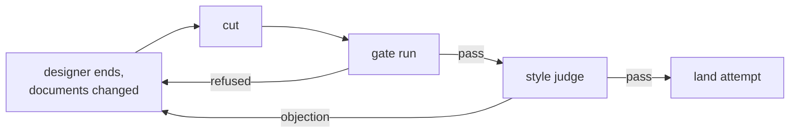

# A cheap agent reads every design document a designer changes and holds it to the writing skills before the owner meets it

**Status:** 2026-11-18. A proposal; none of it is built. Written to the owner's request of 2026-11-18 and his ruling of the same evening on who changes design documents, both quoted in [Section 1](#1-the-request-and-what-happens-today). Facts about the tree, the skills, the checker and the prices were gathered by a scout on 2026-11-18 with the trunk between `bd145e311` and `59f5bee8b`, and I checked the ones this design rests on; what is an estimate or was not verified is marked where it appears. The `D-DP` rows of the ledger from `D-DP3` on are a designer's decisions and await the owner's review.

> **In short.** The mechanical checker proves a design document renders; nothing checks that it can be read. One cheap agent, given the writing skills themselves and the changed document, can check that for about a cent, and its findings can go back to the designer the way a gate refusal does.

**Why it matters.** On 2026-11-18 the owner opened a document an agent had written and found its first question unreadable. `uvx vantage-check` had passed that document, and passes it still ([Section 1](#1-the-request-and-what-happens-today)).

**The shape.** One read-only node, the style judge, after a designer's document change passes the gate and before it lands. It is given the two skills whole, the document whole, and what the designer changed. Its outcomes are pass, an objection, and cannot judge.

**Cost.** An estimated half a cent to one cent per document on the cheapest model. The real cost is the designer's turn when the judge objects, which is about a hundred times that, and one more wait before a design change reaches the trunk.

**Start at [Section 4](#4-one-rulebook-and-what-keeps-the-judge-from-nitpicking)**, how authors and judge read the same rules and what stops a loop of small complaints. [Section 6](#6-where-it-sits) places it beside early design landing and the landing review.

**Needs your ruling:** [OQ-DP1](#OQ-DP1), [OQ-DP2](#OQ-DP2), [OQ-DP3](#OQ-DP3).

**Reads with:** [the landing review](./tillr-diff-review.md) (the review of an item's code, which this is not; [Section 6.2](#62-beside-the-landing-review) says how the two fit), [early design landing](./tillr-early-design-landing.md) (how a designer's documents reach the trunk), [the graph design](./tillr-graph-is-the-path.md) (node kinds, rules, the identical repeat), [the vocabulary](./tillr-vocabulary.md) (judge, check, refusal, return), [designer sessions](./tillr-designer-sessions.md) (how a Vantage comment reaches a document's designer). No implementation plan is seeded.

---

## 1. The request and what happens today

The owner, on 2026-11-18 at about 9:45 PM Eastern, cleaned from dictation:

> I want to take our judging infrastructure further and every change to a design doc, which I believe is basically only from designers — you'll tell me if other things change them and if it's worth applying there too — I would like to follow it up with a style guide adherence judge node running on a cheap model, Luna or whatever that class of things. We'll call it like a style adherence judge or like a compliance officer, I don't know what it is. Like we're complying to a policy, not to logic and stuff, and it should just check to see that the design doc adheres to our skills and send it back just like a landed change if it doesn't work.

He was then told who else changes design documents today, and ruled at about 10 PM:

> the loop itself deletes markers after landings, but we're getting rid of those, so that's out. Sessions outside the drain... Yes, but we're going to stop that. I don't want to do that anymore, so don't have to worry about that. Ruling recordings after your Vantage comments, those are supposed to go to the designers for the item, so that's handled. Me by hand, I don't know what you're talking about. I don't edit design docs.

The requirement, then:

- **It follows every change a designer makes to a design document.** A designer here is a node of an item, on the design seat, inside the drain. Nothing else is to change design documents, so nothing else is covered.
- **It is a node in the item's graph, on a cheap model.**
- **It checks policy, not logic.** Does the document follow the writing skills. Whether the design is right is not its question.
- **A failure goes back to the author.** The findings return to the designer's own session, as a refused change does.

### 1.1 What the mechanical checker passes

The gate already runs `uvx vantage-check` on changed documents. It checks links, anchors, frontmatter, directive syntax and the declared stage words. It does not read prose.

The document the owner opened was [the provenance review](../tillr/decision-provenance-review.md). Its first question, as it stood at `8b0859504`, had three options that were labels: "Keep.", "Overturn." and "Ask properly." Its story cited three decision codes of another document, and a paragraph headed "Who decided" carried history. The design-doc skill forbids each of those in a question. `uvx vantage-check` on the document printed `1 file checked, nothing to fix` (version 0.12.0, run 2026-11-18). The question was rewritten by hand in `be1f5ad27`, after the owner had met it.

That is the gap. Of the 62 rules the scout drew from the design-doc skill, it marked 10 as checked by the checker, 4 more as partly checked, 4 as checked by the skill's own status script, and the rest as needing a reader.

### 1.2 Who changes design documents today

This is the evidence the owner asked for. It measures the distance between today and his ruling; it is not a list of things this design covers.

`git log --since=2026-11-10 -- docs/design docs/tillr` held 687 commits on 2026-11-18, and 685 of them changed a Markdown file there.

| Source | Count | How it was told apart |
| :--- | ---: | :--- |
| The loop removing an item's marker after a landing | 32 | The subject `chore: retire landed document block` |
| Commits that change code and a design document together | 154 | A changed path outside `docs/`, and a design document other than the roadmap; the 32 above excluded |
| Commits that change code and only the roadmap | 57 | The same, with the roadmap as the only document |
| Documents-only commits | 442 | Every changed path under `docs/`; the 8 documents-only retirements excluded |

What the table cannot say is which documents-only commits were a designer inside an item and which were a session outside the drain. Every commit carries one author identity, and landed commits name no item since `cd68c87e3`. The store's landing records could separate them, and were not read for this design.

Read against the ruling:

- **The loop's marker removal** ends when the markers do, by his ruling.
- **Sessions outside the drain** wrote an unknown share of the 442, this document among them. They stop, by his ruling.
- **Rulings he gives in Vantage** go to the item's designer, by his ruling. What that needs is in [Section 7](#7-a-ruling-given-in-vantage).
- **The 154 commits that change code and a design document together** were not on the list he ruled on. Some are workers correcting a design's status or ledger as they build it. A worker is not a designer, so this design does not check those edits ([Section 10](#10-what-this-does-not-cover)).

## 2. The words

Node, seat, ending, objection, producer, chain, evidence key and identical repeat keep the meanings of [the graph design](./tillr-graph-is-the-path.md#2-the-words). Candidate, gate, judge, refusal, return and trunk keep those of [the vocabulary](./tillr-vocabulary.md#5-the-words). Cut, early landing and document paths keep those of [early design landing](./tillr-early-design-landing.md#2-the-words). Landing review keeps that of [the landing review design](./tillr-diff-review.md#2-the-words). These are added.

| Term | Meaning | What it is not |
| :--- | :--- | :--- |
| **Style judge** *(a working name, taken from the owner's first candidate; the name is his to choose in [OQ-DP3](#OQ-DP3))* | A judge node, in the vocabulary's sense of a read-only agent that evaluates a candidate it did not write, whose one question is whether a changed design document follows the writing skills | Not the landing review, which asks whether code matches what was claimed. Not a gate check, which is a program |
| **Design document** *(narrowed here for this check)* | A Markdown file under the document paths whose frontmatter `stage` is a live proposal: a word this repository maps to `open`, `ready` or `built` | Not a roadmap, not a document whose stage maps to `done`, and not an item's block inside a document |
| **Writing skills** | The `design-doc` and `vantage-docs` skill files as delivered to the designer's harness on the machine that runs the node | Not a checklist derived from them, and not the repository's own guide |
| **Finding** *(the landing review's word, with a different shape here)* | One objection: the rule, quoted from a skill under its heading; the line of the document that breaks it, quoted; and one sentence saying why | Not a preference, a rewrite, or an opinion about the design |

## 3. When it runs and what it reads

### 3.1 The trigger

The trigger is an event with a known cause, and it is exact:

- a gate run on a candidate ended pass;
- the candidate changes at least one design document that a design-seat node of the item last wrote;
- no style judge of that document in that candidate has ended.

The policy function then adds one style judge for each such document, before the land attempt. They are read-only and run together. The land attempt is added when every one has passed. That position is my recommendation; the owner chooses it in [OQ-DP1](#OQ-DP1).

It runs because a designer changed a design document, which the graph knows: each node records the head it started from and the head it left. Nothing re-runs because a skill file, a hash or the trunk changed. A candidate the lander replays onto a moved trunk is not judged again, as it is not gated again.

| Designer's node | Its candidate | Judged |
| :--- | :--- | :--- |
| A design answer that changed documents | The cut of those documents | Yes |
| A design answer that wrote a question for the owner | The cut that carries the question | Yes |
| A design item's own document | The item's candidate | Yes |
| A comment item at a document's desk | The item's candidate | Yes |
| A design answer whose documents ride in the item's own landing, because the worker finished first | The item's candidate | Yes, beside the landing review |
| A triage or a rewrite, which write an item's block | Either | No. A block is not design prose, and the prose guide has its own check and its own rewrite |
| A worker's edit to a design document | The item's candidate | No ([Section 10](#10-what-this-does-not-cover)) |

**Degenerate cases.** A candidate that changes no design document gets no judge. A document the designer deleted gets none. A new document is changed in full, so all of it is judged. A document changed by both a designer and a worker is judged on the designer's changes.

### 3.2 What the judge is given

Everything is in the brief or beside it as a file, so the judge needs no search of the tree.

| Given | How |
| :--- | :--- |
| **The two skills, whole** | The `design-doc` and `vantage-docs` skill files, read at dispatch from where the designer's harness loads them |
| **The document, whole** | As it stands at the candidate's head |
| **What the designer changed** | The difference in that document between the candidate's base and its head |
| **What the gate already checked** | The list of document checks that passed, so the judge does not repeat them |
| **Earlier judgements of this document in this item** | Each earlier objection and what the designer answered, when this is not the first |

It is not given the item, its criteria, the code, or the designer's transcript. Those are for a reader of logic.

**A fresh session each time.** The judge is never the designer's session or a fork of it. A second judgement of the same document starts new and reads the first one's objection and the designer's answer as files.

**Read-only is checked after the fact,** as it is for the judge step today: the loop compares the worktree with the head the judge started from, and a judge that changed anything has its verdict discarded.

**A document too large for the seat's model** with the skills beside it is judged on its changed sections, its header and its outline, and the record says so. No tillr design is near that size today: the largest is about 30,000 tokens against a 272,000-token window on the cheapest model here (estimates at four bytes per token).

### 3.3 Which rules

The judge holds the document to what a reader can see on the page. The skills also hold rules about how the author worked and about facts in the tree, and those are not the judge's.

| The judge checks | The judge does not check |
| :--- | :--- |
| A question's shape: the story, a title a person would ask, options that say what the person would see, no internal codes in the story or options, a leaning, no history | Whether the question is the right question, or the leaning is right |
| The header: a thesis in **In short**, the slots, one screen, and a ruling line that names the questions the page really holds | Whether the stage is true of the code |
| Terms: each coined term marked and defined, one word per thing | Whether a term's stated origin is correct |
| Residue: review minutes, track-changes prose, an answered question left in question form, a leaning in several versions | Whether the author ran the searches the skill asks for before compacting |
| Density and structure: lists and tables where the content is one, a section on what is not covered, alternatives with verdicts | Whether a claim about the tree is correct, or the ledger's built column is honest |

The right-hand column is not checked by anyone under this design. It stays the designer's duty and the landing review's and audit's ground.

## 4. One rulebook, and what keeps the judge from nitpicking

### 4.1 The skills are the policy

The designer writes to the `design-doc` and `vantage-docs` skills. The judge is given those same two files, whole, and nothing that restates them.

| Way to give the judge its rules | Verdict |
| :--- | :--- |
| **The skill files themselves, whole, in the brief** | **Chosen.** One rulebook. A change to a skill reaches authors and judge together, with no second file to keep true. It costs about 33,000 tokens a judgement, a third of a cent on the cheapest model |
| A checklist derived from the skills, kept in this repository | Rejected. It is a second statement of the same rules, and it drifts. The `vantage-docs` skill records that its own restatement of the style guide had drifted and was deleted for that reason |
| The checklist at the end of the `design-doc` skill only | Rejected. It is a reminder list for someone who has read the skill. Many of its lines are about how the author worked |
| Rules written into the judge's brief | Rejected. That is the derived checklist under another name |

**Where the files come from.** The two skills are not in this repository. They are delivered to every agent's skill directory from the `matt-craft` pack named in [the shared yolo configuration](../../config/yolo-jail/config.toml). The loop reads them, at dispatch, from the directory the design seat's harness loads. A skill file that cannot be read refuses the dispatch and names the file, as the prose rewrite does for its guide.

**A skill that changes** changes the next judgement and nothing else. No document is judged again because a skill moved. Each judgement records the content hash of the skill files it read, as a record and never as a trigger.

**The closing list of rules in the `design-doc` skill is not enough for a new reader of prose, and that is a fact about the skill.** If the judge proves unable to apply a rule from the skill's text, the fix is in the skill, where authors gain from it too.

### 4.2 The programs go first

The gate's document check runs before the judge and is unchanged. A document with a dead link or a malformed directive is refused there, in seconds, with no model. The judge is told which checks passed and does not look for what they look for.

### 4.3 What keeps it from nitpicking

A cheap model asked to find faults will find them. Six rules bound what counts.

1. **A finding quotes the rule and the line.** The rule is quoted word for word from a skill, with the heading it sits under. The line is quoted word for word from the document. The loop checks both quotations against the files. A finding whose rule is not in the skill, or whose line is not in the document, makes the verdict invalid. The judge cannot object from taste, because taste has no sentence to quote.
2. **Only what the designer changed.** A finding's line must be one the designer added or changed. The one exception is the header and frontmatter, when the change made them untrue: a new question the ruling line does not name. Old faults elsewhere in the document are not findings. Whether that is the right boundary is the owner's, in [OQ-DP2](#OQ-DP2).
3. **Pass is the answer when nothing can be quoted.** There is no score, no "could be clearer" and no list of suggestions. A passing verdict may carry notes; they are kept on the item's page and reach nobody.
4. **No rewriting.** The judge does not propose text. The designer wrote the document and fixes it.
5. **The designer may answer instead of changing.** It may keep the text and say why in its report. The next judge reads that reason and weighs it.
6. **The same objection twice goes elsewhere.** [Section 5.3](#53-when-the-judge-and-the-designer-disagree).

## 5. The outcomes

The judge ends by writing a verdict file that the loop checks: an outcome, the findings, and whether it read the whole document or its changed sections.

### 5.1 Pass

The land attempt follows once every style judge of the candidate has passed. The judge retires no criterion and needs no grant: it has no part in whether the item's work is done.

### 5.2 An objection

An objection is one or more findings. It goes back to the session that last wrote the document, with the findings as text, as a gate refusal does: a turn in the same session, under a new run id, uncounted and unlimited ([the return rules](../../tools/tillr-drain/drain/returned.go)). Where the designer ended with a landing call, the objection is that call's answer: `refused`, at a stage named for the judge.

- The designer changes the document, or keeps it and says why. Either way it commits, and the candidate is built and gated again.
- The next style judge is a fresh session, given the earlier objection and the answer.
- A worker waiting on a design answer does not wait for this. Its resume is claimed when the design answer ends, as [early design landing](./tillr-early-design-landing.md#6-always-or-only-with-a-question) rules; the judge holds only the documents' landing.

### 5.3 When the judge and the designer disagree

No count stops them, by the owner's standing rule. A new finding is not a disagreement: the designer fixes that too.

**An identical repeat goes to a diagnosis.** The evidence key of an objection is the sorted set, over its findings, of the skill heading and the place in the document: the question's id, or the nearest heading. Wording is not in the key. When an objection's key equals an earlier one's in the chain, the loop adds a design answer as diagnosis, in a fresh design-seat session, in place of the return ([the graph design, Section 7](./tillr-graph-is-the-path.md#7-what-stops-repetition)). It reads both objections, the document and the designer's reasons, and ends in one of these ways:

- An instruction to the designer that differs from every earlier one.
- An objection that names the tooling, when the judge misreads the skill. That files a defect against the judge's brief.
- An objection that names the owner, with a question, when the skill itself is unclear. The skill is his.

Whether the diagnosis may also let the document land over the judge's objection is the same decision as for the landing review, and takes whatever the owner rules in [OQ-DR2](./tillr-diff-review.md#OQ-DR2). Until he has, it may not.

### 5.4 Cannot judge, and failures

None of these is a pass, and each names who moves.

| Case | What happens | Who moves |
| :--- | :--- | :--- |
| The verdict file is missing, or a quotation in it does not match its file | The judge's own session is told what is wrong. A repeat of the same fault files a defect against the tooling | The judge's session, then the tooling |
| A skill file cannot be read | The dispatch is refused and names the file. The documents wait | The tooling |
| The judge changed the worktree | Its changes are saved and removed, the verdict is discarded, and a fresh judge runs | The loop |
| The seat's backends are all closed | The candidate waits, and the wait names the backend and its reopening. It is never landed unjudged | The backend |
| The backend policy maps nothing to the seat | The loop refuses to start and names the missing seat | Whoever edits the policy |
| The loop is killed during a judgement | The same node resumes. A judgement with no valid verdict has no effect | The loop |
| A second land attempt for the same candidate | The recorded judgement is reused | Nobody |
| The trunk moves during a judgement | Nothing. The lander replays the change | Nobody |
| Two candidates are ready at once | Each is judged in its own item's worktree. Judges share nothing | Nobody |

The skills are read, the agent is run and the verdict file is read with no store lock held. The loop is the only writer of the judge's records.

## 6. Where it sits

### 6.1 Before the documents land

The owner ruled on 2026-11-18 that every design change lands on the trunk right away ([OQ-EL1](./tillr-early-design-landing.md#decision-ledger)). The operation is a cut of the changed documents, the gate, and the landing. The style judge goes between the gate and the landing.



| Place | What the owner sees | Verdict |
| :--- | :--- | :--- |
| **After the gate, before the landing** | Every designer's document on the trunk has passed. A design change, and a question for him, reach the trunk later by one cheap run, and by a designer's turn when the judge objects | **Recommended.** What he met on 2026-11-18 was a failing document on the trunk |
| After the landing | Documents land as fast as today. For the minutes before a fix lands, the document he opens may be one the judge is sending back | The other reading of "follow it up", and of "just like a landed change". Offered in [OQ-DP1](#OQ-DP1) |
| After the landing, with a revert on an objection | A failing document appears and then disappears, and a question in it with it | Rejected. A revert of documents strips them from the item's branch at its next take-in, and takes the owner's answers with the questions |
| Inside the gate, as a check | Nothing different | Rejected. The gate is programs inside a ten-second budget |
| Before the gate | Nothing different | Rejected. It would pay a model to read a document the checker is about to refuse |

**What the recommended place costs against "right away".** His reason for always landing was "I think not landing them immediately creates too many issues". The judge adds one run of a small model before each such landing, and a chain of objections holds that one document off the trunk until it ends. Other items then read the older design for that long, and a question in it is not yet under "needs you". The item shows as draining, with the judge or the designer as the mover.

### 6.2 Beside the landing review

The owner ruled on 2026-11-18, about the review of an item's code: "doc only landings have no review, no. this is for items that land as commits from a design doc." That stands, and this design does not touch it. The two are different nodes with different questions.

| | The landing review | The style judge |
| :--- | :--- | :--- |
| **Asks** | Does the change match what was claimed, and does anything in the diff look wrong | Does the changed document follow the writing skills |
| **Reads** | The diff, the item, its criteria, the tree | The document and the two skills |
| **Runs for** | A landing that changes anything other than documents | A designer's change to a design document |
| **A documents-only landing** | Not reviewed, by the owner's ruling | Judged, when a designer wrote it |
| **A code landing that carries a designer's documents** | Reviewed | Judged, at the same time; the landing follows when both pass |
| **Criteria** | Marks them met | Touches none |
| **Model** | The owner's choice, open in that design | The cheapest; the owner said so |

A documents-only landing therefore still gets no review of its logic. What the owner added on 2026-11-18 is a second, cheaper reader for a different fault.

## 7. A ruling given in Vantage

By the owner's ruling, a ruling he gives in a Vantage comment is recorded by the item's designer. That designer's change is then judged like any other, so recorded rulings and compactions are covered with nothing added here.

What has to be true for that, and is not yet:

- **Comments are not taken automatically in this repository.** The path from a Vantage comment to the session that last worked on the document is [designer sessions](./tillr-designer-sessions.md), whose status says its six items landed and that it has never been run live. This repository's settings file has no comments table (read 2026-11-18), so the loop takes no comments here today.
- **A ruling spoken to a session outside the drain has no route to a designer.** The rulings of 2026-11-18 were recorded by such sessions. His ruling ends that practice; what replaces it for a ruling given in conversation is not designed.

Both are dependencies of the owner's ruling, not parts of this design. This design names them and stops.

## 8. The brief

This is what the judge is asked. The loop fills in the file paths.

```text
You are checking one design document against the two writing skills below.
You did not write it. Nothing you do may change this worktree.

You are checking how the document is written. You are not checking whether
the design is right, whether its facts are true, or whether you would have
decided differently.

1. Read both skills in full: design-doc and vantage-docs.
2. Read the document in full, then the list of what its author changed.
3. Look only at what the author changed, and at the header and frontmatter
   where the change made them untrue.

Object only when you can quote both of these, word for word:
- a rule from one of the skills, with the heading it is under;
- the line of the document that breaks it.

Do not object to anything you cannot quote a rule for. Do not object to
rules about how the author worked or about what is in the code. The checks
listed below already passed; do not repeat them. Do not rewrite anything
and do not suggest wording.

If an earlier check of this document is attached, read the author's answer
to it. A reason the author gave is to be weighed, not ignored.

Write your verdict to the file named below: pass or objection; each finding
with the skill, the heading, the quoted rule, the quoted line and one
sentence saying why; and whether you read the whole document.
Pass means you have no finding.
```

## 9. The record, and how to tell it works

**What is recorded.** Each style judge is a node of the item's graph and a run with its own id. Its record holds the document and the candidate it judged, the seat, backend and model, the spend, the content hash of the skill files, the outcome, each finding in full, and for an objection the run it was returned to.

**Where it is read.**

- **The item's page** lists each judgement with the rest of the item's path: when, which document, the outcome, and the text of each finding.
- **`tillr drain why`** on a waiting item says which holds: a style judge is running; a style judge objected and the designer has it; a diagnosis has a repeated objection; or the judge waits on a closed backend.
- **A daily count** of judgements by outcome, of objections after which the document changed and after which it did not, and of invalid verdicts.

**How to tell it works.**

- Given the provenance review as it stood at `8b0859504`, the judge objects to its first question and quotes the rule that options say what the person would see. Given the same question as rewritten in `be1f5ad27`, it does not object to it.
- The share of objections after which the document did not change stays small. A large share means the judge is wrong often, and the brief or the skill is what gets fixed.
- The owner stops meeting, on the trunk, a designer's document that breaks the skills on its face.

## 10. What this does not cover

- **Changes not made by an item's designer:** the loop's marker removal, sessions outside the drain, and the owner's own edits. By his ruling of 2026-11-18 the first two end and the third does not happen.
- **A worker's edit to a design document.** 154 commits since 2026-11-10 changed code and a design document together. This design leaves them unjudged, because his ruling scopes the check to designers. If workers keep editing design documents, the smallest extension is to judge a design document whichever seat changed it; that is one rule row, and it is not proposed here.
- **Documents already on the trunk.** Nothing is judged until a designer next changes it. Bringing the standing documents to the skills is the owner's separate request of 2026-11-18.
- **Roadmaps.** A roadmap is not a design document. The tillr roadmap is also about 190,000 tokens, which no cheap model reads with the skills beside it.
- **Item blocks,** which the prose guide governs, with its own check and rewrite.
- **Whether the design is right, or its facts true.** Not the judge's question.
- **Whether a decision is presented as the owner's ruling when it is a designer's.** That fault is real and the skills do not state it as a rule, so the judge cannot quote one. It belongs in the skill first.
- **What the skills say.** They live in their own repository. This design reads them.

## 11. Cost

**These are estimates. No style judge has run.** Token counts are bytes divided by four. Prices are the work machine's, read on 2026-11-18 from [its profile](../../tag-work/config/yolo-jail/config.d/work.toml); the file does not state a unit, and other documents here read the same numbers as dollars per million tokens.

One judgement, done in one turn, reads about 33,000 tokens of skills, the document, and about 2,000 tokens of brief, and writes about 1,500. The median tillr design is about 11,400 tokens and the largest about 29,600.

| Model | Its seat today | A median document | The largest tillr design | A day of 100 documents |
| :--- | :--- | ---: | ---: | ---: |
| Luna 6 | scout | $0.005 | $0.007 | $0.50 to $0.70 |
| Terra 6.1 | build | $0.05 | $0.07 | $5 to $7 |
| Sol 6.2 | review, plan, verify | $0.11 | $0.14 | $11 to $14 |
| Fable 5.2 | design | $0.54 | $0.72 | $54 to $72 |

- **One hundred a day is a ceiling drawn from the wrong population.** On 2026-11-16, 17 and 18, documents-only commits changed 92, 101 and 105 design documents, counting a document once for each commit. Those days include sessions outside the drain, which stop. How many were designers inside items was not measured.
- **A judge that opens other files costs several times this.** The brief gives it everything, and nothing stops it reading more.
- **The designer's turn is the real cost.** A resumed designer session answered a comment for $0.42 inside its cache's lifetime and $0.84 outside it, measured on 2026-11-16 ([designer sessions](./tillr-designer-sessions.md#what-a-turn-costs-measured)). One objection therefore costs about a hundred judgements. How often the judge will object is unknown.
- **The wait.** Each designer's documents reach the trunk one small-model run later, and a gate run and a judgement later again for each objection.

There is no spend target ([OQ-GP3](./tillr-graph-is-the-path.md#decision-ledger)), so cost informs the seat's model and gates nothing. The first build step measures a real judgement, and this table is replaced by what it finds.

## 12. Alternatives considered

| Alternative | Verdict |
| :--- | :--- |
| Widen the landing review to documents | Rejected. The owner ruled documents-only landings out of it, and it asks a different question on a dearer model |
| Have the designer run a checklist on its own work before it ends | Rejected as the mechanism. The designer already loads the skills, and the document of 2026-11-18 was written by an agent that had them. A reader with no memory of writing is the point, as it is for the landing review |
| A sub-agent of the designer | Rejected. The owner's direction is that such work is a node in the graph, visible and recorded |
| A new rule family in `vantage-check` | Not instead. Whether an option says what a person would see is not a pattern a program matches. Rules that prove mechanical should move there, and then the judge stops looking for them |
| Sample documents and judge those | Rejected. The owner asked for every change, and a judgement costs a cent |
| Stop after a number of objections | Refused by the owner's standing rule against counts |

## 13. Build order

Nothing is built before [OQ-DP1](#OQ-DP1) and [OQ-DP2](#OQ-DP2) are answered. Every step that changes a tillr source file changes its copy under the tillr pack in the same commit. The files named are where the scout found the behavior; the planner confirms each against the tree. These are build steps in prose; none is filed.

1. **Judge a designer's documents after their gate run passes.**
   - *Changes:* a seat for the judge in each backend policy, read-only, on the scout seat's backend; the trigger of [Section 3.1](#31-the-trigger) for candidates written by a design-seat run; the brief of [Section 8](#8-the-brief) with the two skills, the document, its changes and the gate's passed checks; the verdict file and the loop's check of its quotations; the design-document test of [Section 2](#2-the-words).
   - *Files:* [the judge step](../../tools/tillr-drain/drain/judge.go) and its tests; [the loop](../../tools/tillr-drain/drain/loop.go); the policies under `config/tillr/`; [the drain's guide](../../tools/tillr-drain/README.md).
   - *Waits on:* [OQ-DP1](#OQ-DP1) and [OQ-DP2](#OQ-DP2).
   - *Done when:* a test candidate holding a question with bare-label options is kept from landing, with a finding that quotes the rule and the line; a clean one lands; a candidate that changes no design document starts no judge; a finding whose quoted rule is not in the skill is refused as invalid; a second land attempt starts no second judge; and one real judgement has run on the work machine, with its spend recorded in [Section 11](#11-cost).
2. **Return an objection to the designer's own session.**
   - *Changes:* the retained-session return for the judge's objection; the evidence key; the earlier objection and the designer's answer given to the next judge; the diagnosis on an identical repeat.
   - *Files:* [the return rules](../../tools/tillr-drain/drain/returned.go), [the retained session](../../tools/tillr-drain/drain/worker_session.go) and their tests.
   - *Waits on:* step 1. It shares the return route with the landing review's second step; whichever is built first carries the shared part.
   - *Done when:* a test shows the objection arriving as a turn in the designer's session under a new run id; a second objection with the same headings and places but different words goes to a diagnosis; one that differs goes back to the designer; no count is read on the route.
3. **Show the judgements.**
   - *Changes:* the rows on the item's page; the states in `tillr drain why`; the daily count.
   - *Files:* `tools/tillr-view`, `tools/tillr-loop` and their tests.
   - *Waits on:* step 1.
   - *Done when:* an item page shows a finding's text, and the two specimens of [Section 9](#9-the-record-and-how-to-tell-it-works) are a standing test of the brief.
4. **Make the judge a node the policy function adds.**
   - *Changes:* the rule rows of [Section 14](#14-amendments-owed).
   - *Waits on:* the graph design's executor and policy function, and the early landing's cut.
   - *Done when:* the policy function's table test covers those rows.

## 14. Amendments owed

None of these documents is edited by this one, except a one-line pointer in the landing review's list of what it does not cover.

- **[The graph design](./tillr-graph-is-the-path.md):**
  - [Section 5.3](./tillr-graph-is-the-path.md#53-the-starting-rule-table): rows 8 and 23 add the style judges after a passed gate run on a candidate that carries a designer's design documents, and the land attempt after they pass; a new row returns a style judge's objection to the session that last wrote the document.
  - [Section 7](./tillr-graph-is-the-path.md#7-what-stops-repetition): the style judge's evidence key.
  - The seats it would declare gain the judge's.
- **[Early design landing](./tillr-early-design-landing.md):** [Section 3.4](./tillr-early-design-landing.md#34-what-the-gate-checks) says a cut has no judge. It has no landing review; it gains the style judge.
- **[The vocabulary](./tillr-vocabulary.md):** the name the owner chooses in [OQ-DP3](#OQ-DP3).
- **The backend policies' seat list and purposes,** with the build.

## 15. Risks

| Risk | Mitigation |
| :--- | :--- |
| The cheap model objects to things that are fine, and designers spend dear turns answering | A finding must quote a rule and a line, and both are checked. The daily count shows objections after which nothing changed. The model is one line of policy |
| The cheap model passes everything | The two specimens are a standing test. The same count shows a judge that never objects |
| The skills are long, and a small model applies them unevenly | Measured in step 1 before anything is built on it. The remedy is a clearer skill or a stronger seat, not a second rulebook |
| A document is held off the trunk while judge and designer disagree | The identical repeat sends it to a diagnosis. The item is visible as draining, with its spend |
| The judge's backend is closed, and no designer's document lands | The seat lists more than one backend, as every seat may. The wait names the backend |
| Designers write to please the judge, not the reader | The judge can only cite the skill, so pleasing it is following the skill. A rule that produces bad documents is fixed in the skill |

## Decision Ledger

`D-DP1` and `D-DP2` are the owner's rulings. Every other row is a designer's decision of 2026-11-18, made from the scout's evidence and the owner's standing rulings. None of those is the owner's ruling; he may overturn any of them, and all await his review. None is built.

| ID | Decision | Date | Settled in | Built |
| :--- | :--- | :--- | :--- | :--- |
| `D-DP1` | **Owner ruling.** Every change to a design document is followed by "a style guide adherence judge node running on a cheap model, Luna or whatever that class of things". "We're complying to a policy, not to logic and stuff, and it should just check to see that the design doc adheres to our skills and send it back just like a landed change if it doesn't work." | 2026-11-18, owner | [Section 1](#1-the-request-and-what-happens-today) | — |
| `D-DP2` | **Owner ruling.** Only an item's designer changes design documents. On the loop's marker removal: "we're getting rid of those, so that's out." On sessions outside the drain: "we're going to stop that." On rulings given in Vantage: "those are supposed to go to the designers for the item, so that's handled." On his own edits: "I don't edit design docs." | 2026-11-18, owner | [Section 1](#1-the-request-and-what-happens-today) | — |
| `D-DP3` | **Designer's decision; the owner may overturn this.** One read-only judge node for each changed design document, in a fresh session, on a seat of its own that each backend policy maps to its cheapest backend. **Evidence:** the vocabulary's judge is a read-only agent that evaluates a candidate it did not write; the scout seat here is Luna 6. **Rejected:** a sub-agent of the designer; one judge for a whole candidate, which fails on a candidate of many documents. | 2026-11-18, designer | [Section 3](#3-when-it-runs-and-what-it-reads) | — |
| `D-DP4` | **Designer's decision; the owner may overturn this.** The trigger is a passed gate run on a candidate that carries a design document last written by a design-seat node. Triage, rewrites and workers' edits are outside it. **Evidence:** the owner's rule against guess triggers; each node records the head it started from and the head it left. **Rejected:** judging when a file's hash changes; judging every seat's edits, which `D-DP2` does not ask for. | 2026-11-18, designer | [Section 3.1](#31-the-trigger) | — |
| `D-DP5` | **Designer's decision; the owner may overturn this.** The policy is the two skill files themselves, whole, read at dispatch from where the designer's harness loads them. No checklist is derived. **Evidence:** the skills are delivered by a pack and are not in this repository; `vantage-docs` records that its own restatement drifted. **Rejected:** a checklist in this repository; rules written into the brief. | 2026-11-18, designer | [Section 4.1](#41-the-skills-are-the-policy) | — |
| `D-DP6` | **Designer's decision; the owner may overturn this.** A finding quotes its rule and its line word for word, and the loop checks both; a finding that fails makes the verdict invalid. The judge proposes no text. **Evidence:** the landing review's findings must point at a place; a cheap model asked for faults finds them. **Rejected:** free-text findings; a score. | 2026-11-18, designer | [Section 4.3](#43-what-keeps-it-from-nitpicking) | — |
| `D-DP7` | **Designer's decision; the owner may overturn this.** The judge checks only what a reader can see on the page. Facts about the tree and how the author worked are not its rules. **Evidence:** it is given the document and the skills and nothing else. **Rejected:** giving it the tree, which makes it a second landing review. | 2026-11-18, designer | [Section 3.3](#33-which-rules) | — |
| `D-DP8` | **Designer's decision; the owner may overturn this.** An objection returns to the session that last wrote the document, as a gate refusal does. An identical repeat, keyed by skill heading and place in the document, goes to a diagnosis on the design seat. Whether the diagnosis may let the document land follows the landing review's ruling. **Evidence:** the owner's rulings that a refusal returns to the same session, uncounted, and that only an identical repeat stops a chain. **Rejected:** a count; the finding's wording as the key. | 2026-11-18, designer | [Section 5](#5-the-outcomes) | — |
| `D-DP9` | **Designer's decision; the owner may overturn this.** The style judge and the landing review are separate nodes. A documents-only landing still gets no landing review; a code landing that carries a designer's documents gets both. **Evidence:** the owner's ruling of 2026-11-18 on documents-only landings was about the review of code. **Rejected:** one reader for both questions. | 2026-11-18, designer | [Section 6.2](#62-beside-the-landing-review) | — |
| `D-DP10` | **Designer's decision; the owner may overturn this.** A design document, for this check, is a Markdown file under the document paths whose stage is a live proposal. Roadmaps, finished or replaced documents and item blocks are outside it. **Evidence:** the tillr roadmap is about 190,000 tokens; item blocks have the prose guide's own check. **Rejected:** every Markdown file under `docs/`. | 2026-11-18, designer | [Section 2](#2-the-words) | — |

## Open Questions

1. 💬 **OQ-DP1: When a design document fails the style check, does it land for you to read before it is fixed?**

   A designer finishes answering a worker and has added a question for you to a design document. The document passes the link and syntax checks. The cheap agent then reads it and finds the new question's options are bare labels. You ruled on 2026-11-18 that design changes land right away, and you asked that this check "follow it up" and send a failure back "just like a landed change". Those words fit either order.

   - **A — It lands only after it passes.** You never open a designer's document on the trunk that failed. Every design change reaches you later by one short run of the cheap model, and by a designer's turn each time it fails. Until then the item shows as draining, and its question is not yet under "needs you".
   - **B — It lands first, and the check follows.** Questions reach you as fast as today. The designer fixes the document and the fix lands a few minutes later. In between, the document you open may be one that is being sent back, and nothing on the page says so.

   <!-- vantage: question id=OQ-DP1 leaning="A: what you objected to on 2026-11-18 was meeting an unreadable document on the trunk, and only checking before the landing prevents that. The price is a short delay before each design change reaches you, which I have estimated and not measured." -->

   _Leaning:_ A: what you objected to on 2026-11-18 was meeting an unreadable document on the trunk, and only checking before the landing prevents that. The price is a short delay before each design change reaches you, which I have estimated and not measured.

   **Answer:**

   > _(empty — fill in when decided)_

2. 💬 **OQ-DP2: When a designer touches an old document, must it fix that document's old faults too?**

   A designer answers a worker by adding one paragraph and one ledger row to a design written two weeks ago. Elsewhere, that document has three old questions whose options are bare labels. The cheap agent reads the whole document and sees them. On 2026-11-18 a script that checks one header line found 62 of 110 design documents failing it, so most old documents have some fault. You asked the same day that documents left standing match the skill.

   - **A — Only what the designer changed.** The paragraph and the row are held to the rules. The old questions stay as they are until someone is sent to fix that document. The designer's turn stays small.
   - **B — The whole document, every time.** The first designer to touch an old document must bring all of it to the rules before its paragraph lands, on the design model. Touched documents come right over weeks; each first touch is slow and dear.
   - **C — Only the change holds the landing, and old faults become one queue item for that document.** The paragraph lands. A "bring this document to the skills" item appears in the queue, at most one for each document.

   <!-- vantage: question id=OQ-DP2 leaning="A: a designer sent to answer one objection should not have to rewrite a document to land a paragraph, and the standing documents are already owed their own pass by your request. C is the next step if that pass does not happen." -->

   _Leaning:_ A: a designer sent to answer one objection should not have to rewrite a document to land a paragraph, and the standing documents are already owed their own pass by your request. C is the next step if that pass does not happen.

   **Answer:**

   > _(empty — fill in when decided)_

3. 💬 🤷 **OQ-DP3: What do you want to call the check?**

   You offered two names on 2026-11-18, "style adherence judge" and "compliance officer", and said you did not know. The name appears on each item's page, in the reason an item is waiting, and as the name of the model seat in the settings file. tillr already uses "judge" for an agent that reads a change it did not write, "check" for a program the gate runs, and "review" for the reading of an item's code.

   - **A — Style judge.** Your first name, shortened. An item's page reads "style judge: objection". It matches the existing meaning of "judge".
   - **B — Compliance officer.** Your second name. The page reads "compliance officer: objection". It is a new kind of word here: a role, where every other step is named for what it does.
   - **C — Document review.** It pairs with "landing review". It also reuses "review", the word you used when you said documents get none.

   <!-- vantage: question id=OQ-DP3 leaning="A, weakly: it is your own first word and it fits the vocabulary. This is a preference; nothing technical depends on it." -->

   _Leaning:_ A, weakly: it is your own first word and it fits the vocabulary. This is a preference; nothing technical depends on it.

   **Answer:**

   > _(empty — fill in when decided)_
