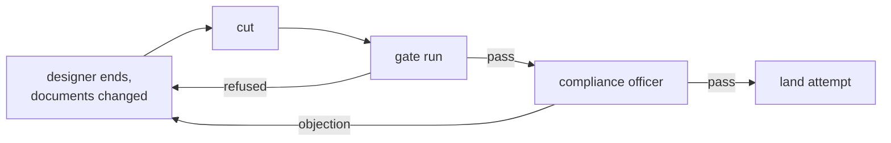

# A compliance officer checks an agent's work against a written policy, and design-document style is the first policy

**Status:** 2026-11-18. A proposal; none of it is built. Written to the owner's request of 2026-11-18 and his rulings of the same evening, quoted in [Section 1](#1-the-request-and-what-happens-today) and the [Decision Ledger](#decision-ledger). Facts about the tree, the skills, the checker and the prices were gathered by a scout on 2026-11-18 with the trunk between `bd145e311` and `59f5bee8b`, and I checked the ones this design rests on; what is an estimate or was not verified is marked where it appears. The ledger says which rows are the owner's rulings and which are a designer's decisions.

> **In short.** Programs lint what a pattern can match; nothing lints what has to be read. A compliance officer is a cheap agent that reads one piece of work against one written policy and can only object by quoting both, so it lints for agents the way a linter does for code.

**Why it matters.** On 2026-11-18 the owner opened a document an agent had written and found its first question unreadable. `uvx vantage-check` had passed that document, and passes it still ([Section 1.1](#11-what-the-mechanical-checker-passes)).

**The shape.** A registered compliance policy names the files it applies to and the text that holds its rules. For each such file in a candidate that has passed the gate, one read-only compliance officer reads the final file, the change that produced it, and the text, before the landing. Its outcomes are pass, an objection, and cannot judge.

**Cost.** An estimated half a cent to one cent per document on the cheapest model. The real cost is the author's turn when the officer objects. Under the first policy that turn can be large: a designer who adds a paragraph to an old document must bring the whole document to the skills before the paragraph lands.

**Start at [Section 4](#4-one-rulebook-and-what-keeps-the-officer-from-nitpicking)**, how authors and officer read the same rules and what stops a loop of small complaints. [Section 3](#3-a-compliance-policy-and-when-an-officer-runs) is the general mechanism, and [Section 6](#6-where-it-sits) places it beside early design landing and the landing review.

**Needs your ruling:** [OQ-DP4](#OQ-DP4).

**Reads with:** [the landing review](./tillr-diff-review.md) (the review of an item's code, which this is not; [Section 6.2](#62-beside-the-landing-review) says how the two fit), [early design landing](./tillr-early-design-landing.md) (how a designer's documents reach the trunk), [the graph design](./tillr-graph-is-the-path.md) (node kinds, rules, the identical repeat), [the vocabulary](./tillr-vocabulary.md) (judge, check, refusal, return), [designer sessions](./tillr-designer-sessions.md) (how a Vantage comment reaches a document's designer). No implementation plan is seeded.

---

## 1. The request and what happens today

The owner, on 2026-11-18 at about 9:45 PM Eastern, cleaned from dictation:

> I want to take our judging infrastructure further and every change to a design doc, which I believe is basically only from designers — you'll tell me if other things change them and if it's worth applying there too — I would like to follow it up with a style guide adherence judge node running on a cheap model, Luna or whatever that class of things. We'll call it like a style adherence judge or like a compliance officer, I don't know what it is. Like we're complying to a policy, not to logic and stuff, and it should just check to see that the design doc adheres to our skills and send it back just like a landed change if it doesn't work.

He was then told who else changes design documents today, and ruled at about 10 PM:

> the loop itself deletes markers after landings, but we're getting rid of those, so that's out. Sessions outside the drain... Yes, but we're going to stop that. I don't want to do that anymore, so don't have to worry about that. Ruling recordings after your Vantage comments, those are supposed to go to the designers for the item, so that's handled. Me by hand, I don't know what you're talking about. I don't edit design docs.

And at about 10:20 PM, on what the thing is:

> So I hesitate calling it the style judge and why I want to call it the compliance officer because, yes, right now this is design doc style, but I don't think this will be the last one. This is basically linting, but this is linting for agent against policies, hence compliance officer.

And at about 10:35 PM, on what the officer reads:

> I want the compliance officer to be able to see the final state of the document as well as the diff of the document.

The requirement, then:

- **The mechanism is general.** An agent checks work against a written policy. Design-document style is the first policy and will not be the last.
- **It is a node in the item's graph, on a cheap model.**
- **It checks compliance, not logic.** Does the work follow the written rules. Whether the work is right is not its question.
- **A failure goes back to the author.** The findings return to the author's own session, as a refused change does.
- **The first policy follows every change a designer makes to a design document.** A designer here is a node of an item, on the design seat, inside the drain. Nothing else is to change design documents, so nothing else is covered.

### 1.1 What the mechanical checker passes

The gate already runs `uvx vantage-check` on changed documents. It checks links, anchors, frontmatter, directive syntax and the declared stage words. It does not read prose.

The document the owner opened was [the provenance review](../tillr/decision-provenance-review.md). Its first question, as it stood at `8b0859504`, had three options that were labels: "Keep.", "Overturn." and "Ask properly." Its story cited three decision codes of another document, and a paragraph headed "Who decided" carried history. The design-doc skill forbids each of those in a question. `uvx vantage-check` on the document printed `1 file checked, nothing to fix` (version 0.12.0, run 2026-11-18). The question was rewritten by hand in `be1f5ad27`, after the owner had met it.

That is the gap. Of the 62 rules the scout drew from the design-doc skill, it marked 10 as checked by the checker, 4 more as partly checked, 4 as checked by the skill's own status script, and the rest as needing a reader.

### 1.2 Who changes design documents today

This is the evidence the owner asked for. It measures the distance between today and his ruling; it is not a list of things this design covers.

`git log --since=2026-11-10 -- docs/design docs/tillr` held 687 commits on 2026-11-18, and 685 of them changed a Markdown file there.

| Source | Count | How it was told apart |
| :--- | ---: | :--- |
| The loop removing an item's marker after a landing | 32 | The subject `chore: retire landed document block` |
| Commits that change code and a design document together | 154 | A changed path outside `docs/`, and a design document other than the roadmap; the 32 above excluded |
| Commits that change code and only the roadmap | 57 | The same, with the roadmap as the only document |
| Documents-only commits | 442 | Every changed path under `docs/`; the 8 documents-only retirements excluded |

What the table cannot say is which documents-only commits were a designer inside an item and which were a session outside the drain. Every commit carries one author identity, and landed commits name no item since `cd68c87e3`. The store's landing records could separate them, and were not read for this design.

Read against the ruling:

- **The loop's marker removal** ends when the markers do, by his ruling.
- **Sessions outside the drain** wrote an unknown share of the 442, this document among them. They stop, by his ruling.
- **Rulings he gives in Vantage** go to the item's designer, by his ruling. What that needs is in [Section 7](#7-a-ruling-given-in-vantage).
- **The 154 commits that change code and a design document together** were not on the list he ruled on. Some are workers correcting a design's status or ledger as they build it. A worker is not a designer, so the first policy as written does not apply to those edits. Whether it should is the owner's, in [OQ-DP4](#OQ-DP4).

## 2. The words

Node, seat, ending, objection, producer, chain, evidence key and identical repeat keep the meanings of [the graph design](./tillr-graph-is-the-path.md#2-the-words). Candidate, gate, judge, refusal, return and trunk keep those of [the vocabulary](./tillr-vocabulary.md#5-the-words). Cut, early landing and document paths keep those of [early design landing](./tillr-early-design-landing.md#2-the-words). Landing review keeps that of [the landing review design](./tillr-diff-review.md#2-the-words). These are added.

| Term | Meaning | What it is not |
| :--- | :--- | :--- |
| **Compliance officer** *(the owner's name, ruled 2026-11-18)* | A read-only agent node that reads one file of a candidate against one compliance policy and passes it or objects. It is a node of the vocabulary's judge kind: it evaluates a candidate it did not write | Not the landing review, which asks whether code matches what was claimed. Not a gate check, which is a program. Not a person |
| **Compliance policy** *(coined here)* | A registered entry that names which changed files it applies to and which text holds the rules. The vocabulary never uses "policy" bare, so this is always the two words | Not the backend policy, the gate policy or the graph design's policy function. Not the rules themselves, which live in the text it names |
| **Policy text** *(coined here)* | The files a compliance policy names as its rules, read whole by the officer | Not a checklist derived from those files |
| **Design-document style** *(coined here)* | The first compliance policy: design documents a designer changed, held to the `design-doc` and `vantage-docs` skills | Not a policy about whether a design is right |
| **Design document** *(narrowed here for that policy)* | A Markdown file under the document paths whose frontmatter `stage` is a live proposal: a word this repository maps to `open`, `ready` or `built` | Not a roadmap, not a document whose stage maps to `done`, and not an item's block inside a document |
| **Finding** *(the landing review's word, with a different shape here)* | One objection: the rule, quoted from the policy text under its heading; the line of the file that breaks it, quoted; and one sentence saying why | Not a preference, a rewrite, or an opinion about the work |

## 3. A compliance policy, and when an officer runs

### 3.1 What a compliance policy supplies

A compliance policy is a small tracked entry beside tillr's other settings. It supplies five things and no code.

| It supplies | For design-document style |
| :--- | :--- |
| **A name** | `design-document-style` |
| **Which files it applies to:** path patterns, and optionally a condition on the file's frontmatter | The document paths, with a `stage` that is a live proposal |
| **Whose changes it applies to:** the seats whose nodes' changes bring a file under it | The design seat |
| **Its policy text:** the files that hold the rules, and where they are read from | The `design-doc` and `vantage-docs` skill files, from the directory the design seat's harness loads |
| **Two specimens:** a file that must draw an objection and one that must pass, kept as a standing test | The provenance review's first question at `8b0859504`, and as rewritten in `be1f5ad27` |

Everything else is the same for every policy: the seat, the brief, the shape of a finding, the route of an objection, the record. That is all "more than one policy" needs, and nothing more is built for it.

**What a second policy would have to supply** is those five things. It must also be a policy an officer can apply from the file and the text alone: a rule that needs the tree, the item or the tests to judge is the landing review's ground, and such a policy is refused when it is registered by its missing specimens, since no specimen can show it. No second policy is proposed here.

**Degenerate cases.** No policy registered: no officer ever runs. Two policies that apply to one file: one officer for each, independent of each other. A policy whose text cannot be read: [Section 5.4](#54-cannot-judge-and-failures). A policy edited while officers run: running officers keep what they were claimed with, and the next claim reads the new entry.

### 3.2 The trigger

The trigger is an event with a known cause, and it is exact:

- a gate run on a candidate ended pass;
- the candidate changes at least one file a registered policy applies to, last written by a node on one of that policy's seats;
- no compliance officer for that policy and that file in that candidate has ended.

The policy function then adds one compliance officer for each such policy and file, before the land attempt. They are read-only and run together. The land attempt is added when every one has passed.

An officer runs because a node changed a file a policy covers, which the graph knows: each node records the head it started from and the head it left. Nothing re-runs because a policy text, a hash or the trunk changed. A candidate the lander replays onto a moved trunk is not checked again, as it is not gated again.

Under design-document style:

| Designer's node | Its candidate | An officer runs |
| :--- | :--- | :--- |
| A design answer that changed documents | The cut of those documents | Yes |
| A design answer that wrote a question for the owner | The cut that carries the question | Yes |
| A design item's own document | The item's candidate | Yes |
| A comment item at a document's desk | The item's candidate | Yes |
| A design answer whose documents ride in the item's own landing, because the worker finished first | The item's candidate | Yes, beside the landing review |
| A triage or a rewrite, which write an item's block | Either | No. A block is not design prose, and the prose guide has its own check and its own rewrite |
| A worker's edit to a design document | The item's candidate | No, unless the owner rules otherwise in [OQ-DP4](#OQ-DP4) |

A candidate that changes no covered file gets no officer. A file the author deleted gets none.

### 3.3 What the officer is given

Everything is in the brief or beside it as a file, so the officer needs no search of the tree.

| Given | How |
| :--- | :--- |
| **The policy text, whole** | Every file the policy names, read at dispatch |
| **The file, whole** | Its final state, as it stands at the candidate's head |
| **The diff of the file** | The difference in that file between the candidate's base and its head: what the author just changed. For a new file it is the whole file |
| **What the gate already checked** | The list of checks that passed on the file, so the officer does not repeat them |
| **Earlier checks of this file in this item** | Each earlier objection and what the author answered, when this is not the first |

It is not given the item, its criteria, the rest of the tree, or the author's transcript. The diff is of the one file and nothing else. Those are for a reader of logic.

**The whole file is held to the policy, every time.** The owner ruled this for design documents on 2026-11-18 ([OQ-DP2](#decision-ledger)), and it is the rule for every policy. An old fault is a finding like a new one, and either keeps the file from landing. [Section 4.4](#44-what-the-whole-document-rule-costs) says what that costs.

**The diff is for knowing what just happened, not for narrowing the check.** The owner ruled on 2026-11-18 that the officer sees "the final state of the document as well as the diff". It serves three ends:

- **The officer reads the change with care.** It knows which lines the author just wrote, and can see what a diff alone shows: a ruling recorded without its question being compacted, or history added where a leaning was replaced.
- **Each finding is marked new or standing.** The loop marks it, by whether the quoted line is one the diff added. The officer's word is not needed for that.
- **A returned objection says where to start.** Findings in the change come first, then the standing ones, so the author sees what it just broke apart from what it inherited.

**A fresh session each time.** The officer is never the author's session or a fork of it. A second check of the same file starts new and reads the first one's objection and the author's answer as files.

**Read-only is checked after the fact,** as it is for the judge step today: the loop compares the worktree with the head the officer started from, and an officer that changed anything has its verdict discarded.

**A file too large for the seat's model** with the policy text beside it is read in parts by more than one officer run, each given the file's header and outline, and passes when every part has. No tillr design is near that size today: the largest is about 30,000 tokens against a 272,000-token window on the cheapest model here (estimates at four bytes per token).

### 3.4 Which rules, under design-document style

The officer holds the document to what a reader can see on the page. The skills also hold rules about how the author worked and about facts in the tree, and those are not the officer's.

| The officer checks | The officer does not check |
| :--- | :--- |
| A question's shape: the story, a title a person would ask, options that say what the person would see, no internal codes in the story or options, a leaning, no history | Whether the question is the right question, or the leaning is right |
| The header: a thesis in **In short**, the slots, one screen, and a ruling line that names the questions the page really holds | Whether the stage is true of the code |
| Terms: each coined term marked and defined, one word per thing | Whether a term's stated origin is correct |
| Residue: review minutes, track-changes prose, an answered question left in question form, a leaning in several versions | Whether the author ran the searches the skill asks for before compacting |
| Density and structure: lists and tables where the content is one, a section on what is not covered, alternatives with verdicts | Whether a claim about the tree is correct, or the ledger's built column is honest |

The right-hand column is not checked by anyone under this design. It stays the designer's duty and the landing review's and audit's ground.

## 4. One rulebook, and what keeps the officer from nitpicking

### 4.1 The policy text is the authors' own rulebook

A designer writes to the `design-doc` and `vantage-docs` skills. Under design-document style the officer is given those same two files, whole, and nothing that restates them. The same holds for any policy: its text is the file the authors already work from.

| Way to give the officer its rules | Verdict |
| :--- | :--- |
| **The authors' own files, whole, in the brief** | **Chosen.** One rulebook. A change to a skill reaches authors and officer together, with no second file to keep true. For the first policy it costs about 33,000 tokens a check, a third of a cent on the cheapest model |
| A checklist derived from the skills, kept in this repository | Rejected. It is a second statement of the same rules, and it drifts. The `vantage-docs` skill records that its own restatement of the style guide had drifted and was deleted for that reason |
| The checklist at the end of the `design-doc` skill only | Rejected. It is a reminder list for someone who has read the skill. Many of its lines are about how the author worked |
| Rules written into the officer's brief | Rejected. That is the derived checklist under another name |

**Where the first policy's text comes from.** The two skills are not in this repository. They are delivered to every agent's skill directory from the `matt-craft` pack named in [the shared yolo configuration](../../config/yolo-jail/config.toml). The loop reads them, at dispatch, from the directory the design seat's harness loads. A policy text that cannot be read refuses the dispatch and names the file, as the prose rewrite does for its guide.

**A policy text that changes** changes the next check and nothing else. No file is checked again because the text moved. Each check records the content hash of the text it read, as a record and never as a trigger.

**When the officer cannot apply a rule from the text,** the fix is in the text, where authors gain from it too.

### 4.2 The programs go first

The gate's checks run before the officer and are unchanged. A document with a dead link or a malformed directive is refused there, in seconds, with no model. The officer is told which checks passed and does not look for what they look for. A rule that proves mechanical should move into a program, and then the officer stops looking for it.

### 4.3 What keeps it from nitpicking

A cheap model asked to find faults will find them. Five rules bound what counts, for every policy.

1. **A finding quotes the rule and the line.** The rule is quoted word for word from the policy text, with the heading it sits under. The line is quoted word for word from the file. The loop checks both quotations against the files. A finding whose rule is not in the text, or whose line is not in the file, makes the verdict invalid. The officer cannot object from taste, because taste has no sentence to quote.
2. **Pass is the answer when nothing can be quoted.** There is no score, no "could be clearer" and no list of suggestions. A passing verdict may carry notes; they are kept on the item's page and reach nobody.
3. **No rewriting.** The officer does not propose text. The author wrote the file and fixes it.
4. **The author may answer instead of changing.** It may keep the text and say why in its report. The next officer reads that reason and weighs it.
5. **The same objection twice goes elsewhere.** [Section 5.3](#53-when-the-officer-and-the-author-disagree).

### 4.4 What the whole-document rule costs

The owner's ruling is that the whole document is checked each time a designer touches it. The costs are these, and the design accepts them.

- **A small change to an old document becomes a rewrite.** A designer who adds one paragraph and one ledger row to a design written two weeks ago is sent every fault the officer can quote anywhere in it. It must bring the whole document to the skills before its paragraph lands, on the design seat's model, which is the dearest here.
- **Old documents mostly fail today.** On 2026-11-18 the design-doc skill's status script, which checks one header line, found 62 of 110 design documents failing it. A designer's first touch of almost any standing document will draw an objection.
- **The paragraph waits for the rewrite.** The check comes before the landing ([Section 6.1](#61-before-the-documents-land)), so a design answer's change, and a question for the owner inside it, reach the trunk only when the whole document passes. The worker that asked does not wait: it is resumed from the item's branch when the design answer ends.
- **Each document pays once.** After its first passing check, a later touch is checked against a document that already passed, and only new faults and rule changes remain.

**What it means for the standing documents.** Every standing design document is brought to the skills the first time a designer changes it, and not before. A document no designer touches is never checked. The owner's separate request of 2026-11-18, that the documents left standing match the skill, is therefore met for touched documents by this rule and for untouched ones only by a pass of their own.

## 5. The outcomes

The officer ends by writing a verdict file that the loop checks: the policy's name, an outcome, the findings, and which parts of the file it read.

### 5.1 Pass

The land attempt follows once every compliance officer of the candidate has passed. The officer retires no criterion and needs no grant: it has no part in whether the item's work is done.

### 5.2 An objection

An objection is one or more findings, those in the change listed first and the standing ones after ([Section 3.3](#33-what-the-officer-is-given)). It goes back to the session that last wrote the file, with the findings as text, as a gate refusal does: a turn in the same session, under a new run id, uncounted and unlimited ([the return rules](../../tools/tillr-drain/drain/returned.go)). Where the author ended with a landing call, the objection is that call's answer: `refused`, at a stage named for the compliance officer, with the policy's name.

- The author changes the file, or keeps it and says why. Either way it commits, and the candidate is built and gated again.
- The next compliance officer is a fresh session, given the earlier objection and the answer.
- Under design-document style, a document changed by both a designer and a worker returns to the designer's session.
- A worker waiting on a design answer does not wait for this. Its resume is claimed when the design answer ends, as [early design landing](./tillr-early-design-landing.md#6-always-or-only-with-a-question) rules; the officer holds only the documents' landing.

### 5.3 When the officer and the author disagree

No count stops them, by the owner's standing rule. A new finding is not a disagreement: the author fixes that too.

**An identical repeat goes to a diagnosis.** The evidence key of an objection is the policy's name with the sorted set, over its findings, of the heading in the policy text and the place in the file: for a document, the question's id or the nearest heading. Wording is not in the key. When an objection's key equals an earlier one's in the chain, the loop adds a design answer as diagnosis, in a fresh design-seat session, in place of the return ([the graph design, Section 7](./tillr-graph-is-the-path.md#7-what-stops-repetition)). It reads both objections, the file and the author's reasons, and ends in one of these ways:

- An instruction to the author that differs from every earlier one.
- An objection that names the tooling, when the officer misreads the text. That files a defect against the officer's brief.
- An objection that names the owner, with a question, when the policy text itself is unclear. The text is his.

Whether the diagnosis may also let the file land over the officer's objection is the same decision as for the landing review, and takes whatever the owner rules in [OQ-DR2](./tillr-diff-review.md#OQ-DR2). Until he has, it may not.

### 5.4 Cannot judge, and failures

None of these is a pass, and each names who moves.

| Case | What happens | Who moves |
| :--- | :--- | :--- |
| The verdict file is missing, or a quotation in it does not match its file | The officer's own session is told what is wrong. A repeat of the same fault files a defect against the tooling | The officer's session, then the tooling |
| A policy text cannot be read | The dispatch is refused and names the file. The candidate waits | The tooling |
| The officer changed the worktree | Its changes are saved and removed, the verdict is discarded, and a fresh officer runs | The loop |
| The seat's backends are all closed | The candidate waits, and the wait names the backend and its reopening. It is never landed unchecked | The backend |
| The backend policy maps nothing to the seat | The loop refuses to start and names the missing seat | Whoever edits the backend policy |
| A registered compliance policy is malformed, or its specimens are missing | The loop refuses to start and names the entry | Whoever edits it |
| The loop is killed during a check | The same node resumes. A check with no valid verdict has no effect | The loop |
| A second land attempt for the same candidate | The recorded check is reused | Nobody |
| The trunk moves during a check | Nothing. The lander replays the change | Nobody |
| Two candidates are ready at once | Each is checked in its own item's worktree. Officers share nothing | Nobody |

The policy text is read, the agent is run and the verdict file is read with no store lock held. The loop is the only writer of the officer's records.

## 6. Where it sits

### 6.1 Before the documents land

The owner ruled on 2026-11-18 that every design change lands on the trunk right away ([OQ-EL1](./tillr-early-design-landing.md#decision-ledger)), and then that a design change lands only after it passes this check ([OQ-DP1](#decision-ledger)). The operation is a cut of the changed documents, the gate, the compliance officer, and the landing.



| Place | What the owner sees | Verdict |
| :--- | :--- | :--- |
| **After the gate, before the landing** | Every designer's document on the trunk has passed. A design change, and a question for him, reach the trunk later by one cheap run, and by a designer's turn when the officer objects | **The owner's ruling** |
| After the landing | Documents land as fast as today. For the minutes before a fix lands, the document he opens may be one the officer is sending back | Not taken, by that ruling |
| After the landing, with a revert on an objection | A failing document appears and then disappears, and a question in it with it | Rejected. A revert of documents strips them from the item's branch at its next take-in, and takes the owner's answers with the questions |
| Inside the gate, as a check | Nothing different | Rejected. The gate is programs inside a ten-second budget |
| Before the gate | Nothing different | Rejected. It would pay a model to read a file the programs are about to refuse |

**What this costs against "right away".** His reason for always landing was "I think not landing them immediately creates too many issues". The officer adds one run of a small model before each such landing, and a chain of objections holds that one document off the trunk until it ends. With the whole document checked, the first chain on an old document is a rewrite of it. Other items read the older design for that long, and a question in it is not yet under "needs you". The item shows as draining, with the officer or the designer as the mover.

Every policy's officer takes this place: after the gate passes, before the landing.

### 6.2 Beside the landing review

The owner ruled on 2026-11-18, about the review of an item's code: "doc only landings have no review, no. this is for items that land as commits from a design doc." That stands, and this design does not touch it. The two are different nodes with different questions.

| | The landing review | The compliance officer |
| :--- | :--- | :--- |
| **Asks** | Does the change match what was claimed, and does anything in the diff look wrong | Does this file follow this written policy |
| **Reads** | The diff, the item, its criteria, the tree | The file and the policy text |
| **Runs for** | A landing that changes anything other than documents | A file a registered policy applies to; today, a designer's change to a design document |
| **A documents-only landing** | Not reviewed, by the owner's ruling | Checked, when a designer wrote it |
| **A code landing that carries a designer's documents** | Reviewed | Checked, at the same time; the landing follows when both pass |
| **Criteria** | Marks them met | Touches none |
| **Model** | The owner's choice, open in that design | The cheapest; the owner said so |

A documents-only landing therefore still gets no review of its logic. What the owner added on 2026-11-18 is a second, cheaper reader for a different fault.

## 7. A ruling given in Vantage

By the owner's ruling, a ruling he gives in a Vantage comment is recorded by the item's designer. That designer's change is then checked like any other, so recorded rulings and compactions are covered with nothing added here.

What has to be true for that, and is not yet:

- **Comments are not taken automatically in this repository.** The path from a Vantage comment to the session that last worked on the document is [designer sessions](./tillr-designer-sessions.md), whose status says its six items landed and that it has never been run live. This repository's settings file has no comments table (read 2026-11-18), so the loop takes no comments here today.
- **A ruling spoken to a session outside the drain has no route to a designer.** The rulings of 2026-11-18, the three recorded in this document among them, were recorded by such sessions. His ruling ends that practice; what replaces it for a ruling given in conversation is not designed.

Both are dependencies of the owner's ruling, not parts of this design. This design names them and stops.

## 8. The brief

This is what every compliance officer is asked. The loop fills in the policy's name, its text and the file paths.

```text
You are a compliance officer. You are checking one file against one written
policy, both below. You did not write the file. Nothing you do may change
this worktree.

You are checking whether the file follows the policy. You are not checking
whether the work is right, whether its facts are true, or whether you would
have decided differently.

1. Read the policy text in full.
2. Read the file in full, in its final state. All of it is held to the
   policy, whoever wrote each part and whenever.
3. Read the diff: what the author just changed. Read those lines with
   particular care. A fault outside the diff is still a finding.

Object only when you can quote both of these, word for word:
- a rule from the policy text, with the heading it is under;
- the line of the file that breaks it.

Do not object to anything you cannot quote a rule for. Do not object to
rules about how the author worked or about anything outside the file. The
checks listed below already passed; do not repeat them. Do not rewrite
anything and do not suggest wording.

If an earlier check of this file is attached, read the author's answer to
it. A reason the author gave is to be weighed, not ignored.

Write your verdict to the file named below: pass or objection; each finding
with the heading, the quoted rule, the quoted line and one sentence saying
why; and which parts of the file you read. Pass means you have no finding.
```

## 9. The record, and how to tell it works

**What is recorded.** Each compliance officer is a node of the item's graph and a run with its own id. Its record holds the policy's name, the file and the candidate it checked, the seat, backend and model, the spend, the content hash of the policy text, the outcome, each finding in full and marked new or standing, and for an objection the run it was returned to.

**Where it is read.**

- **The item's page** lists each check with the rest of the item's path: when, which policy, which file, the outcome, and the text of each finding.
- **`tillr drain why`** on a waiting item says which holds: a compliance officer is running; one objected and the author has it; a diagnosis has a repeated objection; or the officer waits on a closed backend.
- **A daily count,** by policy, of checks by outcome, of findings new and standing, of objections after which the file changed and after which it did not, and of invalid verdicts. The standing count is the backlog the whole-document rule is working through.

**How to tell it works.**

- Each policy's two specimens behave as registered. For design-document style: given the provenance review as it stood at `8b0859504`, the officer objects to its first question and quotes the rule that options say what the person would see; given that question as rewritten in `be1f5ad27`, it does not object to it.
- The share of objections after which the file did not change stays small. A large share means the officer is wrong often, and the brief or the policy text is what gets fixed.
- The owner stops meeting, on the trunk, a designer's document that breaks the skills on its face.

## 10. What this does not cover

- **A second compliance policy.** The mechanism takes one; none is proposed.
- **Changes not made by an item's designer:** the loop's marker removal, sessions outside the drain, and the owner's own edits. By his ruling of 2026-11-18 the first two end and the third does not happen.
- **A worker's edit to a design document.** 154 commits since 2026-11-10 changed code and a design document together. The first policy names the design seat only until the owner answers [OQ-DP4](#OQ-DP4).
- **Documents no designer touches.** They are never checked ([Section 4.4](#44-what-the-whole-document-rule-costs)).
- **Roadmaps.** A roadmap is not a design document. The tillr roadmap is also about 190,000 tokens, which no cheap model reads with the skills beside it.
- **Item blocks,** which the prose guide governs, with its own check and rewrite.
- **Whether the work is right, or its facts true.** Not the officer's question.
- **Whether a decision is presented as the owner's ruling when it is a designer's.** That fault is real and the skills do not state it as a rule, so the officer cannot quote one. It belongs in the skill first.
- **What the skills say.** They live in their own repository. This design reads them.

## 11. Cost

**These are estimates. No compliance officer has run.** Token counts are bytes divided by four. Prices are the work machine's, read on 2026-11-18 from [its profile](../../tag-work/config/yolo-jail/config.d/work.toml); the file does not state a unit, and other documents here read the same numbers as dollars per million tokens.

One check under design-document style, done in one turn, reads about 33,000 tokens of skills, the document, and about 2,000 tokens of brief, and writes about 1,500. The median tillr design is about 11,400 tokens and the largest about 29,600.

| Model | Its seat today | A median document | The largest tillr design | A day of 100 documents |
| :--- | :--- | ---: | ---: | ---: |
| Luna 6 | scout | $0.005 | $0.007 | $0.50 to $0.70 |
| Terra 6.1 | build | $0.05 | $0.07 | $5 to $7 |
| Sol 6.2 | review, plan, verify | $0.11 | $0.14 | $11 to $14 |
| Fable 5.2 | design | $0.54 | $0.72 | $54 to $72 |

- **One hundred a day is a ceiling drawn from the wrong population.** On 2026-11-16, 17 and 18, documents-only commits changed 92, 101 and 105 design documents, counting a document once for each commit. Those days include sessions outside the drain, which stop. How many were designers inside items was not measured.
- **An officer that opens other files costs several times this.** The brief gives it everything, and nothing stops it reading more.
- **The author's turn is the real cost, and it is not measured.** A resumed designer session answered a comment for $0.42 inside its cache's lifetime and $0.84 outside it, measured on 2026-11-16 ([designer sessions](./tillr-designer-sessions.md#what-a-turn-costs-measured)). That is a floor: one objection costs at least a hundred checks, and bringing a whole old document to the skills is a larger turn than answering a comment. How often the officer will object is unknown; on first touches of standing documents, expect nearly always.
- **The wait.** Each designer's documents reach the trunk one small-model run later, and a gate run and a check later again for each objection.

There is no spend target ([OQ-GP3](./tillr-graph-is-the-path.md#decision-ledger)), so cost informs the seat's model and gates nothing. The first build step measures a real check, and this table is replaced by what it finds.

## 12. Alternatives considered

| Alternative | Verdict |
| :--- | :--- |
| A node built for design documents only, with the two skills named in its code | Rejected by the owner's ruling: "I don't think this will be the last one" |
| A policy as a program or a hook, so each can bring its own logic | Rejected. A linter that needs code is a gate check. The officer's whole job is the part no program does, and five supplied facts are enough for it |
| Widen the landing review to documents | Rejected. The owner ruled documents-only landings out of it, and it asks a different question on a dearer model |
| Have the author run a checklist on its own work before it ends | Rejected as the mechanism. The designer already loads the skills, and the document of 2026-11-18 was written by an agent that had them. A reader with no memory of writing is the point, as it is for the landing review |
| A sub-agent of the author | Rejected. The owner's direction is that such work is a node in the graph, visible and recorded |
| A new rule family in `vantage-check` | Not instead. Whether an option says what a person would see is not a pattern a program matches |
| Sample files and check those | Rejected. The owner asked for every change, and a check costs a cent |
| Stop after a number of objections | Refused by the owner's standing rule against counts |

## 13. Build order

Steps 1 to 4 wait on no ruling. [OQ-DP4](#OQ-DP4) holds only which seats the first policy's entry names. Every step that changes a tillr source file changes its copy under the tillr pack in the same commit. The files named are where the scout found the behavior; the planner confirms each against the tree. These are build steps in prose; none is filed.

1. **Check a designer's documents after their gate run passes.**
   - *Changes:* the registration of compliance policies and the entry for design-document style, with its two specimens; a `compliance` seat in each backend policy, read-only, on the scout seat's backend; the trigger of [Section 3.2](#32-the-trigger) for candidates written by a design-seat run; the brief of [Section 8](#8-the-brief) with the policy text, the whole file, its diff and the gate's passed checks; the verdict file and the loop's check of its quotations.
   - *Files:* [the judge step](../../tools/tillr-drain/drain/judge.go) and its tests; [the loop](../../tools/tillr-drain/drain/loop.go); the policies under `config/tillr/`; [the drain's guide](../../tools/tillr-drain/README.md).
   - *Done when:* a test candidate holding a question with bare-label options is kept from landing, with a finding that quotes the rule and the line; a document whose only fault is in text the designer did not change is kept from landing too, with that finding marked standing; a clean one lands; a candidate that changes no covered file starts no officer; a finding whose quoted rule is not in the policy text is refused as invalid; a second policy registered in a test, with its own text and specimens, runs with no code change; a second land attempt starts no second check; and one real check has run on the work machine, with its spend recorded in [Section 11](#11-cost).
2. **Return an objection to the author's own session.**
   - *Changes:* the retained-session return for the officer's objection; the evidence key; the earlier objection and the author's answer given to the next officer; the diagnosis on an identical repeat.
   - *Files:* [the return rules](../../tools/tillr-drain/drain/returned.go), [the retained session](../../tools/tillr-drain/drain/worker_session.go) and their tests.
   - *Waits on:* step 1. It shares the return route with the landing review's second step; whichever is built first carries the shared part.
   - *Done when:* a test shows the objection arriving as a turn in the designer's session under a new run id; a second objection with the same headings and places but different words goes to a diagnosis; one that differs goes back to the designer; no count is read on the route.
3. **Show the checks.**
   - *Changes:* the rows on the item's page; the states in `tillr drain why`; the daily count by policy.
   - *Files:* `tools/tillr-view`, `tools/tillr-loop` and their tests.
   - *Waits on:* step 1.
   - *Done when:* an item page shows a finding's text, and each registered policy's specimens are a standing test of the brief.
4. **Make the officer a node the policy function adds.**
   - *Changes:* the rule rows of [Section 14](#14-amendments-owed).
   - *Waits on:* the graph design's executor and policy function, and the early landing's cut.
   - *Done when:* the policy function's table test covers those rows.

## 14. Amendments owed

None of these documents is edited by this one, except a one-line pointer in the landing review's list of what it does not cover.

- **[The vocabulary](./tillr-vocabulary.md):**
  - A row for **compliance officer** in [its checking and landing table](./tillr-vocabulary.md#54-checking-and-landing): the owner's name, ruled 2026-11-18, for a judge-kind node that checks one file against one compliance policy.
  - A row for **compliance policy**, and its addition to the row that says "policy" is never used bare, beside the backend policy and the gate policy.
  - The **Judge** row is unchanged in meaning. It gains the note that the landing review and the compliance officer are both nodes of that kind, so "judge" alone names neither.
  - No clash was found: `rg -n -i 'compliance|officer' docs/design/tillr-vocabulary.md` printed nothing on 2026-11-18.
- **[The graph design](./tillr-graph-is-the-path.md):**
  - [Section 5.3](./tillr-graph-is-the-path.md#53-the-starting-rule-table): rows 8 and 23 add the compliance officers after a passed gate run on a candidate that carries a file a registered policy applies to, and the land attempt after they pass; a new row returns an officer's objection to the session that last wrote the file.
  - [Section 5.2](./tillr-graph-is-the-path.md#52-permitted-facts): the registered compliance policies are read when a rule is evaluated, as the workflow files are; a change to one is not a fact that adds a node.
  - [Section 7](./tillr-graph-is-the-path.md#7-what-stops-repetition): the compliance officer's evidence key.
  - The seats it would declare gain `compliance`.
- **[Early design landing](./tillr-early-design-landing.md):** [Section 3.4](./tillr-early-design-landing.md#34-what-the-gate-checks) says a cut has no judge. It has no landing review; it gains the compliance officer, and a cut lands only after it passes.
- **The backend policies' seat list and purposes,** with the build.

## 15. Risks

| Risk | Mitigation |
| :--- | :--- |
| The cheap model objects to things that are fine, and designers spend dear turns answering | A finding must quote a rule and a line, and both are checked. The daily count shows objections after which nothing changed. The model is one line of the backend policy |
| The cheap model passes everything | Each policy's specimens are a standing test. The same count shows an officer that never objects |
| The skills are long, and a small model applies them unevenly | Measured in step 1 before anything is built on it. The remedy is a clearer skill or a stronger seat, not a second rulebook |
| A designer's small change to an old document is held for a long rewrite, and a question for the owner inside it with it | Accepted with the whole-document ruling. The item is visible as draining, with its spend, and the worker that asked is not held |
| A rewrite of an old document to pass the officer changes what the design says | The officer cannot see that. The designer owns the document's meaning, and the daily count of large returned turns shows where to look |
| A file is held off the trunk while officer and author disagree | The identical repeat sends it to a diagnosis |
| The officer's backend is closed, and no designer's document lands | The seat lists more than one backend, as every seat may. The wait names the backend |
| Authors write to please the officer, not the reader | The officer can only cite the policy text, so pleasing it is following the text. A rule that produces bad work is fixed in the text |
| Policies multiply until every landing waits on several officers | Each policy is a tracked, reviewed entry with specimens. Officers run together, and the daily count is by policy |

## Decision Ledger

`D-DP1`, `D-DP2`, `D-DP13` and the three `OQ-DP` rows are the owner's rulings. Every other row is a designer's decision of 2026-11-18: engineering detail settled from the scout's evidence and the owner's rulings. None of those is the owner's ruling, none waits on him, and he may overturn any row at any time. The one decision that is his to make is [OQ-DP4](#OQ-DP4). None is built.

| ID | Decision | Date | Settled in | Built |
| :--- | :--- | :--- | :--- | :--- |
| `D-DP1` | **Owner ruling.** Every change to a design document is followed by "a style guide adherence judge node running on a cheap model, Luna or whatever that class of things". "We're complying to a policy, not to logic and stuff, and it should just check to see that the design doc adheres to our skills and send it back just like a landed change if it doesn't work." | 2026-11-18, owner | [Section 1](#1-the-request-and-what-happens-today) | — |
| `D-DP2` | **Owner ruling.** Only an item's designer changes design documents. On the loop's marker removal: "we're getting rid of those, so that's out." On sessions outside the drain: "we're going to stop that." On rulings given in Vantage: "those are supposed to go to the designers for the item, so that's handled." On his own edits: "I don't edit design docs." | 2026-11-18, owner | [Section 1](#1-the-request-and-what-happens-today) | — |
| OQ-DP1 | **Owner ruling: a design document lands only after it passes the check.** Asked whether a failing document lands for him to read before it is fixed, he took the stated leaning as his answer: "A: what you objected to on 2026-11-18 was meeting an unreadable document on the trunk, and only checking before the landing prevents that." The other option, landing first with the check after, is not taken. | 2026-11-18, owner | [Section 6.1](#61-before-the-documents-land) | — |
| OQ-DP2 | **Owner ruling: the whole document, every time.** Asked whether a designer who touches an old document must fix its old faults too, his whole answer was "B", the option that read: the first designer to touch an old document must bring all of it to the rules before its paragraph lands. The designer's leaning, only what the designer changed, is not taken, and neither is filing old faults as a separate queue item. | 2026-11-18, owner | [Section 4.4](#44-what-the-whole-document-rule-costs) | — |
| OQ-DP3 | **Owner ruling: it is the compliance officer, and it is general.** "So I hesitate calling it the style judge and why I want to call it the compliance officer because, yes, right now this is design doc style, but I don't think this will be the last one. This is basically linting, but this is linting for agent against policies, hence compliance officer." The designer's leaning, "style judge", is not taken. | 2026-11-18, owner | [Section 3](#3-a-compliance-policy-and-when-an-officer-runs) | — |
| `D-DP3` | **Designer's decision.** One read-only node for each policy and file, in a fresh session, on one `compliance` seat that each backend policy maps to its cheapest backend. It is a node of the judge kind, not a new kind. **Evidence:** the vocabulary's judge is a read-only agent that evaluates a candidate it did not write; the scout seat here is Luna 6. **Rejected:** a sub-agent of the author; one officer for a whole candidate, which fails on a candidate of many files; a seat for each policy. | 2026-11-18, designer | [Section 3](#3-a-compliance-policy-and-when-an-officer-runs) | — |
| `D-DP4` | **Designer's decision.** The trigger is a passed gate run on a candidate that carries a file a registered policy applies to, last written by a node on one of that policy's seats. Under the first policy, triage and rewrites are outside it; whether a worker's edit is outside it is [OQ-DP4](#OQ-DP4). **Evidence:** the owner's rule against guess triggers; each node records the head it started from and the head it left. **Rejected:** checking when a file's hash or a policy text changes. | 2026-11-18, designer | [Section 3.2](#32-the-trigger) | — |
| `D-DP5` | **Designer's decision.** A policy's rules are the authors' own files, whole, read at dispatch; for the first policy, the two skill files from where the designer's harness loads them. No checklist is derived. **Evidence:** the skills are delivered by a pack and are not in this repository; `vantage-docs` records that its own restatement drifted. **Rejected:** a checklist in this repository; rules written into the brief. | 2026-11-18, designer | [Section 4.1](#41-the-policy-text-is-the-authors-own-rulebook) | — |
| `D-DP6` | **Designer's decision.** A finding quotes its rule and its line word for word, and the loop checks both; a finding that fails makes the verdict invalid. The officer proposes no text. **Evidence:** the landing review's findings must point at a place; a cheap model asked for faults finds them. **Rejected:** free-text findings; a score. | 2026-11-18, designer | [Section 4.3](#43-what-keeps-it-from-nitpicking) | — |
| `D-DP7` | **Designer's decision.** The officer checks only what can be seen in the file. Facts about the tree and how the author worked are not its rules, and a policy that needs them cannot be registered. **Evidence:** it is given the file, its diff and the policy text, and nothing else. **Rejected:** giving it the tree, which makes it a second landing review. | 2026-11-18, designer | [Section 3.4](#34-which-rules-under-design-document-style) | — |
| `D-DP8` | **Designer's decision.** An objection returns to the session that last wrote the file, as a gate refusal does. An identical repeat, keyed by policy, heading and place in the file, goes to a diagnosis on the design seat. Whether the diagnosis may let the file land follows the landing review's ruling. **Evidence:** the owner's rulings that a refusal returns to the same session, uncounted, and that only an identical repeat stops a chain. **Rejected:** a count; the finding's wording as the key. | 2026-11-18, designer | [Section 5](#5-the-outcomes) | — |
| `D-DP9` | **Designer's decision.** The compliance officer and the landing review are separate nodes. A documents-only landing still gets no landing review; a code landing that carries a designer's documents gets both. **Evidence:** the owner's ruling of 2026-11-18 on documents-only landings was about the review of code. **Rejected:** one reader for both questions. | 2026-11-18, designer | [Section 6.2](#62-beside-the-landing-review) | — |
| `D-DP10` | **Designer's decision.** The first policy applies to a Markdown file under the document paths whose stage is a live proposal. Roadmaps, finished or replaced documents and item blocks are outside it. **Evidence:** the tillr roadmap is about 190,000 tokens; item blocks have the prose guide's own check. **Rejected:** every Markdown file under `docs/`. | 2026-11-18, designer | [Section 2](#2-the-words) | — |
| `D-DP11` | **Designer's decision.** A compliance policy is a tracked entry of five facts: a name, the files it applies to, the seats whose changes it covers, its policy text, and two specimens. It carries no code, and the brief, the finding, the route and the record are shared. **Evidence:** the owner's "linting for agent against policies", and that the first policy needs nothing else. **Rejected:** a policy as a program or hook; a policy that sets its own model, brief or route. | 2026-11-18, designer | [Section 3.1](#31-what-a-compliance-policy-supplies) | — |
| `D-DP12` | **Designer's decision.** Every policy's officer is given the final file and its diff, holds the whole file to the policy, and runs after the gate and before the landing. The owner ruled all three for design documents; no policy may choose otherwise. The loop, not the officer, marks a finding new or standing from the diff, and both kinds keep the file from landing. **Evidence:** his rulings on [OQ-DP1](#decision-ledger) and [OQ-DP2](#decision-ledger) and `D-DP13`; one rule for all policies needs no setting. **Rejected:** a setting for each policy, before any second policy exists to need it. | 2026-11-18, designer | [Section 3.3](#33-what-the-officer-is-given) | — |
| `D-DP13` | **Owner ruling.** "I want the compliance officer to be able to see the final state of the document as well as the diff of the document." The whole file is still held to the policy ([OQ-DP2](#decision-ledger)); the diff tells the officer and the author what just changed. | 2026-11-18, owner | [Section 3.3](#33-what-the-officer-is-given) | — |

## Open Questions

1. 💬 **OQ-DP4: When a worker building an item edits a design document, is that edit checked?**

   A worker finishes a build step and, in the same commit as its code, changes the design document: it marks a decision built, or corrects a sentence the code proved wrong. You said on 2026-11-18 that you believe only designers change design documents. Since 2026-11-10, 154 commits changed code and a design document together; how many were workers inside items was not measured. The compliance officer as designed runs only after a designer's change, so such an edit lands unread.

   - **A — Not checked.** Workers go on editing design documents, and those edits land with no officer. A document you open may have been changed since it last passed.
   - **B — Checked like a designer's.** The worker's landing waits for the officer. The whole document is held to the skills, so a build worker on the cheaper build model may have to rewrite an old design before its code lands.
   - **C — Workers may not edit design documents.** A worker's change to one is refused, and it asks a designer instead. Every change is then a designer's and is checked. How "built" gets recorded needs its own small design.

   <!-- vantage: question id=OQ-DP4 leaning="C: it makes what you said you believed true, and keeps one kind of author for every design document. The cost is a designer's turn where a worker edits freely today, and a piece of design this document does not contain. Until that exists, A is what happens." -->

   _Leaning:_ C: it makes what you said you believed true, and keeps one kind of author for every design document. The cost is a designer's turn where a worker edits freely today, and a piece of design this document does not contain. Until that exists, A is what happens.

   **Answer:**

   > _(empty — fill in when decided)_
