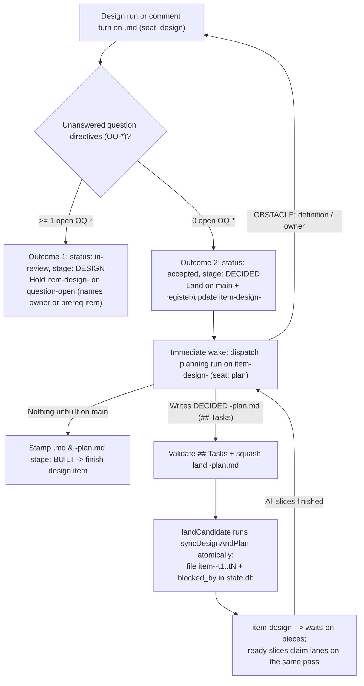

# A design with no open questions moves straight to planning, and owner review comments end in open questions or planning

**Status:** 2026-11-22. Nothing in this document is built; repository and index facts were verified against `bba4ba277e`. Only the owner's dated verbatim statements in [Section 1.1](#11-the-2026-11-22-ruling) (`R-DT1`) and [Section 1.2](#12-inherited-owner-rulings) are owner rulings; `D-DT1` through `D-DT8` are the designer's decisions from an operator request of 2026-11-22, marked in prose and in the [Decision Ledger](#decision-ledger) as the designer's choices that the owner may overturn.

> **In short.** One mechanical test decides whether a design waits on the owner: whether it carries an unanswered `question` directive (`OQ-*`). When a design has zero open questions, the designer stamps `status: accepted` and `stage: DECIDED`, the drain dispatches the design's `plan` run on that landing tick, and landing the companion `<topic>-plan.md` files its build slices straight into `.tillr/state.db` with zero operating-session involvement. When the owner dumps review comments, they route to `<doc>`'s designer on `desk-<doc>`, and the designer's run settles into **exactly one of two outcomes**: open questions remain (naming who is asked), or zero open questions remain and the design moves straight to planning.

**Why it matters.** On 2026-11-22 two of six lanes sat idle for over an hour because the only new work waited behind a hand step: the operating session ("the whale") was holding designs whose front matter asked for review of designer `D-*` rows despite having zero open questions, and reading accepted designs at 15-minute check-ins to file build slices by hand.

**The shape.** Four connected rules:
- **Zero open questions means ready to plan (`D-DT1`, `D-DT2`):** engineering decisions (`D-*`) are labeled for owner overturn and never hold a design in `status: in-review` / `stage: DESIGN`; owner-reserved choices must be real `question` directives (`OQ-*`), closing both the zero-question pause (`D-CA1`–`D-CA6`, `D-SPS1`–`D-SPS7`) and the unindexed prose hold (`D-GR45`).
- **Automatic design -> `plan` -> slice filing (`D-DT3`–`D-DT5`):** both roadmap sync and post-landing settlement of standalone `design` runs register `item-design-<slug>`, dispatch the `plan` seat as soon as `questions == 0`, and import `<topic>-plan.md`'s `## Tasks` into `.tillr/state.db` inside `landCandidate` settlement.
- **Strictly binary comment outcome (`D-DT6`–`D-DT8`):** owner review comments route to `design` at `desk-<doc>` while `design-under-comment` holds unstarted downstream steps, and settlement accepts only Outcome 1 (`>= 1` unanswered `OQ-*`, naming `owner` or an in-drain prerequisite item) or Outcome 2 (`0` unanswered `OQ-*`, `status: accepted`, `stage: DECIDED`, moving straight to planning).

**Cost.** One `plan`-seat run per decided design (or comment-triggered re-plan) to write `<topic>-plan.md`, replacing per-slice `planned-build@v1` planning runs and eliminating idle lane hours between operator check-ins.

**Start at** [Section 2](#2-what-exists-today-step-by-step-and-what-changes) for today's hand steps and how `D-CA1`–`D-CA6`, `D-SPS1`–`D-SPS7`, and `D-GR45` are held, then [Section 4](#4-automatic-transition-from-zero-open-questions-to-queued-slices) for the planning transition and [Section 5](#5-owner-review-comments-routing-to-the-designer-and-the-two-outcomes) for the review-comment loop.

**Needs your ruling:** [OQ-DT1](#OQ-DT1) (what happens to active slice runs on lanes when a late review comment arrives) and [OQ-DT2](#OQ-DT2) (how rollout treats the existing zero-question `DESIGN` and `DECIDED` backlog, including `D-CA1`–`D-CA6`, `D-SPS1`–`D-SPS7`, and `D-GR45`), alongside `8` designer's decisions (`D-DT1` through `D-DT8`) in the [Decision Ledger](#decision-ledger) that you may overturn.

**Reads with:** [operator decisions inside tillr](./operator-decisions-inside-tillr.md) ([Section 5.7](./operator-decisions-inside-tillr.md#57-ready-work-filed-when-no-item-waited-for-a-lane), Kind 7), [the queue mirrors the designs](./tillr-queue-mirrors-designs.md) (`item-design-<slug>` and `<topic>-plan.md`), [owner review comments](./tillr-review-comments.md) (`tillr item comment` and the `comment` track), [conflict-answer check](./tillr-conflict-answer-check.md) (`D-CA1`–`D-CA6`), [shared-path serialization](./tillr-shared-path-serialization.md) (`D-SPS1`–`D-SPS7`), [gate rework](./gate-rework.md) (`D-GR45`), [judge and lifecycle](./tillr-judge-and-lifecycle.md) (`D-JL9`, `D-JL32`), [plan step and seat selection](./tillr-plan-step-and-seat-selection.md) ([OQ-PSS2](./tillr-plan-step-and-seat-selection.md#OQ-PSS2)), and [decision provenance review](../tillr/decision-provenance-review.md) ([OQ-PR12](../tillr/decision-provenance-review.md#OQ-PR12), [OQ-PR21](../tillr/decision-provenance-review.md#OQ-PR21), [OQ-PR22](../tillr/decision-provenance-review.md#OQ-PR22)).

---

## 1. The ruling and inherited boundaries

### 1.1 The 2026-11-22 ruling

On 2026-11-22 the owner gave this direction verbatim (`R-DT1`):

> "And yes, design should transition. You're number four there. I'm not totally sure what you're describing. Design should absolutely transition on their own. Like once a design has no more open questions, it should immediately move to the planning stage and that should be the case. should be something that doesn't require you. So like I dump in review comments, they go to the designer, the designer handles them, and then the designer can either say this needs more help because there's still open questions or it should go right to planning and it shouldn't be a you decision."

What the owner's words rule directly:

1. **Zero open questions triggers an immediate, automatic move to the planning stage.** Once a design has no open questions left, tillr moves it into planning on its own, without waiting for the operating session ("you") to decide, release, or file anything.
2. **Owner review comments go to the designer.** Dumping review comments routes the work to the `design` seat, never to the operating session as a decision-maker.
3. **The designer's handling of review comments has a two-way exit.** After handling the comments, either open questions still remain and more help is needed, or zero open questions remain and the design goes straight to planning — never a third state waiting on the operating session.

What the words leave open — exact front-matter and settlement invariants, how standalone design requests join mirrored roadmap designs, how `<topic>-plan.md` tasks enter `.tillr/state.db` without hand commands, who is named when open questions need help, how in-flight runs behave when late comments overturn a `D-*` decision, and how the existing 57-file zero-question backlog cuts over — are either designed below as explicit designer's decisions (`D-DT1`–`D-DT8`) or put to the owner in [OQ-DT1](#OQ-DT1) and [OQ-DT2](#OQ-DT2).

### 1.2 Inherited owner rulings

Six earlier verbatim rulings of the owner already fix the surrounding boundaries:

- **What the whale can settle without the owner belongs inside tillr ([`R-OD1`](./operator-decisions-inside-tillr.md#1-the-ruling), 2026-11-21):** *"if you ever feel that you as the whale could solve some problem, and it wouldn't need to be escalated to me, then that problem should escalate to... a similarly responsible agent, process, ticket, whatever, within Tiller, rather than popping up to you."* [Section 5.7](./operator-decisions-inside-tillr.md#57-ready-work-filed-when-no-item-waited-for-a-lane) (Kind 7) identifies decided designs whose builds were not filed as one of the four sources that must file their own work.
- **Owner questions hold building; agent engineering detail does not ([OQ-PR21](../tillr/decision-provenance-review.md#OQ-PR21) and [OQ-PR22](../tillr/decision-provenance-review.md#OQ-PR22), 2026-11-19):** Under [OQ-PR21](../tillr/decision-provenance-review.md#OQ-PR21) (*"A: it matches what you said on 2026-11-18, that you decide product direction and trade-offs and the agent decides engineering detail"*), choices touching the owner's documents, repository, money, models, or visible surface must be filed as open questions (`OQ-*`), whereas engineering detail is marked as the agent's decision and **may be built on without stopping the queue**. Under [OQ-PR22](../tillr/decision-provenance-review.md#OQ-PR22), an owner question is closed only by quoting a dated ruling of his verbatim.
- **One queue item per outstanding design; build steps live in `<topic>-plan.md` ([OQ-QM1](./tillr-queue-mirrors-designs.md#1-the-direction-and-what-exists-today), 2026-11-18):** *"when we sync a roadmap into tillr, we create an item for every design doc that is still out for any reason... the implementation plan is intended to be a document that grows alongside the design doc that saves a research and stuff, but a human would never look at it. And it's the perfect place for something like this"*, retiring hidden HTML item comments (`docshare.Start`) everywhere.
- **Review comments go to `<doc>`'s designer on the comment track while unstarted steps wait ([OQ-PR12](../tillr/decision-provenance-review.md#OQ-PR12) and [OQ-RC1](./tillr-review-comments.md#7-decision-ledger), 2026-11-20):** *"A: comment work closes quickly, and building on a design you have just objected to wastes runs"*, borrowing express capacity on `desk-<doc>` (`Option A` on [OQ-RC1](./tillr-review-comments.md#7-decision-ledger)).
- **Uncounted design runs and explicit `NEXT-ACTOR` objections ([`D-JL9`](./tillr-judge-and-lifecycle.md#43-how-a-design-runs-ending-moves-its-conflict-d-jl9), 2026-11-17):** A gated design commit is the answer; a non-committing design run objects by naming the next actor (`owner` or `build`), and only an objection naming `owner` (or an identical repeat) reaches the owner.
- **Retiring per-slice `planned-build@v1` upfront planning ([OQ-PSS2](./tillr-plan-step-and-seat-selection.md#OQ-PSS2), 2026-11-20):** Single-commit build items start directly on `build` and fan out via subagents rather than paying a separate `plan` node before every slice; multi-commit decomposition belongs at the design-to-companion-plan boundary.

---

## 2. What exists today, step by step, and what changes

### 2.1 What the operating session does by hand today

Verified at `bba4ba277e` across [`.agents/skills/drain-timed-checkin/SKILL.md`](../../.agents/skills/drain-timed-checkin/SKILL.md), [`tools/tillr-item/`](../../tools/tillr-item/), [`tools/tillr/vantage/vantage.go`](../../tools/tillr/vantage/vantage.go), and [`tools/tillr-drain/drain/`](../../tools/tillr-drain/drain/):

1. **Polling and hand-filing slices every 15 minutes.** In [`.agents/skills/drain-timed-checkin/SKILL.md`](../../.agents/skills/drain-timed-checkin/SKILL.md) (`Each check-in`, step 6, *"Keep the lanes fed"*), when lanes have no waiting items, the operating session reads designs by hand, decides which slices have no open blocker, and invokes `tillr item request --ordinary` (with `--blocked-by`) one slice at a time. On 2026-11-21 (`item.add` in [operator decisions Section 2](./operator-decisions-inside-tillr.md#2-the-day-measured)), 176 of 192 added items were filed requests; on 2026-11-22, two of six lanes sat idle for over an hour waiting for that manual step.
2. **Sync reads only hidden HTML comments.** Neither [tillr-queue-mirrors-designs.md](./tillr-queue-mirrors-designs.md) nor [tillr-review-comments.md](./tillr-review-comments.md) is built yet. In [`tools/tillr-item/item/sync.go`](../../tools/tillr-item/item/sync.go), `Sync` calls `parseItemBlocks` to scan `docs/` solely for hidden HTML item comments (`docshare.Start`), while [`design_without_item.go`](../../tools/tillr-item/item/design_without_item.go) writes passive warning rows rather than items. Because new requests forbid document item blocks ([`request.go`](../../tools/tillr-drain/drain/request.go)), newly landed designs create zero store items on their own.
3. **The shared question reader exposes neither `stage` roles nor `status`.** In [`tools/tillr/vantage/vantage.go`](../../tools/tillr/vantage/vantage.go), `VantageQuestions` shells out to `uvx vantage-check index --format json` and decodes `Present`, `Questions`, and `LedgerIDs` (`FirstUnanswered`), dropping `status` and `.vantage.toml`'s `[planning.stages]` roles (`open`, `ready`, `built`, `done`). Inside `tillr-drain`, only `retireDesigners` in [`designer.go`](../../tools/tillr-drain/drain/designer.go) reads document stages at all (solely to drop `last_designers` rows once a document is done).
4. **Comment runs terminate at reply delivery with no transition.** Tracked [`.tillr.toml`](../../.tillr.toml) has no `[comments]` table (`tick.Comments == nil`), [`tools/tillr-item/comments.go`](../../tools/tillr-item/comments.go) exposes only `tillr item comments take --doc <doc> --vantage <url>`, and [`tools/tillr-drain/drain/comments.go`](../../tools/tillr-drain/drain/comments.go) (`deliverCommentReplies`) marks `item-comments-*` finished as soon as replies are written — never checking whether zero open questions remain or moving `<doc>` to planning.

### 2.2 Front matter that marks owner review today, and how `D-CA1`–`D-CA6`, `D-SPS1`–`D-SPS7`, and `D-GR45` are held

In [`.vantage.toml`](../../.vantage.toml), `[planning.stages]` already defines `DESIGN = "open"` (*"owes a ruling from the owner"*) and `DECIDED = "ready"` (*"every ruling is in; nothing is built"*). In practice, however, recent designs drifted into **two opposite mismatches** between front matter, prose, and `question` directives, forcing the operating session to inspect every file by eye.

**What front matter and prose mark owner review today:** When a designer records engineering decisions `D-*` without any `OQ-*` owner question, recent designs set YAML front matter:

```yaml
status: in-review
stage: DESIGN
next: "The owner reviews D-... in the Decision Ledger; nothing here is built until reviewed."
```

paired with header lines `**Needs your ruling:** None.` and `**Awaits your review:** D-...` — and **zero** `vantage: question` directives.

Verified against `uvx vantage-check index --format json` at `bba4ba277e`, here is how the three sets of decisions named in this request are held today and what changes under this design:

| Decisions & document | Front matter, header prose, and Vantage index at `bba4ba277e` | How held today | What changes under this design |
| :--- | :--- | :--- | :--- |
| **`D-CA1` to `D-CA6`** in [`tillr-conflict-answer-check.md`](./tillr-conflict-answer-check.md) (landed `72be8955f8`) | Front matter: `status: in-review`, `stage: DESIGN`, `next: "The owner reviews D-CA1 through D-CA6 in the Decision Ledger; nothing here is built until reviewed."` Header: `**Needs your ruling:** None.`, `**Awaits your review:** the designer's decisions D-CA1 through D-CA6...`, *"No companion `-plan.md` seed is opened until those decisions are reviewed."* Vantage index: **`questions: []` (`0` open questions)**; unlinked from [`docs/tillr/roadmap.md`](../tillr/roadmap.md). | **Zero mechanical hold in `tillr-drain`.** Held solely because no `-plan.md` or item exists in `.tillr/state.db` and the operating session saw `status: in-review` / `Awaits your review` and refrained from hand-filing build requests. | `D-CA1`–`D-CA6` are engineering/workflow choices within settled rulings ([OQ-RJ4](./tillr-review-rules.md#decision-ledger), [OQ-DR1](./tillr-diff-review.md#decision-ledger), [OQ-DR2](./tillr-diff-review.md#decision-ledger)). Under `R-DT1` and `D-DT1`–`D-DT3`, a zero-question design is stamped `status: accepted`, `stage: DECIDED`, registered as `item-design-design-tillr-conflict-answer-check` even without a roadmap link, and moved straight to its `plan` run to file its slices (existing-file rollout governed by [OQ-DT2](#OQ-DT2)). `D-CA1`–`D-CA6` stay labeled in the Ledger for owner overturn via comment. |
| **`D-SPS1` to `D-SPS7`** in [`tillr-shared-path-serialization.md`](./tillr-shared-path-serialization.md) (landed `add33e202b`) | Front matter: `status: in-review`, `stage: DESIGN`, `next: "The owner reviews D-SPS1 through D-SPS7 in the Decision Ledger; nothing here is built until reviewed."` Header: `**Needs your ruling:** None.` and `**Awaits your review:** D-SPS1 through D-SPS7 in the Decision Ledger; you may overturn any of them.` Vantage index: **`questions: []` (`0` open questions)**; unlinked from [`docs/tillr/roadmap.md`](../tillr/roadmap.md). | **Zero mechanical hold in `tillr-drain`.** Held purely by the operating session refraining from hand-filing slices after reading `status: in-review` / `next` — part of the exact review pause behind idle lanes on 2026-11-22. | Queue-stepping mechanics belong to the engineers under [OQ-PR4](../tillr/decision-provenance-review.md#OQ-PR4) and [OQ-PR21](../tillr/decision-provenance-review.md#OQ-PR21). With `0` open questions, the design stamps `status: accepted`, `stage: DECIDED`, registers `item-design-design-tillr-shared-path-serialization` at landing, and dispatches `plan` to write `tillr-shared-path-serialization-plan.md` and queue its slices automatically (rollout governed by [OQ-DT2](#OQ-DT2)). |
| **`D-GR45`** in [`gate-rework.md`](./gate-rework.md) ([Section 6.13](./gate-rework.md#613-how-a-change-to-the-gates-own-binary-is-judged-and-how-a-fault-in-the-installed-binary-is-recovered), landed `4452ad9611`) | **The opposite mismatch.** Front matter: **`status: accepted`, `stage: DECIDED`**. Vantage index: **`questions: []` (`0` `question` directives)**. Yet header line `**Needs your ruling:** D-GR45` and Ledger row `D-GR45` state *"Not the owner's ruling and not a decision: the designer's proposal from an operator request of 2026-11-22, for the owner to rule on... Compares four options... Nothing is built until the owner rules"* (choosing which `tillr-gate` binary certifies changes to `tillr-gate`'s own source). | **Zero mechanical hold in `tillr-drain` or Vantage.** To `VantageQuestions`, [`gate-rework.md`](./gate-rework.md) looks completely decided (`questions: []`, `stage: DECIDED`). Held **only** because the operating session read the prose of `D-GR45` and skipped hand-filing Section 6.13 slices while filing `D-GR43`/`D-GR44`/`D-GR46` slices. | Under `D-DT2`, a proposal explicitly reserved *"for the owner to rule on"* may never sit in a `D-*` row without a `question` directive: the gate refuses added prose/ledger lines claiming `"Needs your ruling"` (other than `None`) or `"for the owner to rule on"` without a live `vantage: question` directive. Converting `D-GR45` into a new `OQ-GR*` `question` directive (`stage: DESIGN`, `status: in-review` on [`gate-rework.md`](./gate-rework.md), with `Waits on questions:` scoping only Section 6.13's tasks per `D-QM10`) holds Section 6.13 mechanically while letting unrelated `D-GR44`/`D-GR46` tasks run ([OQ-DT2](#OQ-DT2)). |

**Corpus-wide backlog at `bba4ba277e`.** Querying `uvx vantage-check index --format json` across `docs/design/` finds **`57` files** at `stage: DESIGN` or `SKETCH` with `0` unanswered `question` directives (`10` non-plan designs and `2` `*-plan.md` files linked from [`docs/tillr/roadmap.md`](../tillr/roadmap.md), plus `43` unlinked non-plan files and `2` unlinked `*-plan.md` files — mixing 2026-11-22 designs like [`tillr-conflict-answer-check.md`](./tillr-conflict-answer-check.md) and [`tillr-shared-path-serialization.md`](./tillr-shared-path-serialization.md) with child files [`tillr-utility-contracts/*.md`](./tillr-utility-contracts.md) whose parent holds [`OQ-UC1`](./tillr-utility-contracts.md#OQ-UC1), pre-directive [`escalation-ladder.md`](./escalation-ladder.md), and deprecated [`land-3i-inventory.md`](./land-3i-inventory.md)) alongside **`10` routed non-plan `DECIDED` designs** on [`docs/tillr/roadmap.md`](../tillr/roadmap.md). That heterogeneous backlog is why [OQ-DT2](#OQ-DT2) asks the owner how existing files cut over.

### 2.3 Step-by-step comparison: today vs this design

| Lifecycle step | Today (`bba4ba277e`) | Under this design (`D-DT1`–`D-DT8`) |
| :--- | :--- | :--- |
| **1. Recording `D-*` vs `OQ-*` in a design** | Designers write `0` `OQ-*` directives yet stamp `status: in-review`, `stage: DESIGN` (`Awaits your review: D-...`), or leave `DECIDED` while putting an owner question in prose (`D-GR45`). | Every owner-reserved choice ([OQ-PR21](../tillr/decision-provenance-review.md#OQ-PR21)) is a `question` directive (`OQ-*`); engineering choices are labeled `D-*` rows that do **not** hold planning. Candidate settlement and the gate refuse both mismatches (`D-DT1`, `D-DT2`). |
| **2. Zero-OQ design finishes `design` run** | Commit lands on `main`; nothing registers an item unless linked with a hidden HTML item comment, so the file sits idle until an operator check-in. | Designer stamps `status: accepted`, `stage: DECIDED`. `landCandidate` registers/refreshes `item-design-<slug>` in `.tillr/state.db` (whether on a roadmap or from a standalone `design` run) and wakes the planner on the same tick (`D-DT3`, `D-DT4`). |
| **3. Cutting and filing build slices** | Operating session reads the design by hand and calls `tillr item request --ordinary` per slice; each slice then runs `planned-build@v1` (`plan -> work -> verify`). | `item-design-<slug>` automatically dispatches a `plan`-seat run to write `<topic>-plan.md` (`stage: DECIDED`, `## Tasks`). When `<topic>-plan.md` lands, `landCandidate` runs companion-plan sync atomically, creating `item-<plan-slug>-<task-id>` slices and `blocked_by` edges in `.tillr/state.db` with zero operator action (`D-DT4`, `D-DT5`). |
| **4. Owner review comment intake** | `comments take` requires Vantage HTTP; operator sometimes filed `tillr item request --ordinary` (`scouted-design@v1`, cold lane). | Vantage inbox or `< 5 s` `tillr item comment` relay creates/coalesces `item-comments-<doc>-<N>` in bucket `1` on `desk-<doc>` (`design` seat, `single-worker@v1`, warm session resume) and holds unstarted `<doc>` work on `design-under-comment` ([tillr-review-comments.md](./tillr-review-comments.md), `D-DT6`). |
| **5. Post-comment transition** | `deliverCommentReplies` marks `item-comments-*` done after writing replies; `<doc>` never transitions to planning on its own. | Verified binary exit (`D-DT6`): **Outcome 1** (`>= 1` unanswered `OQ-*` in `<doc>`, `stage: DESIGN`, `status: in-review`, holding on named `owner` or prerequisite item `D-DT7`) or **Outcome 2** (`0` unanswered `OQ-*`, `status: accepted`, `stage: DECIDED`, immediately dispatching/resuming planning on landing `D-DT8`). |
| **6. Planner or builder hits a spec gap** | Document-backed items dispatch `conflict-design` ([`blocked.go`](../../tools/tillr-drain/drain/blocked.go)); blockless requests short-circuit to `owner`. | Both `plan` runs on `item-design-<slug>` and slice `build` runs route `OBSTACLE: definition` / `owner` to `design` via `conflictDecision` (`conflict-answer@v1`), landing the `docs/` answer and resuming on the updated trunk (`D-JL9`, `D-JL32`) or adding an `OQ-*` directive if owner-reserved. |

---

## 3. How existing workflow definitions and seats compose

This design adds **no new seat** and invents no parallel state machine; it connects three mechanisms already defined in the tree and sibling designs:

1. **Design-level `plan` vs per-item `planned-build@v1` ([`planned-build@v1.json`](../../config/tillr/workflows/planned-build@v1.json), [`tillr-queue-mirrors-designs.md`](./tillr-queue-mirrors-designs.md), and [`OQ-PSS2`](./tillr-plan-step-and-seat-selection.md#OQ-PSS2)).** In [`planned-build@v1.json`](../../config/tillr/workflows/planned-build@v1.json), node `plan` (`seat: "plan"`, `access: "read_only"`) decomposes *one single-commit item* into `build-pieces@v1` sub-nodes sharing one worktree; on 2026-11-20 the owner ruled in [OQ-PSS2](./tillr-plan-step-and-seat-selection.md#OQ-PSS2) to retire `planned-build@v1` as the per-slice build workflow because 82% of single-item builds needed no split. Multi-commit decomposition of an accepted design belongs one level higher: `item-design-<slug>` runs one **`plan`-seat stage** (`access: "write"`, fenced to `{<topic>.md, <topic>-plan.md}`) that surveys `HEAD` once and writes ordered, single-commit tasks under `## Tasks` in `<topic>-plan.md` ([tillr-queue-mirrors-designs.md Section 7.2](./tillr-queue-mirrors-designs.md#72-canonical--tasks-grammar-in-topic-planmd)). Each resulting slice (`item-<plan-slug>-<task-id>`) then dispatches directly onto `build` (`single-worker@v1` plus builder subagents under [OQ-PSS2](./tillr-plan-step-and-seat-selection.md#OQ-PSS2)), paying for planning once per design instead of once per slice.
2. **The `design` seat ([`scouted-design@v1.json`](../../config/tillr/workflows/scouted-design@v1.json), `single-worker@v1`, and [`designer.go`](../../tools/tillr-drain/drain/designer.go)).** Initial multi-file drafts use the configured `design` workflow (`scouted-design@v1` today, or single-session `design` with `scout` subagents once [OQ-RD1](./tillr-designer-scouts.md#OQ-RD1) lands); single-document updates and `item-comments-<doc>-<N>` run `single-worker@v1` on `desk-<doc>`, reusing `<doc>`'s warm `last_designer` session via `chooseDesigner` (`D-RC3`, `D-RC8`).
3. **Conflict return from `plan` or `build` back to `design` ([`blocked.go`](../../tools/tillr-drain/drain/blocked.go), [`D-JL9`](./tillr-judge-and-lifecycle.md#43-how-a-design-runs-ending-moves-its-conflict-d-jl9), [`D-JL32`](./tillr-judge-and-lifecycle.md#419-a-worker-returned-by-a-design-answer-starts-from-a-trunk-that-holds-the-answer-d-jl32), and [`conflict-answer@v1`](./tillr-conflict-answer-check.md)).** Just as a build worker already raises `OBSTACLE: definition` or `OBSTACLE: owner` to send an underspecified item to `conflictDecision` on `design` — which either lands a `docs/` amendment onto `main` (`check`-verified under `conflict-answer@v1`) and wakes the worker on a trunk containing the answer (`D-JL32`), or ends with `NEXT-ACTOR: owner` — the `plan` run on `item-design-<slug>` uses that **identical** obstacle path whenever `<topic>.md` contradicts `HEAD` or leaves a slice-cutting decision unset. If the `design` seat answers from recorded rulings, `<topic>.md` stays `DECIDED` and `plan` resumes on the new trunk; if only the owner can decide, `design` commits a new `OQ-*` `question` directive into `<topic>.md` (`stage: DESIGN`, `status: in-review`), holding `item-design-<slug>` on `question-open` until answered.

---

## 4. Automatic transition from zero open questions to queued slices



### 4.1 One mechanical test for owner holds: unanswered `question` directives (`D-DT1`, `D-DT2`)

*Designer's decision (from an operator request of 2026-11-22); the owner may overturn this (`D-DT1`, `D-DT2`).*

1. **Retire the zero-question `status: in-review` / `Awaits your review` pause (`D-DT1`).** Under `R-DT1` and [OQ-PR21](../tillr/decision-provenance-review.md#OQ-PR21), engineering decisions made by the designer (`D-*`) are recorded transparently in the Decision Ledger (*"Designer's decision; the owner may overturn this"*) and named in the document header (`**Designer's decisions (overturnable by comment):** D-...`, satisfying `D-PR2`), **never** treated as a pre-planning stop. Whenever a non-`BUILT`, non-`done` design document `<topic>.md` has **zero unanswered `question` directives** (both in `<topic>.md` itself and in any `#OQ-*` fragments listed in its frontmatter `depends-on`), its required front matter is `status: accepted` and `stage: DECIDED` (`role == "ready"`).
2. **Enforce bidirectional honesty between front matter, prose, and `question` directives (`D-DT2`).** Two mechanical checks eliminate both failure modes observed on 2026-11-22:
   - **No zero-OQ `DESIGN` / `in-review` limbo on `design` commits:** During candidate verification of any `design` or `item-comments-*` commit, for every non-plan design document `docs/design/<topic>.md` created or modified by `base_sha..head_sha` whose stage role is not `built` or `done`, `tillr-drain` checks its indexed unanswered questions (`FirstUnanswered` + `depends-on` `#OQ-*` targets). If `0` unanswered questions exist while front matter still says `stage: SKETCH | DESIGN` or `status: draft | in-review`, settlement refuses the candidate (`design-zero-oq-stage-mismatch`, `$0` fast refusal) and returns uncounted to the warm `design` session: the designer must either add the missing `vantage: question` directive (if an owner ruling is genuinely owed) or advance front matter to `status: accepted` and `stage: DECIDED`. Conversely, `uvx vantage-check`'s existing `planning/stage-disagrees` rule already refuses `stage: DECIDED` or `status: accepted` when `>= 1` unanswered `question` directive is present.
   - **No unindexed owner holds in prose (`D-GR45` guard):** Extending `D-PR3` in the fast `documents` check, any added line in a `stage: DECIDED` document whose header says `**Needs your ruling:**` followed by anything other than `None` / `none`, or whose Decision Ledger row says `"for the owner to rule on"` / `"nothing is built until the owner rules"` without a corresponding unanswered `question` directive in the file, fails the document check with the exact remedy (`convert the unruled proposal into an OQ-* question directive and set stage: DESIGN`).

### 4.2 Registering designs from both mirrored roadmaps and standalone design runs (`D-DT3`)

*Designer's decision (from an operator request of 2026-11-22); the owner may overturn this (`D-DT3`).*

In [tillr-queue-mirrors-designs.md Section 3](./tillr-queue-mirrors-designs.md#3-the-invariant), `tillr item sync` materializes `item-design-<slug>` for every outstanding design linked from a configured `mirror_roadmaps` file ([`docs/tillr/roadmap.md`](../tillr/roadmap.md)). On 2026-11-22, however, both [`tillr-conflict-answer-check.md`](./tillr-conflict-answer-check.md) (`72be8955f8`) and [`tillr-shared-path-serialization.md`](./tillr-shared-path-serialization.md) (`add33e202b`) were written by standalone `tillr item request` runs on `design` **without editing [`docs/tillr/roadmap.md`](../tillr/roadmap.md)** (because a zero-question design has no open `OQ-*` to list under *"Rulings that are waiting on the owner"*).

To ensure no newly written design is ever marooned outside the queue (`D-DT3`):

- **Mirrored roadmaps (`tillr item sync`):** every outstanding design routed by `mirror_roadmaps` materializes and updates `item-design-<slug>` in roadmap order, with `## Icebox` entries parked as `blocked: icebox` ([tillr-queue-mirrors-designs.md Section 6](./tillr-queue-mirrors-designs.md#6-the-icebox)).
- **Post-landing registration of standalone `design` deliverables (`landCandidate`):** whenever a `design`-seat run (`tillr item request`, `tillr item idea`, `item-comments-*`, or `conflict-design`) lands a commit on `main` that creates or updates a non-plan design document `docs/design/<topic>.md` (`stage` role `open` or `ready`), `landCandidate` invokes `syncDesignDocument(tx, "<topic>.md", originItem)` inside the landing transaction. If `item-design-<slug>` does not yet exist in `.tillr/state.db`, it is created immediately, inheriting `originItem`'s queue rank (`items.rank`) when `originItem` was a standalone request or idea, and recording `from_item = originItem.ID` for provenance while `originItem` finishes normally as `landed`.

### 4.3 Immediate transition to the `plan` stage and automatic slice filing (`D-DT4`, `D-DT5`)

*Designer's decision (from an operator request of 2026-11-22); the owner may overturn this (`D-DT4`, `D-DT5`).*

Once `item-design-<slug>` stands in `.tillr/state.db` with `stage: DECIDED` (`role == "ready"`), `0` unanswered questions, not `blocked: icebox`, and `0` unfinished pieces, the entire path from design acceptance to running build lanes executes inside `tillr-drain` with zero operator intervention:

1. **Same-tick dispatch of the planning stage (`D-DT4`).** `landCandidate` on `<topic>.md` wakes `waitForTrigger` immediately (`t < 1 s`). On that planner pass, `item-design-<slug>` matches row 7 of [the design-item state table](./tillr-queue-mirrors-designs.md#42-the-state-table-for-a-design-item) (`role == "ready"`, `0` unfinished pieces) and dispatches its **planning run** on `seat = "plan"` (`single-worker@v1`, `access = "write"`, target write-path set `{<topic>.md, <topic>-plan.md}` claimed in `livePaths` under [shared-path serialization](./tillr-shared-path-serialization.md)).
   - The `plan` brief provides `<topic>.md`, any existing `<topic>-plan.md` (`SKETCH` research notes or prior `DECIDED` tasks), completed piece history for `<topic>.md` from `.tillr/state.db`, and read access to the repository at `HEAD`.
   - If work remains unbuilt, the `plan` seat writes `<topic>-plan.md` with front matter `status: accepted`, `stage: DECIDED`, `planning-actions: none`, `depends-on: [<stem>.md]`, orientation notes (`Map and traps`), and ordered tasks under `## Tasks` (`### Task <local_id>: <Imperative title>`, `After:`, `Seat:`, `Verify:`, optional `Waits on questions:`, and `Criteria:` `c1..cK`), then commits once.
   - If every decision in `<topic>.md` is already built on `HEAD`, the `plan` seat updates `<topic>.md`'s `Built` column and stamps `<topic>.md` (and `<topic>-plan.md` if present) `stage: BUILT`, finishing `item-design-<slug>` on landing with zero slices filed.
2. **Pre-landing companion-plan validation (`D-DT5`).** Before `<topic>-plan.md` squashes onto `main`, candidate verification runs `tillr item sync --check-plan <topic>-plan.md` (and `uvx vantage-check <topic>-plan.md`). Any malformed task heading, unknown seat, dependency cycle in `After:`, missing `c1..cK` criteria, or forbidden `question` directive in `<topic>-plan.md` (`plan-has-question`) refuses the candidate and returns exact findings to the warm `plan` session before `main` moves.
3. **Atomic slice filing on landing (`D-DT5`).** Inside `landCandidate`, immediately after `Trunk.Squash` advances `main` with a `DECIDED` `<topic>-plan.md`, the drain calls `syncCompanionPlan(tx, "<topic>.md", "<topic>-plan.md")` in the same SQLite write transaction:
   - Each unlanded `### Task <local_id>` materializes as `item-<plan-slug>-<local_id>` in `.tillr/state.db` (`state = "in-queue"`, `design_doc = "<topic>.md"`, `body_ref = "<topic>-plan.md#<heading-slug>"`, `from = "item-design-<slug>"`, `express = false` unless declared, `workflow = "single-worker@v1"` by default under [OQ-PSS2](./tillr-plan-step-and-seat-selection.md#OQ-PSS2), and `blocked_by` edges resolved from `After:`).
   - Queue ranks of new slices are placed contiguously at `item-design-<slug>`'s rank in topological `After:` order without rewriting unrelated items' stored order.
   - `item-design-<slug>` moves to held state `waits-on-pieces` (`mover: drain; finish <piece-ids>`), and `waitForTrigger` wakes the next planner pass (`t < 1 s`), where all `After: none` slices immediately allocate free lanes.
4. **Automatic completion check.** When the last piece reaches `landed` or `resolved-elsewhere`, `waits-on-pieces` clears and `item-design-<slug>` dispatches its verification `plan` run ([tillr-queue-mirrors-designs.md Section 4.1](./tillr-queue-mirrors-designs.md#41-how-one-design-item-relates-to-the-work-in-its-companion-plan)) to verify `main`, stamp `stage: BUILT`, or append follow-up tasks if a gap remains.

---

## 5. Owner review comments: routing to the designer and the two outcomes

### 5.1 Routing every review comment to `<doc>`'s designer (`D-DT6`)

*Designer's decision (from an operator request of 2026-11-22); the owner may overturn this (`D-DT6`).*

Whether the owner leaves comments in Vantage or speaks review comments in a session — answering an open `OQ-*` question, questioning prose, or **overturning a `D-*` designer decision on a design that is still in `DESIGN`, currently running `plan`, or already `DECIDED` with queued build slices** — the path is identical, building directly on [tillr-review-comments.md](./tillr-review-comments.md) (`D-RC1`–`D-RC8`) and [OQ-PR12](../tillr/decision-provenance-review.md#OQ-PR12):

1. **Five-second intake, zero operator triage (`D-RC1`).** Delivered Vantage comments or verbatim CLI entries via `tillr item comment --doc <doc> ...` create (or coalesce into an `in-queue`) `item-comments-<doc>-<N>` in planner priority bucket `1` and wake the drain immediately. The operating session never filters comments, never edits `<doc>`, and never decides whether a comment affects planning.
2. **Immediate `design-under-comment` hold on `<doc>`'s downstream work ([OQ-PR12](../tillr/decision-provenance-review.md#OQ-PR12)).** While `item-comments-<doc>-<N>` is `in-queue`, running, or settling, `plan.go` holds `item-design-<slug>` (preventing a `plan` run from starting on stale text) and holds every unstarted piece item whose `design_doc` is `<doc>` on `design-under-comment` (`mover: drain; finish item-comments-<doc>-<N>`). What happens to slice runs *already executing on lanes* when the comment arrives is [OQ-DT1](#OQ-DT1).
3. **Warm `design`-seat turn at `desk-<doc>` (`D-RC3`, `D-RC8`).** `item-comments-<doc>-<N>` dispatches onto `.tillr/lanes/desk-<doc>/worktree` on `seat = "design"` (`single-worker@v1`), resuming `<doc>`'s `last_designer` session when warm (`chooseDesigner` in [`designer.go`](../../tools/tillr-drain/drain/designer.go)), with write scope `{<doc>, <doc>-plan.md (if present), linking roadmaps}` and staged context listing `<doc>`'s current open questions, `<doc>-plan.md`'s current stage/tasks, and any active/landed pieces of `<doc>`.

### 5.2 The binary exit: Outcome 1 (more help needed) vs Outcome 2 (straight to planning)

Under `R-DT1`, settlement of `item-comments-<doc>-<N>` on any non-`BUILT`, non-`done` design enforces **exactly two valid endings** (`D-DT6`):

#### Outcome 1 — More help is needed because questions remain open (and who is asked)

Outcome 1 holds whenever, after applying the owner's comments, **at least one question cannot yet be closed**: an earlier `OQ-*` was not addressed by this batch, a comment gave a partial ruling or asked a follow-up question, overturning a `D-*` row exposed a trade-off reserved to the owner ([OQ-PR21](../tillr/decision-provenance-review.md#OQ-PR21)), or settling the comment requires an upstream ruling or out-of-fence technical investigation.

In Outcome 1:
- `<doc>` carries **at least one unanswered `question` directive** (`vantage: question` with an `OQ-*` ID) under `## Open Questions`, and its front matter is `status: in-review`, `stage: DESIGN` (`next:` naming the open `OQ-*` IDs).
- **Who is asked is recorded explicitly and determines the mover (`D-DT7`):**

| Why the question remains open | How `<doc>` & artifacts record it | Who is asked (`mover` in `tillr drain why` / Observatory) | What happens next automatically |
| :--- | :--- | :--- | :--- |
| **Owner decision or follow-up needed** (product trade-off, scope, models, spend, or clarifying question back to the owner) | `💬` `OQ-*` item with a `vantage: question` directive and `leaning` in `<doc>` (plus link in [`docs/tillr/roadmap.md`](../tillr/roadmap.md) if newly added). | **`owner`** (`owner; answer OQ-... in <doc>`) | `item-design-<slug>` holds on `question-open`; `replies.jsonl` delivers the designer's reply naming the open `OQ-*` ID(s) and stating nothing is built yet. Next comment batch resumes `desk-<doc>`. |
| **Blocked on another design's open owner question** | `🔒` `OQ-*` item with a `vantage: question` directive in `<doc>` and front matter `depends-on: [<other>.md#OQ-...]` (`blockedOn` in Vantage's index). | **`owner` on upstream doc** (`owner; answer <other>.md#OQ-...`) | `item-design-<slug>` holds on `question-open` (`blocked`); when `<other>.md#OQ-...` is answered and compacted, `item-design-<slug>` wakes automatically on `design` to close/resolve the dependent question. |
| **Needs an out-of-fence codebase benchmark or tool-defect fix inside tillr** *(note: ordinary read-only tree checks are run in-session via `scout` subagents during the comment turn itself, never deferred)* | `🔒` `OQ-*` item with a `vantage: question` directive in `<doc>` **plus** `artifacts/needs_help` JSON: `{"kind": "investigation" \| "defect", "question_id": "OQ-...", "title": "...", "prompt": "..."}`. | **`drain` via filed prerequisite item** (`drain; finish <prereq-item-id> for <doc>#OQ-...`) | `landCandidate` files one deduplicated prerequisite item in `.tillr/state.db` (`blocked_by` linked to `item-design-<slug>`). When `<prereq-item-id>` finishes, the drain automatically dispatches `item-design-<slug>` on `design` at `desk-<doc>` with `<prereq-item-id>`'s finding staged in its brief (`D-DT7`). |

*Designer's decision (`D-DT7`; the owner may overturn this):* **`operator` ("the whale") is never a permitted target.** A designer that needs ordinary repository reading runs its own read-only `scout` subagents inside the comment turn ([tillr-designer-scouts.md](./tillr-designer-scouts.md)); only work that requires writing/running code outside the comment fence or fixing a tool defect emits `artifacts/needs_help` to spawn a tracked prerequisite item inside tillr.

#### Outcome 2 — Zero open questions remain: straight to planning

Outcome 2 holds whenever every comment in the batch is resolved, every answered `OQ-*` question is compacted into `## Decision Ledger` quoting the owner's dated words verbatim ([OQ-PR22](../tillr/decision-provenance-review.md#OQ-PR22)), and **zero unanswered `question` directives remain** on `<doc>` (or its `depends-on` `#OQ-*` fragments).

In Outcome 2 (`D-DT6`, `D-DT8`):
1. **Front matter and companion-plan state in the designer's commit:**
   - The designer stamps `<doc>` `status: accepted` and `stage: DECIDED` (if `<doc>` previously had no commit needed because the comment was a pure question answered from tree facts on an already-`DECIDED` design, `outcome = 'answered'` with zero diff preserves `stage: DECIDED`).
   - **If `<doc>` already had a `DECIDED` `<doc>-plan.md` and the comment changed or overturned any design requirement or `D-*` decision (`D-DT8`):** in the same commit, the designer flips `<doc>-plan.md` back to `stage: SKETCH` (appending a short note under `## Map and traps` naming which sections or `D-*` rows changed) so stale tasks cannot dispatch before the `plan` seat updates `<doc>-plan.md`.
   - **If `<doc>` already had a `DECIDED` `<doc>-plan.md` and the comment only clarified prose without altering any behavior, task, or `D-*` choice:** `<doc>-plan.md` stays `stage: DECIDED`.
2. **Post-landing automatic transition (`landCandidate` + `deliverCommentReplies`):**
   - Once `<doc>`'s commit passes the fast document checks and squashes onto `main` (and `<root>/<doc>` passes the blob-match check of `D-RC6`), `design-under-comment` clears and `deliverCommentReplies` delivers the verified reply receipt stating what changed in `<doc>` and that **`<doc>` has `0` open questions and moved automatically to planning (code not built yet)**.
   - Inside the same landing settlement (`D-DT8`):
     - When `<doc>-plan.md` is absent or `stage: SKETCH`, `syncDesignAndPlan` closes any unstarted obsolete piece items from an earlier plan wave as `closed` (`closed_by = "tillr-item/sync"`, `reason = "superseded by comment re-plan"`), keeps already-landed piece records intact, sets `item-design-<slug>` dispatchable for its **`plan` run**, and wakes `waitForTrigger` so `plan` starts on the same tick and files the fresh/delta slices automatically ([Section 4.3](#43-immediate-transition-to-the-plan-stage-and-automatic-slice-filing-d-dt4-d-dt5)).
     - When `<doc>-plan.md` remained `stage: DECIDED` (zero-impact prose clarification or zero-diff answer), waiting unstarted pieces simply release from `design-under-comment` and resume dispatch immediately without paying an unnecessary `plan` run.

### 5.3 Fact-checking designer commits that prescribe concrete code symbols

When a `design` or `item-comments-*` turn in Outcome 2 writes concrete Go symbol names, struct types, CLI flags, or config-decoder claims into `<doc>`, [OQ-RJ4](./tillr-review-rules.md#decision-ledger)'s narrow `review`-seat fact-and-ledger audit (and [`conflict-answer@v1`](./tillr-conflict-answer-check.md)'s `check` stage for `conflict-design`) runs before `main` advances, returning any tree contradiction to the warm `desk-<doc>` session before the `plan` seat ever wakes. Pure prose edits and `OQ-*` compactions that assert no new code symbols pay zero `review` runs.

---

## 6. Edge and failure cases

| Case | What happens |
| :--- | :--- |
| Designer commits `<doc>` with `0` unanswered `OQ-*` directives while leaving `stage: DESIGN` or `status: in-review` | Refused at candidate verification (`design-zero-oq-stage-mismatch`, `$0`) and returned to the warm `design` session to either declare the missing `OQ-*` directive (Outcome 1) or stamp `status: accepted`, `stage: DECIDED` (Outcome 2) (`D-DT2`). |
| Designer commits `<doc>` at `stage: DECIDED` while `>= 1` `OQ-*` directive is unanswered, or writes `"Needs your ruling: D-..."` / `"for the owner to rule on"` without a `question` directive | Refused by `uvx vantage-check` (`planning/stage-disagrees`) or the `documents` gate guard (`D-DT2`) and returned to the warm `design` session. |
| `plan` run discovers `<topic>.md` contradicts `HEAD` or leaves an owner choice unset | `plan` commits nothing and ends with `OBSTACLE: definition` or `OBSTACLE: owner`. `conflictDecision` ([`blocked.go`](../../tools/tillr-drain/drain/blocked.go)) dispatches `design`: an engineering answer lands at `DECIDED` and re-runs `plan` on the new trunk (`D-JL32`); an owner-only choice adds an `OQ-*` directive (`stage: DESIGN`), holding `item-design-<slug>` on `question-open`. |
| `plan` run writes invalid `## Tasks` metadata or puts an `OQ-*` directive inside `<topic>-plan.md` | Refused pre-landing by `tillr item sync --check-plan` (`plan-task-invalid` / `plan-has-question`) and returned to the warm `plan` session (`D-DT5`). |
| Design's promised work is already completely present on `main` | `plan` run verifies `HEAD`, fills `<topic>.md`'s `Built` column, stamps `<topic>.md` (and `<topic>-plan.md`) `stage: BUILT`, and `item-design-<slug>` finishes with zero build slices filed (`D-DT4`). |
| Second owner comment arrives while `item-comments-<doc>-1` or `plan` is running | If `-1` is still `in-queue`, coalesced into `-1`; if `-1` is running, queued as `-2` on `desk-<doc>` (`D-RC4`). If `plan` is running when a comment arrives, `design-under-comment` withholds landing `<topic>-plan.md` until the comment turn settles (`D-DT8`). |
| Owner moves `<topic>.md` under `## Icebox` in [`docs/tillr/roadmap.md`](../tillr/roadmap.md) | Next sync sets `item-design-<slug>` and any unstarted pieces to `blocked: icebox` (`D-QM11`), halting automatic planning and slice dispatch until unparked. |
| One subsystem of an otherwise `DECIDED` design gains a new owner question (such as Section 6.13 / `D-GR45` in [`gate-rework.md`](./gate-rework.md)) | The question is written as a real `OQ-*` directive in `<topic>.md`; already-synced unrelated tasks in `<topic>-plan.md` that do not name `#OQ-*` in `Waits on questions:` continue building (`D-QM10`), while `item-design-<slug>` and tasks naming `#OQ-*` wait on `question-open`. |

---

## 7. Alternatives considered

| Alternative | Verdict |
| :--- | :--- |
| **Keep `status: in-review` / `Awaits your review` as a pre-planning pause for designer `D-*` rows** | **Rejected by `R-DT1` (owner, 2026-11-22) and [OQ-PR21](../tillr/decision-provenance-review.md#OQ-PR21).** It required the operating session or owner to hand-release zero-question designs (`D-CA1`–`D-CA6`, `D-SPS1`–`D-SPS7`) and left two of six lanes idle for over an hour on 2026-11-22. |
| **Have the `design` seat write `## Tasks` and file slices directly inside the design or comment turn, skipping a separate `plan` stage** | **Rejected (`D-DT4`).** Directly contradicts `R-DT1` (*"move to the planning stage"*) and breaks [tillr-review-comments.md Section 2.3](./tillr-review-comments.md#23-target-turnaround-budget)'s sub-60-second comment turnaround by forcing `desk-<doc>` comment turns to run multi-minute codebase symbol surveys before replying to the owner. |
| **Discover designs solely from `docs/tillr/roadmap.md` links** | **Rejected (`D-DT3`).** Standalone `design` requests (`72be8955f8`, `add33e202b`) land zero-question designs under `docs/design/` without editing `roadmap.md`; roadmap-only discovery would leave them unqueued until a hand edit. |
| **Keep `planned-build@v1` as the default workflow on every slice filed from `<topic>-plan.md`** | **Rejected (`D-DT5`, following [OQ-PSS2](./tillr-plan-step-and-seat-selection.md#OQ-PSS2)).** `<topic>-plan.md` already decomposes the design into single-commit tasks with verification commands and criteria; running a second cold `plan` node per slice duplicates planning spend. |

---

## 8. High-level build sequence

Detailed file maps and test specifications belong in `docs/design/tillr-design-to-planning-transition-plan.md` once the two open questions below are ruled (and under this design's own rule, closing them moves this document straight into that `plan` run). Slices `1` to `5` wait on neither open question; slice `6` applies the owner's answers to [OQ-DT1](#OQ-DT1) and [OQ-DT2](#OQ-DT2).

| Slice | What lands | Depends on |
| ---: | :--- | :--- |
| 1 | Expose `Stage`, `StageRole` (`open`, `ready`, `built`, `done`), `Status`, and `DependsOn` question targets in `tools/tillr/vantage` (or native `docquestions` per `D-RC7`) so `tillr-item` and `tillr-drain` read one canonical stage-and-question answer | — |
| 2 | Add candidate settlement check (`design-zero-oq-stage-mismatch`) and fast `documents` gate check refusing unindexed prose/ledger owner holds (`D-GR45` pattern) on added lines (`D-DT1`, `D-DT2`) | 1 |
| 3 | Implement `item-design-<slug>` registration from both mirrored roadmaps (`tillr item sync`) and post-landing `design` commits (`syncDesignDocument`), plus companion `<topic>-plan.md` `## Tasks` sync and `--check-plan` dry-run validator (`D-DT3`, `D-DT5`, building on [tillr-queue-mirrors-designs.md](./tillr-queue-mirrors-designs.md)) | 1 |
| 4 | Wire immediate `DECIDED` -> `plan`-seat dispatch on `item-design-<slug>`, atomic `syncCompanionPlan` slice creation inside `landCandidate`, `waits-on-pieces` hold, and final `BUILT` verification pass (`D-DT4`, `D-DT5`) | 2, 3 |
| 5 | Wire the binary post-comment settlement on `item-comments-<doc>-<N>` (`desk-<doc>`): Outcome 1 (`question-open` naming `owner`, upstream `#OQ-*`, or auto-filed `artifacts/needs_help` prerequisite item) vs Outcome 2 (`DECIDED` -> immediate `plan` dispatch or `SKETCH` re-plan invalidation of unstarted pieces) (`D-DT6`, `D-DT7`, `D-DT8`, building on [tillr-review-comments.md](./tillr-review-comments.md)) | 2, 4 |
| 6 | Implement in-flight slice comment handling per [OQ-DT1](#OQ-DT1) and execute the existing-backlog rollout (`D-CA1`–`D-CA6`, `D-SPS1`–`D-SPS7`, `D-GR45` -> `OQ-GR*`, and existing zero-OQ `DESIGN`/`DECIDED` files) per [OQ-DT2](#OQ-DT2) | 5, [OQ-DT1](#OQ-DT1), [OQ-DT2](#OQ-DT2) |

---

## Open Questions

1. 💬 **OQ-DT1: When an owner review comment arrives on a design whose slices are already running on lanes, what happens to those in-flight runs?**

   Once zero-question designs move immediately to planning and start building slices without waiting in `status: in-review`, a review comment overturning a `D-*` designer decision can arrive while one or more slices of `<doc>` are mid-run on lanes (and after earlier slices may already have landed on `main`). [OQ-PR12](../tillr/decision-provenance-review.md#OQ-PR12) already holds *unstarted* slices on `design-under-comment`, and [operator decisions Section 6](./operator-decisions-inside-tillr.md#6-what-is-the-owners) reserves rewriting `main`. That leaves active in-flight runs:

   - **A — Let active runs finish their turn, hold their landing until the comment settles (~60 s), and never auto-revert `main`.** In-flight workers finish to a kept candidate without killing tokens already spent; `design-under-comment` pauses `landCandidate` for `<doc>`'s slices until `desk-<doc>` lands. If the comment only clarified prose, the kept candidate lands immediately; if the comment overturned a `D-*` choice (`<doc>-plan.md` reset to `SKETCH`), obsolete candidates are closed without landing and the re-triggered `plan` run writes delta tasks on top of `main` for anything already landed.
   - **B — Stop active lane runs on `<doc>`'s slices immediately when the comment arrives, and never auto-revert `main`.** Cancels running `tillr-run` workers on `<doc>` right away to save remaining turn tokens, at the cost of discarding nearly finished runs whenever a comment was only a prose question or affected a later slice.
   - **C — Let active runs both finish and land on `main` while the comment runs.** Simplest path, at the cost of landing a commit the owner just objected to and paying a follow-up task to undo or amend it.

   <!-- vantage: question id=OQ-DT1 leaning="A — hold landing during the ~60s comment turn without killing active workers or auto-reverting main: prose comments waste zero in-flight work, contradicted candidates never hit main, and already-landed commits are amended forward by the re-plan." -->

   _Leaning:_ A — hold landing during the ~60s comment turn without killing active workers or auto-reverting `main`: prose comments waste zero in-flight work, contradicted candidates never hit `main`, and already-landed commits are amended forward by the re-plan.

   **Answer:**

   > _(empty — fill in when decided)_

2. 💬 **OQ-DT2: How should rollout treat the existing backlog of zero-question `DESIGN` and `DECIDED` documents (`D-CA1`–`D-CA6`, `D-SPS1`–`D-SPS7`, `D-GR45`, and peers)?**

   At `bba4ba277e`, `docs/design/` holds `57` `DESIGN`/`SKETCH` files with `0` unanswered `question` directives (`10` non-plan designs on [`docs/tillr/roadmap.md`](../tillr/roadmap.md) plus `43` unlinked non-plan files — mixing active 2026-11-22 designs like [`tillr-conflict-answer-check.md`](./tillr-conflict-answer-check.md) `D-CA1`–`D-CA6`, [`tillr-shared-path-serialization.md`](./tillr-shared-path-serialization.md) `D-SPS1`–`D-SPS7`, [`tillr-queue-mirrors-designs.md`](./tillr-queue-mirrors-designs.md), and [`tillr-review-comments.md`](./tillr-review-comments.md) with older pre-directive drafts like [`escalation-ladder.md`](./escalation-ladder.md), child specs [`tillr-utility-contracts/*.md`](./tillr-utility-contracts.md) whose parent holds [`OQ-UC1`](./tillr-utility-contracts.md#OQ-UC1), and deprecated [`land-3i-inventory.md`](./land-3i-inventory.md)) plus `10` routed `DECIDED` designs including [`gate-rework.md`](./gate-rework.md) (whose `D-GR45` says *"for the owner to rule on"* without a `question` directive).

   - **A — Scoped automatic cutover of active tillr designs + `D-GR45` conversion.** Before turning the transition on, convert `D-GR45` in [`gate-rework.md`](./gate-rework.md) (and any sibling unindexed owner hold) into a real `OQ-GR*` `question` directive, add missing parent `depends-on` links (`tillr-utility-contracts/*.md` -> [`OQ-UC1`](./tillr-utility-contracts.md#OQ-UC1)), retire deprecated/superseded pre-tillr files, link [`tillr-conflict-answer-check.md`](./tillr-conflict-answer-check.md) and [`tillr-shared-path-serialization.md`](./tillr-shared-path-serialization.md) onto [`docs/tillr/roadmap.md`](../tillr/roadmap.md), and then let every unparked zero-OQ design routed on [`docs/tillr/roadmap.md`](../tillr/roadmap.md) promote automatically to `DECIDED` and `plan` in roadmap order.
   - **B — Forward-only automatic transition; existing backlog waits for explicit touch or unpark.** Convert `D-GR45` into an `OQ-GR*` `question` directive, apply automatic zero-OQ -> `plan` transition only to designs newly written or commented on after rollout, and leave existing `status: in-review` zero-OQ designs untouched until a comment or roadmap edit touches them.
   - **C — Sweep all 57 zero-OQ `DESIGN`/`SKETCH` files in `docs/design/` unconditionally.** Promote every zero-OQ file under `docs/design/` into planning regardless of roadmap routing or age (risks planning stale October drafts and unlinked sketches).

   <!-- vantage: question id=OQ-DT2 leaning="A — convert D-GR45 into an OQ-GR* question directive and fix unlinked child/deprecated metadata first, then auto-promote all unparked zero-OQ designs on docs/tillr/roadmap.md (including D-CA1–D-CA6 and D-SPS1–D-SPS7) in roadmap order while leaving unrouted historical drafts out of the queue." -->

   _Leaning:_ A — convert `D-GR45` into an `OQ-GR*` `question` directive and fix unlinked child/deprecated metadata first, then auto-promote all unparked zero-OQ designs on [`docs/tillr/roadmap.md`](../tillr/roadmap.md) (including `D-CA1`–`D-CA6` and `D-SPS1`–`D-SPS7`) in roadmap order while leaving unrouted historical drafts out of the queue.

   **Answer:**

   > _(empty — fill in when decided)_

---

## Decision Ledger

`R-DT1` records the owner's verbatim ruling of 2026-11-22. Every other row (`D-DT1` through `D-DT8`) is the designer's decision made on 2026-11-22 from an operator request, and the owner may overturn any of them. Nothing here is built yet.

| ID | Ruling / Decision | Date | Settled in | Built |
| :--- | :--- | :--- | :--- | :--- |
| R-DT1 | **Owner ruling.** *"And yes, design should transition. You're number four there. I'm not totally sure what you're describing. Design should absolutely transition on their own. Like once a design has no more open questions, it should immediately move to the planning stage and that should be the case. should be something that doesn't require you. So like I dump in review comments, they go to the designer, the designer handles them, and then the designer can either say this needs more help because there's still open questions or it should go right to planning and it shouldn't be a you decision."* | 2026-11-22, owner | [Section 1.1](#11-the-2026-11-22-ruling) | — |
| D-DT1 | **Designer's decision (from an operator request of 2026-11-22); the owner may overturn this.** Retire the zero-question `status: in-review` / `Awaits your review` pause: designer engineering choices (`D-*`) are labeled in the Decision Ledger and header as overturnable by comment and never hold a design out of planning; a non-retired design with zero unanswered `question` directives (`OQ-*`, including `depends-on` `#OQ-*` fragments) stamps `status: accepted` and `stage: DECIDED`. **Rejected:** holding zero-question designs in `status: in-review` until reviewed. | 2026-11-22, designer | [Section 4.1](#41-one-mechanical-test-for-owner-holds-unanswered-question-directives-d-dt1-d-dt2) | — |
| D-DT2 | **Designer's decision (from an operator request of 2026-11-22); the owner may overturn this.** Enforce bidirectional agreement between `question` directives, front matter, and prose: candidate settlement on `design` / `item-comments-*` refuses a modified non-done design with `0` unanswered `OQ-*` directives left at `stage: SKETCH \| DESIGN` or `status: draft \| in-review` (`design-zero-oq-stage-mismatch`), and the fast `documents` check refuses added lines in a `DECIDED` design claiming `"Needs your ruling"` (other than `None`) or `"for the owner to rule on"` without a live `question` directive. | 2026-11-22, designer | [Section 4.1](#41-one-mechanical-test-for-owner-holds-unanswered-question-directives-d-dt1-d-dt2) | — |
| D-DT3 | **Designer's decision (from an operator request of 2026-11-22); the owner may overturn this.** Register and refresh `item-design-<slug>` both from mirrored roadmaps (`tillr item sync`) and inside `landCandidate` whenever a standalone `design`-seat run creates or updates `docs/design/<topic>.md` (inheriting the originating request/idea's queue rank), so unlinked standalone zero-question designs transition immediately without waiting for a roadmap edit. **Rejected:** roadmap-only discovery. | 2026-11-22, designer | [Section 4.2](#42-registering-designs-from-both-mirrored-roadmaps-and-standalone-design-runs-d-dt3) | — |
| D-DT4 | **Designer's decision (from an operator request of 2026-11-22); the owner may overturn this.** Keep design drafting/comments (`design` seat) and slice cutting (`plan` seat) as distinct consecutive stages on `item-design-<slug>`: when `<topic>.md` lands at `stage: DECIDED` with `0` unanswered questions and `0` unfinished pieces, `landCandidate` wakes the loop and dispatches `item-design-<slug>` on `seat = "plan"` in the same pass to write `<topic>-plan.md` (`stage: DECIDED`, `## Tasks`) — or stamp `stage: BUILT` if nothing remains unbuilt. **Rejected:** having `design` or comment turns cut `## Tasks` directly. | 2026-11-22, designer | [Section 4.3](#43-immediate-transition-to-the-plan-stage-and-automatic-slice-filing-d-dt4-d-dt5) | — |
| D-DT5 | **Designer's decision (from an operator request of 2026-11-22); the owner may overturn this.** Validate `<topic>-plan.md` pre-landing with `tillr item sync --check-plan`, and run `syncCompanionPlan` atomically inside `landCandidate` when `<topic>-plan.md` squashes onto `main`, filing `item-<plan-slug>-<local_id>` slices (`single-worker@v1` on `build` by default, with `blocked_by` from `After:` and contiguous ranks at `item-design-<slug>`'s place) and moving `item-design-<slug>` to `waits-on-pieces` with zero operator involvement. | 2026-11-22, designer | [Section 4.3](#43-immediate-transition-to-the-plan-stage-and-automatic-slice-filing-d-dt4-d-dt5) | — |
| D-DT6 | **Designer's decision (from an operator request of 2026-11-22); the owner may overturn this.** Route all owner review comments on `<doc>` (Vantage or `tillr item comment`) onto `desk-<doc>` (`seat = "design"`, `single-worker@v1`, bucket `1`, holding unstarted `<doc>` work on `design-under-comment`) and enforce a binary post-comment exit: Outcome 1 (`>= 1` unanswered `OQ-*` in `<doc>`, `status: in-review`, `stage: DESIGN`, holding on `question-open`) or Outcome 2 (`0` unanswered `OQ-*`, `status: accepted`, `stage: DECIDED`, immediately dispatching or resuming planning on landing). | 2026-11-22, designer | [Section 5.1](#51-routing-every-review-comment-to-docs-designer-d-dt6), [Section 5.2](#52-the-binary-exit-outcome-1-more-help-needed-vs-outcome-2-straight-to-planning) | — |
| D-DT7 | **Designer's decision (from an operator request of 2026-11-22); the owner may overturn this.** In Outcome 1, record who is asked explicitly and forbid `operator` as a mover: `owner` via `💬` `OQ-*` in `<doc>`, upstream `owner` via `🔒` `OQ-*` + `depends-on: [<other>.md#OQ-...]`, or `drain` via `🔒` `OQ-*` + `artifacts/needs_help` JSON (`investigation` or `defect`) that auto-files a deduplicated prerequisite item in `.tillr/state.db` and re-dispatches `desk-<doc>` when it lands (while ordinary read-only codebase checks run in-session via `scout` subagents). | 2026-11-22, designer | [Section 5.2](#52-the-binary-exit-outcome-1-more-help-needed-vs-outcome-2-straight-to-planning) | — |
| D-DT8 | **Designer's decision (from an operator request of 2026-11-22); the owner may overturn this.** In Outcome 2 on a design that already had a `DECIDED` `<doc>-plan.md`, if the comment altered any requirement or overturned a `D-*` row, the designer resets `<doc>-plan.md` to `stage: SKETCH` in the same commit; on landing, `syncDesignAndPlan` closes unstarted obsolete pieces (`superseded by comment re-plan`) and dispatches `plan` immediately to write updated/delta tasks, whereas zero-impact clarifications leave `<doc>-plan.md` `DECIDED` and release waiting pieces immediately. | 2026-11-22, designer | [Section 5.2](#52-the-binary-exit-outcome-1-more-help-needed-vs-outcome-2-straight-to-planning) | — |
