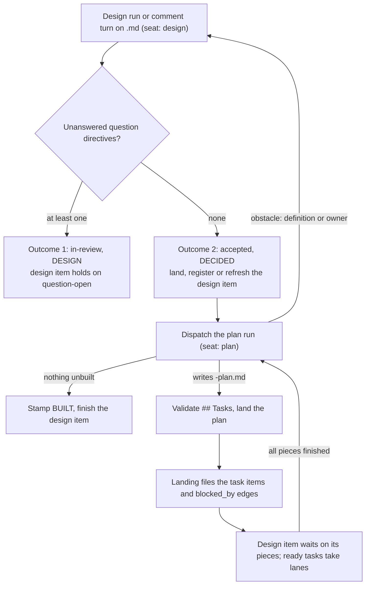

# A design with no open questions moves straight to planning, and owner review comments end in open questions or planning

**Status:** The transition is not built: `rg 'syncDesignDocument|syncCompanionPlan|design-zero-oq-stage-mismatch|check-plan|waits-on-pieces|needs_help' tools`
returns nothing. The comment track it builds on is: `ReasonDesignUnderComment` in
[`definition.go`](../../tools/tillr-drain/drain/definition.go) and
[`comment_intake.go`](../../tools/tillr-drain/drain/comment_intake.go). `R-DT1` is the owner's
ruling; `D-DT1` to `D-DT8` are the designer's decisions, which the owner may overturn.

> **In short.** One mechanical test decides whether a design waits on the owner: whether it
> carries an unanswered `question` directive. With none, the designer stamps
> `status: accepted` and `stage: DECIDED`, the drain dispatches the design's `plan` run on
> that landing, and landing the companion `<topic>-plan.md` files its build tasks into the
> store. Owner review comments go to the document's designer, whose run ends in exactly one
> of two outcomes: questions remain open (naming who is asked), or none remain and the design
> moves straight to planning.

**Why it matters.** Without the rule, a finished design waits for someone to notice it,
decide it is ready and file its build work by hand, and lanes stand idle meanwhile.

**The shape.** Three rules:

- **Zero open questions means ready to plan (`D-DT1`, `D-DT2`).** The designer's engineering
  decisions are labeled for the owner to overturn and never hold a design; a choice reserved
  to the owner must be a real `question` directive.
- **Design, then plan, then filed tasks, with no hand step (`D-DT3` to `D-DT5`).**
- **A two-way exit from a comment turn (`D-DT6` to `D-DT8`).**

**Cost.** One `plan`-seat run per decided design, or per re-plan after a comment, in place of
a planning run per task.

**Start at [Section 4](#4-automatic-transition-from-zero-open-questions-to-queued-slices).**

**Needs your ruling:** [OQ-DT1](#OQ-DT1) and [OQ-DT2](#OQ-DT2).

**Reads with:** [operator decisions inside tillr](./operator-decisions-inside-tillr.md),
[the queue mirrors the designs](./tillr-queue-mirrors-designs.md) (the design item
`item-design-<slug>` and the companion plan), [owner review comments](./tillr-review-comments.md)
(the comment track), [the conflict-answer check](./tillr-conflict-answer-check.md),
[shared-path serialization](./tillr-shared-path-serialization.md),
[judge and lifecycle](./tillr-judge-and-lifecycle.md),
[plan step and seat selection](./tillr-plan-step-and-seat-selection.md), and
[the decision provenance review](../tillr/decision-provenance-review.md)
([OQ-PR12](../tillr/decision-provenance-review.md#OQ-PR12),
[OQ-PR21](../tillr/decision-provenance-review.md#OQ-PR21),
[OQ-PR22](../tillr/decision-provenance-review.md#OQ-PR22)).

---

## 1. The ruling and inherited boundaries

### 1.1 The 2026-11-22 ruling

The owner's words (`R-DT1`):

> "Design should absolutely transition on their own. Like once a design has no more open
> questions, it should immediately move to the planning stage ... So like I dump in review
> comments, they go to the designer, the designer handles them, and then the designer can
> either say this needs more help because there's still open questions or it should go right
> to planning and it shouldn't be a you decision."

("You" is the operating session: the agent session that supervises the drain.) The words rule
three things directly:

1. A design with no open questions moves to planning on its own, with nobody deciding,
   releasing or filing anything.
2. Owner review comments go to the `design` seat, never to the operating session as a
   decision-maker.
3. After the designer handles the comments there are two exits: questions remain open and
   more help is needed, or none remain and the design goes straight to planning.

Everything the words leave open is either a designer's decision below or one of
[OQ-DT1](#OQ-DT1) and [OQ-DT2](#OQ-DT2).

### 1.2 Inherited owner rulings

- **What the operating agent could settle belongs inside tillr**
  ([operator decisions inside tillr](./operator-decisions-inside-tillr.md)). A decided design
  whose build work nobody filed is one of the cases that document names.
- **Owner questions hold building; engineering detail does not**
  ([OQ-PR21](../tillr/decision-provenance-review.md#OQ-PR21) and
  [OQ-PR22](../tillr/decision-provenance-review.md#OQ-PR22)). A choice touching the owner's
  documents, repository, money, models or what the owner sees is filed as an open question;
  engineering detail is marked as the agent's decision and may be built on.
- **One queue item per outstanding design; build steps live in the companion plan**
  ([the queue mirrors the designs](./tillr-queue-mirrors-designs.md)).
- **Review comments go to the document's designer while unstarted steps wait**
  ([OQ-PR12](../tillr/decision-provenance-review.md#OQ-PR12),
  [owner review comments](./tillr-review-comments.md)).
- **A design run that commits nothing names the next actor**
  (`D-JL9` in [judge and lifecycle](./tillr-judge-and-lifecycle.md)).
- **No planning node before every single-commit build**
  ([plan step and seat selection](./tillr-plan-step-and-seat-selection.md)): decomposing a
  design into commits belongs at the boundary between a design and its companion plan.

---

## 2. What exists today, step by step, and what changes

### 2.1 What is in the tree

- **Build work is filed by hand.** `tillr item request` files one item at a time. `Sync` in
  [`sync.go`](../../tools/tillr-item/item/sync.go) imports authored item blocks, and
  `tillr item reconcile` ([`reconcile.go`](../../tools/tillr-item/item/reconcile.go)) only
  reports a proposed `item-design-<slug>` block; neither creates a design item when a design
  lands.
- **The comment track ends at reply delivery.** Comment batches run on the `design` seat at
  the document's desk, and `ReasonDesignUnderComment` holds the document's unstarted work.
  `deliverCommentReplies` in [`comments.go`](../../tools/tillr-drain/drain/comments.go)
  finishes the batch item once replies are written; nothing then checks whether the document
  has zero open questions or moves it to planning.
- **The stage vocabulary already says what a hold is.** [`.vantage.toml`](../../.vantage.toml)
  maps `DESIGN` to `open` ("owes a ruling from the owner") and `DECIDED` to `ready`.

### 2.2 The two mismatches the rule removes

Front matter, prose and `question` directives can disagree in two opposite ways, and each
makes a reader inspect the file by eye:

- **A hold with no question.** A design records only designer decisions, has no `question`
  directive, and still says `status: in-review`, `stage: DESIGN`, with a prose line asking
  the owner to review the decisions. Nothing mechanical holds it; it waits because a reader
  declines to file its build work.
- **A question with no directive.** A design says `status: accepted`, `stage: DECIDED`, and a
  ledger row or header line says a proposal is "for the owner to rule on". To every index it
  looks decided; it waits only because a reader saw the prose.

### 2.3 Step by step

| Step | Today | Under this design |
| :--- | :--- | :--- |
| **Recording a choice** | Either mismatch above can be committed. | An owner-reserved choice is a `question` directive; an engineering choice is a labeled `D-*` row that holds nothing. Settlement and the gate refuse both mismatches (`D-DT1`, `D-DT2`). |
| **A zero-question design lands** | No item is registered; the file waits to be noticed. | The designer stamps `accepted` and `DECIDED`; `landCandidate` registers or refreshes `item-design-<slug>` and wakes the planner (`D-DT3`, `D-DT4`). |
| **Cutting and filing build work** | A person or supervising agent files requests one at a time. | The design item's `plan` run writes `<topic>-plan.md`; its landing creates the task items and their `blocked_by` edges (`D-DT4`, `D-DT5`). |
| **After a comment turn** | The batch item finishes; the document does not move. | Outcome 1 or Outcome 2, verified at settlement (`D-DT6` to `D-DT8`). |
| **A planner or builder hits a gap** | A document-backed item goes to `conflictDecision` in [`blocked.go`](../../tools/tillr-drain/drain/blocked.go). | The design item's `plan` run uses the same obstacle path ([Section 3](#3-how-existing-workflow-definitions-and-seats-compose)). |

---

## 3. How existing workflow definitions and seats compose

The design adds no seat and no second state machine. It connects three things:

1. **A design-level `plan` run.** The `plan` node of
   [`planned-build@v1.json`](../../config/tillr/workflows/planned-build@v1.json) decomposes
   one single-commit item. Decomposing an accepted design into commits sits one level higher:
   `item-design-<slug>` runs one `plan`-seat stage with write access fenced to `<topic>.md`
   and `<topic>-plan.md`, which surveys the tree once and writes ordered single-commit tasks
   under `## Tasks`. Each task item then dispatches directly on `build`.
2. **The `design` seat.** A first draft uses the configured design workflow
   ([`scouted-design@v1.json`](../../config/tillr/workflows/scouted-design@v1.json), or a
   single session with scouts once [OQ-RD1](./tillr-designer-scouts.md#OQ-RD1) is built). A
   single-document update or a comment batch runs one worker at the document's desk, reusing
   its warm session through `chooseDesigner` in
   [`designer.go`](../../tools/tillr-drain/drain/designer.go).
3. **The conflict return.** A `plan` run that finds `<topic>.md` contradicting the tree, or
   missing a decision it needs, ends with a `definition` or `owner` obstacle exactly as a
   build worker does. If the `design` seat can answer from recorded rulings, the answer
   lands, the document stays `DECIDED` and `plan` resumes on a trunk that holds it. If only
   the owner can decide, the designer commits a `question` directive, the document returns to
   `DESIGN`, and the design item holds on `question-open`.

---

## 4. Automatic transition from zero open questions to queued slices

### 4.1 One mechanical test for owner holds: unanswered `question` directives (`D-DT1`, `D-DT2`)

1. **No hold without a question (`D-DT1`).** The designer's engineering decisions are
   recorded in the Decision Ledger as overturnable and named in the header; they are never a
   stop before planning. A design that is not built or retired and has zero unanswered
   `question` directives, in itself and in every `#OQ-*` fragment its `depends-on` names,
   carries `status: accepted` and `stage: DECIDED`.
2. **Front matter, prose and directives must agree (`D-DT2`).** Two checks:
   - **At candidate verification of a `design` or comment commit:** for each non-plan design
     the commit creates or changes, if no question is unanswered while the front matter says
     `SKETCH` or `DESIGN`, or `draft` or `in-review`, settlement refuses the candidate
     (`design-zero-oq-stage-mismatch`) and returns it, uncounted, to the warm design session.
     The designer adds the missing directive or advances the front matter. The opposite case,
     `DECIDED` over an unanswered question, is already `planning/stage-disagrees` in
     `vantage-check`.
   - **In the fast `documents` check:** an added line in a `DECIDED` document whose header
     names something under "Needs your ruling" other than none, or whose ledger row says "for
     the owner to rule on", fails unless the file holds a matching unanswered directive. The
     finding names the remedy: convert the proposal to a question and set `stage: DESIGN`.

### 4.2 Registering designs from both mirrored roadmaps and standalone design runs (`D-DT3`)

A design reaches the queue two ways, so that none is left outside it:

- **From a mirrored roadmap:** `tillr item sync` creates and updates `item-design-<slug>` for
  every outstanding design a configured roadmap links, in roadmap order; an Icebox entry is
  parked.
- **From a landing:** when a `design`-seat run lands a commit that creates or updates a
  non-plan design whose stage role is `open` or `ready`, `landCandidate` registers the design
  item inside the landing transaction. A new item takes the originating request's queue rank
  and records that item as its origin; the originating item finishes as landed.

A zero-question design has no question to list on the roadmap, so roadmap-only discovery
would leave a design written by a standalone request unqueued until someone edited the
roadmap.

### 4.3 Immediate transition to the `plan` stage and automatic slice filing (`D-DT4`, `D-DT5`)

Once the design item is `DECIDED` with no unanswered question, not parked, and has no
unfinished pieces:

1. **Dispatch on the landing's pass (`D-DT4`).** The landing wakes `waitForTrigger`, and the
   next planner pass dispatches the design item's `plan` run with write access to
   `<topic>.md` and `<topic>-plan.md`. The brief carries the design, any existing plan, the
   finished pieces of that design, and read access to the tree.
   - Work remains: the run writes `<topic>-plan.md` (`status: accepted`, `stage: DECIDED`,
     `depends-on` naming the design) with orientation notes and ordered tasks under
     `## Tasks`, each with its predecessors, seat, verification command, any questions it
     waits on, and criteria. One commit.
   - Nothing remains: the run fills the design's `Built` column, stamps the design and any
     plan `BUILT`, and the design item finishes with no tasks filed.
2. **Validation before landing (`D-DT5`).** Candidate verification runs
   `tillr item sync --check-plan <topic>-plan.md` and `uvx vantage-check`. A malformed task
   heading, unknown seat, dependency cycle, missing criteria or a `question` directive in the
   plan (`plan-has-question`) refuses the candidate and returns the findings to the warm
   `plan` session before the trunk moves.
3. **Filing in the landing transaction (`D-DT5`).** When a `DECIDED` plan lands, the same
   store transaction creates one `in-queue` item per unlanded task: its `design_doc` is the
   design, its body is the task's heading in the plan, its origin is the design item, its
   workflow is one build worker by default, and its `blocked_by` edges come from the task's
   predecessors. The new items take contiguous ranks at the design item's place in dependency
   order, without rewriting other items' order. The design item moves to `waits-on-pieces`,
   and tasks with no predecessor take free lanes on the next pass.
4. **Completion.** When the last piece lands or is resolved elsewhere, the design item
   dispatches a `plan` run that verifies the trunk and either stamps `BUILT` or appends
   follow-up tasks.

---

## 5. Owner review comments: routing to the designer and the two outcomes

### 5.1 Routing every review comment to `<doc>`'s designer (`D-DT6`)

Whether a comment answers a question, questions prose, or overturns a `D-*` decision, and
whatever state the design is in, the path is the one in
[owner review comments](./tillr-review-comments.md):

1. **Intake with no triage.** A delivered comment creates or joins a queued comment batch for
   the document and wakes the drain. The operating session never filters comments, edits the
   document or decides whether a comment affects planning.
2. **A hold on the document's downstream work.** While the batch is queued, running or
   settling, the design item and every unstarted piece of the document hold on
   `design-under-comment`. What happens to pieces already running is [OQ-DT1](#OQ-DT1).
3. **A warm `design` turn at the document's desk**, with write scope limited to the document,
   its plan if present, and roadmaps that link it, and with the open questions, the plan's
   stage and tasks, and the active and landed pieces staged in its context.

### 5.2 The binary exit: Outcome 1 (more help needed) vs Outcome 2 (straight to planning)

Settlement of a comment batch on a design that is not built or retired accepts exactly two
endings (`D-DT6`).

#### Outcome 1 — More help is needed because questions remain open (and who is asked)

At least one question cannot be closed: an earlier question the batch did not address, a
partial ruling, a `D-*` overturn that exposes a trade-off reserved to the owner, or a comment
that needs an upstream ruling or an investigation outside the comment's write scope. The
document carries at least one unanswered `question` directive and says `status: in-review`,
`stage: DESIGN`. Who is asked is recorded and decides the mover (`D-DT7`):

| Why it remains open | How it is recorded | Who is asked | What happens next |
| :--- | :--- | :--- | :--- |
| An owner decision or a follow-up to the owner | A 💬 question with a directive and a leaning | `owner` | The design item holds on `question-open`; the reply names the open ids and says nothing is built. The next comment batch resumes the desk. |
| Another design's open owner question | A 🔒 question with a directive, and `depends-on` naming the other document's question | `owner`, on the other document | The design item holds; when the other question is answered and compacted, it wakes on `design` to close the dependent question. |
| A benchmark outside the write scope, or a tool defect | A 🔒 question with a directive, plus a `needs_help` artifact naming the kind (`investigation` or `defect`), the question, a title and a prompt | `drain`, through a filed prerequisite item | The landing files one deduplicated prerequisite item that blocks the design item; when it finishes, the design item dispatches on `design` with the finding in its brief. |

The operating session is never a permitted target. Ordinary reading of the tree is done in
the comment turn by the designer's own scouts ([designer scouts](./tillr-designer-scouts.md)).

#### Outcome 2 — Zero open questions remain: straight to planning

Every comment is resolved, every answered question is compacted into the Decision Ledger
quoting the owner's dated words ([OQ-PR22](../tillr/decision-provenance-review.md#OQ-PR22)),
and no directive is unanswered (`D-DT6`, `D-DT8`):

1. **In the designer's commit.** The document is `accepted` and `DECIDED`. A comment that was
   a question answered from the tree, on an already decided design, may land no diff at all.
   If the design had a `DECIDED` plan and the comment changed a requirement or overturned a
   `D-*` decision, the designer sets the plan back to `SKETCH` in the same commit and notes
   which sections changed, so stale tasks cannot dispatch. A comment that only clarified
   prose leaves the plan `DECIDED`.
2. **On landing.** The hold clears and the reply says what changed, that the document has no
   open questions, that it moved to planning, and that the code is not built.
   - Plan absent or `SKETCH`: unstarted pieces of the earlier plan are closed with the reason
     "superseded by comment re-plan", landed pieces are kept, and the design item's `plan`
     run dispatches on the same pass ([Section 4.3](#43-immediate-transition-to-the-plan-stage-and-automatic-slice-filing-d-dt4-d-dt5)).
   - Plan still `DECIDED`: waiting pieces are released and no `plan` run is spent.

### 5.3 Fact-checking designer commits that prescribe concrete code symbols

When an Outcome 2 commit writes symbol names, types, flags or configuration claims into the
document, the review seat's fact-and-ledger audit
([review rules](./tillr-review-rules.md)) or the check stage of
[the conflict-answer check](./tillr-conflict-answer-check.md) runs before the trunk advances
and returns a contradiction to the warm desk session before the `plan` seat wakes. A prose
edit or a compaction that asserts no new symbol pays for no review run.

---

## 6. Edge and failure cases

| Case | What happens |
| :--- | :--- |
| A commit leaves a design with no unanswered question at `DESIGN` or `in-review` | Refused at candidate verification and returned to the warm design session (`D-DT2`). |
| A commit stamps `DECIDED` over an unanswered question, or reserves a proposal to the owner in prose without a directive | Refused by `planning/stage-disagrees` or the `documents` check (`D-DT2`). |
| The `plan` run finds the design contradicts the tree or leaves an owner choice unset | It commits nothing and ends with an obstacle; the conflict return of [Section 3](#3-how-existing-workflow-definitions-and-seats-compose) applies. |
| The `plan` run writes invalid task metadata or a question into the plan | Refused before landing by `--check-plan` (`D-DT5`). |
| Everything the design promises is already on the trunk | The `plan` run stamps `BUILT`; no tasks are filed (`D-DT4`). |
| A second comment arrives during a comment turn or a `plan` run | A queued batch absorbs it; a running batch is followed by a second one. A plan written during a comment turn does not land until the turn settles (`D-DT8`). |
| The owner moves the design under the roadmap's Icebox | The next sync parks the design item and its unstarted pieces; planning and dispatch stop until it is unparked. |
| One part of a decided design gains an owner question | It is written as a directive. Tasks that do not name it keep building; the design item and tasks that name it wait. |

---

## 7. Alternatives considered

| Alternative | Verdict |
| :--- | :--- |
| Keep `in-review` as a pause for designer `D-*` rows | Rejected by `R-DT1` and [OQ-PR21](../tillr/decision-provenance-review.md#OQ-PR21): it needs someone to release every zero-question design by hand. |
| Have the `design` seat write `## Tasks` inside the design or comment turn | Rejected (`D-DT4`): `R-DT1` names a planning stage, and a comment turn would have to survey the tree before replying. |
| Discover designs only from roadmap links | Rejected (`D-DT3`): a standalone design request lands a design without editing a roadmap. |
| Run a planning node on every task filed from the plan | Rejected (`D-DT5`): the plan already cuts the design into single-commit tasks with verification and criteria. |

---

## 8. High-level build sequence

File maps and tests belong in a companion plan, written once the two open questions are
ruled. Slices 1 to 5 wait on neither.

| Slice | What lands | Depends on |
| ---: | :--- | :--- |
| 1 | The shared question reader in `tools/tillr/vantage` exposes each document's stage, stage role, status and the question targets of `depends-on` | — |
| 2 | The candidate check `design-zero-oq-stage-mismatch` and the `documents` check for owner holds without a directive (`D-DT1`, `D-DT2`) | 1 |
| 3 | Design-item registration from mirrored roadmaps and from design landings; companion-plan task sync and the `--check-plan` validator (`D-DT3`, `D-DT5`) | 1 |
| 4 | `DECIDED` to `plan` dispatch, task filing in the landing transaction, the `waits-on-pieces` hold, and the final `BUILT` pass (`D-DT4`, `D-DT5`) | 2, 3 |
| 5 | The binary settlement of comment batches: Outcome 1 with its three movers, Outcome 2 with re-plan (`D-DT6` to `D-DT8`) | 2, 4 |
| 6 | Handling of running pieces under a late comment, and the cutover of existing documents | 5, [OQ-DT1](#OQ-DT1), [OQ-DT2](#OQ-DT2) |

---

## Open Questions

1. 💬 **OQ-DT1: When an owner review comment arrives on a design whose slices are already running on lanes, what happens to those in-flight runs?**

   Unstarted pieces are held while the comment turn runs, and rewriting the trunk is reserved
   to the owner. That leaves pieces that are mid-run, possibly after earlier pieces landed.

   - **A — Let running pieces finish, hold their landing until the comment settles, never
     revert the trunk.** A prose comment wastes nothing; if the comment overturned a decision,
     the obsolete candidates are closed unlanded and the re-plan writes tasks on top of what
     already landed.
   - **B — Stop running pieces when the comment arrives.** Saves the rest of each run, and
     discards nearly finished work whenever the comment was only a question.
   - **C — Let running pieces finish and land.** Simplest, and lands a commit the owner just
     objected to.

   <!-- vantage: question id=OQ-DT1 leaning="A — hold landing during the ~60s comment turn without killing active workers or auto-reverting main: prose comments waste zero in-flight work, contradicted candidates never hit main, and already-landed commits are amended forward by the re-plan." -->

   _Leaning:_ A — hold landing during the ~60s comment turn without killing active workers or auto-reverting `main`: prose comments waste zero in-flight work, contradicted candidates never hit `main`, and already-landed commits are amended forward by the re-plan.

   **Answer:**

   > _(empty — fill in when decided)_

2. 💬 **OQ-DT2: How should rollout treat the existing backlog of zero-question `DESIGN` and `DECIDED` documents?**

   When the transition is switched on, `docs/design/` already holds documents in both
   mismatches of [Section 2.2](#22-the-two-mismatches-the-rule-removes): designs at `DESIGN`
   with no unanswered question, some linked from the roadmap and many not, and decided
   designs with an owner hold written only in prose (the gate's `D-GR45`, listed under
   [the gate reference's known gaps](../reference/gate.md#known-gaps), is one).

   - **A — Fix the metadata first, then promote what the roadmap routes.** Convert each prose
     hold to a question, add missing `depends-on` links, link the active designs from the
     roadmap, then let every unparked zero-question design on the roadmap promote in roadmap
     order. Documents no roadmap routes stay out of the queue.
   - **B — Forward only.** Convert the prose holds; apply the transition only to designs
     written or commented on after rollout.
   - **C — Promote every zero-question file under `docs/design/`.** Risks planning stale
     drafts and unlinked sketches.

   <!-- vantage: question id=OQ-DT2 leaning="A — convert D-GR45 into an OQ-GR* question directive and fix unlinked child/deprecated metadata first, then auto-promote all unparked zero-OQ designs on docs/tillr/roadmap.md in roadmap order while leaving unrouted drafts out of the queue." -->

   _Leaning:_ A — convert `D-GR45` into an `OQ-GR*` question directive and fix unlinked child/deprecated metadata first, then auto-promote all unparked zero-OQ designs on [`docs/tillr/roadmap.md`](../tillr/roadmap.md) in roadmap order while leaving unrouted drafts out of the queue.

   **Answer:**

   > _(empty — fill in when decided)_

---

## Decision Ledger

`R-DT1` is the owner's ruling. `D-DT1` to `D-DT8` are the designer's decisions of 2026-11-22;
the owner may overturn any of them. None is built.

| ID | Ruling / Decision | Date | Settled in | Built |
| :--- | :--- | :--- | :--- | :--- |
| R-DT1 | **Owner ruling.** A design with no open questions moves to the planning stage on its own. Owner review comments go to the designer, who ends either with questions still open or with the design going straight to planning. | 2026-11-22, owner | [Section 1.1](#11-the-2026-11-22-ruling) | — |
| D-DT1 | Designer `D-*` decisions are labeled overturnable and never hold a design out of planning; a live design with zero unanswered `question` directives, its `depends-on` fragments included, is `accepted` and `DECIDED`. **Rejected:** holding zero-question designs in review. | 2026-11-22, designer | [Section 4.1](#41-one-mechanical-test-for-owner-holds-unanswered-question-directives-d-dt1-d-dt2) | No |
| D-DT2 | Directives, front matter and prose must agree: settlement refuses a changed design with no unanswered question left at `SKETCH`, `DESIGN`, `draft` or `in-review`, and the `documents` check refuses a `DECIDED` design that reserves a choice to the owner without a directive. | 2026-11-22, designer | [Section 4.1](#41-one-mechanical-test-for-owner-holds-unanswered-question-directives-d-dt1-d-dt2) | No |
| D-DT3 | The design item is registered both by roadmap sync and inside the landing of any `design`-seat run that creates or updates a design, taking the originating request's rank. **Rejected:** roadmap-only discovery. | 2026-11-22, designer | [Section 4.2](#42-registering-designs-from-both-mirrored-roadmaps-and-standalone-design-runs-d-dt3) | No |
| D-DT4 | Design and task cutting are consecutive stages on the design item: a `DECIDED` design with no unanswered question and no unfinished piece dispatches a `plan` run on the landing's pass, which writes the companion plan or stamps `BUILT`. **Rejected:** design or comment turns cutting tasks. | 2026-11-22, designer | [Section 4.3](#43-immediate-transition-to-the-plan-stage-and-automatic-slice-filing-d-dt4-d-dt5) | No |
| D-DT5 | The plan is validated before landing by `tillr item sync --check-plan`, and its tasks are filed in the landing transaction as single-worker build items with `blocked_by` edges and contiguous ranks; the design item then waits on its pieces. | 2026-11-22, designer | [Section 4.3](#43-immediate-transition-to-the-plan-stage-and-automatic-slice-filing-d-dt4-d-dt5) | No |
| D-DT6 | Every owner review comment on a document runs on the `design` seat at the document's desk while its unstarted work holds, and the turn ends in Outcome 1 or Outcome 2 only. | 2026-11-22, designer | [Section 5.1](#51-routing-every-review-comment-to-docs-designer-d-dt6), [Section 5.2](#52-the-binary-exit-outcome-1-more-help-needed-vs-outcome-2-straight-to-planning) | Routing and hold: yes. Binary exit: no |
| D-DT7 | Outcome 1 records who is asked, and the operating session is never the mover: the owner, the owner on another document, or the drain through a prerequisite item filed from a `needs_help` artifact. | 2026-11-22, designer | [Section 5.2](#52-the-binary-exit-outcome-1-more-help-needed-vs-outcome-2-straight-to-planning) | No |
| D-DT8 | Outcome 2 on a design with a `DECIDED` plan: a comment that changed a requirement sets the plan back to `SKETCH`, closes unstarted obsolete pieces on landing and dispatches `plan`; a clarification leaves the plan and releases waiting pieces. | 2026-11-22, designer | [Section 5.2](#52-the-binary-exit-outcome-1-more-help-needed-vs-outcome-2-straight-to-planning) | No |
