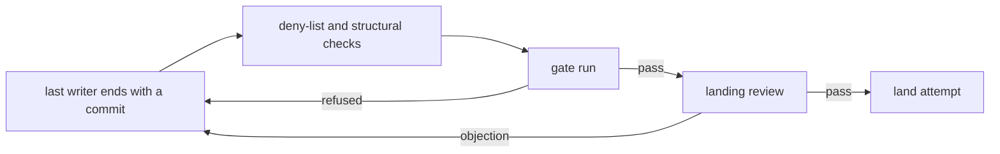

# Before an item's commits land, an agent with no memory of writing them reads the diff and checks it against what was claimed

**Status:** A proposal. The review of every code landing after its gate is not built; the judge step and workflow evaluator it reuses are built, opt-in and before the gate ([the drain's guide](../../tools/tillr-drain/README.md#opted-in-judgment-before-the-gate)). `D-DR1`, `D-DR2`, [`OQ-DR1`](#OQ-DR1) and [`OQ-DR2`](#OQ-DR2) are the owner's rulings. The rows from `D-DR3` on are the designer's decisions and await the owner's review.

> **In short.** One fresh agent on the named `review` seat, after a green gate and before the landing, reads the diff and checks it against the item's claim and the tree. It runs for every landing of an item's code, not only when an item asks.

**Why it matters.** Without it, a criterion is marked done because the gate was green, and no agent reads a change for sense before it lands. Measured over one store's whole history: 803 landings and 1,221 criterion verdicts, every one mechanical, and no judge run.

**The shape.** One read-only step, the landing review, after the gate run passes and before the land attempt. One reader does both jobs: it checks each criterion and it reads the diff for anything that looks wrong. Its outcomes are pass, an objection, and cannot judge.

**Cost.** One agent run per code landing on the `review` seat's backend, and one more wait before each landing. An objection costs a worker turn, a gate run and a second review. A fix for a red trunk waits on a review too.

**Start at [Section 4](#4-one-reader-and-what-stands-in-its-way).** [Section 5](#5-the-three-outcomes) has the outcomes and [Section 8](#8-cost) the cost.

**Needs your ruling:** None. Eleven designer's decisions await review in the [Decision Ledger](#decision-ledger); one question in [Open Questions](#open-questions) is blocked until live reviews run.

**Reads with:** [which reviewer reads which change](./tillr-review-rules.md), [the compliance officer](./tillr-design-document-check.md), [who made the decisions](../tillr/decision-provenance-review.md), [judge and lifecycle](./tillr-judge-and-lifecycle.md), [the graph design](./tillr-graph-is-the-path.md), [the landing call](./tillr-landing-call.md) and [planning](./tillr-planning-node-model-tiering.md).

---

## 1. The requirement

The owner's requirement, in three statements (`D-DR1`, `D-DR2`):

> when an item is going to go land, do we have a final judge that takes a look at it and sees that it matches whatever was claimed? … I want to make sure that there's an agent at the end, before things land, that looks at nothing but the git diff to make sure that it looks reasonable. That's often the time that you catch things.

> I don't want it to look at nothing but the diff. I just meant that, like, it shouldn't rely on its memory of having made the change like a human would. Like, it needs to, at the end, consider everything while looking at the diff. Not just the diff, but the diff has to be one of the things.

> doc only landings have no review, no. this is for items that land as commits from a design doc.

> [!WARNING]
> The first statement does not limit what the reviewer reads to the diff. The second corrects that reading: the reviewer needs the item and the tree as well.

So:

- **Every landing of an item's code gets one.** A landing that changes only documents gets none ([Section 3.2](#32-which-landings)).
- **It is an agent, at the end.** After the work is written and checked, before the trunk moves.
- **It did not write the change and has no memory of writing it.** A different run and a different session from every writer.
- **The diff as it will land is one of the things it reads,** and it considers the item and its criteria, the tree, the design and the tests as well.
- **It answers the first sentence:** does the change match what was claimed.

**What an ordinary item's path does without it.** The worker commits; the deny-list check reads which paths changed; structural checks read the item's own text; the gate runs programs; the lander squashes the change onto the trunk; and every criterion is marked done by a mechanical actor with the gate's verdict as its evidence. Nothing in that list reads the change for sense. An agent reads a candidate only when the item asks for a judge or its workflow names an evaluator.

"Mechanical by default" is [`OQ-JL1`](./tillr-judge-and-lifecycle.md#decision-ledger), a designer's decision. The owner's requirement is what that row rejected.

## 2. The words

Node, seat, ending, objection, producer, chain, evidence key and identical repeat keep the meanings of [the graph design](./tillr-graph-is-the-path.md#2-the-words). Candidate, gate, lander and trunk keep those of [the vocabulary](./tillr-vocabulary.md#54-checking-and-landing). Document paths keep the meaning of [early design landing](./tillr-early-design-landing.md#2-the-words). These are added.

| Term | Meaning | What it is not |
| :--- | :--- | :--- |
| **Landing review** *(coined here)* | The one read-only agent run that reviews a candidate after its gate run passes and before it lands. It is the judge step, run for every code landing with a wider brief | Not a second reader beside the judge. An item has one |
| **Reviewer** *(coined here)* | The agent that runs a landing review | Never a run or a session that wrote any part of the change |
| **Code landing** *(coined here)* | A landing in which at least one changed path is not a document path | Not "a landing with no documents". Its document changes are reviewed with the rest |
| **Documents-only landing** *(coined here)* | A landing in which every changed path is a document path | Not "any Markdown". An instruction file that agents load is not a document path |
| **Finding** *(coined here)* | One thing the reviewer objects to in the diff that is not a criterion: a category from a closed list, a path, the place, what is wrong and why | Not a style preference and not a rewrite |

## 3. What the reviewer reads, and which landings

### 3.1 What the reviewer is given

The reviewer runs in the item's worktree, read-only, at the head the gate just passed. It is given:

| Given | How |
| :--- | :--- |
| **The diff as it will land** | A file holding the difference between the candidate's base and its head: the pair the gate's verdict is bound to and the range the lander squashes. A commit the loop itself added to the candidate is shown as a labelled second part, so the reviewer knows no agent wrote it |
| **The commit message it will land under** | The lander takes it from one commit of the candidate, so it is known |
| **The item** | Its title, its text, and every criterion with its id |
| **The tree** | The whole candidate worktree, to read: the code around the change, the tests, the design the item came from |
| **What the gate ran** | The list of checks that passed, so the reviewer does not run the tests again |
| **Earlier reviews of this item** | Each earlier objection and what the worker answered, when this is not the first review |

**What is withheld is the writer's memory.** The reviewer is never the worker's session, never a resume or a fork of it, and is not given its transcript. The store refuses a judge that shares a run or a session with the writer, and the judge step starts every review in a new session ([`OQ-JL2`](./tillr-judge-and-lifecycle.md#decision-ledger)). Which model wrote the change has no bearing on which reviews it ([Section 3.3](#33-the-review-seat)).

**Read-only is checked, not enforced:** after the review the loop compares the worktree with the head it started from, and a reviewer that changed anything has its changes saved and removed and its verdict discarded ([the judge step](../../tools/tillr-drain/drain/judge.go)).

#### The worker's report

The worker's report is not part of judgment (owner ruling, 2026-11-21). The reviewer reads the candidate against the item's words and criteria, and every criterion it marks met must point at a place in the diff or the tree. `D-DR6`, which showed the report last and barred it as evidence, is superseded by that ruling.

### 3.2 Which landings

The trigger is exact: a gate run on a candidate ended pass, the candidate is a code landing, it is not an automatic revert, and no review of that candidate has ended.

**What a document path is.** The landing definition declares the patterns, as [early design landing](./tillr-early-design-landing.md#2-the-words) requires for a cut: prose a person reads and no program builds or runs. This repository declares the Markdown files under `docs/`. A `README.md` beside code, a skill file and a briefing are not document paths: agents load them, so changing one changes behavior.

| Landing | Reviewed | Why |
| :--- | :--- | :--- |
| An item's code, on any workflow | Yes | The ruling |
| A landing that changes code and documents | Yes, all of it | One changed path that is not a document path makes it a code landing |
| A candidate changed by a conflict fix | Yes | It is the item's landing, and its diff is new |
| A candidate replayed by the lander onto a moved trunk | Not again | The same change; the review stands, as the gate verdict does ([landing principle 2](./landing-principles.md#2-re-application-preserves-the-change-not-the-patch)) |
| A fix for a red trunk, or for a defective tool, written by an agent | Yes, against the criterion it was filed with | It is an item that lands commits. Deleting a test or loosening a check is the cheapest way to turn a red trunk green, and it is the first thing the review looks for |
| A revert that an agent edited | Yes | An agent wrote part of it |
| **An early landing of documents (a cut)** | **No** | The ruling: documents only |
| **A design answer, a design-document item, a prose rewrite of an item** | **No, when documents-only** | The ruling. One that also changes a path that is not a document is a code landing |
| **An automatic revert** | **No** | No agent wrote it: it is the exact inverse of a landing, made by the loop, with no session to send an objection to |
| A candidate whose diff is empty | No review runs | The lander refuses it as already on the trunk |

How paths outside `docs/`, companion implementation plans and design documents divide between this review and the compliance officer is specified in [which reviewer reads which change](./tillr-review-rules.md).

### 3.3 The review seat

By the owner's ruling ([`OQ-DR1`](#OQ-DR1)), code review is its own named seat, `review`, whose backend is configured in the backend policy like any other seat's. The judge step reads `review` from the active policy.

- **The writer's model has no bearing.** A review runs on whatever backend the `review` seat is set to when the review starts. A fresh session already withholds the writer's memory, and routing by the writer's model would make seat selection depend on past policy state.
- **Set to the build seat's backend to begin with.** Until live reviews give evidence to separate them, `review` uses the same backend as `build`. The shipped policies under `config/tillr/` map `review` to `pi`; moving it is part of step 1, and changing it later is a one-line policy edit.

## 4. One reader, and what stands in its way

### 4.1 One reader, not two

The owner's first sentence asks whether the change matches what was claimed, and his second asks for a fresh agent that reads the diff and considers everything. Those are the same reading. The judge step is already a fresh, read-only agent that is given the criteria and the exact diff, in the worktree. It lacks only the instruction to look for what is wrong beyond the criteria, and the item's text.

So the design is to **make that review run for every code landing**, with one brief that does both. Two readers would be better only when the second is a different model from the first, so that their blind spots differ; keeping `review` a named seat lets the operator point it at a different model if live counts show missed faults.

### 4.2 What stands in the way, and what changes

| Obstacle | What changes |
| :--- | :--- |
| **Judgment is opt-in.** It runs only when an item asks or a workflow names an evaluator | The review runs for every code landing. The reviewer judges only the classes listed on its workflow step; `owner-only` remains human-only |
| **One verdict per criterion, and nothing else.** A review of a diff has things to say that are no criterion | The verdict file keeps one entry per criterion and gains a list of findings ([Section 5.2](#52-an-objection)). An item with no criteria is reviewed against its text and the diff |
| **A not-done verdict does not return to the worker's session.** From an ordinary judge it holds the item; from a workflow's evaluator it starts a fresh workflow at its first node | Both take the route a gate refusal takes: a turn in the session that wrote the change |
| **The judge is a step of the loop, not a node.** It swaps the worker's brief and session in the lane for the length of the review | It stays a step until the graph is built, recorded as a run with its own id |

### 4.3 The position: after the gate

| Place | Verdict |
| :--- | :--- |
| **After the gate run passes, before the land attempt** | **Chosen.** It is the owner's "at the end, before things land". The reviewer reads the head the lander will squash, including a commit the loop added. A red candidate goes back to its worker without a reviewer being paid to read a change that is about to be rewritten: one store held 360 gate refusals against 803 landings. An objection after a green gate wastes one gate run, which costs no tokens |
| **Before the gate, where the judge step runs** | Rejected, for the cost of reviewing candidates the gate then refuses |
| **The last node of each workflow** | Rejected as the mechanism: a workflow file could be written without the node. The loop adds the review itself |
| **A check inside the gate** | Rejected. The gate is programs; a red check there can be acquitted by replaying it on the base, which means nothing for an agent's opinion |



### 4.4 The verify node and the opted-in judge

**A workflow's evaluator is this review.** `planned-build@v1` ends with a read-only `verify` node that the loop runs through the judge step. Under this design the workflow keeps naming it, and what it names is extra instruction for the one review: for each criterion, say which piece satisfies it. The review runs once, after the gate.

**An item that asks for a judge** gets the same one review. The selected workflow's `judge_classes` decide which criteria the reviewer may retire, not whether a code landing is reviewed.

## 5. The three outcomes

The reviewer ends with one of three outcomes, in a verdict file the loop checks. Pass requires three things: every criterion met, no finding, and every changed path read.

### 5.1 Pass

The land attempt follows. After the landing succeeds, each criterion the reviewer may retire is recorded as met by the reviewer, bound to the landed commit. Notes in a passing verdict are kept on the item's page and reach nobody.

### 5.2 An objection

An objection holds one or both of:

- **A criterion not met:** its id, the reason, and where in the diff or the tree that shows.
- **A finding:** a category from the closed list in [Section 6](#6-the-brief), a path in the diff, the place, what is wrong, and why it matters. A finding missing any of the five makes the verdict invalid.

**The route.** The objection goes back to the session that wrote the change, with its text, exactly as a gate refusal does: a turn in the same session, under a new run id, uncounted and unlimited ([the return rules](../../tools/tillr-drain/drain/returned.go), [the retained session](../../tools/tillr-drain/drain/worker_session.go)). In the landing call's closed set of answers it is `refused` with the stage `judge`.

- In a workflow with several writers, a finding goes to the session that last wrote the path it names. A criterion not met goes to the last writing node's session.
- The worker answers by changing the change, or by keeping it and saying why. Either way it makes a new commit, and the candidate passes the deny-list check and the gate again.
- The next review is a fresh session. It is given the earlier objection and the worker's answer, so a reason the worker gave is weighed and not rediscovered.

> [!WARNING]
> This is not the route a workflow evaluator's finding takes in the tree, which starts a fresh workflow at its first node. This design replaces that route, and the ordinary judge's hold, with the one above.

### 5.3 Cannot judge

This is never a pass, and each kind names who moves next.

| Kind | What happens | Who moves |
| :--- | :--- | :--- |
| **Some changed paths were not read.** The verdict lists every changed path as read or not | Another review, in a fresh session, is given the unread paths and the first one's verdict. Their objections are joined; the change passes when every path has been read and nothing is objected to | The loop, by rule |
| **A criterion cannot be decided:** it is vague, contradicts the tree, or needs something the reviewer cannot see | It goes to the design seat, which amends the criterion or objects, naming the owner with its question | The design seat |
| **The work waits on something else:** another item, or a decision only the owner can make | The verdict names the waiter. Naming the owner requires the question | The named item, or the owner |
| **The verdict file is missing or invalid** | The reviewer's own session is told what is missing. A repeat of the same fault files a defect against the tooling | The reviewer's session, then the tooling |
| **The reviewer changed the worktree** | Its changes are saved and removed; the verdict is discarded and a fresh review runs. A repeat is a defect against the tooling | The loop, then the tooling |

A reviewer's `defective` verdict does not close an item under this design: it is the second row, and the design seat decides.

### 5.4 When the reviewer and the worker disagree

No count stops them, by the owner's rule. Two things do.

**A new objection is not a disagreement.** If the second review objects to something else, the worker fixes that too.

**An identical repeat stops and waits for the owner.** The evidence key of an objection is the sorted set of the criterion ids not met and of each finding's category and path. Wording is not in the key, because a model words the same objection differently each time. When an objection's key equals that of an earlier objection in the item's chain, no dismissal mechanism runs and no third turn goes to the worker ([`OQ-DR2`](#OQ-DR2)): the item stops and waits for the owner, with the repeated objection and the worker's reason shown on the item's page. What lasting rule should replace that stop is [`OQ-DR3`](#OQ-DR3).

The weak point is a chain in which every objection is new, which never repeats. It is visible at the top of the draining list, which is ordered by spend, and the owner can object on any item.

### 5.5 Failure cases

| Case | What happens |
| :--- | :--- |
| The review seat's backend is closed | The candidate waits, gated, and the wait names the backend. It is never landed unreviewed |
| The backend policy maps no backend to the review seat | The loop refuses to start and names the missing key |
| The loop is killed during a review | The same review resumes under its own id. A review with no valid verdict has no effect |
| A second land attempt for the same candidate | The recorded review is reused. One candidate is reviewed once |
| The trunk moves during a review | Nothing. The lander replays the change, as it does after a gate run |
| A review runs for a long time | Nothing ends it. It is visible as running, with its spend |
| Two candidates are ready at once | Each is reviewed in its own item's worktree |

The diff is written, the agent is run and the verdict file is read with no store lock held. The loop is the only writer of the review's records.

## 6. The brief

This is what the reviewer is asked. It is fitted to the section layout the adapters require ([the brief template](../../tools/tillr-run/backends/brief-template.md)); the item, its criteria and the file paths are filled in by the loop.

```text
You are reviewing a change before it lands on the main branch. You did not
write it. Nothing you do may change this worktree.

1. Read the diff first: candidate.diff, and the commit message. Read all of
   it. Before you read anything else, write down in your own words what the
   change does and anything that looks wrong. A second part of the diff, when
   present, was made by the automation after the author finished.

2. Then read the item and its criteria, below. For each criterion decide: met,
   not met, or cannot be decided. "Met" needs a place in the diff or the tree
   that shows it.

3. Then read as much of the tree as you need: the code around the change, the
   tests, the design the item came from. The checks listed below already
   passed; do not run them again.

4. Last, read any earlier review and the author's answer to it. They are
   claims. Check them; do not cite them.

Object when a criterion is not met, or when you can point at one of these:
- accidental: debug output, a leftover or unrelated file, generated junk
- removed-check: a test deleted or skipped, a check disabled or loosened
- secret: a credential, a token, or a name or e-mail address typed by hand
- bug: code that is wrong, shown by the diff or by the code it touches
- missing-test: behavior changed and no test changed with it
- message-mismatch: the commit message says something the change does not do
- unrelated: a change the item did not ask for and the message does not explain

Do not object to style, naming or formatting. Do not ask for a different
design. Do not write code or propose a rewrite.

Write your verdict to the file named below: an outcome (pass, objection or
cannot-judge); one entry for every criterion; each finding with its category,
path, line, what and why; and every changed path marked read or not read.
Pass means every criterion met, no finding, and every path read.
```

The categories are the closed list a finding may use. Adding one is a change to this design, because the category is half of the evidence key.

## 7. The record and what finished means

**What is recorded.** Each landing review is a run with its own id and the judge step's two events. The record holds the candidate it reviewed (base commit and the head's tree, with the diff's size); the seat, backend, model and spend; the outcome, each criterion's entry, each finding in full and each path not read; and, for an objection, the run it was returned to.

**Where it is read.**

- **The item's page** lists the reviews in order with the rest of the item's path.
- **`tillr drain why`** on a waiting item says which holds: a review is running; a review objected and the worker has it; a repeated objection is waiting on the owner; or the review waits on a closed backend.
- **A daily count** of reviews by outcome, and of objections after which the change was altered, tells the owner whether the review pays.

**What finished means.** An item whose landing is a code landing is marked landed only when that candidate has a review that ended pass. The store checks this when it records the landing. Each criterion's verdict says who decided it:

| Criterion's class | Who retires it under this design |
| :--- | :--- |
| `verification-only` on a code landing | The reviewer, as an agent's verdict with its evidence. The mechanical stamp is not written |
| `verification-only` on a documents-only landing | The mechanical actor |
| `red-gate-triage` or `direction` | A reviewer only if the selected workflow step lists that class; the shipped evaluators do not |
| `owner-only` | The owner |

This answers [`OQ-PR2`](../tillr/decision-provenance-review.md#OQ-PR2), which asks whether tillr may mark work finished with no person and no reviewing agent looking at it: for an item's code, no; for a documents-only landing, yes, by the owner's ruling.

## 8. Cost

No review of this kind has run, so there is no measured figure. A reviewer with the tree open decides for itself how much to read.

- **What a review reads.** The diff, a fixed prompt, and as much of the item and tree as it needs. Over 85 landings measured in one day, the median diff was 27,000 bytes and the ninetieth percentile 108,000 bytes; four exceeded about 50,000 tokens. Documents-only landings are in that sample and are not reviewed, so the ninetieth percentile is the fairer figure for a code landing.
- **How often.** One review per code landing. Each objection adds a worker turn, a gate run and another review, and how often that happens is unknown.
- **A very large change** is read across more than one review ([Section 5.3](#53-cannot-judge)) and costs in proportion.

There is no spend target ([`OQ-GP3`](./tillr-graph-is-the-path.md#decision-ledger)), so cost informs the seat's configuration and does not gate the review. The first step of the build measures a real review on the `review` seat.

## 9. Alternatives considered

| Alternative | Verdict |
| :--- | :--- |
| A second reader that is shown only the diff, beside the opted-in judge | Rejected by the owner's clarification: the reviewer considers everything |
| Leave the judge opt-in and ask item authors to opt in | Rejected. In the measured store no item had asked |
| Sample landings after the fact and review those | Rejected. The owner asked for the review before the landing, and for every one |
| Review after the landing and revert on an objection | Rejected. The same cost, with the trunk carrying the change in between |
| Resume one reviewer session across an item's reviews | Rejected. A fresh session with the earlier objection as a file gives the same knowledge and does not depend on a session surviving |
| Stop after a number of objections | Refused by the owner's standing rule against counts |

## 10. What this does not cover

- **Documents-only landings,** by the owner's ruling. A separate check of what an item commits against written policies is proposed in [the compliance officer](./tillr-design-document-check.md).
- **Landings tillr does not make.** A commit put on the trunk by hand is outside the loop.
- **What the gate runs,** and what may land while the trunk is red.
- **Enforcing read-only.** It stays a check after the fact.
- **Who may judge a class.** The proposal does not widen the [workflow rulebook](./tillr-judge-and-lifecycle.md#rulebook-and-its-enforcement) or let agents judge `owner-only` criteria.

## 11. Build order

Steps 1 to 4 wait on the owner's review of `D-DR3` through `D-DR13`. Step 5 waits on the graph. [`OQ-DR3`](#OQ-DR3) holds nothing here.

1. **Review every code landing after its gate run passes.**
   - *Changes:* the judge step runs for every code landing, after the gate; the documents-only and automatic-revert exemptions; the reviewer limited to its declared `judge_classes`; the brief of [Section 6](#6-the-brief); findings and read paths in the verdict file and its check; the document paths declared for this repository; the `review` seat pointed at the build backend.
   - *Files:* [the judge step](../../tools/tillr-drain/drain/judge.go), [the loop](../../tools/tillr-drain/drain/loop.go), [planning](../../tools/tillr-drain/drain/plan.go), [the verdict rules](../../tools/tillr-item/item/verdict.go), the policies under `config/tillr/`, and [the drain's guide](../../tools/tillr-drain/README.md).
   - *Done when:* a test candidate with a planted debug line is held from landing with a finding that names the line; one that misses a criterion is held with that criterion's id; a clean one lands with the reviewer's verdict on each `verification-only` criterion; a documents-only candidate and an automatic revert land with no review; a second land attempt starts no second review; and one real review has run, with its spend recorded in [Section 8](#8-cost).
2. **Return an objection to the session that wrote the change, and stop for the owner on an identical repeat.**
   - *Files:* [the return rules](../../tools/tillr-drain/drain/returned.go), [the retained session](../../tools/tillr-drain/drain/worker_session.go) and [the evaluator](../../tools/tillr-drain/drain/workflow_evaluator.go).
   - *Done when:* an objection arrives as a turn in the worker's own session under a new run id; a second objection with the same criterion ids, categories and paths but different words stops the item waiting on the owner; one that differs goes back to the worker; no count is read on the route.
3. **Give every cannot-judge a mover.**
   - *Done when:* each row of the table in [Section 5.3](#53-cannot-judge) has a test, and no test ends in a hold without a named mover.
4. **Show the review, and require it to mark a code item landed.**
   - *Done when:* an item page shows an objection's text and, on a repeat, the worker's reason beside it; the store refuses a landed state for a code landing with no passing review.
5. **Make the review a node the policy function adds.**
   - *Waits on:* the graph design's executor and policy function.

## 12. Amendments owed

These land with the build once the owner reviews the `D-DR` rows.

- **[Judge and lifecycle](./tillr-judge-and-lifecycle.md):** [`OQ-JL1`](./tillr-judge-and-lifecycle.md#decision-ledger) is overturned for code landings, and mechanical retirement stays for documents-only landings; `D-JL1` puts the judge after the gate; [`D-JL2`](./tillr-judge-and-lifecycle.md#22-when-generic-judging-survives--and-closing-the-mechanical-stamp-hole-d-jl2) makes review the default for code landings; `D-JL8` no longer decides whether a code landing is reviewed; the judge's `not-done`, `defective` and unreadable outcomes take the routes of [Section 5](#5-the-three-outcomes).
- **[The graph design](./tillr-graph-is-the-path.md):** [the starting rule table](./tillr-graph-is-the-path.md#53-the-starting-rule-table) adds a judge node after a passed gate run for a code landing; [the node kinds](./tillr-graph-is-the-path.md#31-node-kinds) give the judge a cannot-judge ending; [what stops repetition](./tillr-graph-is-the-path.md#7-what-stops-repetition) adds each finding's category and path to the judge's evidence key.
- **[Planning](./tillr-planning-node-model-tiering.md):** the verify node is the landing review with that workflow's extra instruction, runs after the gate, and returns to the writer's session.
- **`config/tillr/workflows/planned-build@v1.json`:** its `verify` stage's text. No other workflow file changes, because the loop adds the review.

## 13. Risks

| Risk | Mitigation |
| :--- | :--- |
| The reviewer objects to things that are fine, and workers spend turns answering | The brief asks for objections it can point at. The daily count shows objections after which nothing changed |
| The reviewer passes everything | The same count shows it. A small set of planted defects is kept as a standing test of the brief |
| The same model wrote the change and reviews it | Chosen to begin with ([`OQ-DR1`](#OQ-DR1)): a fresh session withholds the writer's memory, and one policy line switches the seat to another model |
| The review costs what a worker costs | Step 1 measures it before anything else is built on an estimate |
| A fix for a red trunk waits on a review | One review. If measurement shows it matters, that is evidence for a ruling, not for a silent exemption |
| The judge step has tests and has not run with a real model on every landing | Step 1 is not done until one real review has run |

## Decision Ledger

`D-DR1`, `D-DR2`, [`OQ-DR1`](#OQ-DR1) and [`OQ-DR2`](#OQ-DR2) are the owner's rulings. Every other row is the designer's decision, which the owner may overturn. None is built.

| ID | Decision | Date | Settled in | Built |
| :--- | :--- | :--- | :--- | :--- |
| `D-DR1` | **Owner ruling.** Before an item lands, a fresh agent reviews it: "it shouldn't rely on its memory of having made the change … it needs to, at the end, consider everything while looking at the diff. Not just the diff, but the diff has to be one of the things." It checks that the change "matches whatever was claimed" | 2026-11-18, owner | [Section 1](#1-the-requirement) | — |
| `D-DR2` | **Owner ruling.** "doc only landings have no review, no. this is for items that land as commits from a design doc." | 2026-11-18, owner | [Section 3.2](#32-which-landings) | — |
| OQ-DR1 | **Owner ruling.** Code review is its own named `review` seat, independent of which model wrote the change, and set to the build seat's backend to begin with: "it has to be a named seat that we can pick a model for, because we don't know, and it shouldn't be the original one, that has no bearing, it's the currently active one ... For review, let's just stick with the implementer seat right now, although we may change this later with more evidence." | 2026-11-19, owner | [Section 3.3](#33-the-review-seat) | — |
| OQ-DR2 | **Owner ruling.** No dismissal mechanism is built; on a repeated objection the item stops and waits for the owner with the objection and the worker's reason shown: "if we hit a situation like this, let's step back and evaluate and figure out a better change." The lasting rule is [`OQ-DR3`](#OQ-DR3) | 2026-11-19, owner | [Section 5.4](#54-when-the-reviewer-and-the-worker-disagree) | — |
| `D-DR3` | One reader: the judge step, run for every code landing, checks the criteria and reads the diff for what is wrong. **Rejected:** a second reader beside it | 2026-11-18, designer | [Section 4.1](#41-one-reader-not-two) | — |
| `D-DR4` | The review runs after the gate passes, and the loop adds it, never a workflow file. **Rejected:** before the gate; a workflow's last node; a check in the gate | 2026-11-18, designer | [Section 4.3](#43-the-position-after-the-gate) | — |
| `D-DR5` | A reviewer retires a `verification-only` criterion under its workflow step's declared classes, with no hold before the worker starts. **Rejected:** a standing grant, which must expire | 2026-11-18, designer | [Section 4.2](#42-what-stands-in-the-way-and-what-changes) | — |
| `D-DR6` | The worker's report is shown last and may not be cited as evidence. **Superseded** by the owner's ruling of 2026-11-21 that the report is not part of judgment | 2026-11-18, designer | [The worker's report](#the-workers-report) | — |
| `D-DR7` | A documents-only landing is one whose every changed path is a document path; here, Markdown under `docs/`. One other path makes the whole landing reviewed. **Rejected:** any Markdown file | 2026-11-18, designer | [Section 3.2](#32-which-landings) | — |
| `D-DR8` | An agent-written fix for a red trunk or a defective tool, a conflict fix and an agent-edited revert are reviewed. The automatic revert is exempt. **Rejected:** exempting fixes to shorten a red trunk | 2026-11-18, designer | [Section 3.2](#32-which-landings) | — |
| `D-DR9` | An objection returns to the session that wrote the change, as a gate refusal does. Each review is a fresh session given the earlier objection and answer. **Rejected:** the judge's hold and the evaluator's restart | 2026-11-18, designer | [Section 5.2](#52-an-objection) | — |
| `D-DR10` | The evidence key is the criterion ids not met with each finding's category and path. **Rejected:** the objection's text as the key | 2026-11-18, designer | [Section 5.4](#54-when-the-reviewer-and-the-worker-disagree) | — |
| `D-DR11` | Pass requires every changed path read; unread paths get a further review; an undecidable criterion goes to the design seat; a reviewer's `defective` does not close an item. **Rejected:** passing what was not read; holds with no mover | 2026-11-18, designer | [Section 5.3](#53-cannot-judge) | — |
| `D-DR12` | A workflow's evaluator is the one landing review with that workflow's extra instruction, after the gate. **Rejected:** an evaluator before the gate and a review after it | 2026-11-18, designer | [Section 4.4](#44-the-verify-node-and-the-opted-in-judge) | — |
| `D-DR13` | A code item is marked landed only with a review that passed. **Rejected:** recording the review beside an unchanged mechanical stamp | 2026-11-18, designer | [Section 7](#7-the-record-and-what-finished-means) | — |

## Open Questions

1. 🔒 **OQ-DR3: Once a live review hits a repeated objection, what lasting rule settles a repeated disagreement between reviewer and worker?**

   A reviewer objects to a change, the worker keeps the change and explains why, and a fresh reviewer raises the same objection. Until this is ruled the item stops and shows the owner the objection and the worker's reason.

   <!-- vantage: question id=OQ-DR3 blocked-on="steps 1 and 2 running live and hitting a repeated objection" -->

   Waits on seeing a repeated objection in a live review; no build step waits on it.

   **Answer:**

   > _(empty — fill in when decided)_
