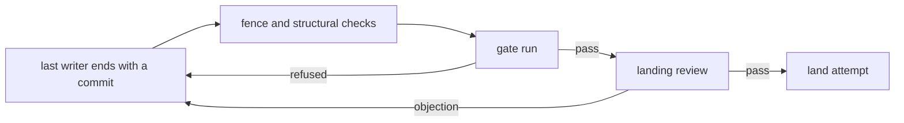

# Before an item's commits land, an agent with no memory of writing them reads the diff and checks it against what was claimed

**Status:** 2026-11-19. A proposal; the universal after-gate review is not built (the opt-in judge and workflow evaluator path it reuses is already built, before the gate). Written to the owner's statements of 2026-11-18 ([Section 1](#1-the-requirement-and-what-happens-today)) and updated with his rulings of 2026-11-19 on [OQ-DR1](#OQ-DR1) and [OQ-DR2](#OQ-DR2). Facts about the loop, the store and the prices were gathered by a scout on 2026-11-18 at `f6b71beb8`, and seat configuration was verified on 2026-11-19 at `9a3b977af`; what is an estimate or was not verified is marked where it appears. The `D-DR` rows from `D-DR3` on are a designer's decisions and await the owner's review.

> **In short.** Today no agent has ever read a change before tillr landed it. The review the owner asks for is the judge step that is already built and has never run: one fresh agent on the named `review` seat, after a green gate and before the landing, that reads the diff and checks it against the item's claim and the tree. It runs for every landing of an item's code, not only when an item asks.

**Why it matters.** The store holds 803 landings and 1,221 criterion verdicts. Every verdict is mechanical: a criterion is marked done because the gate was green. There are 0 judge runs, 0 grants and 0 verdicts by an agent ([Section 1](#1-the-requirement-and-what-happens-today)).

**The shape.** One read-only node, the landing review, after the gate run passes and before the land attempt, dispatched on the named `review` seat (pointed at the `build` seat's backend for now). One reader does both jobs: it checks each criterion and it reads the diff for anything that looks wrong. Its outcomes are pass, an objection, and cannot judge; a repeated objection stops and waits for the owner.

**Cost.** One agent run per code landing on the `review` seat's active backend — today Hydrogen on Copilot (unpriced here) or Terra 6.1 on the work Bedrock profile (estimated at $0.14 to $0.17 per review, unmeasured live) — and one more wait before each landing. An objection costs a worker turn, a gate run and a second review. A fix for a red trunk waits on a review too.

**Start at [Section 4](#4-one-reader-and-what-stood-in-its-way)**, why this is one reader and what has to change in the built judge. [Section 5](#5-the-three-outcomes) has the outcomes and [Section 8](#8-cost) the prices.

**Needs your ruling:** None (11 designer's decisions, `D-DR3` through `D-DR13`, await your review in the [Decision Ledger](#decision-ledger); one deferred question in [Open Questions](#open-questions) is blocked until live reviews run).

**Reads with:** [which reviewer reads which change](./tillr-review-rules.md) (how compliance policies and substantive review divide across change kinds, and whether design documents want a review agent), [the compliance officer](./tillr-design-document-check.md) (the policy-adherence reader that runs alongside this review), [who made the decisions](../tillr/decision-provenance-review.md) (its [OQ-PR2](../tillr/decision-provenance-review.md#OQ-PR2) asks whether work may be marked finished with nobody looking; [Section 7](#7-the-record-and-what-finished-means) says how this design answers it), [judge and lifecycle](./tillr-judge-and-lifecycle.md) (the judge step this design turns on), [the graph design](./tillr-graph-is-the-path.md) (node kinds, rules and the identical repeat), [the landing call](./tillr-landing-call.md) (how a refusal reaches the worker), [planning and model tiering](./tillr-planning-node-model-tiering.md) (the verify node, which becomes this review).

---

## 1. The requirement and what happens today

The owner said three things on 2026-11-18. First:

> when an item is going to go land, do we have a final judge that takes a look at it and sees that it matches whatever was claimed? … I want to make sure that there's an agent at the end, before things land, that looks at nothing but the git diff to make sure that it looks reasonable. That's often the time that you catch things.

Then, on what "nothing but the git diff" meant:

> I don't want it to look at nothing but the diff. I just meant that, like, it shouldn't rely on its memory of having made the change like a human would. Like, it needs to, at the end, consider everything while looking at the diff. Not just the diff, but the diff has to be one of the things.

And on which landings:

> doc only landings have no review, no. this is for items that land as commits from a design doc.

> [!WARNING]
> The first statement does not limit what the reviewer reads to the diff. "Nothing but the git diff" was read that way for an hour on 2026-11-18. The reviewer needs the item and tree as well. The owner later excluded [the worker's report](#the-workers-report) from judgment.

The original requirement, then:

- **Every landing of an item's code gets one.** A landing that changes only documents gets none ([Section 3.2](#32-which-landings)).
- **It is an agent, at the end.** After the work is written and checked, before the trunk moves.
- **It did not write the change and has no memory of writing it.** A different run and a different session from every writer.
- **The diff as it will land is one of the things it reads,** and it considers everything else as well: the item and its criteria, the tree, the design, the tests, and what the worker reported.
- **It answers his first sentence:** does the change match what was claimed.

**What happens today.** The path of an ordinary item, read from [the loop](../../tools/tillr-drain/drain/loop.go) on 2026-11-18:

1. The worker commits.
2. The fence check reads which paths changed.
3. Structural checks read the item's own text.
4. The gate runs programs: tests and the document checks.
5. The lander squashes the change onto the trunk.
6. Every criterion of the item is marked done by a mechanical actor, with the gate's verdict as its evidence ([the loop's guide](../../tools/tillr-loop/README.md), row `verdict`).

Nothing in that list reads the change for sense or compares it with what the item claimed. An agent reads a candidate only when the item asks for a judge or its workflow names an evaluator ([the drain's guide](../../tools/tillr-drain/README.md#opted-in-judgment-before-the-gate)). Neither has ever happened:

| Measured on 2026-11-18 | Result |
| :--- | ---: |
| Judge events in the store's whole history (`tillr view events -since 0`, scanned for `drain.judge.`) | 0 |
| Grants issued (`item.grant` events) | 0 |
| Criterion verdicts by an agent | 0 |
| Criterion verdicts by the mechanical actor | 1,221 |
| Landings recorded (`land.landing` events) | 803 |
| Runs started since 09:18 UTC that day, by workflow | 139 on `single-worker@v1`, 0 on any other |
| Landings in the loop keeper's logs since 2026-11-17 with a judge or evaluator run | 0 of about 349 |

**Who decided that.** "Mechanical by default" is [OQ-JL1](./tillr-judge-and-lifecycle.md#decision-ledger), a designer's decision of 2026-11-15 that rejected "an agent judge on every item by default". The owner never made it, and it is under his review as [OQ-PR2](../tillr/decision-provenance-review.md#OQ-PR2). His requirement is what that row rejected.

## 2. The words

Node, seat, ending, objection, producer, chain, evidence key and identical repeat keep the meanings of [the graph design](./tillr-graph-is-the-path.md#2-the-words). Candidate, gate, lander and trunk keep those of [the vocabulary](./tillr-vocabulary.md#54-checking-and-landing). Document paths keep the meaning of [early design landing](./tillr-early-design-landing.md#2-the-words). These are added.

| Term | Meaning | What it is not |
| :--- | :--- | :--- |
| **Landing review** *(coined here)* | The one read-only agent run that reviews a candidate after its gate run passes and before it lands. It is the built judge step, run for every code landing with a wider brief | Not a second reader beside the judge. An item has one |
| **Reviewer** *(coined here)* | The agent that runs a landing review | Never a run or a session that wrote any part of the change |
| **Code landing** *(coined here)* | A landing in which at least one changed path is not a document path | Not "a landing with no documents". Its document changes are reviewed with the rest |
| **Documents-only landing** *(coined here)* | A landing in which every changed path is a document path | Not "any Markdown". An instruction file that agents load is not a document path |
| **Finding** *(coined here)* | One thing the reviewer objects to in the diff that is not a criterion: a category from a closed list, a path, the place, what is wrong and why | Not a style preference and not a rewrite |

## 3. What the reviewer reads, and which landings

### 3.1 What the reviewer is given

The reviewer runs in the item's worktree, read-only, at the head the gate just passed. It is given:

| Given | How |
| :--- | :--- |
| **The diff as it will land** | A file holding the difference between the candidate's base, which is the trunk commit it was built on, and its head. It is the pair the gate's verdict is bound to and the range the lander squashes. A commit the loop itself added to the candidate is shown as a labelled second part, so the reviewer knows no agent wrote it |
| **The commit message it will land under** | The lander takes it from one commit of the candidate, so it is known |
| **The item** | Its title, its text, and every criterion with its id |
| **The tree** | The whole candidate worktree, to read: the code around the change, the tests, the design the item came from |
| **What the gate ran** | The list of checks that passed, so the reviewer does not run the tests again |
| **Earlier reviews of this item** | Each earlier objection and what the worker answered, when this is not the first review |
| **The worker's report** | As a file the brief tells it to open last ([below](#the-workers-report)) |

**What is withheld is the writer's memory.** The reviewer is never the worker's session, never a resume or a fork of it, and is not given its transcript. The store already refuses a judge that shares a run or a session with the writer, and the judge step starts every review in a new session ([OQ-JL2](./tillr-judge-and-lifecycle.md#decision-ledger)). Which model wrote the change has no bearing on which reviews it: the review runs on whatever backend the `review` seat is set to now ([Section 3.3](#33-the-review-seat)).

**Read-only is checked, not enforced,** as it is today: after the review the loop compares the worktree with the head it started from, and a reviewer that changed anything has its changes saved and removed and its verdict discarded ([the judge step](../../tools/tillr-drain/drain/judge.go)).

#### The worker's report

> **Superseded on 2026-11-21.** The owner removed the worker's report from judgment. The
> verifier reads the candidate against the item's words and criteria and runs its own checks.
> The rules below record the earlier design, not the current verifier contract.

The owner's "consider everything" originally included it. The risk is a reviewer that reads the worker's account first and then sees what the account says. Two rules keep it a claim to check:

- **It is read last.** The brief has the reviewer write down its own reading of the diff before it opens the report.
- **It is never evidence.** Every criterion the reviewer marks met must point at a place in the diff or the tree. The loop's check of the verdict file refuses an entry whose evidence is the report.

The first rule is an instruction and nothing enforces it. The second is checked.

### 3.2 Which landings

The owner's ruling scopes the review to an item's code. The trigger is exact: a gate run on a candidate ended pass, the candidate is a code landing, it is not an automatic revert, and no review of that candidate has ended.

**What a document path is.** The landing definition declares the patterns, as [early design landing](./tillr-early-design-landing.md#2-the-words) already requires for a cut: prose a person reads and no program builds or runs. This repository declares the Markdown files under `docs/`. A `README.md` beside code, a skill file and a briefing are not document paths: agents load them, so changing one changes behavior.

| Landing | Reviewed | Why |
| :--- | :--- | :--- |
| An item's code, on any workflow | Yes | The ruling |
| A landing that changes code and documents | Yes, all of it | One changed path that is not a document path makes it a code landing |
| A candidate changed by a conflict fix | Yes | It is the item's landing, and its diff is new |
| A candidate replayed by the lander onto a moved trunk | Not again | The same change; the review stands, as the gate verdict does ([landing principles, Section 2](./landing-principles.md#2-re-application-preserves-the-change-not-the-patch)) |
| A fix for a red trunk, or for a defective tool, written by an agent | Yes, against the criterion it was filed with: the named check passes, or the named command completes | It is an item that lands commits. Deleting a test or loosening a check is the cheapest way to turn a red trunk green, and it is the first thing the review looks for. The cost is one review added to the time the trunk is red |
| A revert that an agent edited | Yes | An agent wrote part of it |
| **An early landing of documents (a cut)** | **No** | The ruling: documents only |
| **A design answer, a design-document item, a prose rewrite of an item** | **No, when documents-only** | The ruling. One that also changes a path that is not a document is a code landing and is reviewed |
| **An automatic revert** | **No** | No agent wrote it: it is the exact inverse of a landing, made by the loop, with no session to send an objection to. It lands only under its own checks |
| A candidate whose diff is empty | No review runs | The lander refuses it as already on the trunk, as today |

An item that landed before this is built keeps its record, and its page says it landed before reviews ran. How non-code paths outside `docs/`, companion implementation plans and design documents map across this review and the compliance officer is specified in [which reviewer reads which change](./tillr-review-rules.md).

### 3.3 The review seat

By the owner's ruling ([OQ-DR1](#OQ-DR1)), code review is its own named seat, `review`, whose model is configured in the backend policy like any other seat's ([the judge step](../../tools/tillr-drain/drain/judge.go) already reads `review` from the active policy).

- **The writer's model has no bearing.** A review runs on whatever backend the `review` seat is set to at the moment the review starts, never by looking up or avoiding the model that wrote the candidate. Matching or avoiding the author's model per item is a false requirement: a fresh session already withholds the writer's memory, and tying review routing to historical writer runs would make seat selection depend on past policy state rather than the operator's current choice.
- **Set to the implementer seat's backend for now.** Until live reviews provide evidence to separate them, `review` uses the same backend as `build` (`pi-build`): today Hydrogen 4 (`github-copilot/gemini-4-hydrogen`) in [the Copilot backend policy](../../config/tillr/backend-policy.copilot.json), where `review` still points at `pi` (Carbon 4) and moves to `pi-build` in step 1, and Terra 6.1 in [the Bedrock backend policy](../../config/tillr/backend-policy.bedrock.json). Changing the reviewer later is a one-line backend-policy edit.

## 4. One reader, and what stood in its way

### 4.1 One reader, not two

The owner's first sentence asks whether the change matches what was claimed, and his second asks for a fresh agent that reads the diff and considers everything. Those are the same reading. The built judge is already a fresh, read-only agent that is given the criteria and the exact diff, in the worktree. It lacks only the instruction to look for what is wrong beyond the criteria, and the item's text.

So the design is to **make that review run for every code landing**, with one brief that does both, and not to add a second reader beside it.

Two readers would be better in one case only: when the second is a different model from the first, so that their blind spots differ. Two runs of one model on the same inputs buy a second price and little else, and keeping `review` as its own named seat lets the operator point it at a different model later if live counts show missed faults ([Section 3.3](#33-the-review-seat)).

### 4.2 What stood in the way, and what changes

Four things in the judge as built stop it from running on every landing.

| Obstacle | What changes |
| :--- | :--- |
| **The old dispatcher held judged items before the worker started.** No grant had been issued in the [2026-11-18 measurement](#1-the-requirement-and-what-happens-today). | The reviewer judges only the classes listed on its workflow step. The shipped evaluators list `verification-only`; `owner-only` remains human-only. Dispatch does not wait for a renewal. |
| **One verdict per criterion, and nothing else.** A review of a diff has things to say that are no criterion | The verdict file keeps one entry per criterion and gains a list of findings ([Section 5.2](#52-an-objection)). An item with no criteria has no entries and is reviewed against its text and the diff |
| **A not-done verdict does not return to the worker's session.** From an ordinary judge it holds the item; from a workflow's evaluator it starts a fresh workflow at its first node | Both take the route a gate refusal takes: a turn in the session that wrote the change ([Section 5.2](#52-an-objection)) |
| **The judge is a step of the loop, not a node.** It swaps the worker's brief and session in the lane for the length of the review | It stays a step until the graph is built, recorded as a run with its own id. The graph design already has a judge node kind; its rules are owed the amendments in [Section 12](#12-amendments-owed) |

### 4.3 The position: after the gate

| Place | Verdict |
| :--- | :--- |
| **After the gate run passes, before the land attempt** | **Chosen.** It is the owner's "at the end, before things land". The reviewer reads the head the lander will squash, including a commit the loop added. A red candidate goes back to its worker without a reviewer being paid to read a change that is about to be rewritten: the store holds 360 refusals against 803 landings. An objection after a green gate wastes one gate run, which costs seconds and no tokens. The reviewer can take "the tests pass" as given |
| **Before the gate, where the judge step is built** | Rejected, for the cost of reviewing candidates the gate then refuses. `D-JL1` of the judge design is owed the change |
| **The last node of each workflow** | Rejected as the mechanism. The one-worker workflow is not a file, and a workflow file could be written without the node. The loop adds the review itself |
| **A check inside the gate** | Rejected. The gate is programs; a red check there can be acquitted by replaying it on the base, which means nothing for an agent's opinion |



### 4.4 The verify node and the opted-in judge

**A workflow's evaluator is this review.** `planned-build@v1` ends with a read-only `verify` node that the loop already runs through the judge step. It has never run. Under this design the workflow keeps naming it, and what it names is extra instruction for the one review: for each criterion, say which piece satisfies it. The review runs once, after the gate, like every other.

**An item that asks for a judge** gets the same one review under this proposal. The selected workflow's `judge_classes` decide which criteria the reviewer may retire, not whether the proposal calls for a review of a code landing.

## 5. The three outcomes

The reviewer ends with one of three outcomes, in a verdict file the loop checks. Pass requires three things: every criterion met, no finding, and every changed path read.

### 5.1 Pass

The land attempt follows. After the landing succeeds, each criterion the reviewer may retire is recorded as met by the reviewer, bound to the landed commit, which is the path the judge step already has. Notes in a passing verdict are kept on the item's page and reach nobody.

### 5.2 An objection

An objection holds one or both of:

- **A criterion not met:** its id, the reason, and where in the diff or the tree that shows.
- **A finding:** a category from the closed list in [Section 6](#6-the-brief), a path in the diff, the line it is at, what is wrong, and why it matters. A finding missing any of the five makes the verdict invalid.

**The route.** The objection goes back to the session that wrote the change, with its text, exactly as a gate refusal does today: a turn in the same session, under a new run id, uncounted and unlimited ([the return rules](../../tools/tillr-drain/drain/returned.go), [the retained session](../../tools/tillr-drain/drain/worker_session.go)). In the landing call's closed set of answers it is `refused` with the stage `judge`, which that set already has.

- In a workflow with several writers, a finding goes to the session that last wrote the path it names. A criterion not met goes to the last writing node's session.
- The worker answers by changing the change, or by keeping it and saying why in its report. Either way it makes a new commit, as every returned turn must, and the candidate passes the fence and the gate again.
- The next review is a fresh session. It is given the earlier objection and the worker's answer, so a reason the worker gave is weighed and not rediscovered.

> [!WARNING]
> The route is not the one a workflow evaluator's finding takes today. That finding, `verify-not-done`, is returned "without a retained worker session" and "starts a fresh workflow at its first node" ([the drain's guide](../../tools/tillr-drain/README.md#opted-in-judgment-before-the-gate)). The owner's ruling is that a refusal returns to the same session. This design replaces that route, and the ordinary judge's hold, with the one above.

### 5.3 Cannot judge

This is never a pass, and each kind names who moves next.

| Kind | What happens | Who moves |
| :--- | :--- | :--- |
| **Some changed paths were not read.** The verdict lists every changed path as read or not. A large change may not fit one session | Another review, in a fresh session, is given the unread paths and the first one's verdict. Their objections are joined; the change passes when every path has been read and nothing is objected to | The loop, by rule; nobody waits |
| **A criterion cannot be decided:** it is vague, contradicts the tree, or needs something the reviewer cannot see | It goes to the design seat, as a worker's obstacle about the item's definition does. The design seat amends the criterion or objects, naming the owner with its question | The design seat |
| **The work waits on something else:** another item, or a decision only the owner can make | The verdict names the waiter, as the judge's `blocked` verdict does today. Naming the owner requires the question | The named item, or the owner by that question |
| **The verdict file is missing or invalid** | The reviewer's own session is told what is missing. A repeat of the same fault files a defect against the tooling, and the item waits on it | The reviewer's session, then the tooling |
| **The reviewer changed the worktree** | Its changes are saved and removed, as today; the verdict is discarded and a fresh review runs. A repeat is a defect against the tooling | The loop, then the tooling |

The judge's `defective` verdict closes the item today on the reviewer's word. Under this design it is the second row: the design seat decides, and an item is not closed by the reviewer that found the fault.

### 5.4 When the reviewer and the worker disagree

No count stops them, by the owner's rule. Two things do, and both exist.

**A new objection is not a disagreement.** If the second review objects to something else, the worker fixes that too. Each ending is new and nothing is counted.

**An identical repeat stops and waits for the owner.** The evidence key of an objection is the sorted set of the criterion ids not met and of each finding's category and path. Wording is not in the key, because a model words the same objection differently each time. When an objection's key equals that of an earlier objection in the item's chain, no dismissal mechanism runs and the loop does not send a third turn to the worker ([OQ-DR2](#OQ-DR2)): the item stops under "needs you" and waits for the owner, with the repeated objection and the worker's reason shown on the item's page so the case can be examined and a better change chosen. What lasting rule should replace that stop once real cases have been seen stays open as [OQ-DR3](#OQ-DR3).

The weak point is the one the graph design names for itself: a chain in which every objection is new never repeats. It is visible at the top of the draining list, which is ordered by spend, and the owner can object on any item.

### 5.5 Failure cases

| Case | What happens |
| :--- | :--- |
| The review seat's backend is closed | The candidate waits, gated, and the wait names the backend and its reopening, as the judge step does today. It is never landed unreviewed |
| The backend policy maps no backend to the review seat | The loop refuses to start and names the missing key |
| The loop is killed during a review | The same review resumes under its own id. A review with no valid verdict has no effect |
| A second land attempt for the same candidate | The recorded review is reused. One candidate is reviewed once |
| The trunk moves during a review | Nothing. The lander replays the change, as it does after a gate run |
| A review runs for a long time | Nothing ends it. It is visible as running, with its spend |
| Two candidates are ready at once | Each is reviewed in its own item's worktree. Reviews share nothing |

The diff is written, the agent is run and the verdict file is read with no store lock held. The loop is the only writer of the review's records.

## 6. The brief

This is what the reviewer is asked. The planner fits it to the section layout the adapters require ([the brief template](../../tools/tillr-run/backends/brief-template.md)); the item, its criteria and the file paths are filled in by the loop.

```text
You are reviewing a change before it lands on the main branch. You did not
write it. Nothing you do may change this worktree.

1. Read the diff first: candidate.diff, and the commit message. Read all of
   it. Before you read anything else, write down in your own words what the
   change does and anything that looks wrong. A second part of the diff, when
   present, was made by the automation after the author finished.

2. Then read the item and its criteria, below. For each criterion decide: met,
   not met, or cannot be decided. "Met" needs a place in the diff or the tree
   that shows it.

3. Then read as much of the tree as you need: the code around the change, the
   tests, the design the item came from. The checks listed below already
   passed; do not run them again.

4. Last, read the author's report and any earlier review. They are claims.
   Check them; do not cite them.

Object when a criterion is not met, or when you can point at one of these:
- accidental: debug output, a leftover or unrelated file, generated junk
- removed-check: a test deleted or skipped, a check disabled or loosened
- secret: a credential, a token, or a name or e-mail address typed by hand
- bug: code that is wrong, shown by the diff or by the code it touches
- missing-test: behavior changed and no test changed with it
- message-mismatch: the commit message says something the change does not do
- unrelated: a change the item did not ask for and the message does not explain

Do not object to style, naming or formatting. Do not ask for a different
design. Do not write code or propose a rewrite.

Write your verdict to the file named below: an outcome (pass, objection or
cannot-judge); one entry for every criterion; each finding with its category,
path, line, what and why; and every changed path marked read or not read.
Pass means every criterion met, no finding, and every path read.
```

The categories are the closed list a finding may use. Adding one is a change to this design, because the category is half of the evidence key.

## 7. The record and what finished means

**What is recorded.** Each landing review is a run with its own id and the judge step's two events, and a node of the item's graph once that is built. The record holds:

- The candidate it reviewed: base commit and the head's tree, the pair the gate verdict is bound to; the diff's size in lines and bytes.
- The seat, backend and model, and the spend.
- The outcome; each criterion's entry; each finding in full; each path not read.
- For an objection, the run it was returned to.

**Where it is read.**

- **The item's page** lists the reviews in order with the rest of the item's path: when, by which model, the outcome, and the text of each objection.
- **`tillr drain why`** on a waiting item says which holds: a review is running, since when and on which model; a review objected and the worker has it; a repeated objection is waiting on the owner; or the review waits on a closed backend.
- **A daily count** of reviews by outcome, and of objections after which the change was altered, tells the owner whether the review pays. Nothing else can, since none has ever run.

**What finished means.** An item whose landing is a code landing is marked landed only when that candidate has a review that ended pass. The store checks this when it records the landing. Each criterion's verdict says who decided it:

| Criterion's class | Who retires it under this design |
| :--- | :--- |
| `verification-only` on a code landing | The reviewer, as an agent's verdict with its evidence. The mechanical stamp is not written |
| `verification-only` on a documents-only landing | The mechanical actor, as today |
| `red-gate-triage` or `direction` | A reviewer only if the selected workflow step lists that class; the shipped evaluators do not |
| `owner-only` | The owner, as today |

**How this answers [OQ-PR2](../tillr/decision-provenance-review.md#OQ-PR2),** if the owner accepts this design. That question asks whether tillr may mark work finished with no person and no reviewing agent looking at it. For an item's code the answer becomes no, which is that question's "Overturn": every such item is reviewed against its criteria before it lands. For a documents-only landing the answer stays yes, by his ruling of 2026-11-18. [OQ-JL1](./tillr-judge-and-lifecycle.md#decision-ledger) is rewritten to say so.

## 8. Cost

**These are estimates, and rough ones. No review has ever run.** A reviewer with the tree open decides for itself how much to read, so the real figure can be several times these.

The assumptions:

- A review reads the diff, 25,000 tokens of fixed prompt, and 40,000 tokens of item and tree. It takes 10 turns and writes 6,000 tokens. Everything it reads is billed once at the cache-write price and re-read on later turns at the cache-read price.
- The diff sizes are the 85 landings of 2026-11-18: median 27,000 bytes, ninetieth percentile 108,000 bytes, at 3.5 bytes per token. Those 85 include documents-only landings, which are small and will not be reviewed, so the ninetieth percentile is the fairer figure for a code landing.
- How many of the 85 were code landings was not measured. Of the 575 commits on the trunk in those two days, 277 touched something other than Markdown and `docs/`; at that share, about 41 of the 85.
- Prices below are the work machine's Bedrock profile, read on 2026-11-18 from [its profile](../../tag-work/config/yolo-jail/config.d/work.toml). Copilot backends (including Hydrogen 4, which the owner selected for `review` via the `build` seat on 2026-11-19 in [OQ-DR1](#OQ-DR1)) and the personal machines were not priced here; on the Bedrock profile the `build`-seat rule selects the Terra 6.1 row.
- One review per landing. Each objection adds a worker turn, a gate run and another review, and how often that happens is unknown.

| Model | Its seat today | A review of a median diff | Of a ninetieth-percentile diff | A day: 41 reviews at the median | A day: 85 at the ninetieth percentile |
| :--- | :--- | ---: | ---: | ---: | ---: |
| Luna 6 | scout | $0.02 | $0.02 | $0.66 | $1.70 |
| Terra 6.1 | build | $0.14 | $0.17 | $5.70 | $14.80 |
| Sol 6.2 | review, plan, verify | $0.28 | $0.35 | $11.40 | $29.50 |
| Opus 5.5 | none | $0.56 | $0.70 | $22.80 | $59.10 |
| Fable 5.2 | design | $1.30 | $1.62 | $53.30 | $137.70 |

**The ceiling** is a reviewer that works as long as a worker does. The loop keeper's logs show worker runs on Sol 6.2 averaging $3.19 each over 474 runs; 85 reviews at that price is $271 a day. The same logs show $2,043.77 spent on 733 worker runs in about two days, so a day of reviews on Sol 6.2 at the table's figures is one to three percent of a day of work.

**A very large change** is read across more than one review ([Section 5.3](#53-cannot-judge)) and costs in proportion. Of the 85 landings, 4 had a diff over about 50,000 tokens and 1 over 100,000.

There is no spend target ([OQ-GP3](./tillr-graph-is-the-path.md#decision-ledger)), so cost informs seat configuration and does not gate the review. The first step of the build measures a real review on the active `review` seat, and this table is replaced by what it finds.

## 9. Alternatives considered

The standing-grant alternative below records the earlier design discussion.
[The workflow rulebook](./tillr-judge-and-lifecycle.md#rulebook-and-its-enforcement)
now governs the judge; there is nothing to renew.

| Alternative | Verdict |
| :--- | :--- |
| A second reader that is shown only the diff, beside the opted-in judge | Rejected by the owner's clarification: the reviewer considers everything |
| Leave the judge opt-in and ask item authors to opt in | Rejected. No item has ever asked: the store holds no judge event |
| Keep the grant requirement and issue a standing grant | Rejected. A grant must expire, so landing would stop whenever nobody renewed it |
| Sample landings after the fact and review those | Rejected. The owner asked for the review before the landing, and for every one |
| Review after the landing and revert on an objection | Rejected. The same cost, with the trunk carrying the change in between |
| Resume one reviewer session across an item's reviews | Rejected. A fresh session with the earlier objection as a file gives the same knowledge and does not depend on a session surviving |
| Stop after a number of objections | Refused by the owner's standing rule against counts |

## 10. What this does not cover

- **Documents-only landings,** by the owner's ruling. A separate, cheaper check of what an item commits against written policies, documents-only landings included, is proposed in [the compliance officer](./tillr-design-document-check.md); how both readers map across every change kind — and whether design documents or companion plans want a review agent — is proposed in [which reviewer reads which change](./tillr-review-rules.md).
- **Landings tillr does not make.** A commit a person or an operating session puts on the trunk by hand is outside the loop.
- **What the gate runs,** and what may land while the trunk is red.
- **Per-machine backend-policy edits.** This design fixes `review` as its own named seat set to the `build` backend for now ([Section 3.3](#33-the-review-seat)); changing which model a machine maps to a seat later is a policy edit.
- **Enforcing read-only.** It stays a check after the fact.
- **Who may judge a class.** The proposal does not widen the [workflow rulebook](./tillr-judge-and-lifecycle.md#rulebook-and-its-enforcement) or let agents judge `owner-only` criteria.

## 11. Build order

[OQ-DR1](#OQ-DR1) and [OQ-DR2](#OQ-DR2) are answered. Steps 1 to 4 wait on the owner's review of `D-DR3` through `D-DR13` and then build on today's loop. Step 5 waits on the graph; [OQ-DR3](#OQ-DR3) waits until a live review hits a repeated objection and holds nothing here. Every step that changes a tillr source file changes its copy under `yolo-packs/tillr/files/local/share/tillr/` in the same commit, and [the pack sync test](../../tests/pack-sync.test.py) holds that. The files named are where the scout found the behavior; the planner confirms each against the tree.

1. **Review every code landing after its gate run passes.**
   - *Changes:* the judge step runs for every code landing, after the gate; the documents-only and automatic-revert exemptions; the selected reviewer limited to its declared `judge_classes`, with no renewal hold before the worker starts; the brief of [Section 6](#6-the-brief), with the item's text, the gate's passed checks, the worker's report and the two-part diff; findings and read paths in the verdict file and its check; the document paths declared for this repository; the `review` seat pointed at `pi-build` in the backend policies under `config/tillr/` ([Section 3.3](#33-the-review-seat)).
   - *Files:* [the judge step](../../tools/tillr-drain/drain/judge.go) and its tests; [the loop](../../tools/tillr-drain/drain/loop.go); [planning](../../tools/tillr-drain/drain/plan.go); [the verdict rules](../../tools/tillr-item/item/verdict.go); the `review` seat mapping and purpose in the policies under `config/tillr/`; [the drain's guide](../../tools/tillr-drain/README.md).
   - *Waits on:* owner review of `D-DR3` through `D-DR13`.
   - *Done when:* a test candidate with a planted debug line is held from landing with a finding that names the line; one that misses a criterion is held with that criterion's id; a clean one lands with the workflow reviewer's verdict on each `verification-only` criterion, bound to the selected step and candidate; a documents-only candidate and an automatic revert land with no review; a second land attempt starts no second review; and one real review has run on the active `review` seat, with its spend recorded in [Section 8](#8-cost).
2. **Return an objection to the session that wrote the change, and stop for the owner on an identical repeat.**
   - *Changes:* the ordinary judge's hold and the evaluator's restart both replaced by the retained-session route; the evidence key; the earlier objection and the worker's answer given to the next review; an identical repeat stopping under "needs you" for the owner with both objections and the worker's reason shown, with no dismissal path ([OQ-DR2](#OQ-DR2)).
   - *Files:* [the return rules](../../tools/tillr-drain/drain/returned.go), [the retained session](../../tools/tillr-drain/drain/worker_session.go), [the evaluator](../../tools/tillr-drain/drain/workflow_evaluator.go) and their tests.
   - *Waits on:* step 1.
   - *Done when:* a test shows the objection arriving as a turn in the worker's own session under a new run id; a second objection with the same criterion ids, categories and paths but different words stops the item waiting on the owner with the objection and the worker's reason recorded; one that differs goes back to the worker; a workflow's objection reaches the session that wrote the named path; no count is read on the route.
3. **Give every cannot-judge a mover.**
   - *Changes:* the routes of [Section 5.3](#53-cannot-judge): a further review for unread paths, the design seat for an undecidable criterion, the reviewer's session for a bad verdict file; an item no longer closed on a reviewer's `defective`.
   - *Files:* [the judge step](../../tools/tillr-drain/drain/judge.go) and its disposition tests.
   - *Waits on:* step 1.
   - *Done when:* each row of that table has a test, and no test ends in a hold without a named mover.
4. **Show the review, and require it to mark a code item landed.**
   - *Changes:* the review rows on the item's page; the states in `tillr drain why`; the daily count by outcome; the store's check on the landed state.
   - *Files:* `tools/tillr-view`, `tools/tillr-item`, `tools/tillr-loop` and their tests.
   - *Waits on:* step 1.
   - *Done when:* an item page shows an objection's text and, on a repeat, the worker's reason beside it; the store refuses a landed state for a code landing with no passing review; an item landed before this step still reads correctly.
5. **Make the review a node the policy function adds.**
   - *Changes:* the rule rows of [Section 12](#12-amendments-owed); the swap of the worker's brief and session removed.
   - *Waits on:* the graph design's executor and policy function.
   - *Done when:* the policy function's table test covers those rows.

## 12. Amendments owed

None of these documents is edited by this one. **Made on 2026-11-18**, by a reconciliation pass, are the parts that rest on the owner's rulings `D-DR1` and `D-DR2` or are pointers: the [OQ-JL1](./tillr-judge-and-lifecycle.md#decision-ledger) row now says it is overturned for code landings and that no agent has ever judged a landing; `D-JL8` says asking for a judge will no longer decide whether a code landing is reviewed; the graph design's row 23 and [early design landing](./tillr-early-design-landing.md) record that a cut is not reviewed; and the planning design's verify node points here. Everything else below rests on this design's `D-DR` rows (and the 2026-11-19 rulings [OQ-DR1](#OQ-DR1) and [OQ-DR2](#OQ-DR2)) and lands with the build once the owner reviews those rows.

- **[Judge and lifecycle](./tillr-judge-and-lifecycle.md):**
  - The [OQ-JL1](./tillr-judge-and-lifecycle.md#decision-ledger) row: overturned for code landings by the owner's requirement; mechanical retirement stays for documents-only landings.
  - `D-JL1`: the judge runs after the gate, not before it.
  - [Section 2.2](./tillr-judge-and-lifecycle.md#22-when-generic-judging-survives--and-closing-the-mechanical-stamp-hole-d-jl2) and `D-JL2`: this proposal makes review the default for code landings; the reviewer retires `verification-only` criteria only under its selected workflow step.
  - `D-JL8`: asking for a judge no longer decides whether a code landing is reviewed.
  - The judge's `not-done`, `defective` and unreadable outcomes take the routes of [Section 5](#5-the-three-outcomes).
- **[The graph design](./tillr-graph-is-the-path.md):**
  - [Section 5.3](./tillr-graph-is-the-path.md#53-the-starting-rule-table): row 4 adds a gate run after `submitted`, never a judge; row 8 adds a judge node after a passed gate run for a code landing, and a land attempt otherwise; row 7's `pass` adds the land attempt; row 23, a cut, stays with no judge, now by the owner's ruling.
  - [Section 3.1](./tillr-graph-is-the-path.md#31-node-kinds): the judge's endings gain cannot judge, with its kinds.
  - [Section 7](./tillr-graph-is-the-path.md#7-what-stops-repetition): the judge's evidence key gains each finding's category and path.
- **[Planning and model tiering](./tillr-planning-node-model-tiering.md):** the verify node is the landing review with that workflow's extra instruction, runs after the gate, and returns to the writer's session.
- **[Early design landing](./tillr-early-design-landing.md):** records the owner's ruling that a cut is not reviewed.
- **[Who made the decisions](../tillr/decision-provenance-review.md):** [OQ-PR2](../tillr/decision-provenance-review.md#OQ-PR2) points here once the owner accepts this.
- **`config/tillr/workflows/planned-build@v1.json`:** its `verify` stage's text, with the build of step 2. No other workflow file changes, because the loop adds the review.
- **[The drain's guide](../../tools/tillr-drain/README.md)** and the backend policies' `review` seat mapping (`pi-build`) and purpose, with the build of step 1.
- **[The compliance officer](./tillr-design-document-check.md):** [Section 5.3](./tillr-design-document-check.md#53-when-the-officer-and-the-repairer-disagree) inherits [OQ-DR2](#OQ-DR2) (no dismissal built now).

## 13. Risks

| Risk | Mitigation |
| :--- | :--- |
| The reviewer objects to things that are fine, and workers spend turns answering | The brief asks for objections it can point at. The daily count shows objections after which nothing changed. The brief is one file |
| The reviewer passes everything | The same count shows it. The planner keeps a small set of planted defects as a standing test of the brief |
| The reviewer believes the worker's report | The report is read last and cannot be evidence ([Section 3.1](#31-what-the-reviewer-is-given)) |
| The same model wrote the change and reviews it | Chosen for now ([OQ-DR1](#OQ-DR1)): a fresh session withholds the writer's memory, and `review` is its own named seat so one policy line switches to a distinct model if live counts show missed faults |
| The review costs what a worker costs | Step 1 measures it before anything else is built on the estimate |
| A fix for a red trunk waits on a review | One review. If measurement shows it matters, that is evidence for a ruling, not for a silent exemption |
| The judge step has tests and has never run with a real model | Step 1 is not done until one real review has run |

## Decision Ledger

`D-DR5` records the original review proposal. Its selective grant exemption
is superseded by [the workflow rulebook](./tillr-judge-and-lifecycle.md#rulebook-and-its-enforcement).

`D-DR1`, `D-DR2`, [OQ-DR1](#OQ-DR1) and [OQ-DR2](#OQ-DR2) are the owner's rulings. Every other row is a designer's decision of 2026-11-18, made from the scout's evidence and the owner's standing rulings. None of those is the owner's ruling; he may overturn any of them, and all await his review. None is built.

| ID | Decision | Date | Settled in | Built |
| :--- | :--- | :--- | :--- | :--- |
| `D-DR1` | **Owner ruling.** Before an item lands, a fresh agent reviews it: "it shouldn't rely on its memory of having made the change … it needs to, at the end, consider everything while looking at the diff. Not just the diff, but the diff has to be one of the things." It checks that the change "matches whatever was claimed". | 2026-11-18, owner | [Section 1](#1-the-requirement-and-what-happens-today) | — |
| `D-DR2` | **Owner ruling.** "doc only landings have no review, no. this is for items that land as commits from a design doc." | 2026-11-18, owner | [Section 3.2](#32-which-landings) | — |
| OQ-DR1 | **Owner ruling: code review is its own named `review` seat, independent of which model wrote the change, and set to the implementer (`build`) seat's backend (Hydrogen on Copilot) for now.** None of the question's three model options was chosen; he rejected tying the reviewer to or away from the author's model: "it has to be a named seat that we can pick a model for, because we don't know, and it shouldn't be the original one, that has no bearing, it's the currently active one ... For review, let's just stick with the implementer seat right now, although we may change this later with more evidence. So right now I think we're on hydrogen, so it's hydrogen I want you to use right now." | 2026-11-19, owner | [Section 3.3](#33-the-review-seat) | — |
| OQ-DR2 | **Owner ruling: build no dismissal mechanism now; on a repeated objection, stop and wait for the owner with the objection and the worker's reason shown, and evaluate the real case then.** Asked whether a design agent may dismiss a repeated objection, refuse dismissal, or escalate to a stronger model, he ruled against building a settlement mechanism before seeing a case: "Maybe in principle it could dismiss the objection, but I would like to take a closer look here. So I think for now, let's not do anything. Like if we hit a situation like this, let's step back and evaluate and figure out a better change." What the lasting rule should be stays open in narrower form as [OQ-DR3](#OQ-DR3). | 2026-11-19, owner | [Section 5.4](#54-when-the-reviewer-and-the-worker-disagree) | — |
| `D-DR3` | **Designer's decision; the owner may overturn this.** One reader: the built judge step, run for every code landing, checks the criteria and reads the diff for what is wrong. **Evidence:** that step is already a fresh read-only agent given the criteria and the exact diff. **Rejected:** a second reader beside it. | 2026-11-18, designer | [Section 4.1](#41-one-reader-not-two) | — |
| `D-DR4` | **Designer's decision; the owner may overturn this.** The review runs after the gate passes, and the loop adds it, never a workflow file. **Evidence:** 360 refusals against 803 landings; a gate run costs seconds and no tokens. **Rejected:** before the gate, as built; a workflow's last node; a check in the gate. | 2026-11-18, designer | [Section 4.3](#43-the-position-after-the-gate) | — |
| `D-DR5` | **Designer's decision; the owner may overturn this.** A reviewer retires a `verification-only` criterion with no grant, and the hold before the worker starts goes for it. **Evidence:** a program retires that class today on a green gate; no grant has ever been issued. **Rejected:** a standing grant, which must expire. | 2026-11-18, designer | [Section 4.2](#42-what-stood-in-the-way-and-what-changes) | — |
| `D-DR6` | **Designer's decision; the owner may overturn this.** The worker's report is shown, read last, and may not be cited as evidence. **Evidence:** the owner's "consider everything"; the judge's verdict already requires a locator for each entry. **Rejected:** withholding it; showing it first. | 2026-11-18, designer | [Section 3.1](#31-what-the-reviewer-is-given) | — |
| `D-DR7` | **Designer's decision; the owner may overturn this.** A documents-only landing is one whose every changed path is a document path, as declared for a cut; here, Markdown under `docs/`. One other path makes the whole landing reviewed. **Evidence:** early design landing's definition; skill and briefing files change agents' behavior. **Rejected:** any Markdown file. | 2026-11-18, designer | [Section 3.2](#32-which-landings) | — |
| `D-DR8` | **Designer's decision; the owner may overturn this.** An agent-written fix for a red trunk or a defective tool, a conflict fix and an agent-edited revert are reviewed; a fix is reviewed against the criterion it was filed with. The automatic revert is exempt. **Evidence:** a fix is an item that lands commits; a revert has no author and no session. **Rejected:** exempting fixes to shorten a red trunk. | 2026-11-18, designer | [Section 3.2](#32-which-landings) | — |
| `D-DR9` | **Designer's decision; the owner may overturn this.** An objection returns to the session that wrote the change, as a gate refusal does; this replaces the judge's hold and the evaluator's restart at the first node. Each review is a fresh session given the earlier objection and answer. **Evidence:** the owner's ruling that a refusal returns to the same session, uncounted. **Rejected:** keeping either built route. | 2026-11-18, designer | [Section 5.2](#52-an-objection) | — |
| `D-DR10` | **Designer's decision; the owner may overturn this.** The evidence key is the criterion ids not met with each finding's category and path. (Its original routing of an identical repeat to the design seat is superseded for now by the owner's ruling in [OQ-DR2](#OQ-DR2), which stops the item and waits for him.) **Evidence:** the owner's rule that only an identical repeat stops a chain. **Rejected:** the objection's text as the key. | 2026-11-18, designer | [Section 5.4](#54-when-the-reviewer-and-the-worker-disagree) | — |
| `D-DR11` | **Designer's decision; the owner may overturn this.** Pass requires every changed path read; unread paths get a further review; an undecidable criterion goes to the design seat; a reviewer's `defective` no longer closes an item. **Evidence:** the owner's rules that a held state names a mover and an item reaches him only by an objection naming him. **Rejected:** passing what was not read; the built holds with no mover. | 2026-11-18, designer | [Section 5.3](#53-cannot-judge) | — |
| `D-DR12` | **Designer's decision; the owner may overturn this.** A workflow's evaluator is the one landing review with that workflow's extra instruction, after the gate. **Evidence:** the loop already runs the evaluator through the judge step, and an item with both gets one run. **Rejected:** an evaluator before the gate and a review after it. | 2026-11-18, designer | [Section 4.4](#44-the-verify-node-and-the-opted-in-judge) | — |
| `D-DR13` | **Designer's decision; the owner may overturn this.** A code item is marked landed only with a review that passed. **Evidence:** the requirement. **Rejected:** recording the review beside an unchanged mechanical stamp. | 2026-11-18, designer | [Section 7](#7-the-record-and-what-finished-means) | — |

## Open Questions

1. 🔒 **OQ-DR3: Once a live review hits a repeated objection, what lasting rule settles a repeated disagreement between reviewer and worker?**

   A reviewer objects to a change, the worker keeps the change and explains why, and a fresh reviewer raises the same objection. For now the item stops and shows you the objection and the worker's reason so we can inspect a real case first.

   <!-- vantage: question id=OQ-DR3 blocked-on="steps 1 and 2 running live and hitting a repeated objection" -->

   Waits on seeing a repeated objection in a live review; no build step in the initial rollout waits on it.

   **Answer:**

   > _(empty — fill in when decided)_
