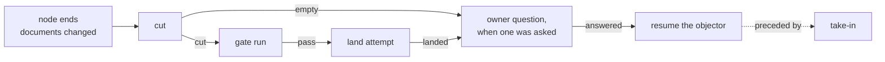

# A question and its design reach the trunk ahead of their item, and nothing is rebased

**Status:** Nothing is built: `rg -i 'early.?land' tools -g '*.go'` finds no cut node. The operation rests on the step of [the graph design](./tillr-graph-is-the-path.md) that commits design answers on the item's branch. The `D-EL` rows of the ledger are the designer's decisions and await the owner's review.

> **In short.** Landing design early is safe once the worker stays on its own branch, because what makes a worker stale is being started anew from the trunk, not the design being there. So an item's documents can be copied onto the trunk tip, gated and landed like any candidate, and the item branch picks them up at its next take-in with no history rewritten.

**Why it matters.** The owner reads and answers questions in Vantage, which serves the trunk. A question that lives only on an item's branch is one the owner cannot see, and an item waiting on it would wait forever.

**The shape.** One new command node, the cut, which builds a documents-only candidate on the trunk tip. The existing gate run and land attempt carry it. The existing take-in brings it back under the branch. The owner's answer returns as a fact that names the question.

**Cost.** An item may have more than one landing: one for its deliverable, and one for each time its documents go ahead. Each early landing costs a gate run, a landing and a proof. A design on the trunk can outlive the item that wrote it.

**Start at [Section 3](#3-the-operation)** for how an early landing works, step by step. [Section 6](#6-always-or-only-with-a-question) says which endings trigger one and what that costs.

**Needs your ruling:** None. **Blocked:** [OQ-EL3](#OQ-EL3), until giving an item up is designed.

**Reads with:** [the graph design](./tillr-graph-is-the-path.md) (the parent: every node kind and rule used here is its own, and [Section 8](#8-amendments-to-the-parent) lists what it carries for this design), [the landing principles](./landing-principles.md) (a landing change is checked against them).

---

## 1. The ruling and what it leaves open

The parent commits every design edit on the item's branch (its rule R11). The owner ruled ([OQ-GP6](./tillr-graph-is-the-path.md#OQ-GP6)) that when an item raises a question for the owner, the question and the design text that changed land on the trunk, and that the operation gets its own design if it is complicated. This document is that design.

| | |
| :--- | :--- |
| **Settled by the owner** | A question for the owner, and the design text that changed, land on the trunk. Every design answer lands this way, not only one that carries a question ([OQ-EL1](#OQ-EL1)) |
| **Decided here** | The operation ([Section 3](#3-the-operation)); what exactly lands ([Section 4](#4-what-lands-early)); how the answer comes back ([Section 5](#5-the-owners-answer)) |
| **Blocked** | What becomes of early-landed documents when their item is given up ([OQ-EL3](#OQ-EL3)) |

The parent's rules bind this design unchanged: no counts and no clocks (R1), no guess triggers (R2), the owner reached only by a written question (R3), work built on the latest trunk (R8), and a done node never changes.

## 2. The words

The parent's words keep its meanings: node, in fog, fixed, done, claim, ending, objection, item branch, take-in, fact, wait, seat. Three are added.

| Term | Meaning | What it is not |
| :--- | :--- | :--- |
| **Early landing** *(coined here)* | A landing on the trunk of some of an item's documents, before the item's deliverable lands | Not the item's landing. The item is still unlanded, and its block is not retired |
| **Cut** *(coined here)* | A command node that builds a candidate commit on the trunk tip holding only documents, and the candidate it builds | Not a rebase and not a take-in. It writes nothing to the item branch |
| **Document paths** *(coined here)* | The path patterns a landing definition declares as prose a person reads and no program builds or runs. Only files matching them may be in a cut | Not the item's fence. A document may be inside or outside it |

This repository would declare the Markdown files under `docs/`. Whether every item block lives there is for the planner to confirm against where blocks are.

## 3. The operation

### 3.1 The nodes

An item's node ends, having changed documents that must be read on the trunk. The trigger is that ending and nothing else ([Section 6](#6-always-or-only-with-a-question) says which endings). The policy function then adds:

| Step | Node | What it does |
| :--- | :--- | :--- |
| 1 | **cut** | Reads the item branch's pinned head and the trunk tip. For each path to land, merges three ways: the path at the trunk commit the branch last took in, at the head, and at the tip. Commits the result with the tip as its parent |
| 2 | **gate run** | Runs the gate on that candidate ([Section 3.4](#34-what-the-gate-checks)) |
| 3 | **land attempt** | The lander puts the candidate on the trunk, unchanged in how it works: it checks that the verdict binds the candidate, squashes it onto the tip and records the landing, marked as early with the item and the cut |
| 4 | **take-in** | Not added by this operation. The parent already runs one before the item's next node that needs the worktree. The branch and the trunk now hold the same text in those documents, so the merge is clean and the branch's difference from the trunk is its remaining work |

The cut's endings are `cut` with the candidate and its paths; `empty`, when the tip already holds the same text; and `conflict` with the paths, when another landing changed the same lines.

**When it may run.** At once. The cut reads a head that a done node recorded, which cannot change, and writes only a new commit that no node has read. It never touches the item branch, so it needs no quiet moment and interrupts nothing. A read-only node of the item that is running keeps the head it was claimed with.

**One at a time per item.** A second cut of the same item is added after the first one's land attempt. It reads the head pinned when it is claimed, so it carries anything written since, and ends `empty` if nothing was.

**The item's own landing overtakes it.** When a node of the item ends `submitted`, a cut still in fog is removed with its followers: the item's landing carries the documents. A cut already claimed finishes; identical text landing twice merges clean.

### 3.2 When a step fails

| What happens | What follows | Who learns |
| :--- | :--- | :--- |
| The cut or its land attempt ends `conflict` | The parent's conflict rule: the session that last wrote those paths is resumed on the latest trunk, after a take-in, and reconciles on the item branch. The cut is added again after it | That session |
| The gate refuses the cut | The parent's gate-refusal rule: the session that wrote the documents is resumed with the gate's output, then a new cut | That session |
| The trunk is red on a check that reads the documents, and the cut does not fix it | The land attempt waits, by the parent's one waiting rule, with the remedy as mover. An owner question behind it waits too, and the item is under "draining" | The trunk panel |
| A proof later attributes a red to the early landing | The parent's revert, then the documents' session is resumed with the check's output | That session |
| The fixing session is a writer, and another writer of the item is running | The fix is claimed when that writer ends. The early landing is later; no other node waits on it | The item page shows the cut waiting on the writer |

> [!WARNING]
> **A reverted early landing removes the documents from the branch at the next take-in.** The branch took in the trunk that held them, the trunk then removed them, and a merge reads that as the trunk's newer change and applies it cleanly. So the resume after such a revert is told which documents were pulled, and restores them from the head its earlier node recorded, which still exists because nothing was rewritten.

### 3.3 Why nothing is rebased

The effect wanted is that the trunk holds the design and the branch holds only what remains. A literal "integrate, then rebase" gets there by rewriting every commit on the branch, and that is where it meets the parent's invariant that a done node never changes.

| | Cut, land, take-in by merge | Integrate, then rebase |
| :--- | :--- | :--- |
| **When it may run** | Any time; it does not write the branch | Only when no node of the item is running, since every running node's base would vanish under it |
| **Heads recorded by done nodes** | Still ancestors of the branch | Unreachable from the branch. The records stay, and name commits the branch does not contain |
| **A session resumed later** | Its transcript's commits are in `git log` | Its transcript names commits that are gone from the branch, and it must be told to distrust its own memory |
| **A commit that mixed design and work** | Untouched; the design half is simply equal to the trunk | Replayed; its design half becomes an empty change or a conflict |
| **What "only the remaining work" is true of** | The branch's difference from the trunk, which is all the lander ever lands | The commit list as well |
| **Cost** | Merge commits on the branch | A history that reads cleanly |

The design takes the first. The second buys a tidier commit list on a branch nobody reads, and pays with records that stop being checkable. It follows that the take-in must merge: with early landings the choice between merge and rebase is visible in the record, so it is not the implementer's.

### 3.4 What the gate checks

- **The same gate, with no documents tier.** The candidate is an ordinary commit on the tip. The gate's document checks are what can fail: links and anchors, and the rules in [the repository guide](../../AGENTS.md#documents-state-the-evidence-never-cite-scratch). One of them matters here: a document that cites a commit found only on the item branch is refused, and returns to its writer.
- **No judge and no review.** A cut has no criteria. The item's criteria are judged when its deliverable lands. A documents-only landing gets no review (owner ruling `D-DR2` in [the landing review design](./tillr-diff-review.md#decision-ledger)).
- **No take-in before it.** The cut is already on the tip. If the trunk moves before the landing, the lander's three-way merge places it, as it does for every candidate.
- **tillr's own check.** Every changed path of the candidate is a path the cut named, and every such path matches the document paths. A failure is a tooling defect, since the cut builds nothing else.

**What a cut costs at the gate.** Each gate check declares the paths it reads, and a result is remembered by its inputs. The document checks read the whole tree, so a documents-only cut runs them again: [the gate's guide](../../tools/tillr-gate/README.md#declaration-directories) measures the `documents` check at 0.42 to 0.52 seconds with its passes remembered and 1.9 to 2.0 seconds with none. Whether the full suite's code checks are skipped on a documents-only tip is unmeasured.

## 4. What lands early

**Whole documents, chosen by path.** A cut holds the documents the triggering node changed, plus any its ending names as needed to read the question. Each lands as it stands at the branch head, merged with the trunk's copy. A named path outside the document paths ends the naming node `refused-by-check`. A node that changed no document and names none gets no cut.

| Way to separate design from work | Verdict |
| :--- | :--- |
| **By path, whole file** | Chosen. The trunk gets a document that a node wrote and read as a whole |
| **By commit**, replaying the designer's commits | Rejected. A commit that also touched code cannot be replayed without it, and an earlier unlanded edit to the same file makes the replay conflict for no one's reason |
| **By the designer's lines only** | Rejected. The trunk would hold a version of the document that no node ever wrote, read or checked |
| **By a path guess**, such as "anything under a docs directory changed on the branch" | Rejected. It lands documents nobody asked to show, which is a guess |

**What comes along.** A whole file carries every change the branch made to it, by any node.

- **The item's own block,** when it lives in a cut document. The trunk's copy of the block then matches the branch's. That is harmless: a block on the trunk describes work that is not built yet. The definition in force is still the latest revision recorded in the graph, as the parent rules; the store keeps both readings and the view shows them equal. Sync reads the changed block on the trunk and re-runs nothing (R2). The block is retired at the item's deliverable landing.
- **A rewrite's edit** to that block. A rewrite reaches the trunk with its item only when its document did not go ahead.
- **A new item block** a designer added to the document. It becomes an item when the cut lands, by ordinary intake.
- **A worker's edit to the same document.** This is the hazard: a worker who wrote "built" beside a ruling has that claim on the trunk before the code. A node that may trigger a cut is told in its brief that its documents will be read on the trunk ahead of the work, and must leave them true for that reader. Nothing checks it ([Section 10](#10-risks)).

**Degenerate cases.** A question whose anchor is not in the named document at the node's head is `missing-output`, as the parent rules for an owner named without a question. A document deleted on the branch is deleted by the cut. Two items cutting the same document meet as a `conflict` in the second cut.

## 5. The owner's answer

**The event is "question Q in document D was answered", with the answer.** No rule reads a trunk hash or a changed file.

**An answer counts when it is committed on the trunk.** The question index reads the trunk commit, not the checkout, and writes the fact once for each question: the document, the question id, the answer's text and the trunk commit that holds it. The drain already works this way. An uncommitted edit to a document records no answer ([the drain's guide](../../tools/tillr-drain/README.md#owner-decisions-in-documents); the test `TestUncommittedOwnerAnswerDoesNotChangeTheConflict` pins it), and uncommitted content in the main checkout belongs to the owner, so tillr never commits it.

**An answer given in a Vantage review is not yet an answer to tillr.** Vantage never writes the repository. The answer reaches the document when an agent records it there, and counts when that commit is on the trunk. Which session does that inside tillr is not designed here.

A later edit to the answer is not an event (R2); a changed ruling is the owner objecting on the item, which the parent already makes an event.

**What follows the fact.**

1. The owner question node ends `answered`. The item leaves "needs you".
2. The objector is resumed with the question's id and the answer, word for word. Its take-in brings the committed answer under the branch.
3. The resumed session folds the ruling into the design on the item branch, as the design seat does for any ruling. The fold lands when that node ends ([Section 6](#6-always-or-only-with-a-question)).

## 6. Always, or only with a question

**Always** (owner ruling [OQ-EL1](#OQ-EL1)). A cut is added in two cases:

- a node ends with an objection naming the owner;
- a design answer ends `answered` having changed documents. The objector's resume does not wait for it.

A design seat's work node is not included: for a design item the document is the deliverable, and it lands judged, with the item.

**The drain as built does neither.** A design answer that passes the gate lands by itself, and a new worker is then started from the trunk ([the drain's guide](../../tools/tillr-drain/README.md#a-design-run-that-ends-without-answering)). The design reaches the trunk at once, and the price is the first worker's session.

**Early landing does not make workers stale.** The staleness in the built drain comes from starting a new worker from the trunk, at a commit that is neither the one the answer was written against nor the one the first worker stood on. Under the parent the answer is committed at the objector's head and the same session resumes from it. Whether a copy of that text is also on the trunk changes nothing the worker reads.

The alternative, landing early only a change that carries a question, was not taken:

| | Only with a question (rejected) | Always (ruled) |
| :--- | :--- | :--- |
| **Other items reading the design** | See it when the item lands. Until then they need an inter-item edge and wait | See it at once and build on it. They may build on a design whose work is later given up |
| **Two items' designs in conflict** | Found when the second item lands, after work was built on both | Found at the second cut, while the designer's session is warm |
| **After the owner answers** | The trunk shows the answer; the folded ruling waits for the item | The fold lands when the designer ends |
| **An item given up** | Its design never lands, except what a question took ahead | Its design stays on the trunk ([Section 7](#7-an-item-that-is-given-up)) |
| **Landings per item** | One, plus one per question | One deliverable landing, plus one documents landing for each design answer |
| **Rules** | Two cases: questions land early, other design does not | One: a designer's documents land when the designer ends |

**What "always" costs.**

- **One more landing for each design answer that changes a document.** Each is a gate run, a landing and a proof of the new tip. What the full suite costs on a documents-only tip is unmeasured ([Section 3.4](#34-what-the-gate-checks)).
- **A design can outlive its work.** When an item is dropped after its design landed, the design stays on the trunk until someone takes it out ([OQ-EL3](#OQ-EL3)).
- **A document can say more than is built.** A worker who edited the same file has its words on the trunk before its code ([Section 4](#4-what-lands-early)). Nothing checks that. This is the ordinary state of a repository where a design and its item blocks are on the trunk before the work is; the ledger's built column says what exists.

## 7. An item that is given up

tillr has no act of giving an item up. An item can be closed, and closing changes nothing on the trunk. Neither the parent nor this document designs giving up, so what becomes of documents that went ahead cannot be settled yet. It is [OQ-EL3](#OQ-EL3), blocked until that design exists. Until then a closed item's documents stay on the trunk.

**The proposal for then: a designer takes them out.** The item's last node is a design answer that removes from those documents what should not outlast the item and keeps what is a ruling, in the document's ledger. Its documents are cut and landed, and the graph is then complete. A plain revert of the early landings is rejected: it deletes the owner's answers with the questions, and it fails once another item has edited the same text.

## 8. Amendments to the parent

[The graph design](./tillr-graph-is-the-path.md) carries everything this design needs from it, in its own text:

- **Rule R11** says a document that a design answer changed, or that carries a question for the owner, reaches the trunk by an early landing.
- **The cut** is among its node kinds, the take-in merges, and an answered question is a fact.
- **Its rule table** follows a design answer that ended `answered` having changed documents with a cut, and claims a repair of a refused or conflicting cut after the item's running writer ends. The objector's resume does not wait for the cut.
- **A dependent item** reads a decision on the trunk once the design answer's documents land. An item that depends on the work, and not only on the decision, gets an inter-item edge until the item lands.
- **Its migration table** has a step for the cut and the owner question, and a later step for landing every design answer's documents.

## 9. Migration and drafted items

The two items below are the parent's migration steps for this design. The parent's earlier steps neither wait on them nor change for them: design answers are first committed on the branch only, and until the first item below is built an item that names the owner is handled as the drain handles it today.

**State that already exists.** Design answers landed by the drain's separate design landing are on the trunk and need nothing. An item waiting on the owner under the drain's holds is imported by the parent's rule; its question is already on the trunk, so its cut ends `empty`.

These are drafted items: proposals in prose, not filed, which nothing reads and from which nothing can be dispatched.

#### Land a question for the owner, and its documents, ahead of the item

When a designer on an item's branch writes a question only the owner can answer, the owner cannot see it on the trunk. This item copies the documents the question is in onto the trunk through the ordinary gate and lander, shows the item under "needs you" once they are there, and resumes the same session with the answer. The item's branch is never rewritten.

- **Paths:** `tools/tillr-drain/`, `tools/tillr-land/`, `tools/tillr-view/`, `config/tillr/`, `yolo-packs/tillr/`, `docs/`
- **Waits on:** Route an objection to a design answer on the item's own branch.
- **c1:** A node that ends with an objection naming the owner is followed by a cut whose candidate sits on the trunk tip and changes only the documents that node changed or named. A test asserts the candidate's parent and its changed paths.
- **c2:** The cut is gated and landed by the same gate and lander as any candidate, and its landing is recorded as early, with the item and the cut. The item is still unlanded and its block is still on the trunk. A test asserts all three.
- **c3:** The owner question node becomes ready only when the cut has landed or ended `empty`. A test asserts the item is not under "needs you" while the cut is at the gate.
- **c4:** No commit on the item branch is rewritten. After the early landing and the next take-in, every head an earlier node recorded is an ancestor of the branch, and the branch's difference from the trunk leaves the landed documents out. A test asserts both.
- **c5:** An answer committed on the trunk ends the owner question `answered` with the question's id and the answer's text. An uncommitted edit to the document, and an unrelated trunk commit, end nothing. A test asserts each.
- **c6:** The objector's session is resumed with the answer after its take-in. No new session is started. A test asserts the session id and the message.
- **c7:** A refused cut returns to the session that wrote the documents with the gate's output, and a conflicting cut to the session that last wrote the conflicting paths. A test asserts each.
- **c8:** The take-in merges. Tests that assert a design answer and a rewrite reach the trunk only in the item's landing cover only documents that did not go ahead.

#### Land every design answer's documents when it ends

Once design answers are committed on the item's branch, a design answer reaches the trunk only when its item lands, so other items and the owner read an older design until then. This item lands a design answer's documents as soon as the designer ends, beside the worker's resume, which does not wait.

- **Paths:** `tools/tillr-drain/`, `config/tillr/`, `yolo-packs/tillr/`, `docs/`
- **Waits on:** Land a question for the owner, and its documents, ahead of the item.
- **c1:** A design answer that ends `answered` having changed a document is followed by a cut of those documents. One that changed none is followed by none. A test asserts both.
- **c2:** The objector's resume is claimed without waiting for the cut, its gate run or its landing. A test holds the cut at the gate and asserts the resume runs.
- **c3:** A second cut of one item waits for the first one's landing. A cut in fog is removed when a node of the item ends `submitted`. A test asserts both.
- **c4:** A resume that repairs a refused or conflicting cut starts only after the item's running writer has ended. A test asserts the order.
- **c5:** A design seat's work node is followed by no cut. A test asserts a design item's document reaches the trunk only in the item's landing.

## 10. Risks

| Risk | What is done about it |
| :--- | :--- |
| **A document lands saying something is built that is not,** because a worker edited the same file | The triggering node's brief says its documents are read ahead of the work. The gate refuses a citation of a branch-only commit. Nothing else checks it; the item page lists the documents that went ahead |
| **A reverted early landing silently strips the branch** | The resume after the revert restores the documents from its recorded head ([Section 3.2](#32-when-a-step-fails)) |
| **Every early landing makes the tip unproven** and schedules a proof | Cheap only if the full suite skips the checks a documents-only change cannot affect, which is unmeasured ([Section 3.4](#34-what-the-gate-checks)) |
| **A worker writes the question itself and then runs for hours after the answer** | The trunk holds the answer, because an answer counts only once it is committed there. The fold waits for that node's end |
| **Other items build on a design that is then withdrawn** | The withdrawal is a document change they take in; a conflict goes to the session that wrote the lines. The queue planner orders what it can see |

**What this does not cover.** How an item is given up. Which session records an answer the owner gave in a Vantage review. Spend ceilings on early landings. The gate's checks and the lander's internals, which are unchanged. Per-file build detail: no implementation plan is seeded.

---

## Decision Ledger

[OQ-EL1](#OQ-EL1) is the owner's ruling, which also accepts the operation as a whole. The `D-EL` rows are the designer's decisions that work the operation out in detail; the owner may overturn any of them, and all await review. [OQ-EL2](#OQ-EL2) is closed without a ruling, for the reason its row gives.

| ID | Decision | Date | Settled in | Built |
| :--- | :--- | :--- | :--- | :--- |
| OQ-EL1 | **Owner ruling: always.** Every design change made while an item is being built is landed on the trunk right away, by the operation this document designs: "let's go with always and this design." Merge or rebase is left to the design. The reason: "I think not landing them immediately creates too many issues." Landing early only a change that carries a question is not taken. | 2026-11-18 | [Section 6](#6-always-or-only-with-a-question) | — |
| `D-EL1` | An early landing is a cut on the trunk tip, the ordinary gate run and land attempt, and the item's next take-in. The item branch is never rewritten. **Rejected:** a literal rebase, which may run only when the item is idle and leaves done nodes naming commits the branch does not hold. | 2026-11-17 | [Section 3](#3-the-operation) | — |
| `D-EL2` | The take-in merges. **Rejected:** leaving merge or rebase to the implementer, which early landings make visible in the record. | 2026-11-17 | [Section 3.3](#33-why-nothing-is-rebased) | — |
| `D-EL3` | A cut holds whole documents by path: those the triggering node changed, and those its ending names. Only document paths qualify. **Rejected:** replaying commits, and landing only the designer's lines. | 2026-11-17 | [Section 4](#4-what-lands-early) | — |
| `D-EL4` | The item's block may land early inside a cut document. The definition in force stays the graph's latest revision. **Rejected:** stripping the block from the cut, which lands a file no node wrote. | 2026-11-17 | [Section 4](#4-what-lands-early) | — |
| `D-EL5` | The gate for a cut is the same gate with no judge and no take-in. **Rejected:** a documents tier, which is a second gate to keep true. | 2026-11-17 | [Section 3.4](#34-what-the-gate-checks) | — |
| `D-EL6` | The answer returns as a fact naming the question, written once the answer is committed on the trunk. tillr writes no answer onto the trunk itself. **Rejected:** resuming on a changed trunk hash; taking an uncommitted edit as the answer, which the drain refuses; and a fact written by the view, which cannot exist because Vantage never writes the repository. | 2026-11-18 | [Section 5](#5-the-owners-answer) | — |
| `D-EL7` | The worker's resume does not wait for the design's early landing, and a repair of that landing waits for the item's writer. **Rejected:** holding the worker until the design lands, which stops work behind a red trunk. | 2026-11-17 | [Section 6](#6-always-or-only-with-a-question) | — |
| `OQ-EL2` | **Closed without a ruling: the drain as built already settles it. The owner may overturn this.** The question asked whether an answer typed into a document and not committed counts. It does not: an answer counts when it is committed on the trunk, and tillr never commits in the owner's checkout. | 2026-11-18 | [Section 5](#5-the-owners-answer) | Yes: answer sync reads the trunk commit, and `TestUncommittedOwnerAnswerDoesNotChangeTheConflict` pins it |

---

## Open Questions

2. 🔒 **OQ-EL3: When an item is given up, what happens to its design that already reached the trunk?**

   <!-- vantage: question id=OQ-EL3 blocked-on="a design of how an item is given up, which does not exist yet" -->

   Waits on a design of how an item is given up. tillr has no such act: an item can be closed, and closing changes nothing on the trunk. The question becomes askable when that design exists and says what closing does to an item's branch and to its early landings. Nothing is built that depends on the answer.

   **Answer:**
   > _(empty — fill in when decided)_
