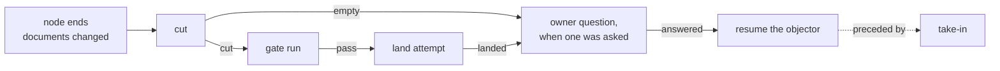

# A question and its design reach the trunk ahead of their item, and nothing is rebased

**Status:** 2026-11-17. A proposal; none of it is built. It answers [OQ-GP6](./tillr-graph-is-the-path.md#OQ-GP6) of [the graph design](./tillr-graph-is-the-path.md), as the owner narrowed it that day. I read that document and no code. What I state about the lander and the gate comes from it and from [the repository guide](../../AGENTS.md); what I did not verify is marked.

> **In short.** Landing design early is safe once the worker stays on its own branch, because what made workers stale was cutting a new worker from the trunk, not the design being there. So an item's documents can be copied onto the trunk tip, gated and landed like any candidate, and the item branch picks them up at its next take-in with no history rewritten.

**Why it matters.** The owner reads and answers questions in Vantage, which serves the trunk. A question that lives only on an item's branch is one he cannot see, and an item waiting on it would wait forever.

**The shape.** One new command node, the cut, which builds a documents-only candidate on the trunk tip. The existing gate run and land attempt carry it. The existing take-in brings it back under the branch. The owner's answer returns as a fact that names the question.

**Cost.** An item may have more than one landing: one for its deliverable, and one for each time its documents go ahead. Each early landing costs a gate run, a landing and a proof. A design on the trunk can outlive the item that wrote it.

**Start at [Section 3](#3-the-operation)**, the operation. [Section 6](#6-always-or-only-with-a-question) is the choice the owner left open.

**Needs your ruling:** [OQ-EL1](#OQ-EL1), [OQ-EL2](#OQ-EL2), [OQ-EL3](#OQ-EL3).

**Reads with:** [the graph design](./tillr-graph-is-the-path.md) (the parent: every node kind, rule and row number used here is its own, and [Section 8](#8-amendments-to-the-parent) lists what this changes in it), [the landing principles](./landing-principles.md) (a landing change is checked against them).

---

## 1. The ruling and what it leaves open

The parent puts every design edit on the item's branch, to reach the trunk in the item's one landing (its rule R11 and decision `D-GP9`). The owner then ruled, on 2026-11-17, cleaned from dictation:

> Yeah, we definitely need to land the questions and the designs that changed when they have questions for me. So maybe we need a special operation here that integrates the design into main and then rebases. We may even want to do this all the time. I mean, ideally, the designs actually do land here quickly, but that has lots of other challenges too that this may bring up as well. But I don't want this to block the rest of the work, so if there's more complication here, let's spin up a new design doc.

| | |
| :--- | :--- |
| **Settled** | When an item raises a question for the owner, the question and the design text that changed land on the trunk |
| **Open, decided here** | The operation ([Section 3](#3-the-operation)); what exactly lands ([Section 4](#4-what-lands-early)); how the answer comes back ([Section 5](#5-the-owners-answer)) |
| **Open, the owner's** | Whether every design answer lands this way ([OQ-EL1](#OQ-EL1)) |

The parent's rules bind this design unchanged: no counts and no clocks (R1), no guess triggers (R2), the owner reached only by a written question (R3), work built on the latest trunk (R8), and a done node never changes.

## 2. The words

The parent's words keep its meanings: node, in fog, fixed, done, claim, ending, objection, item branch, take-in, fact, wait, seat. Three are added.

| Term | Meaning | What it is not |
| :--- | :--- | :--- |
| **Early landing** *(coined here)* | A landing on the trunk of some of an item's documents, before the item's deliverable lands | Not the item's landing. The item is still unlanded, and its block is not retired |
| **Cut** *(coined here)* | A command node that builds a candidate commit on the trunk tip holding only documents, and the candidate it builds | Not a rebase and not a take-in. It writes nothing to the item branch |
| **Document paths** *(coined here)* | The path patterns a landing definition declares as prose a person reads and no program builds or runs. Only files matching them may be in a cut | Not the item's fence. A document may be inside or outside it |

This repository would declare the Markdown files under `docs/`. I did not verify that every item block lives there; the planner confirms the patterns against where blocks are.

## 3. The operation

### 3.1 The nodes

An item's node ends, having changed documents that must be read on the trunk. The trigger is that ending and nothing else ([Section 6](#6-always-or-only-with-a-question) says which endings). The policy function then adds:



| Step | Node | What it does |
| :--- | :--- | :--- |
| 1 | **cut** | Reads the item branch's pinned head and the trunk tip. For each path to land, merges three ways: the path at the trunk commit the branch last took in, at the head, and at the tip. Commits the result with the tip as its parent |
| 2 | **gate run** | Runs the gate on that candidate ([Section 3.4](#34-what-the-gate-checks)) |
| 3 | **land attempt** | The lander puts the candidate on the trunk, unchanged in how it works: it checks that the verdict binds the candidate, squashes it onto the tip and records the landing, marked as early with the item and the cut |
| 4 | **take-in** | Not added by this operation. The parent already runs one before the item's next node that needs the worktree. The branch and the trunk now hold the same text in those documents, so the merge is clean and the branch's difference from the trunk is its remaining work |

The cut's endings are `cut` with the candidate and its paths; `empty`, when the tip already holds the same text; and `conflict` with the paths, when another landing changed the same lines.

**When it may run.** At once. The cut reads a head that a done node recorded, which cannot change, and writes only a new commit that no node has read. It never touches the item branch, so it needs no quiet moment and interrupts nothing. A read-only node of the item that is running keeps the head it was claimed with.

**One at a time per item.** A second cut of the same item is added after the first one's land attempt. It reads the head pinned when it is claimed, so it carries anything written since, and ends `empty` if nothing was.

**The item's own landing overtakes it.** When a node of the item ends `submitted`, a cut still in fog is removed with its followers: the item's landing carries the documents. A cut already claimed finishes; identical text landing twice merges clean.

### 3.2 When a step fails

| What happens | What follows | Who learns |
| :--- | :--- | :--- |
| The cut or its land attempt ends `conflict` | The parent's row 11: the session that last wrote those paths is resumed on the latest trunk, after a take-in, and reconciles on the item branch. The cut is added again after it | That session |
| The gate refuses the cut | The parent's row 9: the session that wrote the documents is resumed with the gate's output, then a new cut | That session |
| The trunk is red on a check that reads the documents, and the cut does not fix it | The land attempt waits, by the parent's one waiting rule, with the remedy as mover. An owner question behind it waits too, and the item is under "draining" | The trunk panel |
| A proof later attributes a red to the early landing | The parent's revert, then row 22: the documents' session is resumed with the check's output | That session |
| The fixing session is a writer, and another writer of the item is running | The fix is claimed when that writer ends. The early landing is later; no other node waits on it | The item page shows the cut waiting on the writer |

> [!WARNING]
> **A reverted early landing removes the documents from the branch at the next take-in.** The branch took in the trunk that held them, the trunk then removed them, and a merge reads that as the trunk's newer change and applies it cleanly. So the resume after such a revert is told which documents were pulled, and restores them from the head its earlier node recorded, which still exists because nothing was rewritten.

### 3.3 Why nothing is rebased

The owner's sketch was "integrate, then rebase". The effect he asked for is that the trunk holds the design and the branch holds only what remains. A literal rebase gets there by rewriting every commit on the branch, and that is where it meets the parent's invariant.

| | Cut, land, take-in by merge | Integrate, then rebase |
| :--- | :--- | :--- |
| **When it may run** | Any time; it does not write the branch | Only when no node of the item is running, since every running node's base would vanish under it |
| **Heads recorded by done nodes** | Still ancestors of the branch | Unreachable from the branch. The records stay, and name commits the branch no longer contains |
| **A session resumed later** | Its transcript's commits are in `git log` | Its transcript names commits that are gone from the branch, and it must be told to distrust its own memory |
| **A commit that mixed design and work** | Untouched; the design half is simply equal to the trunk | Replayed; its design half becomes an empty change or a conflict |
| **What "only the remaining work" is true of** | The branch's difference from the trunk, which is all the lander ever lands | The commit list as well |
| **Cost** | Merge commits on the branch | A history that reads cleanly |

I choose the first. The second buys a tidier commit list on a branch nobody reads, and pays with records that stop being checkable. It follows that the take-in must merge: the parent leaves merge or rebase to the implementer, and with early landings that choice is no longer invisible ([Section 8](#8-amendments-to-the-parent)).

### 3.4 What the gate checks

- **The same gate, with no documents tier.** The candidate is an ordinary commit on the tip. The gate's document checks are what can fail: links and anchors, and the rules in [the repository guide](../../AGENTS.md#documents-state-the-evidence-never-cite-scratch). One of them matters here: a document that cites a commit found only on the item branch is refused, and returns to its writer.
- **No judge.** A cut has no criteria. The item's criteria are judged when its deliverable lands.
- **No take-in before it.** The cut is already on the tip. If the trunk moves before the landing, the lander's three-way merge places it, as it does for every candidate.
- **tillr's own check.** Every changed path of the candidate is a path the cut named, and every such path matches the document paths. A failure is a tooling defect, since the cut builds nothing else.

Whether the gate and the full suite skip checks whose inputs a documents-only change did not touch decides what an early landing costs. The parent says the gate rework designs checks that way; I did not verify that today's checks do.

## 4. What lands early

**Whole documents, chosen by path.** A cut holds the documents the triggering node changed, plus any its ending names as needed to read the question. Each lands as it stands at the branch head, merged with the trunk's copy. A named path outside the document paths ends the naming node `refused-by-check`. A node that changed no document and names none gets no cut.

| Way to separate design from work | Verdict |
| :--- | :--- |
| **By path, whole file** | Chosen. The trunk gets a document that a node wrote and read as a whole |
| **By commit**, replaying the designer's commits | Rejected. A commit that also touched code cannot be replayed without it, and an earlier unlanded edit to the same file makes the replay conflict for no one's reason |
| **By the designer's lines only** | Rejected. The trunk would hold a version of the document that no node ever wrote, read or checked |
| **By a path guess**, such as "anything under a docs directory changed on the branch" | Rejected. It lands documents nobody asked to show, which is a guess |

**What comes along.** A whole file carries every change the branch made to it, by any node.

- **The item's own block,** when it lives in a cut document. The trunk's copy of the block then matches the branch's. That is harmless: a block on the trunk has always described work that is not built yet. The definition in force is still the latest revision recorded in the graph, as the parent rules; the store keeps both readings and the view shows them equal. Sync reads the changed block on the trunk and re-runs nothing (R2). The block is retired at the item's deliverable landing, as before.
- **A rewrite's edit** to that block. The parent's promise that a rewrite reaches the trunk only with its item no longer holds for a document that goes ahead.
- **A new item block** a designer added to the document. It becomes an item when the cut lands, by ordinary intake.
- **A worker's edit to the same document.** This is the hazard: a worker who wrote "built" beside a ruling has that claim on the trunk before the code. A node that may trigger a cut is told in its brief that its documents will be read on the trunk ahead of the work, and must leave them true for that reader. Nothing checks it ([Section 10](#10-risks)).

**Degenerate cases.** A question whose anchor is not in the named document at the node's head is `missing-output`, as the parent already rules for an owner named without a question. A document deleted on the branch is deleted by the cut. Two items cutting the same document meet as a `conflict` in the second cut.

## 5. The owner's answer

**The event is "question Q in document D was answered", with the answer.** No rule reads a trunk hash or a changed file.

| How the owner answers | What records it | What the fact holds |
| :--- | :--- | :--- |
| He writes the answer under the question and it is committed on the trunk | The question index, reading the committed trunk | Document, question id, the answer's text, the trunk commit |
| He uses Vantage's answer action on the question | The view | Document, question id, the answer's text, and that the trunk does not hold it yet |

The fact is written once for each question. A later edit to the answer is not an event (R2); a changed ruling is the owner objecting on the item, which the parent already makes an event.

**What follows the fact.**

1. The owner question node ends `answered`. The item leaves "needs you".
2. **When the trunk does not hold the answer,** an **answer cut** is added: the same cut node, whose content is the owner's words written under the question, with the question marked resolved and dated. It is gated and landed like any cut. This keeps the trunk true: Vantage stops listing a question he has answered.
3. The objector is resumed with the question's id and the answer, word for word. Its take-in brings the recorded answer under the branch.
4. The resumed session folds the ruling into the design on the item branch, as the design seat does for any ruling. When that fold reaches the trunk is [Section 6](#6-always-or-only-with-a-question).

**The resume follows the answer's landing.** This is the one place a resume waits on a landing, and it waits only when the trunk is red on a check that reads the document. Resuming at once would have tillr and the design session both writing the same answer block, to meet as a conflict.

**When the gate refuses the answer cut** (the owner's words can break a document check), the objector is resumed with the answer and the gate's output and records the answer itself. The trunk shows the question open until that session's documents land; tillr's own lists are right throughout.

**An answer typed and not committed** is [OQ-EL2](#OQ-EL2). How such an edit is committed today was not verified for this document.

## 6. Always, or only with a question

**A — Only with a question.** A cut is added when a node ends with an objection naming the owner, and for the answer. Every other design edit stays on the branch.

**B — Always.** A cut is also added when a design answer ends `answered` having changed documents. The objector's resume does not wait for it. A design seat's work node is not included: for a design item the document is the deliverable, and it lands judged, with the item.

**Staleness, re-examined.** The parent rejected early landing as "the source of stale workers". Today a design answer lands by itself and a new worker is then cut from the trunk, at a commit that is neither the one the answer was written against nor the one the first worker stood on, and the first worker's session is thrown away. Both faults are in the second half. Under the parent the answer is committed at the objector's head and the same session resumes from it. Whether a copy of that text is also on the trunk changes nothing the worker reads. Early landing is no longer a cause of staleness under either option.

| | A — only with a question | B — always |
| :--- | :--- | :--- |
| **Other items reading the design** | See it when the item lands. Until then they need an inter-item edge and wait | See it at once and build on it. They may build on a design whose work is later given up |
| **Two items' designs in conflict** | Found when the second item lands, after work was built on both | Found at the second cut, while the designer's session is warm |
| **After the owner answers** | The trunk shows the answer; the folded ruling waits for the item. The document sits "answered, not folded" for that long | The fold lands when the designer ends |
| **An item given up** | Its design never lands, except what a question took ahead | Its design is on the trunk and must be taken out ([Section 7](#7-an-item-that-is-given-up)) |
| **One item, one landing** | Broken only for questions, which the owner ruled | One deliverable landing, plus one documents landing for each design answer |
| **Cost** | A gate run, a landing and a proof for each question and each answer | The same for each design answer as well. How many design answers an item gets was not measured |
| **Rules** | Two cases: questions land early, other design does not | One: a designer's documents land when the designer ends |

**I recommend B.** The trunk is where the owner and every other item read designs, and a design that exists only on a branch is invisible to both. The argument against it was staleness, and that argument is gone. What is left against B is the provisional design, which the owner raised himself: "you could have a provisional design in an item that you might not want to land". I think that is the ordinary state of this repository, where a design and its item blocks are on the trunk before any of the work is, and the ledger's built column says what exists. A also leaves a seam: the question lands, the answer lands, and the ruling's consequences do not.

**What would make me choose A:**

- **Cost.** If a documents-only landing makes the full suite run again in full, each design answer costs a proof, and B is paid for on every item.
- **Provisional designs matter more than current ones.** If the owner would rather the trunk never show a design whose work may be dropped, A keeps that for everything but questions.
- **Items are given up often.** Each one under B costs a withdrawal.

## 7. An item that is given up

The parent says only that an abandoned item's branch never lands; it does not design how an item is given up, and neither does this document. What this document owes is what happens to documents that went ahead.

**A designer takes them out.** The item's last node is a design answer that removes from those documents what should not outlast the item and keeps what is a ruling, in the document's ledger. Its documents are cut and landed, and the graph is then complete. With no early landing the node is not added. A plain revert of the early landings is rejected: it deletes the owner's answers with the questions, and it fails once another item has edited the same text. This is [OQ-EL3](#OQ-EL3). The rule row is written when giving up is designed.

## 8. Amendments to the parent

These are owed in [the graph design](./tillr-graph-is-the-path.md) and are not made by this document. Each shows the current text, then its replacement. The replacements are written to be pasted into the parent, so their links are the parent's own.

### 8.1 Owed whichever way the early-landing question is ruled

The question is [OQ-EL1](#OQ-EL1).

**Rule R11**, in the rules table.

```text
| **R11** | A design answer, a rewrite and a triage commit on the item's own branch and reach the trunk in the item's one landing. |
```

```text
| **R11** | A design answer, a rewrite and a triage commit on the item's own branch. The item's deliverable reaches the trunk in one landing. A document that carries a question for the owner reaches it earlier, by an early landing ([early design landing](./tillr-early-design-landing.md)). |
```

**The node kinds table.** Replace the land attempt row, and add the cut row after take-in.

```text
| **land attempt** | command | Asks the lander to put the candidate, or a revert, on the trunk | `landed` with the trunk commit, `conflict` with paths |
```

```text
| **land attempt** | command | Asks the lander to put the candidate, a cut, or a revert, on the trunk | `landed` with the trunk commit, `conflict` with paths |
| **cut** | command | Builds a candidate on the trunk tip that holds only documents: an item's changed documents, or the owner's answer under its question. It writes nothing to the item branch ([early design landing](./tillr-early-design-landing.md#3-the-operation)) | `cut` with the candidate and its paths, `empty`, `conflict` with paths |
```

**The take-in's form**, in the section on the item branch and the latest trunk.

```text
- **Merge or rebase** is the implementer's choice; the landed result is one squashed commit either way.
```

```text
- **The take-in merges.** It adds a merge commit to the item branch and rewrites nothing, so every head a done node recorded stays an ancestor of the branch. The landed result is one squashed commit.
```

**The paragraph on definition edits**, same section.

```text
**Definition edits live on the item branch (R11).** A rewrite, a triage or a design answer that edits the item's block or its design document commits that edit on the item branch. The worker resumes from that commit. The edit reaches the trunk only in the item's one landing.
```

```text
**Definition edits live on the item branch (R11).** A rewrite, a triage or a design answer that edits the item's block or its design document commits that edit on the item branch. The worker resumes from that commit. The edit reaches the trunk in the item's landing, or earlier when its document goes ahead in an early landing ([early design landing](./tillr-early-design-landing.md)). A cut and its gate run are not preceded by a take-in: the cut is made on the trunk tip.
```

**Two rows of that section's table.**

```text
| **A provisional design** | If the item is abandoned its branch never lands, and neither does the design on it |
```

```text
| **A provisional design** | If the item is abandoned its branch never lands. Documents that went ahead in an early landing are on the trunk, and a designer takes out what should not outlast the item ([early design landing](./tillr-early-design-landing.md#7-an-item-that-is-given-up)) |
```

```text
| **A question for the owner** | Must be visible while the branch is unlanded. The owner ruled on 2026-11-17 that the question lands on the trunk, together with the design text that changed and that the question is about, so he reads both in Vantage. How that early landing works, and whether design edits should always land this way, is [OQ-GP6](#OQ-GP6) |
```

```text
| **A question for the owner** | Must be visible while the branch is unlanded. The owner ruled on 2026-11-17 that the question lands on the trunk, together with the design text that changed and that the question is about, so he reads both in Vantage. A cut of those documents is gated and landed ahead of the item, and the branch takes it in ([early design landing](./tillr-early-design-landing.md#3-the-operation)) |
```

**The permitted fact.**

```text
| Question answered | The owner answered a named question, with the answer | The question index; the view |
```

```text
| Question answered | The owner answered the question with a given id in a given document, with the answer's text, and whether a trunk commit holds it | The question index, reading the committed trunk; the view, for an answer given through it. Written once for each question |
```

**The rule table.** Replace rows 10, 13 and 22, and add rows 23 to 26.

```text
| 10 | A land attempt ended `landed` | Nothing. The graph is complete | The landing record |
```

```text
| 10 | A land attempt for the item's deliverable ended `landed` | Nothing. The graph is complete | The landing record |
```

```text
| 13 | A node ended with an objection naming the owner, with its question | The steps that land the question and its changed design on the trunk ([OQ-GP6](#OQ-GP6)), then an owner question node; when it ends `answered`, a resume of the objector with the answer | The owner as default mover of unrecognized holds |
```

```text
| 13 | A node ended with an objection naming the owner, with its question | A cut of the question's documents, its gate run and its land attempt, then an owner question node after the landing, or directly when the cut ends `empty`. When the owner question ends `answered`: an answer cut, its gate run and its land attempt when the trunk does not hold the answer; then a resume of the objector with the answer | The owner as default mover of unrecognized holds |
```

```text
| 22 | The item landed, and its landing was then reverted for a named check | A resume of the producer with that check's output; its next gate run includes that check | The fixer filed against the landing |
```

```text
| 22 | A landing of the item, its deliverable or an early landing, was then reverted for a named check | A resume of the producer with that check's output; its next gate run includes that check. For an early landing the producer is the session that wrote the documents, and it is told to restore them from the head it recorded | The fixer filed against the landing |
| 23 | A cut ended `cut` | A gate run on its candidate, with no take-in and no judge. Rows 8, 9 and 11 apply to it; the producer is the session that last wrote the documents | Nothing; new |
| 24 | A cut ended `conflict` | As row 11, then a new cut | Nothing; new |
| 25 | A cut ended `empty`, or its land attempt ended `landed` | Nothing for the cut. A node that waited on it is ready | Nothing; new |
| 26 | A node ended `submitted` while a cut of the item is in fog | The cut and its followers are removed; the item's landing carries the documents | Nothing; new |
```

**The item-graph ledger row `D-IG2`.**

```text
| `D-IG2` | Amended | The outside still sees one item, one fence, one deliverable and one landing. The graph no longer stops before the gate. A question for the owner may reach the trunk ahead of the item ([OQ-GP6](#OQ-GP6)) |
```

```text
| `D-IG2` | Amended | The outside still sees one item, one fence, one deliverable and one landing of that deliverable. The graph no longer stops before the gate. The item's documents may reach the trunk ahead of it, in early landings ([early design landing](./tillr-early-design-landing.md)) |
```

**The migration table, step 14.**

```text
| 14 | The owner question node and its surface | step 8, [OQ-GP6](#OQ-GP6) |
```

```text
| 14 | The cut; a question and its documents land ahead of the item; the owner question node, its surface and the answer's return | step 8, [early design landing](./tillr-early-design-landing.md) |
```

**Decision `D-GP9`**, in the ledger.

```text
| `D-GP9` | Definition edits live on the item branch; the definition in force is the latest revision recorded in the graph; design answers and triage may change criteria and the fence, and rewrites and work may not. **Rejected:** landing each definition edit by itself, which is today's behavior and the source of stale workers. | 2026-11-17 | [Section 3.7](#37-the-item-branch-and-the-latest-trunk) | — |
```

```text
| `D-GP9` | Definition edits are committed on the item branch, and the worker resumes from them there; the definition in force is the latest revision recorded in the graph; design answers and triage may change criteria and the fence, and rewrites and work may not. A copy of a document may land ahead of the item. **Rejected:** cutting a new worker from the trunk after a design lands by itself, which is today's behavior and the source of stale workers. | 2026-11-17 | [Section 3.7](#37-the-item-branch-and-the-latest-trunk) | — |
```

**The question itself.** Remove the second list item under the parent's open questions, from its title through its answer blockquote, and add the ledger row below. In the header's ruling line, remove the words shown first, so that the line names only the storage question, and bring the `next` field into line.

```text
 and [OQ-GP6](#OQ-GP6), each
```

```text
| `OQ-GP6` | **Owner ruling.** A question for the owner lands on the trunk with the design text that changed. The operation, and whether every design answer lands this way, are settled in [early design landing](./tillr-early-design-landing.md#decision-ledger). | 2026-11-17 | [Section 3.7](#37-the-item-branch-and-the-latest-trunk) | — |
```

### 8.2 Owed only if every design answer lands early

These apply when [OQ-EL1](#OQ-EL1) is ruled "always". Each replaces text as [Section 8.1](#81-owed-whichever-way-the-early-landing-question-is-ruled) left it.

**Rule R11.** Replace its last sentence.

```text
A document that carries a question for the owner reaches it earlier, by an early landing ([early design landing](./tillr-early-design-landing.md)).
```

```text
A document that a design answer changed, or that carries a question for the owner, reaches it earlier, by an early landing ([early design landing](./tillr-early-design-landing.md)).
```

**Rule table row 12**, and a new row 27.

```text
| 12 | A node ended with an objection naming the design seat | A design answer that starts at the objector's head and forks the document's designer session; when it ends `answered`, a resume of the objector from the design's commit | A conflict row, a separate design run and landing, then a new worker from the trunk |
```

```text
| 12 | A node ended with an objection naming the design seat | A design answer that starts at the objector's head and forks the document's designer session; when it ends `answered`, a resume of the objector from the design's commit, which does not wait for row 27 | A conflict row, a separate design run and landing, then a new worker from the trunk |
| 27 | A design answer ended `answered` having changed documents | A cut of those documents. A resume that repairs a refused or conflicting cut is claimed after the item's running writer ends | Nothing; new |
```

**The table row on a dependent item**, in the section on the item branch and the latest trunk.

```text
| **Another item that depends on the decision** | Gets an inter-item edge until this item lands. The design answer's ending may name the items it affects; the queue level adds the edges. No item reads another item's unlanded branch, because that would predicate work on something that may never land |
```

```text
| **Another item that depends on the decision** | Reads it on the trunk once the design answer's documents land. An item that depends on the work, and not only on the decision, gets an inter-item edge until this item lands; the design answer's ending may name those items, and the queue level adds the edges. No item reads another item's unlanded branch |
```

**The migration table.** Add a row.

```text
| 17 | Every design answer's documents land when it ends | step 14, [early design landing](./tillr-early-design-landing.md) ruled "always" |
```

## 9. Migration and drafted items

This is the parent's step 14, and, if the owner rules "always", a new step 17 after it. Steps 1 to 8 neither wait on it nor change for it: step 8 is built as written, with design answers on the branch only. Until step 14 an item that names the owner is handled as it is today.

**State that already exists.** Design answers landed by today's separate design landing are on the trunk and need nothing. An item waiting on the owner under today's holds is imported by the parent's rule; its question is already on the trunk, so its cut ends `empty`.

Like the parent's, these are item blocks without the item directive, so sync reads neither and nothing can be dispatched.

#### Land a question for the owner, and its documents, ahead of the item

When a designer on an item's branch writes a question only the owner can answer, the owner cannot see it: he reads the trunk. This item copies the documents the question is in onto the trunk through the ordinary gate and lander, shows the item under "needs you" once they are there, and resumes the same session with his answer. The item's branch is never rewritten.

- **Paths:** `tools/tillr-drain/`, `tools/tillr-land/`, `tools/tillr-view/`, `config/tillr/`, `yolo-packs/tillr/`, `docs/`
- **Waits on:** Route an objection to a design answer on the item's own branch.
- **c1:** A node that ends with an objection naming the owner is followed by a cut whose candidate sits on the trunk tip and changes only the documents that node changed or named. A test asserts the candidate's parent and its changed paths.
- **c2:** The cut is gated and landed by the same gate and lander as any candidate, and its landing is recorded as early, with the item and the cut. The item is still unlanded and its block is still on the trunk. A test asserts all three.
- **c3:** The owner question node becomes ready only when the cut has landed or ended `empty`. A test asserts the item is not under "needs you" while the cut is at the gate.
- **c4:** No commit on the item branch is rewritten. After the early landing and the next take-in, every head an earlier node recorded is an ancestor of the branch, and the branch's difference from the trunk leaves the landed documents out. A test asserts both.
- **c5:** An answer committed on the trunk, and an answer given through the view, each end the owner question `answered` with the question's id and the answer's text. An answer given through the view is written under its question on the trunk by an answer cut. A test asserts each path, and that an unrelated trunk commit ends nothing.
- **c6:** The objector's session is resumed with the answer after its take-in. No new session is started. A test asserts the session id and the message.
- **c7:** A refused cut returns to the session that wrote the documents with the gate's output, and a conflicting cut to the session that last wrote the conflicting paths. A test asserts each.
- **c8:** The take-in merges. The tests that assert a design answer and a rewrite reach the trunk only in the item's landing are narrowed to documents that did not go ahead.

#### Land every design answer's documents when it ends

A design answer today reaches the trunk only when its item lands, so other items and the owner read an older design until then. This item lands a design answer's documents as soon as the designer ends, beside the worker's resume, which does not wait.

- **Paths:** `tools/tillr-drain/`, `config/tillr/`, `yolo-packs/tillr/`, `docs/`
- **Waits on:** Land a question for the owner, and its documents, ahead of the item. The owner's ruling that every design answer lands early.
- **c1:** A design answer that ends `answered` having changed a document is followed by a cut of those documents. One that changed none is followed by none. A test asserts both.
- **c2:** The objector's resume is claimed without waiting for the cut, its gate run or its landing. A test holds the cut at the gate and asserts the resume runs.
- **c3:** A second cut of one item waits for the first one's landing. A cut in fog is removed when a node of the item ends `submitted`. A test asserts both.
- **c4:** A resume that repairs a refused or conflicting cut starts only after the item's running writer has ended. A test asserts the order.
- **c5:** A design seat's work node is followed by no cut. A test asserts a design item's document reaches the trunk only in the item's landing.

## 10. Risks

| Risk | What is done about it |
| :--- | :--- |
| **A document lands saying something is built that is not,** because a worker edited the same file | The triggering node's brief says its documents are read ahead of the work. The gate refuses a citation of a branch-only commit. Nothing else checks it; the item page lists the documents that went ahead |
| **A reverted early landing silently strips the branch** | The resume after the revert restores the documents from its recorded head ([Section 3.2](#32-when-a-step-fails)) |
| **Every early landing makes the tip unproven** and schedules a proof | Cheap only if the full suite remembers results by inputs, which was not verified. It is the first reason to choose A |
| **A worker writes the question itself and then runs for hours after the answer** | The trunk holds the answer from the answer cut. The fold waits for that node's end |
| **Other items build on a design that is then withdrawn** | The withdrawal is a document change they take in; a conflict goes to the session that wrote the lines. The queue planner orders what it can see |

**What this does not cover.** How an item is given up. Spend ceilings on early landings. The gate's checks and the lander's internals, which are unchanged. Per-file build detail: no implementation plan is seeded.

---

## Decision Ledger

The `D-EL` rows are the designer's decisions of 2026-11-17, each open to the owner's overturn. None is built.

| ID | Decision | Date | Settled in | Built |
| :--- | :--- | :--- | :--- | :--- |
| `D-EL1` | An early landing is a cut on the trunk tip, the ordinary gate run and land attempt, and the item's next take-in. The item branch is never rewritten. **Rejected:** a literal rebase, which may run only when the item is idle and leaves done nodes naming commits the branch no longer holds. | 2026-11-17 | [Section 3](#3-the-operation) | — |
| `D-EL2` | The take-in merges. **Rejected:** leaving merge or rebase to the implementer, which early landings make visible in the record. | 2026-11-17 | [Section 3.3](#33-why-nothing-is-rebased) | — |
| `D-EL3` | A cut holds whole documents by path: those the triggering node changed, and those its ending names. Only document paths qualify. **Rejected:** replaying commits, and landing only the designer's lines. | 2026-11-17 | [Section 4](#4-what-lands-early) | — |
| `D-EL4` | The item's block may land early inside a cut document. The definition in force stays the graph's latest revision. **Rejected:** stripping the block from the cut, which lands a file no node wrote. | 2026-11-17 | [Section 4](#4-what-lands-early) | — |
| `D-EL5` | The gate for a cut is the same gate with no judge and no take-in. **Rejected:** a documents tier, which is a second gate to keep true. | 2026-11-17 | [Section 3.4](#34-what-the-gate-checks) | — |
| `D-EL6` | The answer returns as a fact naming the question. An answer not yet on the trunk is written there by an answer cut, and the resume follows its landing. **Rejected:** resuming on a changed trunk hash; and leaving the trunk's copy unanswered until the item lands. | 2026-11-17 | [Section 5](#5-the-owners-answer) | — |
| `D-EL7` | Under "always", the worker's resume does not wait for the design's early landing, and a repair of that landing waits for the item's writer. **Rejected:** holding the worker until the design lands, which stops work behind a red trunk. | 2026-11-17 | [Section 6](#6-always-or-only-with-a-question) | — |

---

## Open Questions

1. 💬 **OQ-EL1: Should every design change made for an item reach the trunk when it is written, or only one that asks you something?**

   A worker stops because the design is unclear. A designer amends the design document on the item's branch, and the worker continues from there. As planned, you see that amendment when the item lands, unless it carries a question for you, in which case the document lands at once. The old reason to hold design back, stale workers, is gone: the worker stays on its branch either way. This answers the graph design's question about early landing.

   - **A — Only with a question.** You read a design change on the trunk when it asks you something. The rest appears when the item lands, and never if the item is given up. After you answer, the reworked design also waits for the item.
   - **B — Every time.** Each design change is on the trunk minutes after it is written, and other items build on it. Each costs a gate run and a landing, and a design whose work is dropped must be taken out again.

   <!-- vantage: question id=OQ-EL1 leaning="B, every time: you and every other item read designs on the trunk, and landing them early no longer makes any worker stale." -->

   _Leaning:_ B, every time: you and every other item read designs on the trunk, and landing them early no longer makes any worker stale.

   **Answer:**
   > _(empty — fill in when decided)_

2. 💬 **OQ-EL2: When you type an answer into a document and it is not committed, has the item been answered?**

   An item is under "needs you" with a question in a design document. You open the document, type your answer under the question and close the tab. The file in the trunk checkout is changed and nothing is committed. How such an edit gets committed today was not checked. tillr either takes the typed text as your answer, or waits for an act that says you are done.

   - **A — Only a finished act counts.** The item moves when you use Vantage's answer action or when the edit is committed. Until then it stays under "needs you", and its page reads "answer typed, not committed".
   - **B — The typed text counts.** tillr reads the checkout, commits your edit and resumes the item. A half-written answer can be taken as final, and tillr makes commits in your checkout.

   <!-- vantage: question id=OQ-EL2 leaning="A, only a finished act: an answer taken half-written sends a worker off on a ruling you did not make." -->

   _Leaning:_ A, only a finished act: an answer taken half-written sends a worker off on a ruling you did not make.

   **Answer:**
   > _(empty — fill in when decided)_

3. 💬 **OQ-EL3: When an item is given up, what happens to its design that already reached the trunk?**

   An item asked you a question, so its design document landed ahead of the work. You answered. Later the item is given up because the approach was wrong. The trunk still holds design text for work that will never be built, beside your answer, which is still a ruling.

   - **A — A designer takes it out.** One last design run removes what should not outlast the item and keeps your rulings in the document's ledger. You see the document corrected. It costs a design run.
   - **B — tillr reverts the early landings.** No model runs. Your answer is deleted with its question, and the revert fails once another item has edited the same text.
   - **C — It stays.** The item's page lists the documents it left, and someone cleans up later.

   <!-- vantage: question id=OQ-EL3 leaning="A, a designer takes it out: a revert cannot tell a dropped design from a ruling you made." -->

   _Leaning:_ A, a designer takes it out: a revert cannot tell a dropped design from a ruling you made.

   **Answer:**
   > _(empty — fill in when decided)_
