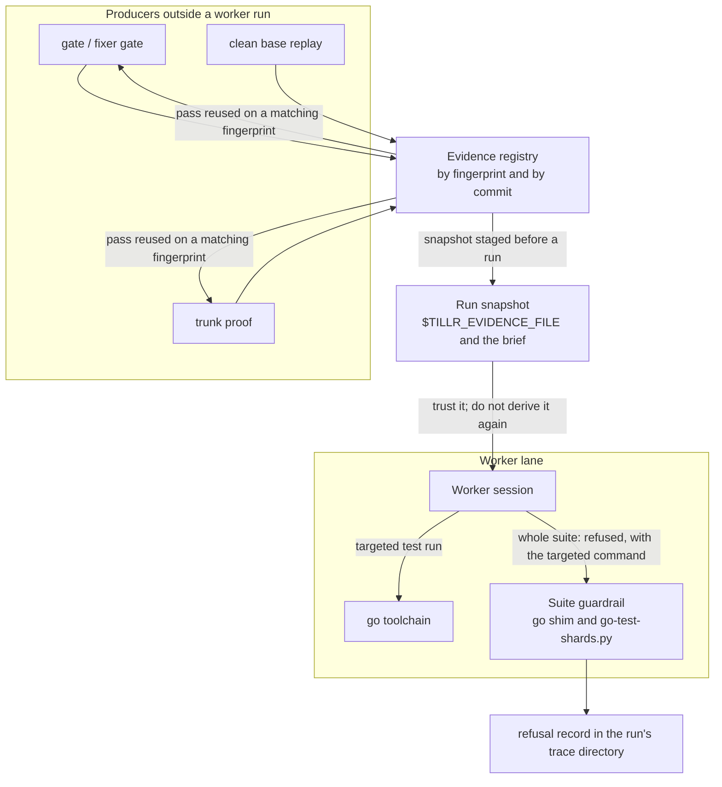

# Evidence Registry and Whole-Suite Lane Guardrail

**Status:** Proposed. The registry, the worker snapshot and the `go` shim are not built: `rg -n 'TILLR_EVIDENCE_FILE|suite-grants' tools config -g '!*.md'` finds nothing, and `tools/tillr-run/shims/` does not exist. Two parts are in the tree: `tools/go-test-shards.py` refuses `--cache` on a repository module inside a lane (`D-ER9`), and the gate disables a contradicted check ([`OQ-ER3`](#OQ-ER3)). [`OQ-ER1`](#OQ-ER1) is open; [`OQ-ER2`](#OQ-ER2) and [`OQ-ER3`](#OQ-ER3) are the owner's rulings. The designer's decisions `D-ER1` to `D-ER9` await review in the [Decision Ledger](#decision-ledger). Companion sketch: [the implementation plan](./tillr-evidence-registry-and-suite-guardrail-plan.md).

---

## 1. The direction and the gaps

The owner gave two linked directions (2026-11-20):

> "Evidence registry, passed to runs with instructions to trust it so they don't re-derive?"
>
> "With those guardrails I talked about, maybe we should stop agents from running the entire suite."

Two gaps stand behind them:

1. **Check evidence is held in separate stores, and none reaches a worker's first run as structured fact.** What one stage proves, the next often runs again.
2. **Leaving whole suites to the gate is only words in a brief.** Nothing stops a worker from running a sharded whole-module suite, an unpooled `go test ./...`, or an unnarrowed `go test` in a very large package. Concurrent lanes doing so have overloaded a machine far enough to time out `go test`.

### 1.1 What exists

| Surface | What it binds to | What it solves | What it misses |
| :--- | :--- | :--- | :--- |
| Remembered passes in [`tools/tillr-gate/memory.go`](../../tools/tillr-gate/memory.go) ([the gate reference](../reference/gate.md#remembered-passes)) | A fingerprint over the check's declaration, the blobs it reads, tool versions and needed refs, on a clean checkout | Reuses a pass across commits when a check's declared inputs are unchanged | Covers only declared gate checks; a failure record stores no failing cases |
| The trunk proof in [`tools/tillr-drain/heavyrun/heavy.go`](../../tools/tillr-drain/heavyrun/heavy.go) | A commit, and path overlap across ancestor tips | Proves the green pointer and carries unchanged passes forward | Its records are separate from the gate's, so a suite proved on the trunk is not remembered by a gate run |
| Worker delivery ([the brief template](../../tools/tillr-run/backends/brief-template.md), [`refusal_cases.go`](../../tools/tillr-drain/drain/refusal_cases.go)) | Prose composed per run | A session resumed after a gate refusal sees the failing cases and a command for each | A first dispatch carries no structured facts, and nothing tells a worker not to derive a result again |

### 1.2 The seam with lane shims

[The lane-shim design](./tillr-lane-shims.md) owns the shared plumbing: a read-only shim directory first on a lane's `PATH`, exit 1 on a policy refusal with a two-part message naming the remedy, and a refusal record appended to the run's trace directory. It also owns process signaling, shared Git refs, protected paths and root recipes.

This document specifies only the whole-suite rule: the `go` shim's test rules, and the matching self-guard inside [`tools/go-test-shards.py`](../../tools/go-test-shards.py), which a `PATH` shim does not intercept when the script is run through `python3`. It answers the lane-shim design's question [`OQ-LS2`](./tillr-lane-shims.md#OQ-LS2) by refusing, paired with [`OQ-ER2`](#OQ-ER2) for broad changes.

---

## 2. Overview

1. **One evidence registry** under the gate's directory in the Git common directory, written only by loop-owned mechanical runners outside a worker run, bound to input fingerprints, staged into each worker's own scratch directory and its brief with instructions to rely on it, and consulted by the gate, the fixer gate, the trunk proof and the base replay so no stage runs a check already proved on the same inputs.
2. **A two-seam whole-suite guardrail**, active whenever `TILLR_RUN_ID` is set: `go-test-shards.py` refuses ungranted whole-module runs in a lane, and a `go` shim refuses unnarrowed whole-module and large-package test runs, printing the exact targeted command for the worker's edited test files and recording every refusal.



### Non-goals

- **A worker's self-report is never gate proof.** Commands captured inside a worker's mutable worktree stay advisory telemetry (`D-ER1`).
- **No expiry by wall clock.** A check whose inputs include state outside Git opts out of reuse with `remember: false` (`D-ER2`).
- **No redesign of the general shims.** Those belong to [the lane-shim design](./tillr-lane-shims.md).

---

## 3. The registry: authority, binding and storage

### 3.1 What counts as evidence, and who may record it

An **evidence entry** (coined here) is an immutable, input-bound record of a check outcome or a structured review finding, produced on a verified clean checkout outside a writing worker's session. The **evidence registry** (coined here) is the shared store of those entries.

Entries are of two kinds (`D-ER1`):

1. **Check evidence:** a pass or fail of a declared check command. Only loop-owned runners on a clean checkout, outside a worker run, may publish it: the gate, the fixer gate, the trunk proof, and the drain's clean base replay. Whether a read-only verify command or a granted in-lane suite run may also publish a reusable pass is [`OQ-ER1`](#OQ-ER1).
2. **Review evidence:** structured criterion or diff objections from a read-only verify, [review](./tillr-diff-review.md#43-the-position-after-the-gate) or compliance session on a committed candidate. It is handed to the resumed writer so the writer addresses exact findings, and is never used to skip a mechanical check.

A worker's progress file, the prose of its report, and a test run in its dirty worktree never count. No lane command writes to the registry, and the gate never reads a lane's scratch directory.

### 3.2 Input binding

An entry must never be trusted on a tree whose relevant inputs changed, and must not be discarded when an unrelated file lands (`D-ER2`):

| Entry | Key | Reusable when |
| :--- | :--- | :--- |
| A check over the tree | A digest of the check's id, command, environment, each read path with its blob and mode, tool versions and needed refs | The checkout is clean on the check's reads, the recomputed key matches, `remember` is not `false`, and no failure exists for the same key |
| A check over a change | A digest of the check, the base commit and the head tree | Base and head tree both match; a rebase onto a new base is a new key |
| A review finding | A digest of the item, the seat, the base, the candidate tree and the criteria | Handed to the writer on its next turn; void once the candidate tree or the criteria change |

The time an entry was observed is never an expiry. It orders a pass against a failure on one key, shows a fixer that a check passed after its hold was filed, and stamps the failure of a check that opted out of reuse.

### 3.3 Layout

The separate caches converge on one directory (`D-ER3`):

```text
<git-common-dir>/tillr-gate/
  evidence/
    by-key/<fingerprint>.pass.json
    by-key/<fingerprint>.fail.json     # a separate file: never overwrites a pass
    by-commit/<commit_sha>.json        # a manifest of every check known for a commit
    logs/<fingerprint>-<run_id>.log    # the output a failure refers to
```

1. **Atomic writes with no global lock.** A pass and a failure are distinct files, each written by temporary file and rename, so concurrent runners publish without overwriting an opposite verdict.
2. **Failing cases captured once, at write time.** A failure embeds its cases (name, place, assertion, reproduce command), its command, its log's digest and a bounded excerpt, replacing the scraping of output.
3. **One read graph per Go module.** A module's check reads the module, each sibling module it replaces locally, the shard runner and its duration data.

---

## 4. Accuracy, contradictions and wrong entries

### 4.1 Invariants

Before a runner trusts or publishes a check entry:

1. **Clean inputs before and after.** The checkout matches the recorded commit and tree, and no path the check reads is modified, staged or untracked, both before the command and after it.
2. **A stable fingerprint.** Recomputing it after the run gives the same digest.
3. **A killed or unjudged run records nothing.** A check ended by a signal, an infrastructure error or a stall writes neither a pass nor a failure.
4. **No truncated reads.** Entries appear only by rename.
5. **Invalidation by edit.** The key covers the check's declaration and tool versions, so correcting a check's reads voids its stale entries. An operator command writes a tombstone to force a check to run again.

### 4.2 When an entry is contradicted on the same fingerprint ([OQ-ER3](#OQ-ER3))

A pass and a failure for one fingerprint is a contradiction. The owner's ruling ([`OQ-ER3`](#OQ-ER3)): "The correct move for a flaky test is disable it, file an item to fix it, and don't let it block anything. It is not considered green, but it also doesn't let you block other things."

The rule and its mechanism are stated once, in [the gate reference](../reference/gate.md#a-contradicted-check-is-disabled), and the gate applies it. Under the registry it reads:

- **A contradiction disables the check.** No runner reuses the pass, and none runs the check for a verdict. Its result is `disabled`, which is never reported as passed, refuses no landing and does not turn the trunk red. The check stays disabled until its repair lands. A tombstone beside a pass is a forced re-run, not a contradiction.
- **Both records are kept**, with their runs, times and logs, and the runner emits an event naming the check, the fingerprint, the failing case and both logs.
- **One repair item per check.** A second contradiction of a check with an open repair item files nothing. The item holds no unrelated landing.

### 4.3 When a worker's targeted reproduction disagrees with a recorded failure

A worker handed a failure runs its single-case command and it passes. The entry is not assumed wrong: races, order dependence and load sensitivity often pass in isolation. The brief gives three steps:

1. Read the recorded assertion and log, then probe the named case with repetition or the race detector, or beside its siblings in a small package. No whole-module run.
2. If the unmodified base cannot fail that way, stop and report a trunk or tooling obstacle.
3. The drain replays that one check on a clean checkout of the base. A pass there makes the fingerprint contradicted, which disables the check ([Section 4.2](#42-when-an-entry-is-contradicted-on-the-same-fingerprint-oq-er3)), and the hold is cleared or updated ([`D-JL16`](./tillr-judge-and-lifecycle.md#49-keeping-a-live-trunk-fixers-work-when-a-rerun-passes-d-jl16)).

---

## 5. Worker delivery and the trust contract

Evidence reaches a worker through two surfaces inside the run's own scratch directory (`D-ER4`):

1. **A machine-readable snapshot at `$TILLR_EVIDENCE_FILE`**, written before a run starts or resumes, with each referenced failure log copied beside it under a size cap. Other lanes cannot overwrite it, reading it opens no store, and the prompt stays compact however many cases failed.
2. **A short digest in the brief's facts section** on a first run, and at the top of a refusal's return on a resumed turn. No new worker command is needed.

The wording in the brief:

```markdown
## Facts carried

Established mechanical evidence (staged in `$TILLR_EVIDENCE_FILE`; trust it — do not re-derive it):
Every check result below was recorded by tillr's gate or trunk proof on a clean checkout of the
named commit and input tree. Treat the check status, failing test name, source location, assertion,
and log output in `$TILLR_EVIDENCE_FILE` as established fact:

- Do NOT run a whole module suite or gate check to confirm a passing base or rediscover a named
  failure for yourself.
- To reproduce or iterate on a listed failure, run ONLY its `reproduce only this case` command.
- If `reproduce only this case` passes on unmodified `BASE_SHA`, the recorded failure was
  intermittent or order-dependent (still a defect to fix): read the assertion and log in
  `$TILLR_EVIDENCE_FILE` first, probe that named test with `-count=5` or `-race`, and report
  `OBSTACLE: trunk` (or `OBSTACLE: tooling`) only if the recorded failure cannot apply to `BASE_SHA`.
- Suites listed as proved on `BASE_SHA` already passed on their exact input trees; leave whole-suite
  regression runs to the landing gate.
```

---

## 6. Reuse across stages

| Transition | Without the registry | With it |
| :--- | :--- | :--- |
| Trunk proof to a gate or fixer gate | The gate cannot read the proof's records and runs unchanged suites again | A candidate whose diff leaves a check's reads untouched computes the same key and skips the check |
| Candidate gate to landing to trunk proof | The proof does not read the gate's results | Where a check's read blobs match after the squash, the proof reuses the pass and runs only what changed |
| A second gate run after a transient landing failure | Suites outside the gate's remembered passes run again | Every tree check with unchanged reads is reused; only change checks with a new base run |
| Read-only verify or review | Nothing stops it from running whole suites before the gate | It is given the gate's verdict and the snapshot, and the guardrail refuses whole suites in its lane |

---

## 7. The whole-suite guardrail in worker lanes

### 7.1 Why prevention sits at both seams

1. **Refusing only the shard runner makes load worse.** A refused worker falls back to an unpooled `go test ./...`.
2. **Refusing only the `./...` pattern leaves the largest suites open.** In a single-package module, `go test` with no pattern is the whole suite, and one package of the drain module holds most of that module's tests.
3. **Prevention must be on `PATH` and inside the runner.** A shell startup file does not reach `sh -c` or a script that calls `go` directly.

### 7.2 The rules

The guardrail is active whenever `TILLR_RUN_ID` is set, which the run utility does for every worker, verify and review session, and which the gate, the trunk proof and an operator's shell never do (`D-ER5`).

1. **Seam A, inside `tools/go-test-shards.py`:**
   - A target outside the repository, such as a synthetic module in a test fixture, runs normally, so a lane editing the runner can run its unit tests.
   - The reserved `proof` slot class is refused.
   - A whole-module run on a repository module is refused with exit 1 unless a loop-staged grant exists for that run and module ([Section 7.4](#74-the-broad-change-exception-and-how-it-is-granted-oq-er2)).
   - `--cache` is refused on a repository module (`D-ER9`, built). The cached mode runs `go test` directly, so the check reads `TILLR_RUN_ID` before the child environment is scrubbed. The gate, the replay and the trunk proof run it outside a worker run.
2. **Seam B, the `go` shim on the lane `PATH`:** the runner's uncached mode compiles test binaries and runs them itself, never calling `go test` without `-c`, so the shim needs no bypass variable a worker could discover.

| Invocation inside a lane | Verdict | Reason |
| :--- | :--- | :--- |
| Any subcommand other than `test` | Allowed | Runs no test binary |
| `go test` with `-c`, `-list` or `-exec true` | Allowed | Compiles or lists without running tests |
| `go test` on a module outside the repository | Allowed | A private fixture |
| `go test` with a narrowing `-run` pattern (not a match-all) | Allowed | A targeted selection |
| `go test` with no `-run` on one package of at most 25 top-level tests | Allowed | A bounded leaf package |
| `go test` with a `...` wildcard and no narrowing `-run` | Refused, exit 1 | An unpooled whole-module run |
| `go test` with no narrowing `-run` on one package of more than 25 top-level tests | Refused, exit 1 | An unpooled whole-suite run |

### 7.3 What the refusal tells the worker to do instead

A refusal that hands back the exact command for the worker's current diff gets copied on the next turn (`D-ER6`). The refusing seam reads which test files the worker touched, extracts their test names, checks the snapshot for a staged reproduce command, and prints three alternatives:

```text
tillr-shim (go): refused in lane worker (<lane>, <run>): whole-suite test run `go test ./...` in `<module>` waits on shared slots or overloads the host; the gate runs affected suites once and returns any failing case to this session.
  Remedy: run one of these instead:
    1. Check that every package and test file compiles:
         cd <module> && go test -exec true ./...
    2. Run every test in the *_test.go files you edited:
         cd <module> && go test ./<pkg> -run '^(TestA|TestB)$'
    3. Reproduce the failure already recorded in $TILLR_EVIDENCE_FILE:
         cd <module> && go test ./<pkg> -run '^TestC$'
```

**Verification lines in queued items (`D-ER7`).** An item whose verification text names a whole-suite command would order the worker to run what the shim refuses. Unless the item carries a grant, staging rewrites such a line to a compile check plus targeted tests, and says the gate runs the full suite.

### 7.4 The broad-change exception and how it is granted ([OQ-ER2](#OQ-ER2))

Even on a cross-cutting change, most breakage is a compile or type error, which `go test -exec true ./...` catches in seconds, and a behavioral failure in a distant package is caught by the gate and returned to the same worker session without counting an attempt ([`D-JL10`](./tillr-judge-and-lifecycle.md#44-how-a-worker-runs-ending-moves-its-item-d-jl10)).

**An exception is never a flag or an environment variable the worker can set.** If the refusal named one, workers would add it on the next call.

**Whole-suite runs are never self-served in lanes** ([`OQ-ER2`](#OQ-ER2)). A granted run works through a loop-owned file outside the worktree: written only by the drain, naming the module, a single permitted run, the reason and who granted it; read by the shard runner, which always uses the ordinary slot class and records the grant's use so it cannot be spent twice.

### 7.5 How refusals are recorded

`D-ER8`. Each refusal appends one small record to the run's trace directory, naming the tool, the rule, the working directory, the command, the module and the suggested command. It writes nothing to the store, and a failed write does not stop the refusal. The trace utility's refusal listing and the run's detail page show it beside the other shim rules, and gate and proof summaries report how many checks were reused and how many ran.

---

## 8. Open Questions

1. 💬 **OQ-ER1: May a check run inside a worker run (such as a verify command or a granted lane suite run) record a reusable pass in the registry, or only loop-owned runners outside a worker run?**

   The gate, the fixer gate, the trunk proof and the clean base replay run outside a worker run, in environments the loop scrubs, so a pass from one is safe for the others on the same fingerprint. Reusing a pass from a granted in-lane run would save one re-run, at the cost of trusting a process started inside an agent's environment.

   - **A — Only loop-owned runners outside a worker run may write reusable passes.** Nothing executed inside an agent's process tree can mark a gate check passed. Workers leave whole suites to the gate, so a suite still runs once.
   - **B — Also allow a loop-invoked read-only verify hook or a granted suite run to write a reusable pass when the tree is clean and committed.** Saves one re-run on granted runs, trusting the runner's environment scrubbing.

   <!-- vantage: question id=OQ-ER1 leaning="A — once workers leave whole suites to the gate, suites already run once in the normal case, and keeping write authority outside agent runs leaves no environment-spoofing surface." -->

   _Leaning:_ A — once workers leave whole suites to the gate, suites already run once in the normal case, and keeping write authority outside agent runs leaves no environment-spoofing surface.

   **Answer:**

   > _(empty — fill in when decided)_

---

## Decision Ledger

[`OQ-ER2`](#OQ-ER2) and [`OQ-ER3`](#OQ-ER3) are the owner's rulings. `D-ER1` to `D-ER9` are the designer's decisions, and the owner may overturn any of them.

| ID | Decision | Date | Settled in | Built |
| :--- | :--- | :--- | :--- | :--- |
| <a id="D-ER1"></a>**D-ER1** | Entries are check evidence, written outside a worker run on a clean checkout, or review evidence, handed back to the writer and never used to skip a check. A worker's claims never enter the registry | 2026-11-20, designer | [Section 3.1](#31-what-counts-as-evidence-and-who-may-record-it) | — |
| <a id="D-ER2"></a>**D-ER2** | A tree check binds to a fingerprint of its inputs and a change check to its base and head tree; the observed time is for ordering and audit, never an expiry | 2026-11-20, designer | [Section 3.2](#32-input-binding) | — |
| <a id="D-ER3"></a>**D-ER3** | The gate's remembered passes, the trunk proof's progress records and the triage output converge on one registry directory, with failing cases embedded in a failure | 2026-11-20, designer | [Section 3.3](#33-layout) | — |
| <a id="D-ER4"></a>**D-ER4** | Evidence reaches a worker as a per-run snapshot plus a short digest in the brief, with instructions to trust it and three steps for a reproduction that passes | 2026-11-20, designer | [Section 4.3](#43-when-a-workers-targeted-reproduction-disagrees-with-a-recorded-failure), [Section 5](#5-worker-delivery-and-the-trust-contract) | — |
| <a id="D-ER5"></a>**D-ER5** | Whole-suite prevention sits at two seams whenever `TILLR_RUN_ID` is set: the shard runner's self-guard and a `go` shim | 2026-11-20, designer | [Section 7.1](#71-why-prevention-sits-at-both-seams), [Section 7.2](#72-the-rules) | — |
| <a id="D-ER6"></a>**D-ER6** | Every refusal prints three alternatives computed from the worker's state: a compile check, the targeted command for its edited tests, and any staged reproduce command | 2026-11-20, designer | [Section 7.3](#73-what-the-refusal-tells-the-worker-to-do-instead) | — |
| <a id="D-ER7"></a>**D-ER7** | Staging rewrites a whole-suite verification line in an item that holds no grant, so no brief orders a refused command | 2026-11-20, designer | [Section 7.3](#73-what-the-refusal-tells-the-worker-to-do-instead) | — |
| <a id="D-ER8"></a>**D-ER8** | Each refusal is appended to the run's trace directory without touching the store, and shown on the trace and run-detail surfaces | 2026-11-20, designer | [Section 7.5](#75-how-refusals-are-recorded) | — |
| <a id="D-ER9"></a>**D-ER9** | The shard runner refuses `--cache` on a repository module whenever `TILLR_RUN_ID` is set, reading it before the child environment is scrubbed; fixtures outside the repository stay allowed. Amends `D-ER5`. **Rejected:** allowing the cached mode in a lane; scrubbing `TILLR_RUN_ID` before the lane guard runs | 2026-11-23, designer | [Section 7.2](#72-the-rules) | Yes: `tools/go-test-shards.py` |
| <a id="OQ-ER2"></a>[OQ-ER2](#OQ-ER2) | **Owner ruling.** Whole-suite runs are never self-served in lanes: a compile check for the whole module, the gate with return to the warm session for full suites, and explicit item or operator grants only | 2026-11-20, owner | [Section 7.4](#74-the-broad-change-exception-and-how-it-is-granted-oq-er2) | — |
| <a id="OQ-ER3"></a>[OQ-ER3](#OQ-ER3) | **Owner ruling.** A contradicted check is disabled, one repair item is filed for it, and it blocks nothing: "The correct move for a flaky test is disable it, file an item to fix it, and don't let it block anything. It is not considered green, but it also doesn't let you block other things." The mechanism is in [the gate reference](../reference/gate.md#a-contradicted-check-is-disabled) | 2026-11-21, owner | [Section 4.2](#42-when-an-entry-is-contradicted-on-the-same-fingerprint-oq-er3) | Yes, in the gate |
