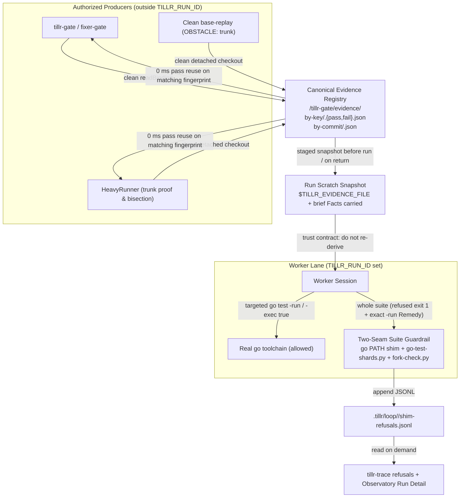

# Evidence Registry and Whole-Suite Lane Guardrail

**Status:** 2026-11-20 — proposed to the owner's direction of 2026-11-20; nothing built. Only [OQ-ER1](#OQ-ER1) remains open; the owner ruled option A for [OQ-ER2](#OQ-ER2) and [OQ-ER3](#OQ-ER3) on 2026-11-20 at about 6:00 PM ET. Eight designer's decisions (`D-ER1` to `D-ER8`) await his review in [the Decision Ledger](#decision-ledger). Companion implementation seed: [tillr-evidence-registry-and-suite-guardrail-plan.md](./tillr-evidence-registry-and-suite-guardrail-plan.md).

---

## 1. Context and the Owner's Direction

On 2026-11-20, after watching lane workers re-run whole test suites to rediscover failures the loop had already caught and saturate the machine's shard pool ahead of the gate and trunk proof, the owner gave two linked directions:

> "Evidence registry, passed to runs with instructions to trust it so they don't re-derive?"
>
> "With those guardrails I talked about, maybe we should stop agents from running the entire suite."

Earlier the same day, four emergency commits patched individual symptoms in prose and in the runner:

- `e5f20f40e` saved a failed legacy proof check's log and pasted a 1,500-character tail into the trunk fixer's criterion text so the fixer would not start blind.
- `e1a5d8dca` reserved test slots and wait priority in [`tools/go-test-shards.py`](../../tools/go-test-shards.py) for `proof` and `gate` runs after `fixer-main-1a02e657069a` (`[unlanded]` reverted trunk tip) spent **43 of its 47 minutes** waiting for slots across two full `tools/tillr-drain` runs (9m42s before editing anything to see the failure for itself, then 33m before committing).
- `8f6b667e2` added prose in [`tools/tillr-run/backends/brief-template.md`](../../tools/tillr-run/backends/brief-template.md) telling workers to run targeted tests and leave whole suites to the gate — an operator stopgap written while the drain was paused.
- `fc5cd652a` parsed `fork-check: triage --` blocks in [`tools/tillr-drain/drain/refusal_cases.go`](../../tools/tillr-drain/drain/refusal_cases.go) so resumed gate-refusal sessions open with the failing test cases instead of raw log paths.

Those patches proved the diagnosis and left two structural gaps:

1. **Check evidence is split across four incompatible stores, none of which reaches initial worker runs as structured truth or shares passes across every stage.** What one stage proves, the next stage often runs again or drops on the floor.
2. **Leaving whole suites to the gate is still only words.** Nothing stops a worker from calling `python3 tools/go-test-shards.py <module> -k 6` (burning shard slots), `cd <module> && go test ./...` (bypassing the slot pool entirely — concurrent lanes doing so drove host load past 60 and pushed `go test` past its ten-minute timeout), or `cd tools/tillr-drain/drain && go test` (running 1,145 tests in one package without `-run`).

### 1.1 What already exists on `main`

Read at `a1cdcebb2` on 2026-11-20:

| Existing surface | Where it writes | What it binds to | What it already solves | What it gets wrong or misses |
| :--- | :--- | :--- | :--- | :--- |
| [`tools/fork-check.py`](../../tools/fork-check.py) triage & baseline log | `<git-common-dir>/yolo-fork-check/record.jsonl`, shared `triage.json`, and indented stdout triage lines | Branch ref (`baselines[ref]`) for passes; `{commit, tree}` on `triage_packet` | Extracts structured failing `cases` (`file`, `reproduce`, `single_case`) for Go and Python suites | Shared `triage.json` is overwritten by whichever run fails newest across all worktrees; `record.jsonl` baselines key by branch ref rather than input-tree slice, so `fixer-gate` and `HeavyRunner` cannot share passes with `tillr-gate` |
| [`tools/tillr-gate/memory.go`](../../tools/tillr-gate/memory.go) (`D-GR8` in [gate rework](./gate-rework.md#62-a-tree-checks-result-is-remembered-by-fingerprint)) | `<git-common-dir>/tillr-gate/results/<key>.{pass,fail}.json` and per-run `gate.verdict.json` | `Format: 2` SHA-256 `treeFingerprint` over `PlanCheck`, `reads` blobs/modes, tool versions, and `needs` refs, guarded by clean `readBinding` | Reuses passes across commits when a check's declared inputs have not changed | Covers only checks migrated to `tools/gate/checks/*.json` (none of the `fork-check.py` Go module suites yet); `.fail.json` stores no failing cases or log hash; and `if pass != nil` short-circuits to `remembered` pass even when `.fail.json` also exists for the same key |
| [`tools/tillr-drain/drain/heavy.go`](../../tools/tillr-drain/drain/heavy.go) & [`heavy_progress.go`](../../tools/tillr-drain/drain/heavy_progress.go) | `<git-common-dir>/tillr-gate/green-<sha>.json`, `heavy-progress.json`, `heavy-replays.json`, and `.rolling/logs/<rev>/legacy-proof.log` | `commit` OID (`GreenProof`) plus `git diff` path overlap across ancestor tips | Proves `refs/tillr/green` under `tillr-loop.lock` (`98e2b112c`) and carries unchanged rolling passes forward | Siloed from `tillr-gate/results/`, so a suite proved on trunk is not remembered by `fixer-gate` or `tillr-gate`; trunk fixers get a whitespace-folded 1,500-byte tail inside a criterion string rather than structured failing cases |
| Worker delivery ([`brief-template.md`](../../tools/tillr-run/backends/brief-template.md) & [`refusal_cases.go`](../../tools/tillr-drain/drain/refusal_cases.go)) | `{{FACTS}}` in `brief.md`; `failureSummary` on `RefusalGate` answers | Ad-hoc per-run prose | Resumed sessions after a gate refusal now see failing case names and `reproduce only this case` commands (`fc5cd652a`) | Initial dispatches (`fixer-main-*`, auto-revert returns, `trunk` base-replay returns, ordinary builds) still receive `"None carried: staging read no facts..."`; log paths point into `.tillr/loop/` or `.rolling/` outside the worker's scratch; no trust contract tells workers not to re-derive |

### 1.2 Seam with preventative lane shell shims ([`tillr-lane-shims.md`](./tillr-lane-shims.md))

The general preventative lane-shim design ([`docs/design/tillr-lane-shims.md`](./tillr-lane-shims.md), `item-request-1273b71e89`, landed in `f7a5e2904` on 2026-11-20) already specifies the shared lane wrapper plumbing in [`tools/tillr-run/run/exec.go`](../../tools/tillr-run/run/exec.go): staging a read-only `<run-scratch>/shims/bin` (`$TILLR_SHIM_BIN`) first on `PATH` from `tools/tillr-run/shims/` alongside an immutable `config.env` (`D-LS1`), stripping `$TILLR_SHIM_BIN` when forwarding so `yolo-jail`'s `/home/agent/.yolo/bin/block/` stays in the chain (`D-LS2`), exiting `1` on policy refusals (`D-LS3`) with a two-part `tillr-shim (<tool>): refused ...` + `Remedy:` message (`D-LS9`), and appending fail-open `kind: "shim.refusal"` records to `$TILLR_TRACE_DIR/shim-refusals.jsonl` scanned on demand by `tillr-trace refusals` and `tillr-trace run <id>` (`D-LS10`, with [OQ-LS4](./tillr-lane-shims.md#OQ-LS4) governing dashboard counters). Its [OQ-LS2](./tillr-lane-shims.md#OQ-LS2) asks whether the `go` shim should redirect whole-module runs to `go-test-shards.py` (option A) or refuse both raw `go test ./...` and `go-test-shards.py` in lanes (option C).

To fit [`tillr-lane-shims.md`](./tillr-lane-shims.md) cleanly rather than repeat or collide with it:

- Process signaling (`pkill`, `killall`, `kill`), shared Git refs, protected path writes, `sqlite3`/`tillr*`, root `just` recipes, and optional Linux namespace isolation stay owned by [`tillr-lane-shims.md`](./tillr-lane-shims.md).
- Following the owner's subsequent direction (*"With those guardrails I talked about, maybe we should stop agents from running the entire suite"*), this document specifies **only** the whole-suite rule across `tools/tillr-run/shims/go` (answering [OQ-LS2](./tillr-lane-shims.md#OQ-LS2) with option C paired with [OQ-ER2](#OQ-ER2) for broad changes, and reusing `D-LS1`–`D-LS3` and `D-LS9`) plus the complementary in-tool self-guards in [`tools/go-test-shards.py`](../../tools/go-test-shards.py) and [`tools/fork-check.py`](../../tools/fork-check.py) (which `PATH` shims alone do not intercept when invoked as `python3 tools/go-test-shards.py`), writing refusals to the same `$TILLR_TRACE_DIR/shim-refusals.jsonl` stream (`D-LS10`).

---

## 2. Overview and Architecture

The design closes both loops with two connected mechanisms:

1. **One canonical Evidence Registry (`<git-common-dir>/tillr-gate/evidence/`)** written exclusively by loop-owned mechanical runners outside `tillr-run` (plus structured evaluator findings on candidate trees), bound by input fingerprint rather than branch name, staged into each worker's own scratch directory (`$TILLR_EVIDENCE_FILE`) and `## Facts carried` brief section with explicit instructions to rely on it, and consulted by `verify`, `tillr-gate`, `fixer-gate`, `HeavyRunner`, and `base-replay` so no stage re-runs a check already proved on the same inputs.
2. **A two-seam Whole-Suite Guardrail** enforcing the brief's suite rule mechanically whenever `TILLR_RUN_ID` is set: `tools/go-test-shards.py` and `tools/fork-check.py` refuse ungranted whole-module and gate runs in lanes, and a `go` shim on the lane `PATH` refuses unnarrowed `go test ./...` and unnarrowed large-package runs while printing the exact targeted `-run` command for the worker's edited test files and recording every refusal for the operator.



### Non-Goals

- **Not trusting worker self-reports as gate proof.** Commands captured in `proc-exec.jsonl` inside a worker's mutable worktree remain advisory session telemetry ([`OQ-SR1` in session recording](./session-recording.md#122-decision-ledger)), never registry evidence (`D-ER1`).
- **Not adding wall-clock cache expiration.** Expiring hermetic check passes on a timer violates [failure diagnosed, not waited out](./failure-diagnosed-not-waited-out.md#decision-ledger) (`D3`) and [gate rework](./gate-rework.md#decision-ledger) (`D-GR8`). Checks with undeclared external inputs opt out of pass reuse via `remember: false` (`D-ER2`).
- **Not re-designing general shell shims.** Process-killing (`pkill`, `killall`), destructive `git`, and general shim packaging belong to [`tillr-lane-shims.md`](./tillr-lane-shims.md).

---

## 3. Evidence Registry: Authority, Binding, and Storage

### 3.1 What counts as evidence and who may record it (`D-ER1`, [OQ-ER1](#OQ-ER1))

An **evidence entry** *(coined here)* is an immutable, input-bound record of a check outcome or structured review finding produced on a verified clean checkout outside a writing worker's unverified session. The **evidence registry** *(coined here)* is the shared repository-local store of those entries under `<git-common-dir>/tillr-gate/evidence/`.

Entries fall into two classes with distinct reuse rules:

1. **Mechanical check evidence (`kind: "check"`):** a `pass` or `fail` outcome of a declared check command (`tools/gate/checks/*.json` or `tools/fork-check.py --registry-json`). Only loop-owned runners executing outside `tillr-run` (`TILLR_RUN_ID` unset) on a verified clean checkout may publish `kind: "check"` entries:
   - `tillr-gate` (candidate landing gate) and `fixer-gate` (trunk-fixer gate);
   - `HeavyRunner` (rolling trunk proof and culprit bisection under `tillr-loop.lock`);
   - `tillr-drain`'s clean detached `base-replay` when verifying `OBSTACLE: trunk`.
   Whether a read-only `verify` command or an explicitly granted in-lane suite run may also publish reusable `pass` entries is left to the owner in [OQ-ER1](#OQ-ER1) (leaning no: keep write authority strictly outside `tillr-run`).
2. **Evaluator finding evidence (`kind: "review"`):** structured criterion or diff objections produced by a read-only `verify`, [diff-review](./tillr-diff-review.md#43-the-position-after-the-gate), or compliance-officer session on a committed candidate tree. Evaluator findings are staged into the resumed writer's `$TILLR_EVIDENCE_FILE` and `## Facts carried` ([plan-step and seat selection](./tillr-plan-step-and-seat-selection.md#42-returning-verification-and-review-objections-to-the-writers-retained-session-d-pss5) `D-PSS5`) so the writer addresses exact findings without re-deriving them, and are **never** used to skip a mechanical check.

**What never counts as evidence:** a worker's `$TILLR_PROGRESS_FILE` (`run.progress`), prose claims in a worker's final report, or test runs inside a worker's dirty or environment-mutable worktree. Write authority is enforced structurally: no lane CLI face writes to `<git-common-dir>/tillr-gate/evidence/`, and `verify` and `tillr-gate` read only `<git-common-dir>/tillr-gate/evidence/`, never a lane's scratch directory.

### 3.2 Input binding: fingerprint, change pair, and `observed_at` (`D-ER2`)

A stale entry must never be trusted on a tree whose relevant inputs changed ([landing principles](./landing-principles.md#2-re-application-preserves-the-change-not-the-patch) [Section 2](./landing-principles.md#2-re-application-preserves-the-change-not-the-patch) and [Section 3](./landing-principles.md#3-gate-what-will-be-the-tip-once)). Conversely, binding a `scope: "tree"` suite to a commit SHA rather than its input slice would discard valid passes every time an unrelated file lands on `main`. Each entry binds to the exact inputs its check reads:

| Entry class | Lookup key (`fingerprint`) | Additional recorded fields | Valid for reuse when |
| :--- | :--- | :--- | :--- |
| **`scope: "tree"` check** (`go-tool:*`, `go-build`, `tillr-docs`, fast tree checks) | `Format: 3` SHA-256 over `{check_id, command, env, reads_tree_entries (path, blob_oid, mode), tool_versions, resolved_needs_refs}` | `commit_sha`, `tree_sha` (`HEAD^{tree}`), `producer`, `run_id`, `observed_at`, `duration_ms`, `result`, and on `fail`: `cases`, `log_path`, `log_sha256`, `excerpt` | Target checkout is clean on `check.Reads`, recomputed `Format: 3` `fingerprint` matches byte-for-byte, `remember` is not `false`, and no contradicting `.fail.json` exists for the same `fingerprint` |
| **`scope: "change"` check** (`citations`, `documents`, `design-citations`, `scratch`) | `Format: 3` SHA-256 over `{check_id, command, env, base_sha, head_tree_sha, tool_versions, resolved_needs_refs}` | Same provenance and failure payload, plus `base_sha` | Both `base_sha` and `head_tree_sha` (plus check declaration and tool versions) match exactly; a rebase onto a new `base_sha` produces a new key |
| **Evaluator finding (`kind: "review"`)** | SHA-256 over `{item_id, evaluator_seat, base_sha, candidate_tree_sha, criteria_digest}` | `commit_sha`, `run_id`, `observed_at`, structured `findings` | Handed to the resumed writer on the next turn; invalidated automatically once `candidate_tree_sha` or `criteria_digest` changes |

**Role of `observed_at` (time):** `observed_at` (RFC 3339 UTC) never acts as a wall-clock TTL on hermetic `remember: true` checks. It serves three concrete purposes:

1. **Fixer causality:** proving a check passed on a descendant *after* a trunk fixer or hold was filed (`PassedAt` in [`heavy_progress.go`](../../tools/tillr-drain/drain/heavy_progress.go)).
2. **Contradiction ordering and operator display:** showing `proved_age` in `tillr view` and ordering `.pass.json` vs `.fail.json` when both appear on one `fingerprint`.
3. **Point-in-time external checks (`remember: false`):** checks whose inputs include state outside Git and pinned tool versions set `remember: false`; their passes are never reused across runs, and their failures reach repair workers explicitly stamped with `observed_at`.

### 3.3 Canonical layout and retiring the fragmented caches (`D-ER3`)

All four check caches converge on `<git-common-dir>/tillr-gate/evidence/`:

```text
<git-common-dir>/tillr-gate/
  evidence/
    by-key/<fingerprint>.pass.json     # atomic temp + fsync + rename
    by-key/<fingerprint>.fail.json     # separate file: never overwrites .pass.json
    by-commit/<commit_sha>.json        # O(1) commit manifest -> map[check_id]{fingerprint, result}
    logs/<fingerprint>-<run_id>.log    # immutable check output referenced by .fail.json
  green-<tip_sha>.json                 # retained for refs/tillr/green compatibility (98e2b112c)
```

Three invariants govern this layout:

1. **Atomic, lock-free per-key writes.** Keeping `.pass.json` and `.fail.json` as distinct files written via same-directory temp file + `fsync` + `rename` lets concurrent `tillr-gate` runs and `HeavyRunner` publish without a global lock and without clobbering an opposite verdict on the same `fingerprint`. `by-commit/<commit_sha>.json` merges entries atomically under a short file lock (`evidence-commit.lock`) so `tillr-drain` can stage all known passes and failures for `base_sha` in one file read instead of recomputing 65 `git ls-tree` fingerprints on every worker dispatch.
2. **Structured failure cases captured once at write time.** `.fail.json` embeds `cases: []FailingCase` (`name`, `where`, `assertion`, `reproduce`), `command`, `log_path`, `log_sha256`, and a bounded 2,000-byte `excerpt`. While any suite remains in [`tools/fork-check.py`](../../tools/fork-check.py), `fork-check.py` writes per-check JSON records to a caller-supplied `--evidence-out <dir>` directory (replacing stdout scraping in [`refusal_cases.go`](../../tools/tillr-drain/drain/refusal_cases.go) and retiring the race-prone shared `<git-common-dir>/yolo-fork-check/triage.json`).
3. **One `reads` graph for Go modules.** Each `go-tool:<module>` check's `reads` includes `<module>/**`, every local `replace` sibling module from `<module>/go.mod`, [`tools/go-test-shards.py`](../../tools/go-test-shards.py), and `tools/go-test-durations.json`, matching the dependency closure [`fork-check.py`](../../tools/fork-check.py) already exports via `--registry-json`.

---

## 4. Accuracy, Contradictions, and Wrong Entries

### 4.1 Pre- and post-execution accuracy invariants

Before a runner trusts or publishes a `kind: "check"` entry, five checks must hold:

1. **Clean input binding before and after execution:** `HEAD` resolves to `commit_sha`, `HEAD^{tree} == tree_sha`, and `git status --porcelain=v1 -z --untracked-files=all` reports zero modified, staged, renamed, or untracked paths matching `check.Reads` both before the command starts and after it exits (generalizing `readBinding` in [`tools/tillr-gate/memory.go`](../../tools/tillr-gate/memory.go)).
2. **Stable fingerprint across execution:** recomputing `fingerprint` after exit yields the exact pre-run digest, catching any mid-run movement in `needs` refs or tool binaries.
3. **Signal-killed and unjudged runs record nothing:** any check ending on an external signal (`exit >= 128`, such as `SIGTERM` during drain shutdown, `f7b707db0`), an infrastructure `error` (`exit == 4`), `unavailable`, `stalled`, or zero judged checks (`98e2b112c`) is `not remembered` — neither `.pass.json` nor `.fail.json` is written.
4. **Artifact hash check on read:** a consumer reading `.fail.json` verifies `log_path` exists (or falls back to the inline `cases` and `excerpt` if log retention pruned an old blob) and never reads a truncated write because entries land only by atomic `rename`.
5. **Automatic invalidation on check or runner edits:** because `Format: 3` hashes the check's `PlanCheck` declaration (command, env, `reads`) and tool versions, editing a check's missing `reads` dependency or bumping `Format` immediately invalidates stale entries without manual cache wiping. An explicit operator face (`tillr gate forget --check <id> | --all`) writes a `.invalid.json` tombstone when an operator wants to force re-verification without editing a check file.

### 4.2 When an entry is contradicted on the same `fingerprint` ([OQ-ER3](#OQ-ER3))

Today [`tools/tillr-gate/memory.go`](../../tools/tillr-gate/memory.go) checks `if pass != nil` before inspecting `fail != nil`, so once a check passes once on a `treeFingerprint`, a subsequent failure on that exact same `treeFingerprint` (for example in `HeavyRunner` or a forced rerun) never stops `tillr-gate` from returning `ResultPass` (`remembered`).

Under the unified registry:

- **Immediate quarantine from pass reuse:** whenever **both** `<fingerprint>.pass.json` and `<fingerprint>.fail.json` (or `.invalid.json`) exist for the same `fingerprint`, that `fingerprint` is **contradicted** (`memory: "contradicted"`). Neither `tillr-gate` nor `HeavyRunner` may reuse `.pass.json` for that `fingerprint`; the check executes live until its inputs change to a new `fingerprint`.
- **Forensic preservation and telemetry:** both `.pass.json` and `.fail.json` remain on disk with their `run_id`, `observed_at`, and `log_path`, and the runner emits a `gate.evidence-contradicted` event naming the check ID, `fingerprint`, failing case, and both logs.
- **Defect filing policy:** when a pass and a failure share a fingerprint, file a `flaky-<check-id>` repair item with the `.fail.json` case and both logs. If that check ID already has an open repair item for the flake, do not file another. Under `D-GR17` ("a test that fails or hangs under load is a broken test"), an intermittent failure is a real defect. The repair item does not hold unrelated landings ([OQ-ER3](#OQ-ER3), option A).

### 4.3 When targeted worker reproduction disagrees with a recorded failure

A repair or resumed build worker is handed a `.fail.json` entry recorded on `base_sha` (or on its prior candidate commit) and runs the single-case `reproduce` command on unmodified `HEAD`. If that single test passes on the first try, the entry is **not** assumed fake — intermittent races, test-order state leaks across files in one package, and load-sensitive assertions (`D-GR17`) routinely pass in isolation. The brief gives the worker a deterministic three-step ladder:

1. **Inspect the recorded assertion and log first, then probe single-test / single-package determinism:** read `assertion`, `where`, and `$TILLR_EVIDENCE_FILE`'s copied log, then test the named case with `-count=5` or `-race` (`go test ./<pkg> -run '^TestName$' -count=5`), or alongside its sibling tests in that single package if the package is within the guardrail threshold, without running the whole module suite.
2. **Escalate via `OBSTACLE: trunk` or `OBSTACLE: tooling` if `base_sha` genuinely cannot fail:** if the worker verifies on unmodified `base_sha` that the recorded failure came from an environment fault or stale premise rather than the code in its fence, it stops and reports `OBSTACLE: trunk` (or `OBSTACLE: tooling` naming the check).
3. **Loop-owned clean replay settles the disagreement:** `tillr-drain`'s `trunk` obstacle handler runs a clean detached replay of that single check on `base_sha`. If clean replay passes, `tillr-drain` writes `.pass.json` alongside `.fail.json` (marking the `fingerprint` `contradicted` so stale failure claims are not re-served as deterministic truth) and clears or updates the hold ([judge and lifecycle](./tillr-judge-and-lifecycle.md#49-keeping-a-live-trunk-fixers-work-when-a-rerun-passes-d-jl16) `D-JL16`).

---

## 5. Worker Delivery and the Trust Contract (`D-ER4`)

Evidence reaches a worker through **two paired surfaces inside the run's own scratch boundary**, replacing ad-hoc `.tillr/loop/` and `.rolling/logs/` paths that sit outside the worker's fence:

1. **Machine-readable run snapshot (`$TILLR_EVIDENCE_FILE`):** before launching or resuming a worker run, `tillr-drain` writes `<run-scratch>/evidence.json` (and copies any referenced failure logs to `<run-scratch>/evidence-logs/<check-id>.log`, capped at 256 KiB per check). [`tools/tillr-run/run/exec.go`](../../tools/tillr-run/run/exec.go) exports `TILLR_EVIDENCE_FILE=<run-scratch>/evidence.json`. Because the snapshot lives inside the run's own scratch directory:
   - concurrent runs in other lanes cannot overwrite it (unlike `.git/yolo-fork-check/triage.json`);
   - reading it never requires opening `.tillr/state.db` or paths outside the worker's fence; and
   - when 15 tests fail, the prompt stays compact while every case and compiler line remains readable via `read` on `$TILLR_EVIDENCE_FILE` and `<run-scratch>/evidence-logs/`.
2. **Inline brief and return digest (`<= 4 KiB`):** `tillr-drain` renders a compact Markdown digest of `$TILLR_EVIDENCE_FILE` into `{{FACTS}}` (`## Facts carried` in [`brief-template.md`](../../tools/tillr-run/backends/brief-template.md)) on initial runs (`fixer-main-*`, reverted items, `trunk` returns, and ordinary starts whose `base_sha` has `by-commit/<base_sha>.json` records) and at the top of `answerLandingRefusal` / `returnedBrief` on resumed turns (unifying `fc5cd652a` and `e5f20f40e` into one renderer). No new worker CLI verb is needed: the digest is already in context on turn 1, and full structured records sit at `$TILLR_EVIDENCE_FILE`.

### Normative trust wording in `brief-template.md` and refusal returns

```markdown
## Facts carried

Established mechanical evidence (staged in `$TILLR_EVIDENCE_FILE`; trust it — do not re-derive it):
Every check result below was recorded by tillr's gate or trunk proof on a clean checkout of the
named commit and input tree. Treat the check status, failing test name, source location, assertion,
and log output in `$TILLR_EVIDENCE_FILE` as established fact:

- Do NOT run a whole module suite or gate check to confirm a passing base or rediscover a named
  failure for yourself.
- To reproduce or iterate on a listed failure, run ONLY its `reproduce only this case` command.
- If `reproduce only this case` passes on unmodified `BASE_SHA`, the recorded failure was
  intermittent or order-dependent (still a defect to fix under D-GR17): read the assertion and log
  in `$TILLR_EVIDENCE_FILE` first, probe that named test with `-count=5` or `-race`, and report
  `OBSTACLE: trunk` (or `OBSTACLE: tooling`) only if the recorded failure cannot apply to `BASE_SHA`.
- Suites listed as proved on `BASE_SHA` already passed on their exact input trees; leave whole-suite
  regression runs to the landing gate.
```

---

## 6. Cross-Stage Reuse (`verify`, `gate`, `fixer-gate`, `heavy`)

With `tillr-gate`, `fixer-gate`, `HeavyRunner`, and `base-replay` sharing `<git-common-dir>/tillr-gate/evidence/by-key/`, every stage reuses passes already established for the same input slice:

| Stage transition | What happens today (`a1cdcebb2`) | What happens with the shared Evidence Registry |
| :--- | :--- | :--- |
| **Trunk proof (`HeavyRunner`) -> `fixer-gate` / `tillr-gate`** | `HeavyRunner` records passes in `heavy-progress.json` and `green-<sha>.json`; `fixer-gate` runs `fork-check.py --since <green>` in a lane branch, misses `record.jsonl`'s branch-keyed baseline, and re-runs unchanged suites. | `HeavyRunner` writes `<fingerprint>.pass.json` for every passing check on detached trunk. Any candidate or fixer whose diff leaves a check's `reads` untouched computes the identical `fingerprint` and skips execution in < 5 ms. |
| **Candidate `tillr-gate` -> `tillr-land` -> `HeavyRunner`** | `tillr-gate` runs landing-tier suites on candidate tree `T_cand`; after squash onto `main`, `HeavyRunner` runs rolling checks from `heavy-progress.json` without reading `tillr-gate/results/`. | When `tillr-land` squashes onto `main` and a check's `reads` blobs in `T_landed` match `T_cand` (always true when `T_landed == T_cand`, and true even after concurrent landings outside `check.Reads`), `HeavyRunner` reuses `<fingerprint>.pass.json` immediately and spends slots only on rolling-only suites (such as `go-tool:tools/tillr-drain`) whose inputs actually changed. |
| **Transient land retry (`SQLITE_BUSY` or refused-push rebase) -> second `tillr-gate` run** | Migrated JSON checks reuse `tillr-gate/results/`; `fork-check.py` Go suites re-run if branch ref moved. | Every `scope: "tree"` check whose `reads` blobs did not change reuses `<fingerprint>.pass.json` in 0 s; only `scope: "change"` checks with a new `base_sha` or `reads` touched by a rebase conflict re-run. |
| **Read-only `verify` / post-gate `review` ([`D-PSS5`](./tillr-plan-step-and-seat-selection.md#42-returning-verification-and-review-objections-to-the-writers-retained-session-d-pss5), [`tillr-diff-review`](./tillr-diff-review.md#43-the-position-after-the-gate))** | Pre-gate `verify` (`planned-build@v1`) runs in a read-only worker lane where nothing stops it from running whole suites ahead of `tillr-gate`. | Post-gate `review` receives `gate.verdict.json` + `$TILLR_EVIDENCE_FILE` showing every check that already passed on `candidate_tree_sha`, and the lane suite guardrail blocks `verify` / `review` sessions (`TILLR_RUN_ID` set) from re-running whole module suites. |

---

## 7. Whole-Suite Guardrail in Worker Lanes

### 7.1 Why prose failed, and why prevention must sit at both seams (`D-ER5`)

Counting top-level `Test*`, `Example*`, and `Fuzz*` functions across the repository's nine Go modules at `a1cdcebb2` exposes why neither a `go-test-shards.py` check alone nor a naive `go test ./...` string match alone works:

| Module (`go.mod`) | Total tests | Largest single package | Tests in largest package |
| :--- | ---: | :--- | ---: |
| `tools/tillr-drain` | 1,491 | `tools/tillr-drain/drain` | **1,145** (337 files; root pkg has 333) |
| `tools/tillr-view` | 327 | `tools/tillr-view` (single-pkg module) | **327** (111 files) |
| `tools/tillr-item` | 310 | `tools/tillr-item` | **168** (`item` subpkg has 140) |
| `tools/tillr` | 156 | `tools/tillr/store` | **103** (34 files) |
| `tools/tillr-land` | 152 | `tools/tillr-land` | **138** (91% of module) |
| `tools/tillr-run` | 151 | `tools/tillr-run/run` | **91** (root pkg has 60) |
| `tools/tillr-gate` | 117 | `tools/tillr-gate` (single-pkg module) | **117** (22 files) |
| `tools/tillr-store` | 37 | `tools/tillr-store` (single-pkg module) | **37** (6 files) |
| `tools/tillr-cli` | 7 | `tools/tillr-cli` (single-pkg module) | **7** (1 file) |

Three consequences follow directly from those numbers:

1. **Refusing only `tools/go-test-shards.py` makes load worse:** the moment `go-test-shards.py` refuses a worker, the model falls back to `cd tools/tillr-drain && go test ./...`, bypassing the shard pool entirely and recreating the load-60 spike.
2. **Refusing only `./...` leaves single-package suites and `drain` wide open:** in `tools/tillr-view` (327 tests) and `tools/tillr-gate` (117 tests), `go test` or `go test .` *is* 100% of the module suite; in `tools/tillr-drain`, `go test ./drain` without `-run` runs **1,145 tests** unpooled.
3. **Prevention must sit on `PATH` + inside the repo runners, not only in `BASH_ENV`:** `pi`'s `background_task` runs under `sh -c` (which ignores `BASH_ENV`), and subagents or Python scripts invoke `go` directly via `PATH`.

### 7.2 Exact enforcement rules across the two seams (`D-ER5`)

Prevention activates whenever `TILLR_RUN_ID` is non-empty (`tillr-run` sets `TILLR_RUN_ID` for every worker, `verify`, and `review` session, while `tillr-gate`, `HeavyRunner`, `tillr-loop`, and interactive operator shells never set it — the same boundary `bin/pi-forks` uses today):

1. **Seam A — In-tool self-guards in [`tools/go-test-shards.py`](../../tools/go-test-shards.py) and [`tools/fork-check.py`](../../tools/fork-check.py):**
   - **Private unit-test fixtures stay allowed:** if the resolved target directory lies outside `$TILLR_REPO_ROOT` and outside `.forks/` (for example, [`tests/go-test-shards.test.py`](../../tests/go-test-shards.test.py) and `tests/fork-check.test.py` running tiny synthetic modules under `$TMPDIR` with a scratch `GO_TEST_SHARDS_LOCK_DIR`), execution proceeds normally so a lane editing the runner or gate can still run its own unit tests.
   - **Reserved-class protection:** when `TILLR_RUN_ID` is set and the target is inside `$TILLR_REPO_ROOT` or `.forks/`, `go-test-shards.py` unconditionally refuses `--slot-class proof` and `GO_TEST_SHARDS_CLASS=proof`, closing the prose-only gap in `e1a5d8dca`.
   - **Whole-module & gate refusal:** on any in-repo module, `go-test-shards.py` refuses execution (`exit 1`, matching [`D-LS3` in `tillr-lane-shims.md`](./tillr-lane-shims.md#decision-ledger)) unless a valid loop-staged exception grant exists for `(TILLR_RUN_ID, canonical_module)` (see [Section 7.4](#74-the-broad-change-exception-and-how-it-is-granted-oq-er2)). `fork-check.py` likewise refuses `just done`, `just preflight`, and direct gate runs under `TILLR_RUN_ID` while still answering read-only metadata flags (`--explain`, `--registry-json`, `--help`).
2. **Seam B — The `go` `PATH` shim in `tools/tillr-run/shims/go` (fitting [`tillr-lane-shims.md`](./tillr-lane-shims.md)):**
   - **No secret bypass env var needed for `go-test-shards.py`:** `go-test-shards.py` invokes `go list -json ./...`, `go test -c -o <scratch>/pkg.test <import>`, and `go tool test2json <pkg.test> -test.run=...` — it never calls `go test` without `-c`. Because compile-only `-c` is always allowed and `tools/tillr-run/shims/go` reads its boundary paths from the runner-written read-only `config.env` ([`D-LS1`](./tillr-lane-shims.md#decision-ledger)), the `go` shim needs zero ambient bypass variable that an agent could discover and export.
   - **Exact allow / refuse matrix for `go` under `TILLR_RUN_ID`:**

| Invocation inside a lane (`TILLR_RUN_ID` set) | Verdict | Reason |
| :--- | :--- | :--- |
| Any subcommand other than `test` (`go build ./...`, `go vet ./...`, `go list ./...`, `go tool ...`) | **Allowed** | Fast compilation / static analysis; runs zero test binaries |
| `go test` with `-c`, `-list` / `-test.list`, or `-exec true` (including `go test -exec true ./...`) | **Allowed** | Compiles every package and test file (~1.5 s) or lists test names without executing tests |
| `go test` whose working/target module is outside `$TILLR_REPO_ROOT` and `.forks/` (`$TMPDIR` unit-test fixtures) | **Allowed** | Private synthetic fixture inside a test case |
| `go test` with a narrowing `-run <pat>` / `-test.run=<pat>` (excluding trivial match-all `.`, `.*`, `^.*$`, `^Test`, `^Test.*`) | **Allowed** | Targeted test or edited-file selection (`-run '^(TestA\|TestB)$'`) |
| `go test` with no `-run` on a single package containing **<= 25** top-level `Test*`/`Example*`/`Fuzz*` functions (e.g. `tillr-cli` [7], `holdrules` [2], `land` [14]) | **Allowed** | Bounded leaf package; sub-second cost |
| `go test` with any `...` wildcard (`./...`, `tools/...`, `...`) and no narrowing `-run` (or with a match-all `-run .` / `.*`) | **Refused (`exit 1`)** | Unpooled whole-module suite run |
| `go test` with no narrowing `-run` on a single package containing **> 25** top-level test functions (e.g. `drain` [1,145], `tillr-view` [327], `tillr-gate` [117], `tillr-store` [37]) | **Refused (`exit 1`)** | Unpooled whole-suite or mega-package run |

### 7.3 What the refusal tells the worker to do instead (`D-ER6`, `D-ER7`)

A bare "blocked" message makes agents guess workarounds; a refusal that hands back the exact command for the worker's current diff gets copied on the next turn. Following the two-part `tillr-shim` + `Remedy:` contract in [`tillr-lane-shims.md`](./tillr-lane-shims.md#6-refusal-messages-that-name-the-next-step) (`D-LS9`), when Seam A or Seam B refuses (`exit 1` to `stderr`), it inspects `git diff --name-only` (against base + working tree) inside the target module, extracts `^func (Test|Example|Fuzz)\w+` names from any touched `*_test.go` files, checks `$TILLR_EVIDENCE_FILE` for any staged `reproduce` command on that module, and prints:

```text
tillr-shim (go): refused in lane worker (<lane>, <TILLR_RUN_ID>): whole-suite test run `go test ./...` in `tools/tillr-drain` waits on shared slots or overloads the host; `tillr-gate` runs affected suites once with reserved slot priority and returns any failing case to this session.
  Remedy: run one of these instead:
    1. Check that every package and test file compiles (~1.5s, 0 slots):
         cd tools/tillr-drain && go test -exec true ./...
    2. Run every test in the *_test.go files you edited:
         cd tools/tillr-drain && go test ./drain -run '^(TestReadTriageBlock|TestFailureSummary)$'
    3. Reproduce the failure already recorded in $TILLR_EVIDENCE_FILE (if fixing a known red):
         cd tools/tillr-drain && go test ./drain -run '^TestHeavyRevert$'
```

(When no `*_test.go` file has been edited yet, item 2 shows the `-run '^TestName$'` template for the target package.)

**Compatibility with legacy `Verify:` lines in queued items (`D-ER7`):** many existing item blocks on [`docs/tillr/roadmap.md`](../tillr/roadmap.md) still contain `Verify: go test ./... in tools/tillr-drain/` or `python3 tools/go-test-shards.py ...`, which `stage.go` renders into `{{VERIFICATION}}` under *"Run each of these and paste its output in your report."* Left untouched, the brief would order the worker to run a command the shim refuses. Unless an item carries an explicit whole-suite grant ([Section 7.4](#74-the-broad-change-exception-and-how-it-is-granted-oq-er2)), `tillr-drain` rewrites whole-suite `go test ./...` and `go-test-shards.py <module>` lines in `{{VERIFICATION}}` at staging time to: *"compile-check `<module>` with `go test -exec true ./...` and run targeted `go test ./<pkg> -run '<changed tests>'`; the landing gate runs the full `<module>` suite."*

### 7.4 The broad-change exception and how it is granted ([OQ-ER2](#OQ-ER2))

Even on a cross-cutting refactor (for example changing a signature in `tools/tillr/store` referenced across 30 files), 95% of breakages are compile or type mismatches caught in 1.5 seconds by `go test -exec true ./...` (which compiles every test binary without running tests), and any behavioral test failure in a distant package is caught by `tillr-gate`'s single priority run and returned with exact failing cases (`fc5cd652a`) to the **same warm worker session** without counting an attempt ([judge and lifecycle](./tillr-judge-and-lifecycle.md#44-how-a-worker-runs-ending-moves-its-item-d-jl10) `D-JL10`).

Crucially, **an exception must never be a CLI flag or environment variable the worker can mint for itself** — if the refusal message named `--allow-whole-suite`, agents would append it on the very next tool call and reduce the guardrail back to prose.

When a whole-suite lane run *is* authorized, the mechanism works through a loop-owned file outside the worktree (`.tillr/loop/<TILLR_RUN_ID>/suite-grants.json`):

- Written only by `tillr-drain` (outside `TILLR_RUN_ID`), naming `{module, max_runs: 1, reason, granted_by}`.
- Read by `tools/go-test-shards.py` (never opening unpooled `go test ./...`, always enforcing `--slot-class ordinary`, and recording usage in `.tillr/loop/<TILLR_RUN_ID>/suite-grants-used.jsonl` so a `max_runs: 1` grant cannot be spent twice in one run).

**Whole-suite runs are never self-served in lanes** ([OQ-ER2](#OQ-ER2), option A). Workers use `go test -exec true ./...` for whole-module compile checks and rely on `tillr-gate` with warm-session return for full suites. `suite-grants.json` is reserved for explicit item/operator grants only.

### 7.5 How refusals are recorded for the operator (`D-ER8`)

Refusal telemetry shares the exact stream and no-SQLite-index contract settled in [session recording](./session-recording.md#71-four-mechanical-fail-open-guarantees) and [`tillr-lane-shims.md`](./tillr-lane-shims.md#7-recording-refusals-without-touching-the-live-store) (`D-LS10`):

1. **Immediate JSONL append in `$TILLR_TRACE_DIR/shim-refusals.jsonl` (zero `.tillr/state.db` writes):** whenever `tools/tillr-run/shims/go`, `go-test-shards.py`, or `fork-check.py` refuses a whole-suite or lane-gate command, it atomically appends (`O_WRONLY | O_CREAT | O_APPEND`) one `< 2 KiB` JSON line with `kind: "shim.refusal"`, `tool: "go" | "go-test-shards" | "fork-check"`, `rule: "whole-suite" | "reserved-slot-class" | "lane-gate"`, `cwd`, `argv`, `target` (module path), and `suggested_cmd`. If `$TILLR_TRACE_DIR` is unset or unwritable, the log write fails open while the `stderr` refusal and `exit 1` still fire.
2. **On-demand operator surfaces:** `tillr-trace refusals [--runs N]`, `tillr-trace run <run-id>`, and the Observatory Run Detail page surface whole-suite refusals alongside the other lane shim rules (with dashboard counters governed by [OQ-LS4](./tillr-lane-shims.md#OQ-LS4)), while `gate.verdict` and `HeavyRunner` summaries report `reused` vs `executed` check counts from the Evidence Registry.

---

## 8. Open Questions

1. 💬 **OQ-ER1: May a check run inside `tillr-run` (such as a `verify` command or a granted lane suite run) record a reusable `pass` in the Evidence Registry, or only loop-owned runners outside `tillr-run`?**

   In [Section 3.1](#31-what-counts-as-evidence-and-who-may-record-it-d-er1-oq-er1) and [Section 6](#6-cross-stage-reuse-verify-gate-fixer-gate-heavy), `tillr-gate`, `fixer-gate`, `HeavyRunner`, and clean `base-replay` run outside `tillr-run` (`TILLR_RUN_ID` unset) in loop-scrubbed environments, so a `pass` proved by one is safely reused by the others on the same `fingerprint`. If an item is ever granted an in-lane `go-test-shards.py` run (or runs a deterministic check inside a `verify` node) on a clean committed tree right before `land`, reusing that pass at `tillr-gate` would save one rerun (~5–45 s), at the cost of trusting a process started inside an agent's environment.

   - **A — Only loop-owned runners outside `tillr-run` may write reusable `pass` entries.** Nothing executed inside an agent container's `TILLR_RUN_ID` process tree can ever mark a gate check passed. Because lane workers leave whole suites to the gate in the normal case, suites still run only once; on the rare granted in-lane run, `tillr-gate` verifies it once in its own scrubbed environment.
   - **B — Also allow a loop-invoked read-only `verify` hook or granted `go-test-shards.py` run to write a reusable `pass` when `readBinding` confirms a clean committed tree.** Saves one rerun on granted in-lane suite runs, trusting environment scrubbing inside the runner script.

   <!-- vantage: question id=OQ-ER1 leaning="A — only loop-owned runners outside tillr-run may write reusable pass entries: once workers leave whole suites to the gate, suites already run once in the normal case, and keeping registry write authority strictly outside agent runs leaves zero environment-spoofing surface." -->

   _Leaning:_ A — only loop-owned runners outside `tillr-run` may write reusable `pass` entries: once workers leave whole suites to the gate, suites already run once in the normal case, and keeping registry write authority strictly outside agent runs leaves zero environment-spoofing surface.

   **Answer:**

   > _(empty — fill in when decided)_


---

## Decision Ledger

Rows `D-ER1` through `D-ER8` are designer's engineering decisions made on 2026-11-20 while drafting this specification; they await the owner's review and may be overturned. Rows [OQ-ER2](#OQ-ER2) and [OQ-ER3](#OQ-ER3) are owner rulings, each accepting option A as quoted below.

| ID | Decision | Provenance & Date | Governing section |
| :--- | :--- | :--- | :--- |
| <a id="D-ER1"></a>**D-ER1** | Separate registry entries into `kind: "check"` (mechanical `pass`/`fail` written outside `tillr-run` on clean checkouts) and `kind: "review"` (structured evaluator findings handed back to writers, never skipping mechanical checks); worker claims and `proc-exec.jsonl` never enter the registry. | Designer's decision; the owner may overturn this (2026-11-20) | [Section 3.1](#31-what-counts-as-evidence-and-who-may-record-it-d-er1-oq-er1) |
| <a id="D-ER2"></a>**D-ER2** | Bind `scope: "tree"` checks to `Format: 3` `treeFingerprint` (check declaration + command + `reads` blobs/modes + tool versions + resolved `needs` refs), `scope: "change"` checks to `(base_sha, head_tree_sha, declaration_digest)`, and `observed_at` to causality/audit rather than a wall-clock TTL (`remember: false` opts non-hermetic checks out of pass reuse). | Designer's decision; the owner may overturn this (2026-11-20) | [Section 3.2](#32-input-binding-fingerprint-change-pair-and-observed_at-d-er2) |
| <a id="D-ER3"></a>**D-ER3** | Unify `tillr-gate/results/`, `HeavyRunner`'s `heavy-progress.json`, and `fork-check.py` triage outputs into `<git-common-dir>/tillr-gate/evidence/` (`by-key/<fingerprint>.{pass,fail}.json` with embedded `FailingCase` list and `log_sha256`, plus `by-commit/<sha>.json`), retiring reliance on mutable shared `.git/yolo-fork-check/triage.json` while keeping `green-<sha>.json`. | Designer's decision; the owner may overturn this (2026-11-20) | [Section 3.3](#33-canonical-layout-and-retiring-the-fragmented-caches-d-er3) |
| <a id="D-ER4"></a>**D-ER4** | Deliver evidence to workers via an isolated per-run snapshot at `$TILLR_EVIDENCE_FILE` (`<run-scratch>/evidence.json` + copied logs under `<run-scratch>/evidence-logs/`) paired with a `<= 4 KiB` inline digest in `## Facts carried` and refusal returns, with explicit instructions to trust established results and a three-step protocol when single-case reproduction passes on `base_sha`. | Designer's decision; the owner may overturn this (2026-11-20) | [Section 4.3](#43-when-targeted-worker-reproduction-disagrees-with-a-recorded-failure), [Section 5](#5-worker-delivery-and-the-trust-contract-d-er4) |
| <a id="D-ER5"></a>**D-ER5** | Enforce whole-suite prevention at both seams whenever `TILLR_RUN_ID` is set on in-repo modules: self-guards in `tools/go-test-shards.py` (blocking `--slot-class proof` and ungranted module runs) and `tools/fork-check.py`, plus `tools/tillr-run/shims/go` (extending [`tillr-lane-shims.md`](./tillr-lane-shims.md)) blocking unnarrowed `...` wildcards and unnarrowed packages with `> 25` tests while allowing `-c`, `-list`, `-exec true`, targeted `-run`, tiny leaf packages, and outside-repo `$TMPDIR` unit-test fixtures. | Designer's decision; the owner may overturn this (2026-11-20) | [Section 7.1](#71-why-prose-failed-and-why-prevention-must-sit-at-both-seams-d-er5), [Section 7.2](#72-exact-enforcement-rules-across-the-two-seams-d-er5) |
| <a id="D-ER6"></a>**D-ER6** | Format every whole-suite guardrail refusal (`exit 1` per [`D-LS3`](./tillr-lane-shims.md#decision-ledger), `tillr-shim` + `Remedy:` per [`D-LS9`](./tillr-lane-shims.md#decision-ledger)) with three actionable alternatives computed from the worker's current state: `go test -exec true ./...` for whole-module compilation, the exact `go test ./<pkg> -run '^(...)$'` command extracted from touched `*_test.go` files, and any staged `reproduce` command from `$TILLR_EVIDENCE_FILE`. | Designer's decision; the owner may overturn this (2026-11-20) | [Section 7.3](#73-what-the-refusal-tells-the-worker-to-do-instead-d-er6-d-er7) |
| <a id="D-ER7"></a>**D-ER7** | Normalize legacy whole-suite `go test ./...` and `go-test-shards.py <module>` lines in staged `{{VERIFICATION}}` blocks (unless the item holds an explicit suite grant) so queued items on `roadmap.md` never instruct a worker to run a command the guardrail refuses. | Designer's decision; the owner may overturn this (2026-11-20) | [Section 7.3](#73-what-the-refusal-tells-the-worker-to-do-instead-d-er6-d-er7) |
| <a id="D-ER8"></a>**D-ER8** | Record every whole-suite guardrail refusal fail-open by atomic JSONL append (`kind: "shim.refusal"`, `rule: "whole-suite"`) to `$TILLR_TRACE_DIR/shim-refusals.jsonl` alongside [`tillr-lane-shims.md`](./tillr-lane-shims.md) (`D-LS10`), surfacing on `tillr-trace refusals`, `tillr-trace run <id>`, and Run Detail ([OQ-LS4](./tillr-lane-shims.md#OQ-LS4)) alongside `reused`/`executed` gate counts without touching `.tillr/state.db`. | Designer's decision; the owner may overturn this (2026-11-20) | [Section 7.5](#75-how-refusals-are-recorded-for-the-operator-d-er8) |
| <a id="OQ-ER2"></a>[OQ-ER2](#OQ-ER2) | “A — never self-served in lanes (go test -exec true ./... for whole-module compile checks, tillr-gate with warm-session return for full suites, and explicit item/operator grants only): any inline worker flag gets used routinely, whereas letting the gate run the suite once eliminates duplicate runs and 33-minute pre-commit slot waits.” | Owner ruling; Vantage `a5fae9a5` (2026-11-20, about 6:00 PM ET) | [Section 7.4](#74-the-broad-change-exception-and-how-it-is-granted-oq-er2) |
| <a id="OQ-ER3"></a>[OQ-ER3](#OQ-ER3) | “A — quarantine the cached pass and file one deduplicated flaky-<check-id> repair item without holding unrelated landings: under D-GR17 an intermittent test failure is a real defect, and deduplicating to one open item per check ID bounds queue noise while ensuring the flake gets fixed.” | Owner ruling; Vantage `a9359659` (2026-11-20, about 6:00 PM ET) | [Section 4.2](#42-when-an-entry-is-contradicted-on-the-same-fingerprint-oq-er3) |
