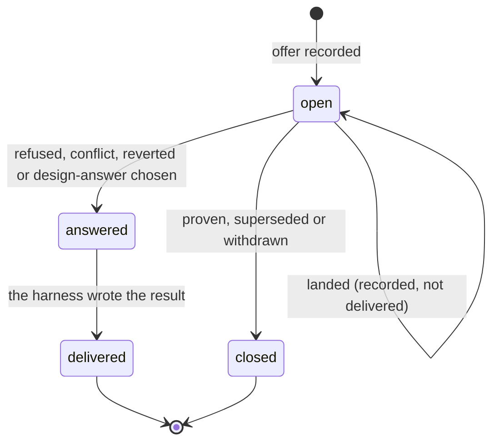
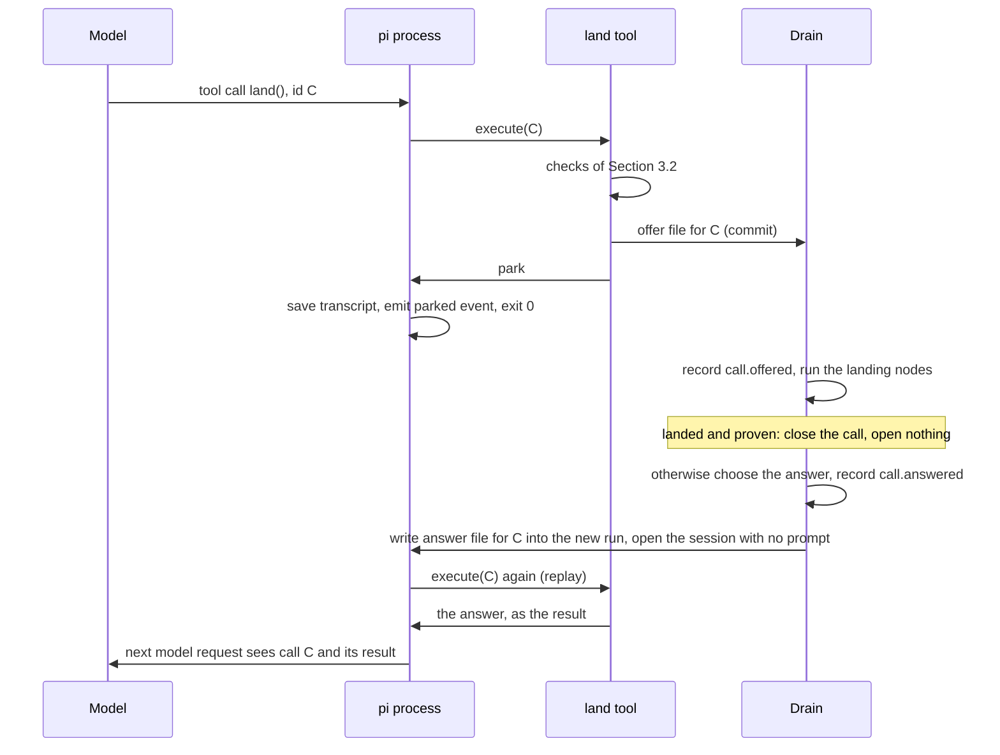

# A landing is a suspended tool call: the worker offers a commit and hears back only when it has something to fix

**Status:** 2026-11-22. Five of the seven build steps are landed: a revert and a squash conflict return to the worker's own session (step 1); the call record, offer and answer files, and answer chooser exist in the drain, with failing-case triage at the head of a gate refusal answer (`fc5cd652a`) (step 2); the three pi fork patches are built (step 3); `land` (`land.ts`), the brief ending, promptless resume, transcript reconciliation, and the `pi --features` capability probe (`fe2e7a2b9`) are landed on pi (step 4); and `obstacle` (`obstacle.ts`, `02aa6caf9`) is landed on pi (step 6). Step 5 remains drafted; step 7, Claude Code's `call-suspends` delivery (`D-LC12`), is designed in [Section 7.1](#71-the-mechanism-on-claude-code) to the owner's 2026-11-20 direction and verified against `claude` 2.1.329 in [Section 11.1](#111-what-the-design-leans-on-that-nobody-ran). [Section 10](#10-build-order) has the state of each step. Decisions `D-LC1` to `D-LC11` are the designer's decisions of 2026-11-18 and await the owner's review; `D-LC12` implements the owner's 2026-11-20 direction for Claude Code; `D-LC13` (2026-11-22, [Section 3.7](#37-a-no-change-finding-is-a-third-tool-on-the-planned-build-workflow), designer's decision from an operator request; the owner may overturn it) adds the `no_change` suspended tool call on `planned-build@v1`'s unsplit `work` stage under [`D-JL34`](./tillr-judge-and-lifecycle.md#421-an-investigation-that-finds-nothing-to-change-ends-inside-tillr-d-jl34).

> **In short.** The worker's last act is a tool call, and the call is the whole of what it knows about landing. tillr answers it only when the worker has something to fix, as the result of that same call in that same session; a change that lands and holds costs no further turn.

**Why it matters.** A run's ending is read from the last line of its report, and a refusal arrives as a new user message that tells the worker it has "a new run record in your existing session". The worker has to compose the one line the machinery reads, and the machinery has to guess when it is missing: on the morning of 2026-11-18, before the worker's endings were closed to a set, 19 of 61 drain runs ended with a result word nobody had defined an answer for.

**The shape.** Four parts: a tool, `land`, registered in the worker's harness; a **call record** in tillr's store that says what was offered and what came of it; each suspending harness's replay of an unanswered or deferred tool call (pi's unanswered-call replay and Claude Code's `PreToolUse` `defer` with promptless `--resume`), which makes the stored answer the call's result when the session is opened again; and an **ending capability** each harness adapter declares, so a harness that cannot suspend keeps today's report footer.

**Cost.** Three patches to the pi fork and a delivery to the host for pi; zero upstream patches on Claude Code, whose stock binary (`2.1.329`, verified 2026-11-20) provides `PreToolUse` `permissionDecision: "defer"` and promptless `--resume`. A second form of everything (`footer`) remains for harnesses that cannot suspend. While worktrees are a fixed set of lanes, a worktree is released when its item lands, so a late revert can find it taken ([Section 5.2](#52-states)).

**Start at [Section 3](#3-the-contract-from-the-workers-seat)**, the contract. [Section 4](#4-landed-and-proven-one-call-two-events), [Section 6](#6-the-mechanism-on-pi) and [Section 7.1](#71-the-mechanism-on-claude-code) carry the rest.

**Needs your ruling:** None open. **Blocked:** [OQ-LC1](#OQ-LC1), until worktrees belong to items.

**Reads with:** [the graph design](./tillr-graph-is-the-path.md) (the direction this follows: every act is a node; rule 1 of its Section 3.3 names this document's two tools), [the vocabulary](./tillr-vocabulary.md) (proposes that a worktree belongs to its item), [the landing principles](./landing-principles.md) (the rulings a landing change is checked against), [the pi adapter's guide](../../tools/tillr-run/backends/pi/README.md) and [the drain's guide](../../tools/tillr-drain/README.md) (what is built today).

---

## 1. The direction and what exists

The owner asked on 2026-11-18 what an item that is trying to land a change is expected to deliver, recalled the earlier idea ("the lane would create an attempt … send it to the landing machinery and that would run the gate and return it and … suspend that tool call"), and ruled:

> It seems like this suspended tool call thing is somewhat orthogonal to what the gate actually runs. So I think I want to design and implement this suspended tool call and then keep talking about the gate.

Three further directions bind this design:

- **pi is not a constraint.** "Regardless of what pi can do, pi will do it because we have our own pi fork." Claude Code, muse and agy offer what they offer.
- **A worktree belongs to its item.** It is a resource the item acquires and keeps, with a lifecycle and garbage collection, not a slot in a fixed pool. A suspended session's worktree stays with its item while it waits.
- **The trunk strategy stands.** The fast gate runs before the merge; the whole suite runs on the trunk afterwards; a red result is repaired by automatic revert or by a fixer; only a proven commit is pushed.

On 2026-11-20, after commit `fc5cd652a` unified the gate refusal answer text across backends, the owner directed that a Claude-backed worker must have the same suspended delivery call rather than ending its turn and receiving a resumed user message:

> I still want the experience of that suspended tool call to be the same. Like the agent delivers whatever they think they should deliver and then we gate it by whatever mechanism that we should be gating things and send it back if there's a change.

That direction rules out the earlier provisional `call-then-message` receipt for Claude Code: Claude Code uses `call-suspends`, delivering the gate's shared answer text as the result of the suspended `land` (or `obstacle`) call itself (`D-LC12`, [Section 7.1](#71-the-mechanism-on-claude-code)).

The rulings of [the graph design, Section 1](./tillr-graph-is-the-path.md#1-the-direction-and-the-rules) (R1 to R12) hold throughout: nothing is counted, no clock fails work, a refusal returns to the same session as often as needed, a killed run resumes as itself, a held state names its mover, and the owner is reached only by a written question.

**Where the idea stands.** It was designed for the board in October and built once, in a weaker form than its name:

| Fact | Source, read 2026-11-18 |
| :--- | :--- |
| The board design ruled landing "one asynchronous tool call": call, suspend, the queue works, only a refusal resumes | Retired board landing design, decisions D8, D12 and D16 ([landing principles](./landing-principles.md)); retired 2026-11-14 |
| It was built in commit `3f72899c9` and deleted with the board in `afdc9a957` | `git show 3f02e3b916^:tools/board-cli/internal/board/landing_call.go` |
| The built form was not a harness suspension. The agent ran a command-line verb through its shell tool, its turn ended, and the drain later appended a tool result to the session file from outside | The same file: `deliverLandingAnswer`, `landingAnswerEntry` |
| Whether it ever ran with a real model is not known. Its tests drove a stand-in process | The board plan's build status |
| The landing principles that superseded the board documents say nothing for or against it | `rg -n -i 'suspend\|tool call' docs/design/landing-principles.md` returned nothing relevant |
| The graph design makes the call the form of a stated ending | [Its Section 3.3](./tillr-graph-is-the-path.md#33-endings), rule 1 |

**The footer path**, which [Section 9](#9-what-this-replaces) maps onto the landing call:

- A footer worker ends with `RESULT: done`, or with a named obstacle and `RESULT: blocked` ([the brief template](../../tools/tillr-run/backends/brief-template.md), "Report shape"). No summary is required.
- On pi, the extension [`keep-going.ts`](../../tools/tillr-run/backends/pi/keep-going.ts) answers a worker that stops without a commit or a footer, inside the same session, with no count.
- The drain then examines the run: fence, optional judge, gate, lander. A refusal dispatches the item again as `returned-with-evidence`, in the worker's own session when the adapter can resume it, with the evidence as a new user message ([the drain's guide](../../tools/tillr-drain/README.md#a-refused-run-goes-back-to-its-worker)).
- A squash conflict and a reverted landing return to the session that wrote the change, as a new user message, when its lane and session remain. Otherwise a fresh session starts with the evidence and the reason is recorded: `lane-unavailable`, `session-missing` or `seat-changed`. This is step 1 of [Section 10](#10-build-order), landed on 2026-11-18.

## 2. The words

Each term is used in this sense for the rest of the document.

| Term | Meaning | What it is not |
| :--- | :--- | :--- |
| **Item** | One unit of work in tillr's queue, with criteria and a fence (the paths it may write) | — |
| **Worker session** | The saved conversation of the agent that builds an item's change: a transcript the harness keeps on disk, plus whatever the model provider has cached of it | Not a process. Between two turns nothing runs |
| **Harness** | The agent program that runs a session: pi, Claude Code, muse or agy. An **adapter** is tillr's wrapper around one | — |
| **Node** | One act on an item, recorded in the item's graph, with a stated ending ([the graph design](./tillr-graph-is-the-path.md#31-node-kinds)) | Not a session: several nodes can continue one session |
| **Trunk** | The branch landings go to, `main` here | — |
| **Landing** | The lander ([`tillr-land`](../../tools/tillr-land/README.md)) putting an item's change on the trunk as one squashed commit | Not the push to a remote |
| **Offer** *(coined here)* | The commit at the head of the item's branch at the moment the worker calls `land` | Not the worktree's uncommitted state, and not a later commit |
| **Landing call** *(coined here)* | One invocation of `land`, identified by the tool call id the harness gave it | Not the item: an item may make several calls |
| **Park** *(coined here)* | The harness ends its process on purpose with a tool call that has no result yet | Not a kill, and not a process that waits |
| **Answer** *(coined here)* | The one result delivered to the worker for a landing call. A call has at most one | Not every outcome: a landing that holds is recorded and never delivered |
| **Fast gate** | The checks that run on the offer before the merge | — |
| **Proof** | The run of the whole suite on a trunk commit, after the merge. The **green pointer** is the ref `refs/tillr/green`, the newest trunk commit whose proof passed ([the gate rework](./gate-rework.md)) | — |
| **Ending capability** *(coined here)* | What an adapter declares about how its harness can end a worker's run: `call-suspends`, `call-then-message` or `footer` | Not the pause kind, which says how a run can be stopped and continued |

**Landed** means the lander moved the trunk to a commit that contains the offer's change; the fact is the squash commit's sha. **Proven** means the green pointer has reached or passed that commit and the landing has not been reverted. Both are facts about the trunk, written by the lander and the proof runner, never by the worker.

## 3. The contract from the worker's seat

A worker's run ends in a tool call. There is no report to compose and no last line to get right.

### 3.1 The call

**`land` takes no arguments.** The judge reads the item's words and criteria and verifies the
commit itself; it does not judge the worker's account of the work. The worker cannot offer
anything but its own branch head.

**Calling it means one thing: the commit at the head of this branch, now, is my change; put it on the trunk.** Work that is not committed is not offered.

### 3.2 What is answered at once

The tool checks the offer before it parks. A failed check returns immediately, as an ordinary error result in the running process; no node ends, and the worker continues.

| Check | Result text names |
| :--- | :--- |
| The head is still the base the run started from | That there is no commit to offer |
| The worktree has uncommitted or untracked paths inside the fence | Each path |
| The head equals an offer that was already refused, or reverted, for this item | That offer's answer, and that a new commit is required |
| Another `land` call from this session is open | That call's id |
| The session still owes a wake to a background task (a task started with a wake-on-completion policy that has not ended) | The task |

The last row exists because a parked session cannot take a wake: the process that would receive it is gone.
Historical report-only refusals no longer disqualify a commit, and an explicit operator retry
may reopen the retained candidate.

### 3.3 What can come back

If the checks pass, the call does not return. The answers below are the closed set, each delivered as the result of the call, flagged as an error result, in the session that made it. Its first line is `ANSWER: <kind>`; the wording after it is the implementer's.

| Answer | When | Evidence it carries | What the worker does |
| :--- | :--- | :--- | :--- |
| `refused`, stage `fence` | The offer changes paths outside the item's fence | The paths | Moves the change inside the fence, or calls `obstacle` with kind `fence` |
| `refused`, stage `judge` | The item's judge failed the offer | Each failed criterion id with the judge's finding | Fixes, commits, calls `land` again |
| `refused`, stage `gate` | A fast-gate check failed on the offer | Each failing check's id, its command and its output | Fixes, commits, calls `land` again |
| `conflict` | The offer does not apply to the trunk, at the take-in or at the squash | The conflicting paths and the trunk commit | Reconciles with that trunk by merge or rebase, its choice, and calls `land` again |
| `reverted` | The offer landed, the proof then failed on a check that was pinned to this landing, and tillr reverted it | The landed commit, the revert commit, the check's id and output | Fixes, commits, calls `land` again; its next fast gate runs that check as a required one |
| `design-answer` | The ending was an identical repeat of an earlier one, so the design seat diagnosed it ([the graph design](./tillr-graph-is-the-path.md#53-the-starting-rule-table), row 19) | The design seat's answer and its commit on the item branch | Continues from that commit |

Rules that hold for every answer:

- **Output is whole.** A check's output is given inline up to 30,000 characters per check. A longer one is given as its first 5,000 and last 25,000 characters with the path of the full log, which is readable from the worktree.
- **Every answer states the branch.** The offer's commit, the branch head now, and the trunk commit the branch last took in. The landing nodes may advance the branch by a clean take-in while the session is parked; they never rewrite the offer's commit and never leave uncommitted changes.
- **Every answer names the turn.** The run id and scratch directory of the node that the resumed turn belongs to, because the answer is the only new content the session gets.
- **No answer is counted.** The same session is answered as often as it calls.

### 3.4 What never comes back

| Outcome | Why the worker is not told | What happens instead |
| :--- | :--- | :--- |
| **Landed** | The work is finished, and a turn to say so buys nothing | Recorded on the call. The session is not opened |
| **Proven** | The same | The call closes |
| The trunk moved and was taken in cleanly | Not a question the worker can answer ([landing principle 3](./landing-principles.md#3-gate-what-will-be-the-tip-once)) | A field on any later answer |
| A check could not complete, the gate stalled, the trunk's worktree was dirty, a red-cap hold | A statement about the machinery, not the offer ([landing principle 1](./landing-principles.md)) | A wait that names its mover; the same offer is tried again. The drain already does this for a gate that returns no verdict: the wait is `gate-no-verdict`, and its mover is the loop |
| The change is already on the trunk | Supersession is a verdict about the trunk | The call closes as `superseded` |
| The owner closed the item | — | The call closes as `withdrawn` |

### 3.5 A named obstacle is a second tool

A worker that cannot finish ends with `obstacle`, a second tool with the same mechanics. Its arguments are the kind (`definition`, `fence`, `trunk`, `tooling`, `seat`, `owner`) and that kind's required fields, which are today's obstacle lines turned into typed arguments.

- **Why a tool and not the footer.** The harness validates the arguments, so a blocked report with a missing field cannot be written, and the reply (a design answer, the owner's answer, "the base replay did not reproduce your `trunk` claim") comes back as the call's result in the same session.
- **Why not an argument of `land`.** `land` means "this commit is my change". An obstacle offers nothing. One tool with both would admit a call that is an offer and a refusal at once.

`obstacle` is the last step of the build order. Until it is built, an obstacle stays a `RESULT: blocked` footer, in every form.

### 3.6 What the brief says

This replaces "Report shape" and "Stop conditions" in the brief of a worker whose adapter suspends. The obstacle table stays as it is until `obstacle` is built.

```text
## Finishing

You are running unattended. Nobody reads a message from you. This run ends with one
tool call, and a message without it is not an ending: you will be asked to continue.

Call `land` when your change is committed on this branch and its verification has run.

The commit at the head of this branch when you call is what you offer. Uncommitted work
is not offered, and the call returns at once, naming the paths, if there is any.

The call does not return while your change is checked and landed. If it lands and holds,
you will never see a result: this session ends there, and that is success. If a result
arrives, it is one of these, and none is counted against the item:

  refused        a check said no. The result names the check and carries its output.
  conflict       your commit does not apply to the trunk. The result names the paths
                 and the trunk commit. Reconcile by merge or rebase, your choice.
  reverted       your change landed, the full suite then failed on a check tied to it,
                 and it was taken back out. The result carries that check's output.
  design-answer  the design seat changed the item on this branch. Continue from there.

Every result states the branch head. Check it before you change anything, fix what the
result names, commit, and call `land` again.

If a fact you cannot change stops you, name the obstacle as below instead.
```

### 3.7 A No-Change Finding Is a Third Tool on the Planned-Build Workflow

**Not the owner's ruling; the designer's decision (`D-LC13`), from an operator request of 2026-11-22 ([`D-JL34`](./tillr-judge-and-lifecycle.md#421-an-investigation-that-finds-nothing-to-change-ends-inside-tillr-d-jl34)), which the owner may overturn.**

On `planned-build@v1`'s unsplit whole-item `work` stage (`id: "work"`, `seat: "build"`, `access: "write"`), a worker whose reproductions establish that nothing in the repository needs changing ends with `no_change`, a third suspended tool call alongside `land` and `obstacle` (`tools/tillr-run/backends/pi/no_change.ts` on Pi; `mcp__tillr__no_change` in `tools/tillr-run/backends/claude/landing` on Claude Code; `RESULT: no_change` with `CAUSE:`, `EVIDENCE:`, and `WHY_NO_CHANGE:` under `footer`). Other workflows and split `build-pieces@v1` pieces do not load or expose `no_change`.

- **Arguments (`{cause, evidence, why_no_change}`).** Unlike `land` (where the commit diff is the work), a no-change finding has no diff, so the tool takes the three non-empty trimmed string fields that `verify` checks and `tillr item show` persists: `cause`, `evidence`, and `why_no_change`.
- **Why a third tool and neither `land` nor `obstacle`.** `land` offers a commit (`HEAD != base`) for the gate and trunk merge; `obstacle` reports that the worker is stopped from finishing; `no_change` submits a completed nothing-to-change finding (`HEAD == base`) for `planned-build@v1`'s `verify` judge.
- **Immediate checks (`D-LC2`).** Inside the call, before parking, `no_change` rejects missing or blank `cause`, `evidence`, or `why_no_change`; `HEAD != base` (a commit exists — call `land` instead); uncommitted or untracked paths (`git status --porcelain=v1 --untracked-files=all`); an identical `(base, cause, evidence, why_no_change)` already refused in `landing-state.json`; another open ending call; or owed background-task wakes on Pi.
- **Offer, answer, and silent close.** On a pass, the tool writes `landing-offer.json` (`{"call_id", "tool": "no_change", "base", "finding": {"cause", "evidence", "why_no_change"}, "transcript"}`) in the run's durable directory and parks/defers (`call.offered` with `tool: "no_change"`). When `verify` passes the finding, the drain records the judge verdicts, stores `finding` on the item, closes the item (`state: "closed"`), and closes the call silently (`call.closed` with `reason: "closed-no-change"`, never waking the session). When `verify` fails it (`not-done`), the call receives `refused` (`stage: "judge"`) as its tool result in the suspended session, unless a reason starts `plan-wrong:` (which closes the call and returns the item to `plan`).

## 4. Landed and proven: one call, two events

Under the trunk strategy, "passed the fast gate and merged" and "the whole suite covered it" are different events, seconds to a minute apart from the call for the first and minutes or more for the second. The question is which one closes the call.

**The call closes at proven, the session is never opened for either, and a revert is the open call's answer.**

The two alternatives were to return `landed` and end the session, delivering a later revert as a new message; or to hold the call open until the proof. With a harness that parks, they differ less than they appear to:

| Consideration | What decides it |
| :--- | :--- |
| **What waiting costs** | Nothing runs while a call is open. A parked session is a transcript on disk and a provider cache. Holding the call open for minutes or hours costs no process and no tokens |
| **What closing at landed would cost** | Writing `landed` into the transcript needs either a paid turn whose only content is "it landed", or an edit to the session file from outside, which [Section 6.1](#61-the-form-chosen-and-the-two-rejected) rejects |
| **What a revert needs** | The same session in the same worktree. With the call still open, the revert is delivered by the one mechanism every refusal uses. With the call closed, it needs a second delivery form on pi |
| **What a late answer pays** | The provider cache on this machine lives 60 minutes from the session's last request (5 minutes on a machine without long retention), measured 2026-11-16 in [the designer-session reference](../reference/tillr-designer-sessions.md#what-a-turn-costs-measured). A refusal from the fast gate arrives well inside it. A revert may not: an expired resume of a 35,000-token conversation cost $1.11 there, against $0.84 for a new session and $0.42 warm. The same session is therefore not chosen for its token price. It is chosen because the worker that wrote the change does not re-derive it, and does not produce a different change under the old name |
| **What the worker does meanwhile** | Nothing, under either choice |
| **What the owner sees** | The item shows `landed` at the merge, with "proof pending" beside it, and `proven` when the green pointer passes it. The call's state is a detail of the item's page, not a third category |

**Timing behind "seconds to a minute".** Read from the drain's own tick lines on 2026-11-18: in the seven ticks of the newest keeper log that ran a gate, the gate took 5.8 to 64.5 seconds per run and the lander 0.4 to 0.9 seconds. Judge durations do not appear in those lines.

**This holds for any split of checks.** Nothing above depends on which checks run before the merge. A check moved from the proof to the fast gate changes which answer carries its output, `refused` or `reverted`, and nothing else. A strategy with no proof closes the call at landed, because landed and proven are then the same event.

**What a reverted item's worker receives** is the `reverted` answer of [Section 3.3](#33-what-can-come-back), in its own session, in place of today's fresh session with the evidence in a new brief. When that session cannot be opened, the fallback and its recorded reason are those of [Section 5.3](#53-delivery-forms).

**A proof that never comes** (an unattributed red, a fixer still working) leaves the call open. That is a wait on a red check whose mover is the fixer item, shown as such; nothing times it out. Whether the worktree is held through it is [Section 5.2](#52-states).

## 5. The record

### 5.1 One record per call, one writer

The call record lives in tillr's store and the drain is its only writer. The harness writes only its transcript. The tool writes only the offer file of [Section 6.2](#62-the-sequence).

| Field | Written when |
| :--- | :--- |
| Call id, tool name, item, node and run, session id and transcript path, worktree path, adapter and ending capability | The offer is recorded |
| Offer commit, base commit | The offer is recorded |
| Landed commit; revert commit | The lander's and the revert's records are written |
| Answer: kind, stage, evidence references | An answer is chosen |
| Delivery: form, the run it was delivered in, time | The harness reports the result written |
| Closing reason | The call closes |

Each row is an event (`call.offered`, `call.landed`, `call.answered`, `call.delivered`, `call.closed`), so the item's page can show a call's whole path and an audit can ask how many calls an item made and what each was told.

### 5.2 States



- **One answer.** The store refuses a second answer for a call id. The chooser is a pure function of the landing nodes' endings; writing the answer is the effect.
- **An answer is immutable** once chosen. Delivering it twice delivers the same text.
- **After delivery the call is finished.** The worker's next `land` is a new call with a new id.
- **When the worktree is released.** For now, at the landing (`D-LC11`). Lanes are a fixed set, and holding one through a long red would take it from new work exactly when the trunk needs repair. A later answer is delivered in the worker's own session when its worktree and session remain, and takes the `fresh-session` form of [Section 5.3](#53-delivery-forms) otherwise, with the reason recorded; that is what the drain does today. Once a worktree belongs to its item, which is the owner's direction of 2026-11-18, the release can wait until no call of the item is open or answered, at the cost of disk and not of a lane. Whether it should is [OQ-LC1](#OQ-LC1), blocked until item-owned worktrees exist. The worktree lifecycle itself is not designed here.

### 5.3 Delivery forms

The answer is one thing; how it reaches the session depends on the adapter and on what is left of the session. The form used is recorded on the call.

| Form | When | What the session receives |
| :--- | :--- | :--- |
| `tool-result` | The adapter's capability is `call-suspends` and the transcript still holds the unanswered or deferred call | The answer as the call's result, and nothing else |
| `message` | A fallback when the harness reports no unanswered or deferred call in a `call-suspends` session that should hold one (or for an adapter declaring `call-then-message`) | The answer as the session's next message |
| `fresh-session` | The session cannot be opened: its transcript is gone, the seat's backend or model changed, the worktree is occupied, or the harness refused to open it | A new session whose brief carries the answer and the pinned refs of the earlier work, as today |

The reasons recorded for `fresh-session` are the ones the drain already writes: `session-missing`, `seat-changed`, `lane-unavailable`, `resume-failed`, `cannot-resume`.

## 6. The mechanism on pi

### 6.1 The form chosen, and the two rejected

**Chosen: the harness replays the unanswered call.** When a session is opened, the pi fork already replays any tool call from the last assistant message that has no saved result, before it adds a prompt or makes a model request. It does not repeat a call whose result is saved.

- **Where that was read.** The fork commit "feat(agent): stop print workers safely on SIGUSR1", on 2026-11-18, in a clean build of this repository's `patch/pi` branch: `getPendingToolCalls` in the agent loop, `Agent.completePendingToolCalls`, and the fork's command-line integration guide.
- **What follows from it.** A tool registered by an extension has its `execute()` run again in the new process, with the same call id and the saved arguments.
- **How `land` uses it.** On the first execution it records the offer and parks. On a replay it returns the stored answer, and pi writes the result entry itself.

**Rejected: appending a tool result to the session file from outside**, the board's form. It needs single-writer discipline that pi does not offer (no lock on the session file, by `rg -n -i 'flock|lockfile|\.lock'` over the fork's session manager on 2026-11-18), a correct parent for the new entry among interleaved non-message entries, and a read-back, because the loader skips a malformed line silently. A duplicate entry id in that scheme closed a parent cycle and killed 47 lane runs on 2026-11-04. Everything it offers, the replay offers through an interface the harness owns.

**Rejected: a tool that waits.** A process held per waiting call, for a wait with no bound, with no answer to a host restart. The board design rejected it for the same reasons.

### 6.2 The sequence

The **offer file** and the **answer file** are the two halves of the hand-off, in the run's own durable directory, each written whole and renamed into place. The tool writes the offer file; the drain writes the answer file; neither writes the other's.



**What `execute()` does**, by what it finds for its call id in its run's directory:

| It finds | It does |
| :--- | :--- |
| An answer file | Returns the answer as an error result. This is a delivery |
| An offer file and no answer file | Parks again. The process was opened before an answer existed |
| Neither | Runs the checks of [Section 3.2](#32-what-is-answered-at-once); on a pass writes the offer file and parks |

**What the drain does with an offer file**, at the run's end and never before the process has exited: records `call.offered`, and treats the node as ended `submitted`. An offer whose call id already has a record is not a new offer: the drain writes that call's answer file if it has an answer, and opens the session again.

### 6.3 Failure cases

| Case | What happens |
| :--- | :--- |
| The process is killed after the model asked for `land` and before the offer file exists | The run has no ending, so it is an interruption and resumes as the same run. The replay runs `execute()`, which finds neither file, checks, writes the offer and parks. No model request is made |
| The process is killed after the offer file is written and before it exits | The offer file is the ending. The run ended `submitted` |
| The answer could exist before the process has exited | It cannot: the drain reads the offer only after the process and its children are gone, which the existing check for a run's surviving processes already establishes |
| Two answers for one call | The store refuses the second. A `landed` followed by a revert is not two answers: `landed` is an outcome on an open call, and `reverted` is its one answer |
| The session is opened with no answer yet | `execute()` parks again. The opening is logged as an exception against the node, uncounted |
| The process dies after the result is saved and before the model's turn | The next opening finds no unanswered call and continues from the saved result. The answer is not delivered twice, because pi does not repeat a call that has a result |
| The process dies before the result is saved | The next opening replays, and `execute()` returns the same answer |
| The transcript is gone or the harness refuses to open it | `fresh-session`, with the reason |
| The transcript no longer holds the unanswered call (compacted, or opened by hand without the tool) | Before opening pi, the adapter checks the active transcript branch: the last assistant message must be a tool-use message containing the call id, no compaction may follow it, and the call must either have no saved result or have one with the last message its tool result. An unreadable or unparseable file fails the check. On failure the adapter opens with the answer as a message and records `message`; pi's refusal to continue without a prompt remains a second line of defense. |
| The model asks for `land` and other tools in one message | The other calls run and their results are saved; only `land` is left unanswered. The offer is the head `execute()` read |
| The parked process does not exit | The adapter's existing exit bound applies (120 seconds, then a signal), recorded as it is today; the offer file still decides the ending |

**tillr never compacts a session that has an open or answered call.** Compaction, where the session's size calls for it, happens after delivery.

### 6.4 The keep-going extension and the settled-session rule

- **A parked call is not a settle.** Parking does not pass through the boundary where an extension may ask for a continuation, so the keep-going extension is never consulted for it and cannot nudge it.
- **Keep-going stays, for one case.** A worker that ends its turn with a message and no call is answered in the same session with what is missing: "you ended without calling `land`". Its other checks (no commit, uncommitted paths) move into the tool, where they return as the call's own result.
- **A parked session is not a hung one.** The adapter's watcher ends a session that has settled and not exited. A parked process announces itself with a parked event in its output stream and exits by itself; the watcher treats that event as an ending in progress, not a settle.
- **A run that ends with an offer is an answered exit**, whatever else its transcript says. No result word is looked for.

### 6.5 The fork patches

All three land in the pi fork's patch branch and ride one delivery. The estimates come from the size of the replay commit's production changes (about 250 lines in six files) and are not measurements.

| Patch | Module | What it does |
| :--- | :--- | :--- |
| **Park** | The agent loop and the agent, where a tool result can already end a batch without a follow-up request; the tool result type; print mode's exit path | A tool's `execute()` may return a park. pi saves no result for that call, makes no further model request, does not consult settle hooks, emits a top-level parked event naming the call ids, flushes the session and exits 0 |
| **Open without a prompt** | Print mode and the command-line arguments; the agent session | A way to open an existing session with no new user message: complete the unanswered calls, then continue from the trailing tool result. With nothing to replay and nothing to continue from, it says so in the stream and exits non-zero without a model request |
| **State the build's features** | The command line | A flag that prints the build's feature names as JSON, including one name, `parked-tool-calls`, that stands for the replay and both patches above |

The `land` tool itself is not a fork patch. It is a tillr extension beside `keep-going.ts`, loaded by the adapter the same way and only for a worker run.

### 6.6 Delivery, and how the drain knows

A fork patch reaches a running jail only through the delivery path [the repository guide](../../AGENTS.md) describes for a patch-branch fork: export the lane's commits to `patch/pi`, check, lint the pack, commit, push (the pre-push hook publishes the branch), let the host's next launch build it, apply on the host, and relaunch. The replay commit itself has not made that trip: on 2026-11-18 this repository's `patch/pi` was four commits ahead of the tracked remote branch, the replay commit and the park patch among them, and [the restart reference](../reference/tillr-restart.md#pushing-what-the-proof-has-passed) records that the pre-push hook publishes local `patch/*` branches to the remote branch that host builds read.

**What must be true on the host before the switch:**

1. `patch/pi` on the remote holds the replay commit and the three patches.
2. The host's launch has built that branch, and the pack's status shows it as the good build, not a held one.
3. The host has applied it and the jail that runs the drain was relaunched afterwards.

**How the drain knows.** The version string cannot tell two builds apart ([the repository guide](../../AGENTS.md) records two builds with different rules printing the same version). So the pi adapter declares `call-suspends` only when the installed binary itself prints `parked-tool-calls` among its features. The adapter asks once at each start of the loop and the answer is recorded as an event with the binary's path. A binary that does not know the flag has answered no.

**The fallback is today's form, whole.** A pi without the feature gets the footer brief, keep-going's footer check, and answers as messages. Nothing in between is built: there is no interim form that parks by killing the process.

**A node's form is fixed when it starts.** A session that began under the footer brief is answered in message form for its whole life, even if the capability appears before its next turn.

## 7. The other harnesses

| Harness | Ending capability | What the contract becomes | Status |
| :--- | :--- | :--- | :--- |
| **pi with the feature** | `call-suspends` | [Section 6](#6-the-mechanism-on-pi): extension tools `land` and `obstacle`, unanswered-call replay on promptless resume, `pi --features` probe | Built (`land.ts`, `obstacle.ts`, `run-pi`, `probePiEndingCapability` in `fe2e7a2b9`) |
| **pi without it** | `footer` | Today's footer and keep-going; answers as the session's next message | Built |
| **Claude Code with deferred-tool resume** | `call-suspends` (`footer` until step 7 lands) | [Section 7.1](#71-the-mechanism-on-claude-code): stdio MCP tools `mcp__tillr__land` and `mcp__tillr__obstacle`, `PreToolUse` deferral (`permissionDecision: "defer"`), `Stop` hook for missing calls, promptless `--resume` replay, capability probe at loop start | Verified 2026-11-20 on `claude` 2.1.329 ([Section 11.1](#111-what-the-design-leans-on-that-nobody-ran)); queued as step 7 (`D-LC12`) |
| **Claude Code without it** (older binary, or `CLAUDE_CODE_DISABLE_DEFERRED_TOOL_RESUME` set) | `footer` | Today's footer; answers as the session's next message | Built |
| **muse, agy** | `footer` | Today's footer. Neither adapter can resume a session, so every answer is `fresh-session` | Built; neither offers a verified resume or hook seam |

The contract is the same across capabilities: the offer is the commit at the moment of ending, the answers are the closed set of [Section 3.3](#33-what-can-come-back) with the shared text of `fc5cd652a`, and nothing is counted. On both `pi` and `Claude Code`, `call-suspends` delivers the answer as the suspended call's own `tool_result`.

### 7.1 The mechanism on Claude Code

#### The form chosen, and the three rejected (`D-LC12`)

**Chosen: native `PreToolUse` deferral (`permissionDecision: "defer"`) and promptless `--resume` replay.** Verified on 2026-11-20 against the installed `claude` 2.1.329 binary in `-p` print mode with `--dangerously-skip-permissions`, `--strict-mcp-config`, `--mcp-config`, and `--settings`:

- When a `PreToolUse` command hook returns `{"hookSpecificOutput": {"hookEventName": "PreToolUse", "permissionDecision": "defer"}}`, Claude Code does not invoke the tool server, writes a `hook_deferred_tool` attachment (`toolUseID`, `toolName`, `toolInput`, `permissionMode`) to `transcript_path`, skips `Stop` hooks, emits a `result` event with `subtype: "success"`, `is_error: false`, `stop_reason: "tool_deferred"`, `result: ""`, and `deferred_tool_use: { id, name, input }`, and exits `0`.
- When reopened with `claude -p ... --resume <session-id>` and empty standard input, Claude Code scans the last 1 MiB of the session JSONL for an unresolved `hook_deferred_tool` attachment, re-emits the saved `tool_use` (with its original `tool_use_id` and `input`) through `PreToolUse` and the MCP server, writes the returned `tool_result` row to the session JSONL, and continues the model turn with no user prompt.

Three alternatives raised during step 7's intake are rejected:

- **Rejected: a blocking MCP `land` call with a live mid-run gate.** Holds a live `claude` process per waiting call for an unbounded gate, judge, or proof wait, collides with the drain's `survivingRunProcesses` check in `settle` and `intakeLandingOffer`, has no answer to a drain or host restart or a late `reverted` answer, and violates `D-LC7`.
- **Rejected: killing `claude` mid-call or editing its session JSONL from outside.** Verified on `claude` 2.1.329 on 2026-11-20: sending `SIGTERM` during an in-flight MCP `tools/call` causes Claude Code to persist an MCP `Connection closed` error `tool_result` before exiting, and sending `SIGKILL` causes `--resume` to synthesize `[Tool call interrupted: ...]` followed by `"No response requested."` ahead of any resumed turn. Appending to Claude Code's session JSONL from outside has no lock or supported schema and is rejected for the same reasons as on pi (`D-LC7`).
- **Rejected: `call-then-message` (`"recorded; end your turn"` followed by a resumed user message).** Overturned by the owner's 2026-11-20 direction in [Section 1](#1-the-direction-and-what-exists): delivery on Claude Code must be one suspended tool call whose own result is the gate's answer.

#### Adapter pieces and sequence

When a worker run's staged ending capability is `call-suspends`, `run-claude` wires four pieces around `claude -p`:

1. **Adapter-managed stdio MCP server (`tillr`).** `run-claude` generates an MCP configuration file in the run's own durable directory and passes `--mcp-config <file>` alongside its existing `--strict-mcp-config` (`D-CB1` in [the Claude backend design](./tillr-claude-backend.md); `--mcp-config` is repeatable, so any policy `--mcp-config` in `harness_args` still loads while ambient account connectors stay off). The `tillr` server exposes `land` (no arguments), `obstacle` (`kind` and that kind's lowercase fields), and — when staged for `planned-build@v1`'s unsplit `work` stage ([Section 3.7](#37-a-no-change-finding-is-a-third-tool-on-the-planned-build-workflow), `D-LC13`) — `no_change` (`cause`, `evidence`, `why_no_change`), which Claude Code names `mcp__tillr__land`, `mcp__tillr__obstacle`, and `mcp__tillr__no_change` on the wire even when `--tools` restricts built-in tools. Its `initialize` `instructions` tell the model that those tools implement the brief's ending calls.
2. **`PreToolUse` hook (`deny`, `defer`, `allow`).** `run-claude` passes `--settings <generated-settings>` while keeping `--setting-sources ""` so user and project hooks remain off (merging any `--settings` from `harness_args` if present). On `PreToolUse`, Claude Code passes `session_id`, `transcript_path`, `cwd`, `tool_name`, `tool_input`, and `tool_use_id` on standard input:
   - **Replay delivery (`allow`):** If `landing-answer.json` in the run's durable directory has `call_id == tool_use_id`, the hook returns `permissionDecision: "allow"`. Claude Code then calls the MCP `tillr` server (`tools/call`, carrying `_meta["claudecode/toolUseId"]`), which reads `landing-answer.json` and returns `{ content: [{ type: "text", text: answer.text }], isError: true }` as that call's `tool_result`.
   - **Idempotent re-park (`defer`):** If `landing-offer.json` or `landing-state.json`'s `open` list already holds `tool_use_id` and no answer file matches, the hook returns `permissionDecision: "defer"` again.
   - **Immediate checks (`deny`):** Otherwise, for `mcp__tillr__land` or `mcp__tillr__obstacle`, the hook runs the [Section 3.2](#32-what-is-answered-at-once) checks (clean worktree via `git status --porcelain=v1 --untracked-files=all`, `HEAD != base`, `HEAD` not already refused in `landing-state.json`, no other unanswered open call after unlinking any `landing-offer.json` whose `call_id` already has a `tool_result` in `transcript_path`; or for `obstacle`, valid `kind`, required fields, repository-relative `paths`, and an attempt on `seat`). Pi's `stop-at-gap --owed-wakes` journal check does not apply because Claude Code does not load Pi's detached background-task extension. On any failed check, the hook returns `{"hookSpecificOutput": {"hookEventName": "PreToolUse", "permissionDecision": "deny", "permissionDecisionReason": "<reason>"}}`, which Claude Code delivers immediately in-session as an error `tool_result` without ending the turn or the process.
   - **Offer and park (`defer`):** When the checks pass, the hook writes `landing-offer.json` atomically (`call_id`, `tool` when `obstacle`, `commit` when `land`, `base`, `obstacle` when applicable, and `transcript: transcript_path`) and returns `permissionDecision: "defer"`.
   - **Sibling-call guard:** Once an unanswered `landing-offer.json` exists in the current invocation, `PreToolUse` denies any subsequent sibling tool call in the same assistant batch so neither `HEAD` nor the worktree can move after the offer is recorded. Conversely, if Claude Code ever ignores `defer` (for example, in a non-streamed multi-tool batch where Claude Code treats `defer` as solo-only) and invokes MCP `tools/call` without a matching `landing-answer.json`, the MCP handler unlinks any matching `landing-offer.json` and returns `isError: true` instructing the worker to call `land` or `obstacle` by itself.
3. **`Stop` hook (missing-call nudge).** Configured in the same generated `--settings`. Because Claude Code skips `Stop` hooks when a turn ends with `stop_reason: "tool_deferred"`, `Stop` fires only when the worker stops with a plain message (`end_turn`). Unless the run's pause-request file exists or the `(head, status, content, text)` fingerprint matches the previous `Stop` nudge in the run's durable directory (keyed by fingerprint rather than `stop_hook_active`, because Claude Code keeps `stop_hook_active: true` across subsequent tool calls within the same prompt), `Stop` returns `{"decision": "block", "reason": "..."}` nudging the worker to finish by calling `land` or `obstacle`.
4. **Promptless resume and fallback in `run-claude`.** When `TILLR_SESSION_MODE=resume` and `landing-answer.json` is staged in the run's durable directory:
   - If `landing-transcript` names a path that is missing on disk, `run-claude` exits non-zero before launching `claude`, triggering `fresh-session` with `resume-failed` just as `run-pi` does.
   - `run-claude` checks the last 1 MiB of `landing-transcript` (matching Claude Code's own 1 MiB tail-scan window) for an unresolved `hook_deferred_tool` attachment with `toolUseID == answer.call_id` and no subsequent row resolving `tool_use_id == answer.call_id`.
   - When held, `run-claude` writes `tool-result` to `landing-delivery` and invokes `claude -p ... --resume <session-id>` with empty standard input and `CLAUDE_CODE_DISABLE_DEFERRED_TOOL_RESUME` unset. If `claude` exits non-zero reporting `"No deferred tool marker found in the resumed session"`, `run-claude` rewrites `landing-delivery` to `message` and retries `--resume <session-id>` with `answer.text` on standard input.
   - When not held: if `landing-transcript` already carries the persisted `tool_result` for `answer.call_id` from an interrupted earlier delivery, `run-claude` keeps `tool-result` and resumes with a minimal continuation prompt so the answer is not duplicated; otherwise it writes `message` to `landing-delivery` and passes `answer.text` on standard input.

#### Drain reconciliation and capability probe

- **Transcript delivery check (`reconcileLandingDelivery` / `landingResultPersisted`).** Alongside Pi's session format, `landingResultPersisted` in `tools/tillr-drain/drain/landing_call.go` recognizes Claude Code's session JSONL rows: entries carrying `"sessionId": session` where a `type: "user"` row's `message.content` contains a `type: "tool_result"` block with `tool_use_id == answer.CallID`, `is_error == true`, and text matching `answer.Text` (accepting string `content` or `[{type: "text", text}]` blocks, and tolerating Claude Code's trailing-newline trim on MCP error results).
- **Capability probe at loop start (`recordEndingCapabilities`).** Following the same rule as `probePiEndingCapability` (`D-LC8`), `backends/claude/ending-capability` declares `call-suspends` once step 7 is built, and `recordEndingCapabilities` probes the installed `claude` binary once at loop start (running `claude -p --setting-sources "" --continue` with empty standard input in an empty temporary directory when `CLAUDE_CODE_DISABLE_DEFERRED_TOOL_RESUME` is unset, and checking standard error for `"No deferred tool marker found in the resumed session"`). If `claude` is absent, predates deferred-tool resume, or has `CLAUDE_CODE_DISABLE_DEFERRED_TOOL_RESUME` set in the environment, the drain records `footer` for the Claude adapter and falls back to today's footer flow.

## 8. In the graph's words

### 8.1 The nodes

- **The work node ends `submitted`, and the call is its stated ending.** The ending record is the offer: call id and commit. It is written by the tool, not composed by the model.
- **The gate run, the judge and the land attempt are nodes**, as [the graph design](./tillr-graph-is-the-path.md#31-node-kinds) has them. They run against the offer's commit. This design adds none.
- **"The session is suspended" means no node of the item is running that uses it.** The item waits on its landing nodes. The session and its open call are assets of the done work node.
- **An answer is what makes the next node a resume.** The rule table adds a resume node with a `resumes` edge to the node that made the call, and the resume's one message is the answer, delivered in the form of [Section 5.3](#53-delivery-forms). The resume ends, in its turn, with a new call.
- **A check answered inside the call ends nothing.** The rows of [Section 3.2](#32-what-is-answered-at-once) happen within a running node.

### 8.2 Amendments to the graph design

[The graph design](./tillr-graph-is-the-path.md) carries these. Rules 1 and 4 of [its Section 3.3](./tillr-graph-is-the-path.md#33-endings) say that the ending record is written by `land` or `obstacle`, and that a dirty worktree or a missing commit is answered inside the call. Rows 6, 7, 9, 10, 11 and 22 of [its rule table](./tillr-graph-is-the-path.md#53-the-starting-rule-table) deliver each resume as the answer to the producer's open call.

## 9. What this replaces

| Today | What happens to it |
| :--- | :--- |
| Reading `RESULT: done` or `RESULT: blocked` from the report's last line | **Kept as the `footer` form** for adapters that cannot suspend, and still read in every old run's record. Not written by a worker whose brief offered `land` |
| "Continuing its session once to finish and commit", and keep-going's nudges for no commit and uncommitted paths | **Folded into the call**: the checks of [Section 3.2](#32-what-is-answered-at-once) return as the call's own result |
| Keep-going's nudge for a missing footer | **Kept, narrowed**: it answers a worker that ended without calling `land` |
| A refusal returned as a new user message ("This is a new run record in your existing session…") followed by the whole brief again | **Replaced by the tool result** where the capability is `call-suspends`. Kept as the `message` form elsewhere. The brief is not repeated: the session has it |
| A fresh session after a reverted landing | **Replaced, in message form, by step 1**: the worker's own session receives the evidence when its lane and session remain. As the call's answer `reverted`, it is step 5 |
| A fresh conflict-fix run after a squash conflict | **Replaced, in message form, by step 1**: the worker's own session receives the conflict, on its own branch. As the call's answer `conflict`, it is step 5 |
| The rule that a returned turn must make a new commit | **Kept, moved into the call**: an unchanged offer is answered at once |
| The identical-repeat rule (`repeatedEnding` in [`returned.go`](../../tools/tillr-drain/drain/returned.go)) | **Kept unchanged.** What it sends to the design seat comes back as `design-answer` |
| The `WorkerSession` record written at a refusal ([`worker_session.go`](../../tools/tillr-drain/drain/worker_session.go)) | **Folded into the call record**, which holds the same facts from the moment of the offer, for every outcome |

## 10. Build order

Smallest first. The running drain keeps working at every step, because the footer form is honored until the last item and every new form is chosen per node at its start.

| Step | What | Needs a fork delivery | State on 2026-11-20 |
| :--- | :--- | :--- | :--- |
| 1 | Reverts and conflicts return to the worker's own session, in message form | No | Landed |
| 2 | The call record, the offer and answer files, the answer chooser, and the ending capability, proven against a stand-in harness | No | Landed (`fc5cd652a` adds failing-case triage at the head of gate refusal answers) |
| 3 | The three fork patches | It is the delivery | Landed on `patch/pi` and built into keyed pi builds |
| 4 | The `land` tool, the new brief ending, and answers as tool results on pi | Yes: steps 2 and 3, and the host steps of [Section 6.6](#66-delivery-and-how-the-drain-knows) | Landed (`land.ts`, brief ending, promptless resume, transcript check, and `probePiEndingCapability` in `fe2e7a2b9`) |
| 5 | The call stays open until proven; `reverted` is its answer | Yes: step 4 | Partly built (store closure on proof and `reverted` answer recording); full item drafted below, not filed |
| 6 | `obstacle` as a tool | Yes: step 4 | Landed on pi (`obstacle.ts`, `02aa6caf9`) |
| 7 | Claude Code's `call-suspends` form ([Section 7.1](#71-the-mechanism-on-claude-code), `D-LC12`) | No | In the queue; mechanism verified 2026-11-20 on `claude` 2.1.329 |

**Step 1 needs nothing from the fork**, and it is worth having if nothing after it is ever built.

**The filed steps live in the roadmap.** Steps 1, 2, 3, 4 and 6 are queue items in [the tillr roadmap](../tillr/roadmap.md#filed-2026-11-18-a-landing-is-a-suspended-tool-call), and their blocks there govern.

### 10.1 Drafted items

One step is drafted and not filed. It is a proposal in prose: nothing reads it, and nothing can be dispatched from it. How a drafted item becomes a queue item is under the owner's review, so no filing step is stated here.

#### Keep the call open until the landing is proven

A landing that the full suite later reverts should come back as the answer to the call that offered it. This item closes a call at proven instead of at landed and makes `reverted` and `conflict` answers.

- **Paths:** `tools/tillr-drain/`, `tools/tillr-land/`, `tools/tillr-view/`, `docs/`
- **Waits on:** End a pi worker's run with the land tool.
- **c1:** A landed call stays open until the green pointer reaches its landing, then closes as `proven`. A test asserts both moments.
- **c2:** A revert pinned to that landing becomes the call's one answer, delivered as its result. A test asserts the answer carries the check's output and both commits.
- **c3:** A squash or take-in conflict becomes the answer `conflict` with its paths and the trunk commit, and the worktree is left on the worker's own branch. A test asserts it.
- **c4:** While worktrees are a fixed set of lanes, the item's worktree is released at the landing. A `reverted` answer is delivered in the worker's own session when its worktree and session remain, and otherwise starts a fresh session with the recorded reason. A test asserts each.
- **c5:** The item's page shows the call's state, "landed, proof pending" among them, and the number of open calls is visible for the whole queue. A test asserts the rendered text.

## 11. Risks

| Risk | What would show it | What changes |
| :--- | :--- | :--- |
| The replay does not run an extension's tool as read (a different call id, a prompt added first, the tool not yet registered when the replay runs) | The experiment below | The park patch grows to cover it. The design does not change: pi is ours |
| A model treats a call that "never returns" as a reason to hedge, and ends with a message first | Keep-going nudges for a missing call, counted from the event log after step 4 | The brief text. The mechanism does not depend on it |
| A parked session is opened by hand, without the tool loaded | pi answers the unanswered call with its own error | The answer is still in the store and is delivered as a message. The item's page shows a parked session, so a person can tell before opening one |
| A late `reverted` answer finds the worktree given to another item, and a fresh session starts cold | The recorded reason `lane-unavailable`, counted from step 1's records | Hold the worktree until proven, once worktrees belong to items ([OQ-LC1](#OQ-LC1)) |
| The fork delivery stalls, as it has for the replay commit | The recorded capability stays `footer` | Nothing breaks. Steps 1 and 2 are in use; 4 to 6 wait |
| An expired cache makes a late `reverted` cost more than a new session would | Token cost per resumed turn, by cache state, from the usage ledger | Compact after delivery when the conversation is large; the choice of the same session does not rest on price |
| A second transcript mechanism is rebuilt by habit (an outside append "just for success") | A review finding | [Section 6.1](#61-the-form-chosen-and-the-two-rejected) is the ruling: the store is the record of a landed call |

### 11.1 What the design leans on that nobody ran

| Leaned on | Status | How to find out |
| :--- | :--- | :--- |
| A registered extension tool is executed again on resume with the same call id, before any prompt | **Verified 2026-11-18 on the local `patch/pi` build, with a caveat.** `bin/pi-forks setup --lane operator-landcall --fork pi` and `bin/pi-forks build --lane operator-landcall --fork pi` built tip `fcf539aa7`. An extension tool whose first `execute()` killed its own process with SIGKILL left its call unanswered in the session file. A second `--print` run on the same `--session` (model `amazon-bedrock/global.openai.gpt-6-luna`, `--no-extensions` plus the one extension) ran `execute()` again with the same call id in a new process, and pi saved the tool result, `answer: refused, fix x`, before the new user prompt; the model then quoted it. Two caveats. A resume today still needs a prompt, so the open-without-prompt patch is real work. And with the default extension set an extension's message, added as the session opened, landed between the call and the replayed result, and Bedrock refused the request; the fork item has a criterion for that order. The replay was not run with the production extension set, which hung in the offer run for a reason not isolated. | Original method, for the record: a ten-line extension whose tool writes its call id to a file and never returns, ask for the tool, kill the process, open the session again. Two small model requests |
| The installed pi lacks the replay | **Verified 2026-11-18.** The same sequence against the installed pi 1.5.2 ran `execute()` once; the resume saved no result for the call, and the model answered that the tool returned "No result provided." | The features flag still settles it for good, and is part of the fork patch |
| The remote `patch/pi` has not moved since this jail last fetched | Read 2026-11-18 without a fetch: the local `patch/pi` is four commits ahead of `origin/patch/pi` (`git rev-list --count origin/patch/pi..patch/pi`): the replay commit, two after it, and the park-and-resume patch | A fetch |
| A stand-in harness is a fair proxy for the drain side | Assumed, as the pause tests assume it | Step 4's first real run is watched |
| Claude Code's MCP tool server, `PreToolUse` deferral, `Stop` hook, and promptless `--resume` behave as [Section 7.1](#71-the-mechanism-on-claude-code) needs | **Verified 2026-11-20 on installed `claude` 2.1.329.** Probed with `claude -p --verbose --output-format stream-json --dangerously-skip-permissions --setting-sources "" --tools Read,Glob,Grep --mcp-config <cfg> --strict-mcp-config --settings <settings>` against a local mock Anthropic SSE server: (1) `--mcp-config` under `--strict-mcp-config` exposes `mcp__tillr__land` even when `--tools` restricts built-in tools, and passes `_meta["claudecode/toolUseId"]` on `tools/call`; (2) `Stop` returning `{"decision": "block", "reason": "..."}` continues in-session on `end_turn`, keeps `stop_hook_active: true` across subsequent tool calls within the same prompt, and is skipped when a turn ends with `stop_reason: "tool_deferred"`; (3) `PreToolUse` returning `permissionDecision: "deny"` delivers `permissionDecisionReason` as an immediate `is_error: true` `tool_result` in-session, while returning `permissionDecision: "defer"` under `--dangerously-skip-permissions` writes `hook_deferred_tool` to `transcript_path` and exits `0` with `stop_reason: "tool_deferred"` and `deferred_tool_use`; (4) `claude -p ... --resume <session-id>` with empty standard input re-emits the deferred call through `PreToolUse` (`allow`) and MCP `tools/call`, persists the `tool_result` (trimming a trailing newline on `isError: true` text) to `transcript_path`, sends `assistant -> tool_use` followed by `user -> tool_result` on the continuation request, and defers cleanly again on a second `land` call; (5) killing `claude` during an in-flight MCP call (`SIGTERM` / `SIGKILL`) corrupts the result (`Connection closed` / `[Tool call interrupted: ...]`); (6) `claude -p --setting-sources "" --continue` with empty standard input in an empty temporary directory exits `1` in ~2 seconds with `"No deferred tool marker found in the resumed session"` on standard error, making zero network calls and writing nothing to `~/.claude/projects/` | Covered by step 7's adapter and drain tests |
| How long a judge takes | No data in the loop's tick lines | Read the judge runs' own records |
| A reverted item's lane is usually still free | Not measured | Count from step 1's recorded reasons |
| The board's built form ever ran with a real model | Unknown, and nothing here depends on it | — |

## 12. What this does not cover

- **What the gate runs**, and which checks sit before or after the merge. [Section 4](#4-landed-and-proven-one-call-two-events) is written to hold for any split.
- **The worktree lifecycle.** This design states one event for it, the release in [Section 5.2](#52-states), and nothing else. [The vocabulary](./tillr-vocabulary.md) proposes the lifecycle.
- **Items that complete without a landing** (a definition whose run ends at a hook). They make no offer and have no call.
- **Read-only runs, judges and design seats.** They do not land; their endings are the graph design's.
- **Keeping a session's cache warm** past its lifetime. It is cost, recorded in [Section 4](#4-landed-and-proven-one-call-two-events), not scope.
- **Sub-agents.** A worker's children end before it does; only the worker offers.

## Decision Ledger

`D-LC1` to `D-LC11` are the designer's decisions of 2026-11-18 and await the owner's review. `D-LC12` (2026-11-20) settles the Claude Code mechanism to match the owner's 2026-11-20 direction in [Section 1](#1-the-direction-and-what-exists). `D-LC13` (2026-11-22) is the designer's decision from an operator request ([`D-JL34`](./tillr-judge-and-lifecycle.md#421-an-investigation-that-finds-nothing-to-change-ends-inside-tillr-d-jl34)) and may be overturned by the owner. The Built column for `D-LC1` to `D-LC12` was read from the tree on 2026-11-20.

| ID | Decision | Date | Settled in | Built |
| :--- | :--- | :--- | :--- | :--- |
| `D-LC1` | A worker's committed change ends with `land`, with no arguments (while a named obstacle ends with `obstacle`, `D-LC4`, and a nothing-to-change finding on `planned-build@v1`'s unsplit `work` stage ends with `no_change`, `D-LC13`). The commit at the branch head at that moment is `land`'s offer. **Rejected:** a claimed-criteria argument or worker summary on `land` (neither is evidence for a commit) and a commit argument (the worker has one branch). The owner removed the original required summary on 2026-11-21. | 2026-11-18, amended 2026-11-21 & 2026-11-22 | [Section 3.1](#31-the-call), [Section 3.7](#37-a-no-change-finding-is-a-third-tool-on-the-planned-build-workflow) | Yes on Pi and Claude Code (`land`) |
| `D-LC2` | Checks the worker can fix at once (no commit, uncommitted paths, an unchanged offer, a second open call, a wake still owed) return inside the call and end nothing. | 2026-11-18 | [Section 3.2](#32-what-is-answered-at-once) | Yes on pi (`executeLand` in `tools/tillr-run/backends/pi/land.ts`); queued on Claude Code (`D-LC12`) |
| `D-LC3` | The answers are a closed set: `refused` (fence, judge, gate), `conflict`, `reverted`, `design-answer`. Machinery outcomes and a clean take-in are never answers. | 2026-11-18 | [Section 3.3](#33-what-can-come-back) | Partly: chooser and failing-case triage (`chooseLandingCallAnswer`, `fc5cd652a`) and pi `tool-result` delivery (`run-pi`, `reconcileLandingDelivery`) are built; step 5 (`reverted`/`conflict` while holding open to proof) and Claude Code delivery remain |
| `D-LC4` | A named obstacle is a second tool, `obstacle`, with typed fields. **Rejected:** an argument of `land`, which would admit an offer that is also a refusal; and keeping the footer on a harness that can suspend. | 2026-11-18 | [Section 3.5](#35-a-named-obstacle-is-a-second-tool) | Yes on pi (`obstacle.ts`, `02aa6caf9`); queued on Claude Code (`D-LC12`) |
| `D-LC5` | Landed and proven are both recorded and neither opens the session. The call closes at proven, and a revert is the open call's answer. **Rejected:** closing at landed, which needs a paid turn or an outside edit to say so and a second delivery form for a revert. | 2026-11-18 | [Section 4](#4-landed-and-proven-one-call-two-events) | Partly: silent closure on `proven`, `superseded`, or `withdrawn` (`landing_call_lifecycle.go`, `TestLandingCallClosesOnProvenSupersededOrWithdrawn`) and `reverted` answer recording (`answerLandingRefusal` in `landing_call.go`, `TestLandingCallAnswersJudgeAndRevertFromTheirDurableRecords`) are built; holding open across landing in the live flow (step 5) remains unbuilt |
| `D-LC6` | One call record per call in the store, written only by the drain; one answer per call, immutable; the delivery form is recorded. | 2026-11-18 | [Section 5](#5-the-record) | Yes: the record and the refusal of a second answer are in the drain (`landing_call.go`) |
| `D-LC7` | On pi the answer is produced by the tool when the harness replays the unanswered call. **Rejected:** appending a result to the session file from outside (no supported interface, and its failure history), and a tool that waits (a process per call). | 2026-11-18 | [Section 6.1](#61-the-form-chosen-and-the-two-rejected) | Yes (`land.ts`, `obstacle.ts`, `run-pi`, `landing_call.go`) |
| `D-LC8` | Three fork patches: park, open without a prompt, and a features flag. The pi adapter declares `call-suspends` only when the installed binary prints `parked-tool-calls`. **Rejected:** an interim form that parks by killing the process. | 2026-11-18 | [Section 6.5](#65-the-fork-patches) | Yes (`probePiEndingCapability` wired into `recordEndingCapabilities` in `fe2e7a2b9`) |
| `D-LC9` | A node's ending form is fixed when it starts. The footer remains the form for an adapter that cannot suspend, and for a pi or Claude Code binary without the feature. | 2026-11-18 | [Section 6.6](#66-delivery-and-how-the-drain-knows) | Yes (`stage.go`, `brief_ending.go`, `recordEndingCapabilities`) |
| `D-LC10` | tillr never compacts a session with an open or answered call. | 2026-11-18 | [Section 6.3](#63-failure-cases) | — |
| `D-LC11` | While worktrees are a fixed set of lanes, an item's worktree is released at its landing, not held until the landing is proven. A later `reverted` answer reaches the worker's own session when its worktree and session remain, and a fresh session otherwise, with the reason recorded. **Rejected for now:** holding the worktree until proven, which takes a lane out of use through a long red. That choice returns as [OQ-LC1](#OQ-LC1) once worktrees belong to items. | 2026-11-18 | [Section 5.2](#52-states) | Yes, in message form: step 1 |
| `D-LC12` | On Claude Code, a worker's run also uses `call-suspends`, matching the owner's 2026-11-20 direction: `run-claude` loads an adapter-managed stdio MCP server (`mcp__tillr__land`, `mcp__tillr__obstacle`), a `PreToolUse` hook answers [Section 3.2](#32-what-is-answered-at-once) failures immediately via `permissionDecision: "deny"`, records `landing-offer.json` and parks valid calls via `permissionDecision: "defer"`, and returns `permissionDecision: "allow"` on replay when `landing-answer.json` matches `tool_use_id`; a `Stop` hook blocks plain-text stops without an ending call (keyed by tree-and-message fingerprint rather than `stop_hook_active`); `run-claude` delivers answers via promptless `--resume` when `landing-transcript` holds an unresolved `hook_deferred_tool` marker within Claude Code's 1 MiB tail window (falling back to `message` otherwise); and the drain probes `claude` at loop start and reconciles Claude's session JSONL format in `landingResultPersisted`. **Rejected:** `call-then-message` (overturned by the owner's 2026-11-20 direction), a blocking MCP call across a live mid-run gate (holds a process per call and conflicts with `survivingRunProcesses`), and mid-call process signals or external JSONL edits (verified on `claude` 2.1.329 to corrupt tool results, and rejected by `D-LC7`). | 2026-11-20 | [Section 7.1](#71-the-mechanism-on-claude-code) | — |
| `D-LC13` | **Designer's decision from an operator request of 2026-11-22 ([`D-JL34`](./tillr-judge-and-lifecycle.md#421-an-investigation-that-finds-nothing-to-change-ends-inside-tillr-d-jl34)); not ruled by the owner; the owner may overturn it.** On `planned-build@v1`'s unsplit `work` stage, expose `no_change({cause, evidence, why_no_change})` (`no_change.ts` on Pi; `mcp__tillr__no_change` on Claude Code; `RESULT: no_change` under `footer`) alongside `land` and `obstacle`. Check immediately inside the call (`D-LC2`) that all three fields are non-empty, `HEAD == base`, the worktree is clean, the same `(base, cause, evidence, why_no_change)` was not already refused in `landing-state.json`, no other ending call is open, and no background wake is owed; write `landing-offer.json` (`tool: "no_change"`) and park/defer. Close the call silently (`closed-no-change`) when `verify` passes and closes the item (`closed`), and deliver `refused` (`stage: "judge"`) as the tool result when `verify` returns `not-done` (unless `plan-wrong:` returns the item to `plan`). **Rejected:** overloading `land` or `obstacle`, or exposing `no_change` outside `planned-build@v1`. | 2026-11-22, designer (operator request; the owner may overturn) | [Section 3.7](#37-a-no-change-finding-is-a-third-tool-on-the-planned-build-workflow), [Section 7.1](#71-the-mechanism-on-claude-code) | Not built |

## Open Questions

1. 🔒 **OQ-LC1: Should an item keep its worktree after it lands, until the full suite has passed on it?**

   <!-- vantage: question id=OQ-LC1 blocked-on="worktrees that belong to items: the vocabulary design proposes them as a designer's decision that awaits review, and none is built" -->

   Waits on worktrees that belong to their items. Your direction of 2026-11-18 is that a worktree is a resource an item acquires and keeps. [The vocabulary](./tillr-vocabulary.md#33-the-life-of-a-worktree) proposes how, as a designer's decision that awaits your review, and records the owner's 2026-11-18 ruling ([`OQ-VO6`](./tillr-vocabulary.md#OQ-VO6)) that an item is finished when the full suite has passed on it. Nothing of the worktree lifecycle is built. Until then worktrees are a fixed set, a worktree is released when its item lands, and a reverted change goes back to the worker that wrote it only if its worktree is still free. Four landings of 803 have been reverted, all on 2026-11-18. Once an item owns its worktree, keeping it until the full suite passes costs disk and not a slot, and the question is asked then.

   **Answer:**
   > _(empty — fill in when decided)_
