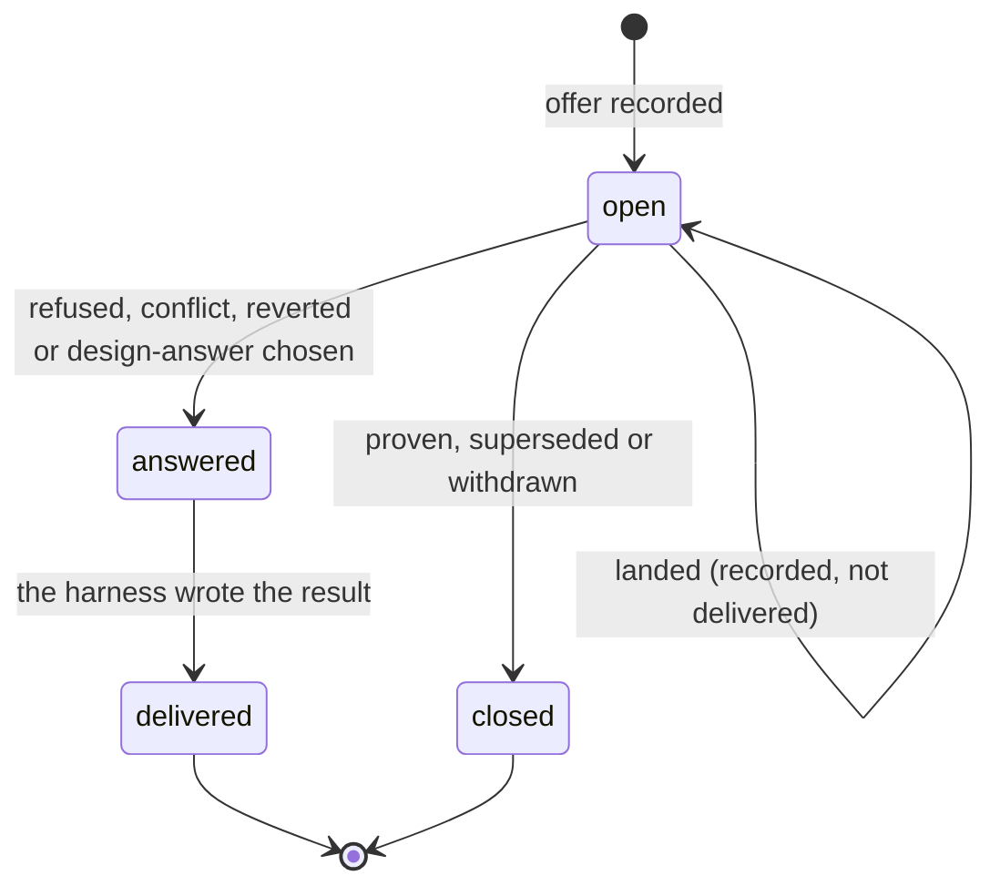
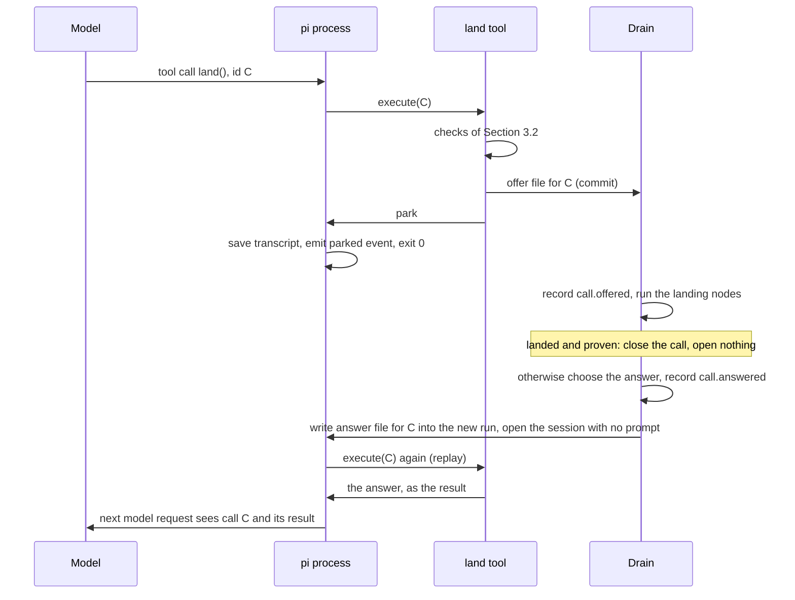

# A landing is a suspended tool call: the worker offers a commit and hears back only when it has something to fix

**Status:** Built on pi and on Claude Code: the `land`, `obstacle` and `no_change` tools, the call record, the answer chooser, delivery as the call's own result, and the capability probes. One step is not built: holding the call open across the landing until the proof ([Section 10](#10-build-order)). `D-LC1` to `D-LC11` and `D-LC13` are the designer's decisions and await the owner's review; `D-LC12` implements an owner ruling.

> **In short.** The worker's last act is a tool call, and the call is the whole of what it knows about landing. tillr answers it only when the worker has something to fix, as the result of that same call in that same session; a change that lands and holds costs no further turn.

**Why it matters.** When a run's ending is read from the last line of a report, the worker has to compose the one line the machinery reads, and the machinery has to guess when the line is missing or malformed. A refusal then arrives as a new user message the worker must connect to its earlier work.

**The shape.** Four parts:

- a tool, `land`, registered in the worker's harness;
- a **call record** in tillr's store that says what was offered and what came of it;
- each suspending harness's replay of an unanswered or deferred tool call, which makes the stored answer the call's result when the session is opened again;
- an **ending capability** each harness adapter declares, so a harness that cannot suspend keeps the report footer.

**Cost.** pi must provide three capabilities ([Section 6.5](#65-what-pi-must-provide)); Claude Code needs none beyond its stock `PreToolUse` `permissionDecision: "defer"` and promptless `--resume`. A second form of everything (`footer`) remains for harnesses that cannot suspend. While worktrees are a fixed set of lanes, a worktree is released when its item lands, so a late revert can find it taken ([Section 5.2](#52-states)).

**Start at [Section 3](#3-the-contract-from-the-workers-seat)**, the contract. [Section 4](#4-landed-and-proven-one-call-two-events), [Section 6](#6-the-mechanism-on-pi) and [Section 7.1](#71-the-mechanism-on-claude-code) carry the rest.

**Needs your ruling:** None open. **Blocked:** [OQ-LC1](#OQ-LC1), until worktrees belong to items.

**Reads with:** [the graph design](./tillr-graph-is-the-path.md) (every act is a node with a stated ending), [the vocabulary](./tillr-vocabulary.md) (proposes that a worktree belongs to its item), [the landing principles](./landing-principles.md) (the rulings a landing change is checked against), [the pi adapter's guide](../../tools/tillr-run/backends/pi/README.md), [the Claude adapter's guide](../../tools/tillr-run/backends/claude/README.md) and [the drain's guide](../../tools/tillr-drain/README.md).

---

## 1. The direction and what exists

Four owner rulings bind this design:

- **The suspended call is independent of what the gate runs.** The worker delivers what it thinks it should deliver; tillr gates it by whatever mechanism applies and sends it back only if there is something to change.
- **The experience is the same on every harness that can suspend.** A Claude Code worker gets the same suspended delivery call as a pi worker, not an ended turn followed by a resumed user message (`D-LC12`).
- **A worktree belongs to its item.** It is a resource the item acquires and keeps, not a slot in a fixed pool. This is a direction, not yet built ([OQ-LC1](#OQ-LC1)).
- **The trunk strategy stands.** The fast gate runs before the merge; the whole suite runs on the trunk afterwards; a red result is repaired by automatic revert or by a fixer; only a proven commit is pushed.

The rulings of [the graph design](./tillr-graph-is-the-path.md) hold throughout: nothing is counted, no clock fails work, a refusal returns to the same session as often as needed, a killed run resumes as itself, a held state names its mover, and the owner is reached only by a written question.

**The footer form** is what a harness that cannot suspend uses:

- A footer worker ends with `RESULT: done`, or with a named obstacle and `RESULT: blocked` ([the brief template](../../tools/tillr-run/backends/brief-template.md), "Report shape").
- The drain examines the run: fence, optional judge, gate, lander. A refusal dispatches the item again as `returned-with-evidence`, in the worker's own session when the adapter can resume it, with the evidence as a new user message ([the drain's guide](../../tools/tillr-drain/README.md)).
- A squash conflict and a reverted landing return to the session that wrote the change when its lane and session remain. Otherwise a fresh session starts with the evidence, and the reason is recorded: `lane-unavailable`, `session-missing` or `seat-changed`.

## 2. The words

Each term is used in this sense for the rest of the document.

| Term | Meaning | What it is not |
| :--- | :--- | :--- |
| **Item** | One unit of work in tillr's queue, with criteria and a fence (the paths it may write) | — |
| **Worker session** | The saved conversation of the agent that builds an item's change: a transcript the harness keeps on disk, plus whatever the model provider has cached of it | Not a process. Between two turns nothing runs |
| **Harness** | The agent program that runs a session: pi, Claude Code, muse or agy. An **adapter** is tillr's wrapper around one | — |
| **Node** | One act on an item, recorded in the item's graph, with a stated ending ([the graph design](./tillr-graph-is-the-path.md)) | Not a session: several nodes can continue one session |
| **Trunk** | The branch landings go to | — |
| **Landing** | The lander ([`tillr-land`](../../tools/tillr-land/README.md)) putting an item's change on the trunk as one squashed commit | Not the push to a remote |
| **Offer** *(coined here)* | The commit at the head of the item's branch at the moment the worker calls `land` | Not the worktree's uncommitted state, and not a later commit |
| **Landing call** *(coined here)* | One invocation of `land`, identified by the tool call id the harness gave it | Not the item: an item may make several calls |
| **Park** *(coined here)* | The harness ends its process on purpose with a tool call that has no result yet | Not a kill, and not a process that waits |
| **Answer** *(coined here)* | The one result delivered to the worker for a landing call. A call has at most one | Not every outcome: a landing that holds is recorded and never delivered |
| **Fast gate** | The checks that run on the offer before the merge | — |
| **Proof** | The run of the whole suite on a trunk commit, after the merge. The **green pointer** is the ref `refs/tillr/green`, the newest trunk commit whose proof passed ([the gate reference](../reference/gate.md)) | — |
| **Ending capability** *(coined here)* | What an adapter declares about how its harness can end a worker's run: `call-suspends`, `call-then-message` or `footer` | Not the pause kind, which says how a run can be stopped and continued |

**Landed** means the lander moved the trunk to a commit that contains the offer's change; the fact is the squash commit's sha. **Proven** means the green pointer has reached or passed that commit and the landing has not been reverted. Both are facts about the trunk, written by the lander and the proof runner, never by the worker.

## 3. The contract from the worker's seat

A worker's run ends in a tool call. There is no report to compose and no last line to get right.

### 3.1 The call

**`land` takes no arguments.** The judge reads the item's words and criteria and verifies the commit itself; it does not judge the worker's account of the work. The worker cannot offer anything but its own branch head.

**Calling it means one thing: the commit at the head of this branch, now, is my change; put it on the trunk.** Work that is not committed is not offered.

### 3.2 What is answered at once

The tool checks the offer before it parks. A failed check returns immediately, as an ordinary error result in the running process; no node ends, and the worker continues.

| Check | Result text names |
| :--- | :--- |
| The head is still the base the run started from | That there is no commit to offer |
| The worktree has uncommitted or untracked paths inside the fence | Each path |
| The head equals an offer that was already refused, or reverted, for this item | That offer's answer, and that a new commit is required |
| Another `land` call from this session is open | That call's id |
| The session still owes a wake to a background task (a task started with a wake-on-completion policy that has not ended) | The task |

The last row exists because a parked session cannot take a wake: the process that would receive it is gone. An explicit operator retry may reopen a retained candidate whose offer was refused.

### 3.3 What can come back

If the checks pass, the call does not return. The answers below are the closed set, each delivered as the result of the call, flagged as an error result, in the session that made it. Its first line is `ANSWER: <kind>`; the wording after it is the implementer's.

| Answer | When | Evidence it carries | What the worker does |
| :--- | :--- | :--- | :--- |
| `refused`, stage `fence` | The offer changes paths outside the item's fence | The paths | Moves the change inside the fence, or calls `obstacle` with kind `fence` |
| `refused`, stage `judge` | The item's judge failed the offer | Each failed criterion id with the judge's finding | Fixes, commits, calls `land` again |
| `refused`, stage `gate` | A fast-gate check failed on the offer | Each failing check's id, its command and its output, with the failing cases at the head | Fixes, commits, calls `land` again |
| `conflict` | The offer does not apply to the trunk, at the take-in or at the squash | The conflicting paths and the trunk commit | Reconciles with that trunk by merge or rebase, its choice, and calls `land` again |
| `reverted` | The offer landed, the proof then failed on a check that was pinned to this landing, and tillr reverted it | The landed commit, the revert commit, the check's id and output | Fixes, commits, calls `land` again; its next fast gate runs that check as a required one |
| `design-answer` | The ending was an identical repeat of an earlier one, so the design seat diagnosed it | The design seat's answer and its commit on the item branch | Continues from that commit |

Rules that hold for every answer:

- **Output is whole.** A check's output is given inline up to 30,000 characters per check. A longer one is given as its first 5,000 and last 25,000 characters with the path of the full log, which is readable from the worktree.
- **Every answer states the branch.** The offer's commit, the branch head now, and the trunk commit the branch last took in. The landing nodes may advance the branch by a clean take-in while the session is parked; they never rewrite the offer's commit and never leave uncommitted changes.
- **Every answer names the turn.** The run id and scratch directory of the node that the resumed turn belongs to, because the answer is the only new content the session gets.
- **No answer is counted.** The same session is answered as often as it calls.

### 3.4 What never comes back

| Outcome | Why the worker is not told | What happens instead |
| :--- | :--- | :--- |
| **Landed** | The work is finished, and a turn to say so buys nothing | Recorded on the call. The session is not opened |
| **Proven** | The same | The call closes |
| The trunk moved and was taken in cleanly | Not a question the worker can answer ([landing principle 3](./landing-principles.md#3-gate-what-will-be-the-tip-once)) | A field on any later answer |
| A check could not complete, the gate stalled, the trunk's worktree was dirty, a red-cap hold | A statement about the machinery, not the offer ([the landing principles](./landing-principles.md)) | A wait that names its mover; the same offer is tried again. For a gate that returns no verdict the wait is `gate-no-verdict`, and its mover is the loop |
| The change is already on the trunk | Supersession is a verdict about the trunk | The call closes as `superseded` |
| The owner closed the item | — | The call closes as `withdrawn` |

### 3.5 A named obstacle is a second tool

A worker that cannot finish ends with `obstacle`, a second tool with the same mechanics. Its arguments are the kind (`definition`, `fence`, `trunk`, `tooling`, `seat`, `owner`) and that kind's required fields.

- **Why a tool and not the footer.** The harness validates the arguments, so a blocked report with a missing field cannot be written, and the reply (a design answer, the owner's answer, "the base replay did not reproduce your `trunk` claim") comes back as the call's result in the same session.
- **Why not an argument of `land`.** `land` means "this commit is my change". An obstacle offers nothing. One tool with both would admit a call that is an offer and a refusal at once.

Under the `footer` form an obstacle is a `RESULT: blocked` footer.

### 3.6 What the brief says

The brief of a worker whose adapter suspends ends with this section in place of the footer form's "Report shape" and "Stop conditions":

```text
## Finishing

You are running unattended. Nobody reads a message from you. This run ends with one
tool call, and a message without it is not an ending: you will be asked to continue.

Call `land` when your change is committed on this branch and its verification has run.

The commit at the head of this branch when you call is what you offer. Uncommitted work
is not offered, and the call returns at once, naming the paths, if there is any.

The call does not return while your change is checked and landed. If it lands and holds,
you will never see a result: this session ends there, and that is success. If a result
arrives, it is one of these, and none is counted against the item:

  refused        a check said no. The result names the check and carries its output.
  conflict       your commit does not apply to the trunk. The result names the paths
                 and the trunk commit. Reconcile by merge or rebase, your choice.
  reverted       your change landed, the full suite then failed on a check tied to it,
                 and it was taken back out. The result carries that check's output.
  design-answer  the design seat changed the item on this branch. Continue from there.

Every result states the branch head. Check it before you change anything, fix what the
result names, commit, and call `land` again.

If a fact you cannot change stops you, name the obstacle as below instead.
```

### 3.7 A No-Change Finding Is a Third Tool on the Planned-Build Workflow

On `planned-build@v1`'s unsplit whole-item `work` stage (`id: "work"`, `seat: "build"`, `access: "write"`), a worker whose reproductions establish that nothing in the repository needs changing ends with `no_change`, a third suspended tool call alongside `land` and `obstacle` ([`D-JL34`](./tillr-judge-and-lifecycle.md#421-an-investigation-that-finds-nothing-to-change-ends-inside-tillr-d-jl34), `D-LC13`). It is `tools/tillr-run/backends/pi/no_change.ts` on pi, `mcp__tillr__no_change` in `tools/tillr-run/backends/claude/landing` on Claude Code, and `RESULT: no_change` with `CAUSE:`, `EVIDENCE:` and `WHY_NO_CHANGE:` under `footer`. Other workflows and split `build-pieces@v1` pieces do not load or expose it.

- **Arguments.** A no-change finding has no diff, so the tool takes three non-empty trimmed string fields, `cause`, `evidence` and `why_no_change`, which `verify` checks and `tillr item show` persists.
- **Why a third tool.** `land` offers a commit (`HEAD != base`) for the gate and the trunk merge; `obstacle` reports that the worker is stopped from finishing; `no_change` submits a completed nothing-to-change finding (`HEAD == base`) for the workflow's `verify` judge.
- **Immediate checks.** Before parking, `no_change` rejects a missing or blank field; `HEAD != base` (a commit exists, so call `land`); uncommitted or untracked paths; an identical `(base, cause, evidence, why_no_change)` already refused; another open ending call; and, on pi, an owed background-task wake.
- **Offer, answer and silent close.** On a pass the tool writes the offer file with `tool: "no_change"` and the finding, and parks. When `verify` passes the finding, the drain records the judge verdicts, stores the finding on the item, closes the item, and closes the call silently with reason `closed-no-change`. When `verify` fails it, the call receives `refused` with stage `judge` as its result, unless a reason starts `plan-wrong:`, which closes the call and returns the item to `plan`.

## 4. Landed and proven: one call, two events

Under the trunk strategy, "passed the fast gate and merged" and "the whole suite covered it" are different events: the first follows the call by seconds to about a minute, the second by minutes or more. The question is which one closes the call.

**The call closes at proven, the session is never opened for either, and a revert is the open call's answer.**

The alternatives are to return `landed` and end the session, delivering a later revert as a new message, or to hold the call open until the proof. With a harness that parks, they differ less than they appear to:

| Consideration | What decides it |
| :--- | :--- |
| **What waiting costs** | Nothing runs while a call is open. A parked session is a transcript on disk and a provider cache. Holding the call open for minutes or hours costs no process and no tokens |
| **What closing at landed would cost** | Writing `landed` into the transcript needs either a paid turn whose only content is "it landed", or an edit to the session file from outside, which [Section 6.1](#61-the-form-chosen-and-the-two-rejected) rejects |
| **What a revert needs** | The same session in the same worktree. With the call still open, the revert is delivered by the one mechanism every refusal uses. With the call closed, it needs a second delivery form |
| **What a late answer pays** | A refusal from the fast gate arrives inside the provider's cache lifetime; a revert may not, and resuming a session whose cache expired can cost more than a new session ([the designer-session reference](../reference/tillr-designer-sessions.md) has the measurements). The same session is therefore not chosen for its token price. It is chosen because the worker that wrote the change does not re-derive it, and does not produce a different change under the old name |
| **What the worker does meanwhile** | Nothing, under either choice |
| **What the owner sees** | The item shows `landed` at the merge, with "proof pending" beside it, and `proven` when the green pointer passes it. The call's state is a detail of the item's page, not a third category |

**This holds for any split of checks.** Nothing above depends on which checks run before the merge. A check moved from the proof to the fast gate changes which answer carries its output, `refused` or `reverted`, and nothing else. A strategy with no proof closes the call at landed, because landed and proven are then the same event.

**A proof that never comes** (an unattributed red, a fixer still working) leaves the call open. That is a wait on a red check whose mover is the fixer item, shown as such; nothing times it out. Whether the worktree is held through it is [Section 5.2](#52-states).

## 5. The record

### 5.1 One record per call, one writer

The call record lives in tillr's store and the drain is its only writer. The harness writes only its transcript. The tool writes only the offer file of [Section 6.2](#62-the-sequence).

| Field | Written when |
| :--- | :--- |
| Call id, tool name, item, node and run, session id and transcript path, worktree path, adapter and ending capability | The offer is recorded |
| Offer commit, base commit | The offer is recorded |
| Landed commit; revert commit | The lander's and the revert's records are written |
| Answer: kind, stage, evidence references | An answer is chosen |
| Delivery: form, the run it was delivered in, time | The harness reports the result written |
| Closing reason | The call closes |

Each row is an event (`call.offered`, `call.landed`, `call.answered`, `call.delivered`, `call.closed`), so the item's page can show a call's whole path and an audit can ask how many calls an item made and what each was told.

### 5.2 States



- **One answer.** The store refuses a second answer for a call id. The chooser (`chooseLandingCallAnswer`) is a pure function of the landing nodes' endings; writing the answer is the effect.
- **An answer is immutable** once chosen. Delivering it twice delivers the same text.
- **After delivery the call is finished.** The worker's next `land` is a new call with a new id.
- **The worktree is released at the landing** (`D-LC11`). Lanes are a fixed set, and holding one through a long red would take it from new work exactly when the trunk needs repair. A later answer is delivered in the worker's own session when its worktree and session remain, and takes the `fresh-session` form of [Section 5.3](#53-delivery-forms) otherwise, with the reason recorded. Once a worktree belongs to its item, the release can wait until no call of the item is open or answered, at the cost of disk and not of a lane. Whether it should is [OQ-LC1](#OQ-LC1). The worktree lifecycle itself is not designed here.

### 5.3 Delivery forms

The answer is one thing; how it reaches the session depends on the adapter and on what is left of the session. The form used is recorded on the call.

| Form | When | What the session receives |
| :--- | :--- | :--- |
| `tool-result` | The adapter's capability is `call-suspends` and the transcript still holds the unanswered or deferred call | The answer as the call's result, and nothing else |
| `message` | A fallback when the harness reports no unanswered or deferred call in a `call-suspends` session that should hold one, or for an adapter declaring `call-then-message` | The answer as the session's next message |
| `fresh-session` | The session cannot be opened: its transcript is gone, the seat's backend or model changed, the worktree is occupied, or the harness refused to open it | A new session whose brief carries the answer and the pinned refs of the earlier work |

The reasons recorded for `fresh-session` are `session-missing`, `seat-changed`, `lane-unavailable`, `resume-failed` and `cannot-resume`.

## 6. The mechanism on pi

### 6.1 The form chosen, and the two rejected

**Chosen: the harness replays the unanswered call.** When a session is opened, pi replays any tool call from the last assistant message that has no saved result, before it adds a prompt or makes a model request. It does not repeat a call whose result is saved. A tool registered by an extension has its `execute()` run again in the new process, with the same call id and the saved arguments. On the first execution `land` records the offer and parks; on a replay it returns the stored answer, and pi writes the result entry itself.

**Rejected: appending a tool result to the session file from outside.** It needs single-writer discipline that pi does not offer (the session file has no lock), a correct parent for the new entry among interleaved non-message entries, and a read-back, because the loader skips a malformed line silently. Everything it offers, the replay offers through an interface the harness owns.

**Rejected: a tool that waits.** A process held per waiting call, for a wait with no bound, with no answer to a host restart.

### 6.2 The sequence

The **offer file** and the **answer file** are the two halves of the hand-off, in the run's own durable directory, each written whole and renamed into place. The tool writes the offer file; the drain writes the answer file; neither writes the other's.



**What `execute()` does**, by what it finds for its call id in its run's directory:

| It finds | It does |
| :--- | :--- |
| An answer file | Returns the answer as an error result. This is a delivery |
| An offer file and no answer file | Parks again. The process was opened before an answer existed |
| Neither | Runs the checks of [Section 3.2](#32-what-is-answered-at-once); on a pass writes the offer file and parks |

**What the drain does with an offer file**, at the run's end and never before the process has exited: records `call.offered`, and treats the node as ended `submitted`. An offer whose call id already has a record is not a new offer: the drain writes that call's answer file if it has an answer, and opens the session again.

### 6.3 Failure cases

| Case | What happens |
| :--- | :--- |
| The process is killed after the model asked for `land` and before the offer file exists | The run has no ending, so it is an interruption and resumes as the same run. The replay runs `execute()`, which finds neither file, checks, writes the offer and parks. No model request is made |
| The process is killed after the offer file is written and before it exits | The offer file is the ending. The run ended `submitted` |
| The answer could exist before the process has exited | It cannot: the drain reads the offer only after the process and its children are gone (`survivingRunProcesses`) |
| Two answers for one call | The store refuses the second. A `landed` followed by a revert is not two answers: `landed` is an outcome on an open call, and `reverted` is its one answer |
| The session is opened with no answer yet | `execute()` parks again. The opening is logged as an exception against the node, uncounted |
| The process dies after the result is saved and before the model's turn | The next opening finds no unanswered call and continues from the saved result. The answer is not delivered twice, because pi does not repeat a call that has a result |
| The process dies before the result is saved | The next opening replays, and `execute()` returns the same answer |
| The transcript is gone or the harness refuses to open it | `fresh-session`, with the reason |
| The transcript does not hold the unanswered call (compacted, or opened by hand without the tool) | Before opening pi, the adapter checks the active transcript branch (`landing-call-held`): the last assistant message must be a tool-use message containing the call id, no compaction may follow it, and the call must either have no saved result or have one with the last message its tool result. An unreadable or unparseable file fails the check. On failure the adapter opens with the answer as a message and records `message` |
| The model asks for `land` and other tools in one message | The other calls run and their results are saved; only `land` is left unanswered. The offer is the head `execute()` read |
| The parked process does not exit | The adapter's exit bound applies (120 seconds, then a signal); the offer file still decides the ending |

**tillr never compacts a session that has an open or answered call** (`D-LC10`). Compaction, where the session's size calls for it, happens after delivery.

### 6.4 The keep-going extension and the settled-session rule

- **A parked call is not a settle.** Parking does not pass through the boundary where an extension may ask for a continuation, so the keep-going extension ([`keep-going.ts`](../../tools/tillr-run/backends/pi/keep-going.ts)) is never consulted for it and cannot nudge it.
- **Keep-going answers one case.** A worker that ends its turn with a message and no call is answered in the same session with what is missing: "you ended without calling `land`". The checks for a missing commit and uncommitted paths live in the tool, where they return as the call's own result.
- **A parked session is not a hung one.** The adapter's watcher ends a session that has settled and not exited. A parked process announces itself with a parked event in its output stream and exits by itself; the watcher treats that event as an ending in progress, not a settle.
- **A run that ends with an offer is an answered exit**, whatever else its transcript says. No result word is looked for.

### 6.5 What pi must provide

| Capability | What it does |
| :--- | :--- |
| **Park** | A tool's `execute()` may return a park. pi saves no result for that call, makes no further model request, does not consult settle hooks, emits a top-level parked event naming the call ids, flushes the session and exits 0 |
| **Open without a prompt** | A way to open an existing session with no new user message: complete the unanswered calls, then continue from the trailing tool result. With nothing to replay and nothing to continue from, it says so in the stream and exits non-zero without a model request |
| **State the build's features** | `pi --features` prints the build's feature names as JSON, including one name, `parked-tool-calls`, that stands for the replay and both capabilities above |

The `land` tool itself is not part of pi. It is a tillr extension ([`land.ts`](../../tools/tillr-run/backends/pi/land.ts)) beside `keep-going.ts`, loaded by the adapter the same way and only for a worker run.

### 6.6 How the drain knows

A version string cannot tell two builds apart. So the pi adapter is treated as `call-suspends` only when the installed binary itself prints `parked-tool-calls` among its features (`probePiEndingCapability`). The drain asks once at each start of the loop (`recordEndingCapabilities`) and records the answer as an event with the binary's path. A binary that does not know the flag has answered no.

**The fallback is the footer form, whole.** A pi without the feature gets the footer brief, keep-going's footer check, and answers as messages. There is no interim form that parks by killing the process.

**A node's form is fixed when it starts.** A session that began under the footer brief is answered in message form for its whole life, even if the capability appears before its next turn.

## 7. The other harnesses

| Harness | Ending capability | What the contract becomes |
| :--- | :--- | :--- |
| **pi with the feature** | `call-suspends` | [Section 6](#6-the-mechanism-on-pi): extension tools `land`, `obstacle` and `no_change`, unanswered-call replay on promptless resume, the `pi --features` probe |
| **pi without it** | `footer` | The footer and keep-going; answers as the session's next message |
| **Claude Code with deferred-tool resume** | `call-suspends` | [Section 7.1](#71-the-mechanism-on-claude-code): stdio MCP tools, `PreToolUse` deferral, a `Stop` hook for missing calls, promptless `--resume` replay, a capability probe at loop start |
| **Claude Code without it** (an older binary, or `CLAUDE_CODE_DISABLE_DEFERRED_TOOL_RESUME` set) | `footer` | The footer; answers as the session's next message |
| **muse, agy** | `footer` | The footer. Neither adapter can resume a session, so every answer is `fresh-session` |

The contract is the same across capabilities: the offer is the commit at the moment of ending, the answers are the closed set of [Section 3.3](#33-what-can-come-back) with one shared text, and nothing is counted. On both pi and Claude Code, `call-suspends` delivers the answer as the suspended call's own `tool_result`.

### 7.1 The mechanism on Claude Code

#### The form chosen, and the three rejected (`D-LC12`)

**Chosen: native `PreToolUse` deferral (`permissionDecision: "defer"`) and promptless `--resume` replay.** The behavior below was verified against `claude` 2.1.329 in `-p` print mode with `--dangerously-skip-permissions`, `--strict-mcp-config`, `--mcp-config` and `--settings`:

- When a `PreToolUse` command hook returns `{"hookSpecificOutput": {"hookEventName": "PreToolUse", "permissionDecision": "defer"}}`, Claude Code does not invoke the tool server, writes a `hook_deferred_tool` attachment (`toolUseID`, `toolName`, `toolInput`, `permissionMode`) to `transcript_path`, skips `Stop` hooks, emits a `result` event with `stop_reason: "tool_deferred"` and `deferred_tool_use: { id, name, input }`, and exits `0`.
- When reopened with `claude -p ... --resume <session-id>` and empty standard input, Claude Code scans the last 1 MiB of the session JSONL for an unresolved `hook_deferred_tool` attachment, re-emits the saved `tool_use` (with its original `tool_use_id` and `input`) through `PreToolUse` and the MCP server, writes the returned `tool_result` row to the session JSONL, and continues the model turn with no user prompt.

Three alternatives are rejected:

- **A blocking MCP `land` call with a live mid-run gate.** It holds a live `claude` process per waiting call for an unbounded gate, judge or proof wait, collides with the drain's `survivingRunProcesses` check, has no answer to a drain or host restart or a late `reverted` answer, and violates `D-LC7`.
- **Killing `claude` mid-call or editing its session JSONL from outside.** `SIGTERM` during an in-flight MCP `tools/call` makes Claude Code persist an MCP `Connection closed` error `tool_result` before exiting, and `SIGKILL` makes `--resume` synthesize `[Tool call interrupted: ...]` ahead of any resumed turn. Appending to the session JSONL from outside has no lock or supported schema and is rejected for the same reasons as on pi.
- **`call-then-message`** (a result reading "recorded; end your turn", followed by a resumed user message). Delivery on Claude Code must be one suspended tool call whose own result is the gate's answer, by the owner's ruling in [Section 1](#1-the-direction-and-what-exists).

#### Adapter pieces and sequence

When a worker run's staged ending capability is `call-suspends`, `run-claude` wires four pieces around `claude -p`, all in [`tools/tillr-run/backends/claude/landing`](../../tools/tillr-run/backends/claude/landing):

1. **Adapter-managed stdio MCP server (`tillr`).** `run-claude` generates an MCP configuration file in the run's own durable directory and passes `--mcp-config <file>` alongside `--strict-mcp-config` ([the Claude backend design](./tillr-claude-backend.md)), so ambient account connectors stay off. The server exposes `land` (no arguments), `obstacle` (`kind` and that kind's lowercase fields) and, when staged for `planned-build@v1`'s unsplit `work` stage, `no_change`. Claude Code names them `mcp__tillr__land`, `mcp__tillr__obstacle` and `mcp__tillr__no_change` on the wire.
2. **`PreToolUse` hook (`deny`, `defer`, `allow`).** `run-claude` passes `--settings <generated-settings>` while keeping `--setting-sources ""`, so user and project hooks remain off. The hook decides by what it finds for `tool_use_id`:
   - **Replay delivery (`allow`).** If `landing-answer.json` in the run's durable directory has `call_id == tool_use_id`, the hook allows the call. Claude Code then calls the MCP server, which reads `landing-answer.json` and returns the answer text with `isError: true` as that call's `tool_result`.
   - **Idempotent re-park (`defer`).** If `landing-offer.json` or the open list in `landing-state.json` already holds `tool_use_id` and no answer file matches, the hook defers again.
   - **Immediate checks (`deny`).** Otherwise the hook runs the [Section 3.2](#32-what-is-answered-at-once) checks (for `obstacle`: a valid `kind`, its required fields, repository-relative `paths`, and an attempt on `seat`). The owed-wake check does not apply, because Claude Code does not load pi's background-task extension. A failed check returns `permissionDecision: "deny"` with the reason, which Claude Code delivers at once as an error `tool_result` without ending the turn or the process.
   - **Offer and park (`defer`).** When the checks pass, the hook writes `landing-offer.json` atomically and defers.
   - **Sibling-call guard.** Once an unanswered offer exists in the current invocation, the hook denies any later sibling tool call in the same assistant batch, so neither `HEAD` nor the worktree can move after the offer is recorded. If Claude Code ever ignores `defer` and invokes the MCP tool with no matching answer, the MCP handler unlinks the offer and returns an error instructing the worker to call the ending tool by itself.
3. **`Stop` hook (missing-call nudge).** Claude Code skips `Stop` hooks when a turn ends with `stop_reason: "tool_deferred"`, so `Stop` fires only when the worker stops with a plain message. Unless the run's pause-request file exists, or the fingerprint of the head, worktree status and message matches the previous nudge, the hook blocks the stop and tells the worker to finish by calling `land` or `obstacle`. The fingerprint is used because Claude Code keeps `stop_hook_active: true` across later tool calls within the same prompt.
4. **Promptless resume and fallback in `run-claude`.** When the session mode is resume and an answer is staged:
   - If the recorded transcript path is missing on disk, `run-claude` exits non-zero before launching `claude`, which triggers `fresh-session` with `resume-failed`, as `run-pi` does.
   - `run-claude` checks the last 1 MiB of the transcript (Claude Code's own scan window) for an unresolved `hook_deferred_tool` attachment for the answer's call id.
   - When the call is held, it records `tool-result` as the delivery and invokes `claude -p ... --resume <session-id>` with empty standard input. If `claude` exits non-zero reporting `"No deferred tool marker found in the resumed session"`, it records `message` instead and retries with the answer text on standard input.
   - When the call is not held: if the transcript already carries the persisted `tool_result` for the call from an interrupted earlier delivery, it keeps `tool-result` and resumes with a minimal continuation prompt so the answer is not duplicated; otherwise it records `message` and passes the answer text on standard input.

#### Drain reconciliation and capability probe

- **Transcript delivery check.** `landingResultPersisted` in `tools/tillr-drain/drain/landing_call.go` recognizes both pi's session format and Claude Code's session JSONL rows: a `type: "user"` row whose `message.content` holds a `tool_result` block for the answer's call id, with `is_error == true` and text matching the answer (tolerating Claude Code's trailing-newline trim on MCP error results). `reconcileLandingDelivery` records `call.delivered` from it.
- **Capability probe at loop start.** `backends/claude/ending-capability` declares `call-suspends`, and `probeClaudeEndingCapability` probes the installed `claude` binary once at loop start: it runs `claude -p --setting-sources "" --continue` with empty standard input in an empty temporary directory and checks standard error for `"No deferred tool marker found in the resumed session"`. If `claude` is absent, predates deferred-tool resume, or has `CLAUDE_CODE_DISABLE_DEFERRED_TOOL_RESUME` set, the drain records `footer` for the Claude adapter and uses the footer form.

## 8. In the graph's words

- **The work node ends `submitted`, and the call is its stated ending.** The ending record is the offer: call id and commit. It is written by the tool, not composed by the model.
- **The gate run, the judge and the land attempt are nodes**, as [the graph design](./tillr-graph-is-the-path.md) has them. They run against the offer's commit. This design adds none.
- **"The session is suspended" means no node of the item is running that uses it.** The item waits on its landing nodes. The session and its open call are assets of the done work node.
- **An answer is what makes the next node a resume.** The rule table adds a resume node with a `resumes` edge to the node that made the call, and the resume's one message is the answer, delivered in the form of [Section 5.3](#53-delivery-forms). The resume ends, in its turn, with a new call.
- **A check answered inside the call ends nothing.** The rows of [Section 3.2](#32-what-is-answered-at-once) happen within a running node.

## 9. The footer form beside the call form

| Under `footer` | Under `call-suspends` |
| :--- | :--- |
| `RESULT: done` or `RESULT: blocked` is read from the report's last line | The offer file is the ending; no result word is looked for |
| Keep-going nudges a worker with no commit or with uncommitted paths | The checks of [Section 3.2](#32-what-is-answered-at-once) return as the call's own result |
| Keep-going nudges a missing footer | Keep-going (pi) or the `Stop` hook (Claude Code) answers a worker that ended without an ending call |
| A refusal is a new user message followed by the brief | The answer is the call's tool result. The brief is not repeated: the session has it |
| A returned turn must make a new commit | An unchanged offer is answered at once, inside the call |

Two rules are the same under both forms. The identical-repeat rule (`repeatedEnding` in [`returned.go`](../../tools/tillr-drain/drain/returned.go)) sends a repeated ending to the design seat, and its reply comes back as `design-answer`. The worker-session record ([`worker_session.go`](../../tools/tillr-drain/drain/worker_session.go)) keeps the session a refusal returns to.

## 10. Build order

Every form is chosen per node at its start, so the footer form keeps working beside the call form.

| Step | What | State |
| :--- | :--- | :--- |
| 1 | Reverts and conflicts return to the worker's own session, in message form | Built |
| 2 | The call record, the offer and answer files, the answer chooser, and the ending capability | Built |
| 3 | The three pi capabilities of [Section 6.5](#65-what-pi-must-provide) | Built; the drain probes for them |
| 4 | The `land` tool, the brief ending, and answers as tool results on pi | Built |
| 5 | The call stays open until proven; `reverted` and `conflict` are its answers | Partly built: the store closes a call on `proven`, `superseded` or `withdrawn` and records a `reverted` answer; the live flow does not yet hold the call open across the landing |
| 6 | `obstacle` as a tool | Built on pi and Claude Code |
| 7 | Claude Code's `call-suspends` form ([Section 7.1](#71-the-mechanism-on-claude-code)) | Built |

### 10.1 The unbuilt step: keep the call open until the landing is proven

A landing that the full suite later reverts should come back as the answer to the call that offered it. This step closes a call at proven instead of at landed and makes `reverted` and `conflict` answers. It touches `tools/tillr-drain/`, `tools/tillr-land/` and `tools/tillr-view/`. Done means:

- A landed call stays open until the green pointer reaches its landing, then closes as `proven`.
- A revert pinned to that landing becomes the call's one answer, delivered as its result, carrying the check's output and both commits.
- A squash or take-in conflict becomes the answer `conflict` with its paths and the trunk commit, and the worktree is left on the worker's own branch.
- While worktrees are a fixed set of lanes, the item's worktree is released at the landing. A `reverted` answer is delivered in the worker's own session when its worktree and session remain, and otherwise starts a fresh session with the recorded reason.
- The item's page shows the call's state, "landed, proof pending" among them, and the number of open calls is visible for the whole queue.

## 11. Risks

| Risk | What would show it | What changes |
| :--- | :--- | :--- |
| A model treats a call that "never returns" as a reason to hedge, and ends with a message first | Nudges for a missing call, counted from the event log | The brief text. The mechanism does not depend on it |
| A parked session is opened by hand, without the tool loaded | The harness answers the unanswered call with its own error | The answer is still in the store and is delivered as a message. The item's page shows a parked session, so a person can tell before opening one |
| A late `reverted` answer finds the worktree given to another item, and a fresh session starts cold | The recorded reason `lane-unavailable` | Hold the worktree until proven, once worktrees belong to items ([OQ-LC1](#OQ-LC1)) |
| The installed pi lacks the capabilities | The recorded capability stays `footer` | Nothing breaks: the footer form is used |
| An expired cache makes a late `reverted` cost more than a new session would | Token cost per resumed turn, by cache state, from the usage ledger | Compact after delivery when the conversation is large; the choice of the same session does not rest on price |
| A second transcript mechanism is rebuilt by habit (an outside append "just for success") | A review finding | [Section 6.1](#61-the-form-chosen-and-the-two-rejected) is the ruling: the store is the record of a landed call |

### 11.1 What is not measured

- How long a judge takes between the offer and the answer.
- How often a reverted item's lane is still free when the `reverted` answer is chosen.
- Whether an upgrade of `claude` past 2.1.329 changes the deferral or resume behavior of [Section 7.1](#71-the-mechanism-on-claude-code). The loop-start probe catches the loss of deferred-tool resume; the adapter's tests (`tools/tillr-run/backends/claude/landing_test.py`) cover the rest against a stand-in.

## 12. What this does not cover

- **What the gate runs**, and which checks sit before or after the merge. [Section 4](#4-landed-and-proven-one-call-two-events) is written to hold for any split.
- **The worktree lifecycle.** This design states one event for it, the release in [Section 5.2](#52-states), and nothing else. [The vocabulary](./tillr-vocabulary.md) proposes the lifecycle.
- **Items that complete without a landing** (a definition whose run ends at a hook). They make no offer and have no call.
- **Read-only runs, judges and design seats.** They do not land; their endings are the graph design's.
- **Keeping a session's cache warm** past its lifetime. It is cost, noted in [Section 4](#4-landed-and-proven-one-call-two-events), not scope.
- **Sub-agents.** A worker's children end before it does; only the worker offers.

## Decision Ledger

`D-LC1` to `D-LC11` and `D-LC13` are the designer's decisions and await the owner's review; the owner may overturn them. `D-LC12` implements the owner's ruling of 2026-11-20. The Built column is read from the tree.

| ID | Decision | Date | Settled in | Built |
| :--- | :--- | :--- | :--- | :--- |
| `D-LC1` | A worker's committed change ends with `land`, with no arguments. The commit at the branch head at that moment is the offer. **Rejected:** a claimed-criteria argument or worker summary (neither is evidence for a commit) and a commit argument (the worker has one branch). | 2026-11-18, amended 2026-11-21 | [Section 3.1](#31-the-call) | Yes, on pi and Claude Code |
| `D-LC2` | Checks the worker can fix at once (no commit, uncommitted paths, an unchanged offer, a second open call, a wake still owed) return inside the call and end nothing. | 2026-11-18 | [Section 3.2](#32-what-is-answered-at-once) | Yes (`land.ts` on pi; the `PreToolUse` hook on Claude Code) |
| `D-LC3` | The answers are a closed set: `refused` (fence, judge, gate), `conflict`, `reverted`, `design-answer`. Machinery outcomes and a clean take-in are never answers. | 2026-11-18 | [Section 3.3](#33-what-can-come-back) | Partly: the chooser and `tool-result` delivery are built; `reverted` and `conflict` on a call held open to the proof are step 5 |
| `D-LC4` | A named obstacle is a second tool, `obstacle`, with typed fields. **Rejected:** an argument of `land`, which would admit an offer that is also a refusal; and keeping the footer on a harness that can suspend. | 2026-11-18 | [Section 3.5](#35-a-named-obstacle-is-a-second-tool) | Yes, on pi and Claude Code |
| `D-LC5` | Landed and proven are both recorded and neither opens the session. The call closes at proven, and a revert is the open call's answer. **Rejected:** closing at landed, which needs a paid turn or an outside edit to say so and a second delivery form for a revert. | 2026-11-18 | [Section 4](#4-landed-and-proven-one-call-two-events) | Partly: silent closure and `reverted` answer recording (`landing_call_lifecycle.go`, `answerLandingRefusal`); holding open across the landing is step 5 |
| `D-LC6` | One call record per call in the store, written only by the drain; one answer per call, immutable; the delivery form is recorded. | 2026-11-18 | [Section 5](#5-the-record) | Yes (`landing_call.go`) |
| `D-LC7` | On pi the answer is produced by the tool when the harness replays the unanswered call. **Rejected:** appending a result to the session file from outside (no supported interface), and a tool that waits (a process per call). | 2026-11-18 | [Section 6.1](#61-the-form-chosen-and-the-two-rejected) | Yes |
| `D-LC8` | pi provides three capabilities: park, open without a prompt, and a features flag. The pi adapter is `call-suspends` only when the installed binary prints `parked-tool-calls`. **Rejected:** an interim form that parks by killing the process. | 2026-11-18 | [Section 6.5](#65-what-pi-must-provide) | Yes (`probePiEndingCapability`) |
| `D-LC9` | A node's ending form is fixed when it starts. The footer remains the form for an adapter that cannot suspend, and for a pi or Claude Code binary without the feature. | 2026-11-18 | [Section 6.6](#66-how-the-drain-knows) | Yes (`brief_ending.go`, `recordEndingCapabilities`) |
| `D-LC10` | tillr never compacts a session with an open or answered call. | 2026-11-18 | [Section 6.3](#63-failure-cases) | — |
| `D-LC11` | While worktrees are a fixed set of lanes, an item's worktree is released at its landing, not held until the landing is proven. A later `reverted` answer reaches the worker's own session when its worktree and session remain, and a fresh session otherwise, with the reason recorded. **Rejected for now:** holding the worktree until proven, which takes a lane out of use through a long red ([OQ-LC1](#OQ-LC1)). | 2026-11-18 | [Section 5.2](#52-states) | Yes, in message form |
| `D-LC12` | Owner ruling: on Claude Code a worker's run also uses `call-suspends`. An adapter-managed stdio MCP server exposes the tools; a `PreToolUse` hook denies, defers or allows; a `Stop` hook blocks a plain-text stop without an ending call; `run-claude` delivers answers by promptless `--resume`, falling back to `message`; the drain probes `claude` at loop start. **Rejected:** `call-then-message`, a blocking MCP call across a live gate, and mid-call signals or outside JSONL edits. | 2026-11-20 | [Section 7.1](#71-the-mechanism-on-claude-code) | Yes (`backends/claude/landing`, `probeClaudeEndingCapability`) |
| `D-LC13` | On `planned-build@v1`'s unsplit `work` stage, expose `no_change({cause, evidence, why_no_change})` alongside `land` and `obstacle`, with its own immediate checks; close the call silently when `verify` passes, and deliver `refused` with stage `judge` when it does not. **Rejected:** overloading `land` or `obstacle`, or exposing `no_change` outside `planned-build@v1`. | 2026-11-22 | [Section 3.7](#37-a-no-change-finding-is-a-third-tool-on-the-planned-build-workflow) | Yes (`no_change.ts`, `backends/claude/landing`, `no_change_test.go`) |

## Open Questions

1. 🔒 **OQ-LC1: Should an item keep its worktree after it lands, until the full suite has passed on it?**

   <!-- vantage: question id=OQ-LC1 blocked-on="worktrees that belong to items: the vocabulary design proposes them, and none is built" -->

   Waits on worktrees that belong to their items, which [the vocabulary](./tillr-vocabulary.md) proposes and nothing builds yet. Until then worktrees are a fixed set, a worktree is released when its item lands, and a reverted change goes back to the worker that wrote it only if its worktree is still free. Once an item owns its worktree, keeping it until the full suite passes costs disk and not a slot, and the question is asked then.

   **Answer:**
   > _(empty — fill in when decided)_
