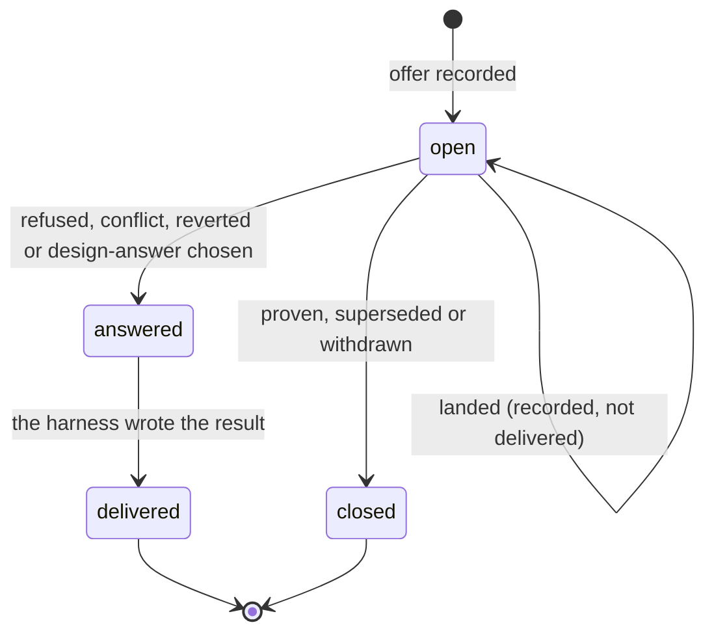
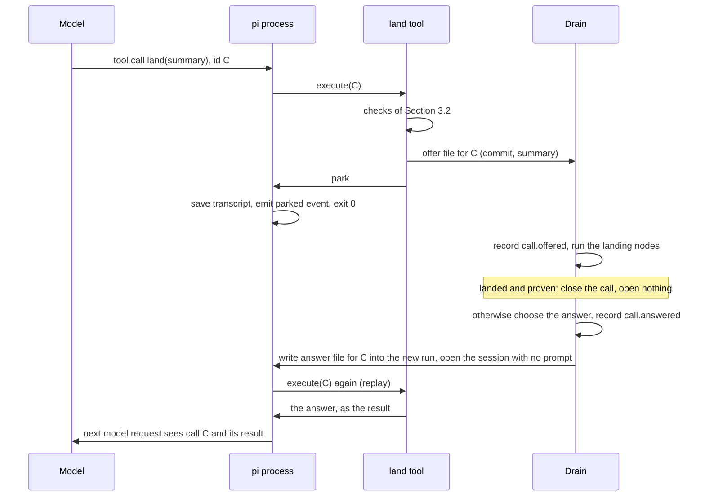

# A landing is a suspended tool call: the worker offers a commit and hears back only when it has something to fix

**Status:** 2026-11-18. A proposal; none of it is built. Written to the owner's direction of 2026-11-18, restated in [Section 1](#1-the-direction-and-what-exists). Facts about the tree, the pi fork and the retired board were gathered by a scout on 2026-11-18 and are stated with the document heading, code symbol or commit they came from; I read no code myself. What nobody ran is listed in [Section 11.1](#111-what-the-design-leans-on-that-nobody-ran).

> **In short.** The worker's last act is a tool call, and the call is the whole of what it knows about landing. tillr answers it only when the worker has something to fix, as the result of that same call in that same session; a change that lands and holds costs no further turn.

**Why it matters.** Today a run's ending is read from the last line of its report, a refusal arrives as a new user message that tells the worker it has "a new run record in your existing session", and a reverted landing or a squash conflict starts a worker that has never seen the change. On 2026-11-18, 19 of 61 drain runs ended with a result word nobody had defined an answer for.

**The shape.** Four parts: a tool, `land`, registered in the worker's harness; a **call record** in tillr's store that says what was offered and what came of it; the pi fork's replay of an unanswered tool call, which makes the stored answer the call's result when the session is opened again; and an **ending capability** each harness adapter declares, so a harness that cannot suspend keeps today's report footer.

**Cost.** Three patches to the pi fork and a delivery to the host before any of it can be switched on. A second form of everything for harnesses that cannot suspend. An item's worktree is held until its landing is proven, not until it lands ([OQ-LC1](#OQ-LC1)).

**Start at [Section 3](#3-the-contract-from-the-workers-seat)**, the contract. [Section 4](#4-landed-and-proven-one-call-two-events) and [Section 6](#6-the-mechanism-on-pi) are the two decisions that carry the rest.

**Needs your ruling:** [OQ-LC1](#OQ-LC1).

**Reads with:** [the graph design](./tillr-graph-is-the-path.md) (the accepted direction: every act is a node; this document fills in the "target form" of its Section 3.3, rule 1), [the landing principles](./landing-principles.md) (the rulings a landing change is checked against), [the retired board state machine](./board-state-machine.md#7-suspend-and-resume) (the only earlier design of this idea; a record, not current machinery), [the pi adapter's guide](../../tools/tillr-run/backends/pi/README.md) and [the drain's guide](../../tools/tillr-drain/README.md) (what is built today).

---

## 1. The direction and what exists

The owner asked on 2026-11-18 what an item that is trying to land a change is expected to deliver, recalled the earlier idea ("the lane would create an attempt … send it to the landing machinery and that would run the gate and return it and … suspend that tool call"), and ruled:

> It seems like this suspended tool call thing is somewhat orthogonal to what the gate actually runs. So I think I want to design and implement this suspended tool call and then keep talking about the gate.

Three further directions bind this design:

- **pi is not a constraint.** "Regardless of what pi can do, pi will do it because we have our own pi fork." Claude Code, muse and agy offer what they offer.
- **A worktree belongs to its item.** It is a resource the item acquires and keeps, with a lifecycle and garbage collection, not a slot in a fixed pool. A suspended session's worktree stays with its item while it waits.
- **The trunk strategy stands.** The fast gate runs before the merge; the whole suite runs on the trunk afterwards; a red result is repaired by automatic revert or by a fixer; only a proven commit is pushed.

The rulings of [the graph design, Section 1](./tillr-graph-is-the-path.md#1-the-direction-and-the-rules) (R1 to R12) hold throughout: nothing is counted, no clock fails work, a refusal returns to the same session as often as needed, a killed run resumes as itself, a held state names its mover, and the owner is reached only by a written question.

**Where the idea stands.** It was designed for the board in October and built once, in a weaker form than its name:

| Fact | Source, read 2026-11-18 |
| :--- | :--- |
| The board design ruled landing "one asynchronous tool call": call, suspend, the queue works, only a refusal resumes | [The board state machine](./board-state-machine.md#1-from-the-agents-seat-landing-is-a-tool-call), decisions D8, D12 and D16; retired 2026-11-14 |
| It was built in commit `3f72899c9` and deleted with the board in `afdc9a957` | `git show 3f02e3b916^:tools/board-cli/internal/board/landing_call.go` |
| The built form was not a harness suspension. The agent ran a command-line verb through its shell tool, its turn ended, and the drain later appended a tool result to the session file from outside | The same file: `deliverLandingAnswer`, `landingAnswerEntry` |
| Whether it ever ran with a real model is not known. Its tests drove a stand-in process | The board plan's build status |
| The landing principles that superseded the board documents say nothing for or against it | `rg -n -i 'suspend\|tool call' docs/design/landing-principles.md` returned nothing relevant |
| The graph design names it as the target form of a stated ending | [Its Section 3.3](./tillr-graph-is-the-path.md#33-endings), rule 1, and Section 12.2 |

**What tillr does today at a run's end**, which [Section 9](#9-what-this-replaces) maps onto the new form:

- The worker's brief ends with a report whose last line is `RESULT: done` or `RESULT: blocked` ([the brief template](../../tools/tillr-run/backends/brief-template.md), "Report shape").
- On pi, the extension [`keep-going.ts`](../../tools/tillr-run/backends/pi/keep-going.ts) answers a worker that stops without a commit or a footer, inside the same session, with no count.
- The drain then examines the run: fence, optional judge, gate, lander. A refusal dispatches the item again as `returned-with-evidence`, in the worker's own session when the adapter can resume it, with the evidence as a new user message ([the drain's guide](../../tools/tillr-drain/README.md#a-refused-run-goes-back-to-its-worker)).
- A squash conflict and a reverted landing record no worker session, so their worker starts fresh ([`recordRefusal`](../../tools/tillr-drain/drain/events.go) skips the capture for a conflict; the revert's payload in [`heavy_revert.go`](../../tools/tillr-drain/drain/heavy_revert.go) carries none).

## 2. The words

Each term is used in this sense for the rest of the document.

| Term | Meaning | What it is not |
| :--- | :--- | :--- |
| **Item** | One unit of work in tillr's queue, with criteria and a fence (the paths it may write) | — |
| **Worker session** | The saved conversation of the agent that builds an item's change: a transcript the harness keeps on disk, plus whatever the model provider has cached of it | Not a process. Between two turns nothing runs |
| **Harness** | The agent program that runs a session: pi, Claude Code, muse or agy. An **adapter** is tillr's wrapper around one | — |
| **Node** | One act on an item, recorded in the item's graph, with a stated ending ([the graph design](./tillr-graph-is-the-path.md#31-node-kinds)) | Not a session: several nodes can continue one session |
| **Trunk** | The branch landings go to, `main` here | — |
| **Landing** | The lander ([`tillr-land`](../../tools/tillr-land/README.md)) putting an item's change on the trunk as one squashed commit | Not the push to a remote |
| **Offer** *(coined here)* | The commit at the head of the item's branch at the moment the worker calls `land`, with the call's summary | Not the worktree's uncommitted state, and not a later commit |
| **Landing call** *(coined here)* | One invocation of `land`, identified by the tool call id the harness gave it | Not the item: an item may make several calls |
| **Park** *(coined here)* | The harness ends its process on purpose with a tool call that has no result yet | Not a kill, and not a process that waits |
| **Answer** *(coined here)* | The one result delivered to the worker for a landing call. A call has at most one | Not every outcome: a landing that holds is recorded and never delivered |
| **Fast gate** | The checks that run on the offer before the merge | — |
| **Proof** | The run of the whole suite on a trunk commit, after the merge. The **green pointer** is the ref `refs/tillr/green`, the newest trunk commit whose proof passed ([the gate rework](./gate-rework.md)) | — |
| **Ending capability** *(coined here)* | What an adapter declares about how its harness can end a worker's run: `call-suspends`, `call-then-message` or `footer` | Not the pause kind, which says how a run can be stopped and continued |

**Landed** means the lander moved the trunk to a commit that contains the offer's change; the fact is the squash commit's sha. **Proven** means the green pointer has reached or passed that commit and the landing has not been reverted. Both are facts about the trunk, written by the lander and the proof runner, never by the worker.

## 3. The contract from the worker's seat

A worker's run ends in a tool call. There is no report to compose and no last line to get right.

### 3.1 The call

`land` takes one argument:

| Argument | Type | Meaning |
| :--- | :--- | :--- |
| `summary` | text, required, at most 2,000 characters | What changed and which verification commands ran with what result. It is kept for the item's page and decides nothing |

**It takes no claim about criteria.** A claim the machinery does not check is narration, and a judge that checks criteria reads them itself. It takes no commit id either: the worker cannot offer anything but its own branch head.

**Calling it means one thing: the commit at the head of this branch, now, is my change; put it on the trunk.** Work that is not committed is not offered.

### 3.2 What is answered at once

The tool checks the offer before it parks. A failed check returns immediately, as an ordinary error result in the running process; no node ends, and the worker continues.

| Check | Result text names |
| :--- | :--- |
| The head is still the base the run started from | That there is no commit to offer |
| The worktree has uncommitted or untracked paths inside the fence | Each path |
| The head equals an offer that was already refused, or reverted, for this item | That offer's answer, and that a new commit is required |
| Another `land` call from this session is open | That call's id |
| The session still owes a wake to a background task (a task started with a wake-on-completion policy that has not ended) | The task |

The last row exists because a parked session cannot take a wake: the process that would receive it is gone.

### 3.3 What can come back

If the checks pass, the call does not return. The answers below are the closed set, each delivered as the result of the call, flagged as an error result, in the session that made it. Its first line is `ANSWER: <kind>`; the wording after it is the implementer's.

| Answer | When | Evidence it carries | What the worker does |
| :--- | :--- | :--- | :--- |
| `refused`, stage `fence` | The offer changes paths outside the item's fence | The paths | Moves the change inside the fence, or calls `obstacle` with kind `fence` |
| `refused`, stage `judge` | The item's judge failed the offer | Each failed criterion id with the judge's finding | Fixes, commits, calls `land` again |
| `refused`, stage `gate` | A fast-gate check failed on the offer | Each failing check's id, its command and its output | Fixes, commits, calls `land` again |
| `conflict` | The offer does not apply to the trunk, at the take-in or at the squash | The conflicting paths and the trunk commit | Reconciles with that trunk by merge or rebase, its choice, and calls `land` again |
| `reverted` | The offer landed, the proof then failed on a check that was pinned to this landing, and tillr reverted it | The landed commit, the revert commit, the check's id and output | Fixes, commits, calls `land` again; its next fast gate runs that check as a required one |
| `design-answer` | The ending was an identical repeat of an earlier one, so the design seat diagnosed it ([the graph design](./tillr-graph-is-the-path.md#53-the-starting-rule-table), row 19) | The design seat's answer and its commit on the item branch | Continues from that commit |

Rules that hold for every answer:

- **Output is whole.** A check's output is given inline up to 30,000 characters per check. A longer one is given as its first 5,000 and last 25,000 characters with the path of the full log, which is readable from the worktree.
- **Every answer states the branch.** The offer's commit, the branch head now, and the trunk commit the branch last took in. The landing nodes may advance the branch by a clean take-in while the session is parked; they never rewrite the offer's commit and never leave uncommitted changes.
- **Every answer names the turn.** The run id and scratch directory of the node that the resumed turn belongs to, because the answer is the only new content the session gets.
- **No answer is counted.** The same session is answered as often as it calls.

### 3.4 What never comes back

| Outcome | Why the worker is not told | What happens instead |
| :--- | :--- | :--- |
| **Landed** | The work is finished, and a turn to say so buys nothing | Recorded on the call. The session is not opened |
| **Proven** | The same | The call closes and the item's worktree is released |
| The trunk moved and was taken in cleanly | Not a question the worker can answer ([landing principle 3](./landing-principles.md#3-gate-what-will-be-the-tip-once)) | A field on any later answer |
| A check could not complete, the gate stalled, the trunk's worktree was dirty, a red-cap hold | A statement about the machinery, not the offer ([landing principle 1](./landing-principles.md)) | A wait that names its mover; the same offer is tried again |
| The change is already on the trunk | Supersession is a verdict about the trunk | The call closes as `superseded` |
| The owner closed the item | — | The call closes as `withdrawn` |

### 3.5 A named obstacle is a second tool

A worker that cannot finish ends with `obstacle`, a second tool with the same mechanics. Its arguments are the kind (`definition`, `fence`, `trunk`, `tooling`, `seat`, `owner`) and that kind's required fields, which are today's obstacle lines turned into typed arguments.

- **Why a tool and not the footer.** The harness validates the arguments, so a blocked report with a missing field cannot be written, and the reply (a design answer, the owner's answer, "the base replay did not reproduce your `trunk` claim") comes back as the call's result in the same session.
- **Why not an argument of `land`.** `land` means "this commit is my change". An obstacle offers nothing. One tool with both would admit a call that is an offer and a refusal at once.

`obstacle` is the last step of the build order. Until it is built, an obstacle stays a `RESULT: blocked` footer, in every form.

### 3.6 What the brief says

This replaces "Report shape" and "Stop conditions" in the brief of a worker whose adapter suspends. The obstacle table stays as it is until `obstacle` is built.

```text
## Finishing

You are running unattended. Nobody reads a message from you. This run ends with one
tool call, and a message without it is not an ending: you will be asked to continue.

Call `land` when your change is committed on this branch and its verification has run.
Give it a `summary`: what changed, and each verification command with its result.

The commit at the head of this branch when you call is what you offer. Uncommitted work
is not offered, and the call returns at once, naming the paths, if there is any.

The call does not return while your change is checked and landed. If it lands and holds,
you will never see a result: this session ends there, and that is success. If a result
arrives, it is one of these, and none is counted against the item:

  refused        a check said no. The result names the check and carries its output.
  conflict       your commit does not apply to the trunk. The result names the paths
                 and the trunk commit. Reconcile by merge or rebase, your choice.
  reverted       your change landed, the full suite then failed on a check tied to it,
                 and it was taken back out. The result carries that check's output.
  design-answer  the design seat changed the item on this branch. Continue from there.

Every result states the branch head. Check it before you change anything, fix what the
result names, commit, and call `land` again.

If a fact you cannot change stops you, name the obstacle as below instead.
```

## 4. Landed and proven: one call, two events

Under the trunk strategy, "passed the fast gate and merged" and "the whole suite covered it" are different events, seconds to a minute apart from the call for the first and minutes or more for the second. The question is which one closes the call.

**The call closes at proven, the session is never opened for either, and a revert is the open call's answer.**

The two alternatives were to return `landed` and end the session, delivering a later revert as a new message; or to hold the call open until the proof. With a harness that parks, they differ less than they appear to:

| Consideration | What decides it |
| :--- | :--- |
| **What waiting costs** | Nothing runs while a call is open. A parked session is a transcript on disk and a provider cache. Holding the call open for minutes or hours costs no process and no tokens |
| **What closing at landed would cost** | Writing `landed` into the transcript needs either a paid turn whose only content is "it landed", or an edit to the session file from outside, which [Section 6.1](#61-the-form-chosen-and-the-two-rejected) rejects |
| **What a revert needs** | The same session in the same worktree. With the call still open, the revert is delivered by the one mechanism every refusal uses. With the call closed, it needs a second delivery form on pi |
| **What a late answer pays** | The provider cache on this machine lives 60 minutes from the session's last request (5 minutes on a machine without long retention), measured 2026-11-16 in [the designer-session design](./tillr-designer-sessions.md). A refusal from the fast gate arrives well inside it. A revert may not: an expired resume of a 35,000-token conversation cost $1.11 there, against $0.84 for a new session and $0.42 warm. The same session is therefore not chosen for its token price. It is chosen because the worker that wrote the change does not re-derive it, and does not produce a different change under the old name |
| **What the worker does meanwhile** | Nothing, under either choice |
| **What the owner sees** | The item shows `landed` at the merge, with "proof pending" beside it, and `proven` when the green pointer passes it. The call's state is a detail of the item's page, not a third category |

**Timing behind "seconds to a minute".** Read from the drain's own tick lines on 2026-11-18: in the seven ticks of the newest keeper log that ran a gate, the gate took 5.8 to 64.5 seconds per run and the lander 0.4 to 0.9 seconds. Judge durations do not appear in those lines.

**This holds for any split of checks.** Nothing above depends on which checks run before the merge. A check moved from the proof to the fast gate changes which answer carries its output, `refused` or `reverted`, and nothing else. A strategy with no proof closes the call at landed, because landed and proven are then the same event.

**What a reverted item's worker receives** is the `reverted` answer of [Section 3.3](#33-what-can-come-back), in its own session, in place of today's fresh session with the evidence in a new brief. When that session cannot be opened, the fallback and its recorded reason are those of [Section 5.3](#53-delivery-forms).

**A proof that never comes** (an unattributed red, a fixer still working) leaves the call open and the worktree held. That is a wait on a red check whose mover is the fixer item, shown as such; nothing times it out.

## 5. The record

### 5.1 One record per call, one writer

The call record lives in tillr's store and the drain is its only writer. The harness writes only its transcript. The tool writes only the offer file of [Section 6.2](#62-the-sequence).

| Field | Written when |
| :--- | :--- |
| Call id, tool name, item, node and run, session id and transcript path, worktree path, adapter and ending capability | The offer is recorded |
| Offer commit, base commit, summary | The offer is recorded |
| Landed commit; revert commit | The lander's and the revert's records are written |
| Answer: kind, stage, evidence references | An answer is chosen |
| Delivery: form, the run it was delivered in, time | The harness reports the result written |
| Closing reason | The call closes |

Each row is an event (`call.offered`, `call.landed`, `call.answered`, `call.delivered`, `call.closed`), so the item's page can show a call's whole path and an audit can ask how many calls an item made and what each was told.

### 5.2 States



- **One answer.** The store refuses a second answer for a call id. The chooser is a pure function of the landing nodes' endings; writing the answer is the effect.
- **An answer is immutable** once chosen. Delivering it twice delivers the same text.
- **After delivery the call is finished.** The worker's next `land` is a new call with a new id.
- **A worktree is released when no call of its item is open or answered** and the item has no node that needs it. That is the garbage-collection event this design gives the worktree lifecycle; the lifecycle itself is not designed here. Whether the hold applies between landed and proven while lanes are still a fixed set is [OQ-LC1](#OQ-LC1); where the worktree was released early, a later answer takes the `fresh-session` form of [Section 5.3](#53-delivery-forms) unless the worktree is free.

### 5.3 Delivery forms

The answer is one thing; how it reaches the session depends on the adapter and on what is left of the session. The form used is recorded on the call.

| Form | When | What the session receives |
| :--- | :--- | :--- |
| `tool-result` | The adapter's capability is `call-suspends` and the transcript still holds the unanswered call | The answer as the call's result, and nothing else |
| `message` | The capability is `call-then-message`; or the harness reports no unanswered call in a session that should hold one | The answer as the session's next message |
| `fresh-session` | The session cannot be opened: its transcript is gone, the seat's backend or model changed, the worktree is occupied, or the harness refused to open it | A new session whose brief carries the answer and the pinned refs of the earlier work, as today |

The reasons recorded for `fresh-session` are the ones the drain already writes: `session-missing`, `seat-changed`, `lane-unavailable`, `resume-failed`, `cannot-resume`.

## 6. The mechanism on pi

### 6.1 The form chosen, and the two rejected

**Chosen: the harness replays the unanswered call.** The pi fork already replays, when a session is opened, any tool call from the last assistant message that has no saved result, before it adds a prompt or makes a model request, and it does not repeat a call whose result is saved. That is the fork commit "feat(agent): stop print workers safely on SIGUSR1", read on 2026-11-18 in a clean build of this repository's `patch/pi` branch: `getPendingToolCalls` in the agent loop, `Agent.completePendingToolCalls`, and the fork's command-line integration guide. A tool registered by an extension therefore has its `execute()` run again in the new process, with the same call id and the saved arguments. `land` uses exactly that: on the first execution it records the offer and parks; on a replay it returns the stored answer, and pi writes the result entry itself.

**Rejected: appending a tool result to the session file from outside**, the board's form. It needs single-writer discipline that pi does not offer (no lock on the session file, by `rg -n -i 'flock|lockfile|\.lock'` over the fork's session manager on 2026-11-18), a correct parent for the new entry among interleaved non-message entries, and a read-back, because the loader skips a malformed line silently. A duplicate entry id in that scheme closed a parent cycle and killed 47 lane runs on 2026-11-04. Everything it offers, the replay offers through an interface the harness owns.

**Rejected: a tool that waits.** A process held per waiting call, for a wait with no bound, with no answer to a host restart. The board design rejected it for the same reasons.

### 6.2 The sequence

The **offer file** and the **answer file** are the two halves of the hand-off, in the run's own durable directory, each written whole and renamed into place. The tool writes the offer file; the drain writes the answer file; neither writes the other's.



**What `execute()` does**, by what it finds for its call id in its run's directory:

| It finds | It does |
| :--- | :--- |
| An answer file | Returns the answer as an error result. This is a delivery |
| An offer file and no answer file | Parks again. The process was opened before an answer existed |
| Neither | Runs the checks of [Section 3.2](#32-what-is-answered-at-once); on a pass writes the offer file and parks |

**What the drain does with an offer file**, at the run's end and never before the process has exited: records `call.offered`, and treats the node as ended `submitted`. An offer whose call id already has a record is not a new offer: the drain writes that call's answer file if it has an answer, and opens the session again.

### 6.3 Failure cases

| Case | What happens |
| :--- | :--- |
| The process is killed after the model asked for `land` and before the offer file exists | The run has no ending, so it is an interruption and resumes as the same run. The replay runs `execute()`, which finds neither file, checks, writes the offer and parks. No model request is made |
| The process is killed after the offer file is written and before it exits | The offer file is the ending. The run ended `submitted` |
| The answer could exist before the process has exited | It cannot: the drain reads the offer only after the process and its children are gone, which the existing check for a run's surviving processes already establishes |
| Two answers for one call | The store refuses the second. A `landed` followed by a revert is not two answers: `landed` is an outcome on an open call, and `reverted` is its one answer |
| The session is opened with no answer yet | `execute()` parks again. The opening is logged as an exception against the node, uncounted |
| The process dies after the result is saved and before the model's turn | The next opening finds no unanswered call and continues from the saved result. The answer is not delivered twice, because pi does not repeat a call that has a result |
| The process dies before the result is saved | The next opening replays, and `execute()` returns the same answer |
| The transcript is gone or the harness refuses to open it | `fresh-session`, with the reason |
| The transcript no longer holds the unanswered call (compacted, or opened by hand without the tool) | The harness reports nothing to replay and exits without a model request; the adapter opens the session again with the answer as a message, and records `message` |
| The model asks for `land` and other tools in one message | The other calls run and their results are saved; only `land` is left unanswered. The offer is the head `execute()` read |
| The parked process does not exit | The adapter's existing exit bound applies (120 seconds, then a signal), recorded as it is today; the offer file still decides the ending |

**tillr never compacts a session that has an open or answered call.** Compaction, where the session's size calls for it, happens after delivery.

### 6.4 The keep-going extension and the settled-session rule

- **A parked call is not a settle.** Parking does not pass through the boundary where an extension may ask for a continuation, so the keep-going extension is never consulted for it and cannot nudge it.
- **Keep-going stays, for one case.** A worker that ends its turn with a message and no call is answered in the same session with what is missing: "you ended without calling `land`". Its other checks (no commit, uncommitted paths) move into the tool, where they return as the call's own result.
- **A parked session is not a hung one.** The adapter's watcher ends a session that has settled and not exited. A parked process announces itself with a parked event in its output stream and exits by itself; the watcher treats that event as an ending in progress, not a settle.
- **A run that ends with an offer is an answered exit**, whatever else its transcript says. No result word is looked for.

### 6.5 The fork patches

All three land in the pi fork's patch branch and ride one delivery. The estimates come from the size of the replay commit's production changes (about 250 lines in six files) and are not measurements.

| Patch | Module | What it does |
| :--- | :--- | :--- |
| **Park** | The agent loop and the agent, where a tool result can already end a batch without a follow-up request; the tool result type; print mode's exit path | A tool's `execute()` may return a park. pi saves no result for that call, makes no further model request, does not consult settle hooks, emits a top-level parked event naming the call ids, flushes the session and exits 0 |
| **Open without a prompt** | Print mode and the command-line arguments; the agent session | A way to open an existing session with no new user message: complete the unanswered calls, then continue from the trailing tool result. With nothing to replay and nothing to continue from, it says so in the stream and exits non-zero without a model request |
| **State the build's features** | The command line | A flag that prints the build's feature names as JSON, including one name, `parked-tool-calls`, that stands for the replay and both patches above |

The `land` tool itself is not a fork patch. It is a tillr extension beside `keep-going.ts`, loaded by the adapter the same way and only for a worker run.

### 6.6 Delivery, and how the drain knows

A fork patch reaches a running jail only through the delivery path [the repository guide](../../AGENTS.md) describes for a patch-branch fork: export the lane's commits to `patch/pi`, check, lint the pack, commit, push (the pre-push hook publishes the branch), let the host's next launch build it, apply on the host, and relaunch. The replay commit itself has not made that trip: on 2026-11-18 this repository's `patch/pi` was three commits ahead of the tracked remote branch, and [the restart design](./tillr-restart.md) records that the installed pi is built from the remote branch.

**What must be true on the host before the switch:**

1. `patch/pi` on the remote holds the replay commit and the three patches.
2. The host's launch has built that branch, and the pack's status shows it as the good build, not a held one.
3. The host has applied it and the jail that runs the drain was relaunched afterwards.

**How the drain knows.** The version string cannot tell two builds apart ([the repository guide](../../AGENTS.md) records two builds with different rules printing the same version). So the pi adapter declares `call-suspends` only when the installed binary itself prints `parked-tool-calls` among its features. The adapter asks once at each start of the loop and the answer is recorded as an event with the binary's path. A binary that does not know the flag has answered no.

**The fallback is today's form, whole.** A pi without the feature gets the footer brief, keep-going's footer check, and answers as messages. Nothing in between is built: there is no interim form that parks by killing the process.

**A node's form is fixed when it starts.** A session that began under the footer brief is answered in message form for its whole life, even if the capability appears before its next turn.

## 7. The other harnesses

| Harness | Ending capability | What the contract becomes | Not verified |
| :--- | :--- | :--- | :--- |
| **pi with the feature** | `call-suspends` | Everything above | [Section 11.1](#111-what-the-design-leans-on-that-nobody-ran) |
| **pi without it** | `footer` | Today's footer and keep-going; answers as the session's next message | — |
| **Claude Code** | `footer` now; `call-then-message` once verified | A `land` tool served to the session that records the offer and returns a receipt ("recorded; end your turn; an answer, if any, arrives as your next message"). A stop hook refuses a stop with no offer, as keep-going does. Answers arrive through the existing session resume, as a message | That a tool server named in the adapter's configuration is usable under its strict setting; that a stop hook can block a stop in the headless mode the adapter uses; whether any supported way exists to answer a pending call on resume. Researched on Claude Code 2.1.294 and marked fast-moving in [the work-control research](../research/claude-work-control.md) |
| **muse, agy** | `footer` | Today's footer. Neither adapter can resume a session, so every answer is `fresh-session` | Whether either offers a tool or hook seam at all |

The contract is the same in all three capabilities: the offer is the commit at the moment of ending, the answers are the closed set of [Section 3.3](#33-what-can-come-back), and nothing is counted. What varies is whether the answer is a result, a message or a brief.

## 8. In the graph's words

### 8.1 The nodes

- **The work node ends `submitted`, and the call is its stated ending.** The ending record is the offer: call id, commit, summary. It is written by the tool, not composed by the model.
- **The gate run, the judge and the land attempt are nodes**, as [the graph design](./tillr-graph-is-the-path.md#31-node-kinds) has them. They run against the offer's commit. This design adds none.
- **"The session is suspended" means no node of the item is running that uses it.** The item waits on its landing nodes. The session and its open call are assets of the done work node.
- **An answer is what makes the next node a resume.** The rule table adds a resume node with a `resumes` edge to the node that made the call, and the resume's one message is the answer, delivered in the form of [Section 5.3](#53-delivery-forms). The resume ends, in its turn, with a new call.
- **A check answered inside the call ends nothing.** The rows of [Section 3.2](#32-what-is-answered-at-once) happen within a running node.

### 8.2 Amendments to the graph design

These are replacement texts for [the graph design](./tillr-graph-is-the-path.md). That document is not edited here.

| Where | Reads today | Replacement |
| :--- | :--- | :--- |
| [Section 3.3](./tillr-graph-is-the-path.md#33-endings), rule 1 | "The target form is a tool call the harness suspends on, so that the answer arrives as that call's result; the first form is a file the worker writes at its end." | "An agent node's ending record is written by the tool the worker calls to end: `land` for `submitted`, `obstacle` for an objection. Where the adapter's ending capability is `footer`, the adapter writes the record from the report's footer." |
| [Section 3.3](./tillr-graph-is-the-path.md#33-endings), rule 4 | "A dirty worktree, a change outside the write scope, a missing or malformed declared output, or no commit where one is required ends the node `refused-by-check` with the check's output." | "A dirty worktree or a missing commit is answered inside the `land` call and ends nothing. A change outside the write scope, or a missing or malformed declared output, ends the node `refused-by-check` with the check's output; so do the first two on an adapter with no tool." |
| [Section 5.3](./tillr-graph-is-the-path.md#53-the-starting-rule-table), row 6 | "An agent node ended `missing-output` → A resume of its session saying what is missing" | The same, with: "Where the harness has a boundary hook, the worker is told inside the running node and no ending is recorded; the row applies only when the process exits anyway." |
| Rows 7, 9 and 11 | "A resume of the producer with the findings / the gate's output / the paths" | The same, with: "delivered as the answer to the producer's open call." |
| Row 10 | "A land attempt ended `landed` → Nothing. The graph is complete" | "A land attempt ended `landed` → Nothing. The producer's call stays open until the proof covers the landing; then it closes and the item's worktree is released." |
| Row 22 | "A resume of the producer with that check's output; its next gate run includes that check" | "A resume of the producer, with the answer `reverted` to its open call carrying that check's output; its next gate run includes that check." |

## 9. What this replaces

| Today | What happens to it |
| :--- | :--- |
| Reading `RESULT: done` or `RESULT: blocked` from the report's last line | **Kept as the `footer` form** for adapters that cannot suspend, and still read in every old run's record. Not written by a worker whose brief offered `land` |
| "Continuing its session once to finish and commit", and keep-going's nudges for no commit and uncommitted paths | **Folded into the call**: the checks of [Section 3.2](#32-what-is-answered-at-once) return as the call's own result |
| Keep-going's nudge for a missing footer | **Kept, narrowed**: it answers a worker that ended without calling `land` |
| A refusal returned as a new user message ("This is a new run record in your existing session…") followed by the whole brief again | **Replaced by the tool result** where the capability is `call-suspends`. Kept as the `message` form elsewhere. The brief is not repeated: the session has it |
| A fresh session after a reverted landing | **Replaced**: the worker's own session receives `reverted` |
| A fresh conflict-fix run after a squash conflict | **Replaced**: the worker's own session receives `conflict`, on its own branch |
| The rule that a returned turn must make a new commit | **Kept, moved into the call**: an unchanged offer is answered at once |
| The identical-repeat rule (`repeatedEnding` in [`returned.go`](../../tools/tillr-drain/drain/returned.go)) | **Kept unchanged.** What it sends to the design seat comes back as `design-answer` |
| The `WorkerSession` record written at a refusal ([`worker_session.go`](../../tools/tillr-drain/drain/worker_session.go)) | **Folded into the call record**, which holds the same facts from the moment of the offer, for every outcome |

## 10. Build order

Smallest first. The running drain keeps working at every step, because the footer form is honored until the last item and every new form is chosen per node at its start.

| Step | What | Needs a fork delivery |
| :--- | :--- | :--- |
| 1 | Reverts and conflicts return to the worker's own session, in message form | No |
| 2 | The call record, the offer and answer files, the answer chooser, and the ending capability, proven against a stand-in harness | No |
| 3 | The three fork patches | It is the delivery |
| 4 | The `land` tool, the new brief ending, and answers as tool results on pi | Yes: steps 2 and 3, and the host steps of [Section 6.6](#66-delivery-and-how-the-drain-knows) |
| 5 | The call stays open until proven; `reverted` is its answer | Yes: step 4 |
| 6 | `obstacle` as a tool | Yes: step 4 |
| 7 | Claude Code's `call-then-message` form | No, but it waits on its own verification |

**Step 1 is the first item, and it needs nothing from the fork.** It is also worth having if nothing after it is ever built.

**Filed 2026-11-18.** Steps 1, 2, 3, 4 and 6 are item blocks with directives in [the tillr roadmap](../tillr/roadmap.md#filed-2026-11-18-a-landing-is-a-suspended-tool-call); step 5 waits on [OQ-LC1](#OQ-LC1) and is not filed. The roadmap's blocks govern from there: the blocks below are the draft, and the filed ones differ in the criteria's wording and paths, and in step 3's added criterion for the order of messages.

### 10.1 Drafted items

These are proposals, written as item blocks with everything except the item directive, so that sync reads none of them and nothing can be dispatched. That is the route [the graph design](./tillr-graph-is-the-path.md#131-drafted-items) uses. A block gets its directive when this design is accepted.

#### Return a reverted landing and a squash conflict to the worker's own session

When the full suite proves that a landed change broke the trunk, or a change no longer applies to the trunk, the worker that is told about it today has never seen the change. This item records the worker's session for those two endings as it is already recorded for a gate refusal, so the same session gets the evidence.

- **Paths:** `tools/tillr-drain/`, `docs/`
- **Waits on:** nothing.
- **c1:** A reverted landing's returned run continues the session of the run that landed, when the adapter can resume and the lane still holds that item's session. A test asserts the decision's reason is `resumed-worker` and the prompt carries the failing check's output.
- **c2:** A squash conflict's returned run continues the session of the run whose candidate conflicted, on that run's branch. A test asserts the reason and that the conflicting paths are in the prompt.
- **c3:** When the lane has been given to another item, the session id is gone, or the seat changed, the run starts fresh with the evidence, and the recorded reason says which. A test asserts each of the three.
- **c4:** Nothing is counted: a test returns the same item three times with different evidence and asserts three dispatches and no hold.

#### Record a landing call and choose its answer

A worker's offer and what came of it are spread today across a refusal event, a landing row and a revert event. This item adds one record per call and the pure function that turns the landing steps' endings into the one answer a call may have, with nothing yet using it for delivery.

- **Paths:** `tools/tillr-drain/`, `tools/tillr-run/`, `docs/`
- **Waits on:** nothing.
- **c1:** A run that ends with an offer file in its durable directory is recorded as a call with the offer's commit, base, summary, session and worktree, and is treated as a run that ended with its commit. A run with a footer and no offer file is treated exactly as today. A test asserts both.
- **c2:** The answer chooser is a pure function with a table test covering: fence refusal, judge refusal, gate refusal, conflict, revert, identical repeat, landed, proven, superseded, withdrawn, and each machinery outcome that yields no answer.
- **c3:** The store refuses a second answer for one call id, and an offer file whose call id is already recorded creates no second call. A test asserts each.
- **c4:** Each adapter directory declares an ending capability, and the drain records the effective one at loop start. A test asserts `footer` for all four adapters as shipped.
- **c5:** A stand-in harness that writes an offer file and exits, and on being opened again reads an answer file and prints it, is carried through offer, gate refusal, delivery and a second offer. A test asserts the call events in order and that the second opening received the stored answer text unchanged.

#### Let a pi tool park its session and be answered on resume

pi can already replay a tool call that has no result when a session is opened again, but a tool cannot ask to be left unanswered, a session cannot be opened without a new prompt, and a build cannot say what it supports. This item adds those three to the pi fork.

- **Paths:** the pi fork's lane checkout; `yolo-packs/pi-fork/`; `docs/`
- **Waits on:** the experiment in [Section 11.1](#111-what-the-design-leans-on-that-nobody-ran).
- **c1:** A tool that returns a park leaves its call with no saved result; the process makes no further model request, emits a parked event naming the call id, and exits 0. A real-process test asserts the transcript and the exit.
- **c2:** Opening that session with no prompt runs the tool again with the same call id and arguments, saves its result once, and continues to a model request. Opening it a second time repeats nothing. A test asserts both.
- **c3:** Opening a session with no unanswered call and no trailing tool result exits non-zero, says so in the stream, and makes no model request. A test asserts it.
- **c4:** The features flag prints JSON that includes `parked-tool-calls`. A test asserts it.
- **c5:** A settle hook is not consulted for a parked batch. A test registers one and asserts it did not run.
- **c6:** The fork's check passes on the exported branch and the pack lints clean.

#### End a pi worker's run with the land tool

With the record and the fork's support in place, this item gives a pi worker the tool and the new brief ending, and delivers refusals as the call's result.

- **Paths:** `tools/tillr-run/backends/`, `tools/tillr-drain/`, `docs/`
- **Waits on:** Record a landing call and choose its answer; Let a pi tool park its session and be answered on resume; the host steps of [Section 6.6](#66-delivery-and-how-the-drain-knows).
- **c1:** The pi adapter's effective capability is `call-suspends` only when the installed binary prints `parked-tool-calls`, and `footer` otherwise. A test asserts both with stand-in binaries, including one that rejects the flag.
- **c2:** Under `call-suspends` the brief ends with the text of [Section 3.6](#36-what-the-brief-says) and the tool is loaded; under `footer` the brief and the extensions are today's. A test asserts each.
- **c3:** Each check of [Section 3.2](#32-what-is-answered-at-once) returns at once with its named content and writes no offer. A test asserts each of the five.
- **c4:** A gate refusal, a judge refusal and a fence refusal each reach the session as the result of the open call, with the evidence of [Section 3.3](#33-what-can-come-back), and the session receives no user message. A test with a stand-in harness asserts the delivery form recorded is `tool-result`.
- **c5:** Each failure case of [Section 6.3](#63-failure-cases) has a test that asserts its stated outcome.
- **c6:** A worker that ends with a message and no call is told so in the same session and nothing is recorded as an ending. A session that parks is not nudged and is not ended by the settled-session watcher. A test asserts each.
- **c7:** A session started under the footer brief is answered as a message after the capability appears. A test asserts it.

#### Keep the call open until the landing is proven

A landing that the full suite later reverts should come back as the answer to the call that offered it. This item closes a call at proven instead of at landed and makes `reverted` and `conflict` answers.

- **Paths:** `tools/tillr-drain/`, `tools/tillr-land/`, `tools/tillr-view/`, `docs/`
- **Waits on:** End a pi worker's run with the land tool; the ruling on [OQ-LC1](#OQ-LC1).
- **c1:** A landed call stays open until the green pointer reaches its landing, then closes as `proven`. A test asserts both moments.
- **c2:** A revert pinned to that landing becomes the call's one answer, delivered as its result. A test asserts the answer carries the check's output and both commits.
- **c3:** A squash or take-in conflict becomes the answer `conflict` with its paths and the trunk commit, and the worktree is left on the worker's own branch. A test asserts it.
- **c4:** The item's worktree is not offered to another item while one of its calls is open or answered. A test asserts it.
- **c5:** The item's page shows the call's state, "landed, proof pending" among them, and the number of open calls is visible for the whole queue. A test asserts the rendered text.

#### Name an obstacle with a tool call

A worker that cannot finish writes its obstacle today as lines in a report, and a missing line is found only afterwards. This item makes the obstacle a tool call with typed arguments whose reply returns to the same session.

- **Paths:** `tools/tillr-run/backends/`, `tools/tillr-drain/`, `docs/`
- **Waits on:** End a pi worker's run with the land tool.
- **c1:** `obstacle` accepts each of the six kinds with that kind's required fields and rejects a call missing one, without ending the run. A test asserts each kind and one rejection.
- **c2:** An obstacle call is recorded and routed exactly as the same obstacle in a footer is today. A test runs the shared obstacle case file through both forms and asserts equal routing.
- **c3:** The reply to an obstacle reaches the session as the call's result. A test asserts it for a design answer and for a `trunk` claim the base replay did not reproduce.

## 11. Risks

| Risk | What would show it | What changes |
| :--- | :--- | :--- |
| The replay does not run an extension's tool as read (a different call id, a prompt added first, the tool not yet registered when the replay runs) | The experiment below | The park patch grows to cover it. The design does not change: pi is ours |
| A model treats a call that "never returns" as a reason to hedge, and ends with a message first | Keep-going nudges for a missing call, counted from the event log after step 4 | The brief text. The mechanism does not depend on it |
| A parked session is opened by hand, without the tool loaded | pi answers the unanswered call with its own error | The answer is still in the store and is delivered as a message. The item's page shows a parked session, so a person can tell before opening one |
| Worktrees held until proven use up a fixed pool of lanes during a long red | Lanes out of rotation with reason "open call" | [OQ-LC1](#OQ-LC1) |
| The fork delivery stalls, as it has for the replay commit | The recorded capability stays `footer` | Nothing breaks. Steps 1 and 2 are in use; 4 to 6 wait |
| An expired cache makes a late `reverted` cost more than a new session would | Token cost per resumed turn, by cache state, from the usage ledger | Compact after delivery when the conversation is large; the choice of the same session does not rest on price |
| A second transcript mechanism is rebuilt by habit (an outside append "just for success") | A review finding | [Section 6.1](#61-the-form-chosen-and-the-two-rejected) is the ruling: the store is the record of a landed call |

### 11.1 What the design leans on that nobody ran

| Leaned on | Status | How to find out |
| :--- | :--- | :--- |
| A registered extension tool is executed again on resume with the same call id, before any prompt | **Verified 2026-11-18 on the local `patch/pi` build, with a caveat.** `bin/pi-forks setup --lane operator-landcall --fork pi` and `bin/pi-forks build --lane operator-landcall --fork pi` built tip `fcf539aa7`. An extension tool whose first `execute()` killed its own process with SIGKILL left its call unanswered in the session file. A second `--print` run on the same `--session` (model `amazon-bedrock/global.openai.gpt-6-luna`, `--no-extensions` plus the one extension) ran `execute()` again with the same call id in a new process, and pi saved the tool result, `answer: refused, fix x`, before the new user prompt; the model then quoted it. Two caveats. A resume today still needs a prompt, so the open-without-prompt patch is real work. And with the default extension set an extension's message, added as the session opened, landed between the call and the replayed result, and Bedrock refused the request; the fork item has a criterion for that order. The replay was not run with the production extension set, which hung in the offer run for a reason not isolated. | Original method, for the record: a ten-line extension whose tool writes its call id to a file and never returns, ask for the tool, kill the process, open the session again. Two small model requests |
| The installed pi lacks the replay | **Verified 2026-11-18.** The same sequence against the installed pi 1.5.2 ran `execute()` once; the resume saved no result for the call, and the model answered that the tool returned "No result provided." | The features flag still settles it for good, and is part of the fork patch |
| The remote `patch/pi` has not moved since this jail last fetched | Read 2026-11-18 without a fetch: `origin/patch/pi` is `caf4f9c3f`, and the local `patch/pi` is three commits ahead (the replay commit `a763610ba`, `4ae75da87`, `fcf539aa7`) | A fetch |
| A stand-in harness is a fair proxy for the drain side | Assumed, as the pause tests assume it | Step 4's first real run is watched |
| Claude Code's tool server, stop hook and resume behave as [Section 7](#7-the-other-harnesses) needs | Not tried; the research is marked fast-moving | Its own experiment before step 7 is cut |
| How long a judge takes | No data in the loop's tick lines | Read the judge runs' own records |
| A reverted item's lane is usually still free | Not measured | Count from step 1's recorded reasons |
| The board's built form ever ran with a real model | Unknown, and nothing here depends on it | — |

## 12. What this does not cover

- **What the gate runs**, and which checks sit before or after the merge. [Section 4](#4-landed-and-proven-one-call-two-events) is written to hold for any split.
- **The worktree lifecycle.** This design states one event for it, the release in [Section 5.2](#52-states), and nothing else.
- **Items that complete without a landing** (a definition whose run ends at a hook). They make no offer and have no call.
- **Read-only runs, judges and design seats.** They do not land; their endings are the graph design's.
- **Keeping a session's cache warm** past its lifetime. It is cost, recorded in [Section 4](#4-landed-and-proven-one-call-two-events), not scope.
- **Sub-agents.** A worker's children end before it does; only the worker offers.

## Decision Ledger

| ID | Decision | Date | Settled in | Built |
| :--- | :--- | :--- | :--- | :--- |
| `D-LC1` | A worker's run ends with the tool call `land`, which takes a summary and nothing else. The commit at the branch head at that moment is the offer. **Rejected:** a claimed-criteria argument (narration nobody checks) and a commit argument (the worker has one branch). | 2026-11-18 | [Section 3.1](#31-the-call) | — |
| `D-LC2` | Checks the worker can fix at once (no commit, uncommitted paths, an unchanged offer, a second open call, a wake still owed) return inside the call and end nothing. | 2026-11-18 | [Section 3.2](#32-what-is-answered-at-once) | — |
| `D-LC3` | The answers are a closed set: `refused` (fence, judge, gate), `conflict`, `reverted`, `design-answer`. Machinery outcomes and a clean take-in are never answers. | 2026-11-18 | [Section 3.3](#33-what-can-come-back) | — |
| `D-LC4` | A named obstacle is a second tool, `obstacle`, with typed fields. **Rejected:** an argument of `land`, which would admit an offer that is also a refusal; and keeping the footer on a harness that can suspend. | 2026-11-18 | [Section 3.5](#35-a-named-obstacle-is-a-second-tool) | — |
| `D-LC5` | Landed and proven are both recorded and neither opens the session. The call closes at proven, and a revert is the open call's answer. **Rejected:** closing at landed, which needs a paid turn or an outside edit to say so and a second delivery form for a revert. | 2026-11-18 | [Section 4](#4-landed-and-proven-one-call-two-events) | — |
| `D-LC6` | One call record per call in the store, written only by the drain; one answer per call, immutable; the delivery form is recorded. | 2026-11-18 | [Section 5](#5-the-record) | — |
| `D-LC7` | On pi the answer is produced by the tool when the harness replays the unanswered call. **Rejected:** appending a result to the session file from outside (no supported interface, and its failure history), and a tool that waits (a process per call). | 2026-11-18 | [Section 6.1](#61-the-form-chosen-and-the-two-rejected) | — |
| `D-LC8` | Three fork patches: park, open without a prompt, and a features flag. The pi adapter declares `call-suspends` only when the installed binary prints `parked-tool-calls`. **Rejected:** an interim form that parks by killing the process. | 2026-11-18 | [Section 6.5](#65-the-fork-patches) | — |
| `D-LC9` | A node's ending form is fixed when it starts. The footer remains the form for an adapter that cannot suspend, and for a pi without the feature. | 2026-11-18 | [Section 6.6](#66-delivery-and-how-the-drain-knows) | — |
| `D-LC10` | tillr never compacts a session with an open or answered call. | 2026-11-18 | [Section 6.3](#63-failure-cases) | — |

## Open Questions

1. 💬 **OQ-LC1: Should an item keep its worktree after it lands, until the full suite has passed on it?**

   A worker finishes a change and it lands in under a minute. The full suite then runs on the trunk for some minutes, and on a bad day stays red for hours while a fixer works. If that suite pins a failure on this change, tillr reverts it and the worker is told. Today the worker's folder may already have been handed to another item, so a new worker starts cold with the evidence. Whether the first worker can pick its own change back up depends on whether its folder was kept.

   - **A — Keep it until the suite passes.** A reverted change always goes back to the worker that wrote it, in the folder it left. You see one folder held per landing that is not yet proven. With today's fixed set of lanes, a long red takes lanes out of use for new work.
   - **B — Release it at the landing.** Lanes free up at once. A revert reaches the original worker only when its folder happens to be free; otherwise a new worker starts with the evidence, as today, and the item's page says which happened.
   - **C — B now, A once folders belong to items.** Nothing is held while lanes are a fixed set. When an item owns its folder, it keeps it until proven.

   <!-- vantage: question id=OQ-LC1 leaning="C: holding a lane from a fixed set through a long red would slow the queue exactly when the trunk needs repair, and once a folder belongs to its item the hold costs only disk." -->

   _Leaning:_ C: holding a lane from a fixed set through a long red would slow the queue exactly when the trunk needs repair, and once a folder belongs to its item the hold costs only disk.

   **Answer:**
   > _(empty — fill in when decided)_
