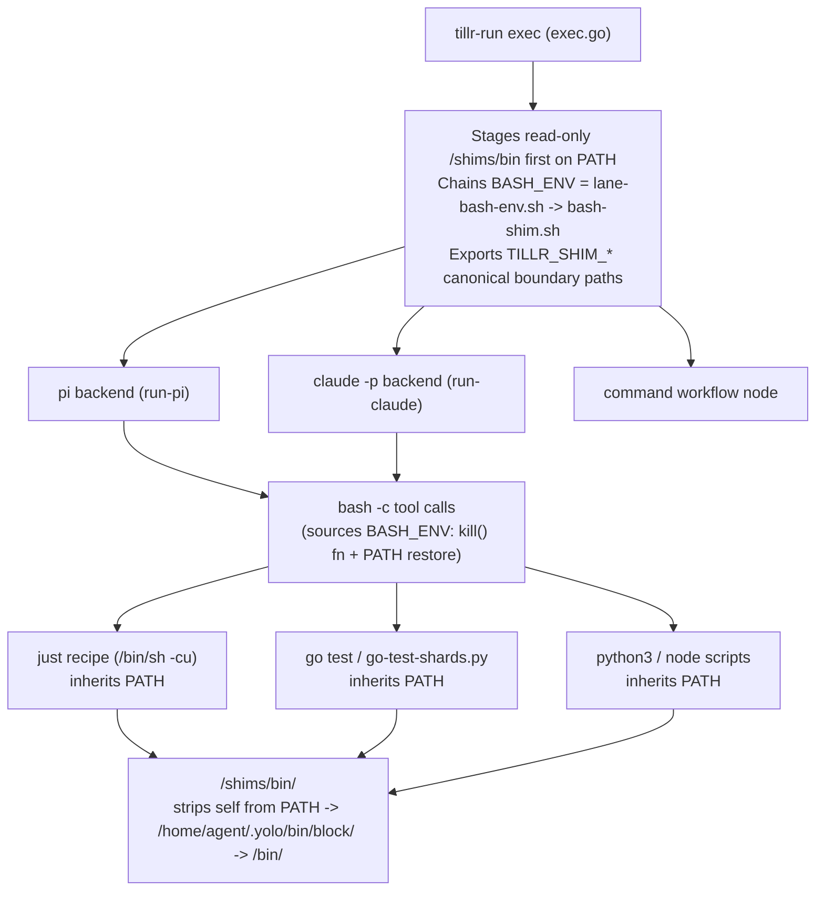

# Preventative shell shims and run boundaries for tillr lane workers

**Status:** 2026-11-20. The owner settled the four lane-shim policies. Nothing here is built; only the effect of a bypass on the landing judgment remains open. Codebase and container measurements taken on 2026-11-20 at `833097ca4`.

> **In short.** Today a tillr lane worker runs as the same user (`uid=0` inside the jail) in the same process and filesystem namespace as the drain loop, the landing gate, the after-merge proof, and every sibling lane, restrained mainly by prose in its brief and a post-hoc snapshot check that stops the loop *after* shared state has already changed. Injecting a per-run shim directory first on `PATH` and a `BASH_ENV` builtin wrapper from [`tools/tillr-run/run/exec.go`](../../tools/tillr-run/run/exec.go) blocks cross-run kills, shared `refs/tillr/` updates, writes to `/workspace/.git/tillr-gate/` and `.tillr/state.db`, cross-lane `rm`/`mv`, and root build recipes *before* they execute — printing the exact remedy and logging each refusal to the run's trace directory — while per-run Linux PID and mount isolation, where supported, stops direct system calls and `/bin/*` bypasses at the kernel boundary.

**Why it matters.** Between 2026-11-14 and 2026-11-20, lane workers killed `go-test-shards` processes outside their run (turning the after-merge proof red with exit `-15` for eight hours), moved `refs/tillr/green` four times and wrote under `/workspace/.git/tillr-gate/` from a mis-rooted test, mutated `refs/tillr/stranded/*` inside the drain's boundary bracket, and saturated shared cores with unsharded `go test ./...` and eight-binary `just tillr-build` runs ([Section 1](#1-three-live-failures-that-words-did-not-stop)).

**The shape.** `tillr-run exec` materializes a read-only shim directory per run ahead of `PATH` (chaining to `yolo-jail`'s `/home/agent/.yolo/bin/block/` rather than replacing it) and prepends a `kill` builtin wrapper to `BASH_ENV` ahead of [`tools/tillr-trace/bash-shim.sh`](../../tools/tillr-trace/bash-shim.sh) ([Section 3](#3-which-commands-get-a-shim-and-what-each-refuses), [Section 4](#4-where-the-shims-live-and-how-every-backend-and-child-process-gets-them)). Where the kernel allows `CLONE_NEWPID | CLONE_NEWNS` (verified working inside the live jail on 2026-11-20), `tillr-run` will also isolate the run's `/proc` view and bind-mount shared refs, `.git/tillr-gate/`, `.tillr/state.db`, and sibling lanes read-only ([Section 5](#5-what-shims-cannot-stop-and-what-backs-them-up)).

**Cost.** Zero model tokens and under 2 ms of startup per run; shell invocations that pass through add one POSIX shell exec (~1–2 ms) only on the nine shimmed command names.

**Start at [Section 3](#3-which-commands-get-a-shim-and-what-each-refuses)** for the command matrix, [Section 4](#4-where-the-shims-live-and-how-every-backend-and-child-process-gets-them) for how `pi`, `claude -p`, `just`, `go test`, and `python3` inherit the boundary, and [Section 5](#5-what-shims-cannot-stop-and-what-backs-them-up) for what bypasses a shell shim and what stops it at the kernel level.

**Needs your ruling:** [OQ-LS5](#OQ-LS5) — how should the landing judge weigh a bypass after reading its reason?

**Reads with:** [the decision provenance review](../tillr/decision-provenance-review.md) ([OQ-PR21](../tillr/decision-provenance-review.md#OQ-PR21) and [OQ-PR22](../tillr/decision-provenance-review.md#OQ-PR22) on owner rulings versus engineering detail), [the vocabulary](./tillr-vocabulary.md) ([OQ-VO5](./tillr-vocabulary.md#OQ-VO5) and [OQ-VO6](./tillr-vocabulary.md#OQ-VO6) on the `git-landing` charter and green proof), [session recording](./session-recording.md) (the `BASH_ENV` trace seam and the no-derived-index ruling), and [the 2026-11-19 unproved-trunk incident](../tillr/unproved-trunk-2026-11-19.md). No implementation plan is seeded yet.

---

## 1. Three live failures that words did not stop

Every worker brief emitted from [`tools/tillr-run/backends/brief-template.md`](../../tools/tillr-run/backends/brief-template.md) tells the worker to edit only inside its target worktree, never to kill processes by pattern, never to run `just done`, and to run full suites on sharded Go modules through [`tools/go-test-shards.py`](../../tools/go-test-shards.py). None of those instructions is enforced before a command executes. Inside a `yolo-jail` container, the drain loop, its gate and after-merge proof, `tillr-roll`, interactive shells, and every lane worker run as the same user (`id` on 2026-11-20 prints `uid=0(root) gid=0(root)`). Four measured incidents show the cost of relying on brief prose and post-hoc checks:

1. **Pattern kills hitting the trunk proof and other lanes (2026-11-20).** A lane worker ran `pkill -f go-test-shards` on the shared container, killing shard runners outside its own run; the after-merge proof read exit `-15` (`SIGTERM`) as a suite failure for eight hours (`OUTSIDE_SIGNAL_RERUNS` comment in [`tools/fork-check.py`](../../tools/fork-check.py), landed in `e8aa442f3` on 2026-11-20; brief warning added in `8b4e89bb8`). Commit `e8aa442f3` retries a gate check killed by an outside signal twice, which absorbs an isolated `SIGTERM` on the gate — yet `pkill -9`, repeated kills, or kills that hit sibling lane workers, `tillr-roll`, or `tillr-drain` itself still succeed immediately.
2. **A worker's test advancing `refs/tillr/green` and writing `.git/tillr-gate/` (2026-11-20).** A Go test running in a lane worktree constructed `HeavyRunner` rooted at `/workspace` instead of an isolated `git init` directory, moving `refs/tillr/green` four times and writing proof state under `/workspace/.git/tillr-gate/`. Reactive patches landed the same day: `a51a15310` required an in-process `LoopLock` and `proofCommonDir` in [`tools/tillr-drain/heavyrun/heavy_authority.go`](../../tools/tillr-drain/heavyrun/heavy_authority.go), `5eb0fea89` added a `TestMain` guard in [`tools/tillr-drain/drain/real_repo_guard_test.go`](../../tools/tillr-drain/drain/real_repo_guard_test.go), and `7c62f0a1c` logged unattributed `refs/tillr/green` moves. Those guards cover only `HeavyRunner` inside Go processes and `go test` inside the single package `tools/tillr-drain/drain`: any shell command, script, or test in another package can still call `git update-ref refs/tillr/*`, write `/workspace/.git/tillr-gate/`, open `.tillr/state.db`, or `rm` another lane's directory.
3. **A lane worker mutating `refs/tillr/stranded/*` and crashing the loop (2026-11-14).** Recorded in [`tools/tillr-run/backends/pi/run-pi`](../../tools/tillr-run/backends/pi/run-pi): when a worker ran an interactive extension against the shared repository and executed `git update-ref refs/tillr/stranded/*` four times, [`tools/tillr-drain/drain/boundary.go`](../../tools/tillr-drain/drain/boundary.go) (`TakeBoundary` / `Compare`) detected the ref change only *after* the run finished and halted the entire drain with `StopHostBoundaryViolation`. Post-hoc boundary comparison turns one worker's mistake into a loop outage after the damage is done.
4. **Whole-module `go test ./...` and `just tillr-build` from lane worktrees (2026-11-17 to 2026-11-20).** Running unsharded `go test ./...` in the seven sharded Go modules bypasses the machine-wide lock pool in [`tools/go-test-shards.py`](../../tools/go-test-shards.py) (measured in `docs/pi/tillr-go-shards-2026-11-17.md`: `tillr-drain` alone runs 1,166 tests in 171s unsharded, and concurrent lanes drove load past 60). Running `just tillr-build` ([`.justfile`](../../.justfile)) clones `--shared`, checks out `refs/tillr/green` — ignoring every uncommitted and committed edit on the lane branch — and compiles all eight Go binaries from scratch.

---

## 2. How `yolo-jail` shims work, and where a lane differs

Inspecting `/home/agent/.yolo/bin/block/` (`ls -la /home/agent/.yolo/bin/block` and reading `find`, `grep`, `rm`, `mv`, and `git` on 2026-11-20) alongside `/home/agent/.bashrc` and `yolo config-ref` shows how the container's own preventative shims work:

- **One directory first on `PATH`.** At container boot, `yolo` writes POSIX `#!/bin/sh` scripts into `/home/agent/.yolo/bin/block/` and places that directory ahead of `/home/agent/.yolo/bin/launch/`, `/bin`, and `/usr/bin` in both the container's boot `PATH` and `/home/agent/.bashrc`. It defines no shell functions (`bash -c 'declare -f'` and `bash -ic 'declare -f'` on 2026-11-20 print nothing).
- **Two preventative shim shapes** (alongside credential-broker forwarders for `aws`, `gh`, and `git-remote-yolo`):
  1. *Wrong-tool / wrong-flag blockers* (`find` and `grep`, configured by `security.blocked_tools` in the `guardrails` pack): `find` exits `127` unconditionally; `grep` scans `"$@"` for `--recursive` or `-r`/`-R`/`-*[rR]*` and exits `127`, forwarding non-recursive pipe and single-file calls via `exec /bin/grep "$@"`. Both print why the form was blocked and a `Suggestion: Try: ...` line on `stderr`.
  2. *Protected-tree guards* (`rm`, `mv`, `git`): `rm` and `mv` resolve each operand's parent directory physically with `cd -P` and `pwd -P` (`_yg_resolve`) and refuse any path inside `/workspace/.yolo` or any ancestor directory that contains `/workspace/.yolo` (`/` or `/workspace`), exempting the durable scratch subtree beneath it (`exit 1`). `git` intercepts `git clean` (handling `-C`, `--git-dir`, and `--work-tree`), normalizes dot segments, and refuses cleaning `/workspace/.yolo` unless `-e .yolo` is present (`exit 1`).
- **Bypass and logging.** Every `yolo` block shim checks `[ "${YOLO_BYPASS_SHIMS:-}" = 1 ]` at line 2 (and mentions that variable in its error footer on `rm`, `mv`, and `git`), hardcodes `/bin/<tool>` for pass-through, and writes no structured log record (`grep -rn receipt /home/agent/.yolo/bin/block/` on 2026-11-20 returns nothing).

Modeled directly on that pattern, a **lane shim** *(coined here: a preventative wrapper executable or `BASH_ENV` builtin function injected by `tillr-run` into one worker execution's environment; not a container-wide `yolo` shim and not a post-hoc `boundary.go` snapshot check)* must handle four differences between a whole container and one worker run inside it:

| Dimension | `yolo-jail` (`/home/agent/.yolo/bin/block/`) | `tillr` lane worker (`tillr-run exec`) |
| :--- | :--- | :--- |
| **Who sees it** | Every process in the container, interactive or unattended | Only child processes of `tillr-run exec` — never `tillr-drain`, `tillr-gate`, the heavy proof, `tillr-roll`, or interactive shells |
| **Pass-through target** | Hardcodes `exec /bin/<tool> "$@"` because nothing sits between `block/` and `/bin` | **Must chain down `PATH`** after removing its own shim directory (`D-LS2`); calling `/bin/rm` directly would bypass `yolo`'s `/home/agent/.yolo/bin/block/rm` guard on `/workspace/.yolo` |
| **Shell builtins & `.bashrc`** | Only external binaries (`find`, `grep`, `rm`, `mv`, `git`) are guarded | `kill` is a shell builtin in both `bash` and `/bin/sh` (`bash -c 'type -a kill'` and `/bin/sh -c 'type kill'` on 2026-11-20 both report `kill is a shell builtin` ahead of `/bin/kill`), and `/home/agent/.bashrc` resets `PATH` unconditionally on `bash -ic`/`-lc` |
| **Self-service bypass** | Prints `(YOLO_BYPASS_SHIMS=1 bypasses this shim.)` for an interactive session | After a denial, the worker may bypass the named shim, not the whole set; each use and its reason are logged ([OQ-LS1](#OQ-LS1)) |

---

## 3. Which commands get a shim and what each refuses

Every lane shim exits `1` on a refusal rather than `127` (`D-LS3`). In POSIX shells — and in `COULD_NOT_ANSWER_CODES = (124, 125, 126, 127, 137)` inside [`tools/fork-check.py`](../../tools/fork-check.py) — exit `127` means "executable not installed," which causes models to try fallback commands (`killall`, `ps | awk | xargs kill`, `python3 -c 'os.remove(...)'`). Exit `1` with a structured refusal and remedy tells scripts and models alike that the tool exists and rejected the specific target by policy.

| Family | Shimmed names | Refused in a lane worker | Passed through to next `PATH` entry |
| :--- | :--- | :--- | :--- |
| **Process signaling** | `pkill`, `killall`, `kill` (`PATH` binary + `BASH_ENV` `kill` function) | Every `pkill` and `killall` call; `kill` targeting `0`, `-1`, any `<pid>` not bearing this execution's `TILLR_RUN_EXEC_ID` in `/proc/<pid>/environ`, any `<pid>` in the runner's ancestor lineage, or any `-<pgid>` with a live member outside this execution (`D-LS4`) | `kill -l` / `-L`; shell `%job` specs (`builtin kill`); `kill` of child PIDs and process groups started inside this `tillr-run exec` |
| **Shared Git refs & common dir** | `git` | When the target repo's `--git-common-dir` (or a local `git push` destination) resolves to `$TILLR_REPO_COMMON_DIR`: `update-ref` on `refs/tillr/*`, `refs/heads/main`, `refs/heads/patch/*`, main-checkout `HEAD`, or another lane's `refs/heads/tillr/*`; any `push`; `fetch --update-head-ok`, `pull`, `receive-pack`; `branch`/`tag`/`checkout -B`/`switch -C`/`reset` mutating `main`, `patch/*`, or another lane's branch; `worktree` (`remove`, `prune`, `move`, `unlock`, `repair`) outside `$TILLR_SCRATCH_DIR`; `gc`, `repack`, `prune`, `pack-refs` (`D-LS5`) | Normal commits, merges, rebases, diffs, status, `log`, `rev-parse`, and `show-ref` on `$TILLR_LANE_BRANCH`; scratch subagent worktrees under `$TILLR_SCRATCH_DIR`; **all** `git` commands inside isolated fixture repos (`git init` in `$TMPDIR` or scratch) |
| **Protected paths & live store** | `rm`, `mv`, `cp`, `ln`, `install`, `truncate`, `sqlite3`, `tillr`, `tillr-*` | Physical paths (or ancestor dirs holding them) resolving to `/workspace/.git/tillr-gate`, `/workspace/.git/refs/tillr`, `/workspace/.git/land.lock*`, `/workspace/.git/tillr-loop.lock`, `/workspace/.git/hooks`, `/workspace/.git/worktrees` (outside scratch), `/workspace/.tillr/` (except `$TILLR_SCRATCH_DIR` and `$TILLR_OUTPUT_DIR`), any sibling lane `$TILLR_LANE_ROOT/<other>`, or `/workspace` outside `$TILLR_TARGET_DIR` (`D-LS6`); `sqlite3` opening files under `/workspace/.tillr/` or `.git/tillr-gate/`; `tillr` / `tillr-*` targeting `$TILLR_LOOP_STORE` or `--root /workspace` (`D-LS7`) | Edits, moves, and removals inside `$TILLR_TARGET_DIR` (`<lane>/worktree` or staged target), `$TILLR_SCRATCH_DIR`, `$TILLR_OUTPUT_DIR`, and `$TMPDIR`; `sqlite3` and `tillr* --store <tmp> --root <tmp>` against test fixtures |
| **Root recipes & Go suites** | `just`, `go` | `just` against the repo/worktree `.justfile` for `done`, `tillr-build`, `tillr-roll`, `tillr-keep`, `tillr-restart`, and `pack-docs`; unsharded whole-module `go test` on the seven sharded Go modules per [OQ-LS2](#OQ-LS2) | `just pack-sync`, `just pack-sync-test`, `just go-test-shards`; `go build`, `go vet`, `go list`, `go tool`, `go test -c`, `go test ... -run <pattern>`, non-sharded modules, and all `go test` runs inside temp fixture modules |

### Key scoping details that keep tests and extensions working

1. **Identifying processes this run started (`D-LS4`).** [`tools/tillr-run/run/exec.go`](../../tools/tillr-run/run/exec.go) already mints a fresh 128-bit random `TILLR_RUN_EXEC_ID` per `Exec` call (`newExecID()`) and places it *only* in `cmd.Env` of the adapter child — never in `tillr-drain`, `tillr-gate`, the after-merge proof, `tillr-roll`, or sibling lanes (`tools/tillr-run/run/children.go` uses the same marker for post-run orphan cleanup). Checking `/proc/<pid>/environ` for `TILLR_RUN_EXEC_ID=$TILLR_RUN_EXEC_ID` (while excluding the adapter wrapper's own PID in `TILLR_RUNNER_LINEAGE`) requires no daemon and never matches another lane or the proof. For a negative target `-<pgid>`, the `kill` shim scans `/proc/[0-9]*/stat` for processes whose `pgrp == <pgid>` and refuses unless at least one exists and every member carries `TILLR_RUN_EXEC_ID`.
2. **Distinguishing the live repository from test fixture repositories (`D-LS5`).** Unit suites in `tools/tillr-drain`, `tools/tillr-land`, and `tools/tillr-gate` run `git update-ref refs/tillr/green`, `git push`, and `git worktree` hundreds of times against temporary `git init` repositories. The `git` shim resolves the target repository with `git <global-flags> rev-parse --path-format=absolute --git-common-dir`: if that path does not equal `$TILLR_REPO_COMMON_DIR` (and no local `git push` destination resolves to `$TILLR_REPO_COMMON_DIR`), the shim immediately execs the next `git` on `PATH`. That passes every isolated fixture test while catching the exact 2026-11-20 bug where a test forgot `git init` and walked up to `/workspace/.git`.
3. **Keeping subagent scratch worktrees and `land`/`obstacle` tools intact.** Inside a `pi` worker, [`tools/tillr-run/backends/pi/land.ts`](../../tools/tillr-run/backends/pi/land.ts) runs only read-only `git rev-parse`, `git diff`, and `git ls-files` plus writes in `$TILLR_SCRATCH_DIR`, and `pi-subagents` with `worktree: true` creates and removes worktrees under `$TILLR_SCRATCH_DIR/worktrees`. Allowing `git worktree` when the worktree path resolves inside `$TILLR_SCRATCH_DIR` preserves `pi-subagents` isolation while blocking `git worktree remove` or `prune` against `/workspace` and `$TILLR_LANE_ROOT/*`.
4. **Preventing write-redirection and copy overwrites (`D-LS6`).** Guarding only `rm` and `mv` would still let `cp bad.db /workspace/.tillr/state.db` or `truncate -s 0 /workspace/.git/tillr-gate/green.json` clobber shared files; `cp`, `ln`, `install`, and `truncate` check destination operands against the same physical-path resolver (`cd -P` + `pwd -P` on the destination's existing parent directory, matching `yolo`'s `_yg_resolve`).

---

## 4. Where the shims live and how every backend and child process gets them

Today [`tools/tillr-run/run/exec.go`](../../tools/tillr-run/run/exec.go) inherits `os.Environ()` without touching `PATH`, while `BASH_ENV` (`tools/tillr-trace/bash-shim.sh`) is wired separately inside [`tools/tillr-run/backends/pi/run-pi`](../../tools/tillr-run/backends/pi/run-pi) and [`tools/tillr-run/backends/claude/run-claude`](../../tools/tillr-run/backends/claude/run-claude) — leaving `command` workflow nodes and any future adapter unshimmed. Moving environment setup into `tillr-run/run/exec.go` (`D-LS1`) puts one boundary in front of every backend and child process:



How each execution path inside a lane interacts with the two mechanisms (`PATH` + `BASH_ENV`):

- **`pi` (`run-pi`) and `claude -p` (`run-claude`) shell tool calls:** Both harnesses execute tool commands via non-interactive `bash -c`. `bash` reads `BASH_ENV` before running `-c`, which loads `lane-bash-env.sh`: it re-prepends `$TILLR_SHIM_BIN` to `PATH` if missing, defines a `kill()` shell function (forwarding `-l`/`-L` and `%job` specs to `builtin kill` and delegating PID/PGID signals to `$TILLR_SHIM_BIN/kill`), and then sources the existing [`tools/tillr-trace/bash-shim.sh`](../../tools/tillr-trace/bash-shim.sh) so `proc.exec` tracing keeps working unchanged. Note from `yolo config-ref` (verified 2026-11-20): Claude Code defines shell functions for `grep` and `find` inside its Bash tool, which do not shadow any of the tillr shim names (`pkill`, `killall`, `git`, `rm`, `mv`, `cp`, `ln`, `install`, `truncate`, `sqlite3`, `tillr*`, `just`, `go`).
- **`just` recipes:** `just` runs recipe lines under `/bin/sh -cu` by default (`dash` on Debian). `/bin/sh` does not read `BASH_ENV`, so `PATH` is what intercepts `pkill`, `git`, `rm`, `mv`, `go`, `just`, and `sqlite3` inside recipes.
- **`go test`, [`tools/go-test-shards.py`](../../tools/go-test-shards.py), `python3`, and Node subprocesses:** Compiled Go tests calling `exec.Command("git", ...)` and Python scripts calling `subprocess.run(["rm", ...])` resolve executables via `PATH` (`private_environment()` in [`tools/go-test-shards.py`](../../tools/go-test-shards.py) copies `os.environ`, preserving `PATH`, verified 2026-11-20).
- **Where the shim files live on disk (`D-LS1`, `D-LS2`).** The canonical scripts live in versioned source under `tools/tillr-run/shims/` (mirrored by `just pack-sync` into `yolo-packs/tillr/files/local/share/tillr/tillr-run/shims/` so external workspaces receive them automatically). At `tillr-run exec` start, `exec.go` copies or links the active shim set into `<run-scratch>/shims/bin` (`0555`) alongside a read-only `config.env` pinning the canonical physical paths (`TILLR_REPO_COMMON_DIR`, `TILLR_LANE_ROOT`, `TILLR_TARGET_DIR`, `TILLR_SCRATCH_DIR`, `TILLR_OUTPUT_DIR`, `TILLR_TRACE_DIR`, `TILLR_LANE_BRANCH`, `TILLR_LOOP_STORE`). Reading paths from that per-run `config.env` rather than mutable shell variables means `TILLR_TARGET_DIR=/workspace rm ...` in a worker shell cannot widen its own boundary!

---

## 5. What shims cannot stop, and what backs them up

A shell and `PATH` shim stops accidental commands and teaches the remedy, yet four execution paths bypass user-space shims entirely:

1. **Direct system calls from compiled tests or interpreters:** Go's `os.WriteFile("/workspace/.git/tillr-gate/...")` (how `HeavyRunner` wrote proof files before `a51a15310`), `os.RemoveAll`, `syscall.Kill`, Python's `os.kill` / `sqlite3.connect`, or Node's `fs.rmSync`.
2. **Explicit absolute binary paths:** `/bin/pkill`, `/bin/kill`, `/bin/rm`, `/bin/git`.
3. **POSIX `/bin/sh` builtin `kill`:** `/bin/sh -c 'kill -15 <pid>'` uses `dash`'s builtin `kill` (`sh -c 'type kill'` on 2026-11-20 prints `kill is a shell builtin`) without reading `BASH_ENV`.
4. **Deliberate `PATH` replacement:** `env PATH=/usr/bin:/bin pkill ...` or an interactive `bash -ic` subshell whose `/home/agent/.bashrc` overwrites `PATH`.

### Measured kernel namespace support inside the live jail (2026-11-20)

Probing `/proc/self/status` and Linux `unshare(2)` / `mount(2)` via Python `ctypes` inside this container on 2026-11-20 at `833097ca4` (`python3 -c` reading `/proc/self/status` and testing `CLONE_NEWPID | CLONE_NEWNS`) established four facts:

1. **Capabilities are already present.** Every jail session runs with `Uid: 0`, `CapEff: 00000000882c35fb` (including `CAP_SYS_ADMIN` and `CAP_KILL`), `NoNewPrivs: 0`, and `Seccomp: 2`, and `unshare(CLONE_NEWPID | CLONE_NEWNS)` succeeds (`rc=0`) with no `yolo-jail` container changes.
2. **Per-run PID namespace + private `/proc` completely isolates signals.** After `unshare(CLONE_NEWPID | CLONE_NEWNS)`, `mount("none", "/", NULL, MS_REC | MS_PRIVATE, NULL)`, fork, and `mount("proc", "/proc", "proc", MS_NOSUID | MS_NODEV | MS_NOEXEC, NULL)` (`rc=0`), `os.listdir("/proc")` sees **only** PIDs inside that child namespace (`['1']`). Inside that namespace, `/bin/pkill`, `/bin/sh -c 'kill -9 -1'`, and Go's `syscall.Kill` cannot see or signal `tillr-drain`, the after-merge proof, `tillr-gate`, or any sibling lane (`ESRCH`). *(Measured pitfall: adding `CLONE_NEWUSER` causes `mount("proc", "/proc", ...)` to fail with `EPERM`; when `euid == 0`, `CLONE_NEWPID | CLONE_NEWNS` must be called without `CLONE_NEWUSER`.)*
3. **Read-only bind-remounts inside `CLONE_NEWNS` block direct file and ref writes with `EROFS`.** Bind-mounting a path onto itself (`MS_BIND | MS_REC`) and remounting read-only while preserving filesystem flags (`MS_BIND | MS_REMOUNT | MS_RDONLY | statvfs.f_flag`) returned `errno=30 (Read-only file system)` on direct Python/Go file opens against protected files while leaving sibling directories writable. Tested on a linked git worktree on 2026-11-20: mounting `.git/refs/tillr` and `.git/tillr-gate` read-only allowed `git commit` on the worktree branch (`rc=0`) while blocking both `git update-ref refs/tillr/green HEAD` (`rc=128`, `Unable to create '.../green.lock': Read-only file system`) and `git update-ref -d refs/tillr/green` against packed refs (`rc=1`). Mounting `.tillr/state.db` (and `-wal`/`-shm`, or masking `.tillr/` while re-binding `$TILLR_TARGET_DIR`, `$TILLR_SCRATCH_DIR`, and `$TILLR_TRACE_DIR` read-write) likewise blocks direct SQLite opens and sibling-lane `os.RemoveAll` calls at the kernel level.
4. **What a mount guard still leaves to the `git` shim.** Normal `git commit` in a linked worktree needs `.git/objects` and `.git/packed-refs` writable, and loose branches under `.git/refs/heads/` share a parent directory (though `.git/refs/heads/main` and `.git/refs/heads/patch` can be mounted read-only when `TARGET_KIND` is a lane worktree). On macOS or unprivileged Linux hosts without `CAP_SYS_ADMIN`, `unshare` returns `EPERM`. The two layers therefore complement each other: shims give clear remedies everywhere and guard loose refs, `go test`, and `just`, while namespaces stop syscalls and `/bin/*` inside Linux jails. Ship both layers together wherever the kernel permits per-run PID and mount isolation. Elsewhere, keep the shims without requiring namespace support ([OQ-LS3](#OQ-LS3)).

### Authority-side protection for the proof and shared refs (`D-LS8`)

Independently of [OQ-LS3](#OQ-LS3), two small authority-side hardening steps back up the shared state from the loop's side:

- **Pre-create `.git/refs/tillr`, `.git/refs/heads/patch`, and `.git/tillr-gate` at drain startup** so those directories always exist before any worker starts (required if `CLONE_NEWNS` bind-mounts them read-only, and harmless otherwise), and extend `LoopLock` / `land.lock` precondition checks (`a51a15310`) to every internal helper that updates `refs/tillr/*`.
- **Keep `OUTSIDE_SIGNAL_RERUNS = 2` (`e8aa442f3`) in [`tools/fork-check.py`](../../tools/fork-check.py)** so gate and proof runs on non-namespace hosts still recover from an external signal.

---

## 6. Refusal messages that name the next step

For unsharded whole-module `go test`, refuse rather than rewriting the command. Print the exact targeted `-run` and `go-test-shards.py` commands ([OQ-LS2](#OQ-LS2)). Printing the sharded command does not grant permission to run the suite; [the whole-suite grant ruling](./tillr-evidence-registry-and-suite-guardrail.md#OQ-ER2) still applies.

Modeled on `/home/agent/.yolo/bin/block/rm` and `/home/agent/.yolo/bin/block/grep`, every refusal writes two lines to `stderr` (`D-LS9`): **what was refused and why**, followed by **`Remedy:` naming the exact command or action to take instead** — with no bypass variable advertised:

```text
tillr-shim (pkill): refused in lane worker (lane-13, run-item-example-a1-n2): pattern kills hit test shards, sibling lanes, and the trunk proof sharing this container.
  Remedy: capture your child's PID when starting it (pid=$!) and run `kill "$pid"`, or stop a harness task with `background_task` (`action: "stop"`). If waiting on `go-test-shards.py`, wait for the lock slot rather than killing test runners.

tillr-shim (kill): refused in lane worker (lane-13, run-item-example-a1-n2): PID 41820 belongs to another process tree, not to this run execution.
  Remedy: pass only a PID or `%job` started by this run, or `kill -l` to list signal names.

tillr-shim (git): refused in lane worker (lane-13, run-item-example-a1-n2): `git update-ref refs/tillr/green` targets the live repository's shared refs (/workspace/.git).
  Remedy: commit your change on this lane's branch (`git commit`); `tillr-land` and the after-merge proof own `refs/tillr/*` and `main`. In a test, run `git init` in `t.TempDir()` so commands target an isolated fixture repo.

tillr-shim (rm): refused in lane worker (lane-13, run-item-example-a1-n2): `/workspace/.tillr/lanes/lane-04/worktree` is outside this run's writable paths.
  Remedy: modify or remove files only inside your target (`/workspace/.tillr/lanes/lane-13/worktree`), your run scratch directory, or `$TMPDIR`.

tillr-shim (just): refused in lane worker (lane-13, run-item-example-a1-n2): `just tillr-build` checks out `refs/tillr/green` (ignoring lane edits) and rebuilds all eight Go binaries.
  Remedy: compile or test only the module you changed (`cd tools/<module> && go build ./...` or `go test ./<pkg> -run '^TestName$'`).

tillr-shim (go): refused in lane worker (lane-13, run-item-example-a1-n2): unsharded `go test ./...` in `tools/tillr-drain` bypasses the machine-wide test slot pool.
  Remedy: run `cd tools/tillr-drain && go test ./drain -run '^TestName$'`. For an explicitly granted whole-suite run, use `python3 tools/go-test-shards.py tools/tillr-drain -k 6` from the worktree root.
```

---

## 7. Recording refusals without touching the live store

Under the owner's 2026-11-18 ruling in [`docs/design/session-recording.md`](./session-recording.md) (no derived SQLite index and zero extra lock contention on `.tillr/state.db`), every refusal appends one newline-terminated JSON record (`O_WRONLY | O_CREAT | O_APPEND`) to `$TILLR_TRACE_DIR/shim-refusals.jsonl` beside `proc-exec.jsonl` in `.tillr/loop/<run-id>/` (`D-LS10`):

```json
{"v":1,"kind":"shim.refusal","ts":1795184210.412,"run_id":"run-item-example-a1-n2","lane_id":"lane-13","item_id":"item-example","tool":"git","rule":"shared-ref-write","cwd":"/workspace/.tillr/lanes/lane-13/worktree","argv":["git","update-ref","refs/tillr/green","HEAD"],"target":"/workspace/.git"}
```

- **Fail-closed on the guard, fail-open on the log write.** Unlike [`tools/tillr-trace/bash-shim.sh`](../../tools/tillr-trace/bash-shim.sh) (which lets the traced command run if trace writing fails), a shim refusal **always exits `1`** even if `$TILLR_TRACE_DIR` is missing or unwritable.
- **How the operator reads it.** [`tools/tillr-trace/tillr_trace.py`](../../tools/tillr-trace/tillr_trace.py) gains a `refusals` subcommand (`tillr-trace refusals [--runs 100] [--json]`) that scans `.tillr/loop/run-*/shim-refusals.jsonl` on demand — matching `audit` and `summary`, which scan 100 runs in milliseconds — and prints which lanes and items hit which `(tool, rule)` and how many times, plus a `Shim refusals` block in `tillr-trace run <run-id>` and on that run's Observatory detail page. Keep refusals on these trace and per-run surfaces; do not add a counter to `tillr view status` or Observatory Home ([OQ-LS4](#OQ-LS4)).

---

## 8. Testing the shims and granting legitimate needs

### Automated test suite (`D-LS11`)

A dedicated Go + shell test suite in `tools/tillr-run` tests the real staged shim directory and `lane-bash-env.sh` across every invocation path:

1. **Per-shim allow/refuse table:** Executes each shim via `bash -c`, `/bin/sh -c`, `just`, `go test`, and `python3` against a temp layout mirroring `/workspace`, `.git`, `.tillr/state.db`, two lanes (`lane-01`, `lane-02`), and a fixture `git init` repo in `$TMPDIR`. Asserts exit `0` on allowed calls and exit `1` + `Remedy:` on `stderr` + untouched target state + one `shim.refusal` JSONL line on refused calls.
2. **Process-tree signal test:** Spawns one child bearing the run's `TILLR_RUN_EXEC_ID` and one sibling process outside the run; verifies `kill <child>` succeeds (`0`), while `kill <outsider>`, `kill -1`, `bash -c 'kill <outsider>'` (testing the `bash` builtin hook!), `pkill`, and `killall` all exit `1` and leave the outsider alive.
3. **`yolo-jail` chaining test:** Places `<run-shims>/bin` ahead of a mock `/home/agent/.yolo/bin/block` on `PATH` and verifies that `rm /workspace/.yolo/state` passes the lane shim (if staged on `main checkout`) and is **still refused** by the chained `yolo` `rm` shim, proving lane shims never short-circuit `yolo`'s own guards.
4. **Immutable `config.env` test:** Verifies `TILLR_TARGET_DIR=/workspace TILLR_RUN_EXEC_ID=other rm /workspace/.tillr/state.db` in the worker shell still reads the runner-written read-only `config.env` and refuses.
5. **`pack-sync` parity:** [`tests/pack-sync.test.py`](../../tests/pack-sync.test.py) already verifies that every committable file under `tools/tillr-run` and `tools/tillr-trace` is byte-identical in `yolo-packs/tillr/`.

### Granting a legitimate need rather than working around it

Most legitimate needs require **no special override** because `tillr-run exec` derives the run's scope from the staged run request into the read-only `config.env`:

- **Main-checkout runs (`TARGET_KIND = main checkout`):** `TILLR_TARGET_DIR` is `/workspace`, so edits and `rm`/`mv` on ordinary repo files in `/workspace` pass while `.tillr/`, `.git/tillr-gate/`, `refs/tillr/*`, and cross-run kills remain blocked.
- **Fork checkout runs (`.forks/lanes/<lane>/<fork>`):** `TILLR_TARGET_DIR` includes the lane's fork checkout while `$TILLR_REPO_COMMON_DIR` still protects `/workspace/.git` (`patch/<fork>` in `/workspace/.git` is moved by `tillr-land` after `fork-build`, never by the worker).
- **Non-`git-landing` charters:** When `tillr-run` executes a workflow for an external charter that sets no `git-landing` repository boundary ([`tillr-separable-parts.md`](./tillr-separable-parts.md)), repo-specific `git`/`just`/`go` rules stay off while `pkill`/`killall`/`kill` process-tree scoping remains active.

After seeing a denial, the worker may use one setting to bypass one named shim for the issue it encountered. There is no setting to disable all lane shims. Log every use with its reason. At landing the judge reads which bypasses the worker used and why ([OQ-LS1](#OQ-LS1)); how that evidence affects the judgment is [OQ-LS5](#OQ-LS5).

The owner's words in Vantage comment `79552d49` (2026-11-20):

> I think we should still let agents bypass things. But having them having seen the denial... I think is good. We don't want them to then apply a setting that disables all things like bypass shims. We want them to have to pick and choose a single setting that bypasses a single issue they're having so that they can't just willy nilly reuse them. And then we should, but we should also be logging in a clear way every time this is used so we can go back and look at why it was used. And I suppose the judge at the end of landing this thing should also probably be looking at this in some way. Okay.

---

## 9. Scope and risks

- **In scope:** Worker executions started through [`tools/tillr-run/run/exec.go`](../../tools/tillr-run/run/exec.go) (`pi`, `claude`, future agent adapters, and `command` workflow nodes) and trace reporting in [`tools/tillr-trace/tillr_trace.py`](../../tools/tillr-trace/tillr_trace.py) / [`tools/tillr-view`](../../tools/tillr-view/).
- **Out of scope:** Changing `yolo-jail`'s own `/home/agent/.yolo/bin/block/` container shims for interactive human sessions; replacing `boundary.go` (which remains in `tillr-drain` as a post-run assertion that catches anything both layers missed).

| Risk | Mitigation |
| :--- | :--- |
| A lane shim calls `/bin/rm` or `/bin/git` directly and bypasses `yolo-jail`'s `/workspace/.yolo` protection | `D-LS2` strips only `$TILLR_SHIM_BIN` from `PATH` and resolves the next executable down `PATH`, pinned by a dedicated chaining test (`D-LS11`) |
| `git` or `sqlite3` shims break unit tests that run `git update-ref refs/tillr/green` or open SQLite stores in `t.TempDir()` | `D-LS5` and `D-LS7` compare resolved physical paths against `$TILLR_REPO_COMMON_DIR` and `$TILLR_LOOP_STORE`; isolated temp repos and temp DBs pass straight through |
| A worker mutates `TILLR_TARGET_DIR` or `TILLR_RUN_EXEC_ID` in its shell to widen shim permissions | `D-LS1` writes boundary paths and `EXEC_ID` into a read-only `config.env` (`0444`, owned by the runner outside writable mount targets under [OQ-LS3](#OQ-LS3)) beside the shim scripts |
| In `CLONE_NEWNS` ([OQ-LS3](#OQ-LS3)), `.git/refs/tillr` does not exist yet on a fresh clone so `mount(MS_BIND)` fails | `D-LS8` pre-creates `.git/refs/tillr`, `.git/refs/heads/patch`, and `.git/tillr-gate` when `tillr-drain` starts, and degrades cleanly with a logged warning when namespaces are unsupported |

---

## Decision Ledger

This design inherits the owner's settled rulings in [the decision provenance review](../tillr/decision-provenance-review.md) ([OQ-PR21](../tillr/decision-provenance-review.md#OQ-PR21) and [OQ-PR22](../tillr/decision-provenance-review.md#OQ-PR22)), [the vocabulary](./tillr-vocabulary.md) ([OQ-VO5](./tillr-vocabulary.md#OQ-VO5) and [OQ-VO6](./tillr-vocabulary.md#OQ-VO6)), and [session recording](./session-recording.md) (the 2026-11-18 ruling against persistent derived SQLite trace indexes). Rows `D-LS1` through `D-LS11` below are a designer's engineering decisions of 2026-11-20; none is the owner's ruling, and the owner may overturn any of them. None is built.

| ID | Decision | Date | Settled in | Built |
| :--- | :--- | :--- | :--- | :--- |
| <a id="OQ-LS1"></a>[`OQ-LS1`](#OQ-LS1) | After denial the worker may bypass one named shim per setting, never all shims. Log every use and reason for the landing judge to read. | 2026-11-20 | Owner, Vantage `79552d49` (quoted [above](#granting-a-legitimate-need-rather-than-working-around-it)) | — |
| <a id="OQ-LS2"></a>[`OQ-LS2`](#OQ-LS2) | A: Refuse unsharded whole-module `go test` and print the exact `-run` and `go-test-shards.py` remedies. | 2026-11-20 | Owner selection, Vantage `ea0c2c04` | — |
| <a id="OQ-LS3"></a>[`OQ-LS3`](#OQ-LS3) | A: Ship shims with per-run PID and mount isolation where supported; fall back to shims elsewhere. | 2026-11-20 | Owner selection, Vantage `afcafe72` | — |
| <a id="OQ-LS4"></a>[`OQ-LS4`](#OQ-LS4) | A: Report refusals through `tillr-trace refusals` and each run’s Observatory detail page, not status or Home counters. | 2026-11-20 | Owner selection, Vantage `7e917941` | — |
| `D-LS1` | **Designer's decision; the owner may overturn this.** Inject both `<run-scratch>/shims/bin` (first on `PATH`, mode `0555`, reading a runner-written read-only `config.env`) and `lane-bash-env.sh` (`BASH_ENV` chaining to `tools/tillr-trace/bash-shim.sh`) centrally in `tools/tillr-run/run/exec.go`. **Evidence:** `kill` is a builtin in `bash` (`type -a kill`), `.bashrc` resets `PATH` on interactive subshells, `just`/`go test`/`python3` read `PATH` without `BASH_ENV`, and per-backend setup in `run-pi`/`run-claude` misses `command` nodes. **Rejected:** `PATH`-only shims (miss `bash` builtin `kill`); `BASH_ENV`-only functions (miss `just`, `go test`, and `python3`); duplicating setup per backend script; reading boundary paths from worker-mutable env vars. | 2026-11-20, designer | [Section 4](#4-where-the-shims-live-and-how-every-backend-and-child-process-gets-them) | — |
| `D-LS2` | **Designer's decision; the owner may overturn this.** Every lane shim forwards allowed calls by stripping only `$TILLR_SHIM_BIN` from `PATH` and resolving the next executable, never hardcoding `/bin/<tool>`. **Evidence:** `/home/agent/.yolo/bin/block/{rm,mv,git}` sits on `PATH` ahead of `/bin` and protects `/workspace/.yolo`; `exec /bin/rm` would bypass `yolo`'s guard. **Rejected:** hardcoding `/bin/<tool>`. | 2026-11-20, designer | [Section 2](#2-how-yolo-jail-shims-work-and-where-a-lane-differs) | — |
| `D-LS3` | **Designer's decision; the owner may overturn this.** Return exit code `1` (not `127`) on every lane shim refusal. **Evidence:** POSIX shells and `COULD_NOT_ANSWER_CODES` in `tools/fork-check.py` treat `127` as "command not installed," nudging agents toward alternative binaries; `yolo`'s `rm`/`mv`/`git` guards use `1`. **Rejected:** exit `127` or `126`. | 2026-11-20, designer | [Section 3](#3-which-commands-get-a-shim-and-what-each-refuses) | — |
| `D-LS4` | **Designer's decision; the owner may overturn this.** Refuse `pkill` and `killall` unconditionally, and allow `kill` (both `PATH` binary and `BASH_ENV` `kill` function) only for `-l`/`-L`, `%job` specs, and PIDs/PGIDs whose live `/proc/<pid>/environ` carries this execution's `TILLR_RUN_EXEC_ID` outside `TILLR_RUNNER_LINEAGE` (refusing `0` and `-1`). **Evidence:** `exec.go` already mints a unique 128-bit `TILLR_RUN_EXEC_ID` per `Exec` call that no other lane, gate, or proof process carries. **Rejected:** matching by UID (all processes in-jail are `uid=0`); matching only process group `pgid` (`go-test-shards.py` and `pi` subagents call `setsid`/`Setpgid`, creating new child PGIDs that still inherit `TILLR_RUN_EXEC_ID`). | 2026-11-20, designer | [Section 3](#3-which-commands-get-a-shim-and-what-each-refuses) | — |
| `D-LS5` | **Designer's decision; the owner may overturn this.** Scope `git` ref, push, branch, worktree, and maintenance refusals to invocations whose resolved `--git-common-dir` (or local `push` destination) equals `$TILLR_REPO_COMMON_DIR`, while allowing commits on `$TILLR_LANE_BRANCH` and worktrees under `$TILLR_SCRATCH_DIR`. **Evidence:** `tillr-*` unit suites run `git update-ref refs/tillr/green` and `git push` against temp `git init` repos, and `pi-subagents` creates worktrees under scratch. **Rejected:** blocking `refs/tillr/*` regardless of repository (breaks `tillr-drain` and `tillr-land` tests); blocking all `git worktree` calls (breaks `pi-subagents` `worktree: true`). | 2026-11-20, designer | [Section 3](#3-which-commands-get-a-shim-and-what-each-refuses) | — |
| `D-LS6` | **Designer's decision; the owner may overturn this.** Guard `rm`, `mv`, and destination operands of `cp`, `ln`, `install`, and `truncate` using physical parent-directory resolution (`cd -P` + `pwd -P`) and ancestor-containment checks against `/workspace/.git/tillr-gate`, `/workspace/.git/refs/tillr`, repo lock files, `/workspace/.tillr/` (outside `$TILLR_SCRATCH_DIR` and `$TILLR_OUTPUT_DIR`), sibling lanes, and `/workspace` outside `$TILLR_TARGET_DIR`. **Evidence:** matches `yolo`'s `_yg_resolve` + `_yg_hit` so symlinks, relative `..`, and `rm -rf /workspace/.tillr` ancestor deletes are all caught. **Rejected:** lexical prefix matching; guarding `rm`/`mv` without destination checks on `cp`/`ln`/`truncate`. | 2026-11-20, designer | [Section 3](#3-which-commands-get-a-shim-and-what-each-refuses) | — |
| `D-LS7` | **Designer's decision; the owner may overturn this.** Shim `sqlite3`, `tillr`, and `tillr-*` to refuse opening or targeting `$TILLR_LOOP_STORE` or `--root /workspace` while passing temp-path invocations through. **Evidence:** `TILLR_LOOP_STORE` must stay in the worker environment for `presence.go` and `children.go`, and worker CLI calls without `--store` default to `<root>/.tillr/state.db`. **Rejected:** unsetting `TILLR_LOOP_STORE` (breaks `presence.go` and `children.go` `/proc` scans); blocking `sqlite3` and `tillr*` unconditionally (breaks CLI integration tests). | 2026-11-20, designer | [Section 3](#3-which-commands-get-a-shim-and-what-each-refuses) | — |
| `D-LS8` | **Designer's decision; the owner may overturn this.** Pre-create `.git/refs/tillr`, `.git/refs/heads/patch`, and `.git/tillr-gate` at drain startup, require `LoopLock` or `land.lock` on internal `refs/tillr/*` writers, and keep `OUTSIDE_SIGNAL_RERUNS = 2` in `tools/fork-check.py`. **Evidence:** mount guards need concrete target directories before bind-mounting, and non-namespace hosts still benefit from authority checks and signal retry. **Rejected:** relying on worker shims alone with no authority-side invariant. | 2026-11-20, designer | [Section 5](#5-what-shims-cannot-stop-and-what-backs-them-up) | — |
| `D-LS9` | **Designer's decision; the owner may overturn this.** Standardize refusal `stderr` to two parts — `tillr-shim (<tool>): refused in lane worker (<lane>, <run>): <why>` plus `Remedy: <exact next step>` — with no bypass env var printed. **Evidence:** matches `yolo`'s actionable `Suggestion:` pattern while avoiding advertising a workaround to an unattended model. **Rejected:** bare "permission denied" errors; printing a bypass variable in `stderr`. | 2026-11-20, designer | [Section 6](#6-refusal-messages-that-name-the-next-step) | — |
| `D-LS10` | **Designer's decision; the owner may overturn this.** Append one JSONL record (`kind: "shim.refusal"`) per refusal to `$TILLR_TRACE_DIR/shim-refusals.jsonl` (fail-open on log I/O, fail-closed on the exit `1` refusal) and read on demand via `tillr-trace refusals` and `tillr-trace run <id>`. **Evidence:** honors the 2026-11-18 [`session-recording.md`](./session-recording.md) ruling (zero `.tillr/state.db` writes or derived cache) and works from POSIX `sh` without SQLite locking. **Rejected:** writing refusals into `.tillr/state.db` during worker shell execution; letting a trace-write error allow the blocked command. | 2026-11-20, designer | [Section 7](#7-recording-refusals-without-touching-the-live-store) | — |
| `D-LS11` | **Designer's decision; the owner may overturn this.** Verify every shim, `BASH_ENV` `kill` hook, `yolo` `PATH` chaining, and `config.env` immutability in `tools/tillr-run` automated tests, mirrored by `just pack-sync`. **Evidence:** catches regressions in shell quoting, `dash` vs `bash` builtins, and `yolo` guard composition before roll. **Rejected:** testing only mock scripts in isolation without `bash`, `/bin/sh`, and chained `block/` stubs. | 2026-11-20, designer | [Section 8](#8-testing-the-shims-and-granting-legitimate-needs) | — |

---

## Open Questions

1. 💬 **OQ-LS5: How should the landing judge weigh a recorded bypass?**

   <!-- vantage: question id=OQ-LS5 -->

   Reading each use and its reason is settled. Should the judge weigh that evidence case by case, or should a bypass require a specific finding before the change can land?
