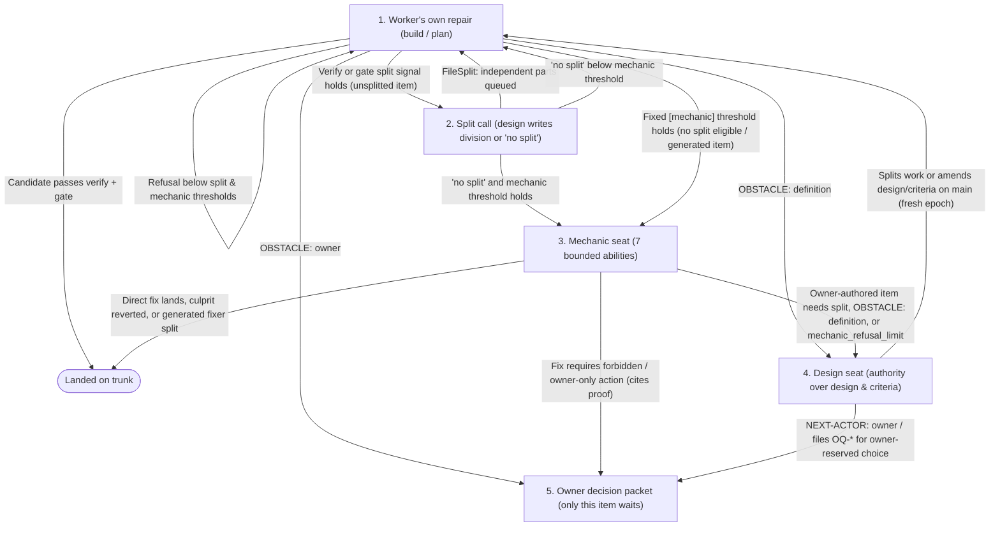

# The Mechanic Agent and Automatic Threshold Escalation Chain

**Status:** 2026-11-27. Proposed; not built at `4e273e02511e` (`rg -n 'SeatMechanic|mechanic_readings|drain\.escalated|drain\.mechanic-action' tools` returns nothing). Today `fixer-main-<sha>` runs as an ordinary `build` worker with no special seat, log reach, revert command, split authority, or dependency pause, and non-identical refusals never escalate. [`R-MC1`](#R-MC1) quotes the owner's 2026-11-27 words verbatim; [`D-MC1`](#D-MC1) through [`D-MC10`](#D-MC10) in the [Decision Ledger](#decision-ledger) are the designer's decisions (from an operator request) that the owner may overturn; [`OQ-MC1`](#OQ-MC1), [`OQ-MC2`](#OQ-MC2), and [`OQ-MC3`](#OQ-MC3) await the owner's ruling.

> **In short.** Fit non-converging repair into the [escalation ladder](./escalation-ladder.md) so there is **one chain and not two**: a worker's own repair comes first, then the **split call** (`design` divides oversized or multi-cause work), then the **mechanic** (`mechanic` seat, triggered automatically by fixed `[mechanic]` thresholds in `.tillr.toml`), then **`design`** when the mechanic hits an architectural or non-convergence ceiling, and **last the `owner`** only when a fix needs an owner-reserved decision. Every threshold is marked **fixed by ruling** (`R-MC1`), applies to any item as well as a red trunk, never stops other items, and never holds an item on the owner by count.

**Why it matters.** Measured on 2026-11-27: the trunk had no proved commit from `07:04` for over nine hours and `30` landings. One mechanic (`fixer-main-…`) produced `15` candidates whose gates failed on a different set of tests each time, while the trunk proof failed `38` tests. Because `repeatedEnding` only matches *identical* failure keys and [`tillr-item-split.md`](./tillr-item-split.md) read split signals only at `verify`, nothing escalated. The operator had to read the proof logs by hand, see that the `38` failures came from multiple causes, and file a split manually.

**The shape.** Five connected parts:

- **One chain fitted to the authority ladder ([Section 2](#2-one-unified-escalation-chain-fitted-to-the-escalation-ladder), [`D-MC2`](#D-MC2)–[`D-MC4`](#D-MC4)).** Joins specification authority (`worker < plan < design < owner` in [`escalation-ladder.md`](./escalation-ladder.md#3-authority-model)) and repair convergence (`worker -> split call -> mechanic -> design -> owner`), harmonized with the sibling gate-refusal split-signal design so splittable multi-cause or oversized gate refusals divide before reaching the mechanic.
- **Fixed `.tillr.toml` thresholds with live store readings ([Section 3](#3-fixed-thresholds-in-tillrtoml-and-live-readings), [`D-MC5`](#D-MC5)).** Four settings under `[mechanic]` (`non_converging_refusals = 5`, `distinct_failing_causes = 4`, `unproved_trunk_landings = 10`, `mechanic_refusal_limit = 3`), each naming the exact fact it reads, marked `"standing": "fixed-by-ruling"`, and recorded beside live `mechanic_readings` from the first refusal so values can be tuned later.
- **Seven bounded abilities and mechanical prohibitions ([Section 4](#4-mechanic-abilities-limits-store-records-and-prohibitions), [`D-MC6`](#D-MC6), [`D-MC7`](#D-MC7)).** Settles cross-run/proof log inspection, isolated sharded full-suite runs, whole-tree edits, gated lander reverts ([`OQ-MC2`](#OQ-MC2)), deduplicated filing/splitting/reordering ([`OQ-MC1`](#OQ-MC1)), clearing-fact-bound pauses of dependent items *only*, and digest-guarded loop restarts — each with a hard mechanical limit and store event — while blocking publish, history rewrite, owner-ruling/criterion/gate-check edits, and check skipping, retrying, or loosening.
- **A dedicated `mechanic` seat ([Section 5.1](#51-seatmechanic-in-backend-policy-and-seat-profiles-d-mc8-oq-mc3), [`D-MC8`](#D-MC8), [`OQ-MC3`](#OQ-MC3)).** Declared in `tools/tillr-item/item/seat.go` and mapped in seat profiles so the owner chooses its model strength independently of `build` and `design`, running in its own concurrency pool so ordinary lanes never stall.
- **Store events and status surfaces ([Section 5.2](#52-escalation-and-ability-store-events-drainescalated-and-drainmechanic-action-d-mc9) and [Section 5.3](#53-hold-rules-and-status-surfaces-d-mc9), [`D-MC9`](#D-MC9)).** `drain.escalated` and `drain.mechanic-action` record every rung transition and ability use, and `tillr drain why`, `tillr item show`, `tillr view waiting`, `tillr view status`, and the Observatory show who holds each stuck item and why.

**Cost.** One `[mechanic]` table in `tools/tillr/settings`, `SeatMechanic` and `mechanic-bin` / `MechanicBoundaryViolation` guards in `tools/tillr-item`, `tools/tillr-run`, and `tools/tillr-drain`, mediated CLI faces for revert/pause/logs/suite, two new event kinds (`drain.escalated`, `drain.mechanic-action`), three `holdrules.go` entries, and view surfaces.

**Start at:** [Section 2](#2-one-unified-escalation-chain-fitted-to-the-escalation-ladder) for the chain and gate-refusal split agreement, [Section 3](#3-fixed-thresholds-in-tillrtoml-and-live-readings) for the `[mechanic]` thresholds, [Section 4](#4-mechanic-abilities-limits-store-records-and-prohibitions) for abilities and prohibitions, and [Build Slices](#build-slices) for the rollout order.

**Needs your ruling:** [`OQ-MC1`](#OQ-MC1), [`OQ-MC2`](#OQ-MC2), and [`OQ-MC3`](#OQ-MC3) (plus designer decisions [`D-MC1`](#D-MC1)–[`D-MC10`](#D-MC10) in the [Decision Ledger](#decision-ledger), which the owner may overturn).

**Reads with:** [the escalation ladder](./escalation-ladder.md), [the item split design](./tillr-item-split.md), [the vocabulary](./tillr-vocabulary.md), [landing principles](./landing-principles.md), [operator decisions inside tillr](./operator-decisions-inside-tillr.md), [drain seat profiles](./tillr-seat-profiles.md), [alert triage seat](./tillr-alert-triage-seat.md), [gate test capacity](./gate-test-capacity.md), [per-step question holds](./tillr-per-step-question-holds.md), and [the restart reference](../reference/tillr-restart.md).

**Words.** **Item**, **criterion**, **candidate**, **seat**, **verdict**, **mechanic**, **revert**, and **green pointer** keep their definitions in [the vocabulary](./tillr-vocabulary.md#5-the-words): the **mechanic** is tillr's name for repair work that diagnoses and fixes red-trunk or non-converging failures (stored on trunk repairs under `fixer-main-<sha>` as a backward-compatible ID alias per [`D-VO12`](./tillr-vocabulary.md#6-renames), and executed on `SeatMechanic = "mechanic"`). Three terms are coined here:

- **Convergence epoch** *(coined here)*: the span of candidate verdicts on one item since the newest named change to its assignment or base — item creation, a split filing (`item.split`), a landed or recorded `design`/`owner` conflict answer (`item.conflict` `answered`), or a trunk-repair base rebase ([`D-GP18`](./tillr-graph-is-the-path.md#D-GP18)). *Excludes:* infrastructure faults, quota pauses, and no-verdict gate/judge retries, which are non-verdicts ([Landing Principle 5](./landing-principles.md#5-only-verdicts-charge)).
- **Scoped dependency pause** *(coined here)*: a store-recorded dispatch hold (`drain.mechanic-pause`) placed by the mechanic on queued items that depend on a named broken item, check, or path set, bound to a machine-verifiable clearing fact (`item-landed` or `check-green`). *Excludes:* global drain pauses, wall-clock sleeps or cooldowns, and interrupting live runs.
- **Standing `fixed-by-ruling`** *(coined here)*: the classification of a routing threshold set under owner authorization ([`R-MC1`](#R-MC1)) to escalate stuck work between agents *inside* tillr without stopping work or waiting on the owner, as distinct from `measured` and `advisory` split signals in [`tillr-item-split.md` §6](./tillr-item-split.md#6-the-signals).

---

## 1. Owner Ruling, the 2026-11-27 Measurement, and What Exists Today

### 1.1 The 2026-11-27 owner ruling and the operator's reading (`R-MC1`, `D-MC1`)

On 2026-11-27, the owner stated ([`R-MC1`](#R-MC1)):

> *"we should also have a fixer agent with real abilities that can be in a escalation chain for fixing when we hit some thresholds. auto fixed thresholds that don't bother me and stop things are just fine. just don't want it to stop progress."*

Confirming the operator's reading as [`D-MC1`](#D-MC1) (a designer's confirmation of an operator reading, which the owner may overturn):

1. **Fixed thresholds may trigger automatic escalation inside tillr.** A configured threshold in `.tillr.toml` may route non-converging work automatically to the `mechanic` agent (and from a non-converging `mechanic` to `design`), provided the transition asks nothing of the owner and stops no other work in the drain.
2. **Narrow, explicit relaxation of [`tillr-item-split.md` §10.5](./tillr-item-split.md#105-no-count-of-attempts-stops-work).** Prior rulings ([`OQ-PT6`](./tillr-planning-node-model-tiering.md#decision-ledger), `D-JL10`, `R-SP2`, `D-SP15`) banned unmeasured attempt counts because earlier counters parked items in `"exhausted"` states or stopped progress on the owner. [`R-MC1`](#R-MC1) relaxes *"no count routes an item"* solely for internal escalation to repair/decomposition agents inside tillr, while **preserving untouched** the rule that no threshold ever closes, drops, fails, or holds an item on the owner.
3. **Aligned with [`R-OD1`](./operator-decisions-inside-tillr.md#1-the-ruling) (2026-11-21).** Because diagnosing logs across runs, running full-suite shards, reverting a bad unproved landing, splitting multi-cause repairs, and pausing broken dependents are actions the operator previously performed by hand without asking the owner, moving them to a responsible agent inside tillr carries out [Landing Principle 16](./landing-principles.md#16-what-the-operator-can-settle-is-settled-inside-tillr).

### 1.2 The 2026-11-27 red-trunk measurement

On 2026-11-27, the trunk went without a proved green commit (`refs/tillr/green`) from `07:04` for more than nine hours while `30` landings accumulated on top of it:

- One generated trunk mechanic (`fixer-main-…`) ran `15` consecutive times as an ordinary `build` worker.
- Each of those `15` candidates failed the landing gate on a *different* subset of tests, while the asynchronous trunk proof failed `38` tests across multiple causes.
- Neither `repeatedEnding` (which requires identical normalized failure keys) nor [`tillr-item-split.md`](./tillr-item-split.md) (which had no gate-refusal split caller and no mechanic escalation) fired.
- Recovery happened only when the operator inspected `.tillr/heavy/` logs manually, saw multiple independent root causes, and split the repair by hand.

### 1.3 What exists in the tree at `4e273e02511e`

| Seam | Current implementation | Gap this design closes |
| :--- | :--- | :--- |
| **Authority escalation** | [`tools/tillr-item/item/conflict.go`](../../tools/tillr-item/item/conflict.go) (`item.conflict`), [`tools/tillr-drain/drain/obstacle.go`](../../tools/tillr-drain/drain/obstacle.go) (`ObstacleContract`), [`blocked.go`](../../tools/tillr-drain/drain/blocked.go) (`conflictDecision`) | Routes explicit `OBSTACLE:` reports (`build -> design -> owner`), with no connection to non-converging candidate refusals. |
| **Refusal return & repeat check** | [`tools/tillr-drain/drain/returned.go`](../../tools/tillr-drain/drain/returned.go), [`repeated_ending.go`](../../tools/tillr-drain/drain/repeated_ending.go), [`internal/runhistory/refusal.go`](../../tools/tillr-drain/internal/runhistory/refusal.go) (`GateRefusalCauses`) | Refusals return to `WorkerSession` uncounted; `repeatedEnding` fires only when `producer + cause + evidence` match verbatim, missing shifting test sets completely. |
| **Splitting** | [`tools/tillr-drain/drain/split.go`](../../tools/tillr-drain/drain/split.go) (`FileSplit`, `ReasonSplitCallDesign`), [`internal/boundary/candidate_size.go`](../../tools/tillr-drain/internal/boundary/candidate_size.go) | `FileSplit` is built, while automatic split calls ([`tillr-item-split.md` §14](./tillr-item-split.md#14-the-build-in-slices-that-each-land-alone) Slice 8) and gate-refusal split signals are unbuilt, and generated fixers cannot self-split. |
| **Trunk fixer & auto-revert** | [`tools/tillr-drain/fixer/fixer.go`](../../tools/tillr-drain/fixer/fixer.go) (`TrunkFixerPrefix = "fixer-main-"`), [`drain/heavy_revert.go`](../../tools/tillr-drain/drain/heavy_revert.go) (`revertLanding`) | `fixer-main-*` runs on `SeatBuild` with an ordinary worker boundary; `revertLanding` runs only from automated proof bisection, not from agent log diagnosis. |
| **Seats, settings & restarts** | [`tools/tillr-item/item/seat.go`](../../tools/tillr-item/item/seat.go), [`tools/tillr/settings/settings.go`](../../tools/tillr/settings/settings.go), [`tools/tillr-drain/restart/restart.go`](../../tools/tillr-drain/restart/restart.go) | No `SeatMechanic`, no `[mechanic]` table in `.tillr.toml`, and no mediated mechanic CLI faces or `mechanic-bin` boundary guard. |

---

## 2. One Unified Escalation Chain Fitted to the Escalation Ladder

### 2.1 Fitting convergence escalation onto the authority ladder (`D-MC2`)

*Designer's decision (`D-MC2`, from an operator request); the owner may overturn this.*

[The escalation ladder](./escalation-ladder.md#3-authority-model) orders seats by **authority over the specification and policy**: `worker` < `plan` < `design` < `owner`. Repair non-convergence orders seats by **diagnostic reach and decomposition power while keeping the specification fixed**. Fitting the two together yields **one deterministic chain** with five ordered rungs, where every seat has both a well-defined operational reach and an explicit specification-authority level:

| Rung | Stage / Seat | Specification authority ([`escalation-ladder.md`](./escalation-ladder.md#31-the-four-authority-levels)) | Operational reach | What moves work out of this rung |
| ---: | :--- | :--- | :--- | :--- |
| **1** | **Worker's own repair** (`build`, `edit`, `docs`, `test-write`, `tricky`, plus `plan` within a planned workflow) | `worker` (and `plan` for intra-item piece boundaries) | Item worktree, narrow targeted tests, `WorkerSession` refusal continuation (`returned.go`), within-seat model climb on `OBSTACLE: seat`, tooling defect filing on `OBSTACLE: tooling` | **Landed**; **Shortcut to Rung 4/5** on explicit `OBSTACLE: definition` / `OBSTACLE: owner`; **Rung 2** when a measured split signal holds at `verify` or `gate`; **Rung 3** when a fixed `[mechanic]` threshold (or identical repeat on a generated item) holds and no split call applies. |
| **2** | **The split call** (`split-call-design` on `design` seat, [`tillr-item-split.md`](./tillr-item-split.md)) | `design` (sole divider of user-facing criteria under rule `P3`) | Pins refused candidate as donor, releases worker slot, divides oversized or multi-cause item into independent parts via `FileSplit` — or records `"no split"` with the shared-invariant reason | **Parts filed (`FileSplit`):** each independent part starts at **Rung 1** with a fresh convergence epoch while accepted donor work lands first. **`"no split"`:** if a `[mechanic]` threshold already holds, advances immediately to **Rung 3 (`mechanic`)**; otherwise returns to **Rung 1** with `"no split"` recorded against that signal frontier. |
| **3** | **The mechanic** (`mechanic` seat) | `worker` over user criteria and standing policies (cannot rewrite criteria, gate checks, or owner rulings) | Cross-run & `.tillr/heavy/` log inspection, isolated sharded full-suite runs, whole-tree edits, gated lander reverts, deduplicated defect filing & generated-item splits, clearing-fact-bound pauses of dependent items, digest-guarded loop restart requests | **Repaired & landed** (or culprit reverted / generated repair split into parts); **Rung 4 (`design`)** when `mechanic_refusal_limit` holds, when an owner-authored item needs criteria division, or on `OBSTACLE: definition`; **Rung 5 (`owner`)** only when a fix requires a prohibited/owner-reserved action. |
| **4** | **Design authority** (`design` seat via `conflict-design` / `escalated-design-from-mechanic`) | `design` (`authority: design` policies, companion plans, criterion supersession under [`criterion-repair.md`](./criterion-repair.md), post-mechanic decomposition) | Reads mechanic diagnosis, pinned candidate, and conflict citations; splits remaining coupled work, amends `design`-authority invariants or flawed item specs on `main`, and re-queues with a fresh epoch | **Split or amended on `main`:** returns item/parts to **Rung 1** against the named change ([Landing Principle 11](./landing-principles.md#11-a-failure-is-diagnosed-not-waited-out)). **Rung 5 (`owner`):** only when `design` proves the block is an owner-reserved choice (`NEXT-ACTOR: owner` or `OQ-*` question). |
| **5** | **The owner** (`conflict-owner` / `question-open`) | `owner` (product intent, `authority: owner` rules, gate policy, history/publish exceptions) | Receives a compact one-screen decision packet (`question`, citations, `2`–`3` options, non-binding `_Leaning:_`) for **only** the irreducible item or part ([`OQ-PR8`](../tillr/decision-provenance-review.md#OQ-PR8)) | Owner's dated ruling or `tillr drain retry` resumes the held item on a trunk carrying the answer (`D-JL32`). Every other item in the drain kept moving meanwhile. |



Why this is **one chain and not two**:

- Every transition writes into the same item lifecycle and conflict/escalation stream rather than maintaining a sideband "repair queue" ([`D-VO11`](./tillr-vocabulary.md#1-what-an-item-is)).
- Authority shortcuts (`OBSTACLE: definition` and `OBSTACLE: owner` from [`escalation-ladder.md` §5](./escalation-ladder.md#5-escalation-routing)) jump ahead to Rungs 4 and 5 on first proof of contradiction instead of wasting `5` worker refusals and `3` mechanic refusals trying to code around an impossible spec.
- Conversely, convergence thresholds (`[mechanic]`) advance silent loops through Rung 2 (`split call`), Rung 3 (`mechanic`), and Rung 4 (`design`) when no worker ever emitted an `OBSTACLE:`.

### 2.2 Agreement with gate-refusal split signals (`D-MC3`)

*Designer's decision (`D-MC3`, from an operator request); the owner may overturn this.*

A sibling design extends [`tillr-item-split.md`](./tillr-item-split.md#6-the-signals) so split signals are read at **`gate` refusals** (`drain.refusal` with `step = "gate"`), not only at `verify` (`not-done`). Both designs read the same `drain.refusal` facts already populated in [`tools/tillr-drain/drain/events.go`](../../tools/tillr-drain/drain/events.go): `candidate_size` (`measureCandidateSize` in [`internal/boundary/candidate_size.go`](../../tools/tillr-drain/internal/boundary/candidate_size.go)) and `refusal_causes` (`GateRefusalCauses` in [`internal/runhistory/refusal.go`](../../tools/tillr-drain/internal/runhistory/refusal.go)). Four rules keep the two designs in exact agreement with zero race or double-routing:

1. **Split call evaluates before mechanic thresholds at every candidate refusal.** In the post-refusal router (`settleCandidateRefusal`), the drain evaluates measured split signals (whether from `verify-not-done` or from `gate`) **before** evaluating `[mechanic]` refusal thresholds:
   - If a measured split signal holds on an owner-authored or document-backed item, and `design` has not already answered `"no split"` for the current signal set in this convergence epoch, the drain pins the candidate as the donor and transitions the item to `split-call-design` (**Rung 2**), even if a `[mechanic]` threshold became true on that exact refusal.
   - Dividing an oversized or multi-behavior item first lets accepted work land immediately ([`OQ-SP1`](./tillr-item-split.md#OQ-SP1)) and keeps `mechanic` capacity focused on genuinely coupled root causes.
2. **`"no split"` hands off cleanly to the mechanic.** When `design` answers a split call with `"no split"` (because the failing checks share one coupled invariant across files), that `"no split"` answer is recorded on the item. If any `[mechanic]` threshold (`non_converging_refusals` or `distinct_failing_causes`) already holds at that point — or on the first subsequent refusal where one holds — the router skips repeating the answered split call and dispatches **`mechanic`** (**Rung 3**).
3. **Generated repair items (`fixer-main-*`, `defect-*`) go straight to `mechanic` and split there.** Generated items have no `design` document block and no owner-authored prose criteria to divide under `P3`. When a generated trunk fixer faces multi-cause gate or proof failures (`distinct_failing_causes >= 4`, as in the `38`-test 2026-11-27 proof) or `unproved_trunk_landings >= 10`, it routes directly to **`mechanic`**, which can invoke `FileSplit` itself ([Section 4.2](#42-behavioral-rules-for-each-ability)) to fan out one child fixer per independent failing check or module.
4. **Shared cause keys, zero duplicate computation.** Both gate-refusal split signals (comparing fixed vs newly introduced failing causes across consecutive gate refusals) and `[mechanic] distinct_failing_causes` read the exact `[]RefusalCause` slice computed once by `GateRefusalCauses` on `drain.refusal`.

### 2.3 Why progress never stops and thresholds never wait on the owner (`D-MC4`)

*Designer's decision (`D-MC4`, from an operator request); the owner may overturn this.*

Four structural invariants guarantee that stuck work neither blocks unrelated items nor ends up parked on the owner by a threshold:

1. **Dedicated mechanic concurrency pool (`[mechanic] max_concurrent = 1`).** Mechanic runs claim slots from their own pool (`mechanic-1` .. `mechanic-<max_concurrent>`, outside `--lanes` / `--max-agents`, matching `express` and `max_concurrent_triage` in [`tillr-alert-triage-seat.md` §4.1](./tillr-alert-triage-seat.md#41-the-triage-seat-on-the-scout-tier-and-its-isolation)). Even on a 2-lane drain (`--max-agents = 2`), a mechanic running full-suite shards occupies **zero** ordinary worker slots, so unrelated queued items keep building, gating, and landing at full width.
2. **Scoped dependency pauses hold only proven dependents.** When a broken shared package or check would cause dependent items to fail identically, `mechanic-pause` ([Section 4.2](#42-behavioral-rules-for-each-ability)) holds *only* items matching the named item, check, or path dependency until a machine-checked clearing fact holds. Unrelated items never pause.
3. **A mechanic that does not converge preserves its work and escalates to `design`, never to `owner` by count.** Reaching `mechanic_refusal_limit` **never** closes an item, **never** discards the mechanic's committed candidate (`refs/tillr/runs/<run_id>` stays pinned on the item branch as a donor), **never** cancels independent `defect-*` or split repair items the mechanic already filed, and **never** writes `conflict-owner`. Instead, it emits `drain.escalated` (`from_stage: "mechanic"`, `to_stage: "design"`) and routes to `design` (`escalated-design-from-mechanic`) to carve working parts from the mechanic's candidate or amend the specification/plan.
4. **Only an owner-reserved decision reaches `owner`, and only for the item that needs it.** In agreement with [`operator-decisions-inside-tillr.md` §4 rule T2](./operator-decisions-inside-tillr.md#4-the-rules) (*"Nothing reaches him because a taker failed or took long"*) and [`OQ-PR8`](../tillr/decision-provenance-review.md#OQ-PR8), `owner` is reached only when `mechanic` proves a fix requires one of the prohibited actions in [Section 4.3](#43-what-the-mechanic-may-not-do-and-mechanical-enforcement-d-mc7) or when `design` proves the conflict turns on an owner-reserved choice ([`operator-decisions-inside-tillr.md` §6](./operator-decisions-inside-tillr.md#6-what-is-the-owners)). Even then, the mechanic or designer splits out any separable work first so **only** the irreducible blocked item waits in `conflict-owner`.

---

## 3. Fixed Thresholds in `.tillr.toml` and Live Readings

### 3.1 The `[mechanic]` table and the four thresholds (`D-MC5`)

*Designer's decision (`D-MC5`, carrying out [`R-MC1`](#R-MC1) from an operator request); the owner may overturn the exact keys and values.*

`tools/tillr/settings/settings.go` adds `"mechanic": true` to the strict top-level `.tillr.toml` allowlist (`Settings.Mechanic`), reloaded cleanly at pass boundaries alongside `[candidate_size]` ([`tools/tillr-drain/drain/settings_reload.go`](../../tools/tillr-drain/drain/settings_reload.go)):

```toml
[mechanic]
# Escalation thresholds are fixed by owner ruling (R-MC1, 2026-11-27), not store-measured.
# Every reading is recorded beside its setting from the first refusal so values can be tuned later.
non_converging_refusals = 5
distinct_failing_causes = 4
unproved_trunk_landings = 10
mechanic_refusal_limit = 3

# Concurrency bound for the dedicated mechanic pool (outside ordinary --max-agents lanes).
max_concurrent = 1
```

Every threshold applies to **any item** in the queue — ordinary `build` items, planned items, split parts, `defect-*` items, and generated `fixer-main-*` trunk mechanics — not only to a red trunk:

| Setting key in `[mechanic]` | Default | Standing | Exact fact read (and what is excluded) | Item scope & transition triggered |
| :--- | ---: | :--- | :--- | :--- |
| **`non_converging_refusals`** | **`5`** | **`fixed-by-ruling`** ([`R-MC1`](#R-MC1), 2026-11-27; not measured) | Count of candidate verdict refusals (`drain.refusal` with `step` in `gate`, `verify-not-done`, `conflict`, `reverted`, or candidate-fault `land`) on the item in its current **convergence epoch** (since item creation, `item.split`, `item.conflict` `answered`, or `D-GP18` trunk-repair rebase) while `seat != "mechanic"`. *Excludes:* `AttemptInfrastructure`, quota pauses, `gate-no-verdict`, `verify-no-verdict`, `gate-stall-rerun`, and non-candidate lander refusals (`verdict-error`, `trunk-worktree-uncommitted`, `trunk-rewritten`, `already-on-trunk`) per [Landing Principle 5](./landing-principles.md#5-only-verdicts-charge). | **Any item.** Once `reading >= non_converging_refusals` (and split-call check either does not apply or answered `"no split"`), emits `drain.escalated` and dispatches the item on `seat = "mechanic"`. |
| **`distinct_failing_causes`** | **`4`** | **`fixed-by-ruling`** ([`R-MC1`](#R-MC1), 2026-11-27; not measured) | Count of distinct `RefusalCause.Cause` strings (`GateRefusalCauses` `<check>:<case>` or `<check>` keys, `verify-not-done` `<criterion>:<place>` keys, and `conflict:<path>` keys) accumulated across `drain.refusal` events in the item's current convergence epoch while `seat != "mechanic"` — **or**, for an open `fixer-main-*` item, the maximum of that count and the distinct failing `<check>:<case>` / `<check>` keys in its attributed `heavy.json` proof failure set. | **Any item.** On an unsplitted user item, a multi-cause gate/verdict split signal calls **Rung 2 (`split-call-design`)** first; after `"no split"` (or immediately on a generated `fixer-main-*` / atomic part), `reading >= distinct_failing_causes` routes directly to `seat = "mechanic"` (routing the `38`-test 2026-11-27 trunk failure on dispatch `1`). |
| **`unproved_trunk_landings`** | **`10`** | **`fixed-by-ruling`** ([`R-MC1`](#R-MC1), 2026-11-27; not measured) | Commit count `git rev-list --count refs/tillr/green..refs/heads/<trunk>` when `refs/tillr/green` exists **and** either `heavy.json` carries failing checks (`red`) or an open `fixer-main-*` item exists (excluding healthy in-flight first proofs with zero recorded proof failures). | **Trunk repair & trunk-blocked items.** Promotes any open `fixer-main-*` item immediately to `seat = "mechanic"` (or files and dispatches a `mechanic` trunk-repair run if none is open and auto-revert was refused), catching unproved drift at `10` landings rather than `30`. |
| **`mechanic_refusal_limit`** | **`3`** | **`fixed-by-ruling`** ([`R-MC1`](#R-MC1), 2026-11-27; not measured) | Count of candidate verdict refusals (`drain.refusal`, same non-verdict exclusions as `non_converging_refusals`) on runs executed with `seat = "mechanic"` in the item's current mechanic episode without landing or splitting. | **Any item on `mechanic`.** Pins the mechanic's latest candidate and escalates to **`design`** (`escalated-design-from-mechanic`) with full diagnostic context — never closing the item and never holding it on `owner` by count. |

Validation rules in `settings.read()`:

- Each of `non_converging_refusals`, `unproved_trunk_landings`, `mechanic_refusal_limit`, and `max_concurrent` must be `>= 1`, and `distinct_failing_causes` must be `>= 2`; zero or negative values fail `.tillr.toml` validation (and `tillr-drain loop --check`) with exit `2`.
- When `[mechanic]` is omitted from `.tillr.toml`, `DefaultMechanicSettings()` supplies `{NonConvergingRefusals: 5, DistinctFailingCauses: 4, UnprovedTrunkLandings: 10, MechanicRefusalLimit: 3, MaxConcurrent: 1}`.
- `StartupLine()` prints `mechanic={refusals:5,causes:4,unproved_landings:10,mechanic_limit:3,max_concurrent:1}` so startup logs record the active thresholds verbatim.

### 3.2 Recording and showing readings for later tuning (`D-MC5`)

Because these four numbers are **fixed by ruling** rather than derived from store percentiles, tillr records the observed readings on every refusal and proof settlement from the very first run — whether or not any threshold fired — so empirical store history accumulates for tuning `[mechanic]` later:

```json
{
  "epoch_anchor": { "kind": "item.add", "seq": 14820 },
  "standing": "fixed-by-ruling",
  "ruling_ref": "R-MC1",
  "non_converging_refusals": { "reading": 2, "threshold": 5, "held": false },
  "distinct_failing_causes": {
    "reading": 3,
    "threshold": 4,
    "held": false,
    "causes": [
      "go-test-tillr-drain:TestLoopPass",
      "go-test-tillr-drain:TestHoldRules",
      "go-vet"
    ]
  },
  "unproved_trunk_landings": {
    "reading": 4,
    "threshold": 10,
    "trunk_red": false,
    "held": false,
    "green_sha": "895c6cb31b66",
    "trunk_sha": "4e273e02511e"
  },
  "mechanic_refusals": { "reading": 0, "threshold": 3, "held": false }
}
```

`mechanic_readings` is embedded on `drain.refusal` payloads (alongside `candidate_size` and `refusal_causes`) and computed live in `tillr item show`, `tillr drain why`, and the Observatory item page ([Section 5.3](#53-hold-rules-and-status-surfaces-d-mc9)).

---

## 4. Mechanic Abilities, Limits, Store Records, and Prohibitions

### 4.1 Summary of the seven abilities, their limits, and their store records (`D-MC6`)

*Designer's decision (`D-MC6`, from an operator request, with [`OQ-MC1`](#OQ-MC1) and [`OQ-MC2`](#OQ-MC2) left to the owner); the owner may overturn this.*

Every candidate ability named in the request is settled below. Each ability gives the `mechanic` seat something an ordinary `build` worker lacks, binds it to a hard mechanical limit enforced by CLI/shim/boundary code, and writes an auditable record in `.tillr/state.db`:

| # | Ability (`ability` key) | What `mechanic` may do that `build` may not | Hard mechanical limit | Store record in `.tillr/state.db` |
| ---: | :--- | :--- | :--- | :--- |
| **1** | **Read every run's logs and trunk proof logs** (`inspect-logs`) | Read sibling `<lane-root>/*/scratch/` logs, `.tillr/loop/run-*/` artifacts, `.tillr/heavy/` (`heavy.json`, `heavy-progress.json`, check logs, `.revert/logs/`), and all read-only `tillr` query faces (`tillr drain mechanic-logs`). | Strictly **read-only** (`MS_RDONLY` mount where `CLONE_NEWNS` is permitted + `CompareRunObserved` conviction on any cross-lane write); `sqlite3` blocked; `--max-bytes` capped at `256 KiB` per read with byte cursor pagination. | `drain.mechanic-action` (`ability: "inspect-logs"`, `targets`, `bytes_read`) + post-run `boundary.check`. |
| **2** | **Run the full suite** (`run-suite`) | Run `tillr drain mechanic-suite` (`tillr-gate shards` or named `heavy` checks) in an isolated node-owned worktree (`<lane-root>/<item-id>/nodes/suite-<seq>/worktree`) to reproduce multi-package or `38`-test proof failures. | Max `3` suite invocations per mechanic run; per-invocation `MAX_SHARDS` (`GOMAXPROCS=1`, `-p 1` per shard) and cgroup/`nice` class (`repair` for `fixer-main-*`, `worker`/`gate` otherwise per [`gate-test-capacity.md`](./gate-test-capacity.md)); `watchdog.go` stall check; never writes `gate.verdict` or `refs/tillr/green`; node worktree deleted on exit. | `drain.mechanic-action` (`ability: "run-suite"`, `tree_sha`, `checks`, `result`, `failing_cases`, `duration_ms`, `artifact_ref`). |
| **3** | **Write across the whole tree without an item's path fence** (`write-tree`) | Edit any tracked repository path inside `<lane-root>/<item-id>/worktree` with no planned-piece `write_scope` restriction (`just format` and `just pack-sync` required when `tools/tillr*` changes). | Refused by `DenyListViolation` (`.tillr`, `.forks`, `item-declaration`) **plus** `MechanicBoundaryViolation` (refuses edits to `tools/gate/**`, `.tillr.toml` `[gate]`/`[candidate_size]`, item criteria, and owner ledger/`Answer:` text); must still pass `tillr-gate` and squash-land via `tools/tillr-land`. | `drain.mechanic-action` (`ability: "write-tree"`, `base_sha`, `head_sha`, `files_changed`, `code_areas`) + `boundary.check` + `gate.verdict` + `landings` row. |
| **4** | **Revert a named landing through the lander** (`revert-landing`) | Call `tillr drain mechanic-revert --landing <sha>... --check <id>... --reason <text>` to build and squash-land a forward inverse commit under `land.lock` and return the reverted item(s) to `in-queue` (`landing-reverted`) with diagnosis attached. | Only recorded `landings` rows strictly after `refs/tillr/green`; never rewrites Git history; requires fast gate **and** named `<check>` pass on the post-revert tree; max `1` revert transaction per mechanic run; remedy/dependent-chain scope governed by [`OQ-MC2`](#OQ-MC2). | `drain.revert` (`actor: "mechanic"`, `mechanic_run_id`, `landing`, `revert`, `checks`, `result`, `reason`) + `landings` row + `item.update` (`landing-reverted`) + `drain.mechanic-action`. |
| **5** | **File, split, and reorder items** (`file-item`, `split-item`, `reorder-item`) | File deduplicated `defect-*`/repair items (`tillr item request --filed-by mechanic --dedup-key`), wire `tillr item dep --add`, split generated items directly (`FileSplit`) or propose donor splits to `design` on user items (`P3`), and promote blockers ahead of waiters ([`OQ-MC1`](#OQ-MC1) for non-dependency rank moves). | Mandatory `--dedup-key`; max `8` new items and max `12` split parts per run; never closes, deletes, narrows, or finishes an existing item; never drops a required part or removes a `blocked_by` edge; never reorders owner-pinned items against each other. | `item.add` (`filed_by: "mechanic"`, `dedup_key`), `item.split` (`called_by: "mechanic"`), `item.dep` (`added_by: "mechanic"`), and `drain.mechanic-action`. |
| **6** | **Pause dispatch of items depending on the broken thing, and only those** (`pause-dependents`) | Call `tillr drain mechanic-pause` naming specific broken `--target-check`, `--target-paths`, or `--target-item` selectors plus a mandatory `--until-item` or `--until-check-green` clearing fact, holding **only** matching dependent items while unrelated items keep dispatching. | Rejects global/wildcard selectors (`"."`, `"*"`, `"**"`, empty); forbids wall-clock timers (`--seconds` / timestamps); requires a live open repair item or currently failing check as clearing fact; max `3` active pauses per run; never kills live runs; auto-clears on first pass where fact holds. | `drain.mechanic-pause` + `drain.mechanic-pause-cleared` + `drain.mechanic-action` + `holdrules.go` (`mechanic-dependency-paused`). |
| **7** | **Request a loop restart** (`request-restart`) | Call `tillr drain restart --role drain --by mechanic --reason <text>` (`restart.File`) so a fixed/rolled `tillr-drain` binary replaces the running loop in place at a safe pass boundary after `tillr-drain loop --check`. | Store request only (`kill`, `pkill`, `killall`, `tillr drain stop` forbidden); max `1` request per `(mechanic_run_id, candidate_binary_digest)` (refuses duplicates and `already-current` loops); never bypasses `loop --check`, `land.lock`, or active proof safety. | `drain.restart-request` (`requested_by: "mechanic"`, `run_id`, `reason`) + `drain.restart-answer` + `drain.mechanic-action`. |

### 4.2 Behavioral rules for each ability

1. **Cross-run and trunk-proof log inspection (`inspect-logs`):**
   - `tillr drain mechanic-logs` exposes structured listing and bounded byte-range reading (`--run <run-id>`, `--item <item-id>`, `--proof`, `--check <check-id>`, `--after-byte <n>`, `--max-bytes <n>`) over `<lane-root>/*/scratch/`, `.tillr/loop/run-*/`, and `.tillr/heavy/`.
   - On Linux hosts where `CLONE_NEWNS` is available, `tillr-run` bind-mounts sibling lane directories and `.tillr/heavy/` read-only (`MS_RDONLY`) into the mechanic's mount namespace while keeping only the mechanic's own `<lane-root>/<item-id>/worktree` and `<lane-root>/<item-id>/scratch/<run-id>` writable (following the read-only mount pattern of [`tillr-alert-triage-seat.md` §5.2](./tillr-alert-triage-seat.md#52-forbidden-actions-hard-mechanical-boundary)). Where `CLONE_NEWNS` is unavailable, `mechanic-bin` and `CompareRunObserved` (`boundary.check` in [`tools/tillr-drain/internal/boundary/boundary.go`](../../tools/tillr-drain/internal/boundary/boundary.go)) enforce read-only access.
2. **Isolated full-suite execution (`run-suite`):**
   - `tillr drain mechanic-suite` creates `<lane-root>/<item-id>/nodes/suite-<seq>/worktree` at the requested commit (`HEAD` of the mechanic's worktree by default, or an ancestor `<sha>` in `refs/tillr/green..<trunk>` when bisecting), runs `tillr-gate shards <module>` or named check commands there, streams progress to `watchdog.go`, writes structured results to the run's scratch, appends `drain.mechanic-action`, and deletes `suite-<seq>` before returning ([`tillr-vocabulary.md` §3.2](./tillr-vocabulary.md#32-who-holds-what)).
   - Under [`gate-test-capacity.md` §3.1](./gate-test-capacity.md#31-no-cross-run-test-process-limit) and [§4.1](./gate-test-capacity.md#41-the-ruling-work-conservation-and-the-four-classes), no cross-run lock pool exists ([`OQ-GTC1`](./gate-test-capacity.md#OQ-GTC1)): each sharded suite sets `GOMAXPROCS=1` and `-p 1` per shard (`D-GTC3`), and kernel scheduling weights (`repair > proof > gate > worker`) place `fixer-main-*` mechanic suite runs in `repair` (`cpu.weight = 400`, `nice = base + 0`) while placing ordinary-item mechanic suite runs in `worker` (`cpu.weight = 50`, `nice = base + 15`) so an ordinary item's mechanic never slows trunk `repair`, trunk `proof`, or ready candidate `gate` runs.
3. **Whole-tree editing (`write-tree`):**
   - Inside `<lane-root>/<item-id>/worktree`, the mechanic has no piece `write_scope` restriction. When fixing an ordinary item reveals a prerequisite bug in an unrelated module (for instance, a `tools/tillr-store` bug exposed while building a `tools/tillr-view` item), the mechanic either files a dedicated `defect-*` blocker with its reproduction (`file-item`) so the two changes land as small independent commits ([Landing Principle 15](./landing-principles.md#15-land-the-smallest-functional-change)), or lands the cross-tree repair directly when the item itself is a `fixer-main-*` or `defect-*` repair.
4. **Gated revert through the lander (`revert-landing`):**
   - `tillr drain mechanic-revert` reuses the loop's `revertMu`-serialized inverse-squash path ([`tools/tillr-drain/drain/heavy_revert.go`](../../tools/tillr-drain/drain/heavy_revert.go)): it builds the three-way inverse on the current trunk tip in `.revert/worktree`, gates the resulting tree through the fast gate plus every `--check` named, and lands the revert commit via `tools/tillr-land` (`Trunk.Squash` + `Trunk.Move` under `land.lock` with `LandingIdentity`).
   - Every reverted item transitions to `in-queue` (`landing-reverted`) with the mechanic's `reason`, check logs, and `requiredChecks` attached so its worker repairs and re-lands it cleanly — zero work is discarded.
   - Whether `mechanic-revert` may revert an ordered leaf-first chain of unproved dependent landings (or a broken fixer landing) versus keeping `heavy_revert.go`'s strict single-landing non-remedy / zero-dependent restriction is put to the owner in [`OQ-MC2`](#OQ-MC2).
5. **Filing, splitting, and reordering items (`file-item`, `split-item`, `reorder-item`):**
   - **Filing:** `tillr item request --filed-by mechanic --dedup-key <cause-key>` checks open and in-flight items with the same `dedup_key`; if one exists, it links `blocked_by` (`tillr item dep --add`) without creating a duplicate item.
   - **Splitting:** On generated items (`fixer-main-*`, `defect-*`), `tillr drain split` (`FileSplit`) directly creates `2`–`12` child repair items and blocks the parent until all parts land and pass the closing check. On owner-authored or document-backed items, `P3` of [`tillr-item-split.md`](./tillr-item-split.md#4-the-rules-a-split-keeps) reserves dividing user-facing criteria to `design`; the mechanic calls `tillr drain split-call --by mechanic` with its pinned donor commit and proposed cause-to-part map, routing the item to `split-call-design` so `design` validates coverage and files the parts.
   - **Reordering:** Wiring `tillr item dep --add <waiter> --needs <repair>` automatically promotes `<repair>` to the earliest rank and express standing of everything waiting on it without mutating stored queue order ([`operator-decisions-inside-tillr.md` §5.6](./operator-decisions-inside-tillr.md#56-a-blocking-defect-moved-to-the-front)), and trunk-red repairs already dispatch first of all ([`roadmap.md` ordering rule 2](../tillr/roadmap.md#ordering-basis)). Whether the mechanic may also re-rank unlinked repair/split items within non-owner-pinned work is [`OQ-MC1`](#OQ-MC1).
6. **Pausing dependent items and only those (`pause-dependents`):**
   - Suppose `go-test-tillr-store` is red on trunk because of a broken migration helper, and `fixer-main-<sha>` (or `defect-<hash>`) is repairing `tools/tillr-store/`. Calling:
     ```sh
     tillr drain mechanic-pause \
       --target-check go-test-tillr-store \
       --target-paths "tools/tillr-store/**" \
       --until-item fixer-main-<sha> \
       --reason "migration helper broken at trunk; dependent store items fail identically"
     ```
     holds **only** queued items whose declared/touched paths match `tools/tillr-store/**`, whose change-scoped check set includes `go-test-tillr-store`, or whose last `drain.refusal` failed `go-test-tillr-store`. Docs items, `tillr-view` UI items, `tillr-watch` items, and every other unrelated item continue dispatching across all lanes.
   - On every pass, the loop evaluates active `drain.mechanic-pause` records before planning: the instant `fixer-main-<sha>` lands (or closes/blocks, installing the new mover per [Landing Principle 13](./landing-principles.md#13-a-held-state-names-a-mover-that-can-still-act)) or `--until-check-green` passes on a commit containing the pause's `trunk_sha`, the loop appends `drain.mechanic-pause-cleared` and releases every held dependent item in the same pass.
7. **Requesting a loop restart (`request-restart`):**
   - `tillr drain restart --role drain --by mechanic --reason <text>` resolves the candidate launcher binary (`TILLR_LAUNCHER_RESOLVE` / binary path), hashes its `FileDigest`, refuses with exit `2` if this `mechanic_run_id` already requested a restart for that digest or if the running loop already matches that digest (`already-current` precheck), and otherwise calls `restart.File` ([`tools/tillr-drain/restart/restart.go`](../../tools/tillr-drain/restart/restart.go)). The loop validates `tillr-drain loop --check` and replaces itself at its safe pass boundary without killing active gates, proofs, or workers ([`docs/reference/tillr-restart.md`](../reference/tillr-restart.md), [`restart-during-trunk-proof.md`](./restart-during-trunk-proof.md)).

### 4.3 What the mechanic may not do, and mechanical enforcement (`D-MC7`)

*Designer's decision (`D-MC7`, carrying out the request's prohibitions); the owner may overturn the enforcement details.*

Six categories of action are strictly forbidden to the mechanic. None relies on prompt advice alone; each is enforced by `tillr-run`'s per-run `mechanic-bin` / `mechanic-bash-env.sh` command wrapper (exiting `2`, [`record.ExitUsage`](../../tools/tillr/record/exit.go), extending [`tools/tillr-run/run/git_guard.go`](../../tools/tillr-run/run/git_guard.go) and [`tillr-alert-triage-seat.md` §5.2](./tillr-alert-triage-seat.md#52-forbidden-actions-hard-mechanical-boundary)) and by `MechanicBoundaryViolation` in `tools/tillr-drain/internal/boundary/` before any candidate enters `tillr-gate`:

| Forbidden action | Specific operations refused | Mechanical enforcement |
| :--- | :--- | :--- |
| **1. Publish** | `git push`, `git remote set-url`, `gh pr/issue/release/api` writes, package publishing, or external deployment calls. | `mechanic-bin` wraps `git` and `gh` (refusing `push` and write verbs with exit `2`); only the loop's own `[push]` controller ever pushes `refs/tillr/green`. |
| **2. Rewrite history** | `git reset`, `git update-ref`, `git symbolic-ref`, `git branch -f` on trunk or `refs/tillr/*`, force-push, or reverting commits at/before `refs/tillr/green`. | `mechanic-bin` `git` guard refuses ref-mutating plumbing outside the mechanic's own worktree `HEAD`; `tillr-land` enforces forward-only `Trunk.Move` CAS; `mechanic-revert` rejects `<= refs/tillr/green`. |
| **3. Change an owner ruling** | Editing, deleting, or rewording any `owner`-attributed row in a `Decision Ledger`, filling or altering an `Answer:` block under any `OQ-*`, or presenting unquoted text as an owner ruling. | `MechanicBoundaryViolation` diffs `base_sha..head_sha` across `docs/**/*.md` and refuses any mutation to existing `owner` ledger rows or `Answer:` sections on `seat == "mechanic"`. |
| **4. Change or drop a criterion** | Mutating `criterion` rows in `.tillr/state.db`, adding/editing/removing `tillr: item` HTML declaration directives, closing an item, or dropping a required split part (`P1`). | `mechanic-bin` blocks `sqlite3`, `tillr item state`, `tillr item apply`, and `tillr item dep --remove`; `DenyListViolation` refuses `item-declaration` edits; `FileSplit` requires `100%` parent clause coverage. |
| **5. Change the gate's checks** | Adding, editing, deleting, or renaming files under `tools/gate/checks/**`, `tools/gate/allowed-commit-identities.json`, `tools/gate/repo-gate`, or `[gate]` / `[candidate_size]` in `.tillr.toml`. | `MechanicBoundaryViolation` refuses any candidate from `seat == "mechanic"` touching those paths (if a gate check itself has a defect, the mechanic files a standalone `defect-*` item whose own reviewed criteria and `verify` step govern that fix). |
| **6. Skip, retry, or loosen a failing check** | Passing `--no-verify` or `core.hooksPath`, calling `tillr-gate enable` or writing disabled markers by hand, re-running a failed check on an **unchanged tree** to overwrite a `fail` verdict, adding `t.Skip` / `.skip` to existing tests, or weakening gate budgets (`budget_ms`, `tsSizeRefuseLines`). | `mechanic-bin` blocks `tillr-gate enable` and `--no-verify`; `gate.verdict` binds `(base_sha, head_sha^{tree})` and `checkresult.Classify` marks same-input pass+fail contradictions `flaky -> disabled` with a filed `flaky-<id>` item ([Landing Principle 17](./landing-principles.md#17-disable-a-flaky-check-file-its-repair-and-count-it-neither-green-nor-blocking)); `MechanicBoundaryViolation` refuses newly added skip calls on existing tests and budget increases on `seat == "mechanic"`. |

**When a fix genuinely requires one of those six things:**

- The mechanic first lands or files any separable lawful repairs so nothing independent waits on the blocked item.
- For the item that genuinely needs the prohibited change (for instance, two owner rulings contradict each other, an obsolete criterion asks for deleted behavior, or a check budget must be raised by owner policy), the mechanic ends `RESULT: blocked` with `OBSTACLE: owner`, recording a compact `item.conflict` decision packet (`waiting_on = "owner"`, `question`, exact log/file citations, `2`–`3` concrete options, and a non-binding leaning).
- Only that item enters `conflict-owner` (`needs you`, mover `owner`), releasing the mechanic slot immediately while the rest of the drain continues.

---

## 5. Dedicated Seat, Profiles, Store Events, and Status Surfaces

### 5.1 `SeatMechanic` in backend policy and seat profiles (`D-MC8`, [`OQ-MC3`](#OQ-MC3))

*Designer's decision (`D-MC8`, from an operator request, with [`OQ-MC3`](#OQ-MC3) left to the owner); the owner may overturn this.*

1. **Seat constant and brief template:**
   - [`tools/tillr-item/item/seat.go`](../../tools/tillr-item/item/seat.go) declares `SeatMechanic = "mechanic"`.
   - `tools/tillr-run/backends/brief-template-mechanic.md` (mirrored into `yolo-packs/tillr/` via `just pack-sync`) carries the ten required preflight `##` headings ([`tools/tillr-run/backends/preflight.sh`](../../tools/tillr-run/backends/preflight.sh)) and injects: the escalation reason and `mechanic_readings`, the item's full refusal history and `refusal_causes`, any pinned donor commit (`refs/tillr/runs/<run_id>`), active `.tillr/heavy/` failure summaries, the seven bounded `mechanic-*` CLI faces with their remaining per-run limits, and the six hard prohibitions.
2. **Seat profile mapping (owner chooses model strength):**
   - [`config/tillr/backend-policy.json`](../../config/tillr/backend-policy.json) (the tracked placeholder specimen, `D-DSP14`) adds `"mechanic": "pi-designer"` (`example-vendor/model-frontier`) in `seats`, omits `"mechanic"` from `read_only_seats`, and adds `seat_purposes["mechanic"]`: `"Diagnose and repair non-converging items or red trunk episodes using cross-run logs, full-suite runs, reverts, splits, and scoped dependency pauses."`
   - In the owner's personal profiles (`~/.config/tillr/backend-policy.<name>.json`, [`tillr-seat-profiles.md` `D-DSP10`](./tillr-seat-profiles.md#decision-ledger)), `"mechanic"` is an independent key in `seats`, so the owner chooses directly how strong a model and effort level fills it in each profile (for example, pairing Opus / frontier high-effort on `mechanic` while keeping Sonnet / medium-tier on `build`).
   - Compatible out of the box with ordered subscription profile switching ([`tillr-quota-profile-switching.md`](./tillr-quota-profile-switching.md)): `"mechanic"` is an active seat backend validated across every listed profile at startup (`tillr-drain loop --check`).
   - Whether `escalate["mechanic"]` in backend policies is fixed empty (`[]`, because the mechanic already sits downstream of `build` and should start directly on the owner's chosen strong model) or may declare a multi-model climb on `OBSTACLE: seat` is [`OQ-MC3`](#OQ-MC3).

### 5.2 Escalation and ability store events (`drain.escalated` and `drain.mechanic-action`, `D-MC9`)

*Designer's decision (`D-MC9`, from an operator request); the owner may overturn this.*

Every rung transition and every ability invocation writes an immutable event in `.tillr/state.db` (registered for utility `"drain"` in `event.Register`):

1. **`drain.escalated` (`object_type = "item"`, `object_id = <item_id>`):**
   ```json
   {
     "item_id": "fixer-main-<sha>",
     "from_stage": "worker",
     "to_stage": "mechanic",
     "from_seat": "build",
     "to_seat": "mechanic",
     "trigger_kind": "fixed-threshold",
     "threshold_name": "distinct_failing_causes",
     "reading": 38,
     "threshold": 4,
     "standing": "fixed-by-ruling",
     "ruling_ref": "R-MC1",
     "donor_run_id": "run-fixer-main-<sha>-a1",
     "donor_sha": "<candidate-sha>",
     "reason": "38 distinct failing cases in attributed trunk proof (>= 4 fixed-by-ruling threshold)",
     "mechanic_readings": { "...": "full snapshot from Section 3.2" }
   }
   ```
   `trigger_kind` is a closed enum: `"split-signal"` (`worker -> split-call-design`), `"fixed-threshold"` (`worker/split -> mechanic` or `mechanic -> design`), `"identical-repeat"` (`worker -> mechanic/design`), `"authority-conflict"` (`worker/mechanic -> design` on `OBSTACLE: definition`), or `"forbidden-action"` / `"owner-authority"` (`mechanic/design -> owner`).

2. **`drain.mechanic-action` (`object_type = "item"`, `object_id = <item_id>`):**
   ```json
   {
     "mechanic_run_id": "run-fixer-main-<sha>-m1",
     "item_id": "fixer-main-<sha>",
     "ability": "pause-dependents",
     "outcome": "ok",
     "summary": "paused 2 queued items touching go-test-tillr-store until fixer-main-<sha> lands",
     "usage_in_run": 1,
     "limit_in_run": 3,
     "linked_ids": ["pause-01"]
   }
   ```
   Refused attempts (such as a `mechanic-pause` rejected for a wildcard path or a `mechanic-revert` whose check failed on the inverse tree) also record `drain.mechanic-action` with `"outcome": "refused"` and the refusal reason so nothing the mechanic tried is invisible.

### 5.3 Hold rules and status surfaces (`D-MC9`)

[`tools/tillr-drain/holdrules/holdrules.go`](../../tools/tillr-drain/holdrules/holdrules.go) adds three rules (verified by `TestEveryReasonConstantHasAHoldRule` and `TestWaitingEveryDrainReasonHasARule`):

| Reason constant | `Class` | `Where` | `Mover` |
| :--- | :--- | :--- | :--- |
| **`"escalated-mechanic"`** | `"waits on work"` | `"queue"` | `"the mechanic seat; dispatches when a mechanic slot is free"` |
| **`"escalated-design-from-mechanic"`** | `"waits on work"` | `"queue"` | `"design; divide or reframe the non-converging mechanic candidate"` |
| **`"mechanic-dependency-paused"`** | `"waits on work"` | `"queue"` | `"the named repair item to land or the named check to turn green"` |

Notice that all three carry `Class = "waits on work"` — never `"needs you"` and never `"alarm"` — because an active agent or machine-checked repair inside tillr owns the next move ([Landing Principle 7](./landing-principles.md#7-a-surface-that-hides-parked-work-is-a-false-report) and [Principle 13](./landing-principles.md#13-a-held-state-names-a-mover-that-can-still-act)). Only `conflict-owner` carries `Class = "needs you"`, `Mover = "owner"`.

How each status surface renders stuck items and readings:

- **`tillr drain why` and `tillr drain why <item>`:** Displays the active chain rung (`worker`, `split-call-design`, `mechanic`, `design (post-mechanic)`, or `owner`), the latest `drain.escalated` trigger (`threshold_name`, `reading` vs `threshold`, `"fixed by ruling R-MC1"`), the live `mechanic_readings` block, any `mechanic-dependency-paused` clearing target (`until item <id> lands` or `until check <id> is green`), and a count of `drain.mechanic-action` events on the item.
- **`tillr item show <item>` (text and `--json`):** Exposes `escalation_rung`, `escalation_holder`, `mechanic_readings` from the first refusal onward, `mechanic_actions`, and `paused_by`.
- **`tillr view waiting` and `tillr view status`:** Shows mechanic pool occupancy (`mechanics: M/K running`), lists items queued for or running on `mechanic` and items held in `mechanic-dependency-paused` with their exact mover and reason, and keeps `tillr view alarms` clean unless a genuine backend or loop fault occurs.
- **Observatory (`tools/tillr-view/web`, `ItemRunPages.tsx`):** Renders a compact 5-rung chain indicator (`Worker -> Split -> Mechanic -> Design -> Owner`) highlighting the active holder and why it moved there, displays the four `[mechanic]` threshold gauges labeled `fixed by ruling` alongside `candidate_size` (`S1`), lists every `drain.mechanic-action` with links to child items/reverts/logs, and shows scoped dependency-pause badges naming the clearing item or check.

---

## 6. Motivating Case Replayed and Alternatives Considered

### 6.1 The 2026-11-27 episode replayed

| Step | What happened on 2026-11-27 (unbuilt) | What happens under this design |
| :--- | :--- | :--- |
| **Proof fails `38` tests across multiple causes; auto-revert not possible** | `fixer-main-<sha>` dispatches on `SeatBuild` as an ordinary worker. | `fixer-main-<sha>` has `distinct_failing_causes = 38 >= 4` (`fixed-by-ruling`). `drain.escalated` fires immediately on pass `1`; `fixer-main-<sha>` dispatches on **`SeatMechanic`** in its dedicated mechanic slot while all ordinary build lanes keep running unrelated items. |
| **Diagnosis** | The `build` worker sees only the truncated summary in its brief, cannot read `.tillr/heavy/` check logs or sibling run logs, and guesses a monolithic fix that fails gate on shifting tests `15` times across `9+` hours and `30` landings. | The mechanic calls `tillr drain mechanic-logs --proof` (`inspect-logs`), reads the `38` failing test outputs across `.tillr/heavy/`, and identifies three independent root causes (`C_A` from one bad unproved landing, `C_B` in `pack-sync-test`, and `C_C` in `tillr-drain`). |
| **Isolation & parallel repair** | Nothing splits; unrelated landings keep piling up unproved to `30` commits; items touching the broken checks keep failing redundantly. | (1) If `C_A`'s landing reverts cleanly and passes its broken checks + fast gate, `mechanic-revert` lands the inverse commit and returns `C_A`'s item to `in-queue` with the failure log. (2) For `C_B` and `C_C`, the mechanic calls `tillr drain split` (`FileSplit`), creating two narrow parallel child repair items, and calls `mechanic-pause` on *only* the checks `C_B` and `C_C` broke (`--until-item` each child repair). |
| **Convergence** | Required manual operator log reading and hand-filed split after `9` hours. | Both small child repairs land independently through `tillr-gate` and `tools/tillr-land`; `mechanic-pause` auto-clears as each lands; the next trunk proof passes and advances `refs/tillr/green`; zero owner wakeups and zero global drain stops occur. |

### 6.2 Alternatives considered

| Alternative | Verdict |
| :--- | :--- |
| **Give every `build` worker all seven mechanic abilities** | **Rejected.** Letting every ordinary build run revert trunk commits, pause peer items, run full heavy suites, and bypass piece `write_scope` destroys least-privilege isolation and multiplies suite load across all lanes. |
| **Wait to measure store percentiles before setting `[mechanic]` thresholds (`D-SP15`)** | **Rejected by [`R-MC1`](#R-MC1).** The owner explicitly authorized *"auto fixed thresholds that don't bother me and stop things"* (`2026-11-27`) so 9-hour loops stop happening now, while recording live `mechanic_readings` lets values be tuned from real runs later. |
| **Park an item on `owner` when `mechanic_refusal_limit` is reached** | **Rejected.** Violates [`R-MC1`](#R-MC1) (*"auto fixed thresholds that don't bother me"*), the request's rule that a threshold never holds an item on the owner, and [`operator-decisions-inside-tillr.md` T2](./operator-decisions-inside-tillr.md#4-the-rules). Routing `mechanic_refusal_limit` to `design` decomposes or reframes stuck work inside tillr, reaching `owner` only on a genuine owner-reserved question. |
| **Skip the split call and route multi-cause gate refusals straight to `mechanic`** | **Rejected.** Contradicts [`tillr-item-split.md` `P3`](./tillr-item-split.md#4-the-rules-a-split-keeps) (where `design` alone divides user criteria so accepted donor parts land immediately) and disagrees with the gate-refusal split-signal design. |
| **Pause the entire drain while `mechanic` repairs a red trunk** | **Rejected by [`R-MC1`](#R-MC1)** (*"just don't want it to stop progress"*). `mechanic-pause` holds *only* items that depend on the broken item, check, or path, with a mandatory auto-clearing fact. |

---

## Open Questions

1. 💬 **OQ-MC1: Should the mechanic's item-reordering ability stay strictly derived from dependency edges (`blocked_by`), or also allow moving a repair or split item ahead of unrelated unpinned work?**

   Under [`operator-decisions-inside-tillr.md` §5.6](./operator-decisions-inside-tillr.md#56-a-blocking-defect-moved-to-the-front) and [§6 rule 3](./operator-decisions-inside-tillr.md#6-what-is-the-owners), adding a `blocked_by` edge (`tillr item dep --add`) already promotes a blocking defect ahead of every item waiting on it (inheriting express standing without rewriting your stored queue order), and trunk-red repairs already run first of all, while every *other* change to queue order was reserved to you. This request lists *"file, split and reorder items"* among the mechanic's abilities:

   - **A — Derived blocker promotion only (`tillr item dep --add` plus trunk-red priority; stored queue order untouched).** The mechanic moves a repair or split part to the front by recording what depends on it (`blocked_by` or trunk-proof repair), so blockers always run ahead of waiters and lift automatically when landed, and the mechanic never re-ranks unrelated items you ordered.
   - **B — Also allow `tillr drain mechanic-prioritize --item <id> --reason <text>` on generated or split repair items within unpinned work.** Lets the mechanic move an urgent generated repair (`defect-*` or split part) ahead of ordinary unpinned queue items even before a waiter hits it, capped at `3` promotions per run, recorded as `drain.mechanic-action` (`ability: "reorder-item"`), and forbidden from reordering owner-pinned items relative to each other.

   <!-- vantage: question id=OQ-MC1 leaning="A — keep mechanic reordering strictly derived from recorded blocked_by edges and trunk-red priority so blockers always run ahead of waiters without mutating the owner's stored queue order." -->

   _Leaning:_ **A** — derived blocker promotion via `blocked_by` edges and trunk-red priority already moves every repair ahead of the items that need it without rewriting your stored queue order, matching [`operator-decisions-inside-tillr.md` §5.6](./operator-decisions-inside-tillr.md#56-a-blocking-defect-moved-to-the-front).

   **Answer:**

   > _(empty — fill in when decided)_

2. 💬 **OQ-MC2: May `mechanic-revert` revert a broken fixer landing or an ordered leaf-first chain of unproved dependent landings, or only a single non-remedy landing with no landed dependents?**

   Today's automatic bisection revert (`revertLanding` in [`tools/tillr-drain/drain/heavy_revert.go`](../../tools/tillr-drain/drain/heavy_revert.go), built under your 2026-11-17 ruling) refuses to revert a fixer's landing or any landing that a later landed item depends on. Because `revertLanding` already handles clean single-landing culprits automatically before a mechanic runs, the mechanic often enters precisely when a bad fixer landed or when `1`–`2` later commits landed on top of the culprit inside the unproved range (`refs/tillr/green..<trunk>`):

   - **A — Allow ordered leaf-first revert of `1`–`3` unproved `landings` commits (including a broken fixer landing and its unproved landed dependents) in one gated lander transaction.** Still strictly limited to commits *after* `refs/tillr/green`, still requires fast gate plus all named broken checks to pass on the resulting tree, and returns every reverted item to `in-queue` (`landing-reverted`) in dependency order so zero work is lost.
   - **B — Keep `heavy_revert.go`'s single-landing non-remedy, zero-dependent restriction on `mechanic-revert`.** `mechanic-revert` only reverts a single non-remedy unproved landing with zero landed dependents (useful when log diagnosis identifies a single culprit that automated bisection missed); when a remedy or dependent sits on top, the mechanic fixes forward in code instead of reverting.

   <!-- vantage: question id=OQ-MC2 leaning="A — allow ordered leaf-first gated revert of up to 3 unproved post-green landings (including a bad fixer or unproved dependents), returning every reverted item to in-queue so zero work is lost." -->

   _Leaning:_ **A** — in a `10`–`30` landing unproved range, a culprit frequently has a dependent or a failed fixer commit above it; bounded leaf-first inverse-squash past `refs/tillr/green` restores a green trunk immediately while returning every reverted item to `in-queue` intact.

   **Answer:**

   > _(empty — fill in when decided)_

3. 💬 **OQ-MC3: In seat profiles, should `mechanic` map to a single strong model (`escalate["mechanic"]: []`) or allow a multi-model `escalate` list?**

   An item reaches `mechanic` only after `build` (including any `escalate["build"]` climb) and `split-call-design` failed to converge, or when `distinct_failing_causes` / `unproved_trunk_landings` fired:

   - **A — Single strong backend per profile (`escalate["mechanic"]: []` enforced by policy check).** Each seat profile maps `"mechanic"` directly to the model tier you choose for deep diagnosis in that profile (typically your frontier model), spending zero extra turns warming up a weaker model on an already-stuck item.
   - **B — Optional `escalate["mechanic"]` list allowed.** Lets a seat profile start `"mechanic"` on a mid/large tier (such as Sonnet) and climb to frontier (such as Opus) if the mechanic reports `OBSTACLE: seat`, trading an extra turn on the hardest bugs for lower token spend on straightforward multi-cause splits.

   <!-- vantage: question id=OQ-MC3 leaning="A — map mechanic to one chosen strong backend per profile with escalate.mechanic = [], since mechanic runs only after ordinary build repair has already failed to converge." -->

   _Leaning:_ **A** — `mechanic` runs rarely compared to `build` and enters only when work is already non-converging, so starting directly on the profile's chosen diagnostic model avoids wasting another non-converging turn.

   **Answer:**

   > _(empty — fill in when decided)_

---

## Decision Ledger

Per [`decision-provenance-review.md` §6](../tillr/decision-provenance-review.md#6-how-this-stops-happening), [`R-MC1`](#R-MC1) quotes the owner's dated words verbatim, and [`D-MC1`](#D-MC1) through [`D-MC10`](#D-MC10) are the designer's decisions (from an operator request) that the owner has not ruled on and may overturn.

| ID | Ruling / Decision | Date | Settled in | Built |
| :--- | :--- | :--- | :--- | :--- |
| <a id="R-MC1"></a>[`R-MC1`](#R-MC1) | **Owner ruling:** *"we should also have a fixer agent with real abilities that can be in a escalation chain for fixing when we hit some thresholds. auto fixed thresholds that don't bother me and stop things are just fine. just don't want it to stop progress."* | 2026-11-27, owner | [§1.1](#11-the-2026-11-27-owner-ruling-and-the-operators-reading-r-mc1-d-mc1) | No |
| <a id="D-MC1"></a>[`D-MC1`](#D-MC1) | **Designer's decision (confirming the operator's reading of [`R-MC1`](#R-MC1), from an operator request); the owner may overturn this.** A fixed threshold in `.tillr.toml` may trigger an automatic escalation to an agent inside tillr (`mechanic`, and from a non-converging `mechanic` to `design`), provided the escalation asks nothing of the owner and stops no other work in the drain. This relaxes, for internal agent escalation only, the rule in [`tillr-item-split.md` §10.5](./tillr-item-split.md#105-no-count-of-attempts-stops-work) (`D-JL10`, `D-SP15`) that no count routes an item, while keeping intact the rule that no threshold ever closes, drops, fails, or holds an item on the owner. | 2026-11-27, designer, from an operator request | [§1.1](#11-the-2026-11-27-owner-ruling-and-the-operators-reading-r-mc1-d-mc1) | No |
| <a id="D-MC2"></a>[`D-MC2`](#D-MC2) | **Designer's decision (from an operator request); the owner may overturn this.** Fit repair convergence and specification authority into **one five-rung escalation chain** (`1. worker's own repair -> 2. split call (design) -> 3. mechanic -> 4. design -> 5. owner`) aligned with [`escalation-ladder.md`](./escalation-ladder.md#3-authority-model): explicit `OBSTACLE: definition` and `OBSTACLE: owner` reports still shortcut directly to `design` / `owner` by authority, while non-converging candidate verdicts advance deterministically through `split call`, `mechanic`, and `design`. On the authority ladder, `mechanic` holds elevated operational reach with `worker`-level specification authority. **Rejected:** a separate parallel repair queue or letting `mechanic` amend frozen criteria or standing policies. | 2026-11-27, designer, from an operator request | [§2.1](#21-fitting-convergence-escalation-onto-the-authority-ladder-d-mc2) | No |
| <a id="D-MC3"></a>[`D-MC3`](#D-MC3) | **Designer's decision (from an operator request); the owner may overturn this.** Harmonize mechanic escalation with the gate-refusal split-signal design: at every `verify-not-done` or `gate` refusal, measured split signals (`candidate_size` and shifting/multi-cause `GateRefusalCauses`) are evaluated **before** `[mechanic]` thresholds on unsplitted user items so `design` divides splittable items first (`P3`); `"no split"` answers, post-split parts, and multi-cause generated repairs (`fixer-main-*`, `defect-*`) advance directly to `mechanic`, sharing the single `GateRefusalCauses` calculation on `drain.refusal`. **Rejected:** routing splittable oversized items straight to `mechanic` ahead of `split-call-design`. | 2026-11-27, designer, from an operator request | [§2.2](#22-agreement-with-gate-refusal-split-signals-d-mc3) | No |
| <a id="D-MC4"></a>[`D-MC4`](#D-MC4) | **Designer's decision (from an operator request); the owner may overturn this.** Run `mechanic` in a dedicated concurrency pool (`[mechanic] max_concurrent = 1`, outside ordinary `--lanes` / `--max-agents`) so ordinary items keep dispatching without interruption; when `mechanic` reaches `mechanic_refusal_limit`, keep its candidate pinned on the item branch and independent filed repairs running while escalating to `design` (`escalated-design-from-mechanic`) — never ending work and never parking on `owner` by count. | 2026-11-27, designer, from an operator request | [§2.3](#23-why-progress-never-stops-and-thresholds-never-wait-on-the-owner-d-mc4) | No |
| <a id="D-MC5"></a>[`D-MC5`](#D-MC5) | **Designer's decision (from an operator request); the owner may overturn this.** Add `[mechanic]` to `.tillr.toml` (`tools/tillr/settings/settings.go`) with four universal escalation thresholds — `non_converging_refusals = 5`, `distinct_failing_causes = 4`, `unproved_trunk_landings = 10`, and `mechanic_refusal_limit = 3` — plus `max_concurrent = 1`. Exclude infrastructure/quota/no-verdict endings per [Landing Principle 5](./landing-principles.md#5-only-verdicts-charge), reset item convergence epochs on named assignment/base changes (`item.split`, `item.conflict` `answered`, `D-GP18` rebase), mark every threshold `"standing": "fixed-by-ruling"` (`R-MC1`), and record `mechanic_readings` from the first refusal on `drain.refusal` and status surfaces for future tuning. **Rejected:** trunk-only thresholds; counting `AttemptInfrastructure` or `gate-no-verdict` toward mechanic escalation; hiding readings below threshold. | 2026-11-27, designer, from an operator request | [§3](#3-fixed-thresholds-in-tillrtoml-and-live-readings) | No |
| <a id="D-MC6"></a>[`D-MC6`](#D-MC6) | **Designer's decision (from an operator request); the owner may overturn this.** Grant `seat == "mechanic"` the seven bounded, store-audited abilities of [Section 4.1](#41-summary-of-the-seven-abilities-their-limits-and-their-store-records-d-mc6): read-only cross-run and `.tillr/heavy/` log inspection (`mechanic-logs`, `256 KiB` paged cap); isolated node-worktree sharded suite runs (`mechanic-suite`, max `3`/run, kernel cgroup/`nice` weighted per [`gate-test-capacity.md`](./gate-test-capacity.md), deleted on exit); whole-tree edits inside its item worktree (`write-tree`); gated inverse-squash lander reverts (`mechanic-revert`, strictly post-`refs/tillr/green`, returning reverted items to `in-queue`, scope per [`OQ-MC2`](#OQ-MC2)); deduplicated defect filing (`--dedup-key`, max `8`/run), direct `FileSplit` on generated items (`<= 12` parts) plus `split-call` to `design` on user items, and blocker promotion ([`OQ-MC1`](#OQ-MC1)); clearing-fact-bound pauses of dependent items *only* (`mechanic-pause`, zero wildcards, zero timers, max `3`/run); and digest-deduplicated `drain.restart-request` filing (`tillr drain restart --by mechanic`, max `1` per binary digest). | 2026-11-27, designer, from an operator request | [§4.1](#41-summary-of-the-seven-abilities-their-limits-and-their-store-records-d-mc6), [§4.2](#42-behavioral-rules-for-each-ability) | No |
| <a id="D-MC7"></a>[`D-MC7`](#D-MC7) | **Designer's decision (from an operator request); the owner may overturn this.** Enforce the six mechanic prohibitions — no publishing, no history rewrite, no editing owner rulings/`Answer:` blocks, no mutating/dropping item criteria or `tillr: item` declarations, no editing `tools/gate/**` checks or `.tillr.toml` `[gate]`/`[candidate_size]`, and no skipping, retrying-to-erase, or loosening failing checks — mechanically through `tillr-run`'s `mechanic-bin` command wrapper (exit `2`) and pre-gate `MechanicBoundaryViolation` diff checks. Route any item genuinely requiring one of those six actions to `owner` (`OBSTACLE: owner` decision packet) while all separable work and unrelated items continue. **Rejected:** enforcing mechanic prohibitions via prompt instructions alone. | 2026-11-27, designer, from an operator request | [§4.3](#43-what-the-mechanic-may-not-do-and-mechanical-enforcement-d-mc7) | No |
| <a id="D-MC8"></a>[`D-MC8`](#D-MC8) | **Designer's decision (from an operator request); the owner may overturn this.** Add `SeatMechanic = "mechanic"` in `tools/tillr-item/item/seat.go`, `tools/tillr-run/backends/brief-template-mechanic.md`, and `"mechanic"` in `config/tillr/backend-policy.json` (and per-user `backend-policy.<name>.json` profiles, not in `read_only_seats`), validated across active and fallback profiles with `escalate["mechanic"]` governed by [`OQ-MC3`](#OQ-MC3). | 2026-11-27, designer, from an operator request | [§5.1](#51-seatmechanic-in-backend-policy-and-seat-profiles-d-mc8-oq-mc3) | No |
| <a id="D-MC9"></a>[`D-MC9`](#D-MC9) | **Designer's decision (from an operator request); the owner may overturn this.** Emit `drain.escalated` on every rung transition and `drain.mechanic-action` on every ability call (including refused calls), register `"escalated-mechanic"`, `"escalated-design-from-mechanic"`, and `"mechanic-dependency-paused"` (`Class = "waits on work"`) in `tools/tillr-drain/holdrules/holdrules.go`, and surface the active holder, reason, `mechanic_readings`, scoped pauses, and mechanic actions across `tillr drain why`, `tillr item show`, `tillr view waiting`, `tillr view status`, and Observatory `ItemRunPages.tsx`. | 2026-11-27, designer, from an operator request | [§5.2](#52-escalation-and-ability-store-events-drainescalated-and-drainmechanic-action-d-mc9), [§5.3](#53-hold-rules-and-status-surfaces-d-mc9) | No |
| <a id="D-MC10"></a>[`D-MC10`](#D-MC10) | **Designer's decision (from an operator request); the owner may overturn this.** Sequence implementation into the eight self-contained [Build Slices](#build-slices) below, putting observation (`[mechanic]` settings and `mechanic_readings`) first, mechanical seat boundaries second, abilities third, and automatic routing after both, so Slices 1, 2, 3, 4, 6, and 7 build immediately under [`OQ-PR8`](../tillr/decision-provenance-review.md#OQ-PR8) while Slice 5 waits only on [`OQ-MC2`](#OQ-MC2) and Slice 8 waits only on [`OQ-MC1`](#OQ-MC1) and [`OQ-MC3`](#OQ-MC3). | 2026-11-27, designer, from an operator request | [Build Slices](#build-slices) | No |

---

## Build Slices

*Designer's sequencing decision ([`D-MC10`](#D-MC10)); the owner may overturn this.* Each slice lands alone with its targeted tests, leaving the trunk working if later slices are still queued. Under [`OQ-PR8`](../tillr/decision-provenance-review.md#OQ-PR8) and [`tillr-per-step-question-holds.md`](./tillr-per-step-question-holds.md), **Slices 1, 2, 3, 4, 6, and 7 depend on zero open questions** and can be built immediately; **Slice 5** waits on [`OQ-MC2`](#OQ-MC2), and **Slice 8** waits on [`OQ-MC1`](#OQ-MC1) and [`OQ-MC3`](#OQ-MC3). Whenever a code slice touches `tools/tillr*`, run `just format` and `just pack-sync` in the same commit.

1. **Slice 1 — `[mechanic]` settings in `.tillr.toml` and recorded `mechanic_readings` from the first refusal (observation-only; waits on nothing, `D-MC5`).**
   - Add `Settings.Mechanic` (`non_converging_refusals = 5`, `distinct_failing_causes = 4`, `unproved_trunk_landings = 10`, `mechanic_refusal_limit = 3`, `max_concurrent = 1`), validation, `DefaultMechanicSettings()`, and `StartupLine()` output in `tools/tillr/settings/settings.go`, plus `.tillr.toml` `[mechanic]` defaults and live pass-boundary reload in `tools/tillr-drain/drain/settings_reload.go`.
   - Compute convergence-epoch `mechanic_readings` (`standing: "fixed-by-ruling"`, excluding non-verdicts per [Landing Principle 5](./landing-principles.md#5-only-verdicts-charge)) and record them on `drain.refusal` payloads and `tillr item show` without changing routing yet.
   - *Tests:* targeted unit tests in `tools/tillr/settings` and `tools/tillr-drain/drain` covering TOML parsing, invalid zero/negative refusal with exit `2`, non-verdict exclusion (`AttemptInfrastructure`, `gate-no-verdict`), epoch reset after `item.split` and `item.conflict` `answered`, and `mechanic_readings` JSON serialization.
2. **Slice 2 — `SeatMechanic = "mechanic"`, dedicated concurrency pool, brief template, and mechanical prohibition guards (waits on nothing, `D-MC4`, `D-MC7`, `D-MC8`).**
   - Add `SeatMechanic = "mechanic"` in `tools/tillr-item/item/seat.go`, map `"mechanic"` in `config/tillr/backend-policy.json` (`escalate["mechanic"]: []` as initial default until Slice 8), add `tools/tillr-run/backends/brief-template-mechanic.md`, and add the dedicated `max_concurrent` mechanic pool in `tools/tillr-drain` outside ordinary `--max-agents` slots.
   - Build `mechanic-bin` / `mechanic-bash-env.sh` in `tools/tillr-run/run/` (exit `2` on `git push`, history-rewriting `git` verbs, `gh` writes, `sqlite3`, `tillr-gate enable`, `--no-verify`, `tillr item state`, `tillr item dep --remove`, and process `kill`/`pkill`/`killall`) plus `MechanicBoundaryViolation` in `tools/tillr-drain/internal/boundary/` (refusing edits to `tools/gate/**`, `.tillr.toml` `[gate]`/`[candidate_size]`, owner `Decision Ledger` / `Answer:` blocks, and newly added test-skip directives on existing tests).
   - *Tests:* targeted tests in `tools/tillr-item`, `tools/tillr-run/run`, and `tools/tillr-drain/internal/boundary` verifying every prohibited command exits `2`, every prohibited diff path/content is refused before `tillr-gate`, and ordinary build slots remain unblocked when a mechanic runs.
3. **Slice 3 — Log inspection (`mechanic-logs`), isolated sharded `mechanic-suite`, whole-tree edits, and `drain.mechanic-action` events (waits on Slice 2; zero open questions, `D-MC6`, `D-MC9`).**
   - Register `drain.mechanic-action`; implement `tillr drain mechanic-logs` (read-only paged access to sibling run scratch and `.tillr/heavy/`, plus `MS_RDONLY` namespace mounts where `CLONE_NEWNS` is available), `tillr drain mechanic-suite` (temporary node-owned worktree `<lane-root>/<item-id>/nodes/suite-<seq>/worktree` deleted on exit, max `3`/run, kernel cgroup/`nice` class placement per [`gate-test-capacity.md`](./gate-test-capacity.md)), and whole-tree write scope on `seat == "mechanic"`.
   - *Tests:* targeted tests in `tools/tillr-drain` verifying cross-lane log reads succeed while cross-lane writes convict, `mechanic-suite` deletes its temporary worktree on pass/fail/cancel and enforces the `3`-run cap, and `drain.mechanic-action` records both `ok` and `refused` calls.
4. **Slice 4 — Scoped dependency pauses (`mechanic-pause`), deduplicated defect filing and splitting, and digest-guarded `restart` requests (waits on Slice 3; zero open questions, `D-MC6`, `D-MC9`).**
   - Implement `tillr drain mechanic-pause` (`drain.mechanic-pause` and automatic `drain.mechanic-pause-cleared` on `--until-item` landing or `--until-check-green` pass, refusing wildcards and timers, holding *only* matching dependent items while unrelated items dispatch), add `"mechanic-dependency-paused"` to `holdrules.go`, enable `--filed-by mechanic --dedup-key` defect filing + `tillr item dep --add` blocker promotion ([`operator-decisions-inside-tillr.md` §5.6](./operator-decisions-inside-tillr.md#56-a-blocking-defect-moved-to-the-front)), enable direct `FileSplit` on generated items (`fixer-main-*`, `defect-*`) and `split-call --by mechanic` on user items, and add digest-deduplicated `tillr drain restart --by mechanic`.
   - *Tests:* targeted tests in `tools/tillr-drain/drain` (including `TestEveryReasonConstantHasAHoldRule`) verifying unrelated items keep dispatching during an active `mechanic-pause`, wildcard/timer flags exit `2`, pauses auto-clear on the first pass after the clearing fact holds, `--dedup-key` coalesces duplicate filings, and duplicate `restart` requests for the same binary digest exit `2`.
5. **Slice 5 — Gated `mechanic-revert` through `tools/tillr-land` (waits on Slice 3 and [`OQ-MC2`](#OQ-MC2), `D-MC6`).**
   - Implement `tillr drain mechanic-revert` under `revertMu` and `land.lock` per the owner's ruling on [`OQ-MC2`](#OQ-MC2): refuse commits at/before `refs/tillr/green` or outside `landings`, require fast gate plus all named `--check` IDs to pass on the post-revert tree, publish the forward inverse commit via `tools/tillr-land`, record `drain.revert` (`actor: "mechanic"`) + `drain.mechanic-action`, and return every reverted item to `in-queue` (`landing-reverted`) with diagnosis and `requiredChecks`.
   - *Tests:* targeted tests in `tools/tillr-drain/drain` covering clean culprit revert + item re-queue, refusal at/before `refs/tillr/green`, refusal when fast gate or named check stays red on the inverse tree, and the [`OQ-MC2`](#OQ-MC2) dependent/remedy case.
6. **Slice 6 — Unified escalation-chain routing and `drain.escalated` events (waits on Slices 1–4; zero open questions, `D-MC2`–`D-MC5`, `D-MC9`).**
   - Wire the unified post-settlement router: evaluate measured `verify` and `gate` split signals **first** on unsplitted user items (`worker -> split-call-design`), route `"no split"` / post-split parts / generated items crossing `non_converging_refusals`, `distinct_failing_causes`, or `unproved_trunk_landings` to `seat = "mechanic"` (`escalated-mechanic`), route `mechanic_refusal_limit` to `design` (`escalated-design-from-mechanic`) with candidate pinned and independent repairs running, route prohibited-fix `OBSTACLE: owner` packets to `conflict-owner` for *only* that item, add `"escalated-mechanic"` and `"escalated-design-from-mechanic"` to `holdrules.go`, and emit `drain.escalated` on every transition.
   - *Tests:* end-to-end deterministic loop tests in `tools/tillr-drain/drain` replaying:
     - shifting gate failures triggering `split-call-design` first and advancing to `mechanic` on `"no split"`,
     - the 2026-11-27 `38`-cause trunk proof routing `fixer-main-*` to `mechanic` on dispatch `1` while unrelated items land concurrently,
     - `unproved_trunk_landings = 10` promoting an open trunk fixer to `mechanic`, and
     - `mechanic_refusal_limit = 3` escalating to `design` without holding on `owner` or dropping pinned work.
7. **Slice 7 — CLI (`tillr drain why`, `tillr item show`, `tillr view waiting/status`) and Observatory surfaces (waits on Slices 4 and 6; zero open questions, `D-MC9`).**
   - Surface the active chain holder, `drain.escalated` reason, live `mechanic_readings` (`fixed by ruling`), active `mechanic-dependency-paused` clearing facts, mechanic pool counts, and `drain.mechanic-action` history in `tillr drain why`, `tillr item show`, `tillr view waiting`, `tillr view status`, and Observatory `ItemRunPages.tsx`.
   - *Tests:* targeted tests in `tools/tillr-drain`, `tools/tillr-view` (`TestWaitingEveryDrainReasonHasARule`), and Vitest component tests in `tools/tillr-view/web`.
8. **Slice 8 — Queue-reordering and seat-escalation profile rules from [`OQ-MC1`](#OQ-MC1) and [`OQ-MC3`](#OQ-MC3) (waits on [`OQ-MC1`](#OQ-MC1) and [`OQ-MC3`](#OQ-MC3), `D-MC6`, `D-MC8`).**
   - Apply the owner's rulings on [`OQ-MC1`](#OQ-MC1) (either locking in Option A's dependency-only promotion or adding Option B's bounded `mechanic-prioritize` on unpinned generated/split items) and [`OQ-MC3`](#OQ-MC3) (enforcing empty `escalate["mechanic"]` vs permitting multi-model `escalate["mechanic"]` in `tillr drain policy`).
   - *Tests:* targeted tests in `tools/tillr-drain` pinning the ruled [`OQ-MC1`](#OQ-MC1) and [`OQ-MC3`](#OQ-MC3) behavior.
