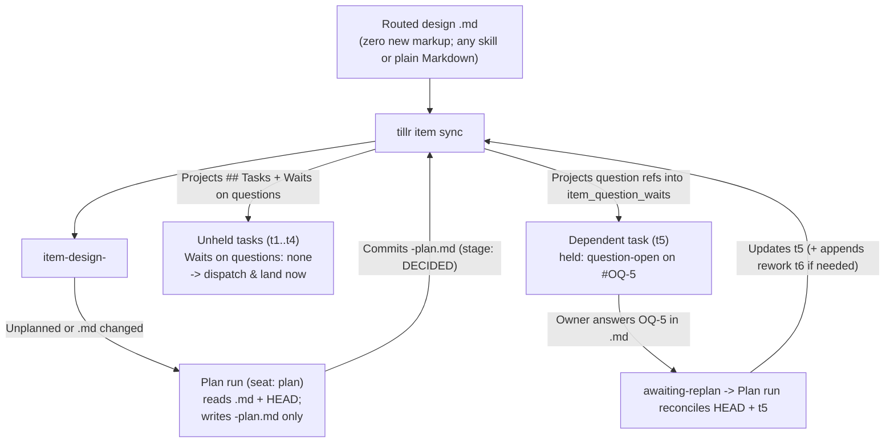

# An unanswered question holds only the steps that depend on its answer, with no new markup in design documents

**Status:** Slices 1 and 2 of [Section 7.2](#72-high-level-build-sequence-d-psh7) are built (Slice 1 in `bc481231`; Slice 2 in the commit that carries this line); Slices 3 and 4 are not. Slice 2 measured on 2026-11-28: in `tools/tillr-item`, `go test ./item -run 'CompanionPlanSync|UnstagedMarkdown|FrontmatterFreeDesign'` passes (`TestCompanionPlanSyncImportsTasksAndRecordsWaits`, `TestCompanionPlanSyncIgnoresSketchAndBuiltPlans`, `TestCompanionPlanSyncRefusesInvalidPlans`, `TestCompanionPlanSyncParksAndUnparksWithTheDesign`, `TestSyncRoutesUnstagedMarkdownOutsideDesignDirectory`, `TestSyncFrontmatterFreeDesignFinishesWhenItsPlanIsBuiltAndStamped`), and `rg -n 'INSERT INTO item_question_waits' tools/tillr-item/item` now finds the sync writer in `companion_sync.go`. Where the tree differs from the design's Slice 2 prose: a plan that carries an unfenced `<!-- vantage: question … -->` or `oq` directive is refused whatever its stage (not only at `DECIDED`), so a `SKETCH` plan can raise `plan-has-question` but never `plan-task-invalid`; `plan-task-invalid` is raised only for a `DECIDED` plan whose design is outstanding; a task with no `Waits on questions:` line (or `none`) is registered by a `source = 'plan'` row whose `ref_key` is the empty string, which `ReadQuestionWaits` reads as present with no refs and never as a wait; a prose wait's `[section-sha256: …]` text is optional and ignored, because sync computes the hash from the design's current bytes; the task title is checked only for being non-empty, not for the 12-word limit; plan-task items are written through the design mirror's create and update path, so they are parked on `blocked` with `WaitingOn{Waiter: "owner", Reason: "icebox"}` rather than `not-started`; and a stored `landed` task is left as it is. Nothing in sync wrote `item_question_waits` or read `<topic>-plan.md` `## Tasks` before this slice. Slice 1 (`bc481231`) as measured on 2026-11-28: `rg 'item_question_waits|QuestionRefs|wait-question' tools --glob '*.go'` finds the two tables and `tillr item wait-question` in `tools/tillr-item` and `Decision.QuestionRefs` with `recordedQuestionState` in `tools/tillr-drain/drain/plan.go`; `go test . -run 'WaitQuestion|QuestionWaits|SectionSHA'` passes in `tools/tillr-item` and `go test ./drain -run 'RecordedWaits|RecordedProse'` in `tools/tillr-drain`. Where the tree differs from the original Slice 1 prose: `item_question_overrides` also carries `heading_slug`, `quoted_question` and `section_sha256`, so an unmarked prose `--add` can be stored; `--none` is a `drop` override whose `ref_key` is `*`; a prose wait whose section has changed keeps holding on `question-open`, because releasing it needs Slice 3's `awaiting-replan` pass; a `question-removed` hold names its reference in `Decision.QuestionRefs`, and `tillr drain why` does not yet show it (Slice 4). Every question in this document is ruled: [`OQ-PR8`](../tillr/decision-provenance-review.md#OQ-PR8), [`OQ-PR21`](../tillr/decision-provenance-review.md#OQ-PR21), [`OQ-QM1`](./tillr-queue-mirrors-designs.md#OQ-QM1), [`OQ-QM2`](./tillr-queue-mirrors-designs.md#OQ-QM2), [`OQ-PSH1`](#OQ-PSH1), and [`OQ-PSH2`](#OQ-PSH2) are the owner's rulings; `R-PSH1` records the 2026-11-27 constraints from the request; `D-PSH1` to `D-PSH8` are designer's decisions in [the ledger](#decision-ledger) that the owner may overturn.

> **In short.** Today one open question in a design holds every task in that design. Under [`OQ-PR8`](../tillr/decision-provenance-review.md#OQ-PR8) (Option B, 2026-11-27), the design item's `plan` run reads the design — even while questions remain open — writes build tasks into the agent-only companion plan (`<topic>-plan.md`), and records on each task only the open questions it actually depends on. Tasks with no open wait build immediately; waiting tasks sit held in the queue naming the exact question(s) they wait on; and when a later answer contradicts work that already landed, a reconciliation `plan` pass appends an explicit rework task before the design can reach `BUILT`. Human-written design documents gain zero new tags, keys, or table columns, and need not be written with any particular skill.

**Why it matters.** Thirty designs routed by [`docs/tillr/roadmap.md`](../tillr/roadmap.md) carry open questions today, and many of those questions affect only one later slice (for example, [`tillr-non-landing-workflow-gaps.md`](./tillr-non-landing-workflow-gaps.md), [`workspace-tmpfs-scratch.md`](./workspace-tmpfs-scratch.md), [`operator-decisions-inside-tillr.md`](./operator-decisions-inside-tillr.md), and [`installing-tillr-outside-yolo.md`](./installing-tillr-outside-yolo.md)). Holding the entire document leaves settled, independent slices unbuilt until every edge question is answered.

**The shape.** Five rules:

- **Plan across open questions; record waits outside `<topic>.md` (`D-PSH1`, `D-PSH2`).** The `plan` run writes `- **Waits on questions:**` in `<topic>-plan.md` (`planning-actions: none`), `tillr item sync` projects those references into `item_question_waits` in `.tillr/state.db` without copying question state, and `planner.questionState` evaluates only a task's own references live against the question index.
- **Work on any Markdown design, marked or unmarked (`D-PSH3`, `D-PSH4`, [`OQ-PSH1`](#OQ-PSH1)).** No frontmatter, ledger, or skill template is required on `<topic>.md`; unmarked prose questions hold only the dependent tasks in `<topic>-plan.md`, by section anchor and quoted prose question, without editing `<topic>.md` ([`OQ-PSH1`](#OQ-PSH1)).
- **Expose and repair wrong dependency calls in both directions (`D-PSH2`, `D-PSH4`).** Over-holds show their one-line reason and drop in one command without touching `<topic>.md`; under-holds meet the worker brief's open-question guard (`OBSTACLE: owner`), pre-landing review, and mid-run `wait-question --add` pause.
- **Show partial progress and exact `(task -> question)` waits everywhere (`D-PSH5`).** The queue, `tillr drain why`, and operational roadmap views show `M/N` landed tasks alongside each waiting task and the specific question ID it waits on, with zero per-landing churn commits to `roadmap.md` or `<topic>.md`.
- **Reconcile answers before releasing dependent tasks (`D-PSH6`).** Answering a question holds newly released tasks on `awaiting-replan` for one `plan` pass that sharpens their criteria against the ruling and appends a rework task whenever the answer contradicts already-landed code.

**Cost.** One `plan`-seat run to cut tasks on an open-question design (and one short reconciliation `plan` pass when an open question is answered), plus occasional rework commits when an answer overturns an assumption that independent steps built on — the trade-off accepted in [`OQ-PR8`](../tillr/decision-provenance-review.md#OQ-PR8) Option B.

**Start at:** [Section 2](#2-where-the-task-to-question-link-lives-and-who-writes-it).

**Needs your ruling:** None in this document ([`OQ-PSH1`](#OQ-PSH1) and [`OQ-PSH2`](#OQ-PSH2) are ruled in [the ledger](#decision-ledger), and only Slice 1 is built; 8 designer's decisions in [the ledger](#decision-ledger) — `D-PSH1` to `D-PSH8` — may be overturned by the owner).

**Reads with:** [the decision-provenance review](../tillr/decision-provenance-review.md) ([`OQ-PR8`](../tillr/decision-provenance-review.md#OQ-PR8), [`OQ-PR12`](../tillr/decision-provenance-review.md#OQ-PR12), [`OQ-PR14`](../tillr/decision-provenance-review.md#OQ-PR14), [`OQ-PR21`](../tillr/decision-provenance-review.md#OQ-PR21), and [`OQ-PR22`](../tillr/decision-provenance-review.md#OQ-PR22)), [the queue mirrors the roadmap's designs](./tillr-queue-mirrors-designs.md) (whose whole-design pre-plan hold in [§4.1](./tillr-queue-mirrors-designs.md#41-how-one-design-item-relates-to-the-work-in-its-companion-plan), [§4.2](./tillr-queue-mirrors-designs.md#42-the-state-table-for-a-design-item), and [§7.1](./tillr-queue-mirrors-designs.md#71-pairing-visibility-and-lifecycle) this design narrows), [the design-to-planning transition](./tillr-design-to-planning-transition.md), [diff review](./tillr-diff-review.md), and [the compliance officer](./tillr-design-document-check.md).

---

## 1. The 2026-11-27 ruling, the owner's constraints, and what exists today

### 1.1 The ruling and constraints

On 2026-11-27, the owner ruled **Option B** on [`OQ-PR8`](../tillr/decision-provenance-review.md#OQ-PR8) (*"B — Only what the question touches waits. The steps that name the question wait, and the other four are built. If your answer changes something they assumed, that work is redone"*), and stated three design constraints in the 2026-11-27 request (`R-PSH1`):

1. **Zero new markup or metadata in design documents.** Design documents must not fill up with markup or metadata: no new HTML tag/comment, no new frontmatter key, and no new table or ledger column is added to a design document for per-step holds.
2. **No required design-writing skill.** tillr must work with anything that looks like a design document, without requiring that it was written with `design-doc` or any one skill.
3. **Open-question markers may be used where present, with defined behavior where absent.** tillr may rely on existing open-question markers (`<!-- vantage: question … -->` / `OQ-*`), and must define what happens when a design document's questions carry no marker.

### 1.2 Why today's code and [`tillr-queue-mirrors-designs.md`](./tillr-queue-mirrors-designs.md) both hold whole documents

Two mechanisms today turn one open question into a document-wide stop:

1. **File-level join in the live planner.** In [`tools/tillr-drain/drain/plan.go`](../../tools/tillr-drain/drain/plan.go), `planner.questionState` looks up `p.questions.Document(item.DesignDoc)` ([`tools/tillr/vantage/vantage.go`](../../tools/tillr/vantage/vantage.go)) and returns `ReasonQuestionOpen` naming `firstUnanswered(answer.Questions)` whenever *any* question in `item.DesignDoc` is unanswered. Every item naming `item.DesignDoc` waits, and [`tools/tillr-drain/drain/why.go`](../../tools/tillr-drain/drain/why.go) plus [`tools/tillr-view/waiting.go`](../../tools/tillr-view/waiting.go) report `<design_doc>#<first-question-id>` even when that item concerns a completely different section.
2. **Pre-plan gate on `item-design-<slug>` in [`tillr-queue-mirrors-designs.md`](./tillr-queue-mirrors-designs.md).** Although `D-QM10` in [`tillr-queue-mirrors-designs.md`](./tillr-queue-mirrors-designs.md#5-a-question-holds-only-what-names-it) added `- **Waits on questions:**` to tasks in `<topic>-plan.md`, [§4.1](./tillr-queue-mirrors-designs.md#41-how-one-design-item-relates-to-the-work-in-its-companion-plan), row 4 of [§4.2](./tillr-queue-mirrors-designs.md#42-the-state-table-for-a-design-item), and [§7.1](./tillr-queue-mirrors-designs.md#71-pairing-visibility-and-lifecycle) held `item-design-<slug>` on `question-open` *before* its `plan` run could execute and ignored `<topic>-plan.md` unless `<topic>.md` was already `DECIDED` (which `vantage-check`'s `planning/stage-disagrees` forbids while any question is open). Consequently, a design that opened with four settled slices and one open question on slice five never ran `plan`, never wrote `<topic>-plan.md`, and held all five slices.

---

## 2. Where the task-to-question link lives, and who writes it

### 2.1 Testing the three candidate homes against the constraints

| Candidate home for `(task -> questions)` | New markup in `<topic>.md`? | Requires a specific design skill? | Survives cold rebuild (`rm -rf .tillr && tillr item sync`)? | Verdict |
| :--- | :--- | :--- | :--- | :--- |
| **1. Inside `<topic>.md`** (HTML tags, frontmatter map, or a `Waits on` slice-table column) | **Yes** — adds tags, keys, or columns to human-read designs | **Yes** — forces human designs to carry tillr task tables or IDs | Yes | **Rejected:** violates the 2026-11-27 zero-markup and skill-independence constraints, plus `D-QM3` and [`OQ-QM1`](./tillr-queue-mirrors-designs.md#OQ-QM1). |
| **2. Only inside `.tillr/state.db`** (written directly by an agent CLI call, with no tracked file) | No | No | **No** — deleting `.tillr/` loses task cuts and question links, breaking `D-QM1` / `D-TC1` | **Rejected as sole home:** fails the cold-machine test; kept only as the synced projection plus receipted operator overrides. |
| **3. Written by the `plan` run in `<topic>-plan.md` (`Waits on questions:`), projected by `tillr item sync` into `.tillr/state.db` (`item_question_waits`), with store overrides for corrections and ad-hoc requests** | **No** — `<topic>.md` is untouched | **No** — `plan` reads free-form `<topic>.md` and writes agent-only `<topic>-plan.md` | **Yes** — `<topic>-plan.md` is tracked in Git (`planning-actions: none`) | **Selected (`D-PSH1`, `D-PSH2`).** |

Why `<topic>-plan.md` passes `vantage-check` while `<topic>.md` still has open questions: `vantage-check` evaluates `planning/stage-disagrees` per file against *that file's own* open questions. Because `<topic>-plan.md` carries zero questions (`plan-has-question` forbids questions in `-plan.md`) and sets `planning-actions: none` (`D-QM17`), `<topic>-plan.md` is valid at `stage: DECIDED` (meaning its current task list is actionable) while `<topic>.md` remains at `stage: DESIGN` (or unstaged) with unanswered questions.

### 2.2 Who writes the link, and how planning runs while questions are open (`D-PSH1`)

*Designer's decision; the owner may overturn this.*

1. **Planning an open-question design without blocking unheld steps.** For every unparked outstanding routed design (`item-design-<slug>`), whatever its `stage` or `status` ([`OQ-PSH2`](#OQ-PSH2), matching [`OQ-QM2`](./tillr-queue-mirrors-designs.md#OQ-QM2): a link under the roadmap's `## Icebox` is the only whole-design hold, and tillr does not read the words `SKETCH` or `draft` to decide this), `item-design-<slug>` is **not** held unconditionally on `question-open` before its `plan` run:
   - Whenever `<topic>-plan.md` does not yet exist at `stage: DECIDED` for `<topic>.md`'s current content (`**Design stamped at:** <git-blob-sha>`), `item-design-<slug>` dispatches a **`plan` run** (`plan` seat, write scope `<topic>-plan.md` — `<topic>.md` is read-only during this pass so the human's design is never rewritten).
   - The `plan` agent reads `<topic>.md` and `HEAD`, cuts the buildable single-commit tasks under `## Tasks` in `<topic>-plan.md` (`status: accepted`, `stage: DECIDED`, `planning-actions: none`), and for each task judges whether writing or verifying that task requires the answer to any open question in `<topic>.md` (or in `<topic>.md`'s `depends-on` targets):
     - **Independent task:** omits `Waits on questions:` or writes `- **Waits on questions:** none`.
     - **Dependent task:** writes one bullet naming each open question it depends on and a one-clause reason why:

       ```markdown
       - **Waits on questions:**
         - `docs/design/tillr-non-landing-workflow-gaps.md#OQ-NLW2` — chooses whether `definition.Hooks` gains `release-run` (Option A) or leaves cleanup to wrappers (Option B)
       ```

   - **No infinite re-plan loop when everything depends on an open question:** If every step of `<topic>.md` depends on a single framing question `<question-id>` that decides whether anything is built at all, `plan` still writes `<topic>-plan.md` stamped with `**Design stamped at:** <blob-sha>` holding the task(s) waiting on `<doc>#<question-id>`. Once `<topic>-plan.md` matches `<topic>.md`'s blob SHA and zero unheld tasks exist, `item-design-<slug>` rests on `question-open` (`needs you`) and runs `plan` again **only** when `<topic>.md` changes.
2. **Syncing `<topic>-plan.md` while `<topic>.md` is still `DESIGN` or unstaged (`D-PSH1`, `D-PSH8`).** On `HEAD`, [`tools/tillr-item/item/sync_design.go`](../../tools/tillr-item/item/sync_design.go) only skips paired `-plan.md` files (`isPairedCompanionPlan`) because Slice 2 of [`tillr-queue-mirrors-designs.md`](./tillr-queue-mirrors-designs.md) has not landed separately (`rg -n 'INSERT INTO item_question_waits' tools/tillr-item/item` returns nothing). Folding the `tillr-item` companion-plan `## Tasks` sync reader of [`tillr-queue-mirrors-designs.md`](./tillr-queue-mirrors-designs.md) ([§7.1](./tillr-queue-mirrors-designs.md#71-pairing-visibility-and-lifecycle), [§7.2](./tillr-queue-mirrors-designs.md#72-canonical--tasks-grammar-in-topic-planmd), [§7.3](./tillr-queue-mirrors-designs.md#73-exact-field-mapping-and-validation-rules-d-qm18-d-qm19), and [§11](./tillr-queue-mirrors-designs.md#11-rollout-sequence-high-level) Slice 2) directly into Slice 2 of this design (`D-PSH8`) and narrowing [`tillr-queue-mirrors-designs.md`](./tillr-queue-mirrors-designs.md) ([§4.1](./tillr-queue-mirrors-designs.md#41-how-one-design-item-relates-to-the-work-in-its-companion-plan), [§7.1](./tillr-queue-mirrors-designs.md#71-pairing-visibility-and-lifecycle), and [§10](./tillr-queue-mirrors-designs.md#10-edge-and-failure-behavior)):
   - Whenever a companion `<dir>/<stem>-plan.md` (paired by filename or frontmatter `depends-on` naming `<stem>.md`) has stage role `ready` (`DECIDED`) and its routed `<dir>/<stem>.md` is outstanding (`open`, `ready`, or unstaged), `tillr item sync` reads and validates `## Tasks` regardless of `<stem>.md`'s `stage` or `status` ([`OQ-PSH2`](#OQ-PSH2)). Companion plans at `SKETCH` (`open`/unstaged) or `BUILT` (`built`/`done`) import zero tasks.
   - Sync enforces `plan-has-question` (refusing any companion `*-plan.md` carrying an unfenced `question` or `oq` directive) and `plan-task-invalid` (refusing a `DECIDED` companion plan missing `planning-actions: none` or `depends-on` naming `<stem>.md`, or a `### Task <local_id>: <Title>` entry with an invalid or duplicate `<local_id>`, empty title, seat rejected by `ValidSeatName`, unknown `After:` reference or dependency cycle, invalid `Claims:`/`Judge:`/`Express:`, zero or more than eight `- **c<N>:**` criteria, or malformed `- **Waits on questions:**` bullet), writing zero pieces from a plan that fails validation and reporting the same `SyncNote` findings under `tillr item sync --dry-run`.
   - Valid tasks materialize as `item-<plan-slug>-<local_id>` (or explicit `- **ID:** item-...`) with `design_doc = <dir>/<stem>.md`, `body_ref = <dir>/<stem>-plan.md#<heading-slug>` (which carries any `- **Verify:**` line to staging's `DefinitionBody`), `from = item-design-<slug>`, `Seat` defaulting to `build`, and `Paths` ignored if present. Companion-plan pieces do not mark `<dir>/<stem>.md` covered against `item-design-<slug>` in `designIndexNeeded`, are treated as shared by `CheckDocumentSharing` (`unshared_open` stays `0`), and park in `blocked` (`WaitingOn{Waiter: "owner", Reason: "icebox"}`, `rank = ""`) when `<dir>/<stem>.md` is parked-only on the roadmap (`D-QM11`), unparking back to `in-queue` when `<dir>/<stem>.md` moves onto the spine. (`retireDocumentBlock` in [`tools/tillr-drain/drain/retire.go`](../../tools/tillr-drain/drain/retire.go) already performs a no-op with zero commit when a piece has no HTML item comment.)



### 2.3 Store projection and live planner evaluation (`D-PSH2`)

*Designer's decision; the owner may overturn this.*

1. **Store schema (`item_question_waits` and `item_question_overrides`, built in `bc481231`).** `tillr-item` adds two small event-logged tables in `.tillr/state.db` (migrated additively so existing stores open cleanly):
   - `item_question_waits(item_id TEXT, ref_key TEXT, doc_path TEXT, question_id TEXT, heading_slug TEXT, quoted_question TEXT, section_sha256 TEXT, reason TEXT, source TEXT, PRIMARY KEY (item_id, ref_key))`:
     - `source = 'plan'`: replaced atomically for `<topic>-plan.md`'s tasks on each `tillr item sync`, projecting both marked bullets (`` `<doc>#<OQ-id>` — <reason> ``) and unmarked prose bullets (`` `<doc>#<heading-slug>` ("<quoted question>") [section-sha256: <hex>] — <reason> ``, computing `SectionSHA256` from `<doc>`'s synced content and refusing missing documents or anchors with `plan-task-invalid`). Because `ReadQuestionWaits` in [`tools/tillr-item/item/question_waits.go`](../../tools/tillr-item/item/question_waits.go) (`bc481231`) treats an item absent from its returned map as a legacy item (`QuestionWaits == nil` -> whole-document hold) and an item present with empty `Refs` (`QuestionWaits{Refs: nil}`) as waiting on nothing, `ReadQuestionWaits` also registers every companion-plan task item as present with `Refs: nil` when its `Waits on questions:` is `none` or omitted (for example via an empty-ref `source = 'plan'` sentinel or companion-plan `items.body_ref` join) while layering `source = 'worker-obstacle'` rows and `item_question_overrides` on top.
     - `source = 'worker-obstacle'`: added automatically when a worker stops with `OBSTACLE: owner` naming an open question in `<topic>.md` ([Section 4.2](#42-false-negative-the-planner-misses-a-dependency-under-hold)).
   - `item_question_overrides(item_id TEXT, ref_key TEXT, op TEXT CHECK (op IN ('add', 'drop')), doc_path TEXT, question_id TEXT, heading_slug TEXT, quoted_question TEXT, section_sha256 TEXT, reason TEXT, actor TEXT, created_at TEXT, PRIMARY KEY (item_id, ref_key))`:
     - Written by `tillr item wait-question` (or observatory `--write` actions; `--none` writes a `drop` row with `ref_key = '*'`) when the owner or operator adds or removes a wait on a task or standalone `tillr item request` item. Sync applies `item_question_overrides` on top of `source = 'plan'` rows so a re-sync never clobbers an explicit human/operator correction.
   - **Zero question state in `.tillr/state.db` (`D-QM1`).** Neither table stores `open` or `answered`. Only the *dependency edge* (`item -> question reference`) is stored.
2. **Live evaluation in `planner.questionState`.** Replacing the file-wide `firstUnanswered(answer.Questions)` check in [`tools/tillr-drain/drain/plan.go`](../../tools/tillr-drain/drain/plan.go):
   - **For a task / piece item (or standalone request with explicit `item_question_waits`):**
     - If `item.DesignDoc != ""` and the file is missing on disk, hold `design-doc-missing` as today.
     - Compute the item's effective wait list (`item_question_waits` plus `add` overrides minus `drop` overrides).
     - **If the effective wait list is empty:** the task has **no `question-open` hold**, even when `item.DesignDoc` carries unanswered questions (and even if the question index subprocess is temporarily slow, only tasks with non-empty waits or `item-design-*` need the index!). Unstarted tasks still pause on `ReasonDesignUnderComment` while an active Vantage review-comment turn is open on `item.DesignDoc` ([`OQ-PR12`](../tillr/decision-provenance-review.md#OQ-PR12)), and park on `icebox` if the roadmap parks `item.DesignDoc` (`D-QM11`).
     - **If the effective wait list is non-empty:** look up each referenced `doc_path` in `QuestionSource` (`tools/tillr/vantage/vantage.go`). If the index cannot be read, hold `questions-unknown`. For each marked reference `doc_path#OQ-...`:
       - if `OQ-...` is in `Questions` with `state != "answered"`, keep `doc_path#OQ-...` in the active open list;
       - if `OQ-...` is in `Questions` with `state == "answered"` or in `LedgerIDs`, the wait is satisfied (gated by `awaiting-replan` if answered after `Design stamped at`; [Section 6](#6-when-the-owners-answer-contradicts-already-built-work));
       - if `OQ-...` is in neither `Questions` nor `LedgerIDs`, hold `question-removed` naming `doc_path#OQ-...`.
     - If one or more references remain open, hold `question-open` with `Decision.QuestionRefs` listing **every** still-open reference in task order (`["docs/...#<question-id>", ...]`, setting `Decision.QuestionID` to the first ID for legacy readers).
   - **Transition rule for pre-companion-plan legacy items:** Existing items in `.tillr/state.db` imported from legacy in-document item blocks before Slice 5 of [`tillr-queue-mirrors-designs.md`](./tillr-queue-mirrors-designs.md#81-fate-of-the-existing----tillr-item-----comments-in-docs) have no `<topic>-plan.md` entry yet. An item whose source is neither a companion plan nor a request carrying explicit `wait-question` metadata keeps its legacy doc-wide check until planned or overridden via `tillr item wait-question <id> --none` / `--add`, so nothing legacy dispatches on an unreviewed assumption at binary upgrade.

---

## 3. Skill-independence and documents whose questions carry no marker

### 3.1 Working with any Markdown design document (`D-PSH3`)

*Designer's decision; the owner may overturn this.*

A human or outside agent may write a design as a plain RFC, architecture note, or bulleted proposal under `docs/` without `design-doc`, YAML frontmatter, `stage:`, `D-*` tags, or a `Decision Ledger` table. tillr handles it with zero edits to `<topic>.md`:

1. **Roadmap discovery without frontmatter.** Any Markdown file under `docs/` linked from a mirrored roadmap's spine or `## Icebox` (excluding other roadmaps, paired `*-plan.md` files, and documents under `docs/reference/` or carrying terminal role `built` / `done`) is treated by `tillr item sync` as an outstanding design (`D-PSH3`, widening `collectRoutedDesigns` in [`tools/tillr-item/item/sync_design.go`](../../tools/tillr-item/item/sync_design.go) so a repository keeping RFCs under `docs/rfcs/` or `docs/architecture/` without `stage:` keys is picked up identically to `docs/design/`). Its title comes from frontmatter `title:` when present, else its first `#` heading, else its filename (`designTitle`).
2. **Agent reading instead of template scraping.** `<topic>.md` is read by the `plan` seat (an LLM agent), never by a regex parser expecting `## Build slices` or `## Decision Ledger`. Whether `<topic>.md` is five paragraphs of prose or a full `design-doc` specification, `plan` extracts the intended behavior into `<topic>-plan.md` (`## Tasks`).
3. **Finishing without injecting frontmatter into `<topic>.md`.** If `<topic>.md` already declares `stage:`, the final verification `plan` run stamps `stage: BUILT` on both `<topic>.md` and `<topic>-plan.md` (`D-QM8`). If `<topic>.md` has **no** YAML frontmatter or no `stage:` key, the verification `plan` run stamps `stage: BUILT` (plus `**Design stamped at:** <blob-sha>`) on `<topic>-plan.md` **alone**, leaving `<topic>.md` byte-for-byte untouched: `tillr item sync` treats an unstaged `<topic>.md` paired with a `BUILT` `<topic>-plan.md` whose `**Design stamped at:** <git-blob-sha>` matches `<topic>.md`'s git blob SHA-1 (`sha1("blob <len>\x00" + content)`) as finished (`role = built` — creating no `item-design-<slug>` row on cold sync, resolving an existing unfinished `item-design-<slug>` row to `resolved-elsewhere` via `doc:<topic>.md`, and importing zero tasks), and treats `<topic>.md` as outstanding (`role = ""`) again if a human later edits `<topic>.md` so its blob SHA-1 differs from `Design stamped at` (reopening an already-finished `item-design-<slug>` row in `.tillr/state.db` remains Slice 3 of [`tillr-queue-mirrors-designs.md`](./tillr-queue-mirrors-designs.md)).

### 3.2 What happens when a design's questions carry no open-question marker (`D-PSH4` and [`OQ-PSH1`](#OQ-PSH1))

Designs fall into two cases when `plan` reads `<topic>.md`:

- **Case 1 — Questions carry open-question markers (`<!-- vantage: question id=OQ-… -->` or `oq`).**
  Vantage's index (`uvx vantage-check index --format json`, read by [`tools/tillr/vantage/vantage.go`](../../tools/tillr/vantage/vantage.go)) reports each question's `id`, `state`, `title`, and `leaning`. `plan` cites `<doc>#<OQ-id>` in `- **Waits on questions:**`, and `planner.questionState` checks `state` live on every pass.

- **Case 2 — Questions carry no marker (plain-prose questions in a skill-free design).**
  Suppose an author writes a plain Markdown design with `## Open questions` and `- Should expired tokens refresh in the background or return 401?`, or writes `TBD: retention window for archived runs` inline, with no `<!-- vantage: question -->` comment and no `OQ-*` ID. Vantage's index reports `0` questions for the file.
  - First, `plan` applies [`OQ-PR21`](../tillr/decision-provenance-review.md#OQ-PR21)'s boundary: internal engineering choices (data structures, helper signatures, file layout) are **not** owner questions — `plan` settles them in `<topic>-plan.md` and builds without holding.
  - Second, for any genuine owner-level question in prose (product behavior, UX, spend, models, repository policy), **tasks that do not depend on that prose question still get `Waits on questions: none` and build immediately** ([`OQ-PR8`](../tillr/decision-provenance-review.md#OQ-PR8)).
  - Third, for the task(s) that **do** depend on the unmarked prose question, `plan` holds only the dependent tasks in `<topic>-plan.md`, by section anchor and quoted prose question, without editing `<topic>.md` ([`OQ-PSH1`](#OQ-PSH1), ruled 2026-11-28; section-hash tracking in `D-PSH4`):

    ```markdown
    - **Waits on questions:**
      - `docs/rfcs/token-auth.md#open-questions` ("Should expired tokens refresh in the background or return 401?") [section-sha256: 8f3a19c2] — controls the 401 handler in t3
    ```

    `tillr item sync` stores that row in `item_question_waits` (`question_id = ""`, `heading_slug = "open-questions"`, `quoted_question = "Should expired tokens..."`, `section_sha256 = "8f3a19c2..."`). On each pass, `planner.questionState` hashes the target section of `docs/rfcs/token-auth.md`:
    - While `section_sha256` is unchanged (and no override dropped the wait), `t3` holds on `question-open` (`class: "needs you"`, `mover: 'owner; answer "Should expired tokens..." in docs/rfcs/token-auth.md#open-questions'`).
    - When the human edits `docs/rfcs/token-auth.md` under `#open-questions` (changing `section_sha256`) or leaves a Vantage review comment, `t3` enters `awaiting-replan` and `item-design-<slug>` runs a reconciliation `plan` pass: if the edited prose answers the question, `plan` removes the wait, sharpens `t3`'s criteria, and releases `t3`; if the prose still leaves the question open, `plan` updates `section_sha256` and keeps `t3` held.

---

## 4. When the dependency judgment is wrong, and how the owner sees and corrects it

Because an agent (`plan` seat) judges which tasks depend on which questions, its judgment can err in either direction. Both failure modes are observable from the normal queue surfaces and correctable without adding markup to `<topic>.md`.

### 4.1 False positive: the planner holds a task on a question it does not need (over-hold)

- **Effect:** Safe failure mode — independent tasks `t1..t2` still build, and over-held `t3` waits cleanly in the queue rather than landing a wrong assumption.
- **How the owner sees it:** `tillr view waiting`, `tillr drain why`, and the observatory's Item and Home pages display **both** the question reference/title and the one-clause dependency reason `plan` wrote in `<topic>-plan.md` (for example, if `t3` were mistakenly linked to [`OQ-NLW2`](./tillr-non-landing-workflow-gaps.md#OQ-NLW2): `item-non-landing-workflow-gaps-t3 — question-open:` [`docs/design/tillr-non-landing-workflow-gaps.md#OQ-NLW2`](./tillr-non-landing-workflow-gaps.md#OQ-NLW2) `— because t3 shares orphan reap`). When `t3` only extracts dead-PID liveness and does not need `release-run`, the mismatch is visible in one line without opening `<topic>-plan.md`.
- **How the owner or operator corrects it (zero edits to `<topic>.md`):**
  1. **Command or observatory click:** Run `tillr item wait-question <item-id> --drop <doc>#<question-id> --reason "..."` (or click **Release from this question** on the item's observatory page under `--write`):

     ```bash
     tillr item wait-question item-non-landing-workflow-gaps-t3 \
       --drop docs/design/tillr-non-landing-workflow-gaps.md#OQ-NLW2 \
       --reason "t3 extracts dead-PID status only; release-run hook is t4"
     ```

     This writes a `drop` row in `item_question_overrides`. `t3` becomes ready on the very next pass, and subsequent `tillr item sync` runs preserve the override. On the design's next `plan` pass, `plan` reads active overrides and removes the dropped bullet from `<topic>-plan.md` so tracked state converges too.
  2. **Direct edit to `<topic>-plan.md`:** Deleting that bullet under `t3`'s `Waits on questions:` in `<topic>-plan.md` and running `tillr item sync` clears the hold directly in Git.

### 4.2 False negative: the planner misses a dependency (under-hold)

When `plan` marks `t4` as `Waits on questions: none` even though `t4` actually turns on open [`OQ-NLW2`](./tillr-non-landing-workflow-gaps.md#OQ-NLW2), four layers catch or recover from the mistake in order:

1. **Layer 1 — Staged worker brief + automatic hold on `OBSTACLE: owner` (before commit).**
   Whenever `stage` builds the brief for a piece whose `design_doc` currently has unanswered questions (marked or unmarked), it includes an **Open questions in `<design_doc>` — do not guess** section listing every currently open question's ID, title, and options, with the instruction:
   *"This task was planned as independent of the open questions above. If completing any criterion requires assuming an answer to one of them, do not guess: stop with `OBSTACLE: owner` and `QUESTION: <doc>#<question-id> — <why this task needs it>`."*
   When settlement sees `OBSTACLE: owner` citing an existing open question in `<topic>.md`, it writes an `item_question_waits` row (`source = 'worker-obstacle'`) linking `t4` to `<doc>#<question-id>` and places `t4` straight into `question-open` on that question — without wasting a `design`-seat turn to re-ask a question `<topic>.md` already asks.
2. **Layer 2 — Pre-landing diff and compliance review (before merge).**
   Both pre-landing code review ([`tillr-diff-review.md`](./tillr-diff-review.md)) and policy compliance ([`tillr-design-document-check.md`](./tillr-design-document-check.md)) receive `<topic>.md`'s live open questions alongside `t4`'s diff. A candidate commit that hard-codes one unruled branch of an open question is refused before `tillr-land` merges it, attaching the missing `<doc>#<question-id>` hold.
3. **Layer 3 — Owner or operator hold while queued or running.**
   In the observatory or `tillr view`, `t4` is visible running or queued under `<topic>.md` while [`OQ-NLW2`](./tillr-non-landing-workflow-gaps.md#OQ-NLW2) is open. Running `tillr item wait-question <item-id> --add <doc>#<question-id> --reason "..."` (or clicking **Hold on question** in the observatory) records an `add` override, writes `$TILLR_PAUSE_REQUEST` to pause `t4`'s active run cleanly at the next turn gap if `t4` is mid-flight, and holds `t4` on `question-open`.
4. **Layer 4 — Post-landing reconciliation rework (after merge).**
   If `t4` already landed on `main` having assumed Option A and the owner later rules Option B on [`OQ-NLW2`](./tillr-non-landing-workflow-gaps.md#OQ-NLW2), the post-answer reconciliation pass ([Section 6](#6-when-the-owners-answer-contradicts-already-built-work)) detects the contradiction on `HEAD` and appends an explicit rework task `t6` before `<topic>.md` can finish.

---

## 5. How the queue, `tillr drain why`, and the roadmap show a partly built design

*Designer's decision (`D-PSH5`); the owner may overturn this.*

Consider [`docs/design/tillr-non-landing-workflow-gaps.md`](./tillr-non-landing-workflow-gaps.md) mid-build: Tasks `t1` and `t2` have **landed**, Task `t3` is **running** (draining), Task `t4` waits on [`OQ-NLW2`](./tillr-non-landing-workflow-gaps.md#OQ-NLW2), and Task `t5` waits on [`OQ-NLW1`](./tillr-non-landing-workflow-gaps.md#OQ-NLW1).

### 5.1 In the queue (`tillr view waiting`, `tillr view status`, and the observatory)

- **Landed tasks (`t1`, `t2`):** `state = landed`; omitted from waiting lists and counted in their parent design's roll-up (`2/5 landed`).
- **Unheld active/ready tasks (`t3`):** shown in `draining` (`moving` on its lane, or `ready` / `waits on work` if behind `After: t2`).
- **Question-held tasks (`t4`, `t5`):** shown in `class: "needs you"`, `why: "question-open"`, naming **only the open question(s) that specific task waits on** — never `firstUnanswered(doc)`:
  - `t4` names [`docs/design/tillr-non-landing-workflow-gaps.md#OQ-NLW2`](./tillr-non-landing-workflow-gaps.md#OQ-NLW2) (the *second* question in the file, not [`OQ-NLW1`](./tillr-non-landing-workflow-gaps.md#OQ-NLW1));
  - `t5` names [`docs/design/tillr-non-landing-workflow-gaps.md#OQ-NLW1`](./tillr-non-landing-workflow-gaps.md#OQ-NLW1).
- **Parent design item (`item-design-design-tillr-non-landing-workflow-gaps`):** shows the design's aggregate slice counts (`2/5 landed, 1 draining, 2 waiting on questions`) so 0-of-5 and 3-of-5 designs never look identically stuck:
  - **While ≥1 unheld task (`t3`) is still draining:** the parent design item sits in `waits on work` (`waits-on-pieces`), `mover: "drain; finish item-non-landing-workflow-gaps-t3"`, while `t4` and `t5` themselves sit in `needs you` naming [`OQ-NLW2`](./tillr-non-landing-workflow-gaps.md#OQ-NLW2) and [`OQ-NLW1`](./tillr-non-landing-workflow-gaps.md#OQ-NLW1).
  - **Once `t3` lands (`3/5 landed`) and only question-held tasks (`t4`, `t5`) remain:** the parent design item surfaces `question-open` (`needs you`) summarizing every remaining `(task -> question)` pair.

Specimen `tillr view waiting` output while `t3` is running and `t4`, `t5` wait on their respective questions:

```text
summary: moving 1; waits-on-work 1; owner-waiting 2; parked 0; next [owner=2 drain=2]

 #  item_id                                            class          where   why
 1  item-non-landing-workflow-gaps-t3                  moving         lane-1  running build (parent 2/5 landed)
 2  item-design-design-tillr-non-landing-workflow-gaps waits on work  queue   waits-on-pieces: 2/5 landed, 1 draining (t3), 2 waiting on questions (t4 -> OQ-NLW2, t5 -> OQ-NLW1)
 3  item-non-landing-workflow-gaps-t4                  needs you      queue   question-open: docs/design/tillr-non-landing-workflow-gaps.md#OQ-NLW2 ("Should a charter's hook program gain a release-run hook?") — gates charter release-run hook
 4  item-non-landing-workflow-gaps-t5                  needs you      queue   question-open: docs/design/tillr-non-landing-workflow-gaps.md#OQ-NLW1 ("How should a workflow skip a stage cleanly?") — gates command exit 77 skip outcome
```

On the observatory's Home and Items pages (`tools/tillr-view/`), each design row renders a compact segmented bar (`2 landed · 1 running · 2 waiting on you`) and expands its child tasks inline, linking each waiting task's `#OQ-...` chip directly to the question anchor in Vantage.

### 5.2 In `tillr drain why` (`tillr drain why` and `tillr drain why <item>`)

`Decision` in [`tools/tillr-drain/drain/plan.go`](../../tools/tillr-drain/drain/plan.go) adds `QuestionRefs []string` (`json:"question_refs,omitempty"`, canonical `docs/.../<file>.md#OQ-...` or `docs/.../<file>.md#<heading-slug>`) alongside legacy `QuestionID`. In [`tools/tillr-drain/drain/why.go`](../../tools/tillr-drain/drain/why.go):

- **`tillr drain why item-non-landing-workflow-gaps-t4`** (waiting task):

  ```text
  item:        item-non-landing-workflow-gaps-t4
  class:       needs you
  action:      hold
  reason:      question-open
  waiting_on:  docs/design/tillr-non-landing-workflow-gaps.md#OQ-NLW2
  why:         question-open: waits on docs/design/tillr-non-landing-workflow-gaps.md#OQ-NLW2 ("OQ-NLW2: Should a charter's hook program (definition.Hooks) gain a release-run hook called by tillr-drain when a run ends or dies?") — gates charter release-run hook
  mover:       owner; answer docs/design/tillr-non-landing-workflow-gaps.md#OQ-NLW2
  ```

  If a single task waits on two open questions (`<doc>#<id-1>` and `<doc>#<id-2>`), `waiting_on` lists both canonical refs and `mover` reads `owner; answer <doc>#<id-1>, <doc>#<id-2>`; as soon as the first question is answered, the next pass narrows `waiting_on` and `mover` to `<doc>#<id-2>` live without touching `.tillr/state.db`.

- **`tillr drain why item-design-design-tillr-non-landing-workflow-gaps`** (parent design item, after `t1..t3` have landed):

  ```text
  item:        item-design-design-tillr-non-landing-workflow-gaps
  class:       needs you
  action:      hold
  reason:      question-open
  waiting_on:  item-non-landing-workflow-gaps-t4 -> docs/design/tillr-non-landing-workflow-gaps.md#OQ-NLW2, item-non-landing-workflow-gaps-t5 -> docs/design/tillr-non-landing-workflow-gaps.md#OQ-NLW1
  why:         partly built (3/5 tasks landed: t1, t2, t3); item-non-landing-workflow-gaps-t4 waits on docs/design/tillr-non-landing-workflow-gaps.md#OQ-NLW2; item-non-landing-workflow-gaps-t5 waits on docs/design/tillr-non-landing-workflow-gaps.md#OQ-NLW1
  mover:       owner; answer docs/design/tillr-non-landing-workflow-gaps.md#OQ-NLW2, docs/design/tillr-non-landing-workflow-gaps.md#OQ-NLW1
  ```

### 5.3 On the roadmap (`docs/tillr/roadmap.md`, Vantage, and operational roadmap views)

Two constraints meet on the roadmap: `vantage-check` forbids copying mutable counts or stages into roadmap bullets (*"the badge beside the link carries the rest, so never copy a status, a stage or a count into it"*), and landing a task must never make a follow-up commit churning `docs/tillr/roadmap.md` or `<topic>.md` (`D-QM19`, [`OQ-PR1`](../tillr/decision-provenance-review.md#OQ-PR1)). Partly built designs therefore appear across the static and live roadmap surfaces without per-landing file churn:

1. **In tracked `<topic>.md` and Vantage's roadmap link badge:** While any question in `<topic>.md` is open, `<topic>.md` stays at `stage: DESIGN` (role `open`), so Vantage's badge beside the roadmap link shows `DESIGN` and the exact count of still-open questions (`2 open` -> `1 open`) — never prematurely stamping `BUILT` while tasks wait. Once all questions are answered, `<topic>.md` is `DECIDED` (role `ready`) while the remaining tasks finish, and moves to `BUILT` only when all tasks (including any post-answer rework) are verified on `main`.
2. **In tracked `docs/tillr/roadmap.md`:** Each entry stays a clean link plus its ordering clause, and `## Open decisions that block entries` names which part of an entry each `OQ-*` holds (as entries 16, 22, 23, 24, 27, 33, 35, 36, 44, 56, 57, and 60 already do — e.g., *"Slices 5 and 6 of entry 24"*). Zero commits touch `roadmap.md` as individual tasks land.
3. **In `tillr view` and the observatory's live roadmap projection (`tillr view waiting --by-roadmap` / observatory Roadmap tab):** Joining the mirrored roadmap's ordered links (`collectRoutedDesigns` in [`tools/tillr-item/item/sync_design.go`](../../tools/tillr-item/item/sync_design.go)) with `.tillr/state.db` and Vantage's live question index renders each roadmap entry's real-time build state and exact per-task question holds:

   ```text
   24. docs/design/workspace-tmpfs-scratch.md  [partly built: 4/6 landed, 0 draining, 2 waiting]
       - item-workspace-tmpfs-scratch-t5  waits on docs/design/workspace-tmpfs-scratch.md#OQ-WT1 ("Accepted ten-lane /tmp ceiling...")
       - item-workspace-tmpfs-scratch-t6  waits on docs/design/workspace-tmpfs-scratch.md#OQ-WT2 ("Should check scratch move to tmpfs?")
   ```

---

## 6. When the owner's answer contradicts already-built work

*Designer's decision (`D-PSH6`); the owner may overturn this.*

In [`OQ-PR8`](../tillr/decision-provenance-review.md#OQ-PR8) Option B, the owner explicitly accepted that building independent steps ahead of an open question means a later answer may require some built work to be redone. Two invariants govern that rework:

- **No blind file-touch re-runs** (standing owner ruling): tillr never invalidates or re-runs landed tasks merely because `<topic>.md` changed or paths overlapped; an agent (`plan` seat) checks semantic compatibility between the new ruling and `HEAD`.
- **No race between answering a question and dispatching the newly unblocked task:** Before the owner answered [`OQ-NLW2`](./tillr-non-landing-workflow-gaps.md#OQ-NLW2), `t4` in `<topic>-plan.md` could not know whether Option A or Option B would win, nor could anyone check whether landed `t1..t3` contradicted the chosen option. Releasing `t4` the instant [`OQ-NLW2`](./tillr-non-landing-workflow-gaps.md#OQ-NLW2) disappears from Vantage's open list would dispatch `t4` on stale pre-ruling criteria.

The reconciliation sequence closes both gaps cleanly:

1. **Answer recorded in `<topic>.md`.** The owner answers [`OQ-NLW2`](./tillr-non-landing-workflow-gaps.md#OQ-NLW2) (via Vantage review comment or direct edit), and the `design` turn records the dated verbatim quote in `<topic>.md` and compacts the question into `<topic>.md`'s `## Decision Ledger` (`R-DT1`, [`OQ-PR22`](../tillr/decision-provenance-review.md#OQ-PR22)). `<topic>.md`'s git blob SHA now differs from `**Design stamped at:** <old-blob-sha>` in `<topic>-plan.md`.
2. **`awaiting-replan` barrier on newly unblocked tasks.** In `planner.questionState`, whenever a task's `item_question_waits` references a question that is now answered in `<topic>.md` *and* `<topic>-plan.md`'s `Design stamped at` still names an older `<topic>.md` blob SHA, the planner holds that task as `awaiting-replan` (`class: "waits on work"`, `mover: "drain; reconcile <topic>-plan.md with newly answered question in <topic>.md"`), and makes `item-design-<slug>` immediately dispatchable on the `plan` seat. Unrelated tasks already running whose assumptions are unaffected are not killed preemptively.
3. **Reconciliation `plan` run (`plan` seat on `item-design-<slug>`).** Reads `<topic>.md` (with the new ruling), `<topic>-plan.md`, the store's landed task list (`t1..t3`), and `HEAD` on `main`:
   - **Updates newly released `t4`:** rewrites `t4`'s task prose and `- **Criteria:**` in `<topic>-plan.md` for the winning option and clears the satisfied reference from `t4`'s `Waits on questions:` (or marks `t4` `cancelled-by-ruling` so sync closes `t4` if the owner chose an option such as *"add no `release-run` hook"*!).
   - **Audits landed `t1..t3` on `HEAD` against the ruling:**
     - *Compatible (normal case):* `t1..t3` need no change; they stay `landed` and untouched.
     - *Contradicted:* Suppose a landed task `t2` assumed on-disk JSON state and the owner's ruling required SQLite-only state. **Landed item `t2` is never reopened or rewritten in history** — its commit landed and its verdicts describe that commit. Instead, `plan` appends a new task `### Task t6: Rework <component> to match ruling` under `## Tasks` in `<topic>-plan.md` naming the exact code on `HEAD` to replace or delete and its verification tests, and adds `- **After:** t6` to `t4` whenever `t4` builds on the reworked code.
     - *In-flight task contradicted:* If `t3` is currently running on a lane and the answer invalidates `t3`'s criteria, `plan` updates `t3`'s criteria (or marks `t3` superseded) in `<topic>-plan.md`; `tillr item sync` updates `t3`, and if the stale in-flight run offers a commit against the old criteria, settlement returns the updated criteria to `t3`'s lane rather than landing contradicted code.
   - Updates `**Design stamped at:** <new-blob-sha>` in `<topic>-plan.md` and commits.
4. **Drain to `BUILT`.** Landing the updated `<topic>-plan.md` runs `tillr item sync`, clears `awaiting-replan`, imports any rework task `t6`, drains `t6` then `t4`, and finally runs `item-design-<slug>`'s verification `plan` pass to stamp `BUILT` once `HEAD` satisfies the entire settled design.

---

## 7. What this amends, and build sequence

### 7.1 Amendments to sibling designs

- **[`tillr-queue-mirrors-designs.md`](./tillr-queue-mirrors-designs.md) ([§4.1](./tillr-queue-mirrors-designs.md#41-how-one-design-item-relates-to-the-work-in-its-companion-plan), [§4.2](./tillr-queue-mirrors-designs.md#42-the-state-table-for-a-design-item), [§5](./tillr-queue-mirrors-designs.md#5-a-question-holds-only-what-names-it), [§7.1](./tillr-queue-mirrors-designs.md#71-pairing-visibility-and-lifecycle), [§7.2](./tillr-queue-mirrors-designs.md#72-canonical--tasks-grammar-in-topic-planmd), [§7.3](./tillr-queue-mirrors-designs.md#73-exact-field-mapping-and-validation-rules-d-qm18-d-qm19), [§10](./tillr-queue-mirrors-designs.md#10-edge-and-failure-behavior), [§11](./tillr-queue-mirrors-designs.md#11-rollout-sequence-high-level) Slice 2, `D-QM10`, `D-QM16`–`D-QM19`):**
  - `item-design-<slug>` runs its `plan` pass (writing `<topic>-plan.md` at `stage: DECIDED` with `**Design stamped at:** <blob-sha>`) on every unparked routed design even while `<topic>.md` still has unanswered questions, whatever `<topic>.md`'s `stage` or `status` ([`OQ-PSH2`](#OQ-PSH2): a link under the roadmap's `## Icebox` is the only whole-design hold, and tillr does not read `SKETCH` or `draft` to decide this), and rests on `question-open` only once `<topic>-plan.md` is current for `<topic>.md`'s blob SHA and every remaining unfinished task is question-held.
  - Because [`tillr-queue-mirrors-designs.md`](./tillr-queue-mirrors-designs.md) Slice 2 has not landed separately on `HEAD`, Slice 2 of [§7.2](#72-high-level-build-sequence-d-psh7) folds in and delivers the `tillr-item` companion-plan `## Tasks` and `Waits on questions:` sync reader (`D-PSH8`), importing `## Tasks` from `DECIDED` `<topic>-plan.md` files whenever `<topic>.md` has role `open`, `ready`, or no `stage:`, whatever `<topic>.md`'s `status` ([`OQ-PSH2`](#OQ-PSH2)).
  - Unstaged routed Markdown designs under any `docs/` subdirectory outside `docs/reference/` are mirrored (`D-PSH3`), and unstaged `<topic>.md` designs finish via `stage: BUILT` + `**Design stamped at:** <blob-sha>` on `<topic>-plan.md` without adding frontmatter to `<topic>.md`.
- **[`tillr-design-to-planning-transition.md`](./tillr-design-to-planning-transition.md) ([§4](./tillr-design-to-planning-transition.md#4-automatic-transition-from-zero-open-questions-to-queued-slices)):**
  - Zero open questions remains the condition for stamping `<topic>.md` `accepted` / `DECIDED` (`R-DT1`), while planning and building *independent* tasks in `<topic>-plan.md` no longer waits for `<topic>.md` to reach zero open questions ([`OQ-PR8`](../tillr/decision-provenance-review.md#OQ-PR8)).

### 7.2 High-level build sequence (`D-PSH7`)

*Designer's sequencing decisions (`D-PSH7`, amended 2026-11-28 by `D-PSH8` to answer the 2026-11-28 operator request); the owner may overturn these.* Every question in this document ([`OQ-PSH1`](#OQ-PSH1) and [`OQ-PSH2`](#OQ-PSH2), alongside [`OQ-PR8`](../tillr/decision-provenance-review.md#OQ-PR8), [`OQ-PR21`](../tillr/decision-provenance-review.md#OQ-PR21), [`OQ-QM1`](./tillr-queue-mirrors-designs.md#OQ-QM1), and [`OQ-QM2`](./tillr-queue-mirrors-designs.md#OQ-QM2)) is ruled, and Slices 1 (`bc481231`) and 2 are built:

1. **Slice 1 — Store tables (`item_question_waits`, `item_question_overrides`), `tillr item wait-question`, and per-item `planner.questionState` + `Decision.QuestionRefs` *(built in `bc481231`)*.** Replace doc-wide `firstUnanswered` holds for items with recorded question-wait metadata (marked `OQ-*` refs and unmarked `section_sha256` prose refs per [`OQ-PSH1`](#OQ-PSH1)), keep legacy unmigrated comment items safe, and verify with unit tests in `tools/tillr-item` and `tools/tillr-drain`.
2. **Slice 2 — Companion-plan `## Tasks` and `Waits on questions:` sync on open-question and skill-free designs *(built; folds in the `tillr-item` companion-plan sync reader per `D-PSH8`)*.** Because [`tillr-queue-mirrors-designs.md`](./tillr-queue-mirrors-designs.md) Slice 2 is not yet in the tree, build the `tillr-item` companion-plan `## Tasks` and `- **Waits on questions:**` sync reader directly here (`tools/tillr-item` plus `just pack-sync` for its pack mirror):
   - In `tillr item sync` (write and `--dry-run`), parse and validate `DECIDED` (`ready`) `<dir>/<stem>-plan.md` files paired with routed outstanding `<dir>/<stem>.md` designs (`open`, `ready`, or unstaged) regardless of `<stem>.md`'s `stage` or `status` ([`OQ-PSH2`](#OQ-PSH2)), enforcing `plan-has-question` and `plan-task-invalid` ([§2.2](#22-who-writes-the-link-and-how-planning-runs-while-questions-are-open-d-psh1), [`tillr-queue-mirrors-designs.md` §7](./tillr-queue-mirrors-designs.md#7-the-companion-implementation-plan)), materializing `item-<plan-slug>-<local_id>` (or `- **ID:**`) tasks while skipping `SKETCH` and `BUILT` plans, parking/unparking companion-plan pieces on `blocked: icebox` alongside `<stem>.md`, keeping `item-design-<slug>` uncovered in `designIndexNeeded`, and treating companion-plan pieces as shared in `CheckDocumentSharing`.
   - Project task `- **Waits on questions:**` bullets (marked `<doc>#<OQ-id>` and unmarked `<doc>#<heading-slug>` quoted-prose + `SectionSHA256` per [`OQ-PSH1`](#OQ-PSH1)) atomically into `item_question_waits` (`source = 'plan'`) without touching `source = 'worker-obstacle'` or `item_question_overrides`, and register zero-wait (`none`/omitted) companion-plan tasks in `ReadQuestionWaits` with empty `Refs` so `recordedQuestionState` (`bc481231`) releases them rather than falling back to legacy whole-document holds ([§2.3](#23-store-projection-and-live-planner-evaluation-d-psh2)). (`retireDocumentBlock` in `tools/tillr-drain/drain/retire.go` already performs a no-op when an item has no HTML block.)
   - Widen `collectRoutedDesigns` in `tools/tillr-item/item/sync_design.go` to unstaged routed Markdown under `docs/` outside `docs/design/` (excluding roadmaps, paired `*-plan.md` files, and unstaged `docs/reference/` files), and treat frontmatter-free/unstaged `<topic>.md` files paired with a `BUILT` `<topic>-plan.md` whose `**Design stamped at:** <git-blob-sha>` matches `<topic>.md`'s git blob SHA-1 as `role = built` (reverting to outstanding `""` when `<topic>.md`'s blob SHA-1 changes; [§3.1](#31-working-with-any-markdown-design-document-d-psh3)).
   - *Explicitly out of Slice 2 (left to their own slices):* reopening finished `item-design-<slug>` store rows ([`tillr-queue-mirrors-designs.md`](./tillr-queue-mirrors-designs.md) Slice 3); `packdocs` `*-plan.md` snapshot filtering and HTML item-comment deletion ([`tillr-queue-mirrors-designs.md`](./tillr-queue-mirrors-designs.md) Slice 5); open-question `plan` dispatch, `waits-on-pieces`, worker-brief open-question injection, and `awaiting-replan` reconciliation (Slice 3 below); and `why` / `view` / observatory roll-up surfaces (Slice 4 below).
3. **Slice 3 — Open-question `plan` dispatch across all unparked routed designs, worker-brief open-question guard (`OBSTACLE: owner` auto-hold), `awaiting-replan` barrier, and post-answer reconciliation rework *(not built)*.** Dispatch `plan` on every unplanned unparked routed design with open questions whatever its `stage` or `status` ([`OQ-PSH2`](#OQ-PSH2): `## Icebox` is the only whole-design hold, and tillr ignores `SKETCH` and `draft`), inject live open questions into piece briefs, hold newly unblocked tasks on `awaiting-replan` when `<topic>.md` advances, and reconcile criteria + rework tasks on `HEAD`.
4. **Slice 4 — Partly-built queue, `tillr drain why`, and operational roadmap views *(not built)*.** Ship `QuestionRefs` and parent `(landed / draining / waiting -> #OQ-id)` roll-ups in `tillr drain why`, `tillr view waiting`, `tillr view status`, and the observatory's Items, Home, and Roadmap views, plus `--write` override controls.

---

## Open Questions

None open in this document. [`OQ-PSH1`](#OQ-PSH1) and [`OQ-PSH2`](#OQ-PSH2) are compacted into the [Decision Ledger](#decision-ledger).

---

## Decision Ledger

Per [`decision-provenance-review.md` §6](../tillr/decision-provenance-review.md#6-how-this-stops-happening) (`D-PR1`, `D-PR2`), [`OQ-PR8`](../tillr/decision-provenance-review.md#OQ-PR8), [`OQ-PSH1`](#OQ-PSH1), and [`OQ-PSH2`](#OQ-PSH2) record the owner's dated rulings, `R-PSH1` quotes the 2026-11-27 request constraints verbatim, and `D-PSH1` to `D-PSH8` are designer's decisions that the owner may overturn.

| ID | Ruling / Decision | Date | Settled in | Built |
| :--- | :--- | :--- | :--- | :--- |
| `R-PSH1` | **Constraints from the 2026-11-27 request implementing [`OQ-PR8`](../tillr/decision-provenance-review.md#OQ-PR8) Option B:** *"An unanswered question holds only the work that depends on its answer. The other steps of the design are built, and the owner accepts that an answer may cause some of that work to be redone."* Constraints: (1) *"Design documents must not fill up with markup or metadata. No new tag, key or table column is added to a design document for this."* (2) *"tillr must work with anything that looks like a design document. It must not require that the document was written with one particular design-writing skill."* (3) *"tillr may depend on the open-question markers a design already carries. The owner said 'maybe', so the design states what happens to a document whose questions carry no marker."* | 2026-11-27 | [§1.1](#11-the-ruling-and-constraints) | Slice 1 (`bc481231`); Slices 2–4 unbuilt |
| <a id="OQ-PSH1"></a>[`OQ-PSH1`](#OQ-PSH1) | **Owner ruling:** When a design document asks an owner-level question in plain prose with no open-question marker, the owner chose Option A in the 2026-11-28 review, in the words of the option: *"hold only the dependent tasks in `<topic>-plan.md`, by section anchor and quoted prose question, without editing `<topic>.md`."* (Discarded options: having the `design` seat wrap unmarked prose questions in `OQ-*` directives in `<topic>.md`, or depending strictly on open-question markers and holding nothing on unmarked prose at planning time.) | 2026-11-28 | [§3.2](#32-what-happens-when-a-designs-questions-carry-no-open-question-marker-d-psh4-and-oq-psh1) | Slice 1 store/drain hold built (`bc481231`); Slices 2–3 unbuilt |
| <a id="OQ-PSH2"></a>[`OQ-PSH2`](#OQ-PSH2) | **Owner ruling:** On 2026-11-28, the owner ruled Option B: *"sketch nad draft will be removed from matt-craft, so just ignore them for now. that's one of the choices , right?"* Confirmed by the operator as Option B: plan and build the unblocked steps of every unparked routed design, whatever its `stage` or `status`; a link under the roadmap's `## Icebox` is the only whole-design hold, and tillr does not read the words `SKETCH` or `draft` to decide this (those two words are to be removed from `matt-craft`, the design-document convention this repository's stage vocabulary comes from). | 2026-11-28 | [§2.2](#22-who-writes-the-link-and-how-planning-runs-while-questions-are-open-d-psh1), [§7.1](#71-amendments-to-sibling-designs), [§7.2](#72-high-level-build-sequence-d-psh7) | No |
| `D-PSH1` | **Designer's decision; the owner may overturn this.** Record task-to-question dependencies in the agent-only companion plan `<topic>-plan.md` (`stage: DECIDED`, `planning-actions: none`, stamped with `**Design stamped at:** <git-blob-sha>`) under `## Tasks` as `- **Waits on questions:** <doc>#<id> — <reason>`, written by `item-design-<slug>`'s `plan` run (`plan` seat, with `<topic>.md` read-only during planning). Dispatch `plan` on every unparked routed open-question design whatever its `stage` or `status` ([`OQ-PSH2`](#OQ-PSH2): `## Icebox` is the only whole-design hold, and tillr ignores `SKETCH` and `draft`) whenever `<topic>-plan.md` is absent or stale for `<topic>.md`'s blob SHA, and allow `tillr item sync` to import `## Tasks` from `DECIDED` companion plans while `<topic>.md` has role `open`, `ready`, or no `stage:`. **Rejected:** adding tags, frontmatter keys, or table columns to `<topic>.md`; storing task-to-question links only in `.tillr/state.db` with no tracked companion plan. | 2026-11-27 | [§2.1](#21-testing-the-three-candidate-homes-against-the-constraints), [§2.2](#22-who-writes-the-link-and-how-planning-runs-while-questions-are-open-d-psh1) | No |
| `D-PSH2` | **Designer's decision; the owner may overturn this.** Project `<topic>-plan.md` question links into `item_question_waits` in `.tillr/state.db` without storing question state (`open`/`answered`), layer receipted `add`/`drop` overrides in `item_question_overrides` via `tillr item wait-question` (and observatory `--write` actions) so re-syncs never clobber human/operator corrections, and change `planner.questionState` to evaluate only a task's effective wait list live against `QuestionSource` (holding `question-open` with `Decision.QuestionRefs` when ≥1 linked question is unanswered, registering zero-wait companion-plan tasks in `ReadQuestionWaits` with empty `Refs` so they do not fall back to whole-document holds, and keeping legacy unmigrated comment items on doc-wide holds until planned or overridden). | 2026-11-27 | [§2.3](#23-store-projection-and-live-planner-evaluation-d-psh2), [§4.1](#41-false-positive-the-planner-holds-a-task-on-a-question-it-does-not-need-over-hold) | Slice 1 tables, `wait-question`, and `recordedQuestionState` built (`bc481231`); Slice 2 sync projection built |
| `D-PSH3` | **Designer's decision; the owner may overturn this.** Make per-step holds independent of `design-doc` or any other skill: mirror unstaged Markdown designs routed by a mirrored roadmap outside `docs/reference/` regardless of `docs/` subdirectory, parse `<topic>.md` via the `plan` agent rather than section-template regexes, and when `<topic>.md` has no `stage:` key, record `stage: BUILT` on `<topic>-plan.md` alone (keyed to `**Design stamped at:** <git-blob-sha>`) so frontmatter is never injected into a plain Markdown design. | 2026-11-27 | [§3.1](#31-working-with-any-markdown-design-document-d-psh3) | No |
| `D-PSH4` | **Designer's decision; the owner may overturn this.** Defend against false-negative dependency calls and track unmarked prose waits in four layers: (1) implementing [`OQ-PSH1`](#OQ-PSH1) (Option A), hash the target section and record `(doc_path, heading_slug, quoted_question, section_sha256)` in `<topic>-plan.md` and `item_question_waits` without editing `<topic>.md`, entering `awaiting-replan` when that section changes; (2) inject `<topic>.md`'s live open questions into every piece's staged brief and auto-attach an `item_question_waits` (`source = 'worker-obstacle'`) hold when a worker stops with `OBSTACLE: owner` naming an existing open question; (3) pass live open questions to pre-landing diff/compliance reviewers; and (4) pause in-flight runs at a turn gap when `tillr item wait-question --add` attaches a hold. | 2026-11-27 | [§3.2](#32-what-happens-when-a-designs-questions-carry-no-open-question-marker-d-psh4-and-oq-psh1), [§4.2](#42-false-negative-the-planner-misses-a-dependency-under-hold) | Slice 1 `SectionSHA256` and prose hold built (`bc481231`); Slices 2–3 unbuilt |
| `D-PSH5` | **Designer's decision; the owner may overturn this.** Surface partial design progress and exact per-task question waits across all three operational views without per-landing commits to `roadmap.md` or `<topic>.md`: record `Decision.QuestionRefs` (`[]string` of canonical `<doc>#<id>` refs) in `tillr-drain`; show each waiting task's exact question ref(s), title, and dependency reason in `tillr view waiting`, the observatory, and `tillr drain why <task>`; show `(landed / draining / waiting_task -> <doc>#<id>)` roll-ups on `item-design-<slug>` (`waits-on-pieces` while unheld tasks drain, `question-open` once only question-held tasks remain); keep `<topic>.md` at `DESIGN` (`open` badge) in Vantage until all questions and tasks finish; and project live per-entry `M/N built; <task> waits on <doc>#<id>` status in `tillr view` and the observatory's roadmap view. | 2026-11-27 | [§5](#5-how-the-queue-tillr-drain-why-and-the-roadmap-show-a-partly-built-design) | `Decision.QuestionRefs` built (`bc481231`); Slice 4 views unbuilt |
| `D-PSH6` | **Designer's decision; the owner may overturn this.** When an open question in `<topic>.md` is answered after `<topic>-plan.md`'s `Design stamped at` blob SHA, hold tasks whose waits named that question on `awaiting-replan` (`waits on work`) and dispatch a reconciliation `plan` pass on `item-design-<slug>` before releasing them. That pass updates newly unblocked task criteria to match the ruling, semantically audits `HEAD` against the ruling (never re-running on blind path-touch heuristics), leaves `landed` task rows immutable in history, and appends new `### Task t<K>: Rework …` tasks (`After: t<K>` where needed) in `<topic>-plan.md` whenever the ruling contradicts already-built work. | 2026-11-27 | [§6](#6-when-the-owners-answer-contradicts-already-built-work) | No |
| `D-PSH7` | **Designer's decision; the owner may overturn this** *(amended 2026-11-28 by `D-PSH8`)*. Sequence implementation into the four slices of [§7.2](#72-high-level-build-sequence-d-psh7) (with every question in this document ruled under [`OQ-PSH1`](#OQ-PSH1) and [`OQ-PSH2`](#OQ-PSH2)): Slice 1 store tables and live per-item `planner.questionState` (`QuestionRefs`, marked and unmarked prose waits, built in `bc481231`), Slice 2 companion-plan `## Tasks` and `Waits on questions:` sync on `DESIGN`/`DECIDED`/unstaged docs regardless of `stage` or `status` plus skill-free discovery and `BUILT` completion, Slice 3 open-question `plan` dispatch across all unparked routed designs (`## Icebox` as the sole whole-design hold) plus reconciliation rework, and Slice 4 queue/`why`/roadmap visibility. | 2026-11-28 | [§7.2](#72-high-level-build-sequence-d-psh7) | Slices 1 (`bc481231`) and 2 built; Slices 3–4 unbuilt |
| `D-PSH8` | **Designer's decision (answering the 2026-11-28 operator request); the owner may overturn this.** Because Slice 2 of [`tillr-queue-mirrors-designs.md`](./tillr-queue-mirrors-designs.md) has not landed separately on `HEAD` (`tools/tillr-item/item/` only skips paired `-plan.md` files via `isPairedCompanionPlan` and has no `## Tasks` reader or `item_question_waits` sync writer), fold the `tillr-item` companion-plan `## Tasks` and `- **Waits on questions:**` sync reader ([`tillr-queue-mirrors-designs.md` §7](./tillr-queue-mirrors-designs.md#7-the-companion-implementation-plan) — `DECIDED` `## Tasks` import, `plan-has-question` / `plan-task-invalid` checks in write and `--dry-run` modes, `ValidSeatName` seat validation, Icebox piece parking/unparking, `designIndexNeeded` coexistence, `CheckDocumentSharing` sharing, and `ReadQuestionWaits` empty-wait registration for `Waits on questions: none`/omitted tasks) directly into Slice 2 of [§7.2](#72-high-level-build-sequence-d-psh7) alongside unstaged routed Markdown discovery outside `docs/design/` and `<topic>-plan.md`-only `BUILT` completion, while leaving `item-design-*` store reopening to [`tillr-queue-mirrors-designs.md`](./tillr-queue-mirrors-designs.md) Slice 3, `packdocs` `*-plan.md` exclusion and HTML-comment deletion to Slice 5, and open-question `plan` dispatch / `waits-on-pieces` / `awaiting-replan` to Slice 3 of [§7.2](#72-high-level-build-sequence-d-psh7). **Rejected:** deferring this design's Slice 2 behind a separate unbuilt [`tillr-queue-mirrors-designs.md`](./tillr-queue-mirrors-designs.md) Slice 2 item; splitting out only `collectRoutedDesigns` and `BUILT` completion while leaving the requested `Waits on questions:` sync unbuilt. | 2026-11-28 | [§2.2](#22-who-writes-the-link-and-how-planning-runs-while-questions-are-open-d-psh1), [§2.3](#23-store-projection-and-live-planner-evaluation-d-psh2), [§7.1](#71-amendments-to-sibling-designs), [§7.2](#72-high-level-build-sequence-d-psh7) | No |
