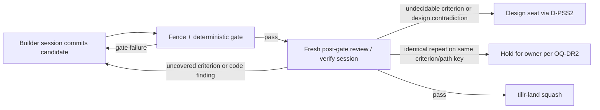

# Stop guessing seats at filing and paying a cold planner before every build: let the first step classify, let the builder fan out under profile-enforced tiers, and return review findings to the writer

**Status:** 2026-11-20. Proposal; nothing here is built. Repository behavior verified at `28bebdf35`.

> **In short.** Over 2026-11-18 and 2026-11-19, `tillr item request` forced filers to pick a seat before reading the design corpus and defaulted every build request into a three-node `planned-build@v1` pipeline whose planner proposed no split 82% of the time, threw away its analysis when it did not split, and re-ran from scratch on every failed verification. Request filing should stop pre-committing build workflows, blockless requests must be able to escalate to `design`, builders should start directly and fan out to tier-capped subagents enforced from the active drain seat profile, and failed verification should resume the writer's session on top of its existing commit.

**Why it matters.** Across the two-day audit of all run records for 2026-11-18 and 2026-11-19:

- **55 `plan` runs** on the judgement model cost **about $129** as reported, taking **about 32 minutes and 51 turns each**, mostly reading files; **45 of the 55 (82%) proposed no split**, and when no split was proposed the build step's brief carried nothing from `plan`, so the builder started cold.
- A failed `verify` restarted the item at `plan`, causing **24 of 51 planned items (47%)** to be planned **2 to 6 times**.
- A fully specified one-row config edit ran `plan`, `work`, and `verify` (**3 runs**) where same-sized single-worker items took **1**.
- `tillr item request` defaulted to `seat = "build"` and `planned-build@v1` unless the filer said otherwise, and **three requests that changed recorded design decisions** were filed by the operator as build work: **34 runs, about $74, none landed**.

**The shape.** Four subjects in the order the owner asked: [who decides an item's seat and workflow](#1-who-decides-an-items-seat-and-workflow-and-when), [what the plan step is for](#2-what-the-plan-step-is-for-if-anything), [how a builder fans out and who enforces model tiers](#3-if-the-builder-fans-out-nodes-or-subagents-model-tiers-and-enforcement), and [where a failed verify returns to](#4-where-a-failed-verify-returns-to), followed by [the owner's recorded ruling on same-model review](#5-recorded-ruling-same-model-review-and-verification) (`D-PSS1`) and [what happens to the two queued items](#6-what-happens-to-the-two-queued-items).
**Cost.** Removing `RequestDefaultWorkflow["build"] = "planned-build@v1"` from CLI request intake, adding `design`-seat conflict routing for store-declared requests (`body_ref == ""`), injecting run-scoped subagent tier caps in `tillr-run` from the active drain seat profile, and preserving the writer's `WorkerSession` across post-gate verification.
**Start at** [Section 1](#1-who-decides-an-items-seat-and-workflow-and-when) for the source of misfiled seats, [Section 2](#2-what-the-plan-step-is-for-if-anything) for the cost-and-gain comparison of retiring the separate planner, or [Open Questions](#open-questions) for the three owner choices.
**Needs your ruling:** [OQ-PSS1](#OQ-PSS1), [OQ-PSS2](#OQ-PSS2), and [OQ-PSS3](#OQ-PSS3); five engineering choices (`D-PSS2` through `D-PSS6`) in the [Decision Ledger](#decision-ledger) are marked as the designer's decisions under [`OQ-PR21`](../tillr/decision-provenance-review.md#decision-ledger), and `D-PSS1` records the owner's 2026-11-19 ruling on same-model review.
**Reads with:** [Planning and model tiering](./tillr-planning-node-model-tiering.md), [Diff review before landing](./tillr-diff-review.md), [The item graph is the whole path](./tillr-graph-is-the-path.md), [Named drain seat profiles](./tillr-seat-profiles.md), [Intake paths](./tillr-intake-paths.md), [Judge and lifecycle](./tillr-judge-and-lifecycle.md), and [Landing principles](./landing-principles.md).

---

## 1. Who decides an item's seat and workflow, and when

On 2026-11-19 the owner asked first: *"What was the source of the wrong seat at filing? Why are we picking a seat at filing? Let's start there."*

### 1.1 Today's intake doors and the two bugs that met on misfiled requests

Surveyed across [`tools/tillr-item/item/`](../../tools/tillr-item/item/) and [`tools/tillr-drain/drain/`](../../tools/tillr-drain/drain/), tillr has four intake doors, and only one of them asks a caller to guess a seat before the tree is read:

| Intake door | Code entry point | Who picks `seat` and `workflow` today | Has a document block (`body_ref`)? |
| :--- | :--- | :--- | :--- |
| Document-declared item | `parseItemDirective` in [`sync.go`](../../tools/tillr-item/item/sync.go); `selectWorkflow` in [`workflow_defaults.go`](../../tools/tillr-drain/drain/workflow_defaults.go) | Written inside an already-settled design or `-plan.md`; omits both by default, resolving to `build` and `single-worker@v1` at dispatch | Yes (`body_ref` names the Markdown section) |
| Saved idea (`tillr item idea`) | `Idea` in [`idea.go`](../../tools/tillr-item/item/idea.go) | Fixed to `seat = "design"` (`scouted-design@v1` or policy default); CLI offers neither `--seat` nor `--workflow` | No (handled as idea intake) |
| Document triage (`tillr item doc-triage`) | `DocTriage` in [`doc_triage.go`](../../tools/tillr-item/item/doc_triage.go) | Fixed to `seat = "design"` and `workflow = "doc-triage@v1"` | No (carries `workflow_args`) |
| Command-line request (`tillr item request`) | `normalizeRequest` and `RequestDefaultWorkflow` in [`request.go`](../../tools/tillr-item/item/request.go) | **Filer chooses**, or `normalizeRequest` silently defaults `Seat = "build"` and `Workflow = "planned-build@v1"` | **No (`body_ref = ""`)** |

Two mechanisms in the current tree combined to produce the **34 runs, ~$74, 0 landings** failure on the three design-changing requests:

1. **Pre-read classification at filing (`normalizeRequest`).** In [`tools/tillr-item/item/request.go`](../../tools/tillr-item/item/request.go), `normalizeRequest` sets `f.Seat = "build"` whenever `--seat` is omitted and maps `"build"` to `"planned-build@v1"` via `RequestDefaultWorkflow` (landed at `5a5c459de`). Knowing whether a natural-language request changes a recorded decision in `docs/design/` requires searching `docs/design/` and reading its Decision Ledgers — work neither the human typing a quick request nor an operator session filing on the owner's behalf has done at filing time. Even an explicit `--seat` requirement would have failed on those three items, because the operator believed they were build work when filing them.
2. **No path from `build` to `design` when `body_ref` is empty (`reportedBlock` and `conflictDecision`).** A CLI request deliberately carries `body_ref = ""` (`request_words` holds its statement). In [`tools/tillr-drain/drain/blocked.go`](../../tools/tillr-drain/drain/blocked.go), both `reportedBlock` (`else if c.BodyRef == ""`) and `conflictDecision` (`case c.BodyRef == ""`) assume only document-declared items can visit the `design` seat: any `definition`, `fence`, `seat`, or `owner` obstacle on a `body_ref == ""` request skips `design` completely and parks on `WaitingOn = "owner"`. Meanwhile, if the request was fenced to code paths (`tools/...`) rather than `docs/design/`, no worker in `planned-build@v1` may touch `docs/design/`, and `plan`'s prompt in [`planned-build@v1.json`](../../config/tillr/workflows/planned-build@v1.json) names only `OBSTACLE: owner` (omitting `definition` and `fence`, as noted in [Planning and model tiering Section 5.4](./tillr-planning-node-model-tiering.md#54-when-the-planner-cannot-plan)). Workers therefore tried repeatedly to satisfy design changes inside code files, failing `verify` and re-planning from node 0 until identical-repeat detection stopped them.

The same filing default also caused the **3-run vs 1-run penalty** on the fully specified one-row config edit: document-declared build items have `workflow = ""` and run `single-worker@v1` (1 run), whereas `tillr item request` locked every CLI build request into `plan -> work -> verify` (3 runs, plus ~340 s of node-handoff latency measured in [the quick-request latency report](../tillr/latency/2026-11-19-quick-request-latency.md#rank-3--default-3-node-planned-buildv1-workflow--read-only-keep-goingts-commit-trap-on-small-code-requests)).

### 1.2 Why seat and workflow belong to execution, not filing

For document-declared items, `idea`, and `doc-triage`, the intake door itself states the stage of thought: `idea` and `doc-triage` enter to produce design documents, and document blocks inside a settled `-plan.md` exist *because* a design already settled them.

A command-line request (`tillr item request`) is different: it is an unshaped ask arriving with saved words and a path fence. At filing time, three things are unknown until an agent inspects the repository:

1. **Does it require design first?** Does the ask alter or contradict a settled row in `docs/design/`, or leave a product, repository, model, spend, or user-visible choice unset under [`OQ-PR21`](../tillr/decision-provenance-review.md#decision-ledger)?
2. **Can it be built directly in one session?** Is it a clear, self-contained change (such as a one-row config edit or a single-package bug fix)?
3. **Should its work be fanned out?** Does it touch multiple packages or need broad mechanical search and parallelizable edits?

Picking a seat and workflow before reading the tree violates [Landing Principle §11 (diagnose rather than wait out)](./landing-principles.md#11-a-failure-is-diagnosed-not-waited-out): a wrong guess at filing locks `items.seat` and `items.workflow` into the store before any evidence exists.

### 1.3 Fixing `design` escalation for blockless requests (`D-PSS2`) and choosing the intake contract ([OQ-PSS1](#OQ-PSS1))

Two changes separate what is pure repair from what the owner chooses:

1. **Route blockless requests to `design` on design obstacles (`D-PSS2`, designer's decision).** Remove the `c.BodyRef == ""` short-circuit to `owner` in [`blocked.go`](../../tools/tillr-drain/drain/blocked.go) for store-declared `request_words` items (keeping `IsGeneratedItem` repair rules unchanged). When a worker on a CLI request reports `OBSTACLE: definition` (contradicts tree or recorded design rulings), `OBSTACLE: fence` naming `docs/design/`, `OBSTACLE: seat` after `policy.escalate["build"]` is exhausted, or `OBSTACLE: owner`:
   - `conflictDecision` dispatches the `design` seat with write access extended to `docs/design/` (without letting `design` edit code paths outside the request's fence unless it widens the request's stored `allowed_paths` on record).
   - If recorded rulings in `docs/design/` already answer the obstacle, `design` records the answer on the conflict (`NEXT-ACTOR: build`, widening `allowed_paths` if `fence` was the sole gap) and returns the request to `build`.
   - If the request genuinely changes a design decision or needs an owner ruling under [`OQ-PR21`](../tillr/decision-provenance-review.md#decision-ledger), `design` commits the new or amended design document under `docs/design/` with `💬` open questions and parks the item cleanly on those questions — costing 1 interrupted turn plus 1 design run instead of 34 wasted build runs.
2. **Who classifies at entry ([OQ-PSS1](#OQ-PSS1), owner decision).** Whether `tillr item request` drops `--seat` and `--workflow` so the first execution step classifies (inferring `design` automatically when `allowed_paths` lies wholly inside `docs/design/`, and otherwise starting on `build` with an explicit first-turn rule to check governing `docs/design/` docs and either escalate via `D-PSS2`, build directly in 1 run, or fan out), versus running a separate read-only intake classifier on every request, versus requiring `--seat` from the filer, touches the CLI and per-item run count and is put to the owner in [OQ-PSS1](#OQ-PSS1).

---

## 2. What the plan step is for, if anything

After reading the audit on 2026-11-19, the owner said: *"So what are the planners doing if the work is discarded and the builder never sees the analysis? ... This just seems to me that maybe we should leave this decision up to the builder. So the builder can either start building or fan things out ... maybe this is just something that needs a design doc around it for what the planner really should be given this evidence."*

### 2.1 Why today's `plan` step threw away 82% of its work

In [`config/tillr/workflows/planned-build@v1.json`](../../config/tillr/workflows/planned-build@v1.json), `plan` runs read-only on the `plan` seat (mapped to the judgement model: `gemini-4-carbon` in [`backend-policy.copilot.json`](../../config/tillr/backend-policy.copilot.json), `gpt-6.2-sol` in [`backend-policy.bedrock.json`](../../config/tillr/backend-policy.bedrock.json)) and declares `"outputs": { "proposal": "graph.proposal" }` so it *may* replace `work` with [`build-pieces@v1`](../../config/tillr/workflows/build-pieces@v1.json).

In [`tools/tillr-drain/drain/node_outputs.go`](../../tools/tillr-drain/drain/node_outputs.go), `(*Workflow).hasNamedFiles()` returns `true` whenever *any* stage in a workflow declares an input or output — including an optional `graph.proposal` that was never written. In [`tools/tillr-drain/drain/loop.go`](../../tools/tillr-drain/drain/loop.go), node staging copies `PreviousReport` only `if !decision.Workflow.hasNamedFiles()`.

Consequently, whenever `plan` decided no split was useful — **45 of the 55 audited `plan` runs (82%)** — `settleProposal` in [`graph_proposal.go`](../../tools/tillr-drain/drain/graph_proposal.go) left `work` untouched and wired no input file, while `hasNamedFiles()` suppressed `PreviousReport`. Every file read, symbol trace, and edge-case note from a **~32-minute, 51-turn judgement-model session** vanished into `node-report.md`, and `work` started cold on a fresh cache. (The exact same bug affects [`scouted-design@v1.json`](../../config/tillr/workflows/scouted-design@v1.json) when `open` proposes no `design-from-scouts@v1` split; `D-PSS6` fixes the underlying `loop.go` handoff regardless of what happens to `planned-build@v1`.)

### 2.2 Comparing the three options against the two-day audit

The audit's measurements test what each design option gains and loses against today's baseline (`planned-build@v1` on build requests, `single-worker@v1` on unmarked document items):

| Dimension | Today (`planned-build@v1` default on requests) | **Option A — Builder-led execution: no separate planner** *(the owner's proposal)* | **Option B — Builder-led default; keep `planned-build@v1` as explicit opt-in / escalation** | **Option C — Keep upfront `plan` with quick-out (`bb7e39762f`) + report handoff (`4c014f05ea`)** |
| :--- | :--- | :--- | :--- | :--- |
| **Upfront planner spend (55 runs, ~$129, ~32 min & 51 turns each; 45/55 no-split)** | Pays full judgement-model orientation on 100% of requests; discards analysis on the 82% no-split majority (~$106 of ~$129). | **$0 separate planner spend; 0 cold duplicate reads.** The builder reads once on the `build` tier and immediately edits or fans out on its warm cache. | **$0 on all ordinary items and requests;** paid only when `design` or `OBSTACLE: seat` explicitly selects `planned-build@v1` for a multi-module split. | Still wakes the judgement-model `plan` seat first on every request; saves `work`'s duplicate read on no-split items via `PreviousReport`, but still pays two cold caches whenever `plan` hands off to `work`. |
| **One-row config edit / small request (3 runs today vs 1 single-worker)** | **3 runs** (`plan`, `work`, `verify`) + two pass/settle seams (~340 s overhead). | **1 worker run** on the cheaper `build` model (+ post-gate diff review only on code paths per [`D-DR2`](./tillr-diff-review.md#decision-ledger)). | **1 worker run** on the `build` model (same as Option A). | **1 run, but on the wrong model tier:** `plan` does the edit itself on the expensive judgement model (`Carbon 4` / `Sol 6.2`) instead of the `build` model (`Hydrogen 4` / `Terra 6.1`), inverting [`OQ-PT1`](./tillr-planning-node-model-tiering.md#decision-ledger). |
| **Re-planning on failed verify (24 of 51 items planned 2–6 times)** | Re-runs `plan` from node 0 on every `verify-not-done`. | **Eliminated** (no `plan` step exists; review returns to the builder's session per [Section 4](#4-where-a-failed-verify-returns-to)). | **Eliminated** on ordinary items, and fixed by `D-PSS5` (return to writer session) on opt-in planned items. | Fixed only once paired with `D-PSS5`; still re-enters `plan` if an attempt is abandoned. |
| **Misfiled design changes (3 requests, 34 runs, ~$74, 0 landings)** | Loops through `plan -> work -> verify` or blocks raw on `owner`. | Caught on turn 1 by the builder's design-corpus check and routed to `design` via `D-PSS2`. | Same as Option A (`D-PSS2`). | Caught in `plan` once `definition`/`fence` and `D-PSS2` are added, at judgement-model turn prices. |

### 2.3 What is gained and what is lost under the owner's proposal (Option A)

**What Option A gains against today:**

1. **Eliminates the 82% no-split tax.** In 45 of 55 runs, paying a separate judgement session to read files for 32 minutes and 51 turns produced zero structural change to the workflow. Starting directly in the builder keeps orientation and editing in one prompt cache on the implementation tier (`Hydrogen 4` / `Terra 6.1` / `Sonnet 5.5`).
2. **Restores 1-run execution for small, clear changes on the cheap implementation tier.** A one-row config edit runs 1 `build` session (matching `single-worker@v1`) without inventing a mid-session `read_only -> write` mutation on `plan`.
3. **Ends 2-to-6x re-planning.** With no `plan` stage in front of `work`, the 24-of-51 re-planning multiplier disappears structurally rather than relying on heuristics.
4. **Retires [OQ-PT8](./tillr-planning-node-model-tiering.md#OQ-PT8)'s unbuilt size heuristic.** [Planning and model tiering Section 6.2](./tillr-planning-node-model-tiering.md#62-a-size-rule-tested-on-the-history) showed that upfront criteria/module counts only weakly predict cost; letting the builder inspect the actual code before deciding whether to build directly or fan out uses live truth instead of a pre-dispatch proxy.

**What Option A loses against today (and what bounds each loss):**

1. **No judgement-tier decomposition before the first `build` attempt when `build` runs a cheaper model than `plan`.** On the 10 of 55 runs (18%) where `plan` did propose pieces, a stronger judgement model (`Carbon 4` / `Sol 6.2`) chose the seams before `Hydrogen 4` / `Terra 6.1` touched code. Under Option A, an item whose architecture exceeds the `build` model tries on `build` first; if its tested attempt shows the task exceeds that model, `OBSTACLE: seat` (`escalateSeat` in [`seat_escalation.go`](../../tools/tillr-drain/drain/seat_escalation.go)) already moves the item to the stronger backend in `policy.escalate["build"]` (`Carbon 4` / `Sol 6.2`), and from there to `design` (`D-PSS2`). Paying the stronger model *only* when the `build` model actually fails an attempt is cheaper than paying $129 upfront across 55 runs where 45 needed no split.
2. **No per-piece durable Git checkpoints across separate drain runs.** In `build-pieces@v1`, each piece committed to the lane worktree before the next piece started, so a mid-attempt crash kept earlier pieces' commits inside that attempt (though a `verify-not-done` still discarded all of them via `l.abandon`). Under in-session subagent fan-out ([Section 3](#3-if-the-builder-fans-out-nodes-or-subagents-model-tiers-and-enforcement)), the builder coordinates children inside one run and makes incremental working progress inside its retained `WorkerSession`. (If the owner wants to preserve multi-node serial checkpoints for rare 3+-module designs without taxing default builds, Option B in [OQ-PSS2](#OQ-PSS2) keeps `planned-build@v1` strictly opt-in.)
3. **Write tools are present from turn 1.** A read-only `plan` stage could never dirty the worktree before reporting an obstacle; however, `resetLane` and `abandon` already clean any uncommitted edits when a `build` run ends `RESULT: blocked`, and `boundary.go` refuses out-of-fence writes before the gate.

Because retiring `planned-build@v1` changes which models run and removes a tracked workflow stage, the choice among **Option A** (retire separate `plan`), **Option B** (keep `planned-build@v1` only as explicit opt-in / escalation), and **Option C** (keep upfront `plan` with quick-out) is raised as [OQ-PSS2](#OQ-PSS2), leaning **Option A**.

---

## 3. If the builder fans out: nodes or subagents, model tiers, and enforcement

The owner noted: *"So the builder can either start building or fan things out and I guess it doesn't really matter if they fan things out within our nodes or sub agents but I guess we do need some level of structure for what kinds of models it gets fanned out to"*.

### 3.1 Drain nodes vs harness subagents (`D-PSS3`)

Surveyed against the live codebase, the two fan-out mechanisms have very different mechanics:

| Property | Drain workflow nodes ([`build-pieces@v1`](../../config/tillr/workflows/build-pieces@v1.json)) | Harness subagents (`pi-subagents` in [`run-pi`](../../tools/tillr-run/backends/pi/run-pi); `--agents` in `run-claude`) |
| :--- | :--- | :--- |
| **Can a running `work` node invoke it today?** | **No.** `settleProposal` in [`graph_proposal.go`](../../tools/tillr-drain/drain/graph_proposal.go) only allows replacing *downstream unstarted* stages after the proposer exits; a builder mid-run would have to stop its own session, wait a pass, and lose its warm context. | **Yes, live in-session.** Dispatches parallel `tasks` (`scout`, `delegate`, `worker`, `reviewer`) and receives structured results directly in tool output. |
| **Scheduling and cache cost** | ~120 s pass/settle overhead per node handoff ([Rank 3](../tillr/latency/2026-11-19-quick-request-latency.md#rank-3--default-3-node-planned-buildv1-workflow--read-only-keep-goingts-commit-trap-on-small-code-requests)); fresh cold prompt cache per piece; writers run strictly serially. | Zero pass-loop seams; parallel read-only scouts and parallel worktree-isolated (`worktree: true`) writers; parent builder stays warm to integrate, test, and commit once. |
| **Visibility in tillr** | Dispatched nodes (`L3` in [Subagent hoisting](./tillr-graph-is-the-path.md#9-subagent-hoisting)). | Observed child nodes (`L1`/`L2` under [`D-GP12`](./tillr-graph-is-the-path.md#decision-ledger)): `exec.go` and `progress.go` in [`tools/tillr-run/run/`](../../tools/tillr-run/run/) already capture `TILLR_CHILD_SESSIONS_ROOT` and emit `run.children-recorded`. |
| **Model-tier enforcement today** | **Enforced** by `tillr-drain` (`policy.Seats` + `read_only_seats` in [`graph_proposal.go`](../../tools/tillr-drain/drain/graph_proposal.go)). | **Unenforced leak today** (see [Section 3.2](#32-the-subagent-policy-leak-in-the-current-tree)). |

**Decision (`D-PSS3`, designer's decision):** When a builder fans work out, it uses **in-session harness subagents** (`L1`/`L2` observed child nodes under [`D-GP12`](./tillr-graph-is-the-path.md#decision-ledger)), not mid-run drain node replacement. Subagents avoid 120-second node seams, run searches and isolated worktree edits in parallel while keeping the parent builder warm to reconcile and run the suite, and produce one candidate commit judged once by `boundary.go`, the gate, and diff review. What subagents lack today is not node scheduling — it is mechanical binding to tillr's active seat policy.

### 3.2 The subagent policy leak in the current tree

Inspecting [`tools/tillr-run/backends/pi/run-pi`](../../tools/tillr-run/backends/pi/run-pi), [`yolo-packs/seat-profiles/files/seat-profiles.json`](../../yolo-packs/seat-profiles/files/seat-profiles.json), and the rendered Pi `settings.json` in a Copilot jail exposes why harness subagents currently bypass tillr's model structure:

1. **`run-pi` pins only the parent model.** `run-pi` passes `--model` for the top-level session from `backend-policy*.json`, leaving child subagent models entirely to the jail's interactive `~/.pi/agent/settings.json`.
2. **`seat-profiles.json` has no Copilot set and does not read drain profiles.** As documented in [Named drain seat profiles Section 2](./tillr-seat-profiles.md#2-boundary-and-vocabulary-what-a-seat-profile-is-and-is-not), Pi's `seat-profiles.json` defines interactive sets (`META`, `OR`, `CODEX`, `BEDROCK`) and knows nothing about `tillr-drain`'s active policy (`copilot-gemini`, `claude-sub`, or `backend-policy*.json`).
3. **Interactive `modelScope.allow` admits frontier and write-banned models.** Under the `copilot` profile, yolo's Pi derive sets `subagents.defaultModel` to `github-copilot/gemini-4-hydrogen` (so an unpinned `scout` runs on `Hydrogen 4` rather than `Flash 3.8`) and sets `subagents.modelScope.allow` to all 14 Copilot models — permitting any child subagent in a `build` run to pick `claude-opus-5.5`, `gpt-6.2-astra`, or `gemini-4-carbon`, or to put `gpt-6-luna` on a writing `worker`/`delegate` despite [`OQ-SP6`](./seat-profiles.md#decision-ledger) barring `Luna` from writing.

### 3.3 The three-tier fan-out structure and who enforces it (`D-PSS4`, [OQ-PSS3](#OQ-PSS3))

To give builder fan-out a single provider-agnostic structure across every drain seat profile (`copilot-gemini`, `bedrock`, and held `claude-sub`), fanned-out work is classified into **three tiers** derived from the active drain seat profile (`D-PSS4`):

| Tier | Kind of fanned-out work | Drain seat source | Harness subagent roles | Active profile models (`copilot-gemini` / `bedrock` / held `claude-sub`) | Hard invariants |
| :--- | :--- | :--- | :--- | :--- | :--- |
| **Tier 1 — Fast read-only floor** | File/symbol search, citation checks, log inspection, running named read-only test commands | `scout`, `test-run` (`read_only_seats`) | `scout` | `gemini-3.8-flash` / `gpt-6-luna` / `claude-haiku-5-5` | **Read-only tools only; never writes repository files** ([`OQ-SP6`](./seat-profiles.md#decision-ledger)). Default thinking `low`/`minimal`. |
| **Tier 2 — Implementation & review tier** | Bounded code edits, test authoring, docs/README updates, and internal pre-commit diff checks | `build`, `edit`, `test-write`, `docs`, `review` | `delegate`, `worker`, `reviewer` | `gemini-4-hydrogen` / `gpt-6.1-terra` / `claude-sonnet-5-5` *(plus write-approved cheap tier such as `Haiku 5.5` for `delegate` when a profile assigns `edit` there; never `Luna 6`)* | **Capped at the parent builder's tier;** concurrent writers must use `worktree: true` or disjoint task paths; same-model `reviewer` allowed per `D-PSS1`. |
| **Tier 3 — Judgement / design ceiling** | Architectural rulings, `definition`/`fence`/`owner` conflict resolution, or `OBSTACLE: seat` escalation | `design`, `policy.escalate["build"]` | `designer` (**never**); `oracle` (**off by default**, see [OQ-PSS3](#OQ-PSS3)) | `gemini-4-carbon` / `claude-fable-5-2` & `gpt-6.2-sol` / `claude-fable-5-2` | **No unscheduled upward fan-out** (unless [OQ-PSS3](#OQ-PSS3) takes Option B): tasks exceeding Tier 2 take `OBSTACLE: seat` or `D-PSS2` so the drain schedules and records the escalation. |

**Who enforces it (`D-PSS4`, designer's decision):**

1. **One policy source (`tillr-drain`).** The active drain seat profile (`config/tillr/profiles/<name>.json` per [Named drain seat profiles](./tillr-seat-profiles.md), or `config/tillr/backend-policy*.json` until that lands) is the sole source of model IDs. No vendor model ID is hardcoded in `tools/tillr*`.
2. **Staging-time compilation (`tillr-drain` -> `tillr-run`).** When staging a worker run on seat $S$, `tillr-drain` resolves the allowed child subagent table from the active policy (`scout` -> `policy.Seats["scout"]`, `delegate` -> `policy.Seats["edit"]`, `worker` -> `policy.Seats["build"]`, `reviewer` -> `policy.Seats["review"]`, stripping any role mapped above $S$'s tier) and passes that structured child-policy JSON to the backend adapter in the run directory.
3. **Tool-dispatch enforcement inside the adapter (`run-pi` and `run-claude`).**
   - **`run-pi`** writes a run-scoped settings file inside its isolated `PI_CODING_AGENT_DIR` setting `subagents.agentOverrides.<role>.model`, restricting `allowedAgents` (on `build`: `["scout", "delegate", "worker", "reviewer"]`), and setting `subagents.modelScope.{enforce: true, strict: true}` with **per-role `subagents.modelScope.agents.<role>.allow`** containing *only* that role's resolved Tier 1 or Tier 2 model. Any attempt by a prompt or child call to request `Opus`, `Fable`, `Astra`, `Carbon`, or `Luna`-on-a-writer is rejected immediately by `pi-subagents` before an API request leaves the process.
   - **`run-claude`** translates the same child-policy JSON into `--agents` definitions pinning `scout` (read-only tools, Tier 1 model) and `delegate`/`worker`/`reviewer` (Tier 2 model) when `claude-sub` runs.
   - *(On a `design`-seat run, the designer already runs at Tier 3 and [`designer.md`](../../yolo-packs/matt/files/pi/agent/agents/designer.md) restricts `allowedAgents` to read-only `scout`, `researcher`, and `evidence-auditor`, which `run-pi` pins to Tier 1 / Tier 2 per policy.)*
4. **Post-run fence and audit enforcement (`tillr-run` + `tillr-drain`).** `boundary.go` verifies that the combined worktree diff stays inside the item's `allowed_paths`, and `progress.go` records every child session's `role`, `model`, token count, and dollar cost from `TILLR_CHILD_SESSIONS_ROOT` into `run.children-recorded` (rolling child spend into `tillr drain why` and refusing in tests if an adapter ever ran an unpermitted model).

Whether a `build` worker should have **zero** upward subagent access (escalating solely via `OBSTACLE: seat`, Option A) or be allowed **one** bounded read-only `oracle` consultation per run on Tier 3 before declaring `OBSTACLE: seat` (Option B) touches judgement-model spend and is put to the owner in [OQ-PSS3](#OQ-PSS3).

---

## 4. Where a failed verify returns to

### 4.1 Why `verify-not-done` wiped out both the candidate and the plan 24 times

In the 2026-11-18 and 2026-11-19 audit, **24 of 51 planned items (47%) were planned 2 to 6 times** because a failed `verify` returned every item to node 0 (`plan`). Four code paths in [`tools/tillr-drain/drain/`](../../tools/tillr-drain/drain/) caused that reset:

1. **`settleJudgeFailure` (`judge.go`) and `returnedBrief` (`returned.go`)** emit `RefusalVerifyNotDone` with the fixed instruction *"The workflow verifier found criteria not done; revise the plan to cover them"* — treating every missing unit test, missed struct field, or unstated verification command as a planning failure, even in the 45 of 55 runs where `plan` proposed no split at all.
2. **`verify` overwrote the lane's `session-id` (`loop.go` / `worker_session.go`).** Because `verify` ran in the same lane after `work`, staging `verify` replaced `laneDirPath(laneID)/session-id` with the verifier's read-only session ID.
3. **`captureWorkerSession` (`worker_session.go`) looked up `c.RunID` (`verify`) instead of `work`.** Checking `w.Decision.Seat == "" || w.Decision.Seat == "build"` against the `verify` run (`Seat == "verify"`) always returned `nil`, leaving `ReturnedEnding.WorkerSession = nil`, while `finishEvaluatorHold` (`workflow_evaluator.go`) called `l.abandon`, discarding the candidate commit from the lane worktree.
4. **`retainedReaders` (`workflow_order.go`) discarded all stages once any writer ran.** Because `if stage.Access != "read_only" && outcomes[stage.ID] != ""` returns `0, nil, nil`, `plan.go` reset `resumeNode = 0` (`plan`) with zero `node_reused` rows on every retry.

### 4.2 Returning verification and review objections to the writer's retained session (`D-PSS5`)

The owner's standing ruling in [Judge and lifecycle (`D-JL10`)](./tillr-judge-and-lifecycle.md#44-how-a-worker-runs-ending-moves-its-item-d-jl10) is that a candidate refusal returns to the session of the worker that made the change, uncounted, and [Diff review before landing](./tillr-diff-review.md) (`D-DR4`, `D-DR9`, `D-DR12`, and the owner's 2026-11-19 ruling [`OQ-DR2`](./tillr-diff-review.md#decision-ledger)) specifies that one post-gate review replaces pre-gate `verify`. Applying those rulings settles the return path (`D-PSS5`):

1. **Default return: the writer's retained `WorkerSession`, with its commit kept on the lane.**
   - Staging a read-only evaluator or landing reviewer writes its session handle inside `RunDir(root, reviewRunID)` and **never** overwrites `laneDirPath(laneID)/session-id`.
   - Before running the reviewer/evaluator, the loop snapshots `WorkerSession` from the **last writing run** (`work`, or for an opt-in multi-piece workflow under [OQ-PSS2](#OQ-PSS2) Option B, the piece run that last touched the cited path, defaulting to the final writing piece for an uncovered criterion), and `finishEvaluatorHold` stops calling `l.abandon` on a resumable candidate.
   - On `not-done` / objection, the next pass resumes that writer's warm session (`resumed-worker` in `worker_session.go`) on top of its existing commit, carrying the exact uncovered criteria and findings in `returnedBrief`. The builder edits only what was missed, commits, and re-runs the gate — **never** restarting at `plan`.
2. **Design or specification defect (`cannot-judge` / `definition` / `fence`).** When the reviewer/verifier finds that a criterion contradicts the tree or requires a design decision, it routes to the `design` seat (including for `body_ref == ""` requests via `D-PSS2`), rather than sending an impossible instruction back to the builder.
3. **Identical repeat ([`OQ-DR2`](./tillr-diff-review.md#decision-ledger)).** When the normalized objection key (uncovered criterion IDs plus finding category and path) repeats an earlier review turn in the same chain, the loop stops immediately under `needs you` (`WaitingOn = "owner"`) with both the objection and the builder's answer shown, per the owner's 2026-11-19 ruling on [`OQ-DR2`](./tillr-diff-review.md#decision-ledger).

---

## 5. Recorded ruling: same-model review and verification

On 2026-11-19 the owner ruled that the same model may review or verify its own work (`D-PSS1`, recorded as closed and not reopened):

> *"I'm not sure that there's fundamentally any issue with the same model reviewing itself. We're going to give it a different briefing, give it a different goal. It has different context, maybe different effort level ... So I wouldn't rule that out."*

How this ruling governs the repository's seats and checks:

1. **Session independence, not model-family separation, is the hard rule.** `tillr-store` and `tillr-drain` continue to refuse a judge/reviewer that shares a `run_id` or `session_id` with the writer ([`OQ-JL2`](./tillr-judge-and-lifecycle.md#decision-ledger), [`D-DR1`](./tillr-diff-review.md#decision-ledger)). Neither the store, the workflow loader, nor `tillr-run` ever refuses a `review` seat, `verify` stage, or internal `reviewer` subagent because its model matches `build`.
2. **Four concrete levers separate reviewer from writer on the same model:**
   - **Fresh context:** the reviewer starts a new session with zero memory of the builder's turns or dead ends ([Diff review Section 3.1](./tillr-diff-review.md#31-what-the-reviewer-is-given));
   - **Distinct briefing and goal:** the reviewer is briefed to audit criteria coverage and diff defects against repository truth, reading the worker's report last and never as evidence (`D-DR6`);
   - **Independent `effort` setting per seat:** a drain seat profile (`config/tillr/profiles/<name>.json` or `backend-policy*.json`) may run `build` at `medium` effort and `review` on the **same model** at `high` effort (for example, `gemini-4-hydrogen` on Copilot per [`OQ-DR1`](./tillr-diff-review.md#decision-ledger), `gpt-6.1-terra` on Bedrock, or `claude-sonnet-5-5` on `claude-sub`), avoiding a jump to `Carbon 4`, `Sol 6.2`, or `Fable 5.2` unless live miss rates warrant switching the `review` seat later;
   - **Deterministic gate first:** tests, linters, `uvx vantage-check`, and `boundary.go` run before the reviewer is invoked (`D-DR4`).
3. **Subagent `reviewer` inside a builder run.** Under `D-PSS4`, a builder on Tier 2 may spawn a fresh-context `reviewer` subagent on that same Tier 2 model before committing, without crossing into Tier 3.

---

## 6. What happens to the two queued items

Reading the live store declarations and run history of both named `in-queue` requests settles their disposition under this design:

| Queued item | Current store state & what its words ask | Disposition under this design |
| :--- | :--- | :--- |
| **`item-request-bb7e39762f`** — *"Let the plan step answer 'just do it' and do the work in the same session"* (`seat: build`, `workflow: planned-build@v1`, fence: `tools/tillr-drain/`, `tools/tillr-run/`, `config/tillr/`, `yolo-packs/tillr/`) | Asks to keep `plan` as the entry step of `planned-build@v1` and let `plan` declare a `"quick way"` on small clear requests, dynamically lifting `read_only` so the `plan` session edits, tests, and commits, skipping `work`, `verify`, and post-build model review, and recording the quick way on `run.Record`. *(Ran 3 attempts / 9 node runs on 2026-11-19, hitting `verify-not-done` and an identical-repeat conflict on `run.Record`, `run-pi` `keep-going.ts`, and `judge_mode == "agent"` before being re-queued.)* | **Withdrawn** under the recommended design ([OQ-PSS2](#OQ-PSS2) **Option A**, and also under **Option B**). Starting directly on `build` (`single-worker@v1`) already executes small clear requests in **1 write-capable session on the cheaper `build` model** (`Hydrogen 4` / `Terra 6.1`) with zero `read_only -> write` mid-run mutation. By contrast, `bb7e39762f` would execute every small edit on the expensive judgement `plan` model (`Carbon 4` / `Sol 6.2`) and skip post-gate diff review on code commits against [`D-DR1`](./tillr-diff-review.md#decision-ledger). *(If the owner instead selects [OQ-PSS2](#OQ-PSS2) **Option C**, `bb7e39762f` **changes**: keep post-gate diff review on code commits, spell out `run.Record` in `tools/tillr-run/run/apply.go` and `keep-going.ts` unlock semantics, and align `plan`'s model cost.)* |
| **`item-request-4c014f05ea`** — *"Give the builder the planner's analysis when the plan proposes no split"* (`seat: build`, `workflow: planned-build@v1`, fence: `tools/tillr-drain/`, `tools/tillr-run/backends/`) | Cites the 2026-11-19 audit (55 `plan` runs, ~$129, ~32 min each, 45/55 no-split) and asks to include the `plan` node's report in `work`'s brief when no pieces are proposed. *(Note: its current fence omits `yolo-packs/tillr/`, which `just pack-sync` requires whenever `tools/tillr-drain/` is edited.)* | **Changes** (narrowed in scope and widened in fence) under [OQ-PSS2](#OQ-PSS2) **Option A** and **Option B** (or **changes fence only and stands** under **Option C**). Retiring `planned-build@v1` removes the `plan -> work` case under Option A, **but** the underlying `(*Workflow).hasNamedFiles()` bug in [`loop.go`](../../tools/tillr-drain/drain/loop.go) still drops `open`'s report before `write` in [`scouted-design@v1.json`](../../config/tillr/workflows/scouted-design@v1.json) whenever `open` proposes no scouts (observed live on this item's own `n1 -> n2` handoff). Re-scope `4c014f05ea` to implement `D-PSS6` — forward `PreviousReport` to any stage with `len(Inputs) == 0` when its predecessor wrote no wired output artifact — add `yolo-packs/tillr/` to `allowed_paths` so `just pack-sync` fits inside the fence, and dispatch it on `single-worker@v1` rather than `planned-build@v1`. *(If `scouted-design@v1`'s `open` node is also retired later, `4c014f05ea` may be **withdrawn** altogether.)* |

---

## Decision Ledger

`D-PSS1` records the owner's dated ruling of 2026-11-19 in his own words ([`OQ-PR22`](../tillr/decision-provenance-review.md#decision-ledger)). `D-PSS2` through `D-PSS6` are engineering decisions marked as the designer's under [`OQ-PR21`](../tillr/decision-provenance-review.md#decision-ledger); the owner may overturn any of them, and nothing is built until he answers [OQ-PSS1](#OQ-PSS1), [OQ-PSS2](#OQ-PSS2), and [OQ-PSS3](#OQ-PSS3).

| ID | Ruling / Decision | Date | Settled in | Built |
| :--- | :--- | :--- | :--- | :--- |
| D-PSS1 | **Owner ruling.** The same model may review or verify its own work; independence comes from a fresh session with different context, a review briefing and goal, and optionally a different effort level, never a ban on matching the writer's model: *"I'm not sure that there's fundamentally any issue with the same model reviewing itself. We're going to give it a different briefing, give it a different goal. It has different context, maybe different effort level ... So I wouldn't rule that out."* | 2026-11-19 | [Section 5](#5-recorded-ruling-same-model-review-and-verification) | Partly: store allows same-model judge ([`OQ-JL2`](./tillr-judge-and-lifecycle.md#decision-ledger)); policy alignment pending |
| D-PSS2 | **Designer's decision; the owner may overturn this.** Remove the `c.BodyRef == ""` bypass to `owner` in [`blocked.go`](../../tools/tillr-drain/drain/blocked.go) for store-declared `request_words` items so `definition`, `fence`, exhausted `seat`, and `owner` obstacles route to the `design` seat with write access to `docs/design/`, letting `design` either answer from recorded rulings and return to `build` or commit a design document with open questions. | 2026-11-20 | [Section 1.3](#13-fixing-design-escalation-for-blockless-requests-d-pss2-and-choosing-the-intake-contract-oq-pss1) | — |
| D-PSS3 | **Designer's decision; the owner may overturn this.** When a builder fans work out, use in-session harness subagents (`L1`/`L2` observed child nodes under [`D-GP12`](./tillr-graph-is-the-path.md#decision-ledger)) rather than mid-run drain node replacement, avoiding ~120 s pass/settle seams and cold caches while committing one candidate verified once by the gate and review. | 2026-11-20 | [Section 3.1](#31-drain-nodes-vs-harness-subagents-d-pss3) | Partly: `TILLR_CHILD_SESSIONS_ROOT` recording built; tier enforcement unbuilt |
| D-PSS4 | **Designer's decision; the owner may overturn this.** Partition builder fan-out into three tiers derived solely from the active drain seat profile (Tier 1 read-only `scout`/`test-run`, Tier 2 implementation/review `delegate`/`worker`/`reviewer` capped at the builder's tier and barring write-banned `Luna`, Tier 3 judgement/design ceiling), staged by `tillr-drain` into `tillr-run` and enforced at tool call time via run-scoped `pi-subagents` per-role `modelScope` + `allowedAgents` (`run-pi`) and `--agents` (`run-claude`), plus post-run `boundary.go` and `progress.go` verification. | 2026-11-20 | [Section 3.3](#33-the-three-tier-fan-out-structure-and-who-enforces-it-d-pss4-oq-pss3) | — |
| D-PSS5 | **Designer's decision; the owner may overturn this.** Run verification/review post-gate in a review-scoped session file without overwriting `laneDirPath(laneID)/session-id` or calling `l.abandon`, snapshot `WorkerSession` from the last writing run, and return uncovered criteria and code findings to that writer's retained session (`D-JL10`, `D-DR9`), while routing undecidable/design contradictions to `design` (`D-PSS2`) and stopping identical repeats on `owner` ([`OQ-DR2`](./tillr-diff-review.md#decision-ledger)). | 2026-11-20 | [Section 4.2](#42-returning-verification-and-review-objections-to-the-writers-retained-session-d-pss5) | — |
| D-PSS6 | **Designer's decision; the owner may overturn this.** In [`loop.go`](../../tools/tillr-drain/drain/loop.go) and [`node_brief.go`](../../tools/tillr-drain/drain/node_brief.go), pass `PreviousReport` to any successor stage with `len(Inputs) == 0` whenever the predecessor produced no wired output artifact (fixing optional `graph.proposal` stages such as `open -> write` in `scouted-design@v1` instead of suppressing `PreviousReport` via workflow-wide `hasNamedFiles()`). | 2026-11-20 | [Section 2.1](#21-why-todays-plan-step-threw-away-82-of-its-work), [Section 6](#6-what-happens-to-the-two-queued-items) | — |

---

## Open Questions

1. 💬 **OQ-PSS1: Should `tillr item request` stop choosing a seat and workflow at filing, letting the first step classify?**

   Filing requests today defaults to `build` + `planned-build@v1`, causing 3 misfiled design-changing requests (34 runs, ~$74, 0 landed) and 3 runs on a one-row edit ([Section 1](#1-who-decides-an-items-seat-and-workflow-and-when)).

   - **A — Unseated filing; first step classifies.** Infer `design` when fenced only to `docs/design/`; else start on `build` (`single-worker@v1`), escalating design changes on turn 1 (`D-PSS2`) or building in 1 run. Drop `--workflow`; keep `--seat` only as an override.
   - **B — Dedicated read-only triage run before `build`.** Classifies every request first, adding an extra session seam on every small edit.
   - **C — Require `--seat` at filing.** Still relies on pre-read guesses by the filer.

   <!-- vantage: question id=OQ-PSS1 leaning="A — removes pre-read seat guessing at filing, keeps one-row edits to 1 build run, and routes design-changing requests to design on turn 1 via D-PSS2." -->

   _Leaning:_ A — removes pre-read seat guessing at filing, keeps one-row edits to 1 build run, and routes design-changing requests to `design` on turn 1 via `D-PSS2`.

   **Answer:**

   > _(empty — fill in when decided)_

2. 💬 **OQ-PSS2: Should we retire the separate `plan` step (`planned-build@v1`) in favor of builder-led execution and fan-out?**

   Across 55 judgement-model `plan` runs (~$129, ~32 min each), 45 proposed no split and 24 of 51 items planned 2–6 times ([Section 2](#2-what-the-plan-step-is-for-if-anything)).

   - **A — Retire separate `plan` (your proposal: builder builds or fans out).** Start directly on `build`, fanning out via tier-capped subagents (`D-PSS3`, `D-PSS4`) and escalating oversized tasks via `OBSTACLE: seat`. Withdraws `item-request-bb7e39762f` and closes [`OQ-PT8`](./tillr-planning-node-model-tiering.md#OQ-PT8).
   - **B — Builder-led default; keep `planned-build@v1` as explicit opt-in.** Ordinary items run as in A; `design` or `OBSTACLE: seat` may still pick `planned-build@v1` (with `D-PSS5` and `D-PSS6`) for multi-module serial commits.
   - **C — Keep upfront `plan` with quick-out (`bb7e39762f`) + report handoff (`4c014f05ea`).** Runs quick-out edits on the expensive `plan` model and keeps two cold sessions on medium no-split items.

   <!-- vantage: question id=OQ-PSS2 leaning="A — eliminates the 82% no-split planner tax and 2–6x re-planning loop while keeping implementation on the cheaper build tier and escalating hard items via OBSTACLE: seat." -->

   _Leaning:_ A — eliminates the 82% no-split planner tax and 2–6x re-planning loop while keeping implementation on the cheaper `build` tier and escalating hard items via `OBSTACLE: seat`.

   **Answer:**

   > _(empty — fill in when decided)_

3. 💬 **OQ-PSS3: May a builder spawn a read-only `oracle` subagent on the judgement tier, or must all builder fan-out stay at or below the `build` tier?**

   Today `settings.json` lets any Pi subagent pick frontier models (`Opus`, `Fable`, `Astra`, `Carbon`); `D-PSS4` locks subagent tiers to the active drain seat profile ([Section 3.3](#33-the-three-tier-fan-out-structure-and-who-enforces-it-d-pss4-oq-pss3)).

   - **A — Strict ceiling at the `build` tier.** Builders may spawn Tier 1 read-only (`scout`) and Tier 2 implementation/review (`delegate`, `worker`, `reviewer`) subagents only; `oracle` and `designer` are disabled. Tasks exceeding the `build` model use `OBSTACLE: seat` so the drain schedules and records the escalation.
   - **B — Allow at most one read-only Tier 3 `oracle` call per `build` run.** Lets a stuck builder ask one architectural question in-session before declaring `OBSTACLE: seat`, adding judgement-model spend inside build runs.

   <!-- vantage: question id=OQ-PSS3 leaning="A — keeps all judgement- and design-tier spend scheduled and visible at the drain level via OBSTACLE: seat and D-PSS2 rather than hidden inside child subagent calls." -->

   _Leaning:_ A — keeps all judgement- and design-tier spend scheduled and visible at the drain level via `OBSTACLE: seat` and `D-PSS2` rather than hidden inside child subagent calls.

   **Answer:**

   > _(empty — fill in when decided)_
