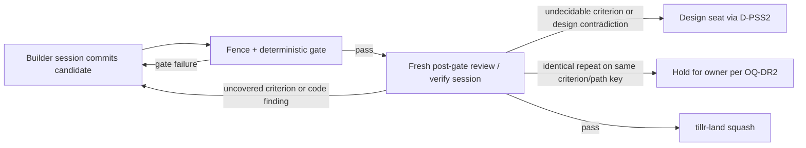

# Stop guessing seats at filing and paying a cold planner before every build: let the first step classify, let the builder fan out under profile-enforced tiers, and return review findings to the writer

**Status:** Partly built. The [Decision Ledger](#decision-ledger) says what the tree holds for each row. Not built: unseated request filing ([`OQ-PSS1`](#OQ-PSS1)), retiring `planned-build@v1` ([`OQ-PSS2`](#OQ-PSS2)), and subagent tier enforcement (`D-PSS4`). [`OQ-PSS3`](#OQ-PSS3) is open, and `D-PSS2` through `D-PSS6` are designer's decisions the owner may overturn.

> **In short.** A request filed with `tillr item request` does not choose a seat or a workflow: its first execution step reads the tree and classifies it, and a request that changes a recorded design decision goes to the `design` seat. There is no separate upfront `plan` step: a builder starts directly, and fans out to subagents whose roles and model tiers tillr sets from the active seat policy. A failed verification or review returns to the writer's own session, on top of its commit.

**Why it matters.** Measured over every run record of two consecutive days of drain operation:

- 55 `plan` runs averaged about 32 minutes and 51 turns each, mostly reading files. 45 of the 55 (82%) proposed no split, and the build step received nothing from them.
- A failed `verify` restarted the item at `plan`, so 24 of 51 planned items (47%) were planned 2 to 6 times.
- A fully specified one-row config edit took 3 runs (`plan`, `work`, `verify`) where a single-worker item of the same size takes 1.
- Three requests that changed recorded design decisions were filed as build work. They took 34 runs and none landed.

**The shape.** Four subjects: [who decides an item's seat and workflow](#1-who-decides-an-items-seat-and-workflow-and-when), [what the plan step is for](#2-what-the-plan-step-is-for-if-anything), [how a builder fans out and who enforces model tiers](#3-if-the-builder-fans-out-nodes-or-subagents-model-tiers-and-enforcement), and [where a failed verify returns to](#4-where-a-failed-verify-returns-to), then [the ruling on same-model review](#5-recorded-ruling-same-model-review-and-verification).

**Needs your ruling:** [`OQ-PSS3`](#OQ-PSS3).

**Reads with:** [Planning and model tiering](./tillr-planning-node-model-tiering.md), [Diff review before landing](./tillr-diff-review.md), [The item graph is the whole path](./tillr-graph-is-the-path.md), [Named drain seat profiles](./tillr-seat-profiles.md), [Intake paths](./tillr-intake-paths.md), [Judge and lifecycle](./tillr-judge-and-lifecycle.md), and [Landing principles](./landing-principles.md).

---

## 1. Who decides an item's seat and workflow, and when

### 1.1 The four intake doors

tillr has four intake doors, and only one of them asks a caller to choose a seat before the tree is read:

| Intake door | Code entry point | Who picks `seat` and `workflow` | Has a document block (`body_ref`)? |
| :--- | :--- | :--- | :--- |
| Document-declared item | `parseItemDirective` in [`sync.go`](../../tools/tillr-item/item/sync.go); `selectWorkflow` in [`workflow_defaults.go`](../../tools/tillr-drain/drain/workflow_defaults.go) | The settled design or plan document that declares it; both are omitted by default and resolve to `build` and `single-worker@v1` at dispatch | Yes |
| Saved idea (`tillr item idea`) | `Idea` in [`idea.go`](../../tools/tillr-item/item/idea.go) | Fixed to `seat = "design"`; the command offers neither `--seat` nor `--workflow` | No |
| Document triage (`tillr item doc-triage`) | `DocTriage` in [`doc_triage.go`](../../tools/tillr-item/item/doc_triage.go) | Fixed to `seat = "design"` and `workflow = "doc-triage@v1"` | No |
| Command-line request (`tillr item request`) | `normalizeRequest` and `RequestDefaultWorkflow` in [`request.go`](../../tools/tillr-item/item/request.go) | **The filer**, or the defaults `seat = "build"` and `workflow = "planned-build@v1"` | No |

### 1.2 Why seat and workflow belong to execution, not filing

For a document-declared item, an idea, and a document triage, the door itself states the stage of thought. A command-line request is an unshaped ask: saved words and optional path hints. Four things are unknown until an agent reads the repository:

1. **Does it need design first?** Does the ask alter or contradict a settled row in `docs/design/`, or leave a product, repository, model, spend, or user-visible choice unset under [`OQ-PR21`](../tillr/decision-provenance-review.md#decision-ledger)?
2. **Is it fork work, repository work, or both?** Nothing a filer writes selects fork handling (`D-PSS8`, with [`D-PT9`](./tillr-planning-node-model-tiering.md#59-deciding-fork-versus-repository-delivery-at-plan-time) and [`D-JL15`](./tillr-judge-and-lifecycle.md#48-planning-time-fork-delivery-the-delivery-obstacle-and-patch-branch-refusal-d-jl15)). A fence entry naming a lane's fork checkout is refused at filing, and delivery is classified after filing.
3. **Can one session build it?** Is it a clear, self-contained change?
4. **Should its work be fanned out?** Does it touch several packages or need broad mechanical search?

Choosing a seat and workflow before reading the tree breaks [Landing Principle §11](./landing-principles.md#11-a-failure-is-diagnosed-not-waited-out): a wrong guess at filing is stored before any evidence exists.

### 1.3 Unseated request filing ([OQ-PSS1](#OQ-PSS1)) and `design` escalation for blockless requests (`D-PSS2`)

1. **Unseated filing; the first execution step classifies ([OQ-PSS1](#OQ-PSS1), owner ruling).** `tillr item request` drops `--workflow` and the `planned-build@v1` default, and keeps `--seat` only as an explicit override:
   - When `allowed_paths` lies wholly inside `docs/design/`, dispatch infers `seat = "design"`.
   - Otherwise the request starts on `build` (`single-worker@v1`). Its first-turn rule is to check the governing `docs/design/` documents and then escalate a design-changing ask (`D-PSS2`), build a clear change directly in one run, or fan out to subagents (`D-PSS3`, `D-PSS4`).
   - *Rejected:* a dedicated read-only triage session before `build` adds a session to every one-row edit, and requiring `--seat` at filing still relies on a guess made before the designs are read.
2. **A blockless request reaches `design` on a design obstacle (`D-PSS2`, designer's decision).** A command-line request carries `body_ref = ""`. When its worker reports `OBSTACLE: definition`, `OBSTACLE: owner`, `OBSTACLE: fence` naming `docs/design/`, or `OBSTACLE: seat` after the build seat's escalation list is exhausted:
   - The planner dispatches the `design` seat with write access to `docs/design/`.
   - If recorded rulings answer the obstacle, `design` records the answer and returns the request to `build`.
   - If the request changes a design decision or needs an owner ruling, `design` commits the new or amended design document with its open questions, and the item waits on them.

---

## 2. What the plan step is for, if anything

### 2.1 What a no-split plan step costs

In [`config/tillr/workflows/planned-build@v1.json`](../../config/tillr/workflows/planned-build@v1.json), `plan` runs read-only on the `plan` seat and may replace `work` with [`build-pieces@v1`](../../config/tillr/workflows/build-pieces@v1.json) by writing a graph proposal. When it proposes no split, its whole output is a report. A successor stage that receives neither a wired input file nor that report starts cold, and repeats the reading on a fresh prompt cache. `D-PSS6` is the rule that the report is handed on.

### 2.2 The alternatives compared

| Dimension | `planned-build@v1` as the default on requests | **Chosen ([OQ-PSS2](#OQ-PSS2)): builder-led execution, no separate planner** | **Rejected: builder-led default, `planned-build@v1` opt-in** | **Rejected: keep the upfront `plan` step, with a quick way out and a report handoff** |
| :--- | :--- | :--- | :--- | :--- |
| **Upfront planner work** | A full judgement-model reading session on every request, unused on the 82% that propose no split. | None. The builder reads once and edits or fans out on its warm cache. | None on ordinary items; a multi-node workflow path stays to maintain. | The judgement model still runs first on every request, and two cold caches are paid whenever `plan` hands off to `work`. |
| **One-row edit** | 3 runs. | 1 run on the build model. | 1 run on the build model. | 1 run, on the more expensive judgement model. |
| **Re-planning after a failed verify** | Re-runs `plan`. | Cannot happen: no `plan` step exists. | Cannot happen on ordinary items. | Fixed only with `D-PSS5`. |
| **Misfiled design changes** | Loop through `plan`, `work` and `verify`. | Caught on turn 1 by the builder's design check and routed to `design` (`D-PSS2`). | Same as chosen. | Caught in `plan`, at judgement-model prices. |

### 2.3 Retiring the separate `plan` step for builder-led execution ([OQ-PSS2](#OQ-PSS2))

**What it gains:**

1. **No reading session whose result is unused.** Orientation and editing stay in one prompt cache on the build tier.
2. **One run for a small, clear change.**
3. **No re-planning.** With no `plan` stage in front of `work`, the repeat is impossible by construction.
4. **No size rule to tune.** [Planning and model tiering Section 6.2](./tillr-planning-node-model-tiering.md#62-a-size-rule-tested-on-the-history) shows that criterion and module counts only weakly predict cost. A builder that has read the code decides on live facts. This closes [`OQ-PT8`](./tillr-planning-node-model-tiering.md#OQ-PT8).

**What it costs, and what bounds each cost:**

1. **No judgement-tier decomposition before the first build attempt.** An item whose architecture exceeds the build model tries on `build` first. If the attempt shows that, `OBSTACLE: seat` moves the item up the build seat's escalation list ([`seat_escalation.go`](../../tools/tillr-drain/drain/seat_escalation.go)), and from there to `design` (`D-PSS2`). The stronger model is paid for only when the build model fails an attempt.
2. **No per-piece commit across separate drain runs.** Under in-session fan-out the builder coordinates its children inside one run and commits once.
3. **Write tools are present from turn 1.** A run that ends `RESULT: blocked` has its uncommitted edits reset, and the fence check refuses out-of-fence writes before the gate.

---

## 3. If the builder fans out: nodes or subagents, model tiers, and enforcement

### 3.1 Drain nodes vs harness subagents (`D-PSS3`)

| Property | Drain workflow nodes ([`build-pieces@v1`](../../config/tillr/workflows/build-pieces@v1.json)) | Harness subagents (`pi-subagents` in [`run-pi`](../../tools/tillr-run/backends/pi/run-pi); `--agents` in `run-claude`) |
| :--- | :--- | :--- |
| **Can a running `work` node use it?** | No. A graph proposal replaces only downstream stages that have not started, after the proposer exits. | Yes, in the session. The parent dispatches parallel tasks and receives their results as tool output. |
| **Scheduling and cache cost** | One pass-and-settle handoff per node and a cold prompt cache per piece; writers run serially. | No handoff; parallel read-only scouts and worktree-isolated writers; the parent stays warm to integrate, test and commit once. |
| **Visibility in tillr** | Dispatched nodes (`L3` in [Subagent hoisting](./tillr-graph-is-the-path.md#9-subagent-hoisting)). | Observed child nodes (`L1` and `L2` under [`D-GP12`](./tillr-graph-is-the-path.md#decision-ledger)): `tillr-run` records child sessions from `TILLR_CHILD_SESSIONS_ROOT` as `run.children-recorded`. |
| **Model-tier enforcement** | Enforced by `tillr-drain` from the policy's seats. | Not enforced ([Section 3.2](#32-what-the-adapter-pins)). |

**Decision (`D-PSS3`, designer's decision):** a builder that fans work out uses in-session harness subagents, not mid-run node replacement. They produce one candidate commit, judged once by the fence check, the gate and diff review. What subagents lack is binding to the active seat policy.

### 3.2 What the adapter pins

1. **`run-pi` pins only the parent model.** It passes `--model` for the top-level session from the backend policy. Child subagent models come from the machine's interactive Pi settings (`rg -n 'modelScope|allowedAgents' tools/tillr-run/backends/pi/run-pi` returns nothing).
2. **The interactive settings know nothing of the drain's policy.** [Named drain seat profiles Section 2](./tillr-seat-profiles.md#2-boundary-and-vocabulary-what-a-seat-profile-is-and-is-not) describes them as interactive model sets.
3. **So a child may run any model the interactive settings allow,** including a model above the builder's tier, or a model the policy bars from writing on a writing role.

### 3.3 The three-tier fan-out structure and who enforces it (`D-PSS4`, `D-PSS7`, [OQ-PSS3](#OQ-PSS3))

tillr controls which subagents and model tiers a builder may use (`D-PSS7`, owner ruling). Fanned-out work falls into three tiers derived from the active seat policy (`D-PSS4`):

| Tier | Kind of work | Drain seat source | Harness subagent roles | Invariants |
| :--- | :--- | :--- | :--- | :--- |
| **1: read-only floor** | File and symbol search, citation checks, log inspection, named read-only test commands | `scout`, `test-run` | `scout` | Read-only tools; never writes repository files. |
| **2: implementation and review** | Bounded code edits, test authoring, document updates, pre-commit diff checks | `build`, `edit`, `test-write`, `docs`, `review` | `delegate`, `worker`, `reviewer` | At or below the builder's tier; concurrent writers use isolated worktrees or disjoint paths; a same-model `reviewer` is allowed (`D-PSS1`). |
| **3: judgement and design** | Architectural rulings, obstacle resolution, seat escalation | `design`, the build seat's escalation list | `designer` (never from `build`); `oracle` (open in [`OQ-PSS3`](#OQ-PSS3)) | Set by tillr, never by the interactive settings; design changes route to `design` (`D-PSS2`). |

**Who enforces it (`D-PSS4`, designer's decision):**

1. **One policy source.** The active backend policy (`config/tillr/backend-policy*.json`, or a seat profile under [Named drain seat profiles](./tillr-seat-profiles.md)) is the only source of model ids. No vendor model id is written in `tools/tillr*`.
2. **Compiled at staging.** When `tillr-drain` stages a worker run, it resolves the allowed child table from the policy (`scout` from the `scout` seat, `delegate` from `edit`, `worker` from `build`, `reviewer` from `review`) and passes it to the backend adapter in the run directory.
3. **Enforced at tool dispatch in the adapter.** `run-pi` writes a run-scoped settings file that pins each role's model and restricts the allowed roles and models to the staged table, so a request for any other model is refused before an API call. `run-claude` translates the same table into `--agents` definitions.
4. **Checked after the run.** The fence check verifies the combined diff, and `tillr-run` records every child session's role, model and usage in `run.children-recorded`.

---

## 4. Where a failed verify returns to

A failed verification that sends an item back to its first node discards two things: the candidate commit and the writer's warm session. Neither loss is needed to act on a finding such as a missing test.

### 4.2 Returning verification and review objections to the writer's retained session (`D-PSS5`)

[Judge and lifecycle (`D-JL10`)](./tillr-judge-and-lifecycle.md#44-how-a-worker-runs-ending-moves-its-item-d-jl10) rules that a candidate refusal returns to the session of the worker that made the change, uncounted. [Diff review before landing](./tillr-diff-review.md) (`D-DR4`, `D-DR9`, `D-DR12`, and [`OQ-DR2`](./tillr-diff-review.md#decision-ledger)) rules that one post-gate review replaces a pre-gate `verify`. Together they settle the return path (`D-PSS5`):

1. **Default: the writer's retained session, with its commit kept on the lane.**
   - A read-only evaluator or reviewer keeps its session handle in its own run directory and never overwrites the lane's `session-id`.
   - Before the reviewer runs, the loop snapshots the session of the last writing run (`WorkerSession` in [`worker_session.go`](../../tools/tillr-drain/drain/worker_session.go)), and a resumable candidate is not abandoned.
   - On an objection, the next pass resumes that session on top of its commit, with the uncovered criteria and findings in its brief. The builder edits only what was missed, commits, and the gate runs again.
2. **Design or specification defect.** A criterion that contradicts the tree or needs a design decision routes to the `design` seat, including for a blockless request (`D-PSS2`).
3. **Identical repeat ([`OQ-DR2`](./tillr-diff-review.md#decision-ledger)).** When an objection's key (uncovered criterion ids plus finding category and path) repeats an earlier review turn in the same chain, the loop stops and waits on the owner, showing both the objection and the builder's answer.

---

## 5. Recorded ruling: same-model review and verification

The same model may review or verify its own work (`D-PSS1`, owner ruling).

1. **Session independence is the hard rule, not model-family separation.** A judge or reviewer that shares a `run_id` or `session_id` with the writer is refused ([`OQ-JL2`](./tillr-judge-and-lifecycle.md#decision-ledger), [`D-DR1`](./tillr-diff-review.md#decision-ledger)). Nothing refuses a `review` seat, a `verify` stage, or a `reviewer` subagent because its model matches `build`.
2. **Four levers separate reviewer from writer on one model:**
   - **Fresh context:** the reviewer starts a new session with no memory of the builder's turns ([Diff review Section 3.1](./tillr-diff-review.md#31-what-the-reviewer-is-given)).
   - **A different brief and goal:** the reviewer audits criteria coverage and diff defects against the repository, and reads the worker's report last and never as evidence (`D-DR6`).
   - **Its own effort setting:** a policy may run `build` and `review` on one model at different effort levels.
   - **The deterministic gate first:** tests, linters, document checks and the fence check run before the reviewer (`D-DR4`).
3. **A `reviewer` subagent inside a builder run.** Under `D-PSS4`, a Tier 2 builder may spawn a fresh-context `reviewer` on the same Tier 2 model before committing.

---

## Decision Ledger

`D-PSS1`, [`OQ-PSS1`](#OQ-PSS1), [`OQ-PSS2`](#OQ-PSS2), `D-PSS7` and `D-PSS8` are owner rulings. `D-PSS2` through `D-PSS6` are engineering decisions marked as the designer's under [`OQ-PR21`](../tillr/decision-provenance-review.md#decision-ledger); the owner may overturn any of them.

| ID | Ruling / Decision | Date | Settled in | Built |
| :--- | :--- | :--- | :--- | :--- |
| D-PSS1 | **Owner ruling.** The same model may review or verify its own work. Independence comes from a fresh session with different context, a review brief and goal, and optionally a different effort level, never from a ban on matching the writer's model. | 2026-11-19 | [Section 5](#5-recorded-ruling-same-model-review-and-verification) | Partly: the store allows a same-model judge ([`OQ-JL2`](./tillr-judge-and-lifecycle.md#decision-ledger)) |
| [`OQ-PSS1`](#OQ-PSS1) | **Owner ruling.** `tillr item request` stops choosing a seat and workflow at filing: `--workflow` and the `planned-build@v1` default are dropped and `--seat` stays only as an override. Dispatch infers `design` when `allowed_paths` lies wholly inside `docs/design/`, and otherwise starts on `build` (`single-worker@v1`), routing a design-changing request to `design` on turn 1 (`D-PSS2`). | 2026-11-20 | [Section 1.3](#13-unseated-request-filing-oq-pss1-and-design-escalation-for-blockless-requests-d-pss2) | No: `RequestDefaultWorkflow` in `tools/tillr-item/item/request.go` maps `build` to `planned-build@v1`, and the command takes `--workflow` |
| [`OQ-PSS2`](#OQ-PSS2) | **Owner ruling.** Retire the separate upfront `plan` step (`planned-build@v1`) in favor of builder-led execution: items start directly on `build` (`single-worker@v1`), fan out through tillr-controlled subagents (`D-PSS3`, `D-PSS4`, `D-PSS7`), and escalate oversized tasks with `OBSTACLE: seat`. Closes [`OQ-PT8`](./tillr-planning-node-model-tiering.md#OQ-PT8). | 2026-11-20 | [Section 2.2](#22-the-alternatives-compared), [Section 2.3](#23-retiring-the-separate-plan-step-for-builder-led-execution-oq-pss2) | No: `config/tillr/workflows/planned-build@v1.json` is the default for a build request |
| D-PSS7 | **Owner ruling.** Which subagents and model tiers a builder may use is controlled by tillr, not left to whatever the interactive settings offer. Whether that control is a strict ceiling at the build tier is [`OQ-PSS3`](#OQ-PSS3). | 2026-11-20 | [Section 3.3](#33-the-three-tier-fan-out-structure-and-who-enforces-it-d-pss4-d-pss7-oq-pss3) | No |
| D-PSS2 | **Designer's decision; the owner may overturn this.** A request with no document block routes `definition`, `fence`, exhausted `seat`, and `owner` obstacles to the `design` seat with write access to `docs/design/`. `design` either answers from recorded rulings and returns the request to `build`, or commits a design document with open questions. | 2026-11-20 | [Section 1.3](#13-unseated-request-filing-oq-pss1-and-design-escalation-for-blockless-requests-d-pss2) | Partly: `requestObstacleDesignInstruction` in `tools/tillr-drain/drain/obstacle.go` briefs the design seat for a request's `definition`, `owner` and `seat` obstacles; the `fence` case is not there |
| D-PSS3 | **Designer's decision; the owner may overturn this.** A builder that fans work out uses in-session harness subagents (observed child nodes under [`D-GP12`](./tillr-graph-is-the-path.md#decision-ledger)), not mid-run node replacement. | 2026-11-20 | [Section 3.1](#31-drain-nodes-vs-harness-subagents-d-pss3) | Partly: child sessions are recorded (`run.children-recorded`); tier enforcement is not built |
| D-PSS4 | **Designer's decision; the owner may overturn this.** Builder fan-out has three tiers derived only from the active seat policy: Tier 1 read-only, Tier 2 implementation and review at or below the builder's tier, Tier 3 judgement and design under [`OQ-PSS3`](#OQ-PSS3). `tillr-drain` stages the table, the adapters enforce it at tool dispatch, and the run's record is checked afterwards. | 2026-11-20 | [Section 3.3](#33-the-three-tier-fan-out-structure-and-who-enforces-it-d-pss4-d-pss7-oq-pss3) | No |
| D-PSS5 | **Designer's decision; the owner may overturn this.** Verification and review run in their own session without overwriting the lane's `session-id` or abandoning the candidate. Uncovered criteria and code findings return to the last writer's retained session (`D-JL10`, `D-DR9`); undecidable or design contradictions route to `design` (`D-PSS2`); an identical repeat waits on the owner ([`OQ-DR2`](./tillr-diff-review.md#decision-ledger)). | 2026-11-20 | [Section 4.2](#42-returning-verification-and-review-objections-to-the-writers-retained-session-d-pss5) | Partly: a `verify-not-done` ending resumes its `WorkerSession` unless the findings say the plan was wrong (`Replan` in `tools/tillr-drain/drain/returned.go`) |
| D-PSS6 | **Designer's decision; the owner may overturn this.** A stage with no wired input receives its predecessor's report whenever the predecessor produced no wired output file, so a stage that may propose a graph and does not (such as `open` before `write` in `scouted-design@v1`) still hands on what it read. | 2026-11-20 | [Section 2.1](#21-what-a-no-split-plan-step-costs) | Yes: node input staging in `tools/tillr-drain/drain/node_outputs.go` falls back to `PreviousReport` when no input path is wired |
| D-PSS8 | **Owner ruling.** Whether an item is fork work, repository work, or both is decided after filing; no filing can be wrong in a way that misdirects later work. Filing takes words and optional `--path` hints and refuses an entry naming a lane's fork checkout. Delivery is classified at the first step, a mid-run `OBSTACLE: delivery` restages and continues without waiting for the operator, and a candidate whose run moved a fork's delivery branch is refused before the gate ([`D-PT9`](./tillr-planning-node-model-tiering.md#59-deciding-fork-versus-repository-delivery-at-plan-time), [`D-JL15`](./tillr-judge-and-lifecycle.md#48-planning-time-fork-delivery-the-delivery-obstacle-and-patch-branch-refusal-d-jl15)). | 2026-11-19 | [Section 1.2](#12-why-seat-and-workflow-belong-to-execution-not-filing) | Not verified here; see the two linked sections |

---

## Open Questions

1. 💬 **OQ-PSS3: Under tillr's subagent control, should a `build` run have a strict ceiling at the `build` tier or permit a named exception such as one read-only higher-tier call per run?**

   Tillr controls which subagents and model tiers a builder may invoke from the active seat policy (`D-PSS7`, [Section 3.3](#33-the-three-tier-fan-out-structure-and-who-enforces-it-d-pss4-d-pss7-oq-pss3)). Still undecided is whether that control caps builder subagents strictly at the `build` tier or permits a narrow read-only higher-tier exception before a stuck builder escalates the run.

   - **A — Strict ceiling at the `build` tier.** Builders may spawn only Tier 1 read-only (`scout`) and Tier 2 implementation and review (`delegate`, `worker`, `reviewer`) subagents; higher-tier subagents (`oracle`, `designer`) are disallowed, and work exceeding the `build` model escalates via `OBSTACLE: seat` so the drain schedules and records it.
   - **B — Named exception: allow at most one read-only higher-tier `oracle` call per `build` run.** Keeps `designer` and all higher-tier writers disallowed, while letting a stuck builder ask one read-only Tier 3 `oracle` question in-session before declaring `OBSTACLE: seat`, adding judgement-model spend inside build runs.

   <!-- vantage: question id=OQ-PSS3 leaning="A — keeps all higher-tier spend scheduled and visible at the drain level via OBSTACLE: seat and D-PSS2 rather than spent inside child subagent calls." -->

   _Leaning:_ A — keeps all higher-tier spend scheduled and visible at the drain level via `OBSTACLE: seat` and `D-PSS2` rather than spent inside child subagent calls.

   **Answer:**

   > _(empty — fill in when decided)_
