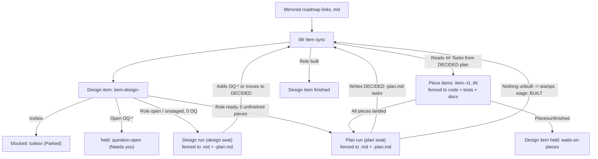

# The queue mirrors the roadmap's outstanding designs: one item per design, and its companion plan holds the work

**Status:** 2026-11-18. In review (`stage: DESIGN`); nothing in this document is built. Written to the owner's four statements of 2026-11-18, quoted in [Section 1](#1-the-direction-and-what-exists-today), including his ruling on [OQ-QM1](#OQ-QM1) that settles how a design's work reaches the queue through its companion implementation plan. Facts about the tree, the store and the planning index were measured on 2026-11-18 at `068774045`, `8c6194abf` and `e9a56e925`; each is stated with the document, symbol or command it came from. Every designer's decision in [the ledger](#decision-ledger) says so plainly and awaits the owner's review before anything is built on it.

> **In short.** Every unfinished design a mirrored roadmap routes gets one item in the queue, its state says what the design owes, and nothing about a question is copied into the store. The design's build steps, fences and pass conditions live in its companion implementation plan (`<topic>-plan.md`) — a file that grows alongside the design and that humans never read — while the design document stays free of build plumbing and hidden `<!-- tillr: item … -->` comments are retired everywhere.

**Why it matters.** Today an item exists only where an agent wrote a hidden `<!-- tillr: item … -->` comment into a document, and `tillr item sync` scans every tracked Markdown file silently. Of the 28 unfinished designs the tillr roadmap routes at `e9a56e925`, 26 have no unfinished item, so the queue can be empty while 26 designs are outstanding. Nine more were built and still said `DECIDED` until a hand sweep on 2026-11-18 (`0cfe5ad1c`), because nothing moves the stage word. Meanwhile, putting step fences and pass conditions inside design documents mixes human-facing decisions with agent execution plumbing.

**The shape.** Five parts:
- a **mirror** rule in sync that creates, finishes and reopens one **design item** per routed design, and skips companion `-plan.md` files as designs of their own;
- a pure function that reads the design's stage role, its questions, its place on the roadmap and its pieces, and says what the design item owes;
- a **companion implementation plan** (`<topic>-plan.md` beside `<topic>.md`) that the designer seeds as `stage: SKETCH` with research and notes, and that the plan run completes as `stage: DECIDED` with structured `## Tasks` entries carrying fences, dependencies, question holds and pass conditions in plain Markdown that sync reads directly;
- two runs the design item starts — a **design run** over the design and its plan seed, and a **plan run** that either writes the companion plan's tasks (which sync loads as pieces) or stamps both files `BUILT` when nothing remains unbuilt;
- a question hold that reaches only the design item and the pieces that name the question.

**Cost.** The queue starts work nobody filed by hand: on the first mirror of the tillr roadmap, unfinished designs outside the Icebox become dispatchable in roadmap order. The Icebox becomes the only way to say "not now", and `blocked` regains a meaning [queue persistence](./tillr-queue-persistence.md) took from it. The hidden `<!-- tillr: item … -->` comment, its scanner across `docs/`, its post-landing retirement commit and its supporting checks are deleted; work without a design enters through `tillr item request`.

**Start at [Section 4](#4-the-life-of-a-design-item-and-its-pieces)** for how one design item relates to the work read from its companion plan, then [Section 7](#7-the-companion-implementation-plan) for the companion plan's form and [Section 8](#8-retiring-the-hidden-comments-and-what-is-deleted) for what happens to existing comments and what is deleted.

**Needs your ruling:** none. The owner ruled [OQ-QM1](#OQ-QM1) on 2026-11-18.

**Awaits your review:** the designer's decisions `D-QM4` to `D-QM22` in [the ledger](#decision-ledger). You may overturn any of them.

**Reads with:** [queue persistence](./tillr-queue-persistence.md) and [its ruling](./queue-persistence-ruling.md) (what this amends; [Section 12](#12-what-this-supersedes-or-amends) lists the amendments owed), [the decision-provenance review](../tillr/decision-provenance-review.md) (whose [OQ-PR14](../tillr/decision-provenance-review.md#OQ-PR14) waited on [OQ-QM1](#OQ-QM1)), [the graph design](./tillr-graph-is-the-path.md) (every act is a node; a pure function adds the nodes that are needed), [planning and model tiering](./tillr-planning-node-model-tiering.md) (the plan seat this design's plan run uses), [early design landing](./tillr-early-design-landing.md) (how a changed design reaches the trunk ahead of its build), [the item module's guide](../../tools/tillr-item/README.md) and [the drain's guide](../../tools/tillr-drain/README.md) (what is built today).

---

## 1. The direction and what exists today

The owner gave four statements on 2026-11-18, and together they are the brief.

On what the queue holds:

> I don't want tillr to mirror this question like in a permanent store or anything, like open questions. But what I'm expecting is that when we sync a roadmap into tillr, we create an item for every design doc that is still out for any reason. And then we expect some of those to complete and some of them have open questions and that should be fully tracked. So if the queue is empty, that means there are no design docs [outstanding], regardless of open questions.

On the Icebox:

> Icebox items should be loaded too, marked blocked for icebox.

On learning that tillr reads a hidden Markdown comment of its own from his documents:

> tillr decided on its own markdown tags and is silently loading them everywhere? I don't want that.

And on [OQ-QM1](#OQ-QM1), answering how work written for a design becomes work tillr can start without putting tillr markup in the design document:

> So I already kind of have provisions for this. This is the idea of the design doc versus the implementation plan split. I think the implementation plan is intended to be a document that grows alongside the design doc that saves a research and stuff, but a human would never look at it. And it's the perfect place for something like this, we can change the form of that implementation plan. But I think that is essentially what you're talking about. It is planning that the designer does for how to implement something, but it's not something that is immediately relevant to a human. So that's why we keep it out of the design doc. See what you can do with that.

The repository already has that split in its authoring conventions (`design-doc` and `implementation-plan` skills) and in companion `docs/design/*-plan.md` files ([`tillr-live-drain-config-plan.md`](./tillr-live-drain-config-plan.md), [`status-bar-plan.md`](./status-bar-plan.md), [`board-utilities-plan.md`](./board-utilities-plan.md), [`tillr-definitions-plan.md`](./tillr-definitions-plan.md) among them). The design document is short, argues choices and trade-offs for a human reader, and stops at what and why; the companion implementation plan (`<topic>-plan.md` beside `<topic>.md`) holds the research, symbol maps, traps and ordered build tasks that agents write for agents. Adapting the companion plan's form gives tillr a tracked, versioned file in git from which to read pieces, fences and pass conditions while keeping every design document clean and reading nothing from arbitrary Markdown files.

Earlier rulings of the owner's bind this design throughout: nothing re-runs on a guess about what a change means; no attempt counts and no clocks that fail work; a held state names who moves it; the owner is reached only by a question written in a document; he sees "draining" or "needs you"; an item's fate and engineering detail are the agents' to decide.

**What sync does today**, read at `e9a56e925`:

| Fact | Where it comes from |
| :--- | :--- |
| Only a hidden comment creates a document-backed item. Sync scans every tracked `.md` file under `docs/` for a comment opening with `<!-- tillr: item`, and a document without one yields nothing | `docshare.ReadTracked` in `tools/tillr-item/docshare/docshare.go` and `parseItemBlocks` in `tools/tillr-item/item/sync.go` |
| After each piece lands, the loop commits a second change, `chore: retire landed document block`, deleting the comment and its `- **cN:**` lines from the document | `RetireItemBlock` in `tools/tillr-item/item/retire.go`, called from `tools/tillr-drain/drain/steps.go` |
| A design the roadmap links that holds no such comment gets a warning row, not an item. The row holds a document path and the roadmap line that links it | `designWithoutItems` in `tools/tillr-item/item/design_without_item.go`; shown by `tillr view waiting` |
| A design counts as covered when it holds any comment at all, landed or not, so one landed step hides a design whose other work was never filed | `designWithoutItems`, same file |
| An open question holds every unfinished item whose comment sits in the same file, related or not, and no item in any other file | Sync sets an item's `design_doc` to the file holding its comment; `tools/tillr-drain/drain/plan.go` holds on that document's first unanswered question |
| A design linked under a roadmap's Icebox heading and holding no comment creates nothing in the store | `sync_roadmap.go` and `D-QP5` in [queue persistence](./tillr-queue-persistence.md#5-the-icebox-and-the-narrowed-meaning-of-blocked-decision-5) |
| Nobody moves a stage word. The loop reads a stage for one purpose, to retire a designer's session when its document is done | `VantageQuestions` in `tools/tillr/vantage/vantage.go` and `retireDesigners` in `tools/tillr-drain/drain/designer.go` |
| `tillr item reconcile` classifies every indexed document as a read-only report, treats any document with an open question as owing no item, and is never called by the loop | `tools/tillr-item/item/reconcile.go` and `tools/tillr-item/README.md` |

**The size of it**, for [the tillr roadmap](../tillr/roadmap.md) at `e9a56e925` (`uvx vantage-check index --format json` joined to `.tillr/state.db` and `git ls-files 'docs/**/*.md'`):

| What | Count |
| :--- | ---: |
| Distinct targets the roadmap links (excluding its scope-exclusion section) | 55 |
| Non-design links (two other roadmaps, one research note, three `tools/*/README.md` guides) | 6 |
| Companion `-plan.md` files linked directly ([`tillr-definitions-plan.md`](./tillr-definitions-plan.md)) | 1 |
| Routed designs after excluding companion `-plan.md` files | 48 |
| Finished designs: `BUILT` (9), `SUPERSEDED` or `CURRENT` (11) | 20 |
| Outstanding designs: `SKETCH` or `DESIGN` (24), `DECIDED` (3), unstaged ([`momentum-principle.md`](./momentum-principle.md)) (1) | 28 |
| Outstanding designs linked only under `## Icebox` ([`tillr-autoqa.md`](./tillr-autoqa.md), [`tillr-goal-monitor.md`](./tillr-goal-monitor.md)) | 2 |
| Outstanding designs with at least one unanswered question | 14 |
| Live `<!-- tillr: item` comments across all of `docs/` (9 unfinished, 6 left behind by landed items) | 15 |

*(Note: [`tillr-muse-backend.md`](../reference/tillr-muse-backend.md) is also linked in the roadmap's Icebox, and its stage is `CURRENT` (graduated from `BUILT`), so it is finished rather than outstanding. The third Icebox bullet, "Prices on the observatory", links no document.)*

---

## 2. The words

| Word | Meaning | What it is not |
| :--- | :--- | :--- |
| **Sync** | `tillr item sync`: the one command that reads tracked roadmaps, routed designs and their companion plans, and brings the store's items into line with them. | Not the loop's planning pass, which reads the store and the live question index and decides what to start. |
| **Routes** | Vantage's word: a roadmap routes a document when it links it outside a `"What this page/file does not cover"` section. | Not "mentions": a document named in prose with no link is not routed. |
| **Stage role** | One of `open`, `ready`, `built`, `done`: what [`.vantage.toml`](../../.vantage.toml) says a document's `stage` word means (`SKETCH` and `DESIGN` are `open`; `DECIDED` is `ready`; `BUILT` is `built`; `CURRENT`, `GRADUATED` and `SUPERSEDED` are `done`). | Not the literal stage word. tillr reads roles so a repository can rename its words. |
| **Mirrored roadmap** *(coined here)* | A roadmap the repository's `.tillr.toml` names under `[sync] mirror_roadmaps`. | Not every roadmap in the repository unless configured. |
| **Design** | A document a mirrored roadmap routes that is not a companion plan (`*-plan.md`) and that either carries a `stage` or lives under `docs/design/`. | Not a companion `-plan.md` file, a module README, a research note or another roadmap. |
| **Companion plan** | The file `<dir>/<stem>-plan.md` beside a design `<dir>/<stem>.md`. Humans do not read it; agents write research into it during design (`stage: SKETCH`) and structured build tasks once the design is decided (`stage: DECIDED`). | Not a design of its own, even if prose links to it: its work belongs to `<dir>/<stem>.md` (`D-QM16`). |
| **Outstanding** *(from the owner's "still out")* | A design whose stage role is `open` or `ready`, or that has no `stage`. | Not "has open questions": a decided, unbuilt design is outstanding too. |
| **Finished** | A design whose stage role is `built` or `done`, or that no mirrored roadmap routes any longer. | Not "all its pieces landed", which is an inference from the store and is never used alone. |
| **Design item** *(coined here)* | The one queue item (`item-design-<slug>`) that stands for an outstanding design across its whole life. | Not a build slice; it never edits code outside its design and companion plan. |
| **Piece** | One buildable task read from a decided companion plan's `## Tasks` section (`item-<plan-slug>-<task-id>`): an ordinary item in the store with its own fence, dependencies and criteria, landing one commit. | Not a hidden comment in a design doc, and not an ephemeral in-memory sub-step. |
| **Request** | A standalone item filed straight into the store via `tillr item request` when work has no design document. | Not read from Markdown comments on a roadmap. |
| **Parked** | Linked under a roadmap heading that starts with `Icebox` (and nowhere on the roadmap's spine). | Not dropped, and not `not-started`. |

---

## 3. The invariant

After every whole sync that succeeds, for every mirrored roadmap:

1. **Every outstanding design has exactly one unfinished design item**, and that item names the design as its document.
2. **Every unfinished design item has an outstanding design.** A design whose stage role becomes `built` or `done`, or that leaves the mirrored roadmaps, has no unfinished design item.
3. **Every task in a `DECIDED` companion plan of an outstanding, unparked design has its piece in the store**, linked to that design item; a companion plan stamped `SKETCH` or `BUILT` contributes zero new pieces.
4. **So a queue with no unfinished item means no design is outstanding** on any mirrored roadmap, regardless of open questions.

The invariant is checkable from two inputs: Vantage's planning index over the tracked tree and the store's `items` table.

**What makes it hold:**

- **Deterministic IDs, no collisions.** A design item's ID is derived from its design path by stripping `docs/` and `.md`, lowercasing, turning every non-alphanumeric run into `-`, and prefixing `item-design-` (for example, `docs/design/tillr-storage.md` becomes `item-design-design-tillr-storage`, matching `tillr item reconcile`'s path-injective slug). Two paths that derive the same ID fail sync before any write.
- **Companion plans never double-count as designs (`D-QM16`).** A file ending in `-plan.md` whose sibling `<stem>.md` exists (or whose frontmatter `depends-on` names `<stem>.md` as its parent design) is paired with that design and never receives its own `item-design-*` row, even when a roadmap paragraph links to the plan in passing (as [the tillr roadmap](../tillr/roadmap.md) links to [`tillr-definitions-plan.md`](./tillr-definitions-plan.md) beside [`tillr-core-and-git-landing.md`](./tillr-core-and-git-landing.md)). A standalone `*-plan.md` with no parent design (such as [`status-bar-plan.md`](./status-bar-plan.md) only if its [`status-bar.md`](./status-bar.md) were absent) is treated on its own merits; when `<stem>.md` exists, `<stem>.md` is always the design.
- **Sync is the sole writer of design items and plan-derived pieces.** Sync creates, finishes and reopens design items, and imports or updates pieces from `DECIDED` companion plans, in one SQLite transaction. Sync never edits any Markdown file.
- **Unstaged means outstanding.** A routed design without a `stage:` key (such as [`momentum-principle.md`](./momentum-principle.md)) is outstanding, never skipped as finished; its first design run gives it a stage.
- **Fail-closed on index errors.** When `uvx vantage-check index --format json` fails or refuses, sync creates nothing and finishes nothing, records the error, and `tillr view` reports the queue state as unknown rather than empty ([Section 10](#10-edge-and-failure-behavior)).

**Which roadmaps mirror.** `.tillr.toml` declares `mirror_roadmaps = ["docs/tillr/roadmap.md"]` under `[sync]`; the default when unset is `[]`, so external repositories using tillr change nothing until they opt in (`D-QM5`). Vantage excludes `*/*-plan.md` from its human-facing Ready/needs-you action cards or marks companion plans `planning-actions: none` in frontmatter (`D-QM17`), so companion plans never clutter the owner's Vantage planning page.

---

## 4. The life of a design item, and its pieces

### 4.1. How one design item relates to the work in its companion plan

A design has **one design item** (`item-design-<slug>`) for its entire life, and **zero or more piece items** (`item-<plan-slug>-<task-id>`) read from its companion `<topic>-plan.md` once the design is decided and planned.

They do different jobs and never compete for the same edit:

1. **While the design is still being decided (`SKETCH`, `DESIGN`, or unstaged),** only the design item exists. No pieces exist in the store even if `<topic>-plan.md` already sits beside `<topic>.md` at `stage: SKETCH` holding research notes from design rounds.
2. **When the design reaches `stage: DECIDED` (`status: accepted`, zero unanswered questions),** the design item runs its **plan run** on the `plan` seat. That run inspects the codebase at `HEAD`, completes `<topic>-plan.md` at `stage: DECIDED` with ordered tasks under `## Tasks` (or finds nothing unbuilt and stamps `<topic>.md` `stage: BUILT`), and commits.
3. **When that commit lands, `tillr item sync` reads `<topic>-plan.md`** and materializes one piece item per task in `.tillr/state.db`, setting each piece's `design_doc` to `<topic>.md`, its `body_ref` to `<topic>-plan.md#<task-heading-slug>`, and its `from` / parent link to `item-design-<slug>`.
4. **While any piece of `<topic>.md` is unfinished,** the design item stays in the store and is **held waiting on its pieces** (`waits-on-pieces`), while the pieces themselves dispatch, gate, review and land as ordinary build items on their own worktrees and fences.
5. **When every piece has reached a finished state (`landed` or `resolved-elsewhere`),** the hold on the design item clears and the design item becomes dispatchable for a **plan run** again. That verification plan run checks the tree against `<topic>.md`'s ledger and `<topic>-plan.md`'s tasks:
   - If every promised piece is built on `main`, it updates `<topic>.md`'s `Built` column and moves `<topic>.md` (and `<topic>-plan.md`, if present) to `stage: BUILT` with the date, commit SHA and `MEASURED:` / `UNMEASURED:` note. When that commit lands, sync sees role `built` and finishes the design item.
   - If the tree still owes work (for example, a task was split or a follow-up piece surfaced), it appends the new task(s) to `<topic>-plan.md`, sync loads the new piece(s), and the design item waits on them again.
   - If a piece was `closed` unbuilt, the plan run never re-files the closed task ID automatically; if only closed work remains unbuilt, it raises an objection to the `design` seat because `<topic>.md` now promises something that was declined.



### 4.2. The state table for a design item

One pure function computes what a design item is on each pass from four recorded inputs: the design's stage role, the design's unanswered questions (from Vantage's index), whether the mirrored roadmap parks the design, and the design's pieces in the store. First matching row wins:

| # | Recorded facts | The design item | Shown as | Who moves it |
| :--- | :--- | :--- | :--- | :--- |
| 1 | Role `built` or `done`, or no mirrored roadmap routes it | Finished by sync | Not in the queue | Nobody; nothing is owed |
| 2 | The roadmap parks it under `Icebox` | `blocked`, reason `icebox` | Parked | `owner`; move the entry out of the Icebox |
| 3 | The planning index cannot be read | Held, reason `questions-unknown` | Needs a cause | Whoever repairs the index read |
| 4 | At least one unanswered question on `<topic>.md` or in `<topic>.md`'s `depends-on` `#OQ-*` fragments | Held, reason `question-open`, naming every one | Needs you (or Blocked if all are 🔒) | `owner` (or upstream blocker); answer in the document |
| 5 | Role `open` or unstaged, zero unanswered questions | Dispatchable: **design run** | Draining | `drain` |
| 6 | Role `ready`, and ≥1 piece of `<topic>.md` is unfinished | Held, reason `waits-on-pieces` | Draining (waits on work) | `drain`, as the pieces finish |
| 7 | Role `ready`, zero unfinished pieces | Dispatchable: **plan run** | Draining | `drain` |

Three consequences follow directly from the owner's rulings:

- **Zero question state in `.tillr/state.db`.** Row 4 is evaluated live from `uvx vantage-check index --format json` on every pass. No `questions` table, no mirrored question rows, and no `<!-- tillr-owner-question -->` HTML tags exist.
- **Icebox outranks open questions.** Parking a design in `## Icebox` moves both the design item and any unfinished pieces of its plan to `blocked` with reason `icebox`, so a parked design stops asking the owner for rulings until he unparks it.
- **Designs on the spine advance automatically.** Anything on a mirrored roadmap outside `## Icebox` is wanted now: row 5 runs the designer and row 7 runs the planner without a human hand-authoring an item block first.

### 4.3. The two runs of a design item

Both runs execute under the design item's ID, and both have a fixed two-file write fence computed mechanically from the design's path: **`<dir>/<stem>.md` and `<dir>/<stem>-plan.md`** (`D-QM13`). Neither run may edit code, roadmaps or other designs (unless an early-landing cut or explicit escalation widens it).

- **The design run** (row 5, `design` seat): reads `<topic>.md` (and `<topic>-plan.md` if one already exists). As the `design-doc` and `implementation-plan` skills specify, any codebase findings, symbol names, file maps or task sketches that surface while arguing the design are saved into `<topic>-plan.md` at `stage: SKETCH` (`planning-actions: none`), keeping `<topic>.md` concise and human-readable. The run ends in one of three ways:
  1. `<topic>.md` has every owner choice settled, its frontmatter moves to `status: accepted` and `stage: DECIDED`, and `uvx vantage-check` passes on both files;
  2. `<topic>.md` gains one or more `OQ-*` questions with `question` directives for choices only the owner can make, putting the item in row 4 on the next pass; or
  3. an explicit obstacle naming the next actor.
- **The plan run** (row 7, `plan` seat): reads the accepted `<topic>.md`, any `SKETCH` or prior `DECIDED` `<topic>-plan.md`, the store's completed piece history for `<topic>.md`, and the current repository tree at `HEAD`. It ends in one of two ways:
  1. **Work remains unbuilt:** it writes or updates `<topic>-plan.md` at `status: accepted`, `stage: DECIDED`, `planning-actions: none`, stamped with the `HEAD` commit SHA it surveyed, containing the prose map/traps and the structured `## Tasks` entries specified in [Section 7](#7-the-companion-implementation-plan). On landing, sync imports the new tasks as pieces and the design item enters row 6 (`waits-on-pieces`).
  2. **Nothing remains unbuilt:** it updates `<topic>.md`'s Decision Ledger `Built` column from tree evidence, sets `stage: BUILT` on `<topic>.md` (and on `<topic>-plan.md` if one exists) with date, commit SHA and a `MEASURED:` or `UNMEASURED:` clause, and commits. On landing, sync finishes the design item (row 1).

### 4.4. Finishing and reopening a design item

| What sync observes | What sync does to `item-design-<slug>` |
| :--- | :--- |
| `<topic>.md` has role `built` or `done`, and the design item is unfinished | Moves the design item to `resolved-elsewhere` (`--resolves-via doc:<topic>.md`, actor `tillr-item/sync`): a stage change landed outside the item's own final run (or before the mirror existed) |
| The design item's own plan run landed the `stage: BUILT` commit | Nothing; normal landing settlement already moved the item to `landed` (with its landing receipt) |
| No mirrored roadmap routes `<topic>.md` any longer, or `<topic>.md` was deleted | Closes the design item (`closed`) and closes any unstarted pieces of `<topic>-plan.md` |
| `<topic>.md` is outstanding again (for example, someone moved `stage: BUILT` back to `DESIGN` or `DECIDED`) and `item-design-<slug>` is in a finished state | Reopens `item-design-<slug>` to `in-queue` (or `blocked: icebox` if parked) with a sync receipt (`--by tillr-item/sync --reason "design outstanding again"`), ranked after existing ranked items (`D-QM6`) |

*Store note (`D-QM6`):* `tillr item reopen` and `SetStateWithReceipt` in `tools/tillr-item/item/lifecycle.go` and `state.go` already support reopening `closed` items and returning `landed` items with a receipt; Step 2 extends `SetStateWithReceipt` so sync's receipt reopens any finished `item-design-*` row when its design returns to an outstanding role, avoiding `-v2` clone IDs.

---

## 5. A question holds only what names it

Today an open question in a file holds every item in that file and nothing outside it. With pieces living in `<topic>-plan.md` and questions living in `<topic>.md` (or in an upstream design), file identity is the wrong join.

The rule (`D-QM10`):

- **A design item (`item-design-<slug>`) is held by every unanswered question in `<topic>.md`**, and by every unanswered question named as a `#OQ-*` fragment in `<topic>.md`'s frontmatter `depends-on` list.
- **A companion plan never carries owner questions.** `vantage-check` / sync refuses a `-plan.md` file that declares a `question` or `oq` directive (`plan-has-question`): if the planner hits a choice only the owner can make, it files an obstacle to the `design` seat, which writes the `OQ-*` question into `<topic>.md` and moves `<topic>.md` back to `stage: DESIGN`.
- **A piece is held only by the questions it explicitly names** in its task metadata (`Waits on questions:` in `<topic>-plan.md`, stored as `(doc_path, question_id)` references on the piece). A piece that names no question runs even if `<topic>.md` later gains an open question about a different slice, unless the owner parks the design in the Icebox or comments on `<topic>.md` (if [OQ-PR12](../tillr/decision-provenance-review.md#OQ-PR12) keeps the comment hold).
- **A plan run waits for every question on `<topic>.md`.** While `<topic>.md` has any unanswered question, row 4 precedes row 7 (and `vantage-check`'s `planning/stage-disagrees` forbids `DECIDED` with open questions anyway).

Question references are resolved live against Vantage's index on each pass: an answered question in `## Open Questions` (`✅`) or compacted into `## Decision Ledger` holds nothing; a referenced ID absent from both holds the piece with `question-removed`.

---

## 6. The Icebox

**What changes (`D-QM2`, `D-QM11`, `D-QM12`).** A design linked only under a mirrored roadmap's `## Icebox` heading gets its design item like any other outstanding design, and sync puts that design item — together with any unfinished pieces from its companion plan — into state `blocked` with reason `icebox`.

- **Reverses two points of `D-QP5`:** parked designs with no pieces still materialize their `item-design-<slug>` row, and parked items use `blocked` (with waiter `owner` and reason `icebox`) rather than `not-started`.
- **Hold-rule row:** reason `icebox`, location `queue`, class `parked`, mover `owner; move "<title>" out of the Icebox in <roadmap>`. `parked` counts neither in `draining` nor in `needs you`; `tillr view waiting` shows its count separately (`parked N`).
- **Unparking:** when the owner moves the link out of `## Icebox` onto the roadmap's spine, the next whole sync moves `item-design-<slug>` (and any `blocked: icebox` pieces of its plan) back to `in-queue` and assigns a rank if unranked. Only the owner edits `## Icebox`; no agent may park or unpark work.
- **Finished designs in the Icebox stay finished.** Row 1 precedes row 2, so [`tillr-muse-backend.md`](../reference/tillr-muse-backend.md) (`stage: CURRENT`, graduated from `BUILT`) gets no open row.
- **Documentless Icebox bullets** (such as "Prices on the observatory") create no item and are reported in sync's summary line (`icebox_without_doc: 1`) so nothing disappears silently.

---

## 7. The companion implementation plan

This section specifies the concrete form of `<topic>-plan.md` settled from the owner's [OQ-QM1](#OQ-QM1) ruling (`D-QM16` to `D-QM20`).

### 7.1. Pairing, visibility and lifecycle

1. **Path convention.** For any design `<dir>/<stem>.md`, its companion implementation plan is `<dir>/<stem>-plan.md` (for example, `docs/design/tillr-queue-mirrors-designs.md` pairs with `docs/design/tillr-queue-mirrors-designs-plan.md`). Frontmatter of `<stem>-plan.md` carries `depends-on: [<stem>.md]`, `status: draft | in-review | accepted`, `stage: SKETCH | DECIDED | BUILT | GRADUATED | SUPERSEDED`, and `planning-actions: none`.
2. **Humans never need to read it.** `planning-actions: none` (supported in Vantage 0.12; see `uvx vantage-check style-guide`) keeps `<stem>-plan.md` out of Vantage's Ready, graduation and compaction lists. Roadmaps link to `<stem>.md`, never to `<stem>-plan.md`. Design documents never contain `<!-- tillr: item … -->` comments, file-fence lists, or `- **c1:**` criterion blocks; a design's own migration/rollout section, when it has one, stays high-level architectural sequencing when order is load-bearing for risk or compatibility, and omits it otherwise.
3. **Two authoring phases, matching the `implementation-plan` skill:**
   - **During design (`stage: SKETCH`):** while `<stem>.md` is in `SKETCH` or `DESIGN`, the design agent creates or appends to `<stem>-plan.md` (`stage: SKETCH`) whenever research, measurements, symbol locations, edge-case notes or candidate task boundaries come up. Sync ignores `SKETCH` plans completely — free-form notes cannot trigger findings or premature items.
   - **After design acceptance (`stage: DECIDED`):** once `<stem>.md` is `DECIDED` with zero unanswered questions, the design item's **plan run** (`plan` seat) surveys the tree at `HEAD`, writes the prose orientation sections (`Ground truth`, `Map`, `Reuse`, `Traps`, `Don't`) for build workers, and writes the `## Tasks` section in the canonical grammar below, stamping `stage: DECIDED`.
   - **Completion (`stage: BUILT`):** when all tasks have landed and the verification plan run stamps `<stem>.md` `stage: BUILT`, it stamps `<stem>-plan.md` `stage: BUILT` in the same commit. Sync reads `## Tasks` only from companion plans of routed designs (or standalone `-plan.md` files explicitly listed) whose `stage` role is `ready` (`DECIDED`).

### 7.2. Canonical `## Tasks` grammar in `<topic>-plan.md`

Instead of hidden HTML comments anywhere in `docs/`, `<topic>-plan.md` expresses work as ordinary Markdown headings and a structured metadata list under `## Tasks` (`D-QM18`). Because humans never read `<topic>-plan.md`, its `## Tasks` section can be strict, unambiguous and validated by `tillr item sync` without hiding anything inside comments:

```markdown
---
title: "Queue mirrors designs — implementation plan"
status: accepted
stage: DECIDED
updated: 2026-11-18
planning-actions: none
depends-on:
  - tillr-queue-mirrors-designs.md
summary: "Completed against the tree at e9a56e925: six tasks across tillr, tillr-item, tillr-drain and tillr-view."
---

# Queue mirrors designs — implementation plan

**Design:** [`tillr-queue-mirrors-designs.md`](./tillr-queue-mirrors-designs.md)
**Tree stamped at:** `e9a56e925`

## Map and traps

- `tools/tillr/vantage/vantage.go` (`parseVantageIndex`) currently drops stage roles down to a boolean `Done`; expose the four-role enum (`open`, `ready`, `built`, `done`).
- Every edit under `tools/tillr*` must run `just pack-sync` in the same commit (`tests/pack-sync.test.py`).

## Tasks

### Task t1: Expose four-valued stage roles in the shared Vantage reader

The shared Vantage reader collapses stages to `Done bool`, forcing `design_without_item.go` and `reconcile.go` to parse `.vantage.toml` or literal stage words on their own. Exposing the four roles in one place lets sync and the planner agree on every repository's vocabulary.

- **Paths:** `tools/tillr/`, `tools/tillr-item/`, `yolo-packs/tillr/`
- **Seat:** `build`
- **After:** none
- **Verify:** `python3 tools/go-test-shards.py tools/tillr -k 6 && python3 tools/go-test-shards.py tools/tillr-item -k 6 && just pack-sync`
- **Criteria:**
  - **c1:** `vantage.Document` exposes `StageRole` in `{"", "open", "ready", "built", "done"}` from the index payload, and a repository that renames `DECIDED` in `.vantage.toml` yields role `ready`.
  - **c2:** No Go file under `tools/tillr*` compares literal stage strings (`"SKETCH"`, `"DESIGN"`, `"DECIDED"`, `"BUILT"`, `"CURRENT"`, `"GRADUATED"`, `"SUPERSEDED"`).

### Task t2: Mirror routed designs into design items during sync

Sync needs to materialize, finish and reopen `item-design-<slug>` rows for every outstanding design on a mirrored roadmap so an empty queue means no design is outstanding.

- **Paths:** `tools/tillr-item/`, `tools/tillr-drain/`, `.tillr.toml`, `yolo-packs/tillr/`
- **After:** `t1`
- **Workflow:** `planned-build@v1`
- **Criteria:**
  - **c1:** After `tillr item sync` on a fixture with one design per role plus one unstaged, one iceboxed and one with open questions, every outstanding design has one unfinished `item-design-<slug>` row and finished designs have none.
  - **c2:** Companion `*-plan.md` files paired with a `<stem>.md` design never receive their own `item-design-*` row even when linked from the roadmap.
  - **c3:** When the planning index is unreadable, sync creates and finishes zero design items and exits non-zero with the reader's error.
```

### 7.3. Exact field mapping and validation rules (`D-QM18`, `D-QM19`)

Under `## Tasks` in a `DECIDED` companion plan `<dir>/<stem>-plan.md`:

| Plan element | How `tillr item sync` reads and validates it |
| :--- | :--- |
| **Heading `### Task <local_id>: <Imperative title>`** | `<local_id>` matches `^[a-z0-9][a-z0-9-]*$` (unique within the plan, e.g. `t1`, `sync-mirror`). Derived store `item_id` is `item-<plan-slug>-<local_id>` where `<plan-slug>` is `<dir>/<stem>` stripped of `docs/` and `design/` noise and slugified (or an optional `- **ID:** item-...` key when migrating a legacy item ID verbatim). `<Imperative title>` is the item's `title` (imperative verb, ≤12 words, checked directly without a `prose="2"` shibboleth). |
| **Why paragraph(s) + worker notes** | Prose between the `### Task` heading and the metadata bullets (plus any `**Notes:**` / `**Preconditions:**` blocks after `- **Criteria:**`) becomes the piece's body context at `<dir>/<stem>-plan.md#<heading-slug>`, read by the build worker alongside `<dir>/<stem>.md`. |
| **`- **Paths:** <prefix>, ...`** | Required. Backticked or plain comma-separated repo-relative prefixes that exist on `HEAD` (or parent directories for new files, plus `.forks/lanes/lane-1/<fork>/` for fork tasks), no globs. Mapped to `allowed_paths`. |
| **`- **After:** <ref>, ...` or `none`** | Optional (defaults to `none`). Each `<ref>` is either a sibling `<local_id>` in the same plan (expanded to that sibling's `item_id`) or a full `item-...` ID in the store. Mapped to `blocked_by`. |
| **`- **Seat:** <seat>`** | Optional (defaults to `build`). Validated against `tools/tillr-item/item/seat.go` (`build`, `design`, `review`, `scout`, `plan`, `edit`, `test-writing`, `test-running`, `docs`, `verify`). |
| **`- **Workflow:** <name>@v<N>`** | Optional (defaults to the charter's default build workflow, e.g. `planned-build@v1` or `single-worker@v1`). Note how the two planning layers compose (`D-QM20`): `<topic>-plan.md` cuts a **design** into **pieces** (each one commit, one queue item); within a complex piece, `planned-build@v1`'s runtime `plan` node may further split that single commit's work across cheap `edit` / `test-writing` / `docs` sub-nodes (`build-pieces@v1`) on the same worktree. |
| **`- **Waits on questions:** <doc>#OQ-..., ...`** | Optional (defaults to none). Stored as question references for [Section 5](#5-a-question-holds-only-what-names-it). |
| **`- **Claims:** c2=direction, ...`** | Optional (defaults to `verification-only` for every criterion). Validated against `D-JL2`'s claim classes. |
| **`- **Judge:** agent \| mechanical`** / **`- **Express:** true`** | Optional overrides matching today's item schema. |
| **`- **Verify:** <command>`** | Optional targeted verification command surfaced in the worker's brief. |
| **`- **Criteria:**` with nested `- **c<N>:** <text>`** | Required (`c1..cK`, 1 to 8 non-empty judgeable conditions). Mapped to `item_criteria`. |

**No post-landing file deletion commit (`D-QM19`).** When a piece lands:
- `.tillr/state.db` records the `landings` receipt, the `done` criterion verdicts, and `state = landed`.
- **The loop does NOT run `RetireItemBlock` or make a second `chore: retire landed document block` commit.** `<topic>-plan.md` stays untouched as each piece lands — eliminating 33+ extra trunk commits and the race where a retirement commit clashed with sibling lanes (`d81e54c50`, `f87ad8923`).
- On the same machine, sync sees `item-<plan-slug>-<local_id>` already `landed` in `.tillr/state.db` and leaves it finished. Once the final piece lands, the design item's verification plan run stamps `<topic>.md` and `<topic>-plan.md` `stage: BUILT` in one clean commit, after which a cold machine rebuilding `.tillr/state.db` from git skips both files because their stage role is `built`.
- What if a machine loses `.tillr/state.db` *mid-wave*, after 2 of 5 pieces landed and before `<topic>-plan.md` is stamped `BUILT`? If [OQ-PR1](../tillr/decision-provenance-review.md#OQ-PR1) restores commit-level item attribution, sync marks those 2 pieces `landed` from `git log` on cold rebuild; if [OQ-PR1](../tillr/decision-provenance-review.md#OQ-PR1) keeps commits unnamed, the planner/worker checks the tree against `c1..cN` and resolves an already-present piece via `resolved-elsewhere` (`commit:<sha>`). Either way, no post-landing deletion commit is ever needed.

**What about prose rewriting ([OQ-PR14](../tillr/decision-provenance-review.md#OQ-PR14))?** Under this split:
- Your human-read documents (`<topic>.md` and `roadmap.md`) carry **no** item blocks or build steps, so no cheap model ever edits wording inside your design documents, and no `prose="2"` shibboleth comment exists anywhere.
- Companion plans (`<topic>-plan.md`) are written by the `plan` seat and checked directly by `tillr item sync` for imperative task titles and non-empty criteria; a malformed task in `<topic>-plan.md` refuses the plan run at the gate before it lands.
- Standalone requests (`tillr item request`) live only in `.tillr/state.db`, so any triage/prose shaping of a raw request happens on tillr's side (or by spawning a new `<topic>.md` design when the request needs design).

---

## 8. Retiring the hidden comments, and what is deleted

### 8.1. Fate of the 15 existing `<!-- tillr: item … -->` comments in `docs/`

Measured at `e9a56e925`, `docs/` contains **15** live unfenced `<!-- tillr: item … -->` declarations across **5** files (plus fenced documentation specimens in [`tillr-queue-persistence.md`](./tillr-queue-persistence.md) and [`queue-persistence-ruling.md`](./queue-persistence-ruling.md)):

| File | Live comments | Current state in `.tillr/state.db` | What happens in the cutover (`D-QM21`) |
| :--- | ---: | :--- | :--- |
| [`docs/pi/usage-recording-request.md`](../pi/usage-recording-request.md) (`stage: CURRENT`) | 6 | All 6 `landed` (missed by block retirement) | Strip all 6 HTML comments; keep surrounding historical prose |
| [`docs/tillr/roadmap.md`](../tillr/roadmap.md) (`item-landing-call-pi-fork-park`) | 1 | `landed` (missed by block retirement) | Strip the HTML comment |
| [`docs/design/tillr-autoqa.md`](./tillr-autoqa.md) (`item-design-autoqa-slices`) | 1 | `not-started` | Close `item-design-autoqa-slices` and strip the HTML comment: AutoQA's mirrored design item `item-design-design-tillr-autoqa` (`blocked: icebox`, then design run -> plan run) replaces it |
| [`docs/design/status-bar-plan.md`](./status-bar-plan.md) (`item-bar-ironbar-config-v2`) | 1 | `not-started` (parked on `docs/roadmap.md` Icebox) | Rewrite Task 4 of [`status-bar-plan.md`](./status-bar-plan.md) into the `## Tasks` companion-plan format (keeping `ID: item-bar-ironbar-config-v2` alongside [`status-bar.md`](./status-bar.md)) and delete the HTML comment |
| [`docs/tillr/roadmap.md`](../tillr/roadmap.md) (`item-landing-call-delivery-tests`, `item-landing-call-pi-switch-on`, `item-landing-call-obstacle-tool`) | 3 | 1 `blocked`, 2 `in-queue` | Move those unlanded tasks (and their Agent Details) out of [`roadmap.md`](../tillr/roadmap.md) into [`tillr-landing-call.md`](./tillr-landing-call.md)'s companion `docs/design/tillr-landing-call-plan.md` (preserving their exact `item-*` IDs so store history and `blocked_by` edges stay intact), and delete the HTML comments and item prose from [`roadmap.md`](../tillr/roadmap.md) (fulfilling roadmap entry 9 at the same time) |
| [`docs/tillr/roadmap.md`](../tillr/roadmap.md) (`item-gate-pinned-fork-inputs`, `item-agent-default-bmad-superpowers-skills`) and [`docs/cost-levers/qa.md`](../cost-levers/qa.md) (`item-bedrock-claude-latest-only`) | 3 | 1 `in-queue`, 2 `blocked` | Any still unfinished at cutover keep their live definitions in `.tillr/state.db` as standalone requests (or move into a companion `-plan.md` where a design owns them, such as [`gate-rework.md`](./gate-rework.md)'s `gate-rework-plan.md` for `item-gate-pinned-fork-inputs`), and their HTML comments are stripped from [`roadmap.md`](../tillr/roadmap.md) and [`qa.md`](../cost-levers/qa.md) |

*(None of those 15 comments is touched by this design commit; they are migrated and stripped in the cutover build task once the companion-plan reader is in place.)*

How work with **no design document** enters from then on (`D-QM21`):
- Small chores, bug fixes and ad-hoc requests with no design enter through `tillr item request` (or the observatory's idea box, which creates a design when the work needs one and a request when it does not).
- Roadmaps go back to being pure ordered links and short priority rationale (~200 lines), never a 9,000-line warehouse of build specs and HTML comments.

### 8.2. What is deleted (`D-QM22`)

Once sync reads mirrored roadmaps and `## Tasks` in companion `-plan.md` files and the 15 comments above are migrated, all of the following are deleted:

1. **The hidden HTML item-comment scanner across `docs/`:** `tools/tillr-item/docshare/` (`Start`, `AttributePattern`, `Declared`, `Sharing`, `ReadTracked` scanning every `docs/**/*.md` file) and `parseItemBlocks` in `tools/tillr-item/item/sync.go`. Replaced by a parser that reads **only** configured roadmaps and `## Tasks` inside `DECIDED` `*-plan.md` companion files, plus a gate check (`tests/tillr-docs.test.py` / `tools/fork-check.py`) that **refuses** any unfenced `<!-- tillr:` comment in tracked Markdown so silent tags can never creep back in.
2. **Post-landing block-retirement commits:** `tools/tillr-item/item/retire.go` (`RetireItemBlock`, `retire` CLI face), the retirement step in `tools/tillr-drain/drain/steps.go`, and the retirement-commit exemptions in `tools/tillr-drain/drain/` (`d81e54c50`, `f87ad8923`).
3. **The hidden owner-question HTML comment:** `tools/tillr-item/item/owner_question.go` (`<!-- tillr-owner-question … -->`), which already has zero live instances in `docs/`.
4. **The `prose="2"` shibboleth and document-rewriting item spawner:** `prose.go` / `prose_rewrite` item generation (`rewrite-<id>` items that rewrite an author's Markdown block in place) and `document_prerequisite.go`'s `prose="2"` requirement. Task headings and criteria in `<topic>-plan.md` are checked structurally when the plan run commits `<topic>-plan.md`.
5. **Comment-block guards in request validation and design answers:** `validateRequest`'s `DefinitionBlockIDs` diff in `tools/tillr-drain/drain/request.go` (replaced by the repo-wide refusal of `<!-- tillr:` comments) and `blockSection` comment-marker lookup in `tools/tillr-drain/drain/design_answer.go` (replaced by companion-plan task section lookup by heading `### Task <id>:`).
6. **Comment-neutralizing shims in pack delivery and gate checks:** `neutralize_tillr_directives` in `tools/pack-docs.py` (pack snapshots also exclude `*-plan.md` files, since external workspaces read designs and READMEs, never internal build plans) and the `<!-- tillr:.* -->` allowance in `tools/gate/checks/roadmap_sections.py`.
7. **Warning and residue plumbing made obsolete by the mirror and companion plans:** `tools/tillr-item/item/design_without_item.go` and the `design_without_item` table for mirrored roadmaps; `tools/tillr-item/item/reconcile.go` (`tillr item reconcile`, whose partition contradicted the owner's open-question rule); and `stale_doc_blocks` / `unshared_open` counts in `tillr view status`.

---

## 9. What the owner sees

**In Vantage (the human surface).**
- Design documents (`docs/design/<topic>.md`) contain problem statements, choices, trade-offs, Decision Ledgers and `OQ-*` Open Questions — zero HTML item tags, zero path fences, zero `- **c1:**` checklists.
- Roadmaps (`docs/tillr/roadmap.md`) contain ordered links to designs and one-clause reasons for their order.
- Companion plans (`docs/design/<topic>-plan.md`) carry `planning-actions: none`, so they never appear in Vantage's Ready or graduation queues; a human never has to open one.

**In `tillr view waiting` and the observatory (the operational surface).**
One row per outstanding design item, with its pieces nested under it (or shown with `from: item-design-<slug>`). Warning rows with empty item IDs disappear for mirrored roadmaps:

```text
summary: owner-waiting 12; parked 2; next [drain=14]

 #  item_id                                 class          where  why
 1  item-design-design-tillr-diff-review    needs you      queue  question-open: 2 unanswered in docs/design/tillr-diff-review.md: OQ-DR1, OQ-DR2
 2  item-design-design-gate-rework          ready          queue  plan run: decided, companion plan not written yet
 3  item-design-design-tillr-landing-call   waits on work  queue  waits-on-pieces: 3 unfinished in docs/design/tillr-landing-call-plan.md
 4  item-design-design-tillr-autoqa         parked         queue  icebox: "AutoQA" in docs/tillr/roadmap.md
```

**`tillr drain why <item>`.** For a design item, document facts precede loop-wide holds: `icebox`, then `question-open` / `questions-unknown`, then `waits-on-pieces`, then loop-wide holds such as `trunk-broken`. Movers always read `<who>; <act>` with `owner` spelled `owner`:

```text
question-open    owner; answer OQ-DR1, OQ-DR2 in docs/design/tillr-diff-review.md
icebox           owner; move "AutoQA" out of the Icebox in docs/tillr/roadmap.md
waits-on-pieces  drain; finish item-landing-call-delivery-tests, item-landing-call-pi-switch-on, item-landing-call-obstacle-tool
```

**Sync output (never silent).** Every `tillr item sync` prints what it read and changed: mirrored roadmaps, design items created/reopened/finished/parked, companion plans read (`DECIDED` count vs `SKETCH` skipped), pieces imported/updated, and any documentless Icebox entries.

**The three quiet states:**

```text
queue empty: every design docs/tillr/roadmap.md routes is finished (synced 5:54 PM ET). Nothing needs you.
next: link a new design from docs/tillr/roadmap.md.

nothing draining, nothing needs you; 2 designs parked in the Icebox of docs/tillr/roadmap.md.
next: move an entry out of the Icebox to start it.

queue state unknown: the last sync could not read the planning index (<reader error>).
next: tillr item sync
```

---

## 10. Edge and failure behavior

| Case | What happens |
| :--- | :--- |
| A design has a `<topic>-plan.md` at `stage: SKETCH` while `<topic>.md` is `DESIGN` | Sync creates/updates `item-design-<slug>` from `<topic>.md` and ignores the `SKETCH` plan completely; zero pieces are loaded |
| `<topic>-plan.md` is `DECIDED` while `<topic>.md` is moved back to `DESIGN` with a new `OQ-*` | The design item is held `question-open`; sync imports no *new* pieces while `<topic>.md` has role `open`, and any unstarted pieces wait if they name the question (or if `<topic>.md` is parked) |
| A roadmap links both `<topic>.md` and `<topic>-plan.md` | `<topic>-plan.md` is recognized as `<topic>.md`'s companion (`D-QM16`) and gets no `item-design-*` row of its own |
| `<topic>-plan.md` contains an `OQ-*` `question` directive | Refused by sync and `tests/tillr-docs.test.py` (`plan-has-question`): owner questions belong only in `<topic>.md`, where humans read them |
| A task in a `DECIDED` `<topic>-plan.md` has a missing path prefix, unknown seat, cycle in `After:`, or zero criteria | Sync reports a structured finding (`plan-task-invalid`) naming the file and `### Task` heading and writes no pieces from that plan; the plan run's gate check runs `tillr item sync --dry-run` so malformed plans cannot land |
| The planning index cannot be read at sync | Sync creates, finishes and reopens nothing, reports the error, and leaves existing store rows untouched |
| Two syncs run concurrently | One SQLite write transaction + deterministic IDs; the second is a no-op |
| A person edits `<topic>.md`'s `stage` by hand in either direction | Honored at the next sync (finishing as `resolved-elsewhere` or reopening `item-design-<slug>`) |
| Someone adds a `<!-- tillr: item … -->` comment to any Markdown file after cutover | Refused at the gate and ignored by sync |

**Never:** sync never edits a Markdown file; the loop never makes a post-landing commit to delete tasks from `<topic>-plan.md`; humans are never asked to read or rule on `<topic>-plan.md`; questions are never copied into `.tillr/state.db`.

---

## 11. Rollout sequence (high-level)

Detailed file maps, function signatures, test names and per-task fences belong in the companion `docs/design/tillr-queue-mirrors-designs-plan.md` once the owner has reviewed the ledger below. The architectural order is load-bearing for one reason: the companion-plan reader and design mirror must land *before* existing HTML comments are stripped and their scanner is deleted, so active work in `.tillr/state.db` never drops during the transition.

1. **Stage roles and companion-plan pairing in the shared Vantage reader** — expose the four roles (`open`, `ready`, `built`, `done`) and `<stem>-plan.md` pairing in one place.
2. **Roadmap mirror, Icebox `blocked: icebox`, and scoped question holds** — materialize/finish/reopen `item-design-<slug>` rows for mirrored roadmaps, park Icebox designs and pieces as `blocked` (`reason: icebox`), and scope question holds to `<topic>.md` + `depends-on` fragments for design items and explicit `Waits on questions` for pieces.
3. **Companion-plan `## Tasks` reader in `tillr item sync` + dry-run gate check** — read pieces from `DECIDED` `<topic>-plan.md` files alongside the still-working legacy comment reader, and turn off `RetireItemBlock` for plan-backed pieces.
4. **Design run and plan run workflows + faces** — wire the two-file fence (`<topic>.md`, `<topic>-plan.md`), `waits-on-pieces`, and the `tillr view waiting` / `why` / `status` surfaces.
5. **Migrate the remaining live comments and delete the HTML comment machinery** — move active roadmap/design blocks into companion `-plan.md` files (preserving item IDs), strip landed leftover comments, delete `docshare`, `retire.go`, `owner_question.go`, `reconcile.go`, `design_without_item.go` and `prose="2"` rewriting, and add the gate check refusing `<!-- tillr:` comments in `docs/`.

---

## 12. What this supersedes or amends

Once the owner has reviewed the designer's decisions below, the build tasks update these documents to match:

- **[Queue persistence](./tillr-queue-persistence.md), [`OQ-QP2`](./tillr-queue-persistence.md#91-decision-ledger), `D-QP2`, `D-QP3`, `D-QP5`, `D-QP8`, `D-QP10` and `D-QP11`.** [`OQ-QP2`](./tillr-queue-persistence.md#91-decision-ledger) is overturned by the owner's 2026-11-18 ruling on [OQ-QM1](#OQ-QM1): `<!-- tillr: item … -->` blocks in documents are retired in favor of one mirrored design item per routed design plus `## Tasks` in companion `<topic>-plan.md` files. `D-QP5` and `D-QP10` are amended so Icebox designs and pieces sit in `blocked` (`reason: icebox`). `D-QP8` and `D-QP11` (`tillr item reconcile`) are retired and replaced by the roadmap mirror.
- **[Shared documents carry the work](./queue-persistence-ruling.md), `D-RS1` to `D-RS5`.** `D-RS1`, `D-RS2`, `D-RS4` and `D-RS5` (the HTML item-block grammar, where blocks are placed, and post-landing block deletion as the shared receipt) are superseded: companion `-plan.md` files carry the tasks, tasks stay in `<topic>-plan.md` without deletion commits, and `<topic>.md` + `<topic>-plan.md` moving to `stage: BUILT` is the shared completion mark. `D-RS3` (whether commits carry a `Tillr-Item:` line) remains with the owner in [OQ-PR1](../tillr/decision-provenance-review.md#OQ-PR1).
- **[Decision-provenance review](../tillr/decision-provenance-review.md), [OQ-PR14](../tillr/decision-provenance-review.md#OQ-PR14).** Unblocked by [OQ-QM1](#OQ-QM1): because human-read documents no longer carry build steps or item blocks, no cheap model rewrites wording inside the owner's design documents, and `prose="2"` is retired.
- **[Convergence](./tillr-convergence.md), `D-TC1` and `D-TC2`.** The cold-rebuild invariant ("delete `.tillr/`, run sync, the queue is the same queue") stands, now backed by mirrored roadmaps and companion `-plan.md` files rather than HTML comments.
- **[Intake paths](./tillr-intake-paths.md).** The `prose="2"` shibboleth door is retired; design-backed work enters through `<topic>.md` -> `<topic>-plan.md`, and standalone work without a design enters through `tillr item request`.
- **[The tillr roadmap](../tillr/roadmap.md), entry 9 ("Move the queue's items off this page") and the AutoQA Icebox note.** Fulfilled when the remaining live roadmap blocks move to companion plans and HTML comments are removed.

---

## 13. Risks

| Risk | What limits it |
| :--- | :--- |
| Turning on the mirror makes every unparked, zero-question outstanding design on `docs/tillr/roadmap.md` dispatchable in roadmap order | They queue in roadmap order behind existing ranked work, and `## Icebox` is the owner's one-line lever to park any design he does not want worked yet |
| A plan run writes overly broad `Paths:` fences or weak criteria in `<topic>-plan.md`, since humans do not read `<topic>-plan.md` | `tillr item sync` validates paths and criteria before admitting pieces, the compliance officer and landing diff reviewer ([`tillr-diff-review.md`](./tillr-diff-review.md)) see every code diff against `<topic>.md` as well as `<topic>-plan.md`, and `<topic>-plan.md` is still in git for forensic inspection whenever something goes wrong |
| An agent puts an owner decision inside `<topic>-plan.md` where the owner never looks | Sync and the gate refuse any `question` / `oq` directive in `*-plan.md` (`plan-has-question`), and `planning-actions: none` hides `*-plan.md` from Ready; owner questions can only live in `<topic>.md` |
| Cold rebuild of `.tillr/state.db` mid-wave (when 2 of 5 tasks in a `DECIDED` plan have landed, before `stage: BUILT`) re-imports all 5 tasks | If [OQ-PR1](../tillr/decision-provenance-review.md#OQ-PR1) restores commit trailers, sync marks the 2 landed from `git log`; otherwise the verification/build check sees their criteria already satisfied on `HEAD` and resolves them via `resolved-elsewhere` (`commit:<sha>`) without re-editing code |

---

## 14. What this does not cover

- **Graduating a `BUILT` design into evergreen reference docs.** A `BUILT` design owes nothing to the build queue; graduation remains a separate doc-hygiene pass.
- **Cross-design build ordering beyond `depends-on: [<other>.md#OQ-*]` and roadmap rank.** Piece-level `After:` can name an item ID in another plan when needed; design-to-design build barriers without open questions are not added here.
- **Whether landed commits carry an item-ID trailer**, which is asked separately in [OQ-PR1](../tillr/decision-provenance-review.md#OQ-PR1).

---

## Decision Ledger

Rows `D-QM1` to `D-QM3` and [OQ-QM1](#OQ-QM1) record the owner's own words of 2026-11-18. Every other row (`D-QM4` to `D-QM22`) is the designer's decision, and the owner may overturn it; nothing is built until he has had the chance to review them.

| ID | Ruling / Decision | Date | Settled in | Built |
| :--- | :--- | :--- | :--- | :--- |
| D-QM1 | **The owner's ruling:** "when we sync a roadmap into tillr, we create an item for every design doc that is still out for any reason … if the queue is empty, that means there are no design docs [outstanding], regardless of open questions." Open questions are read live and never mirrored into `.tillr/state.db`. | 2026-11-18 | [Section 3](#3-the-invariant) | — |
| D-QM2 | **The owner's ruling:** "Icebox items should be loaded too, marked blocked for icebox." | 2026-11-18 | [Section 6](#6-the-icebox) | — |
| D-QM3 | **The owner's ruling:** "tillr decided on its own markdown tags and is silently loading them everywhere? I don't want that." Silent repo-wide scanning of custom `<!-- tillr: item … -->` tags is rejected. | 2026-11-18 | [Section 8](#8-retiring-the-hidden-comments-and-what-is-deleted) | — |
| <a id="OQ-QM1"></a>[`OQ-QM1`](#OQ-QM1) | **The owner's ruling:** Build planning, research and machine-readable work definitions belong in the companion implementation plan (`<topic>-plan.md`) that grows alongside `<topic>.md` and that humans never look at, keeping the design document free of implementation plumbing; the form of `<topic>-plan.md` may be adapted so tillr reads work from it. Quoted in full in [Section 1](#1-the-direction-and-what-exists-today): *"This is the idea of the design doc versus the implementation plan split. I think the implementation plan is intended to be a document that grows alongside the design doc that saves a research and stuff, but a human would never look at it. And it's the perfect place for something like this, we can change the form of that implementation plan … See what you can do with that."* | 2026-11-18 | [Section 7](#7-the-companion-implementation-plan), [Section 8](#8-retiring-the-hidden-comments-and-what-is-deleted) | — |
| D-QM4 | **Designer's decision; the owner may overturn this.** Outstanding is stage role `open` or `ready`, or no `stage`; finished is role `built` or `done`, or no longer routed by a mirrored roadmap. | 2026-11-18 | [Section 2](#2-the-words) | — |
| D-QM5 | **Designer's decision; the owner may overturn this.** `[sync] mirror_roadmaps` in `.tillr.toml` names the roadmaps that mirror; the default is `[]`; this repository names `["docs/tillr/roadmap.md"]`. | 2026-11-18 | [Section 3](#3-the-invariant) | — |
| D-QM6 | **Designer's decision; the owner may overturn this.** A design item's ID (`item-design-<slug>`) is derived from `<topic>.md`'s path, and a design keeps that single design item for life: sync reopens it with a receipt if the design becomes outstanding again, rather than cloning `-v2`. | 2026-11-18 | [Section 4.4](#44-finishing-and-reopening-a-design-item) | — |
| D-QM7 | **Designer's decision; the owner may overturn this.** Sync alone creates, finishes and reopens design items and imports companion-plan pieces; sync never edits a Markdown file. | 2026-11-18 | [Section 3](#3-the-invariant), [Section 4.4](#44-finishing-and-reopening-a-design-item) | — |
| D-QM8 | **Designer's decision; the owner may overturn this.** Stage words are moved by the design item's own runs: a design run moves `<topic>.md` to `DECIDED` (while seeding `<topic>-plan.md` at `SKETCH`), and a plan run stamps `<topic>.md` and `<topic>-plan.md` `BUILT` once all work is verified on `main`. | 2026-11-18 | [Section 4.3](#43-the-two-runs-of-a-design-item) | — |
| D-QM9 | **Designer's decision; the owner may overturn this.** Any outstanding design on a mirrored roadmap outside `## Icebox` advances automatically when unheld; `## Icebox` is the single "not now" switch. | 2026-11-18 | [Section 4.2](#42-the-state-table-for-a-design-item) | — |
| D-QM10 | **Designer's decision; the owner may overturn this.** Unanswered questions in `<topic>.md` (and `#OQ-*` entries in `<topic>.md`'s `depends-on`) hold `item-design-<slug>`; pieces in `<topic>-plan.md` are held only by questions listed in their `Waits on questions` field; companion plans themselves may never contain `OQ-*` directives. | 2026-11-18 | [Section 5](#5-a-question-holds-only-what-names-it) | — |
| D-QM11 | **Designer's decision; the owner may overturn this.** Parked designs and their unfinished pieces sit in state `blocked` with reason `icebox` and class `parked`, counted neither as draining nor as needing the owner. | 2026-11-18 | [Section 6](#6-the-icebox) | — |
| D-QM12 | **Designer's decision; the owner may overturn this.** An Icebox bullet that links no document creates no item and is surfaced in sync's summary line. | 2026-11-18 | [Section 6](#6-the-icebox) | — |
| D-QM13 | **Designer's decision; the owner may overturn this.** Both the design run and the plan run of `item-design-<slug>` are fenced mechanically to `<dir>/<stem>.md` and `<dir>/<stem>-plan.md`, with fixed per-run-kind criteria in tillr's configuration. | 2026-11-18 | [Section 4.3](#43-the-two-runs-of-a-design-item) | — |
| D-QM14 | **Designer's decision; the owner may overturn this.** `tillr view waiting` shows one row per outstanding design, `tillr drain why` orders document holds (`icebox`, `question-open`, `waits-on-pieces`) ahead of loop-wide holds, movers read `<who>; <act>`, and `tillr item sync` prints every roadmap and companion plan it read. | 2026-11-18 | [Section 9](#9-what-the-owner-sees) | — |
| D-QM15 | **Designer's decision; the owner may overturn this.** `design_without_item` warnings (for mirrored roadmaps) and `tillr item reconcile` are retired and deleted. | 2026-11-18 | [Section 8.2](#82-what-is-deleted-d-qm22), [Section 12](#12-what-this-supersedes-or-amends) | — |
| D-QM16 | **Designer's decision; the owner may overturn this.** `<dir>/<stem>-plan.md` pairs with `<dir>/<stem>.md` by filename convention + `depends-on: [<stem>.md]`; sync never creates a separate `item-design-*` row for a paired `-plan.md`, even if a roadmap links to it. | 2026-11-18 | [Section 3](#3-the-invariant), [Section 7.1](#71-pairing-visibility-and-lifecycle) | — |
| D-QM17 | **Designer's decision; the owner may overturn this.** Companion `-plan.md` files carry `planning-actions: none` in YAML frontmatter so Vantage keeps them out of Ready, graduation and compaction lists, and `pack-docs.py` omits `*-plan.md` from external workspace snapshots. | 2026-11-18 | [Section 7.1](#71-pairing-visibility-and-lifecycle), [Section 8.2](#82-what-is-deleted-d-qm22) | — |
| D-QM18 | **Designer's decision; the owner may overturn this.** Sync reads pieces only from `## Tasks` in companion plans whose `stage` role is `ready` (`DECIDED`), using plain Markdown `### Task <local_id>: <Title>` sections with structured metadata bullets (`Paths`, `After`, `Seat`, `Workflow`, `Waits on questions`, `Claims`, `Judge`, `Express`, `Verify`, `Criteria` -> `c1..cN`) and zero HTML comments; `SKETCH` and `BUILT` plans yield zero new pieces. | 2026-11-18 | [Section 7.2](#72-canonical--tasks-grammar-in-topic-planmd), [Section 7.3](#73-exact-field-mapping-and-validation-rules-d-qm18-d-qm19) | — |
| D-QM19 | **Designer's decision; the owner may overturn this.** Landing a piece makes no second `chore: retire landed document block` commit; tasks stay in `<topic>-plan.md`, `.tillr/state.db` tracks landed pieces during the build wave, and the final plan run stamps `<topic>.md` and `<topic>-plan.md` `stage: BUILT`. | 2026-11-18 | [Section 7.3](#73-exact-field-mapping-and-validation-rules-d-qm18-d-qm19) | — |
| D-QM20 | **Designer's decision; the owner may overturn this.** While any piece from `<topic>-plan.md` is unfinished, `item-design-<slug>` sits held as `waits-on-pieces`; when all pieces finish, `item-design-<slug>` runs its verification plan run on the `plan` seat; within a single piece, `planned-build@v1` remains available to split one commit's edits across cheaper sub-seats. | 2026-11-18 | [Section 4.1](#41-how-one-design-item-relates-to-the-work-in-its-companion-plan), [Section 7.3](#73-exact-field-mapping-and-validation-rules-d-qm18-d-qm19) | — |
| D-QM21 | **Designer's decision; the owner may overturn this.** At cutover, unlanded items in `docs/` move their task specs into their design's `<topic>-plan.md` (preserving existing `item-*` IDs via `- **ID:**`) or remain in `.tillr/state.db` as standalone requests; leftover landed comments and `item-design-autoqa-slices` are removed; future design-less work enters via `tillr item request`, never Markdown comments. | 2026-11-18 | [Section 8.1](#81-fate-of-the-15-existing----tillr-item-----comments-in-docs) | — |
| D-QM22 | **Designer's decision; the owner may overturn this.** Delete `tools/tillr-item/docshare/`, `parseItemBlocks`, `retire.go` (and the drain's post-land retirement step), `owner_question.go`, `prose="2"` shibboleth checking and in-document rewrite item spawning, `pack-docs.py` directive neutralization, and `roadmap_sections.py`'s `<!-- tillr:` allowance, and enforce a gate check refusing unfenced `<!-- tillr:` comments in `docs/`. | 2026-11-18 | [Section 8.2](#82-what-is-deleted-d-qm22) | — |

---

## Open Questions

None. [OQ-QM1](#OQ-QM1) was ruled by the owner on 2026-11-18 and is compacted into the [Decision Ledger](#decision-ledger) above.
