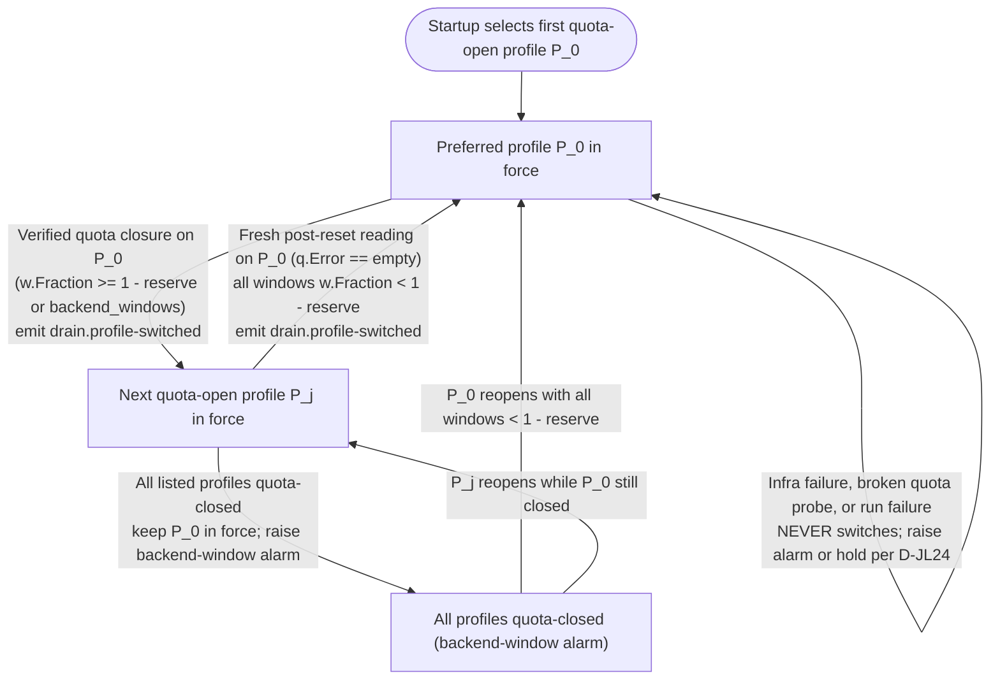

# Automatic Seat-Profile Switching on Subscription Quota Closure and Reopen

**Status:** 2026-11-28. Partly built: Slices 1, 2, 3, and 4 are built (`40a6ef03fa9c`, `83d111864e1f`, `b66f99ad3989`, and Slice 3 in `67086b705273`, `37dc7d0a920f`, and the change that added startup selection and infrastructure-closure filtering), and Slice 5 can now be built but is not built yet. Slice 3 was measured on 2026-11-28 by `go test ./internal/policy` (ok) and `go test ./drain -run 'TestProfile|TestRecordedRefusal|TestPassQuotaRefresh|TestSwitchedProfile|TestNewLoop'` (ok) in `tools/tillr-drain`, which cover switch-away on reserve and on `RefusedWindow`, no switch on a broken or stale quota, a failed run or an infrastructure closure, immediate switch-back on a fresh reading, no switch onto an infrastructure-closed profile, and startup selection with no `drain.profile-switched` event. One difference from the design, where the tree is the fact: active seat backends are every backend a profile's default, seats, seat lists and escalation lists name (`ActiveSeatBackends` in [`tools/tillr-drain/internal/policy/profile_select.go`](../../tools/tillr-drain/internal/policy/profile_select.go)), not filtered by a repository seat catalog, because the tree has none (`ls config/tillr` lists no `seats.json`, and `rg -l 'seats.json|SeatCatalog' tools/tillr-drain` returns nothing). `R-QPS1` (2026-11-27), [`OQ-QPS1`](#OQ-QPS1) (2026-11-28, option A), and [`OQ-QPS2`](#OQ-QPS2) (2026-11-28, option B) quote the owner's dated words verbatim in [Section 1.1](#11-checking-the-owners-rulings-on-backend-selection-and-quota) and [the Decision Ledger](#decision-ledger); `D-QPS1` to `D-QPS7` in [the Decision Ledger](#decision-ledger) are designer's decisions from an operator request that the owner may overturn.

> **In short.** Give `tillr-drain` an ordered list of named seat profiles instead of a single fixed policy. The loop uses the first profile whose subscription-backed active backends all have quota, moves to the next profile in the list when a verified quota closure shuts one of them — starting any run paused mid-attempt again at once in a fresh session on the new profile's backend while keeping its lane's commits and uncommitted files ([`OQ-QPS1`](#OQ-QPS1)) — and moves back without a timer as soon as a fresh post-reset quota reading shows every window of the preferred profile strictly below its reserve line ([`OQ-QPS2`](#OQ-QPS2)). Only quota closes trigger a switch; infrastructure failures, broken quota probes, refused briefs, and failed runs keep their existing holds and alarms.

**Why it matters.** Measured on 2026-11-27 on the all-Claude profile: the shared five-hour subscription window ran out at 13:08 after roughly 50 minutes of work, the loop paused its runs in `quota_pauses`, and work resumed on its own at 15:30 — leaving 2 hours 22 minutes during which no seat could run, while each of the four Claude backend rows discovered the exhausted shared quota separately. Ordering a preferred subscription profile ahead of a secondary profile keeps the drain moving across quota windows without mixing providers inside individual seat fallback lists or restarting the loop by hand.

**The shape.** Five mechanisms:

- **An ordered profile list in the standard start-default sources (`D-QPS1`).** Configured via CLI option (`--profiles`), `.tillr.toml` (`[drain] profiles`), or environment (`TILLR_DRAIN_PROFILES`), resolved in `<config-dir>` (`backend-policy.<name>.json`), and validated in full for every listed entry at startup.
- **Vendor-neutral subscription pools (`D-QPS2`).** Subscriptions are defined solely by a backend's `quota` command and runtime rate-limit refusal headers (`RefusedWindow`) — identical for Claude (`run-claude`), Antigravity (`run-agy`), OpenAI or Codex (`run-pi`), and any future adapter. Backends sharing a `quota_group` or identical `quota` command argv probe once, close together, and keep getting probed while bypassed so switch-back is automatic.
- **Strict quota-only switching and immediate timer-free switch-back (`D-QPS3`, `D-QPS4`, [`OQ-QPS2`](#OQ-QPS2)).** Only a verified quota reading at or above `1 - reserve` or a recorded runtime rate-limit window switches profiles; infrastructure errors and broken quota commands never switch. Switching back happens without a timer as soon as a fresh post-reset reading shows every window strictly below `1 - reserve`.
- **Explicit rules for live, paused, and backend-bound sessions (`D-QPS5`, [`OQ-QPS1`](#OQ-QPS1)).** Live runs on open backends finish undisturbed in both directions, a run paused mid-attempt in `quota_pauses` starts again at once in a fresh session on the new profile's backend keeping its lane's commits and uncommitted files ([`OQ-QPS1`](#OQ-QPS1)), harness transcripts never cross backends or model routes (`seat-changed`), and warm designer transcripts stay preserved per `(document, backend, route)`.
- **Auditable switch events and read surfaces (`D-QPS6`).** Every switch appends `drain.profile-switched` in `.tillr/state.db` and updates `PolicyState` so the loop status line, `tillr drain policy`, `tillr view status`, and the observatory show the active profile, the bypassed profiles, and the quota reading that caused the switch.

**Cost.** Multi-profile resolution in `tools/tillr/settings` and `tools/tillr-drain`, pooled quota probing in `internal/policy`, one new store event (`drain.profile-switched`), and read-surface updates in `tillr-drain` and `tillr-view`. No tracked file carries personal model names (`D-DSP10`).

**Start at:** [Section 1](#1-owner-rulings-the-2026-11-27-measurement-and-what-exists-today) for how the owner's rulings constrain the design, [Section 2](#2-ordered-profile-list-start-default-sources-and-upfront-validation) and [Section 3](#3-vendor-neutral-subscriptions-and-shared-quota-pools) for configuration and shared quota pools, [Section 4](#4-quota-only-switching-and-timer-free-switch-back) for the switch trigger and timer-free switch-back rule, and [Section 5](#5-paused-live-and-resumable-runs-at-each-switch) for work in flight.

**Needs your ruling:** None ([`OQ-QPS1`](#OQ-QPS1) and [`OQ-QPS2`](#OQ-QPS2) were ruled on 2026-11-28 in [the Decision Ledger](#decision-ledger); Slice 3 is built and Slice 5 can now be built but is not built yet; 7 designer's decisions in [the Decision Ledger](#decision-ledger) — `D-QPS1` to `D-QPS7` — remain open to the owner's overturn).

**Reads with:** [drain seat profiles](./tillr-seat-profiles.md) (per-user `backend-policy.<name>.json` files, `hold` metadata, and live reload), [live drain configuration](./tillr-live-drain-config.md) (`drain_runtime_config` precedence and pass-boundary reload), [the judge and lifecycle design](./tillr-judge-and-lifecycle.md#415-no-automatic-move-to-another-model-d-jl24-to-d-jl27) (`D-JL24` to `D-JL27` on no fallbacks and backend alarms), [per-step question holds](./tillr-per-step-question-holds.md) ([`OQ-PR8`](../tillr/decision-provenance-review.md#OQ-PR8)), [the Claude backend reference](../reference/tillr-claude-backend.md), and [designer sessions](../reference/tillr-designer-sessions.md).

---

## 1. Owner rulings, the 2026-11-27 measurement, and what exists today

### 1.1 Checking the owner's rulings on backend selection and quota

Five dated rulings of the owner's govern backend selection, failures, profile storage, and profile switching:

1. **Automatic profile switch on subscription quota, 2026-11-27 (`R-QPS1`):**
   > *"use a claude involved profile until the quota runs out, then autoswitch to something else when it runs out, then back to the claude profile when it is back. and this should be generic enough for any sub with a quota, agy, openai/codex, etc."*
2. **Immediate mid-attempt restart on the new profile and immediate switch-back when quota is below reserve, 2026-11-28 ([`OQ-QPS1`](#OQ-QPS1) option A, [`OQ-QPS2`](#OQ-QPS2) option B):**
   > *"option B for 2. don't do any fancy math. if there's quota, use it. 1. A for sure"*

   Under [`OQ-QPS1`](#OQ-QPS1) (option A), a run paused mid-attempt when the profile switches starts again at once in a fresh session on the new profile's backend for its seat, keeping the lane's commits and uncommitted files ([Section 5](#5-paused-live-and-resumable-runs-at-each-switch)). Under [`OQ-QPS2`](#OQ-QPS2) (option B), the loop switches back to the preferred profile without a timer as soon as a fresh reading shows every window strictly below `1 - reserve` ([Section 4.2](#42-switching-back-without-a-timer-as-soon-as-every-window-is-below-its-reserve-line)).
3. **No fallbacks on failure, 2026-11-20 ([`D-JL24`](./tillr-judge-and-lifecycle.md#415-no-automatic-move-to-another-model-d-jl24-to-d-jl27)):**
   > *"no fallbacks. A failure is diagnosed and fixed, not routed around by trying something else, and a judge whose backend cannot run is an alarm that gets fixed."*
4. **Earlier deferral of automatic provider switching, 2026-11-20 ([`OQ-LD2`](./tillr-live-drain-config.md#OQ-LD2)):**
   > *"I'm not ready for this. I will manually switch them right now and restart. But I do want to do this eventually"*.
5. **Per-user profile files outside any repository, 2026-11-24 (`D-DSP10` and `D-DSP11` in [`tillr-seat-profiles.md`](./tillr-seat-profiles.md#decision-ledger)):**
   Seat profiles are *"personal preference"* belonging in per-user configuration rather than tracked repository files, delivered *"from a personal pack into jails or with manual staging somewhere for other setups"*.

How these rulings fit together without contradiction:

- **`D-JL24` stands untouched for every fault.** An infrastructure error, a broken or unauthenticated quota probe, an adapter preflight refusal, or a failed worker run is a fault to diagnose and fix — never a reason to switch profiles ([Section 4.1](#41-only-a-verified-quota-closure-causes-a-switch)).
- **`R-QPS1` settles whole-profile quota switching where `D-JL26` had held single policies.** In [`tillr-judge-and-lifecycle.md`](./tillr-judge-and-lifecycle.md#quota-exhaustion-is-not-an-exception-d-jl26), `D-JL26` (a 2026-11-20 designer decision, not an owner quote) held quota-refused work on its own backend because no multi-profile mechanism existed yet ([`OQ-LD2`](./tillr-live-drain-config.md#OQ-LD2)). Under `R-QPS1`, an owner who configures a single profile (`--profile claude-sub`) still pauses and raises the `backend-window` alarm (`D-JL25`, `D-JL26`), while an owner who configures an ordered list (`--profiles claude-sub,copilot-gemini`) explicitly authorizes switching the whole seat table to the next listed profile on quota closure and back when quota returns.
- **Pure profiles replace per-seat mixed-provider fallbacks.** Keeping each profile internally pure (for example, `claude-sub` naming only Claude subscription rows and `copilot-gemini` naming only Copilot rows) and switching at the profile boundary preserves coherent seat tiers without per-seat silent provider spillover (relating to open [`OQ-DSP2`](./tillr-seat-profiles.md#OQ-DSP2) and [`OQ-PR7`](../tillr/decision-provenance-review.md#OQ-PR7), neither of which is closed here without an owner quote naming them under [`OQ-PR22`](../tillr/decision-provenance-review.md#OQ-PR22)).

### 1.2 Three gaps in the tree at `83580e31504c` (and what Slices 1, 2, and 4 have built since)

Inspecting `tools/tillr-drain` and `tools/tillr/settings` against the 2026-11-27 all-Claude measurement at `83580e31504c` surfaced three concrete gaps (with Slices 1, 2, 3, and 4 subsequently landed — Slice 3 in `67086b705273` and `37dc7d0a920f` plus the startup-selection change — leaving Slice 5 unbuilt):

1. **One fixed policy for the life of the loop.** Commit `e1590b4ecd38` added `ResolveConfigDir`, `ListProfileNames`, and `ResolveProfilePath` in [`tools/tillr-drain/drain/profile.go`](../../tools/tillr-drain/drain/profile.go), `--profile <name>` in [`tools/tillr-drain/main.go`](../../tools/tillr-drain/main.go), and `[drain] profile` in [`tools/tillr/settings/settings.go`](../../tools/tillr/settings/settings.go). Commit `40a6ef03fa9c` (Slice 1) added ordered multi-profile startup resolution and full-list validation, and commit `b66f99ad3989` (Slice 4) added the CLI, loop, and Observatory read surfaces. Slice 3 made the profile in force switch on quota closures and reopens, and `NewLoop` now chooses the starting profile from stored readings.
2. **Per-backend quota rows with destructive cleanup on inactive policies.** At `83580e31504c`, `RefreshQuotas` in [`tools/tillr-drain/internal/policy/quota_probe.go`](../../tools/tillr-drain/internal/policy/quota_probe.go) probed each backend name independently and ran `DELETE FROM backend_quota WHERE backend=?` for any backend absent from the single active `*Policy` — causing the four Claude backend rows to discover the 2026-11-27 exhausted window separately and preventing inactive profiles from retaining or refreshing `backend_quota` rows. Commit `83d111864e1f` (Slice 2) added `quota_group` / command-derived quota pools and multi-profile quota retention.
3. **Single-worker-only `quota_pauses` rows.** In [`tools/tillr-drain/drain/quota_continue.go`](../../tools/tillr-drain/drain/quota_continue.go), `quotaSingleRun` admits only single-worker decisions (`d.Workflow == nil && len(d.Parallel) == 0 && d.BlockConflict == nil`) into `quota_pauses` (`pauseQuotaPeers`, `resumeQuotaRun`), and dirty mid-attempt `quota_pauses` rows still wait for their original backend until Slice 5 implements [`OQ-QPS1`](#OQ-QPS1) (option A). Multi-node workflow steps (`planned-build@v1`, `scouted-design@v1`), `BlockConflict` design turns, and evaluators record `backend_windows` on a runtime refusal and wait at the planner via `ReadQuotaOnlyShut` without a `quota_pauses` row.

---

## 2. Ordered profile list, start-default sources, and upfront validation

*Designer's decision (`D-QPS1`, from an operator request); the owner may overturn this.*

### 2.1 Profile-list shape and start-default precedence

A **profile list** *(coined here)* is an ordered, non-empty list of distinct profile names (`<name>` matching `[a-z0-9][a-z0-9_-]*`), ordered from highest preference (index `0`) to lowest preference (index `N - 1`). Each `<name>` resolves to `<config-dir>/backend-policy.<name>.json` via `ResolveConfigDir` (`$TILLR_CONFIG_DIR`, else `$XDG_CONFIG_HOME/tillr`, else `$HOME/.config/tillr`; [`tillr-seat-profiles.md` §3.2](./tillr-seat-profiles.md#32-per-user-profile-directory-configtillrbackend-policynamejson)). A single `--profile <name>` is a one-element profile list `[<name>]`.

Fitting the uniform start-defaults rule of [`tillr-seat-profiles.md` §4.4](./tillr-seat-profiles.md#44-uniform-environment-and-tillrtoml-start-defaults-for-tillr-drain-loop) (`D-DSP19`: **CLI option > saved runtime target > `.tillr.toml` > environment variable > built-in default** on a fresh start) into the policy resolver of [`tillr-seat-profiles.md` §4.1](./tillr-seat-profiles.md#41-slotting-into-drain_runtime_config-rather-than-beside-it) yields one ordered lookup walk:

1. **Command-line option on a fresh `tillr-drain loop` start** (source `option`, when `TILLR_RESTART_REQUEST` is unset and `--check` is false): `--policy <path>` pins one policy file by path and wins over `--profile` / `--profiles` (`D-DSP18`); otherwise `--profiles <name,name,...>` (comma-separated, whitespace-trimmed) or singular `--profile <name>`. Passing both `--profile` and `--profiles` on the same command line is refused with exit 2.
2. **Stored runtime operator selection in `drain_runtime_config`** (source `operator`, once [`tillr-seat-profiles.md`](./tillr-seat-profiles.md) Slice 6 lands): `seat_profile` accepts `{"profiles": ["claude-sub", "copilot-gemini"]}` from `tillr drain profile use <name> [<name>...]` (with one name equivalent to a 1-element list). Survives `tillr-drain restart` (outranking inherited boot `argv` when `TILLR_RESTART_REQUEST` is set), `tillr-keep` relaunches, and unflagged starts until replaced by a fresh-start CLI flag or cleared with `tillr drain config --reset`.
3. **Workspace `.tillr.toml`** (source `.tillr.toml`): `[drain] policy = "<path>"` (winning over `profile` / `profiles`), else `[drain] profiles = ["<name>", ...]` or `[drain] profile = "<name>"` in `Settings.Drain` ([`tools/tillr/settings/settings.go`](../../tools/tillr/settings/settings.go)). Setting both `profile` and `profiles` in `.tillr.toml`, an empty `profiles = []`, duplicate names, or any name failing `ValidProfileName` is refused when `.tillr.toml` is read. `StartupLine()` prints `drain.profiles=["<a>","<b>"]` when a multi-profile list is set (preserving `drain.profile="<a>"` when singular `profile` is set).
4. **Environment variable** (source `environment variable`): `TILLR_DRAIN_POLICY` (winning over `TILLR_DRAIN_PROFILE` / `TILLR_DRAIN_PROFILES`), else `TILLR_DRAIN_PROFILES=<name,name,...>` or singular `TILLR_DRAIN_PROFILE=<name>`. Setting both `TILLR_DRAIN_PROFILES` and `TILLR_DRAIN_PROFILE` to different lists, or setting an invalid or empty value, refuses startup with exit 2 naming the variable and value (`D-DSP19`).
5. **Per-user default and repository fallbacks** (`D-DSP15`): `profiles` (or `profile`) in `<config-dir>/drain.json` (source `user-default`), else the sole ready profile in `<config-dir>` (source `sole-profile`), else `<root>/config/tillr/backend-policy.json` (source `built-in default` / `repository`).

### 2.2 Upfront full-list validation

Every profile named in the resolved list is loaded and validated in full (`DecodePolicy`, `Policy.Check`, adapter resolution, not `"example": true`, and not `hold` once Slice 5 of [`tillr-seat-profiles.md`](./tillr-seat-profiles.md) lands) at `tillr-drain loop` startup, in `tillr-drain loop --check`, and on pass-boundary reloads:

- **Startup refusal on any bad entry:** If *any* profile in `[P_0, ..., P_{N-1}]` is missing, malformed, held, an example, or missing a required seat mapping, startup exits 2 naming the offending profile, its index in the list, `<config-dir>`, and the available profiles. The loop never silently drops a broken fallback entry only to discover hours later at 02:00 that its second profile cannot load.
- **In-flight disk edits (`D-DSP5`):** If a profile file already accepted into memory is later edited invalidly or disappears while the loop runs, the loop retains the last accepted snapshot of that profile in memory and records the reload refusal in `PolicyState.Refusal` so `tillr drain policy` and the observatory surface the fault without crashing running work.

---

## 3. Vendor-neutral subscriptions and shared quota pools

*Designer's decision (`D-QPS2`, from an operator request); the owner may overturn this.*

### 3.1 Zero vendor-specific rules

Nothing in `tools/tillr*` branches on a provider name, an adapter name, or a provider's window-kind string:

- **What defines a subscription:** A backend row is subscription-backed whenever it configures `"quota": ["<prog>", ...]` (producing `{"windows": [{"kind": "<string>", "fraction": <0..1+>, "reset_at": "<RFC3339>|null"}]}` decoded by `DecodeQuota` in [`tools/tillr-drain/internal/policy/quota_probe.go`](../../tools/tillr-drain/internal/policy/quota_probe.go)) or when a run report header carries `rate limit kind` + `status: rejected` + `fraction` + `reset` parsed by `RefusedWindow` ([`tools/tillr-drain/internal/policy/quota_window.go`](../../tools/tillr-drain/internal/policy/quota_window.go)).
- **Uniform across adapters:** Claude (`run-claude`, reporting `five_hour` / `seven_day` windows), Antigravity (`run-agy`), OpenAI / Codex / Copilot (`run-pi`), `run-muse`, `run-native`, and any later adapter use the exact same `quota` argv contract and `RefusedWindow` report header. Window `kind` strings are opaque labels compared and displayed verbatim, regardless of how many windows (`1`, `2`, or `K`) a subscription reports.
- **Pay-as-you-go or flat-rate backends without `quota`:** A backend row with no `quota` command has no reading-based hold (`ReadQuotaOnlyShut`) and stays quota-open unless a run on it records an explicit runtime refusal window in `backend_windows`. Placing a pay-as-you-go API profile or a flat-rate secondary subscription profile after a primary subscription profile requires no dummy quota script.

### 3.2 Shared quota pools (`quota_group` and canonical `quota` command identity)

On 2026-11-27, four Claude backend rows sharing one subscription probed and failed separately because quota state was keyed solely by backend row name (`claude-designer`, `claude-sonnet`, `claude-haiku`). Two backends share one **quota pool** *(coined here)* whenever they draw from the same underlying subscription account:

1. **Pool key derivation (`QuotaPoolKey`):** Each `run.Backend` row gains an optional `"quota_group"` string (`[a-z0-9][a-z0-9_-]*`):
   - When `"quota_group"` is set, the pool key is `"group:" + b.QuotaGroup`. Two different adapters or two quota commands drawing from the same account (for instance, `run-claude` and `run-pi` using the same vendor subscription) share one pool by naming the same `quota_group`.
   - When `"quota_group"` is omitted and `len(b.Quota) > 0`, the pool key defaults to `"cmd:" + canonicalJSON(b.Quota)`. All four backend rows in `claude-sub` invoking `["tillr-run", "claude-quota"]` therefore share one pool automatically with zero extra configuration, while two accounts invoking `["tillr-run", "claude-quota", "--account", "a"]` and `["tillr-run", "claude-quota", "--account", "b"]` stay in distinct pools.
   - When both `"quota_group"` and `"quota"` are empty, the pool key is `"backend:" + name` (relevant only if a runtime `RefusedWindow` arrives).
   - Policy validation refuses two backends in the same profile list that declare the same explicit `quota_group` with different non-empty `quota` commands unless their `quota` commands are identical (preventing ambiguous probe commands for one named group).
2. **One probe per pool, retained across the whole profile list:**
   - `RefreshQuotas` accepts the full loaded slice of profiles `[P_0, ..., P_{N-1}]` alongside `activeIndex`.
   - `RefreshQuotas` deletes `backend_quota` rows **only** for backends absent from *every* profile in `[P_0, ..., P_{N-1}]` — never deleting a preferred profile's quota state when the loop switches to a lower-ranked profile.
   - At each `RefreshQuotas` call, the loop collects unique quota pools across all loaded profiles `[P_0, ..., P_{N-1}]` (ordered with `P_{activeIndex}` first, as landed in `83d111864e1f`). Each unique pool whose reading is missing or stale (`!QuotaFresh`, meaning `age > QuotaProbeInterval` or `now >= w.ResetAt`) executes its `quota` command **once** and fans the resulting `observed_at`, `windows`, and `error` out to every backend row in that pool (recording each backend's own configured `b.Reserve`).
3. **Simultaneous closure and peer pause across the pool:**
   - When `RecordBackendWindow` records a runtime `RefusedWindow` on `rec.Backend`, it writes `backend_windows` for **every** backend sharing `rec.Backend`'s quota pool across the loaded profile list and invokes `pauseQuotaPeers` across live `quotaSingleRun` peers on all backends in that pool in the same write transaction. One 429/rate-limit rejection closes the whole account pool immediately instead of letting three sibling backends launch into the same exhausted window.

---

## 4. Quota-only switching and timer-free switch-back

### 4.1 Only a verified quota closure causes a switch

*Designer's decision (`D-QPS3`, enforcing owner ruling `D-JL24`); the owner may overturn the mechanism.*

For any profile `P`, its **active seat backends** *(coined here)* are the backend rows referenced by `P.DefaultBackend`, `P.Seats`, `P.SeatLists`, and `P.Escalate` for the seats declared by the operated repository (ignoring unused seat rows from other repositories; [`tillr-seat-profiles.md` §3.1](./tillr-seat-profiles.md#31-one-canonical-seat-catalog-configtillrseatsjson)).

Profile `P` is **quota-closed** *(coined here)* at time `at` if and only if at least one active seat backend `b` in `P` is shut by a verified quota condition:

1. **Verified reserve closure:** `len(b.Quota) > 0`, its pool's `QuotaStatus` `q` is fresh (`QuotaFresh(q, cmd, at)`), `q.Error == ""`, and at least one window `w` in `q.Windows` has `w.Fraction >= 1 - b.Reserve`; **or**
2. **Unexpired runtime refusal window:** `backend_windows` holds a row for `b`'s pool with `reset_at > at` recorded from a run report's `RefusedWindow`.

Nothing else ever causes the loop to switch profiles:

| Event on active profile `P` | Switch profile? | Required behavior |
| :--- | :--- | :--- |
| **Fresh quota reading with `w.Fraction >= 1 - b.Reserve`, or unexpired `RefusedWindow` in `backend_windows`** | **Yes** (to first quota-open `P_j` in list) | Emits `drain.profile-switched` (`cause: "quota-closed"`), updates `PolicyState`, and plans subsequent dispatches on `P_j`. |
| **Infrastructure failure (`AttemptInfrastructure`: auth error, crash, network fault, provider 5xx)** | **Never** (`D-JL24`) | Closes that backend in `backend_outcomes`, raises the `backend-closed` alarm (`D-JL25`), and holds affected work on that backend until `tillr-drain probe-backend` or a non-infrastructure ending reopens it. |
| **Quota command fails, times out, returns invalid JSON, or stays stale (`q.Error != ""` or `!QuotaFresh` after probe)** | **Never** (`D-JL24`) | Holds that backend via `ReadQuotaOnlyShut` and raises the quota-probe `alarm` in `waitingBackendQuotas`. Routing around a broken quota script would hide expired credentials or broken tooling behind a fallback provider. |
| **Adapter preflight / brief refusal (`AttemptRefused`)** | **Never** | Holds that item as `adapter-refused` for the operator; closes no backend and switches no profile. |
| **Worker run failure, missing `RESULT:` footer, fence/verify/gate refusal, or `OBSTACLE: seat`** | **Never** | Handled inside active profile `P` (refusal return to lane or `escalate` climb within `P` only). |
| **Every profile `P_0 .. P_{N-1}` in the list is quota-closed** | **No open target** | Keeps highest-ranked `P_0` as the profile in force, raises the `backend-window` alarm (`D-JL25`) naming every profile's closed window and `reset_at`, and waits for the earliest reopen. |



### 4.2 Switching back without a timer as soon as every window is below its reserve line

*Owner ruling ([`OQ-QPS2`](#OQ-QPS2), option B) and designer's decision (`D-QPS4`, fresh post-reset reading requirement; the owner may overturn `D-QPS4`).*

No timer, cooldown, minimum dwell duration, or sleep is used anywhere in profile selection, and under [`OQ-QPS2`](#OQ-QPS2) (option B — *"option B for 2. don't do any fancy math. if there's quota, use it. 1. A for sure"*), switching back uses the exact same `1 - b.Reserve` line as closing. Whenever the loop is running on `P_{active}` (`active > 0`) and evaluates a higher-ranked profile `P_{high}` (`high < active`), two conditions govern switching back:

1. **Fresh post-reset reading required (wall clock alone never switches back, `D-QPS4`):**
   - In `QuotaFresh` ([`tools/tillr-drain/internal/policy/quota_probe.go`](../../tools/tillr-drain/internal/policy/quota_probe.go)), reaching `w.ResetAt` (`!w.ResetAt.After(at)`) already marks the cached reading stale.
   - For any active seat backend `b` in `P_{high}` with `len(b.Quota) > 0`, passing `reset_at` on the wall clock **never** marks `b` open by itself: `RefreshQuotas` must run `b`'s pool command, obtain a fresh reading with `q.Error == ""`, and clear any `backend_windows` row via `ReopenBackendWindow` (`drain.backend-quota-reopened`). (Only a backend with `len(b.Quota) == 0` that was shut solely by a runtime `backend_windows` refusal reopens on `now >= reset_at`, because it has no probe command.)
2. **Every window strictly below `1 - b.Reserve` ([`OQ-QPS2`](#OQ-QPS2), option B):**
   - **Close line while `P` is active:** `P` closes when *any* window `w` of an active seat backend `b` in `P` reaches:
     $$\text{w.Fraction} \ge 1 - b.\text{Reserve}$$
     (or an unexpired runtime `backend_windows` refusal is recorded).
   - **Reopen line to switch back to bypassed `P_{high}` (`high < active`):** `P_{high}` retakes control as soon as **every** window `w` of **every** quota-probed active seat backend `b` in `P_{high}` satisfies:
     $$\text{w.Fraction} < 1 - b.\text{Reserve}$$
     and no `backend_windows` refusal, infrastructure closure, or quota-probe error is open on `P_{high}`.
   - On a fixed window reset (`fraction` drops to `0.00`), `P_{high}` clears `w.Fraction < 1 - b.Reserve` on the very first probe after `reset_at` and switches back immediately. On a multi-window subscription (`five_hour` + `seven_day` with `reserve = 0.20`), if `five_hour` resets to `0.00` while `seven_day` sits at `0.82` (`>= 0.80`), `seven_day` fails `w.Fraction < 0.80` so the loop stays on the fallback profile; as soon as both windows read `< 0.80`, `P_{high}` switches back on that probe. If a rolling window oscillates near `1 - b.Reserve`, the owner widens `reserve` directly in the profile file.

At the top of each pass (and immediately after `RecordBackendWindow` settles a quota refusal), the selector picks the lowest index `i` in `0 .. N-1` whose active seat backends are all open:
- if `i == activeIndex`, `P_i` has not crossed the close line (`w.Fraction < 1 - b.Reserve` on all windows, and no `backend_windows` closure);
- if `i < activeIndex`, `P_i` has a fresh error-free reading strictly below its reserve line (`w.Fraction < 1 - b.Reserve` on all windows, and no `backend_windows` closure, infrastructure closure, or quota-probe error);
- if `i > activeIndex` (evaluated only when `P_{activeIndex}` is quota-closed), `P_i` is quota-open (`w.Fraction < 1 - b.Reserve` on all windows, and no `backend_windows` closure, infrastructure closure, or quota-probe error).

---

## 5. Paused, live, and resumable runs at each switch

*Owner ruling on mid-attempt paused runs ([`OQ-QPS1`](#OQ-QPS1), option A) and designer's decision (`D-QPS5`, from an operator request; the owner may overturn `D-QPS5`).*

Every switch — both **switch-away** (`P_{pref} -> P_{next}` on quota closure) and **switch-back** (`P_{next} -> P_{pref}` on quota reopen) — happens at a pass boundary without killing running child processes and without ever passing one harness's session ID or transcript to a different backend or model route.

| Work state at the switch | On switch-away (`P_{pref} -> P_{next}`) | On switch-back (`P_{next} -> P_{pref}`) |
| :--- | :--- | :--- |
| **1. Live run on a backend that still has quota** (worker, scout, plan, verify, gate, or lander) | **Finishes undisturbed** on the backend, model, and effort it launched with, then gates and lands normally. A proactive reserve closure (`w.Fraction >= 1 - b.Reserve`) never pauses live runs ([`tools/tillr-drain/README.md#backend-quota-admission`](../../tools/tillr-drain/README.md#backend-quota-admission)); only a runtime `RefusedWindow` calls `pauseQuotaPeers` on live `quotaSingleRun` peers of the *exhausted* quota pool, leaving any open pool or `command` step running. | **Finishes undisturbed** on `P_{next}`'s backend and model, then gates and lands normally. Switching back to `P_{pref}` never kills, pauses, or preempts a live fallback worker mid-turn. |
| **2a. Quota-refused run with zero lane work** (refused on turn 1 with `HEAD == base_sha` and no uncommitted paths, or held at planner before staging; `D-JL30`, `efd1fcee35c2`) | Releases or skips `quota_pauses` and **dispatches immediately on `P_{next}`'s backend** for that seat in a fresh session. | **Dispatches on `P_{pref}`'s backend** for that seat in a fresh session. |
| **2b. Run paused mid-attempt in `quota_pauses` with committed or uncommitted work in its lane** (`quotaSingleRun`, [`OQ-QPS1`](#OQ-QPS1) option A) | Clears `quota_pauses`, keeps the lane's commits and uncommitted files intact, mints a new `session-id` so the prior harness transcript is never cross-resumed, and **starts again at once in a fresh session on `P_{next}`'s backend** for its seat (`D-DSP6`, [`OQ-QPS1`](#OQ-QPS1)). | If a run is paused mid-attempt in `quota_pauses` on `P_{next}` when `P_{pref}` reopens, clears `quota_pauses`, keeps the lane's commits and uncommitted files intact, and **starts again at once in a fresh session on `P_{pref}`'s backend** for its seat (or resumes its warm `P_{pref}` session if its saved `session-id` was already on `P_{pref}`). |
| **3. Multi-node workflow in flight** (`planned-build@v1`, `scouted-design@v1`, `build-pieces@v1`, `doc-triage@v1`) | Running nodes finish on the backend they claimed; unclaimed downstream nodes store `seat` names (never backend names) and resolve against **`P_{next}`** when claimed (`D-DSP6`). Earlier node outputs and lane commits carry forward unchanged. | Running nodes on `P_{next}` finish on `P_{next}`; unclaimed downstream nodes resolve against **`P_{pref}`** when claimed. |
| **4. Returned resumable worker session (`WorkerSession`)** after gate, verify, fence, or conflict refusal | `workerSessionReason` ([`tools/tillr-drain/drain/worker_session.go`](../../tools/tillr-drain/drain/worker_session.go)) compares `s.Backend` and `s.Route` against `P_{next}`'s request, answers `seat-changed`, and starts a **fresh session on `P_{next}`'s backend** in the same lane on top of the retained candidate `HeadSHA` with the refusal evidence in the brief. | If `WorkerSession` was started on `P_{next}`, `workerSessionReason` answers `seat-changed` and starts a **fresh session on `P_{pref}`'s backend** on top of `HeadSHA`. If `WorkerSession` was started on `P_{pref}` before the outage and its lane `session-id` still matches, `s.Backend` and `s.Route` match again and it resumes normally (`resumed-worker`). |
| **5. Warm designer desk (`last_designers` at `desk-<doc>`)** | Keying `last_designers` by `(document, backend, route)` instead of a single row per document keeps `P_{pref}`'s transcript file intact in `desk-<doc>/durable/` while opening a **fresh session on `P_{next}`'s `design` backend** in the shared `desk-<doc>` worktree. | `chooseDesigner` finds `P_{pref}`'s saved `(document, backend, route)` entry in `desk-<doc>/durable/` and resumes it (`resumed-expired` or `resumed-compacted`, injecting the `What moved:` diff since the blob SHA `P_{pref}` last saw; [`tillr-designer-sessions.md#choosing-at-dispatch`](../reference/tillr-designer-sessions.md#choosing-at-dispatch)). |
| **6. Parked tool call (`land` / `obstacle` `call-suspends`)** | A passed `land` call lands on trunk without needing another model turn. If `land` is refused by the gate or lander while `P_{pref}`'s backend is quota-shut, the loop cannot deliver a tool result into another harness; it settles the parked call and continues the lane on `P_{next}` as a `seat-changed` fresh session on `HeadSHA` with the refusal report. | If a `P_{next}` worker's `land` gate finishes right after switch-back while `P_{next}`'s backend is still quota-open, the loop delivers the refusal tool result to that parked `P_{next}` session so the in-flight attempt finishes cleanly without throwing away its warm context. |
| **7. `cannot-resume` adapters (`run-agy`, `run-muse`) and `drain.seat-escalated` history** | `cannot-resume` adapters already start a fresh session on the retained worktree and commits on every continuation, so switching profiles needs no adapter special case. `SeatEscalation` (`drain.seat-escalated` in [`tools/tillr-drain/internal/policy/seat_escalation.go`](../../tools/tillr-drain/internal/policy/seat_escalation.go)) gains optional `profile` (`json:"profile,omitempty"`, `D-DSP6`), and `EscalatedBackend` scopes escalations to the active profile (treating legacy empty `profile` rows as matching only when the active profile defines `to`), so an item escalated under `P_{pref}` starts at `P_{next}`'s primary backend for that seat. | Same rule: `cannot-resume` starts fresh on `P_{pref}`, and escalations recorded under `P_{pref}` apply again only when `P_{pref}` is active. |

---

## 6. Store events and visibility across CLI and Observatory

*Designer's decision (`D-QPS6`, from an operator request); the owner may overturn this.*

### 6.1 Structured store event (`drain.profile-switched`)

`tools/tillr-drain/internal/policy` registers `const ProfileSwitchedKind = "drain.profile-switched"` in `event` for `drainmodel.Utility`. Whenever the active profile index changes due to quota closure or quota reopen (initial selection at loop start is startup state rather than a switch), the loop appends one `drain.profile-switched` event on `object_type = "drain"`, `object_id = "policy"` inside a store write transaction:

```json
{
  "from_profile": "claude-sub",
  "to_profile": "copilot-gemini",
  "from_index": 0,
  "to_index": 1,
  "profiles": ["claude-sub", "copilot-gemini"],
  "cause": "quota-closed",
  "trigger_backend": "claude-sonnet",
  "quota_group": "cmd:[\"tillr-run\",\"claude-quota\"]",
  "reading": {
    "source": "probe",
    "observed_at": "2026-11-27T18:08:12Z",
    "reserve": 0.2,
    "windows": [
      { "kind": "five_hour", "fraction": 0.82, "reset_at": "2026-11-27T20:30:00Z" },
      { "kind": "seven_day", "fraction": 0.34, "reset_at": "2026-12-02T00:00:00Z" }
    ]
  }
}
```

On switch-back, `"cause"` is `"quota-reopened"`, `"from_profile"` is `"copilot-gemini"`, `"to_profile"` is `"claude-sub"`, and `"reading"` carries the fresh reading of `to_profile` showing every window strictly below `1 - reserve`.

### 6.2 `PolicyState` snapshot and the four read surfaces

`PolicyState` in `.tillr/loop/backend-policy.json` (and `.tillr/loop/backend-policy-changes.jsonl`; [`tools/tillr-drain/internal/policy/policy_reload.go`](../../tools/tillr-drain/internal/policy/policy_reload.go)) gains:
- `profile` (`string`), `profile_index` (`int`), `profiles` (`[]string`), and `source` (`"option"`, `"operator"`, `".tillr.toml"`, `"environment variable"`, `"user-default"`, `"sole-profile"`, or `"built-in default"`, matching `D-DSP19` in [`tools/tillr-drain/loop_options.go`](../../tools/tillr-drain/loop_options.go));
- `why` (`string`): concise human-readable reason for the profile currently in force (for example, `"preferred profile (1/2); all quota windows open"` or `"switched from claude-sub at 2026-11-27T18:08:12Z: claude-sonnet five_hour used 0.82 >= 0.80 (reserve 0.20), resets 2026-11-27T20:30:00Z"`);
- `switched_from` (`string, omitempty`), `switched_at` (`*time.Time, omitempty`), and `skipped_profiles` (`[]SkippedProfileQuota, omitempty`, populating `Profile`, `Backend`, `Windows`, `Reserve`, and `ResetAt` for each higher-ranked bypassed profile; because [`OQ-QPS2`](#OQ-QPS2) option B recorded in `3bda78bd82ec` has no reopen headroom and reopens at `w.Fraction < 1 - b.Reserve`, `SkippedProfileQuota.ReopenThreshold` from pre-ruling Slice 4 `b66f99ad3989` stays `0` and is omitted via `omitempty`).

Every operator and owner surface reads those fields:

1. **Loop startup, switch, and status lines (`tillr-drain loop` stderr):**
   - At startup (and `--check`): `loop: profile claude-sub (1/2 of [claude-sub, copilot-gemini], source .tillr.toml): preferred profile (1/2); all quota windows open`.
   - On switch-away: `loop: profile switched claude-sub -> copilot-gemini (2/2): claude-sonnet five_hour used 0.82 >= 0.80 (reserve 0.20; resets 2026-11-27T20:30:00Z)`.
   - On switch-back: `loop: profile switched copilot-gemini -> claude-sub (1/2): claude-sub reopened (five_hour used 0.00 < 0.80, seven_day used 0.34 < 0.80; reserve 0.20)`.
   - Periodic/waiting loop status lines include `profile=<active>` (and `(fallback from <preferred>; resets <reset_at>)` whenever `profile_index > 0`).
2. **`tillr drain policy` (`--json` and text) and `tillr view status`:**
   - `tillr drain policy` ([`tools/tillr-drain/policy.go`](../../tools/tillr-drain/policy.go)) prints the active profile name, its position in `profiles`, `source`, `why`, and any `skipped_profiles` quota readings and reset times ahead of the seat table, and includes the full `PolicyState` struct under `--json`.
   - `tillr view status` includes the active profile and fallback reason in its drain status summary.
3. **Observatory header and waiting rows (`tools/tillr-view`):**
   - `ObservatoryHeaderBar.tsx` displays the active profile badge (`claude-sub`, or `copilot-gemini · fallback from claude-sub until 20:30Z` when `profile_index > 0`), with the full profile list, quota fractions, reserve, and switch timestamp in its detail popover.
   - In `waitingBackendQuotas` ([`tools/tillr-view/waiting_quota.go`](../../tools/tillr-view/waiting_quota.go)), a quota-closed backend belonging to a **bypassed** higher-ranked profile while an open fallback profile is carrying the queue is classed as `waits on work` (`mover: "the loop; switched to <active>, switches back after <reset_at>"`) rather than `alarm` — keeping `alarm` (`tillr view alarms` exit 1, `D-JL25`) truthful for quota-probe errors (`q.Error != ""`) and for when **every** profile in `profiles` is closed.

---

## Decision Ledger

Per [`decision-provenance-review.md` §6](../tillr/decision-provenance-review.md#6-how-this-stops-happening) (`D-PR1`, `D-PR2`, [`OQ-PR22`](../tillr/decision-provenance-review.md#OQ-PR22)), `R-QPS1`, [`OQ-QPS1`](#OQ-QPS1), and [`OQ-QPS2`](#OQ-QPS2) are **owner rulings** quoting the owner's dated words verbatim, and `D-QPS1` to `D-QPS7` are **designer's decisions** from an operator request that the owner has not ruled on and may overturn.

| ID | Ruling / Decision | Date | Settled in | Built |
| :--- | :--- | :--- | :--- | :--- |
| `R-QPS1` | **Owner ruling:** *"use a claude involved profile until the quota runs out, then autoswitch to something else when it runs out, then back to the claude profile when it is back. and this should be generic enough for any sub with a quota, agy, openai/codex, etc."* (2026-11-27), read alongside the owner's 2026-11-20 ruling [`D-JL24`](./tillr-judge-and-lifecycle.md#415-no-automatic-move-to-another-model-d-jl24-to-d-jl27) (*"no fallbacks. A failure is diagnosed and fixed, not routed around by trying something else, and a judge whose backend cannot run is an alarm that gets fixed"*) and 2026-11-24 rulings `D-DSP10`/`D-DSP11` ([`tillr-seat-profiles.md`](./tillr-seat-profiles.md#decision-ledger): profiles are *"personal preference"* and need *"a way to ship profiles from a personal pack into jails or with manual staging somewhere for other setups"*). | 2026-11-27, owner | [§1.1](#11-checking-the-owners-rulings-on-backend-selection-and-quota) | Partly (Slices 1, 2, 3, 4 built; Slice 5 not built) |
| <a id="OQ-QPS1"></a>[`OQ-QPS1`](#OQ-QPS1) | **Owner ruling (option A):** *"option B for 2. don't do any fancy math. if there's quota, use it. 1. A for sure"* (2026-11-28). When a quota closure switches the loop to the next profile, a single-worker run paused mid-attempt in `quota_pauses` with committed or uncommitted work in its lane clears `quota_pauses`, mints a new `session-id` so the prior harness transcript is never cross-resumed, and starts again at once in a fresh session on the new profile's backend for its seat, keeping the lane's commits and uncommitted files intact. | 2026-11-28, owner | [§1.1](#11-checking-the-owners-rulings-on-backend-selection-and-quota), [§5](#5-paused-live-and-resumable-runs-at-each-switch) | No (Slice 5) |
| <a id="OQ-QPS2"></a>[`OQ-QPS2`](#OQ-QPS2) | **Owner ruling (option B):** *"option B for 2. don't do any fancy math. if there's quota, use it. 1. A for sure"* (2026-11-28). The loop switches back to the preferred profile without a timer as soon as a fresh post-reset reading (`q.Error == ""`) shows every window of every quota-probed active seat backend strictly below its reserve line (`w.Fraction < 1 - b.Reserve`). | 2026-11-28, owner | [§1.1](#11-checking-the-owners-rulings-on-backend-selection-and-quota), [§4.2](#42-switching-back-without-a-timer-as-soon-as-every-window-is-below-its-reserve-line) | Yes (Slice 3) |
| `D-QPS1` | **Designer's decision (from an operator request; revised 2026-11-28 to match `D-DSP19`); the owner may overturn this.** Configure an ordered non-empty list of distinct named profiles (`backend-policy.<name>.json` in `<config-dir>`) via `--profiles <name,...>` (or 1-element `--profile <name>`), `drain_runtime_config` (`seat_profile`), `.tillr.toml` `[drain] profiles = [...]` (mutually exclusive with `[drain] profile`), or `TILLR_DRAIN_PROFILES` / `TILLR_DRAIN_PROFILE`, obeying `CLI option (--policy > --profiles/--profile) > operator (seat_profile; outranks inherited boot argv on TILLR_RESTART_REQUEST restarts) > .tillr.toml ([drain] policy > profiles/profile) > environment (TILLR_DRAIN_POLICY > TILLR_DRAIN_PROFILES/TILLR_DRAIN_PROFILE) > user-default > sole-profile > repository`. Validate **every** listed profile in full at startup and `--check` (exiting 2 if any entry is missing, invalid, `"example": true`, or `hold`), keeping last-accepted snapshots in memory on invalid later disk edits (`D-DSP5`). **Rejected:** lazily validating fallback profiles only when the first profile runs out of quota; silently skipping missing or invalid entries in `profiles`. | 2026-11-27, designer; revised 2026-11-28 | [§2](#2-ordered-profile-list-start-default-sources-and-upfront-validation) | Yes (`40a6ef03fa9c`; `seat_profile` store key awaits [`tillr-seat-profiles.md`](./tillr-seat-profiles.md) Slice 6) |
| `D-QPS2` | **Designer's decision (from an operator request); the owner may overturn this.** Keep subscription handling 100% vendor-neutral (`quota` command JSON windows and `RefusedWindow` report headers only; zero vendor, adapter, or window-kind branches in Go). Group backends sharing one subscription account by optional `"quota_group"` (`[a-z0-9][a-z0-9_-]*`), defaulting when omitted and `len(b.Quota) > 0` to the canonical JSON encoding of `b.Quota`. Probe once per unique pool in `RefreshQuotas`, retain and probe `backend_quota` rows across all profiles in the configured list (deleting only backends absent from *every* configured profile), and close/pause all backends in a pool together on `RecordBackendWindow` / `pauseQuotaPeers`. **Rejected:** provider-specific Claude/Codex/Antigravity code paths; deleting inactive profiles' `backend_quota` rows on switch-away; probing duplicate `quota` commands N times per pass. | 2026-11-27, designer | [§3](#3-vendor-neutral-subscriptions-and-shared-quota-pools) | Yes (`83d111864e1f`) |
| `D-QPS3` | **Designer's decision (from an operator request); the owner may overturn this.** Switch profiles **only** when an active seat backend of the current profile is shut by a fresh error-free quota reading (`w.Fraction >= 1 - b.Reserve`) or an unexpired runtime `backend_windows` refusal. Never switch profiles on `AttemptInfrastructure` (`backend-closed` alarm), failed/stale/malformed quota probes (`q.Error != ""` -> quota-probe `alarm`), `AttemptRefused` (`adapter-refused`), worker run failures, or `seat` obstacles. When every listed profile is quota-closed, keep index `0` in force and raise the `backend-window` alarm naming every profile's `reset_at`. **Rejected:** treating a failing quota script (`q.Error != ""`) or provider 5xx/auth error as a trigger to switch profiles. | 2026-11-27, designer | [§4.1](#41-only-a-verified-quota-closure-causes-a-switch) | Yes (Slice 3) |
| `D-QPS4` | **Designer's decision (from an operator request; revised 2026-11-28 for [`OQ-QPS2`](#OQ-QPS2)); the owner may overturn this.** Require a fresh post-reset reading (`QuotaFresh` with `q.Error == ""`) and cleared `backend_windows` — never wall-clock passage past `reset_at` alone — before a quota-probed active seat backend in a higher-ranked profile can reopen at `w.Fraction < 1 - b.Reserve` across **every** window ([`OQ-QPS2`](#OQ-QPS2)), with zero timers, sleeps, or dwell intervals. **Rejected:** wall-clock cooldown timers; reopening on `now >= reset_at` before running the quota command; checking only the window that originally closed while ignoring a closed secondary window. | 2026-11-27, designer; revised 2026-11-28 | [§4.2](#42-switching-back-without-a-timer-as-soon-as-every-window-is-below-its-reserve-line) | Yes (Slice 3) |
| `D-QPS5` | **Designer's decision (from an operator request; revised 2026-11-28 for [`OQ-QPS1`](#OQ-QPS1) and Slice 3 tree alignment); the owner may overturn this.** At both switch-away and switch-back: leave live runs on open backends (and gates/landers) undisturbed; route unclaimed workflow nodes by seat against the newly active profile; never resume a harness session across different backends or model routes (`seat-changed` fresh session on retained `HeadSHA` for `WorkerSession` and quota-shut refused `land` calls, while delivering `land` refusals to parked fallback sessions whose backend remains open after switch-back); key `last_designers` by `(document, backend, route)` in `desk-<doc>/durable/` so preferred designer sessions survive temporary fallback turns; stamp optional `profile` on `SeatEscalation` (`drain.seat-escalated`) so escalations apply only to the profile that recorded them; dispatch clean first-turn quota refusals (`HEAD == base_sha`, no dirty paths) immediately on the active profile; and restart mid-attempt `quota_pauses` runs at once in a fresh session on the newly active profile's backend keeping lane commits and uncommitted files per [`OQ-QPS1`](#OQ-QPS1). **Rejected:** killing or preempting live fallback workers on switch-back; passing a `claude` or `pi` session ID to another backend; overwriting a preferred designer's warm desk row during a short quota switch. | 2026-11-27, designer; revised 2026-11-28 | [§5](#5-paused-live-and-resumable-runs-at-each-switch) | Partly (Slice 3 built; Slice 5 not built) |
| `D-QPS6` | **Designer's decision (from an operator request; revised 2026-11-28 after [`OQ-QPS2`](#OQ-QPS2) in `3bda78bd82ec`); the owner may overturn this.** Emit `drain.profile-switched` (`from_profile`, `to_profile`, `from_index`, `to_index`, `profiles`, `cause`, `trigger_backend`, `quota_group`, `reading`) in `.tillr/state.db` on every quota switch, record `profile`, `profiles`, `profile_index`, `source` (`D-DSP19` labels), `why`, `switched_from`, `switched_at`, and `skipped_profiles` (`ReopenThreshold` left `0`/omitted under [`OQ-QPS2`](#OQ-QPS2) option B) in `PolicyState`, show them in `tillr-drain loop` status lines, `tillr drain policy`, `tillr view status`, and `ObservatoryHeaderBar.tsx`, and classify bypassed profiles' closed quota rows in `waitingBackendQuotas` as `waits on work` rather than `alarm` while an open fallback profile is active. **Rejected:** keeping `tillr view alarms` exit 1 firing continuously during healthy fallback operation when a secondary profile is open; populating a `reopen_threshold` field after [`OQ-QPS2`](#OQ-QPS2) ruled out reopen headroom. | 2026-11-27, designer; revised 2026-11-28 | [§6](#6-store-events-and-visibility-across-cli-and-observatory) | Yes (read surfaces in `b66f99ad3989`; `drain.profile-switched` and `PolicyState` switch updates in `37dc7d0a920f`) |
| `D-QPS7` | **Designer's decision (from an operator request; revised 2026-11-28 after [`OQ-QPS1`](#OQ-QPS1) and [`OQ-QPS2`](#OQ-QPS2) rulings); the owner may overturn this.** Sequence the build into the five slices of [Build Slices](#build-slices): Slices 1, 2, and 4 landed under [`OQ-PR8`](../tillr/decision-provenance-review.md#OQ-PR8) (`40a6ef03fa9c`, `83d111864e1f`, `b66f99ad3989`), and with [`OQ-QPS1`](#OQ-QPS1) and [`OQ-QPS2`](#OQ-QPS2) ruled on 2026-11-28, Slices 3 and 5 can now be built. | 2026-11-27, designer; revised 2026-11-28 | [Build Slices](#build-slices) | Partly (Slices 1, 2, 3, 4 built; Slice 5 not built) |

---

## Build Slices

*Designer's sequencing decision (`D-QPS7`); the owner may overturn this.* With [`OQ-QPS1`](#OQ-QPS1) and [`OQ-QPS2`](#OQ-QPS2) ruled on 2026-11-28, no question remains open: Slices 1, 2, 3, and 4 are built, and **Slice 5 can now be built but is not built yet**. Whenever `tools/tillr*` changes in a code slice, run `just format` and `just pack-sync` in the same commit.

1. **Slice 1 — Ordered profile list across CLI, `.tillr.toml`, and environment, with upfront full-list validation (`D-QPS1`; built in `40a6ef03fa9c`).**
   - Add `Settings.Drain.Profiles` (`[drain] profiles = [...]`, mutually exclusive with `[drain] profile`) and `StartupLine()` formatting in `tools/tillr/settings`.
   - Add `--profiles` and `TILLR_DRAIN_PROFILES` / `TILLR_DRAIN_PROFILE` resolution in `tools/tillr-drain` following `CLI option > operator > .tillr.toml > environment > fallbacks` (`D-DSP19`), load and validate every profile in the list at startup and `--check`, and populate `Profile`, `Profiles`, `ProfileIndex`, and `Source` on `PolicyState`.
   - *Tests:* unit tests in `tools/tillr/settings` and `tools/tillr-drain/drain` covering precedence (`option > .tillr.toml > env`, `--policy` override, conflicting singular/plural refusal), missing/invalid second-profile startup exit 2, and `PolicyState` serialization.
2. **Slice 2 — Vendor-neutral `quota_group` / shared-command pooling and multi-profile quota retention (`D-QPS2`; built in `83d111864e1f`).**
   - Add optional `quota_group` on `run.Backend`, derive `QuotaPoolKey` (explicit `quota_group` else canonical `quota` argv), deduplicate probes per pool in `RefreshQuotas`, retain and probe `backend_quota` rows across all profiles in the configured list instead of deleting bypassed profiles' rows, and close/pause all backends sharing a pool together in `RecordBackendWindow` and `pauseQuotaPeers`.
   - *Tests:* targeted tests in `tools/tillr-drain/internal/policy` and `tools/tillr-drain/drain` verifying four backends with one `quota` command run the probe once, close together on one `RefusedWindow`, and keep probing a bypassed profile's pool without deleting its `backend_quota` rows.
3. **Slice 3 — Quota-only profile switching, timer-free switch-back, session safety, and `drain.profile-switched` (`D-QPS3`–`D-QPS6`, [`OQ-QPS2`](#OQ-QPS2); built in `67086b705273`, `37dc7d0a920f`, and the startup-selection change, measured on 2026-11-28 by `go test ./internal/policy` (ok) and `go test ./drain -run 'TestProfile|TestRecordedRefusal|TestPassQuotaRefresh|TestSwitchedProfile|TestNewLoop'` (ok) in `tools/tillr-drain`, which cover switch-away on reserve and on `RefusedWindow`, no switch on a broken or stale quota, a failed run or an infrastructure closure, immediate switch-back on a fresh reading, no switch onto an infrastructure-closed profile, and startup selection with no `drain.profile-switched` event).**
   - Evaluate the ordered profile list at startup, at each pass, and after `RecordBackendWindow`: switch away on verified reserve closure (`w.Fraction >= 1 - b.Reserve`) or `backend_windows`, refuse to switch on `AttemptInfrastructure`, `q.Error != ""`, `AttemptRefused`, or run failures, switch back without a timer as soon as fresh post-reset readings show every window strictly below `1 - b.Reserve` ([`OQ-QPS2`](#OQ-QPS2), leaving `SkippedProfileQuota.ReopenThreshold` unset/`0` in `PolicyState`), emit `drain.profile-switched` and log switch lines, key `last_designers` by `(document, backend, route)`, scope `SeatEscalation` (`drain.seat-escalated`) by `profile`, keep live runs and open parked `land` calls undisturbed, and dispatch new work and clean first-turn quota refusals on the active profile (leaving mid-attempt dirty `quota_pauses` handoff to Slice 5).
   - *Tests:* deterministic fake-clock tests (zero sleeps, zero timers) covering switch-away on reserve and on `RefusedWindow`, non-switch on infrastructure failure and broken quota command, immediate switch-back once every window in a single-window or multi-window pool reads strictly below `1 - b.Reserve`, staying on the fallback profile while a secondary window remains `>= 1 - b.Reserve`, all-profiles-closed alarm fallback to index 0, `WorkerSession` `seat-changed` continuation on `HeadSHA`, warm `last_designers` preservation across switch-away and switch-back, and `drain.profile-switched` event payloads.
4. **Slice 4 — CLI, loop status line, and Observatory visibility (`D-QPS6`; built in `b66f99ad3989`).**
   - Update `tillr-drain loop` startup/switch/status lines, `tillr drain policy` (text and `--json`), `tillr view status`, `waitingBackendQuotas` (non-alarm `waits on work` when a fallback profile is active vs `alarm` when all profiles are closed or a probe errors), and `ObservatoryHeaderBar.tsx`.
   - *Tests:* targeted tests in `tools/tillr-drain`, `tools/tillr-view`, and Vitest component tests in `tools/tillr-view/web`.
5. **Slice 5 — Mid-run `quota_pauses` handoff at a switch (`D-QPS5`, [`OQ-QPS1`](#OQ-QPS1); can now be built — not built yet).**
   - Implement [`OQ-QPS1`](#OQ-QPS1) (option A) for single-worker runs already paused mid-attempt in `quota_pauses` with committed or uncommitted work in their lane when the active profile switches: clear `quota_pauses`, mint a fresh `session-id` so the prior harness transcript is never cross-resumed, and start the run again at once in a fresh session on the newly active profile's backend for its seat while keeping the lane's commits and uncommitted files intact.
   - *Tests:* targeted tests in `tools/tillr-drain/drain` verifying immediate fresh-session restart and preserved dirty-lane commits and uncommitted files across switch-away and switch-back.

---

## Open Questions

None. [`OQ-QPS1`](#OQ-QPS1) (option A) and [`OQ-QPS2`](#OQ-QPS2) (option B) were ruled by the owner on 2026-11-28 and are compacted into [the Decision Ledger](#decision-ledger).
