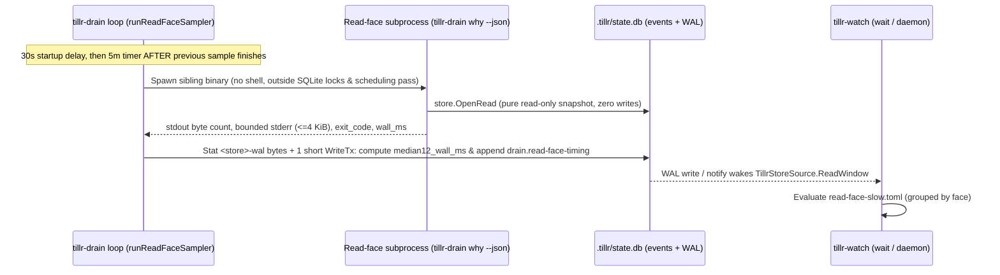

# A single-flight sampler in `tillr-drain loop` times read faces into `drain.read-face-timing` so read faces stay read-only

**Status:** 2026-11-24. Nothing in this design is built. Tree facts were verified at `679a05d0a1` on 2026-11-24 (`rg -n 'read-face-timing|readFaceSampler' tools/ config/` returns nothing). Only the owner's dated statements quoted verbatim in [§1.2](#12-standing-owner-rulings) (`R-RFT1` through `R-RFT6`) are owner rulings; the filed request and every mechanism, event kind, field name, cadence, threshold derivation rule, slice split, and rejected alternative (`D-RFT1` through `D-RFT6`) are from the operator request or the design seat, marked so in prose and in the [Decision Ledger](#decision-ledger), and the owner may overturn any of them.

> **In short.** Read faces such as `tillr drain why` must stay strictly read-only (`store.OpenRead`) and silent when uncalled, yet unattended overnight regressions happen precisely when no human or browser is invoking them. Having `tillr-drain loop` run one bounded, non-overlapping background read-face sample every five minutes after completion and append `drain.read-face-timing` to `.tillr/state.db` lets `tillr-watch` alert on slow or broken read faces today without touching read-face purity or `tillr-watch`'s engine.

**Why it matters.** Over the night of 2026-11-23, `tillr drain why` grew from `36 s` to `58 s` (`item-request-5755787e11`) with zero alerts; the operator discovered the regression only by timing the CLI manually at hourly check-ins ([§1.1](#11-what-happened-on-2026-11-23)).

**The shape.** One single-flight background goroutine in `tillr-drain loop` invokes configured read faces (starting with `tillr-drain why --json`) outside all SQLite locks, appends one registered `drain.read-face-timing` event per sample (`group_by = "face"`), and feeds two `predicate_match` watch rules (rolling 12-sample median drift and single-sample outlier, plus non-zero exit) whose thresholds are computed from a recorded live `>= 24`-sample baseline ([§3](#3-the-measurer-and-its-record-loop-sampler-and-drainread-face-timing)–[§4](#4-how-the-alert-threshold-is-measured-never-guessed)).

**Cost.** Twelve read-only subprocess invocations per hour per sampled face (`288` `drain.read-face-timing` rows per day, `< 0.03%` of the live store's `1.39M` events), zero read-face contract changes, zero `tillr-watch` engine changes, and zero extra supervised processes.

**Start at** [§2](#2-read-face-purity-and-comparison-of-the-three-candidate-measurers) for why the loop sampler wins over the face itself and the Observatory, then [§3](#3-the-measurer-and-its-record-loop-sampler-and-drainread-face-timing) for the exact component and event contract and [§4](#4-how-the-alert-threshold-is-measured-never-guessed) for how thresholds are measured.

**Needs your ruling:** None. (Open questions [`OQ-GW2`](./general-agent-watch.md#OQ-GW2) and [`OQ-GW3`](./general-agent-watch.md#OQ-GW3) remain in [`general-agent-watch.md`](./general-agent-watch.md); this design neither guesses nor depends on either.)

**Awaits your review:** the designer's decisions `D-RFT1` through `D-RFT6` in the [Decision Ledger](#decision-ledger).

**Reads with:** [`tillr-watch.md`](./tillr-watch.md) ([Section 5.5](./tillr-watch.md#55-fast-gate-time-two-rules-and-the-event-they-read-d-tw43) `drain.fast-gate-timing` precedent, [Section 6.8](./tillr-watch.md#68-alert-investigation-mandatory-outcomes-tracking-item-links-and-variable-scoped-silences-d-tw64-d-tw65) variable-scoped silences, [Section 6.9](./tillr-watch.md#69-rule-load-baselines-judging-only-events-from-a-rules-first-load-onward-d-tw66) rule load baselines), [`tillr-utility-contracts.md`](./tillr-utility-contracts.md) and [`tillr-utility-contracts/tillr-watch.md`](./tillr-utility-contracts/tillr-watch.md) (what `tillr-watch` reads and expects), [`general-agent-watch.md`](./general-agent-watch.md) (source decoupling and open [`OQ-GW2`](./general-agent-watch.md#OQ-GW2)/[`OQ-GW3`](./general-agent-watch.md#OQ-GW3)), and [`tillr-scheduling-and-notifications.md`](./tillr-scheduling-and-notifications.md) (keeping background work outside the scheduling pass).

---

## 1. The incident, the request, and standing owner rulings

### 1.1 What happened on 2026-11-23

The filed operator request states the incident and scope verbatim:

> What happened, 2026-11-23: `tillr drain why` grew from 36 s to 58 s over the night (item-request-5755787e11) and no alert reported it; the operator found it by timing the command at hourly check-ins. The owner's rule is that every fault found gets an alert, and tillr-watch rules read only registered events or projections. `tillr drain why` is a read face: having it write an event to the store would change that contract, so this is a design question, not a build item.
>
> The one thing to decide: which component measures a read face's duration (the face itself, the Observatory, a sampler) and where it records it so a rule can read it. Change nothing else.
>
> Out of scope: making tillr drain why faster (item-request-5755787e11). A gap there is not a reason to refuse this item; list it in the candidate note.

Later on 2026-11-23, commit `231783f6d6` (*"perf(tillr-drain): eliminate quadratic scans and duplicate folds in drain why"*) eliminated the duplicate event-stream folds and quadratic item/run scans in [`tools/tillr-drain/drain/why.go`](../../tools/tillr-drain/drain/why.go) and [`tools/tillr-drain/drain/plan.go`](../../tools/tillr-drain/drain/plan.go), cutting `tillr drain why --store .tillr/state.db --root . --lanes 1 --json` on the live `1.4 GB` store + `691 MB` WAL (`1,389,219` events, `4,494` runs, `1,088` items, load `~130` on `32` cores) from `7.24 s` wall (`5.04 s` warm CLI real) to **`2.50 s` wall (`2.34 s` CLI real)**. Still nothing alerts if `tillr drain why` — or another read face — regresses again as the event log, WAL, or document index grows.

### 1.2 Standing owner rulings

Six dated statements of the owner govern this design verbatim; nothing else in this document is presented as an owner ruling:

1. **Every fault found gets an alert (`R-RFT1`, 2026-11-21, quoted in [`.agents/skills/drain-timed-checkin/SKILL.md`](../../.agents/skills/drain-timed-checkin/SKILL.md#alerts)):**

   > "Apart from just creating a list of brainstormed alerts or however you want that you can think of ahead of time, every time you see a fault that you would have otherwise like to know about you should be filing an item to add an alert for that."

2. **Watchers apply no remedies (`R-RFT2`, 2026-11-21, [`OQ-TW2`](./tillr-watch.md#OQ-TW2)):**

   > "Every single one of these sounds like a fallback to cover an issue. We don't cover issues. We use this to find the issues and fix them."

3. **Every alert gets an investigation and action, rules are parameterized by variables for scoped silences, and noisy/expected alarms are fixed rather than ignored (`R-RFT3`, 2026-11-22, [`D-TW64`](./tillr-watch.md#D-TW64) and [`.agents/skills/drain-timed-checkin/SKILL.md`](../../.agents/skills/drain-timed-checkin/SKILL.md#alerts)):**

   > "One alert rule shouldn't just have one silence. If it's an alert rule for like package, like they should be parameterized with variables... There shouldn't be a know about and don't file. There also shouldn't be an alert that we don't know why it fired, so we need an investigation and action."
   >
   > "ALL alerts get triaged and acted on. noisy alerts get tweaked or disabled not ignored."
   >
   > "why is there an \"expected\" alarm? that is never good for \"boy who cried wolf\""

4. **Budgets are targets with performance monitoring, and high machine load never fails or caps work (`R-RFT4`, 2026-11-17 `D-GR15` and 2026-11-21 `D-GR38` in [the gate reference](../reference/gate.md#why-its-this-way), plus [`momentum-principle.md`](./momentum-principle.md)):**

   > "target budgets, watch for stalls, but don't let 'load is high' cause failures that would otherwise finish just fine."
   >
   > "if you think drain suite selected tests are 40 seconds, let's do that, and monitor how it goes, just make sure we have perf monitoring all over it. 10 seconds was apsirational"

5. **No fallbacks that hide failures (`R-RFT5`, 2026-11-20, [`tillr-judge-and-lifecycle.md` Section 4.15](./tillr-judge-and-lifecycle.md#415-no-automatic-move-to-another-model-d-jl24-to-d-jl27) and [`.agents/skills/drain-timed-checkin/SKILL.md`](../../.agents/skills/drain-timed-checkin/SKILL.md#model-policy-owner-2026-11-21)):**

   > "We need deliberate choices, not fallbacks. We need to fix what's wrong."
   >
   > "That is everything. ... If something fails, you fix it. If it fails loudly, you fix it. You don't hide it with a fallback."

6. **Separate utilities interact through explicit contracts (`R-RFT6`, 2026-11-21, [`tillr-utility-contracts.md` Section 1](./tillr-utility-contracts.md#1-the-ruling)):**

   > "So not just Vue should have a contract, all of the Tiller utilities should have a contract. They are separate utilities, so they need to have a defined API and what they expect from others."

### 1.3 Terms used in this document

**Alert episode**, **subject key**, **clearing event**, and **standing rule** keep their meanings from [`tillr-watch.md` Section 1.2](./tillr-watch.md#12-terms-used-in-this-document). **Observation** and **observation source** keep their meanings from [`general-agent-watch.md`](./general-agent-watch.md). Two terms are coined here:

- **Read face** *(coined here)*: a command-line subcommand across the `tillr` utilities (such as `tillr drain why`, `tillr drain plan`, `tillr view waiting`, `tillr view status`, or `tillr watch status`) that opens `.tillr/state.db` solely via `store.OpenRead` and promises zero store mutation, zero schema migration, and zero sidecar filesystem writes. It is not a mutating command (`loop`, `once`, `apply`, `seen`) and not the long-lived Observatory HTTP server (`tillr-view serve`).
- **Read-face sample** *(coined here)*: one bounded, out-of-transaction subprocess execution of a configured read face against the live store and repository root, timed wall-clock from spawn to process exit and recorded as one `drain.read-face-timing` event. It is an observational measurement, never a correctness gate, and it never cancels, caps, or alters any queue item or caller invocation.

### 1.4 Non-goals (what this design does not touch)

- **Making `tillr drain why` or any other read face faster (`item-request-5755787e11`).** SQLite WAL checkpointing, `tillr-drain loop`'s own CPU share, `uvx vantage-check index` rebuild speed when `main` advances, and Observatory payload sizes (all noted out of scope in `231783f6d6`) remain out of scope here.
- **Modifying `tillr-watch`'s evaluation engine, pattern set, or observation sources.** Neither [`OQ-GW2`](./general-agent-watch.md#OQ-GW2) (`command` probe sources) nor [`OQ-GW3`](./general-agent-watch.md#OQ-GW3) (sidecar `watch.db` vs `.tillr/state.db`) is settled or needed here.
- **Adding timeouts that kill slow read-face calls, or applying automatic remedies** such as `PRAGMA wal_checkpoint` when a slow read-face alert fires (`R-RFT2`, `R-RFT4`).

---

## 2. Read-face purity and comparison of the three candidate measurers

### 2.1 Two verified constraints in the tree at `679a05d0a1`

1. **Read faces are contractually side-effect-free, and `tillr` replaces its own process on exec.**
   In [`tools/tillr-drain/why.go`](../../tools/tillr-drain/why.go), `whyFace` opens `.tillr/state.db` read-only via `store.OpenRead`. Repository conformance tests — `TestAReadOnlyOpenDoesNotMigrate` in [`tools/tillr/conformance/conformance_test.go`](../../tools/tillr/conformance/conformance_test.go), `TestWatchStatusReadOnly` in [`tillr-utility-contracts/tillr-watch.md`](./tillr-utility-contracts/tillr-watch.md#4-how-the-contract-is-pinned), `storeFingerprint` around `plannerWhy` in [`tools/tillr-view/waiting_design_test.go`](../../tools/tillr-view/waiting_design_test.go), and `D-SH4` in [`tillr-selfhosted-build.md`](./tillr-selfhosted-build.md) — enforce that read faces leave `.tillr/state.db` byte-identical, succeed on `0444` stores without running schema migrations, and never contend for SQLite's single writer lock (`SQLITE_BUSY`, [`tillr-watch.md` Section 5.6](./tillr-watch.md#56-a-rule-brought-forward-a-store-write-refused-as-busy-d-tw46)). Nor can the top-level `tillr` wrapper time a read face after it exits: `run` in [`tools/tillr-cli/main.go`](../../tools/tillr-cli/main.go) hands off via `syscall.Exec`, replacing its own process image.
2. **`tillr-watch` today reads only `.tillr/state.db` events and four projections.**
   Although Slice 1 of [`general-agent-watch.md`](./general-agent-watch.md) introduced the `ObservationSource` interface, `TillrStoreSource` ([`tools/tillr/watch/tillr_source.go`](../../tools/tillr/watch/tillr_source.go)) is the sole source wired into [`tools/tillr-watch/main.go`](../../tools/tillr-watch/main.go). `ReadWindow` queries `events` (`SELECT seq,ts,kind,seat,object_type,object_id,revision,payload FROM events`) and `Project` reads `charter`, `items`, `workflow_selections`, and `git_refs`; sidecar `jsonl` and active `command` sources ([`general-agent-watch.md`](./general-agent-watch.md) Slices 2, 3, and 9) are unbuilt. Meanwhile, [`tools/tillr-watch/main.go`](../../tools/tillr-watch/main.go) already blank-imports `github.com/mschulkind-oss/tillr-drain/drain`, so any `drain.*` event kind registered via `event.Register` in `tools/tillr-drain/drain` is accepted immediately by `LoadRules` and evaluated by `predicate_match` — the exact pattern proven in production by `drain.fast-gate-timing` ([`tools/tillr-drain/drain/gate_timing.go`](../../tools/tillr-drain/drain/gate_timing.go), [`tillr-watch.md` Section 5.5](./tillr-watch.md#55-fast-gate-time-two-rules-and-the-event-they-read-d-tw43)).

### 2.2 Comparing the three candidate measurers (`D-RFT1`)

**Designer's decision (`D-RFT1`, answering the operator request; the owner may overturn it).** A **bounded, single-flight read-face sampler inside `tillr-drain loop`** measures read-face duration and appends one `drain.read-face-timing` event per sample to `.tillr/state.db`. Both the read face itself and the Observatory are rejected on verified structural grounds:

| Candidate | How it would measure & record | What happens overnight with no human or open browser tab | Effect on read-only contracts & writer lock | Works with landed `tillr-watch` today? | Verdict |
| :--- | :--- | :--- | :--- | :--- | :--- |
| **1. The read face itself** (`tillr drain why` writing to `.tillr/state.db` or a sidecar JSONL file) | Each CLI call times itself before exit and writes an event or JSONL line. | **Blind overnight:** if nothing invokes `tillr drain why` between check-ins, **zero** measurements are written while latency climbs from `36 s` to `58 s`. | **Breaks purity:** writing `.tillr/state.db` violates `store.OpenRead`, fails on `0444` / unmigrated stores, and contends on SQLite's writer lock; writing a sidecar file fails on read-only paths unless errors are silently dropped (violating `R-RFT5`). | Store write: yes (at contract cost). Sidecar JSONL: **no** (needs unbuilt Slices 2–3 of [`general-agent-watch.md`](./general-agent-watch.md)). | **Rejected.** |
| **2. The Observatory** (`tillr-view serve` via [`perflog.go`](../../tools/tillr-view/perflog.go) or store writes) | Records `/api/v1/why` route latency on HTTP requests into `server-YYYYMMDD.jsonl` (or `.tillr/state.db`). | **Double blind spot:** (1) in [`tools/tillr-view/why.go`](../../tools/tillr-view/why.go) (`whyPayload`) and [`tools/tillr-view/why_pass.go`](../../tools/tillr-view/why_pass.go) (`whyFromPass`), `/api/v1/why` answers from `drain_passes` + `dispatches` (`source: "pass"`, `ms: 0`) whenever `tillr-drain loop` is live — **never calling `tillr-drain why` during normal drain operation**; (2) with no open browser tab (or Observatory down), zero HTTP requests arrive. | Keeping timings in `server-YYYYMMDD.jsonl` leaves `.tillr/state.db` clean, whereas making `tillr-view` write `.tillr/state.db` on read routes violates `tillr-view`'s own read-only server contract. | **No:** `TillrStoreSource` cannot read `server-YYYYMMDD.jsonl`, and `/api/v1/why` does not measure `tillr-drain why` while the loop runs. | **Rejected.** |
| **3. A sampler in `tillr-drain loop`** (`Loop.runReadFaceSampler` -> `drain.read-face-timing` in `.tillr/state.db`) | Background single-flight goroutine runs `tillr-drain why --json` out-of-transaction every `5m` post-completion and appends one `drain.read-face-timing` event. | **Detects overnight drift automatically:** runs continuously whenever the drain loop is up, catching `36 s -> 58 s` growth with zero human or browser activity. | **Preserves 100% read-face purity:** every read face keeps `store.OpenRead` and zero sidecar writes; only `tillr-drain loop` (already a lawful `.tillr/state.db` writer) commits one tiny post-sample `WriteTx`. | **Yes, immediately:** zero changes to `tools/tillr/watch` or `tools/tillr-watch`, and compatible with either ruling on [`OQ-GW2`](./general-agent-watch.md#OQ-GW2) and [`OQ-GW3`](./general-agent-watch.md#OQ-GW3). | **Selected (`D-RFT1`).** |

> [!WARNING]
> **Trap — assuming Observatory's `/api/v1/why` already exercises `tillr drain why`.** In [`tools/tillr-view/why.go`](../../tools/tillr-view/why.go), `whyPayload` calls `s.whyFromPass` first and invokes `plannerWhy` (`tillr-drain why`) *only* when `whyFromPass` returns a `passFallback` (`"no loop is running"` or `"no pass is recorded"`). Throughout the 2026-11-23 overnight run, `tillr-drain loop` was running and recording passes, so `/api/v1/why` served `whyFromPass` in milliseconds while `tillr drain why` climbed to `58 s`.

Why the sampler lives inside `tillr-drain loop` rather than in a separate seventh daemon or inside `tillr-watch`:

- **No extra unsupervised daemon.** A running session already supervises six processes ([`.agents/skills/drain-timed-checkin/SKILL.md`](../../.agents/skills/drain-timed-checkin/SKILL.md#start-or-resume)); a standalone sampler script would add a seventh process that can die silently, whereas `tillr-drain loop` is already kept alive by `tillr-keep` and monitored for silence by `drain-loop-no-pass` ([`D-TW45`](./tillr-watch.md#D-TW45)).
- **Follows established `tillr-drain` precedents.** `Loop.refreshQuotas` ([`tools/tillr-drain/drain/quota_probe.go`](../../tools/tillr-drain/drain/quota_probe.go)) already executes periodic external CLI probes outside SQLite transactions, and `appendFastGateTiming` ([`tools/tillr-drain/drain/gate_timing.go`](../../tools/tillr-drain/drain/gate_timing.go)) already records `wall_ms` plus a rolling median inside one short `WriteTx` for `tillr-watch` rules.
- **Independent of [`OQ-GW2`](./general-agent-watch.md#OQ-GW2) and [`OQ-GW3`](./general-agent-watch.md#OQ-GW3).** Whether a watch rule may itself run a `command` probe is an open owner question ([`OQ-GW2`](./general-agent-watch.md#OQ-GW2)). Sampling in `tillr-drain loop` keeps `tillr-watch` purely observational over `.tillr/state.db` events today, and works unchanged regardless of how the owner rules [`OQ-GW2`](./general-agent-watch.md#OQ-GW2) or [`OQ-GW3`](./general-agent-watch.md#OQ-GW3).

---

## 3. The measurer and its record: loop sampler and `drain.read-face-timing`



### 3.1 Execution, scheduling isolation, and concurrency (`D-RFT2`)

**Designer's decision (`D-RFT2`; the owner may overturn it).** `Loop.Run` starts one background goroutine, `Loop.runReadFaceSampler(ctx)`, governed by six invariants:

1. **Zero coupling to the scheduling pass or restart lock.** Consistent with `D-SN1` in [`tillr-scheduling-and-notifications.md`](./tillr-scheduling-and-notifications.md#3-the-scheduling-pass-what-holds-the-lock-and-what-writes), the sampler never runs inside `passMode`, never holds `<git-common-dir>/tillr-loop.lock`, never holds `restartMechanical`, and never keeps a SQLite transaction open while the child subprocess executes.
2. **Sibling-binary resolution, never ambient `PATH`.** For each sampled face, the loop resolves the executable from the directory of `os.Executable()` (for `"drain.why"`, `os.Executable()` itself; for another utility such as `"view.waiting"`, the sibling `tillr-view` in the same directory), falling back to nothing (`R-RFT5`). This eliminates the stale-`PATH` measurement bug documented in [`.agents/skills/drain-timed-checkin/SKILL.md`](../../.agents/skills/drain-timed-checkin/SKILL.md#each-check-in), where a background helper picked up an older `tillr-drain` on `PATH` and failed for an hour.
3. **Exact CLI invocation for `"drain.why"`.** The built-in default target table starts with one entry (`face = "drain.why"`), executed without a shell (`exec.CommandContext`) in `l.cfg.Root` as:

   ```text
   <self-tillr-drain> why --store <l.cfg.Store> --root <l.cfg.Root> [--policy <l.cfg.PolicyPath>] --json
   ```

   Because `--lanes`, `--questions-index`, and `--questions-cmd` are omitted, `whyFace` ([`tools/tillr-drain/why.go`](../../tools/tillr-drain/why.go)) resolves live loop lanes via `drain.LiveLoopLanes` and loads the loop's saved `questions-index.json` via `drain.LoadSavedQuestionsIndex` when `trunk_sha` matches (rebuilding the Vantage index when `main` has moved) — measuring the exact code path an operator or caller runs, while keeping `why` 100% unmodified.
4. **Post-completion cadence (`5m` default) and strict single-flight serialization.** The goroutine waits `30s` after `Loop.Run` starts (avoiding cold-start recovery contention), executes the configured read-face list sequentially one subprocess at a time, and resets a `time.Timer` for `DefaultReadFaceSampleInterval = 5 * time.Minute` (`300s`) **only after** the cycle finishes. Even if `tillr drain why` regresses to `58 s` or `180 s`, a second sample can never start while the first is still running.
5. **Bounded memory and deadlock-only ceiling (`10m` = `600s`).** Standard output is streamed through a counting sink (`io.Discard` byte counter, allocating `O(1)` memory regardless of JSON size), and standard error is capped at `4,096` bytes (`4 KiB`). Per `R-RFT4`, slow execution is never killed by a tight budget — killing a slow `why` at `60 s` would destroy the duration measurement needed to see `58 s -> 90 s` growth. Only a `10m` (`600s`) deadlock safety ceiling (matching Go's test deadlock limit so an OS/SQLite hang cannot block the single-flight sampler forever) or loop shutdown (`ctx` cancellation) terminates the child process group.
6. **Clean shutdown and degenerate inputs.**
   - **Loop stop or rolling restart (`ctx.Err() != nil`):** If the parent loop context is cancelled while a sample is running, the child process group is terminated and **zero** timing event is written (matching `Loop.refreshQuotas` in [`tools/tillr-drain/drain/quota_probe.go`](../../tools/tillr-drain/drain/quota_probe.go)), so rolling restarts never fabricate failed-sample alerts.
   - **Empty face list:** In production the default list contains `["drain.why"]`; if a test or explicit config sets an empty slice, the goroutine returns immediately without starting a timer.
   - **Failed sample (`exit_code != 0` or spawn failure) vs failed event write:** A sample that fails to start (`exit_code = -1`) or exits non-zero (`exit_code > 0`) **is** recorded as a `drain.read-face-timing` event with its `error` text so `tillr-watch` alerts on broken read faces (`R-RFT5`), while being excluded from `median12_wall_ms` so fast `5 ms` errors never depress the rolling duration median. Conversely, if opening or committing the `WriteTx` on `.tillr/state.db` fails (`SQLITE_BUSY` past `DefaultBusyTimeout = 5 s` or I/O error), the loop prints `"drain: could not publish read-face timing for <face>: <err>"` on stderr and continues running (`D-TW46` already covers refused store writes).

### 3.2 Recorded event contract: `drain.read-face-timing` (`D-RFT3`)

**Designer's decision (`D-RFT3`; the owner may overturn it).** `tools/tillr-drain/drain` registers **`drain.read-face-timing`** via `event.Register` in package `init`. When a sample completes (with `ctx.Err() == nil`), the sampler stats `<store>-wal` on disk (recording `0` if `os.ErrNotExist`), opens `.tillr/state.db` via `store.Open(ctx, path, false)`, and runs one short `WriteTx` that reads `EventHeadSeq`, computes the 12-sample rolling median for `face`, and appends one event with `ObjectType = "read_face"` and `ObjectID = &p.Face`:

| Payload field | JSON type | Presence & meaning |
| :--- | :--- | :--- |
| `face` | `string` | Always present. Canonical `<noun>.<face>` identifier (starting with `"drain.why"`). Non-empty string so `group_by = "face"` never skips an event under [`D-TW22`](./tillr-watch.md#9-decision-ledger) and variable-scoped silences bind per face (`R-RFT3`). |
| `wall_ms` | `int64` | Always present (`>= 0`). Elapsed wall-clock duration of the subprocess in milliseconds. |
| `exit_code` | `int` | Always present. `0` on clean exit, subprocess exit code on failure (`124` if killed by the `10m` deadlock ceiling), or `-1` if the binary could not be started. |
| `timed_out` | `bool` | Present (`true`) only when terminated by the `10m` (`600,000 ms`) deadlock ceiling; omitted when `false`. |
| `output_bytes` | `int64` | Always present (`>= 0`). Total bytes written to standard output by the subprocess. |
| `event_head_seq` | `int64` | Always present. Store `EventHeadSeq` inside the recording `WriteTx` right before appending this event, anchoring every duration reading to store history size. |
| `wal_bytes` | `int64` | Always present (`>= 0`). Byte length of `<store>-wal` observed immediately after the subprocess exits (`0` if absent), exposing uncheckpointed WAL growth directly in alert bundles. |
| `median12_wall_ms` | `int64` | Present on `exit_code == 0` events once at least 11 earlier `exit_code == 0` `drain.read-face-timing` events exist for the same `face` (`12` samples = `1 hour` at the `5m` cadence): integer mean of the 6th and 7th sorted `wall_ms` values, rounded down. Omitted on failed runs (`exit_code != 0`) and while `< 12` successful samples exist for `face`. |
| `error` | `string` | Present only when `exit_code != 0`: trimmed stderr / spawn error capped at `512` UTF-8-safe bytes so every failure carries its literal diagnostic cause. |

Inside `WriteTx`, `median12ReadFaceTiming` queries only the newest earlier `drain.read-face-timing` rows for that `face` using the existing `events_by_object` index (`CREATE INDEX IF NOT EXISTS events_by_object ON events(object_id, seq)` in [`tools/tillr/event/append.go`](../../tools/tillr/event/append.go)):

```sql
SELECT json_extract(payload, '$.wall_ms')
FROM events INDEXED BY events_by_object
WHERE object_id = ? AND kind = 'drain.read-face-timing'
  AND json_extract(payload, '$.exit_code') = 0
ORDER BY seq DESC LIMIT 11
```

Because `object_id` is `face` (for example `"drain.why"`), that query touches at most a handful of index entries in microseconds, never scanning `run.child-session` or other faces' rows regardless of how large `events` grows.

---

## 4. How the alert threshold is measured, never guessed

### 4.1 Why guessing a threshold fails in both directions

Read-face wall time is not an intrinsic constant of the Go code; it depends on live store geometry and bimodal cache state that do not exist inside a unit-test fixture or an isolated lane worktree:

1. **Store and WAL scale (`231783f6d6`).** On an empty or 10-item test store, `tillr drain why` finishes in `< 20 ms`. On the live repository store (`1.4 GB` `state.db`, `691 MB` `state.db-wal`, `1.39M` events, `4,494` runs, `1,088` items under load `~130`), the optimized post-`231783f6d6` `tillr drain why` measured **`2.34 s` CLI real (`2.50 s` wall)** — two orders of magnitude slower than any synthetic fixture, and sensitive to `<store>-wal` size between SQLite checkpoints.
2. **Bimodal Vantage question-index cache misses (`~2.5 s` hit vs `+11.4–12.1 s` rebuild).** As documented in [`tools/tillr-view/vantagecache.go`](../../tools/tillr-view/vantagecache.go), running `uvx vantage-check index --format json` across this repository's `466` indexed documents takes **`11.4–12.1 s`**. When `main` has not moved since the loop saved `questions-index.json`, `whyFace` ([`tools/tillr-drain/why.go`](../../tools/tillr-drain/why.go)) reuses the saved index (`~0 ms`) and finishes in `~2.3–2.5 s`. When a sample lands right after `main` advances and before `questions-index.json` refreshes for the new `trunk_sha`, `whyFace` runs `uvx vantage-check index` itself (`~2.5 s + 12 s ≈ 14.5 s`).

Consequently, a guessed `5 s` per-sample threshold invented from `231783f6d6`'s single `2.50 s` snapshot would wolf-cry a false alert every time a sample coincided with a `main` landing (violating `R-RFT3`), while an unmeasured `60 s` guess would repeat the `fast-gate-run-slow` mistake of [`D-TW43`](./tillr-watch.md#55-fast-gate-time-two-rules-and-the-event-they-read-d-tw43) and miss a `36 s -> 58 s` overnight climb until it passed a minute.

### 4.2 The measure-then-threshold procedure (`D-RFT4`, `D-RFT5`)

**Designer's decisions (`D-RFT4` and `D-RFT5`; the owner may overturn either).** Following the empirical baseline pattern established for `drain.fast-gate-timing` in [`tillr-watch.md` Section 5.5](./tillr-watch.md#55-fast-gate-time-two-rules-and-the-event-they-read-d-tw43), shipping the producer and shipping the thresholded watch rules are split across two commits separated by a mandatory live measurement window:

1. **Step 1 — Land Slice 1 (sampler + `drain.read-face-timing` event) with zero guessed thresholds.** Once rolled onto the running `tillr-drain loop`, `.tillr/state.db` begins recording one `drain.read-face-timing` sample every `5m` under real store size, WAL size, trunk landings, and concurrent gate/proof load.
2. **Step 2 — Collect at least `N >= 24` consecutive `exit_code == 0` live samples (`>= 2 hours` at `5m` cadence) spanning active drain work.** Read the baseline window from `.tillr/state.db` starting at `<slice1_roll_seq>` through the stable `tillr view events` read face (never raw SQL on `.tillr/state.db`):

   ```bash
   tillr view events --store .tillr/state.db --since <slice1_roll_seq> | jq '
     [.payload.events[]
      | select(.kind == "drain.read-face-timing"
               and .payload.face == "drain.why"
               and .payload.exit_code == 0)]
     | {
         count: length,
         wall_ms_sorted: (map(.payload.wall_ms) | sort),
         p50_ms: (map(.payload.wall_ms) | sort | .[length / 2 | floor]),
         p95_ms: (map(.payload.wall_ms) | sort | .[(length * 95 / 100) | floor]),
         max_ms: (map(.payload.wall_ms) | max),
         max_median12_ms: ([.[] | .payload.median12_wall_ms // empty] | max),
         wal_bytes_min_max: [ (map(.payload.wal_bytes) | min), (map(.payload.wal_bytes) | max) ],
         event_head_seq_min_max: [ (map(.payload.event_head_seq) | min), (map(.payload.event_head_seq) | max) ]
       }'
   ```

   To qualify as a valid calibration baseline, the window must satisfy `count >= 24`, include at least `12` computed `median12_wall_ms` values, and span at least one `main` landing / gate run (not two hours of a completely idle, unchanging repository).
3. **Step 3 — Compute the two duration thresholds deterministically from the recorded distribution (`D-RFT5`):**
   - **Rolling-median drift threshold (`T_median_ms` for `read-face-median-slow`):**

     $$\text{T\_median\_ms} = \left\lceil \frac{\max(2.0 \times \text{p50\_ms},\; 1.5 \times \text{max\_median12\_ms})}{1000} \right\rceil \times 1000$$

     Because `median12_wall_ms` takes the median across `12` samples (`1 hour`), rare single-sample `questions-index.json` rebuilds (`+12 s`) vanish from the median, leaving `p50_ms` and `max_median12_ms` tightly clustered around steady-state store fold speed (for example, `~2.5–3.5 s` after `231783f6d6`, yielding `T_median_ms ≈ 6,000 ms` = `6 s` — catching a `36 s -> 58 s` overnight climb six times earlier while keeping `1.5x–2.0x` headroom over real heavy-load variance).
   - **Single-sample outlier threshold (`T_sample_ms` for `read-face-sample-slow`):**

     $$\text{T\_sample\_ms} = \left\lceil \frac{\max(2.0 \times \text{p95\_ms},\; 1.5 \times \text{max\_ms})}{1000} \right\rceil \times 1000$$

     Anchoring `T_sample_ms` above `max(2.0 * p95_ms, 1.5 * max_ms)` absorbs normal single-sample `uvx vantage-check index` cache misses on `trunk_sha` advances (`~14–15 s` -> `T_sample_ms ≈ 23,000 ms` = `23 s`) without false-positive alerts, while still firing immediately on a single `36 s` or `58 s` step regression before 12 samples accumulate.
4. **Step 4 — Stamp the exact numbers and provenance comment into `config/tillr/watch/read-face-slow.toml` (Slice 2).** Like [`config/tillr/watch/fast-gate-slow.toml`](../../config/tillr/watch/fast-gate-slow.toml) ([`D-TW43`](./tillr-watch.md#55-fast-gate-time-two-rules-and-the-event-they-read-d-tw43)), the TOML comment above each rule in Slice 2 records the measurement date, sample count `N`, `event_head_seq` range, `wal_bytes` range, `p50_ms`, `p95_ms`, `max_ms`, `max_median12_ms`, and resulting `T_median_ms` / `T_sample_ms`. No build worker may invent placeholder numbers without that live reading; when a second read face (such as `"view.waiting"`) is added later, its `face`-scoped rule clause gets its own `N >= 24` live baseline rather than reusing `"drain.why"`'s milliseconds.

### 4.3 Rule shape in `config/tillr/watch/read-face-slow.toml` (`D-RFT4`)

Slice 2 ships one rule file, `config/tillr/watch/read-face-slow.toml`, holding three rules — all scoped `core`, reading `["drain.read-face-timing"]`, grouping by `face` (so episodes, `tillr watch track`, and variable-scoped silences bind per read face under `R-RFT3` / [`D-TW64`](./tillr-watch.md#D-TW64), and per-rule load baselines under [`D-TW66`](./tillr-watch.md#69-rule-load-baselines-judging-only-events-from-a-rules-first-load-onward-d-tw66) prevent pre-load bursts), delivering to `receiver = "foreground"` with `also_notify = ["subscribers"]`, and executing zero remedies (`R-RFT2`):

| Rule `id` | Severity | `window` | `match` | `clear_when` | What it catches |
| :--- | :--- | :--- | :--- | :--- | :--- |
| `read-face-median-slow` | `warning` | `24h` | `event.face == "drain.why" and event.exit_code == 0 and event.median12_wall_ms > <T_median_ms>` | `event.face == "drain.why" and event.exit_code == 0 and event.median12_wall_ms <= <T_median_ms>` | Sustained / overnight latency growth (`36 s -> 58 s`), auto-resolving once a fix or WAL checkpoint brings the 1-hour median back at or below `<T_median_ms>`. |
| `read-face-sample-slow` | `warning` | `1h` | `event.face == "drain.why" and event.exit_code == 0 and event.wall_ms > <T_sample_ms>` | *(none — ages out of `1h` window once slow samples stop)* | Sudden single-call regressions (`> <T_sample_ms>`) without waiting 12 samples (`1h`) for the median to shift. |
| `read-face-failed` | `high` | *(unwindowed)* | `event.exit_code != 0` | `event.exit_code == 0` | Any read face exiting non-zero, failing to spawn, or hitting the `10m` deadlock ceiling (`timed_out == true`); needs zero threshold calibration and applies across every sampled `face`. |

Guidance lines render `{{subject}}`, `{{event.wall_ms}}`, `{{event.median12_wall_ms}}`, `{{event.wal_bytes}}`, `{{event.event_head_seq}}`, and `{{event.error}}` (via `8d3912eb73`'s `{{event.<name>}}` bundle interpolation in [`tools/tillr/watch/bundle.go`](../../tools/tillr/watch/bundle.go)), directing the woken receiver to inspect whether `wal_bytes` or `event_head_seq` grew or a new unindexed scan landed and to profile the face (`go test -cpuprofile` / SQLite query plans as in `231783f6d6`), never to run an automatic remedy.

---

## 5. Build order, alternatives, and risks

### 5.1 Two small slices that each land alone (`D-RFT6`)

Per the request (*"so this is a design question, not a build item... Change nothing else"*), **zero queue items and zero code changes are included in this commit**. When built, the work splits into two small slices (`D-RFT6`; Slice 1 runs `just pack-sync` for the `yolo-packs/tillr/` mirror):

| Slice | What lands | Verification & observable done condition | Follows |
| ---: | :--- | :--- | :--- |
| **1** | **Single-flight read-face sampler (`Loop.runReadFaceSampler`) and `drain.read-face-timing` event in `tools/tillr-drain`.** Register `drain.read-face-timing`, run `"drain.why"` out-of-transaction every `5m` post-completion (`30s` initial delay, `10m` deadlock ceiling, sibling binary resolution, `O(1)` stdout byte count, `<= 4 KiB` stderr), and append `drain.read-face-timing` with `median12_wall_ms` via `events_by_object`. | Targeted `go test ./drain` tests prove: (1) zero store mutation inside `why` itself; (2) post-completion single-flight timer never overlaps a slow child; (3) `median12_wall_ms` appears on the 12th `exit_code == 0` sample for that `face` and ignores `exit_code != 0` failures; (4) `ctx` cancellation during loop shutdown appends no bogus failure event; (5) `EXPLAIN QUERY PLAN` for `median12_wall_ms` uses `events_by_object`. Live loop emits `drain.read-face-timing` every `5m` in `tillr view events`. | — |
| **2** | **Baseline-calibrated `config/tillr/watch/read-face-slow.toml` and rule evaluation test in `tools/tillr-watch`.** After recording `N >= 24` live `drain.read-face-timing` samples from `.tillr/state.db` via the [§4.2](#42-the-measure-then-threshold-procedure-d-rft4-d-rft5) query, compute `T_median_ms` and `T_sample_ms`, record the distribution and formula in the rule file's header comment, and ship `read-face-median-slow`, `read-face-sample-slow`, and `read-face-failed`. | Targeted `go test` in `tools/tillr-watch` (`read_face_slow_rule_test.go`) verifies rule loading, `D-TW66` baseline behavior, boundary firing/non-firing at `T_median_ms` and `T_sample_ms`, `clear_when` auto-resolution on median recovery and `exit_code == 0` recovery, per-`face` episode isolation, and `{{event.*}}` guidance interpolation. | Slice 1 + live `N >= 24` baseline window |

### 5.2 Alternatives considered and risks

| Alternative | Verdict |
| :--- | :--- |
| **Have `tillr drain why` open `.tillr/state.db` writable and append its own timing event** | **Rejected:** breaks `store.OpenRead` read-only purity, fails on `0444` and unmigrated stores (`TestAReadOnlyOpenDoesNotMigrate`), adds SQLite writer-lock contention to every read call, and still writes zero events overnight when nobody invokes `tillr drain why`. |
| **Have `tillr drain why` append timings to a sidecar JSONL file** | **Rejected:** still produces zero samples overnight when uncalled, forces a read-only CLI either to fail on unwritable directories or silently drop errors (violating `R-RFT5`), and cannot be read by `tillr-watch` today before Slices 2–3 of [`general-agent-watch.md`](./general-agent-watch.md) land. |
| **Read Observatory `/api/v1/why` timings from `perflog.go` (`server-YYYYMMDD.jsonl`)** | **Rejected:** `whyPayload` serves `whyFromPass` (`ms: 0`) whenever `tillr-drain loop` is running (never invoking `tillr-drain why` during normal drain operation), records nothing when no browser tab is open, and writes outside `.tillr/state.db`. |
| **Wait for [`OQ-GW2`](./general-agent-watch.md#OQ-GW2) (`command` probe source in `tillr-watch`) instead of sampling in `tillr-drain loop`** | **Rejected:** [`OQ-GW2`](./general-agent-watch.md#OQ-GW2) is an unruled, lower-priority generalization item (`R-GW1`) whose Option A explicitly rejects `command` sources; sampling in `tillr-drain loop` closes the live drain monitoring gap now with zero `tillr-watch` engine changes and remains valid under either [`OQ-GW2`](./general-agent-watch.md#OQ-GW2) ruling. |
| **Start a separate standalone cron/Python sampler script as a seventh session process** | **Rejected:** adds a seventh background process to supervise ([`.agents/skills/drain-timed-checkin/SKILL.md`](../../.agents/skills/drain-timed-checkin/SKILL.md#start-or-resume)) that can die silently or resolve a stale `PATH` binary, duplicating what `tillr-drain loop` already owns. |
| **Guess a fixed round threshold (such as `5 s` or `30 s`) in a single combined build** | **Rejected:** violates Criterion 6 (`c6`); a fixture-based or single-snapshot guess either wolf-cries on `~12 s` `vantage-check index` rebuilds when `main` moves (`R-RFT3`) or misses real multi-ten-second regressions ([`D-TW52`](./tillr-watch.md#D-TW52)). |

| Risk | Mitigation |
| :--- | :--- |
| **A regressed `58 s` read face stacks overlapping subprocesses and saturates CPU** | Prevented structurally by single-flight execution plus resetting the `5m` `time.Timer` *after* subprocess exit ([§3.1](#31-execution-scheduling-isolation-and-concurrency-d-rft2)): at most one read-face sample subprocess can ever exist at once. |
| **A `main` commit landing right before a sample triggers a `~12 s` Vantage index rebuild and false-fires an alert** | Handled in both rules ([§4.2](#42-the-measure-then-threshold-procedure-d-rft4-d-rft5)): `median12_wall_ms` filters out isolated single-sample cache misses, and `T_sample_ms` is calibrated at `ceil_to_1000ms(max(2.0 * p95_ms, 1.5 * max_ms))` over a live window required to span active `main` landings. |
| **Fast non-zero exits (`5 ms` usage/open error) pull `median12_wall_ms` down and mask a slow face** | `median12ReadFaceTiming` filters `json_extract(payload, '$.exit_code') = 0` ([§3.2](#32-recorded-event-contract-drainread-face-timing-d-rft3)), while `read-face-failed` opens a `high`-severity alert immediately on any `exit_code != 0`. |
| **Rolling loop restarts kill an in-flight sample and false-fire `read-face-failed`** | When `ctx.Err() != nil`, `runReadFaceSampler` exits cleanly without appending `drain.read-face-timing` ([§3.1](#31-execution-scheduling-isolation-and-concurrency-d-rft2)). |

---

## Decision Ledger

Two sections, kept strictly separate so only the owner's dated words are recorded as owner rulings and every operator-request or designer decision is marked as subject to the owner's overturn.

### The owner's rulings

| ID | Ruling | Date | Settled in | Built |
| :--- | :--- | :--- | :--- | :--- |
| <a id="R-RFT1"></a>`R-RFT1` | **Every fault found gets an alert.** Owner, 2026-11-21, verbatim ([`.agents/skills/drain-timed-checkin/SKILL.md`](../../.agents/skills/drain-timed-checkin/SKILL.md#alerts)): *"Apart from just creating a list of brainstormed alerts or however you want that you can think of ahead of time, every time you see a fault that you would have otherwise like to know about you should be filing an item to add an alert for that."* | 2026-11-21 | [§1.2](#12-standing-owner-rulings) | — |
| <a id="R-RFT2"></a>`R-RFT2` | **Watch rules apply no automatic remedies ([`OQ-TW2`](./tillr-watch.md#OQ-TW2)).** Owner, 2026-11-21, verbatim: *"Every single one of these sounds like a fallback to cover an issue. We don't cover issues. We use this to find the issues and fix them."* | 2026-11-21 | [§1.2](#12-standing-owner-rulings), [§4.3](#43-rule-shape-in-configtillrwatchread-face-slowtoml-d-rft4) | `e85ae973d9` |
| <a id="R-RFT3"></a>`R-RFT3` | **Every alert gets an investigation and action, rules are parameterized by variables for scoped silences, and noisy/"expected" alerts are fixed rather than ignored ([`D-TW64`](./tillr-watch.md#D-TW64)).** Owner, 2026-11-22, verbatim: *"One alert rule shouldn't just have one silence. If it's an alert rule for like package, like they should be parameterized with variables... There shouldn't be a know about and don't file. There also shouldn't be an alert that we don't know why it fired, so we need an investigation and action."* *"ALL alerts get triaged and acted on. noisy alerts get tweaked or disabled not ignored."* *"why is there an \"expected\" alarm? that is never good for \"boy who cried wolf\""*. | 2026-11-22 | [§1.2](#12-standing-owner-rulings), [§4.1](#41-why-guessing-a-threshold-fails-in-both-directions), [§4.3](#43-rule-shape-in-configtillrwatchread-face-slowtoml-d-rft4) | — |
| <a id="R-RFT4"></a>`R-RFT4` | **Budgets are targets with performance monitoring, and load never fails or caps valid work (`D-GR15`, `D-GR38` in [the gate reference](../reference/gate.md#why-its-this-way)).** Owner, 2026-11-17 and 2026-11-21, verbatim: *"target budgets, watch for stalls, but don't let 'load is high' cause failures that would otherwise finish just fine."* *"if you think drain suite selected tests are 40 seconds, let's do that, and monitor how it goes, just make sure we have perf monitoring all over it. 10 seconds was apsirational"*. | 2026-11-17; 2026-11-21 | [§1.2](#12-standing-owner-rulings), [§3.1](#31-execution-scheduling-isolation-and-concurrency-d-rft2) | — |
| <a id="R-RFT5"></a>`R-RFT5` | **No silent fallbacks (`D-JL24` in [`tillr-judge-and-lifecycle.md` Section 4.15](./tillr-judge-and-lifecycle.md#415-no-automatic-move-to-another-model-d-jl24-to-d-jl27)).** Owner, 2026-11-20, verbatim: *"We need deliberate choices, not fallbacks. We need to fix what's wrong."* *"That is everything. ... If something fails, you fix it. If it fails loudly, you fix it. You don't hide it with a fallback."* | 2026-11-20 | [§1.2](#12-standing-owner-rulings), [§2.2](#22-comparing-the-three-candidate-measurers-d-rft1), [§3.1](#31-execution-scheduling-isolation-and-concurrency-d-rft2) | — |
| <a id="R-RFT6"></a>`R-RFT6` | **Separate utilities interact through explicit, test-pinned contracts ([`tillr-utility-contracts.md` Section 1](./tillr-utility-contracts.md#1-the-ruling)).** Owner, 2026-11-21, verbatim: *"So not just Vue should have a contract, all of the Tiller utilities should have a contract. They are separate utilities, so they need to have a defined API and what they expect from others."* | 2026-11-21 | [§1.2](#12-standing-owner-rulings), [§2.1](#21-two-verified-constraints-in-the-tree-at-679a05d0a1) | — |

### The designer's decisions

Each `D-RFT` row below is the design seat's engineering decision answering the operator's 2026-11-24 request within [`R-RFT1`](#R-RFT1)–[`R-RFT6`](#R-RFT6). None is an owner ruling, and the owner may overturn any of them.

| ID | Decision | Date | Settled in | Built |
| :--- | :--- | :--- | :--- | :--- |
| <a id="D-RFT1"></a>`D-RFT1` | **Designer's decision (from an operator request); the owner may overturn it.** Measure read-face duration with a bounded, single-flight sampler inside `tillr-drain loop` (`Loop.runReadFaceSampler`) and record each measurement as a registered `drain.read-face-timing` event in `.tillr/state.db` read by `tillr-watch` via `TillrStoreSource`. **Rejected:** self-logging inside the read face (breaks `store.OpenRead` purity or sidecar-free contracts and records zero samples overnight when uncalled), reading Observatory `/api/v1/why` `perfLog` timings (`whyPayload` serves `whyFromPass` at `0 ms` while the loop runs and logs nothing without an open browser tab), starting a seventh standalone sampler daemon, or blocking on [`OQ-GW2`](./general-agent-watch.md#OQ-GW2). | 2026-11-24 | [§2.2](#22-comparing-the-three-candidate-measurers-d-rft1), [§5.2](#52-alternatives-considered-and-risks) | — |
| <a id="D-RFT2"></a>`D-RFT2` | **Designer's decision; the owner may overturn it.** Run `Loop.runReadFaceSampler` outside the scheduling pass, `restartMechanical`, and SQLite transactions: resolve sibling binaries from `os.Executable()`'s directory (never ambient `PATH`), start `30s` after loop entry, wait `5m` (`300s`) *after* each cycle completes so slow runs never overlap, stream stdout to an `O(1)` byte counter, cap stderr at `4 KiB`, apply only a `10m` (`600s`) deadlock safety ceiling, and suppress event writes when interrupted by loop shutdown (`ctx.Err() != nil`). | 2026-11-24 | [§3.1](#31-execution-scheduling-isolation-and-concurrency-d-rft2) | — |
| <a id="D-RFT3"></a>`D-RFT3` | **Designer's decision; the owner may overturn it.** Register `drain.read-face-timing` (`ObjectType = "read_face"`, `ObjectID = face`) carrying `face`, `wall_ms`, `exit_code`, optional `timed_out`, `output_bytes`, `event_head_seq`, `wal_bytes`, optional `median12_wall_ms` (computed over the 12 newest `exit_code == 0` samples for `face` via `INDEXED BY events_by_object`), and optional `<= 512`-byte `error` on `exit_code != 0`. | 2026-11-24 | [§3.2](#32-recorded-event-contract-drainread-face-timing-d-rft3) | — |
| <a id="D-RFT4"></a>`D-RFT4` | **Designer's decision; the owner may overturn it.** Ship three rules in `config/tillr/watch/read-face-slow.toml`, all grouped by `face` for per-face episode deduplication and variable-scoped silences (`R-RFT3`): `read-face-median-slow` (1-hour `median12_wall_ms > T_median_ms` with `clear_when <= T_median_ms`), `read-face-sample-slow` (`wall_ms > T_sample_ms` in `1h`), and unwindowed `read-face-failed` (`exit_code != 0` with `clear_when` on `exit_code == 0`), delivering to `foreground` + `subscribers` with zero remedies (`R-RFT2`). | 2026-11-24 | [§4.3](#43-rule-shape-in-configtillrwatchread-face-slowtoml-d-rft4) | — |
| <a id="D-RFT5"></a>`D-RFT5` | **Designer's decision (from an operator request); the owner may overturn it.** Never guess thresholds from synthetic fixtures or single-point profiles: collect `N >= 24` consecutive `exit_code == 0` live `drain.read-face-timing` samples (`>= 2h`, spanning active `main` landings and gate/proof load) via `tillr view events --since <slice1_roll_seq>`, compute `T_median_ms = ceil_to_1000ms(max(2.0 * p50_ms, 1.5 * max_median12_ms))` and `T_sample_ms = ceil_to_1000ms(max(2.0 * p95_ms, 1.5 * max_ms))`, and cite the recorded sample count, `event_head_seq` range, `wal_bytes` range, and percentiles in `read-face-slow.toml`'s header comment (calibrating each newly added `face` from its own `N >= 24` live baseline). | 2026-11-24 | [§4.2](#42-the-measure-then-threshold-procedure-d-rft4-d-rft5) | — |
| <a id="D-RFT6"></a>`D-RFT6` | **Designer's decision; the owner may overturn it.** Split implementation into two standalone slices ([§5.1](#51-two-small-slices-that-each-land-alone-d-rft6)) — Slice 1 (`drain.read-face-timing` producer + `just pack-sync`) followed after the live `N >= 24` baseline window by Slice 2 (`config/tillr/watch/read-face-slow.toml` + `tools/tillr-watch` rule test) — filing zero build items and touching zero code in this design commit. | 2026-11-24 | [§5.1](#51-two-small-slices-that-each-land-alone-d-rft6) | — |
