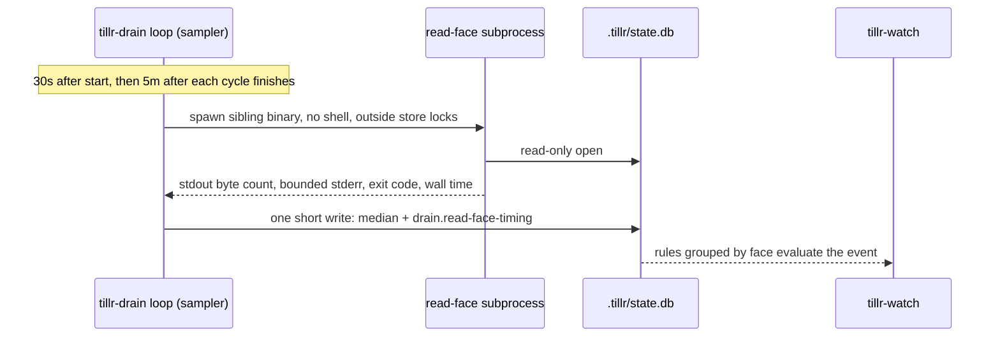

# A single-flight sampler in `tillr-drain loop` times read faces into `drain.read-face-timing` so read faces stay read-only

**Status:** 2026-11-27. Every decision is in and no question is open. Nothing in this design is built: `rg -n 'read-face-timing|readFaceSampler' tools config` returns nothing.

> **In short.** A read face such as `tillr drain why` must stay read-only and silent, yet it regresses precisely when nobody is calling it. `tillr-drain loop` therefore samples each configured read face on a timer and records the duration as an event, so `tillr-watch` can alert on a slow or broken read face without touching the read face or the watch engine.

**Why it matters.** A read face's wall time grows with the event log, the write-ahead log and the document index. Without a recorded measurement, the only way to notice is to time the command by hand.

**The shape.** One background goroutine in `tillr-drain loop` runs the configured read faces one at a time, outside every store lock, and appends one `drain.read-face-timing` event per sample. Three watch rules read that event, grouped by face: a rolling-median drift rule, a single-sample outlier rule, and a failure rule.

**Cost.** Twelve read-only subprocess runs and twelve small events per hour per sampled face. No read-face contract changes, no watch engine changes, no additional supervised process.

**Start at** [§2](#2-who-measures-and-why-not-the-face-itself-or-the-observatory).

**Needs your ruling:** None. The design neither depends on nor guesses [OQ-GW2](./general-agent-watch.md#OQ-GW2) or [OQ-GW3](./general-agent-watch.md#OQ-GW3).

**Designer's decisions:** `D-RFT1` to `D-RFT6` in the [Decision Ledger](#decision-ledger). The owner may overturn any of them; none holds the build ([the design-to-planning rule](./tillr-design-to-planning-transition.md#41-one-mechanical-test-for-owner-holds-unanswered-question-directives-d-dt1-d-dt2)).

**Reads with:** [the tillr-watch design](./tillr-watch.md) ([Section 5.5](./tillr-watch.md#55-fast-gate-time-two-rules-and-the-event-they-read-d-tw43), the fast-gate timing event this follows; [Section 6.9](./tillr-watch.md#69-rule-load-baselines-judging-only-events-from-a-rules-first-load-onward-d-tw66), rule load baselines), [the utility contracts](./tillr-utility-contracts.md), [the `tillr-watch` contract](./tillr-utility-contracts/tillr-watch.md), [the general agent watch design](./general-agent-watch.md), and [scheduling and notifications](./tillr-scheduling-and-notifications.md) (background work stays outside the scheduling pass).

---

## 1. Terms, rulings and non-goals

**Alert episode**, **subject key** and **clearing event** keep their meanings from [the tillr-watch design](./tillr-watch.md#12-terms-used-in-this-document). Two terms are coined here:

- **Read face** *(coined here)*: a subcommand of a `tillr` utility (`tillr drain why`, `tillr drain plan`, `tillr view waiting`, `tillr watch status`) that opens `.tillr/state.db` only for reading and promises no store change, no schema migration and no file written beside the store. It is not a mutating command and not the long-lived Observatory server.
- **Read-face sample** *(coined here)*: one bounded subprocess run of a configured read face against the live store, timed from spawn to exit and recorded as one event. It is a measurement, never a gate: it cancels, caps and alters nothing.

The owner rulings that bound the design are recorded as `R-RFT1` to `R-RFT6` in the [Decision Ledger](#decision-ledger).

Non-goals:

- Making any read face faster.
- Changing the watch engine, its patterns or its observation sources.
- Killing a slow read-face call, or applying any remedy when an alert fires ([R-RFT2](#R-RFT2), [R-RFT4](#R-RFT4)).

---

## 2. Who measures, and why not the face itself or the Observatory

Two facts in the tree constrain the choice:

1. **Read faces have no side effects.** `whyFace` in [`tools/tillr-drain/why.go`](../../tools/tillr-drain/why.go) opens the store read-only, and `TestAReadOnlyOpenDoesNotMigrate` in [`conformance_test.go`](../../tools/tillr/conformance/conformance_test.go) pins that a read-only open does not migrate. The top-level `tillr` wrapper cannot time a face either: [`tools/tillr-cli/main.go`](../../tools/tillr-cli/main.go) replaces its own process with `syscall.Exec`.
2. **`tillr-watch` reads store events and projections only.** `TillrStoreSource` ([`tillr_source.go`](../../tools/tillr/watch/tillr_source.go)) is the one source wired into [`tools/tillr-watch/main.go`](../../tools/tillr-watch/main.go). A `drain.*` event kind registered with the drain's other kinds ([`events.go`](../../tools/tillr-drain/internal/storelog/events.go)) is accepted by rule loading, which is how `drain.fast-gate-timing` ([`gate_timing.go`](../../tools/tillr-drain/internal/gatespans/gate_timing.go)) already works.

| Candidate | With nobody calling the face | Effect on read-only contracts | Readable by `tillr-watch` today | Verdict |
| :--- | :--- | :--- | :--- | :--- |
| **The read face records its own duration** (in the store or a file beside it) | No samples. | Breaks them: a store write fails on a read-only store and contends for the writer lock; a file write fails on a read-only path unless the error is dropped ([R-RFT5](#R-RFT5)). | Store write yes; a file no. | Rejected |
| **The Observatory records `/api/v1/why` latency** | No samples without an open browser tab. And while a loop is running, `whyPayload` in [`tools/tillr-view/why.go`](../../tools/tillr-view/why.go) answers from the last recorded pass (`whyFromPass` in [`why_pass.go`](../../tools/tillr-view/why_pass.go)) and does not run `tillr-drain why` at all. | Its timing log stays outside the store; writing the store from a read route would break the server's own contract. | No. | Rejected |
| **A sampler in `tillr-drain loop`** | Samples whenever the loop is up. | Preserves them: only the loop, already a store writer, commits one small write after each sample. | Yes, with no engine change. | **Selected (`D-RFT1`)** |

The sampler lives in the loop rather than in a separate process or in `tillr-watch` because:

- the loop is already kept alive and already watched for silence by `drain-loop-no-pass` ([D-TW45](./tillr-watch.md#D-TW45)), where a separate sampler process could die unnoticed;
- the loop already runs periodic external probes outside store transactions (`RefreshQuotas` in [`quota_probe.go`](../../tools/tillr-drain/internal/policy/quota_probe.go)) and already records a duration with a rolling median for a watch rule (`AppendFastGateTiming` in [`gate_timing.go`](../../tools/tillr-drain/internal/gatespans/gate_timing.go));
- whether a watch rule may itself run a command is an open question ([OQ-GW2](./general-agent-watch.md#OQ-GW2)), and this design works under either answer.

---

## 3. The sampler and its record



### 3.1 Execution, isolation and concurrency (`D-RFT2`)

The loop starts one sampler goroutine, bound by six rules:

1. **Outside the scheduling pass.** The sampler never runs inside a pass, never holds the loop lock or the restart lock, and never keeps a store transaction open while a subprocess runs ([`D-SN1`](./tillr-scheduling-and-notifications.md#3-the-scheduling-pass-what-holds-the-lock-and-what-writes)).
2. **Sibling binary, never `PATH`.** The executable for a face is resolved from the directory of the loop's own executable: itself for `drain.why`, the sibling `tillr-view` for a `view.*` face. There is no fallback to `PATH`; an unresolvable binary is a failed sample.
3. **The same invocation a caller makes.** The default face list holds one entry, `drain.why`, run as:

   ```text
   <tillr-drain> why --store <store> --root <root> [--policy <policy>] --json
   ```

   With no `--lanes`, `--questions-cmd` or `--questions-index` flag, `whyFace` resolves the live loop's lanes and its saved question index exactly as it does for an operator.
4. **Single flight.** The sampler waits `30s` after the loop starts, runs the face list sequentially, and arms a `5m` timer only after the cycle finishes. A second sample cannot start while one is running, however slow.
5. **Bounded memory, and a ceiling for deadlock only.** Standard output is counted and discarded; standard error is kept up to 4 KiB. A slow run is never killed for being slow, since that would destroy the measurement ([R-RFT4](#R-RFT4)). A `10m` ceiling, or loop shutdown, ends the child's process group.
6. **Degenerate cases.**
   - *Loop shutdown during a sample:* the child is ended and no event is written, so a restart never produces a failed-sample alert.
   - *Empty face list:* the goroutine returns without arming a timer.
   - *A sample fails to start or exits non-zero:* it is recorded, with its error text, and excluded from the rolling median.
   - *The event write fails:* the loop prints `drain: could not publish read-face timing for <face>: <err>` on standard error and continues; the refused write itself is covered by [the store-busy rule](./tillr-watch.md#56-a-rule-brought-forward-a-store-write-refused-as-busy-d-tw46).

### 3.2 The event: `drain.read-face-timing` (`D-RFT3`)

Registered with the drain's other event kinds ([`events.go`](../../tools/tillr-drain/internal/storelog/events.go)), with object type `read_face` and the face as object id. After a sample, the sampler reads the size of the store's write-ahead log file and appends one event in one short write transaction:

| Field | Type | Meaning |
| :--- | :--- | :--- |
| `face` | string | Always present. `<utility>.<face>`, for example `drain.why`. The rules group by it. |
| `wall_ms` | integer | Always present. Wall time of the subprocess. |
| `exit_code` | integer | Always present. `0`, the subprocess's code, `124` when ended by the ceiling, `-1` when it could not start. |
| `timed_out` | boolean | Present, `true`, only when ended by the ceiling. |
| `output_bytes` | integer | Always present. Bytes written to standard output. |
| `event_head_seq` | integer | Always present. The store's newest event sequence at recording, tying the duration to history size. |
| `wal_bytes` | integer | Always present. Size of the write-ahead log file after the run; `0` if absent. |
| `median12_wall_ms` | integer | Present on a successful sample once eleven earlier successful samples exist for the face: the mean of the sixth and seventh sorted values, rounded down. Twelve samples are one hour. |
| `error` | string | Present only on failure: the trimmed error text, at most 512 bytes. |

The median reads at most the eleven newest earlier successful samples for the face through the `events_by_object` index ([`append.go`](../../tools/tillr/event/append.go)), so its cost does not grow with the event log.

---

## 4. How the alert threshold is measured, never guessed

### 4.1 Why a guessed threshold fails in both directions

Read-face wall time is not a constant of the code:

1. **It scales with the store.** A fixture store answers in milliseconds; a store with over a million events answers in seconds, and the time moves with the write-ahead log's size between checkpoints.
2. **It is bimodal.** `uvx vantage-check index --format json` takes 11.4 to 12.1 s on this repository (measured, recorded in [`vantagecache.go`](../../tools/tillr-view/vantagecache.go)). `tillr drain why` reuses the loop's saved index when the trunk has not moved and rebuilds it when a sample lands just after a landing, adding that time to one sample.

A low guess fires on every index rebuild; a high guess misses real growth until it is large.

### 4.2 Measure, then set the threshold (`D-RFT4`, `D-RFT5`)

The producer and the rules ship separately, with a measurement window between them, as for `drain.fast-gate-timing` ([D-TW43](./tillr-watch.md#55-fast-gate-time-two-rules-and-the-event-they-read-d-tw43)):

1. **Ship the sampler and the event** with no thresholds.
2. **Collect a baseline** of at least 24 consecutive successful live samples (two hours), read through `tillr view events`, never raw SQL. The window must include at least twelve computed medians and span at least one landing on the trunk.
3. **Compute both thresholds** from the recorded distribution, rounded up to a whole second:

   $$\text{T\_median\_ms} = \left\lceil \frac{\max(2.0 \times \text{p50\_ms},\; 1.5 \times \text{max\_median12\_ms})}{1000} \right\rceil \times 1000$$

   $$\text{T\_sample\_ms} = \left\lceil \frac{\max(2.0 \times \text{p95\_ms},\; 1.5 \times \text{max\_ms})}{1000} \right\rceil \times 1000$$

   The median over twelve samples ignores an isolated index rebuild, so `T_median_ms` tracks steady-state speed. `T_sample_ms` sits above the slowest rebuild seen, so it fires only on a step regression.
4. **Record the numbers in the rule file.** The comment above each rule states the measurement date, the sample count, the ranges of `event_head_seq` and `wal_bytes`, the percentiles and the resulting thresholds, as [`fast-gate-slow.toml`](../../tools/tillr-watch/rules/fast-gate-slow.toml) does. No builder invents a placeholder. A face added later gets its own baseline.

### 4.3 The rules (`D-RFT4`)

One file, `tools/tillr-watch/rules/read-face-slow.toml`, shipped with `tillr-watch` beside [`fast-gate-slow.toml`](../../tools/tillr-watch/rules/fast-gate-slow.toml), holds three `core` rules that read `drain.read-face-timing`, group by `face`, deliver to the foreground and to subscribers, and run no remedy:

| Rule | Severity | Window | Fires when | Clears when | Catches |
| :--- | :--- | :--- | :--- | :--- | :--- |
| `read-face-median-slow` | `warning` | `24h` | a successful sample's `median12_wall_ms` exceeds `T_median_ms` | the median is back at or below it | Sustained growth. |
| `read-face-sample-slow` | `warning` | `1h` | a successful sample's `wall_ms` exceeds `T_sample_ms` | the slow sample ages out of the window | A sudden step, before twelve samples accumulate. |
| `read-face-failed` | `high` | none | `exit_code != 0` | a later sample exits `0` | A face that fails, cannot start or hits the ceiling. Needs no calibration. |

Guidance renders the subject and the event's `wall_ms`, `median12_wall_ms`, `wal_bytes`, `event_head_seq` and `error`, and directs the receiver to check whether the log or the store grew or a new scan landed, and to profile the face.

---

## 5. Build order, alternatives and risks

### 5.1 Two slices (`D-RFT6`)

| Slice | What lands | Done when |
| ---: | :--- | :--- |
| **1** | The sampler and the `drain.read-face-timing` event in `tools/tillr-drain`. | Tests show the face itself writes nothing, a slow child never overlaps the next sample, the median appears on the twelfth successful sample and ignores failures, shutdown during a sample writes no event, and the median query uses `events_by_object`. A live loop emits one event per `5m`. |
| **2** | `tools/tillr-watch/rules/read-face-slow.toml`, calibrated from the live baseline, with a rule test in `tools/tillr-watch`. Follows slice 1 and the baseline window. | Tests show the rules load, fire and hold at each threshold boundary, clear on recovery, and keep episodes apart per face. |

### 5.2 Alternatives and risks

| Alternative | Verdict |
| :--- | :--- |
| The read face writes its own timing to the store or to a file | Rejected ([§2](#2-who-measures-and-why-not-the-face-itself-or-the-observatory)). |
| Read the Observatory's route timings | Rejected ([§2](#2-who-measures-and-why-not-the-face-itself-or-the-observatory)). |
| Wait for a command probe source in `tillr-watch` ([OQ-GW2](./general-agent-watch.md#OQ-GW2)) | Rejected: that question is open, and the loop sampler is valid under either answer. |
| A separate sampler process | Rejected: one more process to supervise, able to die silently or run a stale binary. |
| A fixed round threshold shipped with the sampler | Rejected: it either fires on index rebuilds or misses real regressions ([D-TW52](./tillr-watch.md#D-TW52)). |

| Risk | Mitigation |
| :--- | :--- |
| A slow face stacks overlapping subprocesses | Single flight: the timer is armed only after the previous sample exits. |
| A landing just before a sample triggers an index rebuild and a false alert | The median ignores an isolated miss, and the sample threshold is calibrated over a window that includes landings. |
| Fast failures pull the median down and hide a slow face | The median counts successful samples only; `read-face-failed` fires on any failure. |
| A loop restart ends a sample and fires `read-face-failed` | No event is written when the loop is shutting down. |

---

## Decision Ledger

### The owner's rulings

| ID | Ruling | Date | Settled in | Built |
| :--- | :--- | :--- | :--- | :--- |
| <a id="R-RFT1"></a>`R-RFT1` | Every fault worth knowing about gets an alert: when one is seen, an item is filed to add the alert. | 2026-11-21 | [§2](#2-who-measures-and-why-not-the-face-itself-or-the-observatory) | — |
| <a id="R-RFT2"></a>`R-RFT2` | Watch rules apply no automatic remedies ([OQ-TW2](./tillr-watch.md#OQ-TW2)). | 2026-11-21 | [§4.3](#43-the-rules-d-rft4) | — |
| <a id="R-RFT3"></a>`R-RFT3` | Every alert gets an investigation and an action; rules are parameterized by variables so a silence is scoped; a noisy alert is fixed or disabled, not ignored ([D-TW64](./tillr-watch.md#D-TW64)). | 2026-11-22 | [§4.1](#41-why-a-guessed-threshold-fails-in-both-directions), [§4.3](#43-the-rules-d-rft4) | — |
| <a id="R-RFT4"></a>`R-RFT4` | Budgets are targets with performance monitoring; high load never fails or caps work that would otherwise finish ([the gate reference](../reference/gate.md#why-its-this-way), [the momentum principle](./momentum-principle.md)). | 2026-11-17, 2026-11-21 | [§3.1](#31-execution-isolation-and-concurrency-d-rft2) | — |
| <a id="R-RFT5"></a>`R-RFT5` | No fallback that hides a failure ([the judge and lifecycle design](./tillr-judge-and-lifecycle.md#415-no-automatic-move-to-another-model-d-jl24-to-d-jl27)). | 2026-11-20 | [§2](#2-who-measures-and-why-not-the-face-itself-or-the-observatory), [§3.1](#31-execution-isolation-and-concurrency-d-rft2) | — |
| <a id="R-RFT6"></a>`R-RFT6` | Separate utilities interact through explicit contracts ([the utility contracts](./tillr-utility-contracts.md#1-the-ruling)). | 2026-11-21 | [§2](#2-who-measures-and-why-not-the-face-itself-or-the-observatory) | — |

### The designer's decisions

None of these is an owner ruling; the owner may overturn any of them.

| ID | Decision | Date | Settled in | Built |
| :--- | :--- | :--- | :--- | :--- |
| <a id="D-RFT1"></a>`D-RFT1` | Measure read-face duration with a bounded, single-flight sampler inside `tillr-drain loop`, recorded as a `drain.read-face-timing` event. Rejected: the face recording itself, the Observatory's route timings, a separate process, waiting on [OQ-GW2](./general-agent-watch.md#OQ-GW2). | 2026-11-24 | [§2](#2-who-measures-and-why-not-the-face-itself-or-the-observatory) | No |
| <a id="D-RFT2"></a>`D-RFT2` | Run the sampler outside the scheduling pass and every store transaction; resolve sibling binaries; start `30s` after the loop, wait `5m` after each cycle; count standard output, cap standard error at 4 KiB; a `10m` deadlock ceiling only; write nothing when interrupted by shutdown. | 2026-11-24 | [§3.1](#31-execution-isolation-and-concurrency-d-rft2) | No |
| <a id="D-RFT3"></a>`D-RFT3` | Register `drain.read-face-timing` with the fields of [§3.2](#32-the-event-drainread-face-timing-d-rft3), the median computed over the twelve newest successful samples for the face. | 2026-11-24 | [§3.2](#32-the-event-drainread-face-timing-d-rft3) | No |
| <a id="D-RFT4"></a>`D-RFT4` | Ship three rules grouped by face: median drift, single-sample outlier, and failure, with no remedies. | 2026-11-24 | [§4.3](#43-the-rules-d-rft4) | No |
| <a id="D-RFT5"></a>`D-RFT5` | Never guess a threshold: compute both from at least 24 live successful samples by the formulas of [§4.2](#42-measure-then-set-the-threshold-d-rft4-d-rft5), and record the distribution in the rule file. | 2026-11-24 | [§4.2](#42-measure-then-set-the-threshold-d-rft4-d-rft5) | No |
| <a id="D-RFT6"></a>`D-RFT6` | Build in two slices: the producer, then, after the baseline window, the calibrated rules. | 2026-11-24 | [§5.1](#51-two-slices-d-rft6) | No |
