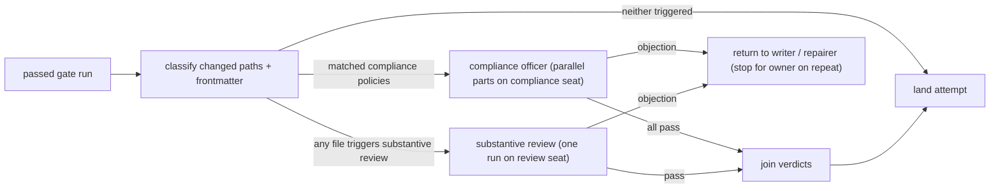

# Every commit point matches changed files to two kinds of reader: cheap policy compliance by artifact class, and substantive review where no human reads

**Status:** 2026-11-19. A proposal started from the owner's request of 2026-11-19 alongside his rulings on [the landing review](./tillr-diff-review.md#decision-ledger); nothing here is built. Commit mix measured on 2026-11-19 at `9a3b977af` over the 1,227 non-retirement commits since 2026-11-10.

> **In short.** Two post-gate readers are already designed — [the compliance officer](./tillr-design-document-check.md) for written rules on the cheapest model, and [the landing review](./tillr-diff-review.md) for substantive diff and criterion review on the `review` seat — yet today they divide the repository along one blunt line (`docs/` versus everything else) and specify only one compliance policy. Routing by artifact class extends policy compliance to the repository's other rulebooks, keeps substantive review where no human reads before execution, and puts to the owner whether design documents themselves need a review agent.

**Why it matters.** Since 2026-11-10 (`git log --since=2026-11-10 HEAD` at `9a3b977af`, excluding 36 mechanical marker retirements), 519 of 1,227 commits touched only `docs/**/*.md` and 708 touched paths outside `docs/`. Inside those two buckets sit companion implementation plans that humans never read, evergreen system references that neither reader checks, and 54 non-`docs/` commits that touched no program or test source ([Section 1](#1-why-one-boundary-is-not-enough)).

**The shape.** One tracked routing table maps each changed file's artifact class to zero or more registered compliance policies (file-scoped, at both early cuts and final merges) and to whether the candidate triggers substantive review at final merge ([Section 3](#3-the-routing-matrix-by-kind-of-change)).

**Cost.** Each added compliance policy costs pennies per run on the `compliance` seat; substantive review runs at most once per candidate on the `review` seat (currently the `build` backend, Hydrogen 4 on Copilot, per [OQ-DR1](./tillr-diff-review.md#OQ-DR1)). Adding a design-review agent is the one choice that could touch frontier spend or slow early design cuts ([Section 6](#6-do-design-documents-want-a-review-agent)).

**Start at [Section 3](#3-the-routing-matrix-by-kind-of-change)** for the routing table, [Section 4](#4-extending-the-compliance-officers-policies) for the new compliance policies, and [Section 6](#6-do-design-documents-want-a-review-agent) for whether design documents want a reviewer.

**Needs your ruling:** [OQ-RJ1](#OQ-RJ1), [OQ-RJ2](#OQ-RJ2), [OQ-RJ3](#OQ-RJ3), [OQ-RJ4](#OQ-RJ4).

**Reads with:** [the landing review](./tillr-diff-review.md) (the substantive `review`-seat check on code landings), [the compliance officer](./tillr-design-document-check.md) (the `compliance`-seat policy checker), [the queue mirrors designs](./tillr-queue-mirrors-designs.md) (companion `<topic>-plan.md` files that drive worker dispatch), and [designer sessions](../reference/tillr-designer-sessions.md) (how the owner's Vantage comments return to a document's designer). No implementation plan is seeded while the questions are open.

---

## 1. Why one boundary is not enough

Four owner rulings of 2026-11-18 and 2026-11-19 fix the baseline across [the landing review](./tillr-diff-review.md#decision-ledger) and [the compliance officer](./tillr-design-document-check.md#decision-ledger):

1. **Every code landing gets a fresh landing review after the gate** (`D-DR1`), on the named `review` seat set to the `build` backend for now ([OQ-DR1](./tillr-diff-review.md#OQ-DR1)).
2. **Documents-only landings get no landing review** (`D-DR2`).
3. **One general compliance officer runs on the cheapest model at both commit points** — a designer's early cut and an item's final merge — checking whole files and their diffs against written policies (`D-DP1`, [OQ-DP3](./tillr-design-document-check.md#OQ-DP3), [OQ-DP4](./tillr-design-document-check.md#OQ-DP4)).
4. **A repeated identical objection stops and waits for the owner** with no dismissal mechanism built now ([OQ-DR2](./tillr-diff-review.md#OQ-DR2)).

Today those two designs partition the repository with one path rule (`docs/**/*.md` versus everything else) and specify only one compliance policy (`design-document-style`). Measured across `git log --since=2026-11-10 HEAD` at `9a3b977af` (1,263 commits total; 1,227 after excluding the 36 `chore: retire landed document block` commits), the actual commit mix has eight distinct kinds of change:

| Kind of change in `9a3b977af` since 2026-11-10 | Commits touching it | Pure commits (only this kind) | What runs under the two existing designs |
| :--- | ---: | ---: | :--- |
| Program and test source (`tools/`, `tests/`, `bin/`, pack code mirror) | 654 | 501 | Landing review; no compliance policy |
| Configuration, recipes, and pack manifests/patches (`config/`, `tag-*/`, `host-*/`, `yolo-packs/`) | 162 | 44 | Landing review; no compliance policy |
| Agent instructions, skills, and briefings (`AGENTS.md`, `.agents/skills/`, pack skills/briefings) | 41 | 3 | Landing review; no compliance policy |
| Module and pack `README.md` files outside `docs/` | 219 | 5 | Landing review; no compliance policy |
| Live-proposal design documents (`docs/design/<topic>.md`, open/ready/built stages) | 266 | 199 | `design-document-style` compliance; no landing review |
| Companion implementation plans (`docs/design/<topic>-plan.md`) | 34 | 20 | Caught by `design-document-style` (wrong skill); no landing review |
| Evergreen references, research, and triage docs under `docs/` (`CURRENT` or non-proposal) | 59 | 31 | Neither compliance nor landing review |
| Roadmaps (`docs/**/roadmap.md`) | 257 | 189 | Neither compliance nor landing review |

Four concrete seams appear in that table:

- **Companion implementation plans (`docs/design/<topic>-plan.md`) get the wrong compliance check and zero substantive review.** Under [the queue mirrors designs](./tillr-queue-mirrors-designs.md#decision-ledger) ([OQ-QM1](./tillr-queue-mirrors-designs.md#OQ-QM1)), humans never read `<topic>-plan.md`, and `tillr item sync` dispatches workers straight from its `DECIDED` tasks, fences, and criteria. Yet `<topic>-plan.md` sits under `docs/` with `stage: SKETCH` or `DECIDED`: `D-DR7` exempts its commits from landing review as "documents-only", while `D-DP10` matches its live-proposal `stage` and holds an agent-only plan to `design-doc` (walkthrough human questions, no per-file tasks) instead of `implementation-plan`.
- **Written rulebooks outside design documents have no compliance policy.** System references (`system-doc`), companion plans (`implementation-plan` and `tillr-prose-style`), and repository configs/packs (`AGENTS.md`) already have explicit written rules that authors load, yet [the compliance officer](./tillr-design-document-check.md#10-what-this-does-not-cover) specifies only `design-document-style`.
- **Fifty-four non-`docs/` commits touched no program or test source.** Forty-four changed only configuration or pack manifests/patches, five changed only module `README.md`s, three changed only skills/instructions, and two combined those. Landing review's `missing-test` category assumes software behavior changes carry automated tests, whereas the house rules (`yolo-packs/matt/briefing/prose.md`) exempt pure configuration and documentation changes from mandatory new tests.
- **Design documents get style checking and human reading, with no check of their factual claims about the tree.** On 2026-11-18, [the 43-design roadmap triage](../tillr/triage/2026-11-18-tillr-roadmap-designs.md) and [the decision-provenance review](../tillr/decision-provenance-review.md) found stale tree claims (such as calling built substrate unbuilt) and unflagged collisions across sibling Decision Ledgers — the exact things `vantage-check` and the compliance officer cannot see because neither opens the codebase.

## 2. The words

Node, seat, ending, objection, chain, evidence key, and identical repeat keep the meanings of [the graph design](./tillr-graph-is-the-path.md#2-the-words). Candidate, gate, lander, and trunk keep those of [the vocabulary](./tillr-vocabulary.md#54-checking-and-landing). Landing review, reviewer, code landing, documents-only landing, and finding keep those of [the landing review](./tillr-diff-review.md#2-the-words). Commit point, compliance officer, compliance policy, and live proposal keep those of [the compliance officer](./tillr-design-document-check.md#2-the-words). Companion plan keeps that of [the queue mirrors designs](./tillr-queue-mirrors-designs.md#2-the-words). These are added.

| Term | Meaning | What it is not |
| :--- | :--- | :--- |
| **Artifact class** *(coined here)* | The category a repository path (plus optional YAML frontmatter `stage`) belongs to for review routing — for example, live-proposal design document, companion plan, reference document, configuration/pack file, or program source | Not a git attribute and not a workflow name; one commit can touch files of several artifact classes |
| **Review routing table** *(coined here)* | The tracked declaration that maps each artifact class to its registered compliance policies and to whether changing it triggers substantive review at final merge | Not code per policy; the loop evaluates paths and frontmatter mechanically after a passed gate |
| **Substantive review** *(coined here)* | A fresh read-only agent run that may open the tree to check whether a candidate's content is true, complete, and faithful to what was claimed — today [the landing review](./tillr-diff-review.md) on `review` | Never the compliance officer, which reads only the changed file, its diff, and one policy text |
| **Design review** *(coined here)* | A proposed substantive review of a live-proposal design document (`docs/design/<topic>.md`), distinct from style compliance and from the owner's own Vantage reading ([Section 6](#6-do-design-documents-want-a-review-agent)) | Not `vantage-check` and not `design-document-style` on the compliance officer |

## 3. The routing matrix by kind of change

Two orthogonal questions govern every candidate after the mechanical gate passes:

- **P1. Compliance (`compliance` seat, cheapest model) follows written file rules.** Whenever an artifact class has a written rulebook whose violations can be quoted line-and-rule from the file, its diff, and the rulebook alone — with no tree search — a compliance policy checks it at both commit points (early cut and final merge).
- **P2. Substantive review (`review` seat, currently the `build` backend) covers changes no human reads before they take effect.** A human never reads a code commit, a skill edit, a config change, or (under [OQ-QM1](./tillr-queue-mirrors-designs.md#OQ-QM1)) a companion plan before it runs or dispatches workers, so an agent with tree access checks those at final merge. Where the owner *is* the substantive reader — design documents in Vantage — adding an agent reviewer must earn its wait and cost ([Section 6](#6-do-design-documents-want-a-review-agent)).

### 3.1 Proposed map across this repository's artifact classes

| Artifact class | Path / frontmatter match | Mechanical gate (runs first) | Compliance policy (`compliance` seat, both commit points) | Substantive review (`review` seat, final merge) | Human reader in normal flow |
| :--- | :--- | :--- | :--- | :--- | :--- |
| **Program and test code** | `tools/**`, `tests/**`, `bin/**`, pack code mirror | Unit, integration, pack-sync, identity checks | None ([Section 4.2](#42-what-stays-out-of-compliance-policies)) | **Yes** — landing review (criteria + 7 finding categories) | None before merge |
| **Agent instructions, skills, and briefings** | `AGENTS.md`, `CLAUDE.md`, `.agents/skills/**`, `yolo-packs/*/skills/**`, `yolo-packs/*/briefing/**` | `vantage-check` where Markdown, `yolo pack lint`, `fork-check` | `repo-pack-and-scope-rules` when under `yolo-packs/` or root instructions ([OQ-RJ1](#OQ-RJ1)) | **Yes** — landing review (changes live agent behavior; `missing-test` scoped by [OQ-RJ2](#OQ-RJ2)) | None before merge |
| **Configuration, recipes, and pack manifests/patches** | `config/**`, `tag-*/**`, `host-*/**`, `rcrc`, `justfile`, `.tillr.toml`, `.vantage.toml`, `yolo-packs/*/pack.*`, `yolo-packs/*/patches/**` | `rcm` tests, `yolo pack lint`, `fork-build` | `repo-pack-and-scope-rules` ([OQ-RJ1](#OQ-RJ1)) | **Asked in [OQ-RJ2](#OQ-RJ2)** (landing review with config-aware brief versus gate + compliance only) | None before merge |
| **Module and pack `README.md`s** | `**/README.md` outside `docs/` | `vantage-check`, `documents` / `citations` / `scratch` | None beyond `vantage-check` | **Asked in [OQ-RJ2](#OQ-RJ2)** (exempt when pure README-only versus reviewed against adjacent code) | Optional |
| **Companion implementation plans** | `docs/design/*-plan.md` | `vantage-check`, `design-citations`, `tillr item sync` grammar check | `implementation-plan-style` (`D-RJ1`, [OQ-RJ1](#OQ-RJ1)); excluded from `design-document-style` | **Asked in [OQ-RJ3](#OQ-RJ3)** (review when `stage: DECIDED` against parent `<topic>.md` versus unreviewed) | **None** ([OQ-QM1](./tillr-queue-mirrors-designs.md#OQ-QM1)) |
| **Live-proposal design documents** | `docs/**/*.md` excluding `*-plan.md` and `**/roadmap.md`, with `stage` in `open`, `ready`, or `built` | `vantage-check`, `design-citations`, `citations`, `scratch` | `design-document-style` (settled in [the compliance officer](./tillr-design-document-check.md)) | **Asked in [OQ-RJ4](#OQ-RJ4)** (none, tree-and-ledger fact audit, or full design critique) | **Owner in Vantage** |
| **Evergreen reference, research, and triage docs** | `docs/reference/**/*.md`, `docs/**/*.md` with `stage: CURRENT` or no live-proposal stage (excluding `**/roadmap.md`) | `vantage-check`, `citations`, `scratch` | `reference-document-style` on `docs/reference/**` and `stage: CURRENT` ([OQ-RJ1](#OQ-RJ1)) | **No** (`D-DR2`) | Reader on demand |
| **Roadmaps** | `docs/**/roadmap.md` | `vantage-check` roadmap rules | None (size and badge-only grammar; `vantage-check` covers it) | **No** (`D-DR2`) | Owner on Planning page |
| **Automatic reverts** | Loop-generated inverse commit | Own revert checks | **None** (`D-DP4`) | **No** (`D-DR8`) | Reported on item page |

### 3.2 How mixed commits compose

One commit frequently touches more than one artifact class — since 2026-11-10, 154 commits touched both code and a design document, and 214 touched code alongside a module `README.md`. Three deterministic rules compose the table (`D-RJ2`):

1. **First specific match per file.** A path matches at most one artifact class in precedence order (`*-plan.md` and `**/roadmap.md` before general `docs/**/*.md`), so a companion plan never falls through into `design-document-style`.
2. **Union of compliance policies, one parallel part per matched policy.** If a commit changes a Go file, `config/yolo-jail/config.toml`, and `docs/design/foo.md`, the compliance officer runs the matched policies in parallel inside one node (`D-DP3`) and joins their findings.
3. **At most one landing review on the whole candidate, parallel with compliance.** If *any* changed file in the candidate is in an artifact class whose substantive-review column says Yes, one landing review runs on the whole candidate diff (`D-DR7`) at the same time as the compliance officer (`D-DP9`). The merge proceeds only when every triggered reader passes.

## 4. Extending the compliance officer's policies

[The compliance officer](./tillr-design-document-check.md#32-what-a-compliance-policy-supplies) defines a compliance policy as five tracked facts with no custom code: a name, the files it applies to, the authors' own policy text, who repairs an objection, and two specimens (one clean, one with a planted fault). Extending it means registering entries that obey `D-DP7`'s boundary: **every violation can be proved by quoting one rule in the policy text and one line in the changed file, without opening the rest of the tree.**

### 4.1 Candidate policies that fit the contract

| Policy name | Files matched | Authors' own rulebook loaded at dispatch | Examples of faults caught before merge | Repairer |
| :--- | :--- | :--- | :--- | :--- |
| `design-document-style` *(existing)* | `docs/**/*.md` with live-proposal `stage`, **excluding** `docs/design/*-plan.md` and `**/roadmap.md` (`D-RJ1`) | `design-doc` + `vantage-docs` skills | Bare-label options, decision codes inside an `OQ-*` story, missing header slots, track-changes prose | Item's designer ([OQ-DP5](./tillr-design-document-check.md#OQ-DP5) for build items) |
| `implementation-plan-style` *(new)* | `docs/design/*-plan.md` | `implementation-plan` + `tillr-prose-style` skills + [Section 7.2 of queue-mirrors-designs](./tillr-queue-mirrors-designs.md#72-canonical--tasks-grammar-in-topic-planmd) | Human-facing `OQ-*` directives placed in an agent-only plan, prose checklists outside `## Tasks`, undefined internal abbreviations, full function bodies pasted as tasks | Session that wrote the plan (`plan` or `design` seat) |
| `reference-document-style` *(new)* | `docs/reference/**/*.md` and `docs/**/*.md` with `stage: CURRENT` (excluding `**/roadmap.md`) | `system-doc` + `vantage-docs` skills | Perishable bare line-number citations (`foo.go:142`), missing verification stamps, leftover `## Open Questions` or `## Decision Ledger` scaffolding from before graduation | Session that last wrote the file |
| `repo-pack-and-scope-rules` *(new)* | `config/yolo-jail/**`, `tag-*/config/yolo-jail/**`, `host-*/**`, `yolo-packs/**`, `AGENTS.md` | `AGENTS.md` (the repository agent guide) | `[active_provider]` placed in tracked `work.toml`, `profiles` or `use_profiles` in workspace config, edits to host-config-synced `yolo-packs/matt/briefing/prose.md` or `yolo-packs/matt/skills/` | Session that last wrote the file |

### 4.2 What stays out of compliance policies

Two temptations fail `D-DP7` and belong elsewhere:

- **Program-code style and architecture policies (`prose.md`'s testing and modularity rules, Go idioms).** Telling whether a helper is dead, whether a boundary validates untrusted input, or whether a test exercises real behavior requires reading callers and tests across the tree. A compliance officer given only the changed file and a prose rulebook either hallucinates context or nitpicks variable names — which [the landing review's brief](./tillr-diff-review.md#6-the-brief) explicitly forbids (*"Do not object to style, naming or formatting"*). Mechanical code style stays in linters inside the gate; behavioral defects stay in landing review.
- **Rules already enforced 100% by a gate program.** Unlanded commit SHAs (`citations`), durable-scratch citations (`scratch`), broken links and directives (`vantage-check`), git author identity (`git-identity.test.py`), and pack symlinks (`yolo pack lint`) already fail in seconds at zero token cost before any agent runs.

Whether to ship only the companion-plan fix alongside `design-document-style` first, or register all three new policies as soon as the compliance officer lands, is [OQ-RJ1](#OQ-RJ1).

## 5. Substantive review outside program source

### 5.1 Config-only, pack-only, skill, and README-only commits

Under `D-DR7` of [the landing review](./tillr-diff-review.md#32-which-landings), every path outside `docs/` triggers a code landing review. Across the 54 non-`docs/` commits since 2026-11-10 that touched no program or test source, three distinct cases sit together:

1. **Agent instructions, skills, and briefings** (3 pure commits; 41 commits overall) and **pack manifests/patches** (12 pure commits): changing a skill, `AGENTS.md`, or a patch series alters live runtime behavior for every subsequent session or jail launch, often with no unit test in `tests/`. Having the `review` seat read the diff against the item's claim catches silent scope regressions and dropped lines.
2. **Configuration and recipes** (32 pure commits, such as backend policies, `work.toml`, `personal.toml`, `justfile`): a wrong seat mapping or clobbered profile breaks dispatch or launches without touching Go or Python source. Substantive review is valuable here too, **provided** the reviewer's brief does not demand a new automated test where `yolo-packs/matt/briefing/prose.md` says configuration changes need operational verification rather than a new test (`D-RJ3`).
3. **Module and pack `README.md`s outside `docs/`** (5 pure commits; 219 commits overall): unlike `AGENTS.md` or `SKILL.md`, a tool's `README.md` is human reference prose beside code, not an automatically injected prompt (confirmed via `rg -n 'README\.md' tools/tillr-drain tools/tillr-run` on 2026-11-19: tillr never loads `README.md` into worker briefs unless an item names it). When a commit changes code *and* `README.md`, landing review already reads both (`D-DR7`) and catches flag drift; when a commit changes *only* `README.md` files, paying for a full code review contradicts the spirit of `D-DR2` (and `yolo-packs/matt/briefing/work-rules.md` rule 4 already lets interactive lanes skip code review on docs-only edits).

[OQ-RJ2](#OQ-RJ2) puts the boundary for README-only and config-only commits to the owner.

### 5.2 Companion implementation plans (`docs/design/<topic>-plan.md`)

Companion plans sit at the sharpest seam in the current architecture:

- When a designer seeds `<topic>-plan.md` at `stage: SKETCH`, `tillr item sync` ignores its tasks (`D-QM7` in [the queue mirrors designs](./tillr-queue-mirrors-designs.md#41-how-one-design-item-relates-to-the-work-in-its-companion-plan)). Nothing executes from a `SKETCH` plan, so substantive review at `SKETCH` would pay to check rough notes.
- When the `plan` seat promotes `<topic>-plan.md` to `stage: DECIDED` after reading the accepted parent `<topic>.md` and the tree at a stamped commit, `tillr item sync` immediately turns its `## Tasks` into runnable work items — and by [OQ-QM1](./tillr-queue-mirrors-designs.md#OQ-QM1), **no human ever reads `<topic>-plan.md`**.
- Under `D-DR7` today, promoting `<topic>-plan.md` to `DECIDED` is a documents-only commit under `docs/` and lands with **no substantive review at all**. A task that drops a requirement of `<topic>.md`, sets a fence narrower than the files to edit, or writes a weak `verification-only` criterion is discovered only after workers run — or never, if the weak criterion passes each worker's own landing review!

Reviewing `<topic>-plan.md` on the `review` seat **only when its `stage` is `DECIDED`** (checking task coverage against `<topic>.md`, fence completeness against the tree, and criterion testability) closes that gap at one review per plan rather than one per cut. [OQ-RJ3](#OQ-RJ3) asks the owner whether to turn that on.

## 6. Do design documents want a review agent?

The owner asked whether design review agents are wanted, or whether the design process already covers that. Answering honestly requires separating what the existing process catches from what actually slipped past it this month.

### 6.1 What the design process already covers

Unlike code commits — where the worker writes on a faster build model and merges without human eyes — a live-proposal design document (`docs/design/<topic>.md`) already passes through five layers across its life:

| Layer in the design process | Seat / actor | What it catches | What it cannot catch |
| :--- | :--- | :--- | :--- |
| **1. Parallel scouts + authoring** (`scouted-design@v1` or designer desk) | `scout` (cheap) + `design` (strongest model: Carbon 4 / Fable 5.2) | Initial codebase reconnaissance and architectural synthesis | An author's own blind spots, misread scout notes, or silent drift from sibling designs |
| **2. Mechanical gate** | Gate programs (`vantage-check`, `design-citations`, `citations`, `scratch`) | Broken links, dead `#OQ-*` anchors, invalid directives, unlanded commit SHAs, scratch paths | False prose claims about code, missing failure modes, unasked owner questions |
| **3. Compliance officer** (`design-document-style`) | `compliance` (cheapest model: Flash / Luna) | Unreadable `OQ-*` options, missing header slots, wall-of-text prose, missing provenance tags (`D-DP7`: file + diff + skill only) | Anything requiring opening the tree or another design's Decision Ledger |
| **4. Owner review in Vantage + warm designer session** ([designer sessions](../reference/tillr-designer-sessions.md)) | **The owner**, routing comments back to the document's warm designer session | Wrong product direction, rejected trade-offs, over-engineering, unaccepted `D-*` rows | Factual claims about the codebase that look plausible on the page — checking them forces the owner to audit the tree or trust the prose |
| **5. Planner tree read** (`plan` seat writing `<topic>-plan.md`) | `plan` (after design acceptance) | Claims in an *accepted* design that fail when mapped onto concrete files (`definition` obstacle returns to `design`) | Runs **after** the owner already spent review cycles ruling on a design built on false premises |

### 6.2 What still reached the owner unchecked

Two repository audits on 2026-11-18 measured what got past layers 1–3 into `docs/design/` before the owner read it:

- **Stale or false claims about what is already built in the tree.** In [the 43-design roadmap triage](../tillr/triage/2026-11-18-tillr-roadmap-designs.md#the-43-documents), multiple `DESIGN` documents misstated the tree they proposed to change — including [the landing review](./tillr-diff-review.md) itself, whose status originally said "none of it is built" when `tools/tillr-drain/drain/judge.go` and `planned-build@v1` already existed, and sibling designs whose `Built` column or status lagged landed code.
- **Unflagged collisions with settled rulings in sibling Decision Ledgers, and unattributed designer choices.** [The decision-provenance review](../tillr/decision-provenance-review.md#13-the-counts-and-how-far-to-trust-them) found over twenty high-significance designer decisions across `docs/design/` presented as settled foundation or colliding with rulings elsewhere (for example, [OQ-JL1](./tillr-judge-and-lifecycle.md#OQ-JL1)'s mechanical-by-default row versus the owner's diff-review requirement).

### 6.3 Why an open-ended "design critic" is a trap, and the three real choices

Running a general "critique this architecture" agent before a design cut lands has three structural flaws:

1. **It argues about taste before the decider has spoken.** Open trade-offs in a `DESIGN` document are `OQ-*` questions addressed to the owner. A second model asked whether the design is good will object to leanings and scope choices that are the owner's to settle, churning dear `design`-seat turns behind the scenes.
2. **It slows early design landing.** [Early design landing](./tillr-early-design-landing.md#1-the-ruling-and-what-it-leaves-open) exists so a designer's question reaches Vantage immediately; adding a multi-turn frontier critique and returned designer turn before every cut puts minutes and $0.50–$1.60+ per turn ([the landing review's cost table](./tillr-diff-review.md#8-cost)) in front of every question.
3. **The `design` seat is already the ceiling model.** Having the same frontier tier second-guess its own architectural taste adds far less signal than checking falsifiable facts against the repository.

That narrows the real choices for `docs/design/<topic>.md` ([OQ-RJ4](#OQ-RJ4)) to three:

| Option | What runs on a design commit | What it checks | Cost and latency impact |
| :--- | :--- | :--- | :--- |
| **A — No design-review agent (rely on the design process)** | Gate + `design-document-style` compliance officer only | Style, structure, links, and provenance formatting; the owner judges architecture in Vantage and the planner verifies tree fit at plan time | $0 added beyond pennies for compliance; fastest path to Vantage; owner may still meet plausible-looking false tree claims |
| **B — Narrow fact-and-ledger audit on `review`** | Gate + compliance officer + one read-only `review`-seat check (Hydrogen / Terra) with a fact-only brief | **Only falsifiable claims:** cited paths/symbols exist, negative claims (`rg` / `git`) hold, `Built` column matches the tree, and new `D-*` rows do not silently contradict a settled owner ruling in `depends-on` / `Reads with` ledgers. Forbidden from objecting to trade-offs, leanings, or scope | ~$0.14–$0.17 Bedrock equivalent per design commit, in parallel with compliance; catches factual rot before the owner reads without arguing over design choices |
| **C — Full independent design review on `design`** | Gate + compliance officer + fresh `design`-seat reviewer (Carbon / Fable) | Both tree/ledger facts and missing failure modes, concurrency holes, or unasked questions (`design-doc`'s hole list) | ~$1.30–$1.62 Bedrock equivalent per design commit plus dear `design` repair turns; highest pre-owner polish, slowest cuts |

## 7. Ordering, concurrency, and failure behavior

Every reader in [Section 3](#3-the-routing-matrix-by-kind-of-change) reuses the mechanics already settled in [the landing review](./tillr-diff-review.md#5-the-three-outcomes) and [the compliance officer](./tillr-design-document-check.md#5-the-outcomes):

- **Trigger and position.** Classification runs deterministically in the loop immediately after a gate run ends `pass`, at both commit points (a cut's early landing and an item's final merge). On an early cut, only matched compliance policies (and Option B/C of [OQ-RJ4](#OQ-RJ4), if chosen for cuts) run; substantive code/plan review runs only at final merge (`D-RJ2`).
- **Degenerate inputs.** An empty diff is refused before review as today; an automatic revert triggers neither reader; a file matching no compliance policy and `No` for substantive review (for example, `docs/tillr/roadmap.md` alone) merges immediately after the green gate.
- **Parallel execution and one writer.** Triggered compliance parts and the triggered substantive review are all read-only against the same gated candidate head, so they start together (`D-DP9`). If any reader mutates the worktree, its changes are stripped and its verdict discarded. Only the loop writes review events to the store.
- **Objections and identical repeats.** If both compliance and substantive review object on the same candidate, the loop delivers their objections together in one returned turn when the same session repairs both, or stages the designer repair before the worker return when [OQ-DP5](./tillr-design-document-check.md#OQ-DP5) assigns document repair to a designer (`D-RJ4`). Any identical repeat — same compliance key `(policy, heading, file, place)` or same landing-review key `(unmet criteria, finding category + path)` — follows the owner's 2026-11-19 ruling ([OQ-DR2](./tillr-diff-review.md#OQ-DR2)): **no dismissal runs; the item stops under "needs you" with the objection and the writer's reason shown.**
- **Existing state.** Items and documents landed before these rules ship are not retroactively blocked; under [OQ-DP2](./tillr-design-document-check.md#OQ-DP2), an old file is brought up to its matched compliance policy the next time a candidate touches it.

## 8. Alternatives considered

| Alternative | Verdict |
| :--- | :--- |
| Keep the binary `docs/`-versus-everything-else rule with a single `design-document-style` policy | Rejected. Leaves `*-plan.md` checked against the wrong skill (`design-doc`) and unreviewed when `DECIDED`, while leaving `docs/reference/` unchecked |
| Register a `prose.md` / Go-style compliance policy on the cheap `compliance` seat for all code commits | Rejected (`D-DP7`). Code modularity and test adequacy require reading callers and tests across the tree, turning a cheap file linter into a noisy second code reviewer |
| Run landing review sequentially after the compliance officer passes | Rejected (`D-DP9`). Both are read-only on the gated head; serializing them doubles latency on clean mixed commits to save pennies only when compliance objects |
| Let workflows opt into or out of compliance policies or substantive review per workflow JSON | Rejected (`D-DR4`, `D-DP4`). A workflow file omitting a reader silently reopens the unreviewed-landing hole |
| Have a design-review agent rewrite weak sections directly | Rejected. Violates read-only reviewer separation and overwrites the warm designer session's context ([designer sessions](../reference/tillr-designer-sessions.md)) |

## 9. What this does not cover

- **What mechanical checks run inside the gate,** or acquitting pre-existing trunk failures.
- **Changing the `review` seat away from the `build` backend** ([OQ-DR1](./tillr-diff-review.md#OQ-DR1) settled Hydrogen / `pi-build` until live counts justify moving it) or **changing the `compliance` seat away from the cheapest model** ([OQ-DP4](./tillr-design-document-check.md#OQ-DP4)).
- **Settling a repeated disagreement automatically** — held across all readers by [OQ-DR2](./tillr-diff-review.md#OQ-DR2) and [OQ-DR3](./tillr-diff-review.md#OQ-DR3).
- **Editing the external `design-doc`, `implementation-plan`, `system-doc`, or `vantage-docs` skills themselves.** Those live outside this repository (or in the owner's host configuration) and are loaded as-is at dispatch (`D-DP5`).
- **Manual commits made outside tillr** by the human or an interactive lane (governed for interactive agents by `yolo-packs/matt/briefing/work-rules.md`).

## 10. Amendments owed

None of these is edited until the owner answers [OQ-RJ1](#OQ-RJ1) through [OQ-RJ4](#OQ-RJ4), except the cross-reference links added to [the landing review](./tillr-diff-review.md) in the same commit that introduces this document:

- **[The compliance officer](./tillr-design-document-check.md):** exclude `docs/design/*-plan.md` from `design-document-style` (`D-DP10`), register whichever policies [OQ-RJ1](#OQ-RJ1) selects, and align [Section 5.3](./tillr-design-document-check.md#53-when-the-officer-and-the-repairer-disagree) with [OQ-DR2](./tillr-diff-review.md#OQ-DR2)'s stop-for-owner rule on repeated objections.
- **[The landing review](./tillr-diff-review.md):** narrow or extend [Section 3.2](./tillr-diff-review.md#32-which-landings) and [Section 6](./tillr-diff-review.md#6-the-brief) for config-only, README-only, and `DECIDED` companion-plan commits per [OQ-RJ2](#OQ-RJ2) and [OQ-RJ3](#OQ-RJ3).
- **[The queue mirrors designs](./tillr-queue-mirrors-designs.md):** add the `implementation-plan-style` compliance check (and `DECIDED` plan review if chosen in [OQ-RJ3](#OQ-RJ3)) to [Section 7](./tillr-queue-mirrors-designs.md#7-the-companion-implementation-plan).
- **[Early design landing](./tillr-early-design-landing.md):** update [Section 3.4](./tillr-early-design-landing.md#34-what-the-gate-checks) if [OQ-RJ4](#OQ-RJ4) adds a fact-and-ledger check on design cuts or merges.
- **`docs/tillr/roadmap.md` and `docs/tillr/design-status.md`:** route this document and its open questions once an item fenced to `docs/tillr/` syncs the roadmap.

## 11. Risks

| Risk | Mitigation |
| :--- | :--- |
| `design-document-style` ships first without excluding `*-plan.md` and rejects companion plans for lacking human `OQ-*` blocks | `D-RJ1` excludes `docs/design/*-plan.md` from `design-document-style` from day one, whether or not `implementation-plan-style` ships in the same step |
| `repo-pack-and-scope-rules` causes the cheap model to misread nuanced prose in `AGENTS.md` | Every finding must quote a rule and an offending line word-for-word (`D-DP6`), backed by two standing specimens; noisy rules are tightened in `AGENTS.md` or moved to a mechanical gate test |
| Landing review raises `missing-test` on valid configuration edits | `D-RJ3` adds one explicit line to the landing-review brief exempting pure configuration and prose files from `missing-test` unless a criterion asks for a test |
| A fact-and-ledger design audit (if chosen in [OQ-RJ4](#OQ-RJ4)) drifts into subjective design critique | Its brief restricts findings to closed, locatable factual categories (missing path/symbol, falsified search claim, wrong `Built` cell, unacknowledged ledger contradiction) and discards free-form opinions |
| Combined compliance + substantive objections overwhelm a worker turn | Joined into one structured return sorted by file, and any identical repeat stops immediately for the owner ([OQ-DR2](./tillr-diff-review.md#OQ-DR2)) |

## Decision Ledger

This design inherits the owner's settled rulings in [the landing review](./tillr-diff-review.md#decision-ledger) (`D-DR1`, `D-DR2`, [OQ-DR1](./tillr-diff-review.md#OQ-DR1), [OQ-DR2](./tillr-diff-review.md#OQ-DR2)) and [the compliance officer](./tillr-design-document-check.md#decision-ledger) (`D-DP1`, `D-DP2`, `D-DP13`, [OQ-DP1](./tillr-design-document-check.md#OQ-DP1)–[OQ-DP4](./tillr-design-document-check.md#OQ-DP4)). Rows `D-RJ1` through `D-RJ4` below are a designer's decisions of 2026-11-19; none is the owner's ruling, and the owner may overturn any of them. None is built.

| ID | Decision | Date | Settled in | Built |
| :--- | :--- | :--- | :--- | :--- |
| `D-RJ1` | **Designer's decision; the owner may overturn this.** Exclude companion implementation plans (`docs/design/*-plan.md`) from `design-document-style` so agent-only plans are never judged against `design-doc`'s human-question and header rules. **Evidence:** [OQ-QM1](./tillr-queue-mirrors-designs.md#OQ-QM1) makes companion plans agent-only task specs governed by `implementation-plan`, which forbids human `OQ-*` scaffolding there. **Rejected:** holding every `SKETCH`/`DECIDED` file under `docs/design/` to `design-document-style`. | 2026-11-19, designer | [Section 4.1](#41-candidate-policies-that-fit-the-contract) | — |
| `D-RJ2` | **Designer's decision; the owner may overturn this.** Classify each changed file by most-specific path/frontmatter rule; run one compliance part per matched policy and at most one landing review on the whole candidate in parallel after a passed gate, merging only when all triggered readers pass. **Evidence:** composes `D-DR7`, `D-DP3`, and `D-DP9` with zero extra latency on clean mixed commits. **Rejected:** per-workflow opt-ins; sequential compliance-then-review execution. | 2026-11-19, designer | [Section 3.2](#32-how-mixed-commits-compose) | — |
| `D-RJ3` | **Designer's decision; the owner may overturn this.** Whenever landing review runs on configuration, pack, or documentation paths, `missing-test` applies only to program behavior changes or when an item criterion requires a test. **Evidence:** `yolo-packs/matt/briefing/prose.md` explicitly exempts configuration and documentation edits from mandatory new automated tests; 44 commits since 2026-11-10 touched only config or packs. **Rejected:** forcing workers to write tautological config-parsing tests to appease `missing-test`. | 2026-11-19, designer | [Section 5.1](#51-config-only-pack-only-skill-and-readme-only-commits) | — |
| `D-RJ4` | **Designer's decision; the owner may overturn this.** Join simultaneous compliance and substantive objections into one returned turn when the same session repairs both, and inherit [OQ-DR2](./tillr-diff-review.md#OQ-DR2) across every reader here (stop and wait for the owner on an identical repeat, with no dismissal built now). **Evidence:** avoids spending two worker turns and two gate runs on one candidate's first round of feedback while honoring the owner's 2026-11-19 ruling. **Rejected:** separate serial return turns for the same writer; building a reader-specific dismissal override. | 2026-11-19, designer | [Section 7](#7-ordering-concurrency-and-failure-behavior) | — |

## Open Questions

1. 💬 **OQ-RJ1: Which written rulebooks should the cheap compliance officer enforce beyond design documents?**

   You already ruled that the compliance officer is a general policy checker on the cheapest model, starting with design documents. Authors in this repository also follow written rulebooks for companion implementation plans (34 commits in nine days), evergreen reference docs (59 commits), and repository pack and machine-scoping rules (162 commits). Today none of those three has a registered policy.

   - **A — Add only companion implementation plans now.** Fixes the clash where agent-only task plans would be judged as human design docs, for pennies on 34 commits; reference docs and config rules wait.
   - **B — Register all three alongside design documents.** Holds companion plans, evergreen reference docs, and pack/config files to their existing rulebooks from the start, at pennies per matching commit.
   - **C — Keep only design documents for now.** Excludes companion plans from the design-doc check so they do not break, and adds no second policy until the first has live counts.

   <!-- vantage: question id=OQ-RJ1 leaning="B — register all three alongside design documents: each already has a written rulebook in the repo or harness, fits the file-plus-diff contract with no tree search, and costs pennies on the cheapest model." -->

   _Leaning:_ B — register all three alongside design documents: each already has a written rulebook in the repo or harness, fits the file-plus-diff contract with no tree search, and costs pennies on the cheapest model.

   **Answer:**

   > _(empty — fill in when decided)_

2. 💬 **OQ-RJ2: Should commits that change only configuration, packs, or module READMEs outside `docs/` get a substantive landing review?**

   Any changed file outside `docs/` currently triggers a full code landing review. In the last nine days, 44 commits changed only configuration or pack files and 5 changed only a tool's README beside code, with no program source touched. Bad config or pack edits can break launches without failing a unit test, whereas a tool README is never loaded by agents at runtime.

   - **A — Review config and pack commits (without requiring unit tests), and exempt README-only commits.** Catches broken config and pack changes while treating pure README prose like `docs/`.
   - **B — Review all of them, README-only commits included.** Keeps one path boundary (`docs/` versus everything else) and checks README flag examples against adjacent code, paying one review on 5 pure README commits per nine days.
   - **C — Exempt config-only, pack-only, and README-only commits alike.** Relies on mechanical gate linters unless program, test, or agent-skill files changed.

   <!-- vantage: question id=OQ-RJ2 leaning="A — review config and pack commits with a config-aware brief, and exempt pure README-only commits: config and pack mistakes change live system behavior with no unit test, while a standalone README edit cannot." -->

   _Leaning:_ A — review config and pack commits with a config-aware brief, and exempt pure README-only commits: config and pack mistakes change live system behavior with no unit test, while a standalone README edit cannot.

   **Answer:**

   > _(empty — fill in when decided)_

3. 💬 **OQ-RJ3: When a companion implementation plan is marked ready to dispatch workers, should an agent review it against the accepted design?**

   Once you accept a design, a planner writes a companion task plan under `docs/` that splits the build into tasks, file fences, and completion criteria. By your earlier ruling, you never read that companion plan, and because it sits under `docs/`, the code landing review skips it too — so workers fan out from a plan nobody checked against your accepted design.

   - **A — Review the companion plan once on the review seat when it becomes ready to dispatch.** Rough drafts land unreviewed; promoting the plan triggers one review checking that its tasks, fences, and criteria cover the accepted design.
   - **B — Never review companion plans; review only each worker's code landing.** Saves one review per design, at the risk that a dropped requirement or weak criterion is never caught by downstream worker reviews.

   <!-- vantage: question id=OQ-RJ3 leaning="A — review the companion plan once when it becomes ready to dispatch: no human ever reads that file, and one review before fan-out is cheaper than discovering a missing requirement after several workers land." -->

   _Leaning:_ A — review the companion plan once when it becomes ready to dispatch: no human ever reads that file, and one review before fan-out is cheaper than discovering a missing requirement after several workers land.

   **Answer:**

   > _(empty — fill in when decided)_

4. 💬 **OQ-RJ4: Do design documents want a review agent, or does the existing design process already cover them?**

   Before a design reaches you in Vantage, mechanical checks verify its links and the cheap compliance officer checks its formatting, then you read the design yourself and later a planner reads the codebase to build it. Even so, this month's audits found designs reaching you with false claims about what was already built and silent clashes with earlier rulings.

   - **A — No design-review agent; the design process already covers it.** Keeps early design commits fast and cheap; you judge architecture in Vantage, and false codebase claims surface later when the planner reads the tree.
   - **B — Add a narrow fact-and-ledger audit on the review seat.** Checks only falsifiable claims (cited files exist, negative searches hold, built status matches the codebase, no silent clash with earlier rulings), never arguing over trade-offs or leanings.
   - **C — Add a full independent design review on the frontier design seat.** Critiques missing failure modes and unasked questions as well as codebase facts before you read, adding $1.30+ and extra minutes to design commits.

   <!-- vantage: question id=OQ-RJ4 leaning="B — add a narrow fact-and-ledger audit on the review seat: you already review design judgment yourself in Vantage, so a second opinion on taste wastes time and money, whereas checking codebase and ledger facts saves you from ruling on false premises." -->

   _Leaning:_ B — add a narrow fact-and-ledger audit on the review seat: you already review design judgment yourself in Vantage, so a second opinion on taste wastes time and money, whereas checking codebase and ledger facts saves you from ruling on false premises.

   **Answer:**

   > _(empty — fill in when decided)_
