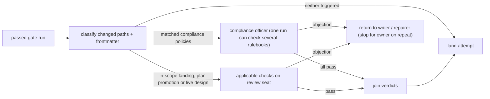

# Review rules: which rulebooks apply, which projects get landing review, and when plans and designs are checked

**Status:** Decided, not built. The owner's four rulings of 2026-11-20 are rows of the [ledger](#decision-ledger); the routing and checks specified here are not built. The commit mix is a measurement of 2026-11-19 over 1,227 commits.

> **In short.** Two post-gate readers are already designed — [the compliance officer](./tillr-design-document-check.md) for written rules on the cheapest model, and [the landing review](./tillr-diff-review.md) for substantive diff and criterion review on the `review` seat. Those two designs draw one line (`docs/` versus everything else) and specify only one compliance policy. File type determines which rulebooks apply; project scope determines whether a final merge needs landing review. Two separate checks protect the handoffs to people and workers: audit design facts before the owner reads, and review a companion plan against its accepted design before dispatch.

**Why it matters.** In a nine-day sample measured on 2026-11-19 (excluding 36 mechanical commits that remove a landed document block), 519 of 1,227 commits touched only `docs/**/*.md` and 708 touched paths outside `docs/`. Inside those two buckets sit companion implementation plans that humans never read, evergreen system references that neither reader checks, and 54 non-`docs/` commits that touched no program or test source ([Section 1](#1-why-one-boundary-is-not-enough)).

**The shape.** One tracked routing table maps each changed file's artifact class to zero or more registered compliance policies (file-scoped, at both early cuts and final merges); project scope, document type and plan readiness select the substantive checks ([Section 3](#3-the-routing-matrix-by-kind-of-change)).

**Cost.** A cheap `compliance` run can check several rulebooks; landing review runs at most once per in-scope candidate on the `review` seat (currently the `build` backend, Hydrogen 4 on Copilot, per [OQ-DR1](./tillr-diff-review.md#OQ-DR1)). The design audit uses the `review` seat, not the frontier `design` seat ([Section 6](#6-do-design-documents-want-a-review-agent)).

**Start at [Section 3](#3-the-routing-matrix-by-kind-of-change)** for the routing table, [Section 4](#4-extending-the-compliance-officers-policies) for the new compliance policies, and [Section 6](#6-do-design-documents-want-a-review-agent) for the limits of the design audit.

**Needs your ruling:** [Who owns the companion-plan rulebook?](#OQ-RJ5)

**Reads with:** [the landing review](./tillr-diff-review.md) (the substantive `review`-seat check on code landings), [the compliance officer](./tillr-design-document-check.md) (the `compliance`-seat policy checker), [the queue mirrors designs](./tillr-queue-mirrors-designs.md) (companion `<topic>-plan.md` files that drive worker dispatch), and [designer sessions](../reference/tillr-designer-sessions.md) (how the owner's Vantage comments return to a document's designer). No implementation plan exists while the rulebook ownership question is open.

---

## 1. Why one boundary is not enough

Four owner rulings of 2026-11-18 and 2026-11-19 set the baseline across [the landing review](./tillr-diff-review.md#decision-ledger) and [the compliance officer](./tillr-design-document-check.md#decision-ledger):

1. **Every code landing gets a fresh landing review after the gate** (`D-DR1`), on the named `review` seat set to the `build` backend for now ([OQ-DR1](./tillr-diff-review.md#OQ-DR1)).
2. **Documents-only landings get no landing review** (`D-DR2`).
3. **One general compliance officer runs on the cheapest model at both commit points** — a designer's early cut and an item's final merge — checking whole files and their diffs against written policies (`D-DP1`, [OQ-DP3](./tillr-design-document-check.md#OQ-DP3), [OQ-DP4](./tillr-design-document-check.md#OQ-DP4)).
4. **A repeated identical objection stops and waits for the owner** with no dismissal mechanism built now ([OQ-DR2](./tillr-diff-review.md#OQ-DR2)).

Those designs partition the repository with one path rule (`docs/**/*.md` versus everything else) and specify only one compliance policy (`design-document-style`). Measured on 2026-11-19 over nine days of commits (1,263 in total; 1,227 after excluding 36 mechanical commits that remove a landed document block), the commit mix has eight distinct kinds of change:

| Kind of change | Commits touching it | Pure commits (only this kind) | What runs under the two designs |
| :--- | ---: | ---: | :--- |
| Program and test source (`tools/`, `tests/`, `bin/`, pack code mirror) | 654 | 501 | Landing review; no compliance policy |
| Configuration, recipes, and pack manifests | 162 | 44 | Landing review; no compliance policy |
| Agent instructions, skills, and briefings (`AGENTS.md`, `.agents/skills/`, pack skills/briefings) | 41 | 3 | Landing review; no compliance policy |
| Module and pack `README.md` files outside `docs/` | 219 | 5 | Landing review; no compliance policy |
| Live-proposal design documents (`docs/design/<topic>.md`, open/ready/built stages) | 266 | 199 | `design-document-style` compliance; no landing review |
| Companion implementation plans (`docs/design/<topic>-plan.md`) | 34 | 20 | Caught by `design-document-style` (wrong skill); no landing review |
| Evergreen references, research, and triage docs under `docs/` (`CURRENT` or non-proposal) | 59 | 31 | Neither compliance nor landing review |
| Roadmaps (`docs/**/roadmap.md`) | 257 | 189 | Neither compliance nor landing review |

Four concrete seams appear in that table:

- **Companion implementation plans (`docs/design/<topic>-plan.md`) get the wrong compliance check and zero substantive review.** Under [the queue mirrors designs](./tillr-queue-mirrors-designs.md#decision-ledger) ([OQ-QM1](./tillr-queue-mirrors-designs.md#OQ-QM1)), humans never read `<topic>-plan.md`, and `tillr item sync` dispatches workers straight from its `DECIDED` tasks, fences, and criteria. Yet `<topic>-plan.md` sits under `docs/` with `stage: SKETCH` or `DECIDED`: `D-DR7` exempts its commits from landing review as "documents-only", while `D-DP10` matches its live-proposal `stage` and holds an agent-only plan to `design-doc` (walkthrough human questions, no per-file tasks) instead of `implementation-plan`.
- **Written rulebooks outside design documents have no compliance policy.** System references (`system-doc`), companion plans (`implementation-plan` and `tillr-prose-style`), and repository configs/packs (`AGENTS.md`) already have explicit written rules that authors load, yet [the compliance officer](./tillr-design-document-check.md#10-what-this-does-not-cover) specifies only `design-document-style`.
- **Fifty-four non-`docs/` commits touched no program or test source.** Forty-four changed only configuration or pack manifests, five changed only module `README.md`s, three changed only skills/instructions, and two combined those. Landing review's `missing-test` category assumes software behavior changes carry automated tests, whereas a pure configuration or documentation change has no behavior for a new test to exercise.
- **Design documents get style checking and human reading, with no check of their factual claims about the tree.** [The decision-provenance review](../tillr/decision-provenance-review.md) and a reading of 43 designs against the tree on 2026-11-18 found stale tree claims (such as calling built substrate unbuilt) and unflagged collisions across sibling Decision Ledgers — the exact things `vantage-check` and the compliance officer cannot see because neither opens the codebase.

## 2. The words

Node, seat, ending, objection, chain, evidence key, and identical repeat keep the meanings of [the graph design](./tillr-graph-is-the-path.md#2-the-words). Candidate, gate, lander, and trunk keep those of [the vocabulary](./tillr-vocabulary.md#54-checking-and-landing). Landing review, reviewer, code landing, documents-only landing, and finding keep those of [the landing review](./tillr-diff-review.md#2-the-words). Commit point, compliance officer, compliance policy, and live proposal keep those of [the compliance officer](./tillr-design-document-check.md#2-the-words). Companion plan keeps that of [the queue mirrors designs](./tillr-queue-mirrors-designs.md#2-the-words). These are added.

| Term | Meaning | What it is not |
| :--- | :--- | :--- |
| **Artifact class** *(coined here)* | The category a repository path (plus optional YAML frontmatter `stage`) belongs to for review routing — for example, live-proposal design document, companion plan, reference document, configuration/pack file, or program source | Not a git attribute and not a workflow name; one commit can touch files of several artifact classes |
| **Review routing table** *(coined here)* | The tracked declaration that selects compliance policies by artifact class and substantive checks by project scope, document type and plan readiness | Not code per policy; the loop evaluates paths and frontmatter mechanically after a passed gate |
| **Substantive review** *(coined here)* | A fresh read-only agent run that may open the tree to check whether a candidate's content is true, complete, and faithful to what was claimed — today [the landing review](./tillr-diff-review.md) on `review` | Never the compliance officer, which reads only the changed file, its diff, and the applicable rulebooks |
| **Design review** *(coined here)* | A fact-and-ledger audit of a live-proposal design document (`docs/design/<topic>.md`), distinct from style compliance and from the owner's own Vantage reading ([Section 6](#6-do-design-documents-want-a-review-agent)) | Not `vantage-check` and not `design-document-style` on the compliance officer |

## 3. The routing matrix by kind of change

Two orthogonal questions govern every candidate after the mechanical gate passes:

- **P1. Compliance (`compliance` seat, cheapest model) follows written file rules.** Whenever an artifact class has a written rulebook whose violations can be quoted line-and-rule from the file, its diff, and the rulebook alone — with no tree search — a compliance policy checks it at both commit points (early cut and final merge).
- **P2. Landing review follows project scope, not file type.** At final merge, a change to tillr and its pi backend, extensions included ([`tools/tillr-run/backends/pi/`](../../tools/tillr-run/backends/pi/README.md)) triggers one landing review. Everything else skips landing review. Independently, the `review` seat checks a companion plan once when it becomes ready for dispatch and audits the facts and ledger claims of live designs.

### 3.1 Proposed map across this repository's artifact classes

| Artifact class | Path / frontmatter match | Mechanical gate (runs first) | Compliance policy (`compliance` seat, both commit points) | Substantive review (`review` seat; project scope applies to every landing) | Human reader in normal flow |
| :--- | :--- | :--- | :--- | :--- | :--- |
| **Program and test code** | `tools/**`, `tests/**`, `bin/**`, pack code mirror | Unit, integration, pack-sync, identity checks | None ([Section 4.2](#42-what-stays-out-of-compliance-policies)) | Landing review only for in-scope projects | None before merge |
| **Agent instructions, skills, and briefings** | `AGENTS.md`, `CLAUDE.md`, `.agents/skills/**`, `yolo-packs/*/skills/**`, `yolo-packs/*/briefing/**` | `vantage-check` where Markdown, `documents`, `citations`, `scratch` | `repo-pack-and-scope-rules` when under `yolo-packs/` or root instructions ([OQ-RJ1](#OQ-RJ1)) | Landing review only for in-scope projects | None before merge |
| **Configuration, recipes, and pack manifests** | `config/**`, `.justfile`, `.tillr.toml`, `.vantage.toml`, `yolo-packs/*/pack.*` | `workflows`, `pack-sync`, `format` | `repo-pack-and-scope-rules` ([OQ-RJ1](#OQ-RJ1)) | Landing review only for in-scope projects | None before merge |
| **Module and pack `README.md`s** | `**/README.md` outside `docs/` | `vantage-check`, `documents` / `citations` / `scratch` | None beyond `vantage-check` | Landing review only for in-scope projects, even if only the README changes | Optional |
| **Companion implementation plans** | `docs/design/*-plan.md` | `vantage-check`, `design-citations`, `tillr item sync` grammar check | `implementation-plan-style` (`D-RJ1`, [OQ-RJ1](#OQ-RJ1)); excluded from `design-document-style` | Review once against the accepted design on promotion to `DECIDED` ([OQ-RJ3](#OQ-RJ3)) | **None** ([OQ-QM1](./tillr-queue-mirrors-designs.md#OQ-QM1)) |
| **Live-proposal design documents** | `docs/**/*.md` excluding `*-plan.md` and `**/roadmap.md`, with `stage` in `open`, `ready`, or `built` | `vantage-check`, `design-citations`, `citations`, `scratch` | `design-document-style` (settled in [the compliance officer](./tillr-design-document-check.md)) | Fact-and-ledger audit before owner review; no design critique ([OQ-RJ4](#OQ-RJ4)) | **Owner in Vantage** |
| **Evergreen reference, research, and triage docs** | `docs/reference/**/*.md`, `docs/**/*.md` with `stage: CURRENT` or no live-proposal stage (excluding `**/roadmap.md`) | `vantage-check`, `citations`, `scratch` | `reference-document-style` on `docs/reference/**` and `stage: CURRENT` ([OQ-RJ1](#OQ-RJ1)) | Landing review only for in-scope projects | Reader on demand |
| **Roadmaps** | `docs/**/roadmap.md` | `vantage-check` roadmap rules | None (size and badge-only grammar; `vantage-check` covers it) | Landing review only for in-scope projects | Owner on Planning page |
| **Automatic reverts** | Loop-generated inverse commit | Own revert checks | **None** (`D-DP4`) | **No** (`D-DR8`) | Reported on item page |

### 3.2 How mixed commits compose

One commit frequently touches more than one artifact class — in the same sample, 154 commits touched both code and a design document, and 214 touched code alongside a module `README.md`. Three deterministic rules compose the table (`D-RJ2`):

1. **First specific match per file.** A path matches at most one artifact class in precedence order (`*-plan.md` and `**/roadmap.md` before general `docs/**/*.md`), so a companion plan never falls through into `design-document-style`.
2. **Collect the matched rulebooks.** If a candidate changes tillr Go code, `yolo-packs/tillr/pack.json`, and a live `docs/design/foo.md`, one compliance reviewer run can check both the pack rules and the design-document rules. A second rulebook does not require a second job.
3. **At most one landing review on the whole candidate, parallel with compliance.** In the example, the tillr change triggers one landing review on the whole diff; the design change also gets its narrow audit. A candidate wholly out of scope skips landing review. When triggered, landing review runs at the same time as the compliance officer (`D-DP9`). The merge proceeds only when every triggered reader passes.

## 4. Extending the compliance officer's policies

[The compliance officer](./tillr-design-document-check.md#32-what-a-compliance-policy-supplies) defines a compliance policy as five tracked facts with no custom code: a name, the files it applies to, the authors' own policy text, who repairs an objection, and two specimens (one clean, one with a planted fault). Extending it means registering entries that obey `D-DP7`'s boundary: **every violation can be proved by quoting one rule in the policy text and one line in the changed file, without opening the rest of the tree.**

### 4.1 Policies that fit the contract

| Policy name | Files matched | Authors' own rulebook loaded at dispatch | Examples of faults caught before merge | Repairer |
| :--- | :--- | :--- | :--- | :--- |
| `design-document-style` *(existing)* | `docs/**/*.md` with live-proposal `stage`, **excluding** `docs/design/*-plan.md` and `**/roadmap.md` (`D-RJ1`) | `design-doc` + `vantage-docs` skills | Bare-label options, decision codes inside an `OQ-*` story, missing header slots, track-changes prose | Item's designer ([OQ-DP5](./tillr-design-document-check.md#OQ-DP5) for build items) |
| `implementation-plan-style` *(new)* | `docs/design/*-plan.md` | `implementation-plan` + `tillr-prose-style` skills + [Section 7.2 of queue-mirrors-designs](./tillr-queue-mirrors-designs.md#72-canonical--tasks-grammar-in-topic-planmd) | Human-facing `OQ-*` directives placed in an agent-only plan, prose checklists outside `## Tasks`, undefined internal abbreviations, full function bodies pasted as tasks | Session that wrote the plan (`plan` or `design` seat) |
| `reference-document-style` *(new)* | `docs/reference/**/*.md` and `docs/**/*.md` with `stage: CURRENT` (excluding `**/roadmap.md`) | `system-doc` + `vantage-docs` skills | Perishable bare line-number citations (`foo.go:142`), missing verification stamps, leftover `## Open Questions` or `## Decision Ledger` scaffolding from before graduation | Session that last wrote the file |
| `repo-pack-and-scope-rules` *(new)* | `yolo-packs/**`, `AGENTS.md` | `AGENTS.md` (the repository agent guide) | A change that breaks a written rule of the agent guide which no gate check enforces | Session that last wrote the file |

[OQ-RJ1](#OQ-RJ1) adds **all three** new checkers. Rulebooks can be built into tillr or owned by the repository tillr runs in. The pack and scope rulebook belongs to the repository tillr runs in, so its policy is supplied by that repository and is not built into tillr. The companion-plan rulebook’s home is open ([OQ-RJ5](#OQ-RJ5)), not whether plans are checked. The owner ruled both points in Vantage on 2026-11-20 (`95e55eec`): add checkers for all three, let one compliance run check several rulebooks so the number of jobs does not multiply, and keep a repository's own pack rules with that repository.

### 4.2 What stays out of compliance policies

Two temptations fail `D-DP7` and belong elsewhere:

- **Program-code style and architecture policies (testing and modularity rules, Go idioms).** Telling whether a helper is dead, whether a boundary validates untrusted input, or whether a test exercises real behavior requires reading callers and tests across the tree. A compliance officer given only the changed file and a prose rulebook either hallucinates context or nitpicks variable names — which [the landing review's brief](./tillr-diff-review.md#6-the-brief) explicitly forbids (*"Do not object to style, naming or formatting"*). Mechanical code style stays in linters inside the gate; behavioral defects stay in landing review.
- **Rules already enforced 100% by a gate program.** Unlanded commit SHAs (`citations`), durable-scratch citations (`scratch`), broken links and directives (`vantage-check`), git author identity (`commit-identity`), and a drifted pack mirror (`pack-sync`) already fail in seconds at zero token cost before any agent runs.

## 5. Substantive review outside program source

### 5.1 Config-only, pack-only, skill, and README-only commits

[OQ-RJ2](#OQ-RJ2) replaces the `docs/` boundary with a project boundary: tillr and its pi backend, extensions included ([`tools/tillr-run/backends/pi/`](../../tools/tillr-run/backends/pi/README.md)) are in scope for landing review. Everything else in the repository tillr runs in is out of scope and skips it. A README-only change to tillr gets landing review; an ordinary repository config edit does not. Both still go through the mechanical gate and any matching compliance checks. For in-scope changes, the designer’s `D-RJ3` limits `missing-test` to behavior changes or tests an item criterion requires.

**Owner, Vantage, 2026-11-20** (`e98a12bb`, root text `79130d13ebafd1db`):

> Tiller is in scope. Everything else is out of scope. Out-of-scope stuff can skip whatever landing review. In general, I would be comfortable with having an agent just ad hoc run five tool commands and edit of my configs when I ask. I want to have something as close to that as possible with Tiller just remembering the queue here. And I think what that means is that we basically skip all landing review.

### 5.2 Companion implementation plans (`docs/design/<topic>-plan.md`)

Companion plans sit at the sharpest seam in the current architecture:

- When a designer creates `<topic>-plan.md` at `stage: SKETCH`, `tillr item sync` ignores its tasks (`D-QM7` in [the queue mirrors designs](./tillr-queue-mirrors-designs.md#41-how-one-design-item-relates-to-the-work-in-its-companion-plan)). Nothing executes from a `SKETCH` plan, so substantive review at `SKETCH` would pay to check rough notes.
- When the `plan` seat promotes `<topic>-plan.md` to `stage: DECIDED` after reading the accepted parent `<topic>.md` and the tree at a stamped commit, `tillr item sync` immediately turns its `## Tasks` into runnable work items — and by [OQ-QM1](./tillr-queue-mirrors-designs.md#OQ-QM1), **no human ever reads `<topic>-plan.md`**.
- Under `D-DR7` today, promoting `<topic>-plan.md` to `DECIDED` is a documents-only commit under `docs/` and lands with **no substantive review at all**. A task that drops a requirement of `<topic>.md`, sets a fence narrower than the files to edit, or writes a weak `verification-only` criterion is discovered only after workers run — or never, if the weak criterion passes each worker's own landing review!

[OQ-RJ3](#OQ-RJ3) selects one review **on promotion to `DECIDED`, before dispatch**. The `review` seat checks that the tasks cover the accepted design, the fences admit the work, and the criteria can be tested. Neither a rough draft nor an edit to an already-ready plan triggers this readiness check.

## 6. Do design documents want a review agent?

The owner asked whether design review agents are wanted, or whether the design process already covers that. Answering requires separating what the design process catches from what slips past it.

### 6.1 What the design process covers

Unlike code commits — where the worker writes on a faster build model and merges without human eyes — a live-proposal design document (`docs/design/<topic>.md`) passes through five layers across its life:

| Layer in the design process | Seat / actor | What it catches | What it cannot catch |
| :--- | :--- | :--- | :--- |
| **1. Parallel scouts + authoring** (`scouted-design@v1` or designer desk) | `scout` (cheap) + `design` (strongest model: Carbon 4 / Fable 5.2) | Initial codebase reconnaissance and architectural synthesis | An author's own blind spots, misread scout notes, or silent drift from sibling designs |
| **2. Mechanical gate** | Gate programs (`vantage-check`, `design-citations`, `citations`, `scratch`) | Broken links, dead `#OQ-*` anchors, invalid directives, unlanded commit SHAs, scratch paths | False prose claims about code, missing failure modes, unasked owner questions |
| **3. Compliance officer** (`design-document-style`) | `compliance` (cheapest model: Flash / Luna) | Unreadable `OQ-*` options, missing header slots, wall-of-text prose, missing provenance tags (`D-DP7`: file + diff + skill only) | Anything requiring opening the tree or another design's Decision Ledger |
| **4. Owner review in Vantage + warm designer session** ([designer sessions](../reference/tillr-designer-sessions.md)) | **The owner**, routing comments back to the document's warm designer session | Wrong product direction, rejected trade-offs, over-engineering, unaccepted `D-*` rows | Factual claims about the codebase that look plausible on the page — checking them forces the owner to audit the tree or trust the prose |
| **5. Planner tree read** (`plan` seat writing `<topic>-plan.md`) | `plan` (after design acceptance) | Claims in an *accepted* design that fail when mapped onto concrete files (`definition` obstacle returns to `design`) | Runs **after** the owner already spent review cycles ruling on a design built on false premises |

### 6.2 What reaches the owner unchecked

Two readings of `docs/design/` against the tree on 2026-11-18 measured what gets past layers 1–3 before the owner reads it:

- **Stale or false claims about what is already built in the tree.** Of 43 designs read, several `DESIGN` documents misstated the tree they proposed to change — a status saying "none of it is built" when `tools/tillr-drain/drain/judge.go` and `planned-build@v1` existed, and a `Built` column or status that lagged landed code.
- **Unflagged collisions with settled rulings in sibling Decision Ledgers, and unattributed designer choices.** [The decision-provenance review](../tillr/decision-provenance-review.md#13-the-counts-and-how-far-to-trust-them) found over twenty high-significance designer decisions across `docs/design/` presented as settled foundation or colliding with rulings elsewhere (for example, [OQ-JL1](./tillr-judge-and-lifecycle.md#OQ-JL1)'s mechanical-by-default row versus the owner's diff-review requirement).

### 6.3 Why the audit checks facts rather than design choices

Running a general "critique this architecture" agent before a design cut lands has three structural flaws:

1. **It argues about taste before the decider has spoken.** Open trade-offs in a `DESIGN` document are `OQ-*` questions addressed to the owner. A second model asked whether the design is good will object to leanings and scope choices that are the owner's to settle, churning dear `design`-seat turns behind the scenes.
2. **It slows early design landing.** [Early design landing](./tillr-early-design-landing.md#1-the-ruling-and-what-it-leaves-open) exists so a designer's question reaches Vantage immediately; adding a multi-turn frontier critique and returned designer turn before every cut puts minutes and $0.50–$1.60+ per turn ([the landing review's cost table](./tillr-diff-review.md#8-cost)) in front of every question.
3. **The `design` seat is already the ceiling model.** Having the same frontier tier second-guess its own architectural taste adds far less signal than checking falsifiable facts against the repository.

Of the three approaches considered, [OQ-RJ4](#OQ-RJ4) selects **B**. The reviewer checks facts the owner would otherwise have to look up; the owner still decides the design.

| Option | What runs on a design commit | What it checks | Cost and latency impact |
| :--- | :--- | :--- | :--- |
| **A — No design-review agent (rely on the design process)** | Gate + `design-document-style` compliance officer only | Style, structure, links, and provenance formatting; the owner judges architecture in Vantage and the planner verifies tree fit at plan time | $0 added beyond pennies for compliance; fastest path to Vantage; owner may still meet plausible-looking false tree claims |
| **B — Narrow fact-and-ledger audit on `review`** | Gate + compliance officer + one read-only `review`-seat check (Hydrogen / Terra) with a fact-only brief | **Only falsifiable claims:** cited paths/symbols exist, negative claims (`rg` / `git`) hold, `Built` column matches the tree, and new `D-*` rows do not silently contradict a settled owner ruling in `depends-on` / `Reads with` ledgers. Forbidden from objecting to trade-offs, leanings, or scope | ~$0.14–$0.17 Bedrock equivalent per design commit, in parallel with compliance; catches factual rot before the owner reads without arguing over design choices |
| **C — Full independent design review on `design`** | Gate + compliance officer + fresh `design`-seat reviewer (Carbon / Fable) | Both tree/ledger facts and missing failure modes, concurrency holes, or unasked questions (`design-doc`'s hole list) | ~$1.30–$1.62 Bedrock equivalent per design commit plus dear `design` repair turns; highest pre-owner polish, slowest cuts |

## 7. Ordering, concurrency, and failure behavior

Every reader in [Section 3](#3-the-routing-matrix-by-kind-of-change) reuses the mechanics already settled in [the landing review](./tillr-diff-review.md#5-the-three-outcomes) and [the compliance officer](./tillr-design-document-check.md#5-the-outcomes):

- **Trigger and position.** Classification runs deterministically in the loop immediately after a gate run ends `pass`, at both commit points (a cut's early landing and an item's final merge). Matched compliance policies apply at either point, as does the fact-and-ledger audit for a live design. Landing review runs only at final merge and only for an in-scope change. The plan review runs on the promotion that makes the plan ready to dispatch.
- **Degenerate inputs.** An empty diff is refused before review as today; an automatic revert triggers neither reader; a file matching no compliance policy and `No` for substantive review (for example, a standalone README for an out-of-scope project) can land immediately after the green gate.
- **Parallel execution and one writer.** The compliance officer and any triggered `review`-seat checks are all read-only against the same gated candidate head, so they start together (`D-DP9`). If any reader mutates the worktree, its changes are stripped and its verdict discarded. Only the loop writes review events to the store.
- **Objections and identical repeats.** If both compliance and substantive review object on the same candidate, the loop delivers their objections together in one returned turn when the same session repairs both, or stages the designer repair before the worker return when [OQ-DP5](./tillr-design-document-check.md#OQ-DP5) assigns document repair to a designer (`D-RJ4`). Any identical repeat — same compliance key `(policy, heading, file, place)` or same landing-review key `(unmet criteria, finding category + path)` — follows the owner's 2026-11-19 ruling ([OQ-DR2](./tillr-diff-review.md#OQ-DR2)): **no dismissal runs; the item stops under "needs you" with the objection and the writer's reason shown.**
- **Existing state.** Items and documents landed before these rules ship are not retroactively blocked; under [OQ-DP2](./tillr-design-document-check.md#OQ-DP2), an old file is brought up to its matched compliance policy the next time a candidate touches it.

## 8. Alternatives considered

| Alternative | Verdict |
| :--- | :--- |
| Keep the binary `docs/`-versus-everything-else rule with a single `design-document-style` policy | Rejected. Leaves `*-plan.md` checked against the wrong skill (`design-doc`) and unreviewed when `DECIDED`, while leaving `docs/reference/` unchecked |
| Register a `prose.md` / Go-style compliance policy on the cheap `compliance` seat for all code commits | Rejected (`D-DP7`). Code modularity and test adequacy require reading callers and tests across the tree, turning a cheap file linter into a noisy second code reviewer |
| Run landing review sequentially after the compliance officer passes | Rejected (`D-DP9`). Both are read-only on the gated head; serializing them doubles latency on clean mixed commits to save pennies only when compliance objects |
| Let workflows opt into or out of compliance policies or substantive review per workflow JSON | Rejected (`D-DR4`, `D-DP4`). A workflow file omitting a reader silently reopens the unreviewed-landing hole |
| Have a design-review agent rewrite weak sections directly | Rejected. Violates read-only reviewer separation and overwrites the warm designer session's context ([designer sessions](../reference/tillr-designer-sessions.md)) |

## 9. What this does not cover

- **What mechanical checks run inside the gate,** or acquitting pre-existing trunk failures.
- **Changing the `review` seat away from the `build` backend** ([OQ-DR1](./tillr-diff-review.md#OQ-DR1) settled Hydrogen / `pi-build` until live counts justify moving it) or **changing the `compliance` seat away from the cheapest model** ([OQ-DP4](./tillr-design-document-check.md#OQ-DP4)).
- **Settling a repeated disagreement automatically** — held across all readers by [OQ-DR2](./tillr-diff-review.md#OQ-DR2) and [OQ-DR3](./tillr-diff-review.md#OQ-DR3).
- **Editing the external `design-doc`, `implementation-plan`, `system-doc`, or `vantage-docs` skills themselves.** Those are maintained outside this repository and are loaded as-is at dispatch (`D-DP5`).
- **Manual commits made outside tillr** by the human or an interactive lane.

## 10. Amendments owed

These are follow-up amendments to the related designs, not changes already made:

- **[The compliance officer](./tillr-design-document-check.md):** exclude companion plans from `design-document-style`, register all three new checks, and allow one run to check multiple built-in or repository-owned rulebooks. Align [its repeated-objection rule](./tillr-design-document-check.md#53-when-the-officer-and-the-repairer-disagree) with [OQ-DR2](./tillr-diff-review.md#OQ-DR2).
- **[The landing review](./tillr-diff-review.md):** replace the documents-only exemption with the project scope in [OQ-RJ2](#OQ-RJ2).
- **[The queue mirrors designs](./tillr-queue-mirrors-designs.md):** add plan-style compliance and the single review against the accepted design on promotion to `DECIDED`.
- **[Early design landing](./tillr-early-design-landing.md):** include the fact-and-ledger audit, distinct from style compliance, before the owner reads a live design.
- **`docs/tillr/roadmap.md` and `docs/tillr/design-status.md`:** reflect the four answers and the remaining rulebook ownership question.

## 11. Risks

| Risk | Mitigation |
| :--- | :--- |
| `design-document-style` ships first without excluding `*-plan.md` and rejects companion plans for lacking human `OQ-*` blocks | `D-RJ1` excludes `docs/design/*-plan.md` from `design-document-style` from day one, whether or not `implementation-plan-style` ships in the same step |
| `repo-pack-and-scope-rules` causes the cheap model to misread nuanced prose in `AGENTS.md` | Every finding must quote a rule and an offending line word-for-word (`D-DP6`), backed by two standing specimens; noisy rules are tightened in `AGENTS.md` or moved to a mechanical gate test |
| Landing review raises `missing-test` on valid configuration edits | `D-RJ3` adds one explicit line to the landing-review brief exempting pure configuration and prose files from `missing-test` unless a criterion asks for a test |
| The fact-and-ledger design audit drifts into subjective design critique | Its brief restricts findings to closed, locatable factual categories (missing path/symbol, falsified search claim, wrong `Built` cell, unacknowledged ledger contradiction) and discards free-form opinions |
| Combined compliance + substantive objections overwhelm a worker turn | Joined into one structured return sorted by file, and any identical repeat stops immediately for the owner ([OQ-DR2](./tillr-diff-review.md#OQ-DR2)) |

## Decision Ledger

This design inherits the owner's settled rulings in [the landing review](./tillr-diff-review.md#decision-ledger) (`D-DR1`, `D-DR2`, [OQ-DR1](./tillr-diff-review.md#OQ-DR1), [OQ-DR2](./tillr-diff-review.md#OQ-DR2)) and [the compliance officer](./tillr-design-document-check.md#decision-ledger) (`D-DP1`, `D-DP2`, `D-DP13`, [OQ-DP1](./tillr-design-document-check.md#OQ-DP1)–[OQ-DP4](./tillr-design-document-check.md#OQ-DP4)). Rows `D-RJ1` through `D-RJ4` below are a designer's decisions of 2026-11-19; none is the owner's ruling, and the owner may overturn any of them. None is built.

| ID | Decision | Date | Settled in | Built |
| :--- | :--- | :--- | :--- | :--- |
| `D-RJ1` | **Designer's decision; the owner may overturn this.** Exclude companion implementation plans (`docs/design/*-plan.md`) from `design-document-style` so agent-only plans are never judged against `design-doc`'s human-question and header rules. **Evidence:** [OQ-QM1](./tillr-queue-mirrors-designs.md#OQ-QM1) makes companion plans agent-only task specs governed by `implementation-plan`, which forbids human `OQ-*` scaffolding there. **Rejected:** holding every `SKETCH`/`DECIDED` file under `docs/design/` to `design-document-style`. | 2026-11-19, designer | [Section 4.1](#41-policies-that-fit-the-contract) | — |
| `D-RJ2` | **Designer's decision; the owner may overturn this.** Classify each changed file by most-specific path/frontmatter rule; after a passed gate, run compliance in parallel with at most one landing review on the whole candidate when in scope. Under [OQ-RJ1](#OQ-RJ1), one compliance run can cover multiple policies. Merge only when all triggered readers pass. **Evidence:** composes `D-DR7`, `D-DP3`, and `D-DP9` with zero extra latency on clean mixed commits. **Rejected:** per-workflow opt-ins; sequential compliance-then-review execution. | 2026-11-19, designer | [Section 3.2](#32-how-mixed-commits-compose) | — |
| `D-RJ3` | **Designer's decision; the owner may overturn this.** Whenever landing review runs on configuration, pack, or documentation paths, `missing-test` applies only to program behavior changes or when an item criterion requires a test. **Evidence:** a configuration or documentation edit has no behavior for a new automated test to exercise; 44 commits in the measured sample touched only config or packs. **Rejected:** forcing workers to write tautological config-parsing tests to appease `missing-test`. | 2026-11-19, designer | [Section 5.1](#51-config-only-pack-only-skill-and-readme-only-commits) | — |
| `D-RJ4` | **Designer's decision; the owner may overturn this.** Join simultaneous compliance and substantive objections into one returned turn when the same session repairs both, and inherit [OQ-DR2](./tillr-diff-review.md#OQ-DR2) across every reader here (stop and wait for the owner on an identical repeat, with no dismissal built now). **Evidence:** avoids spending two worker turns and two gate runs on one candidate's first round of feedback while honoring the owner's 2026-11-19 ruling. **Rejected:** separate serial return turns for the same writer; building a reader-specific dismissal override. | 2026-11-19, designer | [Section 7](#7-ordering-concurrency-and-failure-behavior) | — |
| OQ-RJ1 | Add all three checkers: companion plans, evergreen references, and repository pack and scope rules. One compliance run can check several rulebooks. Rulebooks are built into tillr or owned by the repository it runs in; the consuming repository owns its pack rules. | 2026-11-20, owner | [Compliance policies](#4-extending-the-compliance-officers-policies), Vantage `95e55eec` | — |
| OQ-RJ2 | Landing review covers tillr and its pi backend, extensions included. Everything else skips landing review. | 2026-11-20, owner | [Project scope](#51-config-only-pack-only-skill-and-readme-only-commits), Vantage `e98a12bb` | — |
| OQ-RJ3 | Selected A: review the companion plan once against the accepted design when the plan becomes ready to dispatch. | 2026-11-20, owner selection | [Companion plans](#52-companion-implementation-plans-docsdesigntopic-planmd), Vantage `1e7a35ec` | — |
| OQ-RJ4 | Selected B: add a narrow fact-and-ledger audit on the `review` seat, not a second opinion on the design. | 2026-11-20, owner selection | [Design audit](#63-why-the-audit-checks-facts-rather-than-design-choices), Vantage `d0f72e0b` | — |

## Open Questions

1. 💬 **OQ-RJ5: Does the companion-plan rulebook ship with tillr, or belong to the repository tillr runs in?**

   Companion plans will be checked either way. What remains open is whether their rules go with tillr or stay with the repository whose plans they describe.

   - **A — Build the rulebook into tillr.** Projects using tillr receive the same plan rules when tillr ships.
   - **B — Keep the rulebook in the repository tillr runs in.** Repository keeps its own plan conventions; they do not become requirements for other projects.

   <!-- vantage: question id=OQ-RJ5 -->

   **Answer:**

   > _(empty — fill in when decided)_
