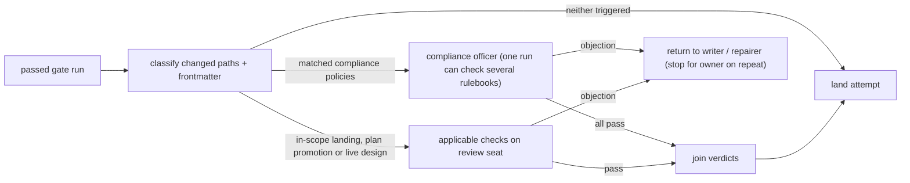

# Review rules: which rulebooks apply, which projects get landing review, and when plans and designs are checked

**Status:** Not built: `rg 'implementation-plan-style|reference-document-style|repo-pack-and-scope' tools config` finds nothing. The owner's four rulings are rows of the [ledger](#decision-ledger); one question is open.

> **In short.** Two readers run after the gate: [the compliance officer](./tillr-design-document-check.md), which checks written rules on the cheapest model, and [the landing review](./tillr-diff-review.md), which reviews the diff and the criteria on the `review` seat. Those two designs draw one line, `docs/` versus everything else, and specify one compliance policy. Here, file type determines which rulebooks apply, and project scope determines whether a final merge needs landing review. Two further checks protect the handoffs to people and workers: a design's facts are audited before the owner reads it, and a companion plan is reviewed against its accepted design before dispatch.

**Why it matters.** In a nine-day sample of 1,227 commits, 519 touched only `docs/**/*.md` and 708 touched paths outside `docs/`. Inside those two buckets sit companion implementation plans that no human reads, evergreen references that neither reader checks, and 54 commits outside `docs/` that touched no program or test source ([Section 1](#1-why-one-boundary-is-not-enough)).

**The shape.** One tracked routing table maps each changed file's artifact class to zero or more compliance policies, at both early cuts and final merges; project scope, document type and plan readiness select the substantive checks ([Section 3](#3-the-routing-matrix-by-kind-of-change)).

**Cost.** One cheap `compliance` run can check several rulebooks. Landing review runs at most once per in-scope candidate on the `review` seat. The design audit uses the `review` seat, not the `design` seat ([Section 6](#6-do-design-documents-want-a-review-agent)).

**Start at [Section 3](#3-the-routing-matrix-by-kind-of-change)** for the routing table, [Section 4](#4-extending-the-compliance-officers-policies) for the new compliance policies, and [Section 6](#6-do-design-documents-want-a-review-agent) for the limits of the design audit.

**Needs your ruling:** [OQ-RJ5](#OQ-RJ5).

**Reads with:** [the landing review](./tillr-diff-review.md) (the substantive `review`-seat check on code landings), [the compliance officer](./tillr-design-document-check.md) (the `compliance`-seat policy checker), [the queue mirrors designs](./tillr-queue-mirrors-designs.md) (the companion `<topic>-plan.md` files that drive worker dispatch), and [designer sessions](../reference/tillr-designer-sessions.md) (how the owner's review comments return to a document's designer). No implementation plan exists while [OQ-RJ5](#OQ-RJ5) is open.

---

## 1. Why one boundary is not enough

Four owner rulings across [the landing review](./tillr-diff-review.md#decision-ledger) and [the compliance officer](./tillr-design-document-check.md#decision-ledger) set the baseline:

1. **Every code landing gets a fresh landing review after the gate** (`D-DR1`), on the `review` seat ([OQ-DR1](./tillr-diff-review.md#OQ-DR1)).
2. **Documents-only landings get no landing review** (`D-DR2`).
3. **One general compliance officer runs on the cheapest model at both commit points**, a designer's early cut and an item's final merge, checking whole files and their diffs against written policies (`D-DP1`, [OQ-DP3](./tillr-design-document-check.md#OQ-DP3), [OQ-DP4](./tillr-design-document-check.md#OQ-DP4)).
4. **A repeated identical objection stops and waits for the owner**, with no dismissal mechanism ([OQ-DR2](./tillr-diff-review.md#OQ-DR2)).

Those designs partition the repository with one path rule and specify one compliance policy, `design-document-style`. The commit mix has eight kinds of change:

| Kind of change | What runs under the two designs alone |
| :--- | :--- |
| Program and test source (`tools/`, `tests/`, `bin/`, the pack's code mirror) | Landing review; no compliance policy |
| Configuration, recipes, and pack manifests | Landing review; no compliance policy |
| Agent instructions, skills, and briefings | Landing review; no compliance policy |
| Module and pack `README.md` files outside `docs/` | Landing review; no compliance policy |
| Live-proposal design documents (`docs/design/<topic>.md`) | `design-document-style` compliance; no landing review |
| Companion implementation plans (`docs/design/<topic>-plan.md`) | `design-document-style`, which is the wrong rulebook; no landing review |
| Evergreen references, research, and triage documents under `docs/` | Neither |
| Roadmaps (`docs/**/roadmap.md`) | Neither |

Four seams appear in that table:

- **Companion plans get the wrong compliance check and no substantive review.** Under [the queue mirrors designs](./tillr-queue-mirrors-designs.md#decision-ledger) ([OQ-QM1](./tillr-queue-mirrors-designs.md#OQ-QM1)), no human reads `<topic>-plan.md`, and workers are dispatched straight from its `DECIDED` tasks, fences, and criteria. Yet the file sits under `docs/` with a live-proposal stage: it is exempt from landing review as documents-only, and it is held to `design-doc`, which wants walkthrough questions for a human and no per-file tasks, in place of `implementation-plan`.
- **Written rulebooks outside design documents have no compliance policy.** System references (`system-doc`), companion plans (`implementation-plan` and `tillr-prose-style`), and repository configuration and packs (`AGENTS.md`) have written rules that authors load, and [the compliance officer](./tillr-design-document-check.md#10-what-this-does-not-cover) specifies only `design-document-style`.
- **Some changes outside `docs/` change no behavior.** Of the 54 such commits in the sample, 44 changed only configuration or pack manifests. Landing review's `missing-test` category assumes a behavior change carries a test; a pure configuration or documentation change has no behavior for a new test to exercise.
- **Design documents get style checking and human reading, and no check of their claims about the tree.** A stale tree claim, such as calling built machinery unbuilt, or a collision with a ruling in a sibling Decision Ledger ([the decision-provenance review](../tillr/decision-provenance-review.md)), is invisible to `vantage-check` and to the compliance officer, because neither opens the codebase.

## 2. The words

Node, seat, ending, objection, chain, evidence key, and identical repeat keep the meanings of [the graph design](./tillr-graph-is-the-path.md#2-the-words). Candidate, gate, lander, and trunk keep those of [the vocabulary](./tillr-vocabulary.md#54-checking-and-landing). Landing review, reviewer, code landing, documents-only landing, and finding keep those of [the landing review](./tillr-diff-review.md#2-the-words). Commit point, compliance officer, compliance policy, and live proposal keep those of [the compliance officer](./tillr-design-document-check.md#2-the-words). Companion plan keeps that of [the queue mirrors designs](./tillr-queue-mirrors-designs.md#2-the-words). These are added.

| Term | Meaning | What it is not |
| :--- | :--- | :--- |
| **Artifact class** *(coined here)* | The category a repository path, with its optional frontmatter `stage`, belongs to for review routing: for example a live-proposal design document, a companion plan, a reference document, a configuration or pack file, or program source | Not a git attribute and not a workflow name; one commit can touch files of several artifact classes |
| **Review routing table** *(coined here)* | The tracked declaration that selects compliance policies by artifact class and substantive checks by project scope, document type and plan readiness | Not code per policy; the loop evaluates paths and frontmatter mechanically after a passed gate |
| **Substantive review** *(coined here)* | A fresh read-only agent run that may open the tree to check whether a candidate's content is true, complete, and faithful to what was claimed, such as [the landing review](./tillr-diff-review.md) | Never the compliance officer, which reads only the changed file, its diff, and the applicable rulebooks |
| **Design review** *(coined here)* | A fact-and-ledger audit of a live-proposal design document, distinct from style compliance and from the owner's own reading ([Section 6](#6-do-design-documents-want-a-review-agent)) | Not `vantage-check` and not `design-document-style` |

## 3. The routing matrix by kind of change

Two independent questions govern every candidate after the mechanical gate passes:

- **P1. Compliance follows written file rules.** Whenever an artifact class has a written rulebook whose violations can be quoted, line and rule, from the file, its diff, and the rulebook alone, with no tree search, a compliance policy checks it at both commit points.
- **P2. Landing review follows project scope, not file type.** At final merge, a change to tillr or its pi backend, extensions included ([`tools/tillr-run/backends/pi/`](../../tools/tillr-run/backends/pi/README.md)), triggers one landing review. Everything else skips it. Independently, the `review` seat checks a companion plan once when it becomes ready for dispatch, and audits the facts and ledger claims of live designs.

### 3.1 Proposed map across this repository's artifact classes

| Artifact class | Path or frontmatter match | Mechanical gate (runs first) | Compliance policy (both commit points) | Substantive review (`review` seat) | Human reader in normal flow |
| :--- | :--- | :--- | :--- | :--- | :--- |
| **Program and test code** | `tools/**`, `tests/**`, `bin/**`, the pack's code mirror | Unit, integration, pack-sync, identity checks | None ([Section 4.2](#42-what-stays-out-of-compliance-policies)) | Landing review for in-scope projects | None before merge |
| **Agent instructions, skills, and briefings** | `AGENTS.md`, `.agents/skills/**`, `yolo-packs/*/skills/**`, `yolo-packs/*/briefing/**` | `vantage-check` where Markdown, `documents`, `citations`, `scratch` | `repo-pack-and-scope-rules` when under `yolo-packs/` or root instructions ([OQ-RJ1](#OQ-RJ1)) | Landing review for in-scope projects | None before merge |
| **Configuration, recipes, and pack manifests** | `config/**`, `.justfile`, `.tillr.toml`, `.vantage.toml`, `yolo-packs/*/pack.*` | `workflows`, `pack-sync`, `format` | `repo-pack-and-scope-rules` ([OQ-RJ1](#OQ-RJ1)) | Landing review for in-scope projects | None before merge |
| **Module and pack `README.md` files** | `**/README.md` outside `docs/` | `vantage-check`, `documents`, `citations`, `scratch` | None beyond `vantage-check` | Landing review for in-scope projects, even when only the README changes | Optional |
| **Companion implementation plans** | `docs/design/*-plan.md` | `vantage-check`, `design-citations`, the sync grammar check | `implementation-plan-style` (`D-RJ1`, [OQ-RJ1](#OQ-RJ1)); excluded from `design-document-style` | One review against the accepted design on promotion to `DECIDED` ([OQ-RJ3](#OQ-RJ3)) | **None** ([OQ-QM1](./tillr-queue-mirrors-designs.md#OQ-QM1)) |
| **Live-proposal design documents** | `docs/**/*.md` excluding `*-plan.md` and `**/roadmap.md`, with an open, ready, or built `stage` | `vantage-check`, `design-citations`, `citations`, `scratch` | `design-document-style` | Fact-and-ledger audit before owner review; no design critique ([OQ-RJ4](#OQ-RJ4)) | **The owner** |
| **Evergreen reference, research, and triage documents** | `docs/reference/**/*.md`, and `docs/**/*.md` with `stage: CURRENT` or no live-proposal stage, excluding roadmaps | `vantage-check`, `citations`, `scratch` | `reference-document-style` on `docs/reference/**` and `stage: CURRENT` ([OQ-RJ1](#OQ-RJ1)) | Landing review for in-scope projects | Reader on demand |
| **Roadmaps** | `docs/**/roadmap.md` | `vantage-check` roadmap rules | None | Landing review for in-scope projects | The owner |
| **Automatic reverts** | A loop-generated inverse commit | Its own revert checks | **None** (`D-DP4`) | **None** (`D-DR8`) | Reported on the item page |

### 3.2 How mixed commits compose

One commit often touches more than one artifact class: code with a design document, or code with a module `README.md`. Three deterministic rules compose the table (`D-RJ2`):

1. **First specific match per file.** A path matches at most one artifact class, in precedence order (`*-plan.md` and `**/roadmap.md` before general `docs/**/*.md`), so a companion plan never falls through into `design-document-style`.
2. **Collect the matched rulebooks.** If a candidate changes tillr Go code, `yolo-packs/tillr/pack.json`, and a live design document, one compliance run checks both the pack rules and the design-document rules. A second rulebook does not require a second job.
3. **At most one landing review on the whole candidate, in parallel with compliance.** In that example the tillr change triggers one landing review of the whole diff, and the design change also gets its narrow audit. A candidate wholly out of scope skips landing review. The merge proceeds only when every triggered reader passes.

## 4. Extending the compliance officer's policies

[The compliance officer](./tillr-design-document-check.md#32-what-a-compliance-policy-supplies) defines a compliance policy as five tracked facts with no custom code: a name, the files it applies to, the authors' own policy text, who repairs an objection, and two specimens, one clean and one with a planted fault. A new policy obeys the boundary of `D-DP7`: **every violation can be proved by quoting one rule in the policy text and one line in the changed file, without opening the rest of the tree.**

### 4.1 Policies that fit the contract

| Policy name | Files matched | Rulebook loaded at dispatch | Examples of faults caught before merge | Repairer |
| :--- | :--- | :--- | :--- | :--- |
| `design-document-style` *(existing design)* | `docs/**/*.md` with a live-proposal `stage`, **excluding** `docs/design/*-plan.md` and `**/roadmap.md` (`D-RJ1`) | The `design-doc` and `vantage-docs` skills | Bare-label options, decision codes inside a question's story, missing header slots, track-changes prose | The item's designer ([OQ-DP5](./tillr-design-document-check.md#OQ-DP5) for build items) |
| `implementation-plan-style` *(new)* | `docs/design/*-plan.md` | The `implementation-plan` and `tillr-prose-style` skills, and [the tasks grammar](./tillr-queue-mirrors-designs.md#72-canonical--tasks-grammar-in-topic-planmd) | Question directives for a human in an agent-only plan, prose checklists outside `## Tasks`, undefined abbreviations, full function bodies pasted as tasks | The session that wrote the plan |
| `reference-document-style` *(new)* | `docs/reference/**/*.md`, and `docs/**/*.md` with `stage: CURRENT`, excluding roadmaps | The `system-doc` and `vantage-docs` skills | Bare line-number citations, missing verification stamps, leftover Open Questions or Decision Ledger scaffolding | The session that last wrote the file |
| `repo-pack-and-scope-rules` *(new)* | `yolo-packs/**`, `AGENTS.md` | `AGENTS.md`, the repository agent guide | A change that breaks a written rule of the agent guide which no gate check enforces | The session that last wrote the file |

All three new checkers are added ([OQ-RJ1](#OQ-RJ1)). One compliance run checks several rulebooks, so the number of jobs does not multiply. A rulebook is either built into tillr or owned by the repository tillr runs in: the pack and scope rulebook belongs to that repository, which supplies its policy. Where the companion-plan rulebook lives is open ([OQ-RJ5](#OQ-RJ5)); that plans are checked is not.

### 4.2 What stays out of compliance policies

Two temptations fail `D-DP7` and belong elsewhere:

- **Program-code style and architecture policies.** Telling whether a helper is dead, whether a boundary validates untrusted input, or whether a test exercises real behavior requires reading callers and tests across the tree. A compliance officer given only the changed file and a prose rulebook either invents context or objects to variable names, which [the landing review's brief](./tillr-diff-review.md#6-the-brief) forbids. Mechanical code style stays in linters inside the gate; behavioral defects stay in landing review.
- **Rules a gate program already enforces completely.** Unlanded commit shas (`citations`), scratch citations (`scratch`), broken links and directives (`vantage-check`), commit identity, and a drifted pack mirror (`pack-sync`) fail in seconds, at no token cost, before any agent runs.

## 5. Substantive review outside program source

### 5.1 Config-only, pack-only, skill, and README-only commits

The boundary for landing review is the project, not `docs/` ([OQ-RJ2](#OQ-RJ2)): tillr and its pi backend, extensions included, are in scope. Everything else in the repository tillr runs in is out of scope and skips landing review, so that an ordinary configuration edit through tillr is as close as possible to asking an agent to make it directly. A README-only change to tillr gets landing review; an ordinary repository configuration edit does not. Both still go through the mechanical gate and any matching compliance checks. For in-scope changes, `D-RJ3` limits `missing-test` to behavior changes and to tests an item criterion requires.

### 5.2 Companion implementation plans (`docs/design/<topic>-plan.md`)

- While a plan is at `stage: SKETCH`, sync ignores its tasks (`D-QM7` in [the queue mirrors designs](./tillr-queue-mirrors-designs.md#41-how-one-design-item-relates-to-the-work-in-its-companion-plan)). Nothing executes from it, so substantive review at `SKETCH` would pay to check rough notes.
- When the `plan` seat promotes the plan to `stage: DECIDED`, sync turns its `## Tasks` into runnable work items, and no human reads the plan.
- Without a check, that promotion is a documents-only commit that lands with no substantive review. A task that drops a requirement of the design, sets a fence narrower than the files to edit, or writes a weak criterion is discovered only after workers run, or never, if the weak criterion passes each worker's own landing review.

So the plan gets one review **on promotion to `DECIDED`, before dispatch** ([OQ-RJ3](#OQ-RJ3)). The `review` seat checks that the tasks cover the accepted design, the fences admit the work, and the criteria can be tested. Neither a rough draft nor an edit to an already-ready plan triggers it.

## 6. Do design documents want a review agent?

A narrow one, for facts only ([OQ-RJ4](#OQ-RJ4)). The design process already catches design choices; what it does not catch is a false statement about the tree.

### 6.1 What the design process covers

A live-proposal design document passes through five layers:

| Layer | Seat or actor | What it catches | What it cannot catch |
| :--- | :--- | :--- | :--- |
| **1. Scouts and authoring** | `scout` and `design` | Codebase reconnaissance and architectural synthesis | The author's own blind spots, misread scout notes, drift from sibling designs |
| **2. Mechanical gate** | Gate programs | Broken links, dead anchors, invalid directives, unlanded commit shas, scratch paths | False prose claims about code, missing failure modes, unasked questions |
| **3. Compliance officer** | `compliance` | Unreadable question options, missing header slots, walls of prose, missing provenance | Anything that requires opening the tree or another design's ledger |
| **4. Owner review, with the document's warm designer session** ([designer sessions](../reference/tillr-designer-sessions.md)) | The owner | Wrong product direction, rejected trade-offs, over-engineering | Factual claims about the codebase that look plausible on the page |
| **5. Planner's tree read** | `plan`, after acceptance | Claims in an accepted design that fail when mapped onto concrete files | It runs after the owner has already ruled on a design built on false premises |

### 6.2 What reaches the owner unchecked

Two kinds of defect get past layers 1 to 3:

- **Stale or false claims about what is built,** such as a status that says nothing is built when the code exists, or a `Built` column that lags the tree.
- **Collisions with settled rulings in sibling Decision Ledgers, and designer choices presented as settled.** [The decision-provenance review](../tillr/decision-provenance-review.md#13-the-counts-and-how-far-to-trust-them) counts them.

### 6.3 Why the audit checks facts rather than design choices

A general "critique this architecture" agent before a design cut lands has three structural flaws:

1. **It argues about taste before the decider has spoken.** Open trade-offs in a design are questions addressed to the owner. A second model asked whether the design is good objects to leanings and scope choices that are the owner's to settle.
2. **It slows early design landing.** [Early design landing](./tillr-early-design-landing.md#1-the-ruling-and-what-it-leaves-open) exists so a designer's question reaches the owner at once; a multi-turn critique and a returned designer turn before every cut stand in front of every question.
3. **The `design` seat is already the strongest model.** Having the same tier second-guess its own taste adds far less signal than checking falsifiable facts against the repository.

| Option | What runs on a design commit | What it checks | Verdict |
| :--- | :--- | :--- | :--- |
| **A — No design-review agent** | The gate and `design-document-style` | Style, structure, links, and provenance formatting | Rejected: the owner still meets plausible false tree claims |
| **B — A narrow fact-and-ledger audit on `review`** | The gate, the compliance officer, and one read-only `review`-seat check with a fact-only brief, in parallel with compliance | **Only falsifiable claims:** cited paths and symbols exist, negative claims hold when their search is re-run, the `Built` column matches the tree, and a new decision row does not silently contradict a settled owner ruling in a ledger the document depends on or reads with. It may not object to trade-offs, leanings, or scope | **Chosen** ([OQ-RJ4](#OQ-RJ4)) |
| **C — A full independent design review on `design`** | The gate, the compliance officer, and a fresh `design`-seat reviewer | Facts, plus missing failure modes, concurrency holes, and unasked questions | Rejected: roughly ten times the cost of B per commit by [the landing review's cost table](./tillr-diff-review.md#8-cost), plus `design`-seat repair turns, and the slowest cuts |

## 7. Ordering, concurrency, and failure behavior

Every reader in [Section 3](#3-the-routing-matrix-by-kind-of-change) reuses the mechanics of [the landing review](./tillr-diff-review.md#5-the-three-outcomes) and [the compliance officer](./tillr-design-document-check.md#5-the-outcomes):

- **Trigger and position.** Classification runs deterministically in the loop immediately after a gate run ends `pass`, at both commit points. Matched compliance policies apply at either point, as does the fact-and-ledger audit for a live design. Landing review runs only at final merge and only for an in-scope change. The plan review runs on the promotion that makes the plan ready to dispatch.
- **Degenerate inputs.** An empty diff is refused before review. An automatic revert triggers neither reader. A file that matches no compliance policy and no substantive review, such as a README of an out-of-scope project, lands directly after the green gate.
- **Parallel execution and one writer.** The compliance officer and any triggered `review`-seat checks are read-only against the same gated candidate head, so they start together (`D-DP9`). If a reader changes the worktree, its changes are stripped and its verdict discarded. Only the loop writes review events to the store.
- **Objections and identical repeats.** If compliance and substantive review both object to one candidate, the loop delivers their objections together in one returned turn when the same session repairs both, or stages the designer's repair before the worker's return when [OQ-DP5](./tillr-design-document-check.md#OQ-DP5) assigns document repair to a designer (`D-RJ4`). An identical repeat, by the compliance key `(policy, heading, file, place)` or the landing-review key `(unmet criteria, finding category and path)`, follows [OQ-DR2](./tillr-diff-review.md#OQ-DR2): **no dismissal runs; the item stops under "needs you" with the objection and the writer's reason shown.**
- **Existing state.** Items and documents landed before these rules exist are not blocked after the fact; under [OQ-DP2](./tillr-design-document-check.md#OQ-DP2), an old file is brought up to its matched policy the next time a candidate touches it.

## 8. Alternatives considered

| Alternative | Verdict |
| :--- | :--- |
| Keep the `docs/`-versus-everything-else rule with the single `design-document-style` policy | Rejected. Companion plans stay checked against the wrong skill and unreviewed when `DECIDED`, and `docs/reference/` stays unchecked |
| Register a code-style compliance policy on the `compliance` seat for all code commits | Rejected (`D-DP7`). Modularity and test adequacy require reading callers and tests across the tree, which turns a cheap file check into a noisy second code reviewer |
| Run landing review after the compliance officer passes | Rejected (`D-DP9`). Both are read-only on the gated head; running them in series doubles latency on clean mixed commits |
| Let a workflow opt into or out of compliance policies or substantive review | Rejected (`D-DR4`, `D-DP4`). A workflow file that omits a reader silently reopens the unreviewed landing |
| Have a design-review agent rewrite weak sections itself | Rejected. It breaks the read-only reviewer rule and overwrites the warm designer session's context |

## 9. What this does not cover

- **Which mechanical checks run inside the gate,** or acquitting failures the trunk already had.
- **Which backend the `review` seat or the `compliance` seat uses** ([OQ-DR1](./tillr-diff-review.md#OQ-DR1), [OQ-DP4](./tillr-design-document-check.md#OQ-DP4)).
- **Settling a repeated disagreement automatically** ([OQ-DR2](./tillr-diff-review.md#OQ-DR2), [OQ-DR3](./tillr-diff-review.md#OQ-DR3)).
- **Editing the `design-doc`, `implementation-plan`, `system-doc`, or `vantage-docs` skills.** They are maintained outside this repository and loaded as they are at dispatch (`D-DP5`).
- **Manual commits made outside tillr.**

## 10. Amendments owed

These follow from this design and are for the named documents to make:

- **[The compliance officer](./tillr-design-document-check.md):** exclude companion plans from `design-document-style`, register the three new policies, and let one run check several built-in or repository-owned rulebooks. Align [its repeated-objection rule](./tillr-design-document-check.md#53-when-the-officer-and-the-repairer-disagree) with [OQ-DR2](./tillr-diff-review.md#OQ-DR2).
- **[The landing review](./tillr-diff-review.md):** replace the documents-only exemption with the project scope of [OQ-RJ2](#OQ-RJ2).
- **[The queue mirrors designs](./tillr-queue-mirrors-designs.md):** add plan-style compliance and the one review against the accepted design on promotion to `DECIDED`.
- **[Early design landing](./tillr-early-design-landing.md):** include the fact-and-ledger audit, distinct from style compliance, before the owner reads a live design.

## 11. Risks

| Risk | Mitigation |
| :--- | :--- |
| `design-document-style` is built first without excluding `*-plan.md`, and rejects companion plans for lacking questions for a human | `D-RJ1` excludes `docs/design/*-plan.md` from `design-document-style` from the start, whether or not `implementation-plan-style` is built in the same step |
| `repo-pack-and-scope-rules` leads the cheap model to misread nuanced prose in `AGENTS.md` | Every finding quotes a rule and an offending line word for word (`D-DP6`), backed by two standing specimens; a noisy rule is tightened in `AGENTS.md` or moved to a gate check |
| Landing review raises `missing-test` on valid configuration edits | `D-RJ3` adds one line to the landing-review brief exempting pure configuration and prose files unless a criterion asks for a test |
| The fact-and-ledger audit drifts into design critique | Its brief restricts findings to closed, locatable categories (missing path or symbol, falsified search claim, wrong `Built` cell, unacknowledged ledger contradiction) and discards free-form opinions |
| Combined compliance and substantive objections overwhelm a worker turn | They are joined into one structured return sorted by file, and any identical repeat stops for the owner ([OQ-DR2](./tillr-diff-review.md#OQ-DR2)) |

## Decision Ledger

This design inherits the owner's rulings in [the landing review](./tillr-diff-review.md#decision-ledger) (`D-DR1`, `D-DR2`, [OQ-DR1](./tillr-diff-review.md#OQ-DR1), [OQ-DR2](./tillr-diff-review.md#OQ-DR2)) and [the compliance officer](./tillr-design-document-check.md#decision-ledger) (`D-DP1`, `D-DP2`, `D-DP13`, [OQ-DP1](./tillr-design-document-check.md#OQ-DP1) to [OQ-DP4](./tillr-design-document-check.md#OQ-DP4)). Rows `D-RJ1` to `D-RJ4` are the designer's decisions; the owner may overturn any of them. None is built.

| ID | Decision | Date | Settled in | Built |
| :--- | :--- | :--- | :--- | :--- |
| `D-RJ1` | **Designer's decision.** Exclude companion implementation plans (`docs/design/*-plan.md`) from `design-document-style`, so an agent-only plan is never judged against `design-doc`'s rules for human questions and headers. **Rejected:** holding every `SKETCH` or `DECIDED` file under `docs/design/` to `design-document-style`. | 2026-11-19, designer | [Section 4.1](#41-policies-that-fit-the-contract) | — |
| `D-RJ2` | **Designer's decision.** Classify each changed file by the most specific path and frontmatter rule; after a passed gate, run compliance in parallel with at most one landing review of the whole candidate when in scope. One compliance run can cover several policies ([OQ-RJ1](#OQ-RJ1)). Merge only when all triggered readers pass. **Rejected:** per-workflow opt-ins; compliance, then review, in series. | 2026-11-19, designer | [Section 3.2](#32-how-mixed-commits-compose) | — |
| `D-RJ3` | **Designer's decision.** When landing review runs on configuration, pack, or documentation paths, `missing-test` applies only to a program behavior change or when an item criterion requires a test. **Rejected:** forcing workers to write tautological configuration-parsing tests. | 2026-11-19, designer | [Section 5.1](#51-config-only-pack-only-skill-and-readme-only-commits) | — |
| `D-RJ4` | **Designer's decision.** Join simultaneous compliance and substantive objections into one returned turn when the same session repairs both, and apply [OQ-DR2](./tillr-diff-review.md#OQ-DR2) to every reader here: stop and wait for the owner on an identical repeat. **Rejected:** separate return turns in series for the same writer; a dismissal override per reader. | 2026-11-19, designer | [Section 7](#7-ordering-concurrency-and-failure-behavior) | — |
| OQ-RJ1 | **Owner ruling.** Add all three checkers: companion plans, evergreen references, and repository pack and scope rules. One compliance run can check several rulebooks. A rulebook is built into tillr or owned by the repository it runs in; that repository owns its pack rules. | 2026-11-20, owner | [Section 4](#4-extending-the-compliance-officers-policies) | — |
| OQ-RJ2 | **Owner ruling.** Landing review covers tillr and its pi backend, extensions included. Everything else skips landing review. | 2026-11-20, owner | [Section 5.1](#51-config-only-pack-only-skill-and-readme-only-commits) | — |
| OQ-RJ3 | **Owner ruling.** Review the companion plan once against the accepted design when the plan becomes ready to dispatch. | 2026-11-20, owner | [Section 5.2](#52-companion-implementation-plans-docsdesigntopic-planmd) | — |
| OQ-RJ4 | **Owner ruling.** Add a narrow fact-and-ledger audit on the `review` seat, not a second opinion on the design. | 2026-11-20, owner | [Section 6.3](#63-why-the-audit-checks-facts-rather-than-design-choices) | — |

## Open Questions

1. 💬 **OQ-RJ5: Does the companion-plan rulebook ship with tillr, or belong to the repository tillr runs in?**

   Companion plans will be checked either way. What remains open is whether their rules go with tillr or stay with the repository whose plans they describe.

   - **A — Build the rulebook into tillr.** Projects using tillr receive the same plan rules when tillr ships.
   - **B — Keep the rulebook in the repository tillr runs in.** Repository keeps its own plan conventions; they do not become requirements for other projects.

   <!-- vantage: question id=OQ-RJ5 -->

   **Answer:**

   > _(empty — fill in when decided)_
