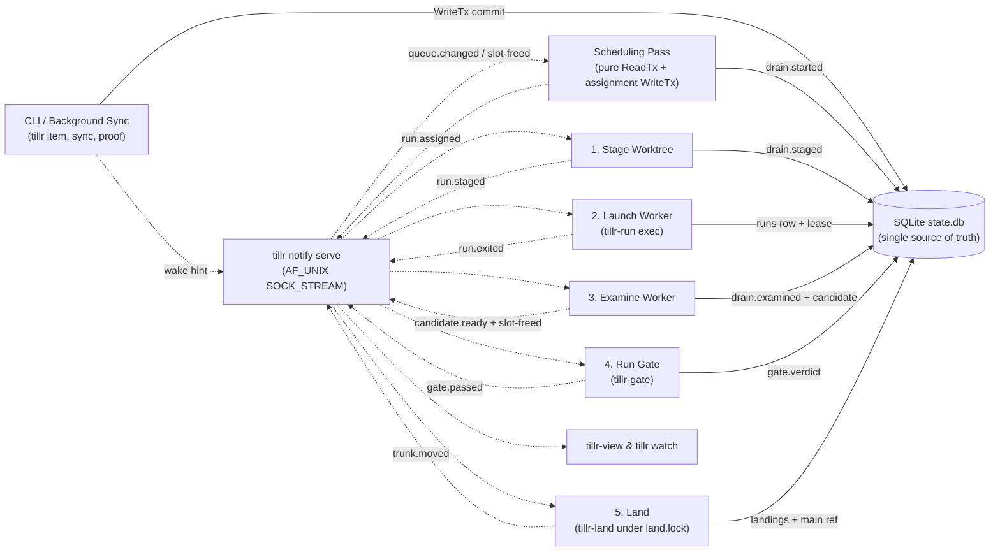

# The scheduling pass writes assignments; everything else runs outside it on notifications

**Status:** Partly built: of the six slices in [Section 8](#8-build-slices-smallest-first-and-how-each-is-measured), Slices 1 and 3 are in the tree, Slice 2 is partly in, and Slices 4 to 6 are not; that section names the evidence. The direction is the owner's ruling ([`R-SN1`](#decision-ledger)); the notification mechanism, the single-writer step contracts, the fallback interval and the build slices (`D-SN1` through `D-SN9`) are the designer's decisions, and the owner may overturn any of them.

> **In short.** A scheduling pass that also syncs documents, runs Vantage subprocesses, sweeps refs, stages worktrees, and arbitrates restarts turns a 5-millisecond assignment decision into a 60-to-75-second bottleneck. Narrowing the pass to pure assignment writing — while driving staging, launch, examination, gating, and landing from durable SQLite records over ephemeral local notifications plus a 15-second fallback poll — removes the queue pass from every hand-off path.

- **Why it matters:** with every job inside the pass, queue passes begin 60 to 75 seconds apart, a finished worker waits 5.4 to 13.6 seconds to have its examination claimed, examination takes 3.1 to 6.2 seconds, and about 7 seconds pass between settlement and gate claim ([Section 2](#2-what-the-pass-costs-when-it-does-everything)).
- **The shape:** one pure **scheduling pass** writes node assignments to SQLite under the scheduling lock; five single-writer **step coordinators** (`stage`, `launch`, `examine`, `gate`, `land`) and three **background actors** (`sync`, `trunk-proof`, `gc`) run outside the lock, woken by a statically linked `AF_UNIX` pub/sub relay (`tillr notify serve`) and backed by a 15-second store reconciliation poll.
- **Cost:** one small local notification subcommand (`tillr notify serve`) and one staged-worktree event (`drain.staged`). It deletes `claimSettledCandidateJudge` ([`settle_judge.go`](../../tools/tillr-drain/drain/settle_judge.go)) and the fresh-start shadow planner ([`start_coordinator.go`](../../tools/tillr-drain/drain/start_coordinator.go), [`start_view.go`](../../tools/tillr-drain/drain/start_view.go)) once the pass itself is under 50 ms.
- **Start at:** [Section 3](#3-the-scheduling-pass-what-holds-the-lock-and-what-writes) for the pass boundary, [Section 4](#4-notifications-and-the-15-second-fallback) for the notification bus, and [Section 5](#5-every-step-outside-the-pass-and-its-one-writer) for the step contracts.
- **Needs your ruling:** None.
- **Reads with:** [`tillr-vocabulary.md`](./tillr-vocabulary.md) (owns the words **item**, **node**, **path**, **run**, **worktree**, **scratch**, and **running-agent limit**), [`tillr-graph-is-the-path.md`](./tillr-graph-is-the-path.md) (owns node kinds, parallel writer checkouts, and scheduling semantics), and [`landing-principles.md`](./landing-principles.md) (owns gate-once squashing, uncounted returns, and named movers).

---

## 1. The owner's ruling, scope, and vocabulary

### 1.1 The owner's ruling (`R-SN1`)

The owner ruled on 2026-11-23 ([`R-SN1`](#decision-ledger)):

- The scheduling pass only decides scheduling and writes the assignment to SQLite. That is the whole pass under the lock.
- Everything else runs in the background without the lock.
- The background steps are driven by lightweight notifications with a fallback of about 15 seconds. A notification speeds work up and is not otherwise critical.
- The mechanism is the designer's choice. Something statically linked is preferred, and Redis is not to be chosen merely because it was named.

Every concrete mechanism, event name, wire frame, lock rule, fallback interval, rejected alternative and slice (`D-SN1` through `D-SN9`) is the designer's engineering decision, which the owner may overturn.

### 1.2 Non-goals (what this design does not touch)

- **The gate's own execution time.** How fast individual checks inside `tillr-gate` run stays in [the gate reference](../reference/gate.md).
- **The heavy trunk proof's own execution time.** How long the full suite takes per commit on `main` and whether [`config/tillr/gate-policy.json`](../../config/tillr/gate-policy.json) cuts bases from `"green"` or `"tip"` are out of scope here.
- **Model, seat, and backend policy.** Seat routing, fallback chains, and quota windows remain governed by policy files and [`tillr-judge-and-lifecycle.md`](./tillr-judge-and-lifecycle.md).
- **Numbered lanes.** Numbered pool slots have no place in this architecture; where a table or flag carries `lane` in its name, the name is a compatibility alias ([`tillr-vocabulary.md`](./tillr-vocabulary.md) `D-VO9`).

### 1.3 Terms and state shapes used here

Every queue concept uses its settled definition in [`tillr-vocabulary.md`](./tillr-vocabulary.md):

- **Item, graph, path, node, and run** ([`tillr-vocabulary.md` Section 1](./tillr-vocabulary.md#1-what-an-item-is) and [Section 2](./tillr-vocabulary.md#2-what-a-run-is), [`D-VO3`](./tillr-vocabulary.md#decision-ledger)): an **item** has one **graph**; its started nodes form its **path**; execution data (what stored tables `runs` and `node_runs` call a **run**: segments, lease, log, declared outputs, ending, spend) belongs directly to its **node**.
- **What an assignment binds** ([`tillr-vocabulary.md` Section 3](./tillr-vocabulary.md#3-what-a-lane-was-and-the-worktree-as-a-resource), [`R-VO4`](./tillr-vocabulary.md#decision-ledger)):
  1. **The running-agent limit** (`D-VO6` in [`tillr-vocabulary.md` Section 3.5](./tillr-vocabulary.md#35-what-limits-how-many-agents-run-at-once)): the integer cap (`running_agents` / `--max-agents`, keeping `--lanes` as an alias) on ordinary agent nodes executing at once. Work the owner is waiting on (`express = true`) runs outside the ordinary limit; command executions (`take-in`, `gate run`, `join`, `land attempt`) do not count against it.
  2. **The item-owned worktree and scratch** (`D-VO5`, `D-VO10`, and [`R-VO3`](./tillr-vocabulary.md#decision-ledger) / `D-VO15` in [`tillr-vocabulary.md` Section 3.2](./tillr-vocabulary.md#32-who-holds-what)): an item acquires one primary checkout (`.tillr/items/<item-id>/worktree` and `.tillr/items/<item-id>/scratch`) when a node needs one, plus temporary isolated checkouts (`.tillr/items/<item-id>/nodes/<node-id>/worktree`) when an item's plan runs multiple writers in parallel before a `join` node, bounded across disk by `2x` worktree count and `4 GB x` bytes.
  3. **The node execution lease** (`runs` / `lanes` alias row): the time-bounded liveness record of one running node segment.
- **Wake hint** *(coined here)*: an ephemeral, non-authoritative message sent over the local notification socket naming a topic (for example `run.exited` or `candidate.ready`) and optional identifiers (`item_id`, `run_id`, `seq`). It is **not** a state transition, a work queue entry, or a durable event: dropping, duplicating, or reordering a wake hint never alters what SQLite records, and no consumer acts on a wake hint without first reading SQLite or a verified artifact file.

---

## 2. What the pass costs when it does everything

### 2.1 The measured basis

One drain with four ordinary agents and one express agent was measured before any slice was built, from its `drain.loop-pass` store events and the `handoff.jsonl` phase spans of four finished runs. These are the baselines every slice in [Section 8](#8-build-slices-smallest-first-and-how-each-is-measured) is measured against:

| Stage or gap | Baseline | Source |
| :--- | :--- | :--- |
| Queue pass, start to start | **60 to 75 s** | `drain.loop-pass` store events |
| Worker exit to examination claim | **5.4 to 13.6 s**, and a full pass interval for an intermediate node | `handoff.jsonl` |
| Examination body, before the gate | **3.1 to 6.2 s** | `handoff.jsonl`, `examination` spans |
| Settlement to gate claim | **about 7 s**, and a full pass interval if the claim yields | `handoff.jsonl`, `claim_settled_judge` span |

### 2.2 The structural causes

Four structures in [`tools/tillr-drain/drain/`](../../tools/tillr-drain/drain/) account for those numbers. The first and the last part of the fourth stand in the tree; Slices 2 and 3 removed the rest.

1. **`passMode` runs about 20 I/O, Git, Vantage and SQLite jobs ahead of scheduling.** In [`pass.go`](../../tools/tillr-drain/drain/pass.go), `passMode` runs marker sweeps, trunk observation, completion draining, ref pruning, comment intake and delivery, `refreshDocuments` (a full Markdown sync), landing reconciliation, stale-record repair and `checkCommentDispatch` Vantage subprocesses serially on the one pass goroutine before it plans anything.
2. **A separate fast path handles fresh starts only.** `runFastStart` ([`start_coordinator.go`](../../tools/tillr-drain/drain/start_coordinator.go)) claims fresh starts; continuations, session resumes, next workflow steps and conflict-fix runs wait for the queue pass.
3. **One restart barrier covered restarts, worktree checkouts and examinations.** A read hold on `Loop.restartMechanical` ([`restart_work.go`](../../tools/tillr-drain/drain/restart_work.go)) that spans a checkout or an examination lets a pending restart stall both, which the `restart_lock_wait` span records.
4. **Queue-wide planning sat inside every worker hand-off.** Settling a finished worker by re-planning the whole queue contends for SQLite's single writer with the pass and with one-second session heartbeats. `claimSettledCandidateJudge` ([`settle_judge.go`](../../tools/tillr-drain/drain/settle_judge.go)) still plans again before `tillr-gate` starts, only to check whether an interactive item wants the slot — a check that item-owned worktrees and express work outside the limit ([`tillr-vocabulary.md`](./tillr-vocabulary.md) `D-VO5`, `D-VO6`) make unnecessary.

---

## 3. The scheduling pass: what holds the lock and what writes

### 3.1 Pure read outside the lock, one assignment `WriteTx` under the lock (`D-SN1`)

Under [`R-SN1`](#decision-ledger), `tillr-drain` has **one** scheduling pass for every agent node kind (fresh starts, next workflow steps, session resumes, parallel node groups, evaluators, and conflict-fix resumes). The pass wakes on `queue.changed`, `agent.slot-freed`, `backend.changed`, `resync`, or the 15-second fallback timer, and executes in two strict phases:

1. **Read and pure selection (outside the scheduling write lock):**
   - Opens one consistent SQLite `ReadTx` and reads queue items, workflow graph frontiers, active node assignments and leases against `running_agents` (`D-VO6`), express flags (`D-IG10`), backend availability and seat quota windows, active fork claims, cached `main` / `refs/tillr/green` SHAs recorded in the store, and cached worktree/scratch disk usage (`D-VO10`).
   - Runs pure, deterministic scheduling selection in memory: chooses which ready agent node(s) acquire open agent capacity (and isolated writer checkouts if parallel under `R-VO3`), and computes updated derived wait reasons (`agent-limit`, `worktree-bound`, `backend-closed`, `trunk-unproved`, `blocked-by`) for unscheduled items.
   - **Zero subprocesses and zero filesystem reads:** if the pure pass selects zero new assignments and zero changed wait records, it closes the `ReadTx` and goes back to sleep without taking a write lock or allocating a pass generation.
2. **Atomic assignment commit (under the scheduling lock, target `< 10 ms`):**
   - Serialized in-process by a dedicated scheduler mutex inside the loop holding `<git-common-dir>/tillr-loop.lock` ([`heavy_authority.go`](../../tools/tillr-drain/heavyrun/heavy_authority.go)) and committed in **one short SQLite `WriteTx`**.
   - **Optimistic delta guard inside `WriteTx`:** verifies via indexed sequence lookups (`EventHeadSeq` / `pendingHistoryChanged`) that no scheduling-relevant event modified the selected item's input version, active agent count, or backend availability since the `ReadTx`. If one item's input moved, that item is skipped (and a follow-up wake runs immediately); other valid assignments in the batch still commit.

### 3.2 Exact write set of the scheduling pass — and nothing else (`D-SN1`)

Inside that single `WriteTx`, the scheduling pass writes **only**:

1. **Node assignment and initial lease rows:** marks each assigned node started on its item's graph (`node_runs` / `startNode`), binds its selected backend, seat, and decided `base_sha`, and writes the node's pre-launch assignment lease (`runs` / `lanes` alias row via `ClaimLease`) counting against `running_agents` and seat quota.
2. **Assignment event and pass observation:** appends `drain.started` (`dispatchStartedKind`) to `events` carrying `(item_id, node_id, run_id, base_sha, loop_owner)` and records the pass generation/decision summary (`drain_passes` / `dispatches`, plus changed item wait/conflict records when an item enters a durable hold).

Immediately **after** `WriteTx` commits, the pass publishes one `run.assigned` wake hint per assigned `run_id` and releases the scheduling lock.

**Explicitly excluded from the scheduling pass and its lock:**

- No `git` subprocesses (`rev-parse`, `worktree add`, `merge-base`, `for-each-ref`, `update-ref`, ref pruning).
- No Vantage or Python subprocesses (`checkCommentDispatch`, `refreshDocuments`).
- No worktree directory creation, checkout reset, brief rendering, or scratch deletion.
- No `tillr-run` process spawn, boundary snapshot, worker examination, `verify` evaluator run, `tillr-gate` run, `tillr-land` run, or `heavyrun` proof.
- No comment intake, reply delivery, landing-call reconciliation, disabled-check marker sweep, or orphan repair.

Once Slice 6 ([Section 8](#8-build-slices-smallest-first-and-how-each-is-measured)) lands, `startView`, `runFastStart`, and `claimFastStart` ([`start_coordinator.go`](../../tools/tillr-drain/drain/start_coordinator.go), [`start_view.go`](../../tools/tillr-drain/drain/start_view.go), [`start_claim.go`](../../tools/tillr-drain/drain/start_claim.go)) are deleted: they exist only to route fresh starts around a 60–75 s `passMode`, and a single sub-50 ms scheduling pass handles every start uniformly.

### 3.3 Separating the three locks (`D-SN2`)

Three different invariants each get their own lock, and no critical section of one covers another:

| Lock | Owner and scope | Max hold time | Never held across |
| :--- | :--- | :--- | :--- |
| **Scheduling lock + store `WriteTx`** | Scheduler goroutine in `tillr-drain` (under `tillr-loop.lock`) | `< 10 ms` (one pure SQLite `WriteTx`) | Any subprocess, Git command, filesystem walk, worktree stage, gate, or model run |
| **Restart transition barrier (`restartMechanical`)** | In-process `sync.RWMutex` in `tillr-drain` guarding `Restarter.Replace` (`syscall.Exec` in [`restart.go`](../../tools/tillr-drain/drain/restart.go)) | `< 100 ms` (held only across individual SQLite `WriteTx` commits and child `cmd.Start` calls) | Worktree staging, boundary Git scans, `tillr-gate`, `tillr-land`, `heavyrun`, or `tillr-run` waits |
| **Trunk publish lock (`land.lock`)** | `tillr-land` ([`lock.go`](../../tools/tillr-land/land/lock.go)) and mechanical revert | `< 500 ms` (`git merge-tree` + `commit-tree` + `update-ref` + receipt `WriteTx`) | Scheduling pass, staging, examination, `tillr-gate`, or trunk proof |

Because every step outside the pass resumes from durable store records after `syscall.Exec`, `tillr-drain` never needs to block a rolling self-restart behind a worktree checkout or an examination in flight.

---

## 4. Notifications and the 15-second fallback

### 4.1 Choosing the notification mechanism: alternatives and costs (`D-SN5`)

All processes for one store live on a single Linux host: `tillr-drain` (which replaces itself in place via `syscall.Exec` onto each rolled build), `tillr-run` workers, detached `tillr-gate` runs, `tillr-land`, `heavyrun` trunk proofs, `tillr-view` Observatory (`servews.go`), `tillr watch wait` (`wake.go`), and short-lived CLI commands (`tillr item`, `tillr drain`). Every `tools/tillr*` binary is already statically compiled with `CGO_ENABLED=0` using pure-Go SQLite (`modernc.org/sqlite`).

| Candidate mechanism | Delivery latency | Survives `tillr-drain` `syscall.Exec` & stop? | Operational & test footprint | Verdict |
| :--- | :--- | :--- | :--- | :--- |
| **1. `tillr notify serve` (`AF_UNIX` `SOCK_STREAM` relay built into static `tillr` binary)** | **0.1–0.3 ms** | **Yes.** Separate tiny OS process (`--idle-exit 30s`) holds zero queue/SQLite state, stays up across `tillr-drain` `syscall.Exec`, and keeps waking `tillr-view` and `tillr watch` when `tillr-drain` is stopped | **~250 LOC Go stdlib**, `CGO_ENABLED=0`, zero containers, zero ports; publishers never spawn it (`ENOENT` is a 10 µs no-op in unit tests) | **Chosen (`D-SN5`).** Meets every constraint with zero external dependencies |
| **2. Podman `redis-server` container** | 0.2–0.5 ms | Yes, while container runs | Requires rootless Podman daemon/container supervision (~0.5–2 s cold start), bind-mounted socket management, and fails or adds heavy setup inside `yolo-jail` and parallel `go test` shards | **Rejected.** Heavy container lifecycle for ephemeral 120-byte hints that need zero persistence |
| **3. Prebuilt static `nats-server` binary** | 0.2–0.4 ms | Yes, as sidecar | Adds a third-party binary to Nix/pack distribution plus a client protocol dependency across `tools/tillr*`, while still needing the same socket-path, lock, and `--idle-exit` wrapper | **Rejected.** External binary + client library for behavior stdlib `net.UnixConn` provides in ~250 lines |
| **4. Direct peer-to-peer sockets or `tillr-drain`-hosted socket** | 0.1–0.3 ms | **No.** `syscall.Exec` drops active client stream goroutines (losing hints emitted during the `exec` window), and stopping `tillr-drain` leaves `tillr-view` and `tillr watch` blind to CLI writes | Requires multi-target peer discovery or couples every observer to `tillr-drain`'s process lifetime | **Rejected.** Breaks across `tillr-drain` `syscall.Exec` and when `tillr-drain` is stopped |
| **5. Filesystem `inotify` / `fsnotify` on SQLite `-wal` alone** | 1–100 ms (batched) | Kernel-mediated | Verified brittle in [`wake.go`](../../tools/tillr-watch/wake.go) and [`start_watcher_linux.go`](../../tools/tillr-drain/drain/start_watcher_linux.go): SQLite WAL commits update `-shm` via `mmap` with **no `inotify` event**, `-wal` `IN_MODIFY` fires *before* commit (`100 ms` batching in `start_view.go`), opening/closing `-shm` drops POSIX `fcntl` locks, and wakes carry no topic (waking every listener on 1 s heartbeats) | **Rejected for IPC** (kept only for watching human edits to tracked Markdown files on disk) |

### 4.2 Wire protocol, socket path, and backpressure (`D-SN5`)

- **Runtime socket path (immune to `UNIX_PATH_MAX`):** Linux limits `sockaddr_un.sun_path` to 108 bytes, which deep lane and `$TMPDIR` test paths exceed. The canonical store path (`filepath.EvalSymlinks` + `filepath.Abs` of `state.db`) hashes to `$XDG_RUNTIME_DIR/tillr/<sha256[:16]>.sock` (falling back to `/tmp/tillr-<uid>/<sha256[:16]>.sock` when `XDG_RUNTIME_DIR` is unset), with directory mode `0700` and socket mode `0600`. Single-instance startup is arbitrated by `flock(LOCK_EX|LOCK_NB)` on `<sock>.lock`.
- **Line-oriented JSON frames (`\n`-delimited, max `4 KiB`):**
  - Client handshake line: `{"op":"sub","topics":["run.*","candidate.*","gate.*","trunk.*","queue.*"]}` or `{"op":"pub","topic":"run.exited","item_id":"...","run_id":"...","seq":4812,"at_ms":1763936280000}`.
  - Topics: `queue.changed`, `agent.slot-freed`, `backend.changed`, `run.assigned`, `run.staged`, `run.started`, `run.exited`, `candidate.ready`, `gate.passed`, `gate.finished`, `trunk.moved`, `proof.green`, `item.ended`, `docs.changed`, and `resync`.
- **Lifecycle rules that prevent leaks and blocking:**
  - **Publishers never spawn and never block:** `notify.Publish` dials/writes with a `5 ms` deadline after `WriteTx` commits. If `<sock>` is absent or refused, `Publish` returns `nil` in microseconds; a store test or CLI call with no listener running spawns zero background processes.
  - **Long-lived subscribers auto-start on demand:** `tillr-drain loop`, `tillr view serve`, and `tillr watch wait` dial `<sock>`; on `ENOENT` or `ECONNREFUSED`, the subscriber acquires `<sock>.lock` and spawns detached `tillr notify serve --store <path> --idle-exit 30s`. When zero subscribers remain connected for `30 s` (after `tillr drain stop` and closing views), the relay unlinks `<sock>` under `<sock>.lock` and exits cleanly.
  - **Bounded ring buffer (`256` frames per subscriber):** the relay never blocks a publisher or fast subscriber on a slow reader. Overflowing a subscriber's 256-frame channel drops its queued frames and sets a dirty flag that delivers one `{"topic":"resync"}` frame as soon as the socket becomes writable, triggering an immediate reconciliation scan.
  - **Reconnect + immediate resync:** if a subscriber's socket closes (for example if the relay was killed), the subscriber reconnects with jittered backoff (`100 ms` initial, `2x` up to `1 s` cap) and immediately runs its fallback poll query on reconnect so events during the disconnect do not even wait 15 seconds.

### 4.3 The lost-notification invariant and the 15-second fallback (`D-SN6`, `D-SN7`)

**Invariant (`D-SN7`):** *A notification is strictly an accelerator. Losing any subset — or 100 percent — of notifications never changes which items run, how a candidate is judged, or what `state.db` and `main` record; it delays each unnotified hand-off by at most one fallback poll interval.*

Three rules enforce this invariant structurally:

1. **Publish strictly post-commit:** a writer emits its wake hint only *after* its SQLite `WriteTx` commits (or after an atomic `os.Rename` of `verdict.json` completes).
2. **State-driven eligibility queries, never payload trust:** every consumer treats a wake hint as `wake()` and re-reads SQLite (`ReadTx`) for all unclaimed work matching its durable state predicate (`assigned` without `staged`, `staged` without active/terminal `runs`, terminal `runs` without `examined`, `candidate` without `gate.verdict`, passing `gate.verdict` without `landings`).
3. **15-second fallback reconciliation (`--fallback-poll 15s`, `D-SN6`):**
   - Every coordinator in `tillr-drain` runs the same eligibility query on an unconditional `15 s` ticker (`DefaultFallbackPollInterval` in [`trigger.go`](../../tools/tillr-drain/drain/trigger.go), the owner's suggested 15 seconds) as it runs on a wake hint.
   - **No faster steady-state poll exists:** an idle `tillr-drain` reads the store once per 15 seconds, where a 100 ms poll would read it ten times a second.
   - **`tillr-view` (`wsFallbackPollInterval` in [`servews.go`](../../tools/tillr-view/servews.go)) and `tillr watch wait` ([`wake.go`](../../tools/tillr-watch/wake.go))** subscribe to the relay for sub-millisecond updates and poll every `15 s` while connected; `tillr-view` polls faster only while disconnected from the socket.
   - `--no-notify` (and `l.pollOnly` in tests) disables socket publish/subscribe completely so automated parity tests prove identical recorded state under 100 percent notification loss.

> [!IMPORTANT]
> **Fallback polling reconciles missed wakes; it never retries failures ([`landing-principles.md` Section 11](./landing-principles.md#11-a-failure-is-diagnosed-not-waited-out)).** Once examination, gating, or landing records an outcome — a candidate refusal returned to the worker's session, a closed backend (`backend-closed`), an obstacle wait, or a fault — the durable transition is complete and the 15-second scan ignores that record. Only *unprocessed* transitions (such as a terminal `runs` row with no `drain.examined` event) are picked up by the fallback scan.

---

## 5. Every step outside the pass and its one writer

### 5.1 Summary: single-writer ownership across the system (`D-SN3`)

No table row, ref, or directory has two concurrent writers. Optimistic compare-and-swap (CAS) in SQLite `WriteTx` (or `flock` for filesystem paths and `main`) arbitrates every boundary:

| Step / Actor | Wakes on (+ `15 s` poll) | Who runs it | Reads | Sole writer of | Concurrency & `Exec` safety |
| :--- | :--- | :--- | :--- | :--- | :--- |
| **Scheduling pass** | `queue.changed`, `agent.slot-freed`, `backend.changed` | Single pass goroutine in `tillr-drain` | `items`, `node_runs`, `runs` leases, policy, cached `tip`/`green` | `drain.started`, initial node assignment (`node_runs`, pre-launch lease), `drain_passes` | Serialized by scheduler mutex; `< 10 ms` `WriteTx` |
| **1. Stage worktree** | `run.assigned` | Per-item goroutine in `tillr-drain` | `drain.started`, item branch ref, `main`, `D-VO10` disk usage | Item/node worktree checkout + `run.request` file (under `<worktree>.stage.lock`) and `drain.staged` event | Parallel across items; idempotent re-stage after `syscall.Exec` |
| **2. Launch worker** | `run.staged` | Launcher goroutine in `tillr-drain` -> detached `tillr-run exec` | `drain.staged`, `run.request`, existing `runs` lease | **`tillr-run`** owns `runs` row, lease heartbeats, `run.progress`, and terminal `runs` state | Own process group survives `tillr-drain` `syscall.Exec`; lease CAS prevents double launch |
| **3. Examine worker** | `run.exited` | Per-item goroutine in `tillr-drain` | Terminal `runs` row, worktree `HEAD`/status, scratch outputs, prior endings | `drain.examination-claimed`, declared output copies, `boundary.check`, `refs/tillr/runs/<run_id>`, `drain.candidate` / graph advance, `drain.examined` | Parallel across items; `WriteTx` CAS on `drain.examination-claimed` per `run_id` |
| **4. Start & run gate** | `candidate.ready` | Gate coordinator in `tillr-drain` -> detached `tillr-gate` | `drain.candidate`, `disabled/*.json`, red-trunk `reads` | **`tillr-gate`** writes `verdict.json`; coordinator writes `gate.verdict` & `drain.candidate-gated` | Concurrent across items (bounded by test-slot pool); detached dir survives `syscall.Exec` |
| **5. Land** | `gate.passed`, `trunk.moved`, `proof.green` | Single land worker in `tillr-drain` -> `tillr-land` | Passing `gate.verdict`, `items` state, `main`, `refs/tillr/landed/<run_id>` | **`tillr-land`** under `land.lock` owns `refs/heads/main`, `refs/heads/patch/*`, `landings`, `trunk_history`, `land.landing` | Serialized by `land.lock`; `Trunk.Squash` lands moved tips without re-gating |
| **Background actors (`sync`, `proof`, `gc`)** | `docs.changed`, `trunk.moved`, `run.exited`, `item.ended` | Independent actors in `tillr-drain` (`heavyrun` for proof) | Tracked Markdown/Vantage, `main` commits, idle/ended item worktrees | Synced `items`/comments (`sync`), `refs/tillr/green` + `heavy.json` (`proof`), worktree/scratch eviction (`gc` under `<worktree>.stage.lock`) | Never hold scheduling lock; emit `queue.changed` / `proof.green` on state change |

### 5.2 Step 1 — Staging a worktree (`stage`)

- **Who runs it:** A per-item goroutine in `tillr-drain`'s staging coordinator, triggered by `run.assigned` or the 15-second scan finding a `drain.started` assignment with no `drain.staged` event and no active/terminal `runs` segment. Holds **neither** the scheduling lock **nor** `restartMechanical` during Git or filesystem work.
- **What it reads:** The `drain.started` record (`item_id`, `node_id`, `run_id`, `base_sha`, workflow step, session/output inputs), the item's pinned branch ref (if restoring or continuing), current `refs/heads/main` (taking in newer commits cleanly onto `base_sha` when fast-forward/merge-clean on a fresh start), and worktree/scratch byte totals (`D-VO10`).
- **Its one writer:** Acquires non-blocking `flock` on `<worktree>.stage.lock` (`LOCK_EX|LOCK_NB`) and is the sole writer of `.tillr/items/<item-id>/worktree` and `.tillr/items/<item-id>/scratch` (or `.tillr/items/<item-id>/nodes/<node-id>/worktree` for parallel writers under [`R-VO3`](./tillr-vocabulary.md#decision-ledger)) plus the rendered `run.request` file while staging. Commits one short `WriteTx` appending `drain.staged` (`run_id`, `worktree_path`, effective `base_sha`, `request_path`) guarded by `run_id` still being unlaunched and unstaged, then publishes `run.staged`.
- **When it fails:**
  - *`tillr-drain` `syscall.Exec` or stop mid-checkout:* `drain.staged` was never committed; the successor `tillr-drain` re-stages the existing `drain.started` assignment idempotently without cancelling or charging the node.
  - *All worktrees in use at the `D-VO10` bound:* releases the unlaunched assignment cleanly ([`landing-principles.md` Section 5](./landing-principles.md#5-only-verdicts-charge) and [Section 13](./landing-principles.md#13-a-held-state-names-a-mover-that-can-still-act)), records wait `worktree-bound` naming a running node as mover, and wakes when `run.exited` / `gc` frees space.
  - *Git `.git/config.lock` contention or corrupt directory:* retries transient `.git/config.lock` contention with `10–50 ms` jittered backoff (up to `2 s`); on corrupt checkout, recreates once from the pinned item-branch ref; if Git still fails, releases the unlaunched assignment and records a `stage-failed` machinery fault routed internally ([`landing-principles.md` Section 16](./landing-principles.md#16-what-the-operator-can-settle-is-settled-inside-tillr)).
- **Two at once:**
  - *Different items:* check out separate item directories concurrently with zero shared tillr lock.
  - *Same `run_id` (duplicate wake):* dropped immediately by an in-process active-stage map, backed across process boundaries by `<worktree>.stage.lock` and the `NOT EXISTS drain.staged` `WriteTx` guard.

### 5.3 Step 2 — Launching a worker (`launch`)

- **Who runs it:** `tillr-drain`'s launch coordinator, spawning detached `tillr-run exec` (in its own OS process group so `tillr-drain` `syscall.Exec` never signals running workers). Wakes on `run.staged` or the 15-second scan finding `drain.staged` with no live lease and no terminal `runs` row.
- **What it reads:** `drain.staged` (`run_id`, `request_path`, `worktree_path`) and `runs` / lease rows in `ReadTx` (distinguishing an unstarted node from a live post-`exec` worker or an interrupted segment needing `tillr-run exec --resume` recovery under `D-VO4`).
- **Its one writer:** **`tillr-run exec` is the sole writer of its `runs` row, lease renewals ([`lease.go`](../../tools/tillr-run/run/lease.go)), `run.progress` events, and terminal `runs` outcome** (`StateExited`, `StateFailed`, `StateKilled`, or quota pause). After committing its initial lease `WriteTx`, `tillr-run` publishes `run.started`; after committing its terminal `runs` `WriteTx`, `tillr-run` publishes `run.exited`. Removing `passMode`'s multi-second write bursts removes the write-lock starvation that `claimGate` ([`claim_gate.go`](../../tools/tillr-drain/drain/claim_gate.go)) works around.
- **When it fails:**
  - *Process spawn failure before `tillr-run` claims its lease:* releases the unlaunched assignment (`releaseUnlaunchedClaims`) or records a `tooling` fault without charging the item.
  - *Backend/provider error during execution:* `tillr-run` records the terminal `runs` row and publishes `run.exited`; Step 3 closes that backend (`backend.outcome`) and re-queues the node onto an open backend ([`landing-principles.md` Section 11](./landing-principles.md#11-a-failure-is-diagnosed-not-waited-out)).
  - *Host crash killing `tillr-run`:* once the lease expires and PID liveness confirms the process is gone, the launcher starts a new **segment** of the same node (`tillr-run exec --resume`, [`tillr-vocabulary.md` Section 2](./tillr-vocabulary.md#2-what-a-run-is)).
- **Two at once:**
  - *Different items (or parallel nodes of one item):* execute concurrently as independent OS processes.
  - *Same `run_id`:* guarded by the in-process launch map and `tillr-run`'s atomic lease CAS in SQLite (`ClaimLease` refuses a second live holder).

### 5.4 Step 3 — Examining a finished worker (`examine`)

- **Who runs it:** Per-item goroutine in `tillr-drain`'s examination coordinator, woken immediately by `run.exited` (for **every** node kind — final writers, intermediate `no_commit` workflow nodes such as `open` and `plan`, parallel reader/writer nodes, `verify` evaluators, and conflict-fix resumes; no node kind is skipped) or by the 15-second scan finding a terminal `runs` row with no `drain.examined` event and no live `drain.examination-claimed` owner.
- **What it reads:** Terminal `runs` row and log/tool-call output (`land` or `obstacle` call, or `RESULT:` footer), item workflow state (`node_runs`, sibling status for parallel frontiers), prior item endings (`repeatedEnding` / `designRepeatOf`), and the worktree's Git `HEAD`, deny-list diff, and sibling observation (`CompareRunObserved` in [`boundary.go`](../../tools/tillr-drain/drain/boundary.go) per [`landing-principles.md` Section 14](./landing-principles.md#14-convict-a-run-on-what-it-did-not-on-what-happened-while-it-ran)). **Never calls queue-wide `planDefinition` or Vantage.**
- **Its one writer:** Claims exclusive ownership of `(item_id, run_id)` via `WriteTx` CAS appending `drain.examination-claimed` (bound to `LoopOwner`), copies declared node outputs out of scratch, pins `refs/tillr/runs/<run_id>` (and updates the item-branch ref), and commits one settlement `WriteTx` writing `boundary.check`, `drain.examined` (freeing the running-agent slot immediately), and the transition fact:
  - *Intermediate step passed (including `plan` fan-out or `join`):* writes `nodeAdvancedKind` / `graphChangedKind` and publishes `queue.changed` + `agent.slot-freed` so the scheduling pass assigns the next step(s) immediately.
  - *Candidate ready for mechanical gate:* writes `drain.candidate` (`item_id`, `run_id`, `base_sha`, `head_sha`, `head_tree`, `worktree`) and publishes **both** `candidate.ready` (waking Step 4 directly, with no `claimSettledCandidateJudge` re-plan) and `agent.slot-freed`.
  - *No-commit, deny-list refusal, worker `obstacle`, or repeated ending:* writes the return resume node (`returned-with-evidence`), `design` escalation (on identical repeat per `D-JL10`), or obstacle wait, and publishes `queue.changed` + `agent.slot-freed`.
- **When it fails:**
  - *`tillr-drain` `syscall.Exec` or crash before `drain.examined`:* `releaseRestartExaminations` (or dead-owner detection) clears `drain.examination-claimed`; the successor `tillr-drain` re-examines from the immutable terminal `runs` row and pinned worktree.
  - *Transient Git/store failure:* releases `drain.examination-claimed` without writing `drain.examined`; picked up on the next wake / 15-second fallback, escalating repeated machinery errors to `settle-failed` without charging the candidate.
- **Two at once:**
  - *Different items:* run completely in parallel without touching queue planning or shared locks.
  - *Same `run_id`:* `drain.examination-claimed` CAS inside `WriteTx` grants ownership to one goroutine; any racing wake sees the claim or `drain.examined` and exits as a no-op.

### 5.5 Step 4 — Starting and running a gate (`gate`)

- **Who runs it:** `tillr-drain`'s gate coordinator spawning detached `tillr-gate` (`<git-common-dir>/tillr-gate/detached/...` so running checks survive `tillr-drain` `syscall.Exec`), woken by `candidate.ready` or the 15-second scan finding an unsuperseded `drain.candidate` with no `gate.verdict` for `(run_id, base_sha, head_tree)`. Gate runs do not count against `running_agents` ([`tillr-vocabulary.md` Section 3.5](./tillr-vocabulary.md#35-what-limits-how-many-agents-run-at-once)); test parallelism is bounded by the machine-wide sharded slot pool ([`tools/go-test-shards.py`](../../tools/go-test-shards.py)).
- **What it reads:** `drain.candidate` (`item_id`, `run_id`, `base_sha`, `head_sha`, `head_tree`, `worktree`), item state (aborting if closed/superseded), red-trunk check `reads` ([`OQ-GP7`](./tillr-graph-is-the-path.md#decision-ledger) in [`tillr-graph-is-the-path.md`](./tillr-graph-is-the-path.md) for `pass-inherited` vs `trunk-already-red`), and `disabled/*.json` check markers (`D-GR21` in [the gate reference](../reference/gate.md#why-its-this-way)). By [`landing-principles.md` Section 3](./landing-principles.md#3-gate-what-will-be-the-tip-once), the gate evaluates `base_sha..head_sha` **once** and never restarts because `main` moved while it ran.
- **Its one writer:** **`tillr-gate` is the sole writer of `verdict.json`** in that run's detached gate directory (atomically renamed into place, followed by a `gate.finished` wake hint); the gate coordinator for `(item_id, run_id, head_tree)` is the **sole writer of `gate.verdict` (`GateVerdictKind`) and `drain.candidate-gated` (`candidateGatedKind`)** in SQLite `events` via CAS. On `pass` or `pass-inherited`, it publishes `gate.passed`; on `fail` (or `trunk-already-red`), it records the return resume node (or trunk wait) in the same `WriteTx` and publishes `queue.changed`.
- **When it fails:**
  - *Check assertion failure (`result = "fail"`):* returns evidence uncounted to the author's session (`returned-with-evidence`), escalating to `design` only if normalized failure evidence repeats (`D-JL10`).
  - *Check stall (`exit 6` from [`watchdog.go`](../../tools/tillr-gate/watchdog.go), [`landing-principles.md` Section 8](./landing-principles.md#8-a-gate-that-cannot-answer-must-say-which)):* reruns once on the same `head_tree` (`gate-stall-rerun`); a second stall holds `gate-stalled` / files repair (`D-GR15`).
  - *Gate error (`exit 4`, `result = "error"`):* records machinery fault without convicting the candidate.
  - *`tillr-drain` `syscall.Exec` mid-gate:* detached `tillr-gate` finishes undisturbed; the replacement `tillr-drain` adopts the detached directory (`hasDetachedGateInDir`) and records `gate.verdict` without re-running checks.
- **Two at once:**
  - *Different items:* run concurrently; fast checks (`documents`, `citations`, `commit-identity`) finish in ~1–3 seconds while heavy suites share [`tools/go-test-shards.py`](../../tools/go-test-shards.py) slots.
  - *Same `(item_id, run_id, head_tree)`:* deduplicated by the detached-gate lockfile and `NOT EXISTS gate.verdict` CAS.

### 5.6 Step 5 — Landing (`land`)

- **Who runs it:** A single FIFO landing coordinator in `tillr-drain` invoking external **`tillr-land`** ([`tools/tillr-land/`](../../tools/tillr-land/)), woken by `gate.passed`, `trunk.moved` / `proof.green` (re-checking `red-cap` waiters and `already-on-trunk` supersession), or the 15-second scan finding a passing `gate.verdict` with no `landings` row for `(run_id, head_sha)` and no active wait.
- **What it reads:** `gate.verdict` binding `(base_sha, head_tree)`, current `items` disposition, unproved-range `red-cap` policy, `refs/heads/main` (`trunkBefore`), and `refs/tillr/landed/<run_id>` ([`landing.go`](../../tools/tillr-land/land/landing.go), [`trunk.go`](../../tools/tillr-land/land/trunk.go)).
- **Its one writer:** **`tillr-land` under `<git-common-dir>/land.lock` ([`lock.go`](../../tools/tillr-land/land/lock.go)) is the sole writer of `refs/heads/main`, `refs/heads/patch/<fork>`, `refs/tillr/landed/<run_id>`, `landing_claims`, `landings`, `trunk_history`, and `land.landing` events.** Under `land.lock`, `Trunk.Squash` runs pure Git plumbing (`git merge-tree --write-tree --merge-base=<base> <trunkBefore> <head>` + `git commit-tree` with scope-checked `LandingIdentity`), compare-and-swaps `main`, and writes `landings` (`gated_tree`, `landed_tree`). Post-commit, it publishes `trunk.moved` + `queue.changed`, moving the item to provisional `landed` (leaving its worktree **Idle** until `proof.green` proves the commit under [`OQ-VO6`](./tillr-vocabulary.md#decision-ledger)).
- **When it fails:**
  - *`squash-conflict` (`ResultSquashConflict`, [`landing-principles.md` Section 2](./landing-principles.md#2-re-application-preserves-the-change-not-the-patch)):* pins `refs/tillr/runs/<run_id>` at `head_sha`, records `conflict_paths` on `landings`, appends a conflict-resolution resume node on the author's session (routing to `design` only if `conflictEndingKey` repeats), and publishes `queue.changed` so the scheduling pass assigns it like any ordinary agent node (with no synchronous conflict fix inside examination).
  - *`already-on-trunk` ([`landing-principles.md` Section 10](./landing-principles.md#10-supersession-is-a-verdict-not-a-stall)):* moves the item to `resolved-elsewhere`, marks `drain.examined`, and publishes `item.ended` + `queue.changed` so `gc` deletes its worktree and scratch.
  - *`red-cap`, `trunk-rewritten`, `trunk-worktree-uncommitted`, or `verdict-error` ([`landing-principles.md` Section 1](./landing-principles.md#1-a-refusal-must-be-a-verdict)):* retains the standing `gate.verdict` without re-gating, records the wait (`proof.green` mover for `red-cap`; internal repair for trunk faults), and resumes landing automatically when the mover publishes `proof.green` or `trunk.moved`.
  - *Crash or `SQLITE_BUSY` after `Trunk.Move` before `landings` commit:* `refs/tillr/landed/<run_id>` recovers the exact squash commit idempotently on the next wake without creating a duplicate commit ([`landing-principles.md` Section 3](./landing-principles.md#3-gate-what-will-be-the-tip-once)).
- **Two at once:**
  - *Different items:* serialized by the landing coordinator and `land.lock`. When Item A advances `main` from $T_0$ to $T_1$, Item B (already gated at $T_0$) immediately squashes `base..head` onto $T_1$ under `land.lock` in milliseconds **without a second gate** (`gated_tree != landed_tree`).
  - *Same `(run_id, head_sha)`:* `tillr-land` sees the existing `landings` row (or `refs/tillr/landed/<run_id>`) under `land.lock` and returns the stored receipt with zero writes.

### 5.7 Background actors replacing `passMode` housekeeping (`D-SN3`)

The ~20 housekeeping calls in `passMode` ([Section 2.2](#22-the-structural-causes)) move into three single-owner background actors inside `tillr-drain`, each running without the scheduling lock on notifications plus the 15-second fallback:

1. **Document and comment sync actor (`sync`):** wakes on `docs.changed` (`inotify` on tracked Markdown/roadmaps and Vantage comment events) + `15 s` fallback; runs `refreshDocuments`, `intakeComments`, `confirmCommentReplies`, `flushCommentDeliveries`, and `checkCommentDispatch` outside the pass; writes item/comment updates and publishes `queue.changed`.
2. **Trunk and proof actor (`trunk-proof`):** wakes on `trunk.moved` + `15 s` fallback; runs `observeTrunk`, `reconcileRewrittenLandings`, `reconcileLandingCalls`, `startHeavy` (`heavyrun`), `sweepDisabledMarkers`, `resolveProvedFixers`, and `releaseTrunkAcquittals`; advances `refs/tillr/green` and publishes `proof.green` + `item.ended` + `queue.changed`.
3. **Lease, ref, and worktree collection actor (`gc`):** wakes on `run.exited`, `item.ended`, lease-expiry timer, and `15 s` fallback; runs `releaseUnlaunchedClaims`, `repairStaleRunRecords`, `pruneRunRefs`, and `D-VO5`/`D-VO10` worktree + scratch eviction (serialized per directory with Step 1 via `<worktree>.stage.lock`).

---

## 6. Four further ideas, weighed

Four ideas for shortening hand-offs were weighed on evidence (`D-SN8`):

| Idea | Verdict | Evidence and reasoning |
| :--- | :--- | :--- |
| **1. Pick up a finished worker at once instead of at the next gap in the pass** | **Adopt in full** (Slices 3–4) | Directly removes the **5.4–13.6 s** exit-to-claim gap, the full-pass wait for an intermediate `no_commit` or conflict-fix node, and the **~7 s** `claimSettledCandidateJudge` gap ([Section 2.1](#21-the-measured-basis)) |
| **2. Keep a spare worktree already at the latest proved commit** | **Reject as a pool; defer optional single `.warm` directory unless fresh `StageMS > 1000 ms`** | Two traps: first, [`config/tillr/gate-policy.json`](../../config/tillr/gate-policy.json) sets `"lane_base": "green"` (`provedLaneBaseAt` in [`lane_base.go`](../../tools/tillr-drain/drain/lane_base.go)), so a start from `refs/tillr/green` is behind `main` by however many landings are unproved and a spare checkout there prevents no `squash-conflict`; items whose block or design answer landed after `green` still move off `green` via `blockBaseAt`. Second, sequential nodes of an item reuse its warm `.tillr/items/<id>/worktree` (`D-VO5`), and a spare pool spends `D-VO10`'s bound on idle directories to save about a second of `git worktree add`. Measure lock-free `StageMS` first; only if fresh creation exceeds `1 s` may `gc` maintain at most **one** unowned `.tillr/items/.warm-green` moved via `git worktree move` |
| **3. Start the pack mirror and the gate's Go test builds when the worker commits** | **Reject background `pack-sync`; reject speculative `go test -c` on commit** | **Correctness violation on `pack-sync`:** `just pack-sync` is part of the candidate commit verified by [`tests/pack-sync.test.py`](../../tests/pack-sync.test.py); running it outside the worker mutates the worker's live checkout behind its back (violating single-writer worktree ownership and racing `git commit --amend`) or builds uncommitted bytes the gate must still refuse. **Resource waste on `go test -c`:** gate duration is out of scope, workers typically call `land` or end within 1–3 s of their final `git commit` (or amend intermediate commits), and speculative compiles contend for CPU, RAM, and `D-VO10` scratch with active workers, gates, and [`tools/go-test-shards.py`](../../tools/go-test-shards.py). Sub-100 ms `run.exited` -> `gate` starts the real gate immediately |
| **4. Write the next node's inputs while the previous node is examined** | **Reject speculative pre-writing before examination settles** | Which node runs next — and whether one exists — is unknown until examination finishes (`plan` may fan out 1–12 pieces via `graph.proposal` or take the quick path; `work` may return a refusal to itself or advance to `verify`/`gate`; any node may end with an `obstacle`). Speculating writes into scratch while Step 3 is reading outputs breaks single-writer ownership to hide a **3.1–6.2 s** examination delay whose cause is queue-wide planning under contended locks. Making Step 3 a `< 200 ms` local check removes the wait cleanly |

---

## 7. Risks, forbidden behavior, and pre-existing state

### 7.1 Risks and mitigations

| Risk | Consequence if unhandled | Structural mitigation |
| :--- | :--- | :--- |
| **`UNIX_PATH_MAX` (108 bytes) exceeded in deep lane or `$TMPDIR` scratch paths** | `net.Listen("unix", ...)` fails with `EINVAL` in tests or nested worktrees | Socket path hashes canonical `state.db` path into `$XDG_RUNTIME_DIR/tillr/<sha256[:16]>.sock` (or `/tmp/tillr-<uid>/...`, ~52 bytes fixed length) |
| **Orphan relay processes leaked by hundreds of `go test` store fixtures** | Test shards accumulate idle background daemons | Publishers (`store`, `tillr-run`, `tillr item`) **never** spawn the relay; only `tillr-drain loop`, `tillr view serve`, and `tillr watch wait` spawn it with `--idle-exit 30s` |
| **Notification arrives before SQLite transaction is visible** | Consumer reads stale snapshot and goes back to sleep until 15 s poll | `notify.Publish` is called strictly after `WriteTx` returns `nil`, never inside the transaction closure |
| **`tillr-drain` `syscall.Exec` mid-stage, mid-examination, or mid-gate** | Half-staged worktree or orphaned check stalls item or triggers duplicate gate | Staging is idempotent before `drain.staged`; `releaseRestartExaminations` clears unclaimed settlements; detached `tillr-gate` (`hasDetachedGateInDir`) and process-group `tillr-run` survive `exec` and are re-adopted on startup |
| **Concurrent `git worktree add` calls contend on `.git/config.lock`** | Git exits non-zero when two items stage new worktrees in the same millisecond | Step 1 retries Git config-lock errors with `10–50 ms` jittered backoff up to `2 s` before treating failure as an error |

### 7.2 Forbidden behavior

- **Never block a store writer or CLI caller on notification delivery** (5 ms cap; drop on error).
- **Never trust payload fields of a wake hint without reading SQLite** (hints carry zero authority).
- **Never retry a failed candidate, refused gate, or closed backend on the 15-second fallback timer** ([`landing-principles.md` Section 11](./landing-principles.md#11-a-failure-is-diagnosed-not-waited-out)).
- **Never run `git`, Vantage, filesystem staging, examination, `tillr-gate`, or `tillr-land` inside the scheduling pass or under its lock.**
- **Never hold `restartMechanical` across worktree checkouts, boundary Git scans, `tillr-gate`, `tillr-land`, or `tillr-run` waits.**
- **Never re-run `tillr-gate` on an already-gated `(base_sha, head_tree)` merely because `main` moved** ([`landing-principles.md` Section 3](./landing-principles.md#3-gate-what-will-be-the-tip-once)).

### 7.3 State already in a store

No destructive schema change is required. Existing `runs`, `node_runs`, `events`, `drain_passes`, and `landings` rows remain valid: a `drain.started` whose `runs` row exists and that has no `drain.staged` event is treated by the eligibility fold as implicitly `drain.staged` and launched, while detached gates in `<git-common-dir>/tillr-gate/detached/` and marker refs in `refs/tillr/landed/<run_id>` recover unchanged.

---

## 8. Build slices (smallest first) and how each is measured

Following [`landing-principles.md` Section 15](./landing-principles.md#15-land-the-smallest-functional-change), the build lands in six slices, smallest standalone change first (`D-SN9`). Each slice leaves the trunk green on its own, includes parity tests (`notifications on` vs `--no-notify`), and is measured directly against the baselines in [Section 2.1](#21-the-measured-basis). Slices 1–3 are independent of [`tillr-vocabulary.md` Section 9](./tillr-vocabulary.md#9-drafted-items); Slices 4–6 consume `running_agents` (`D-VO6`) and item-owned worktrees (`D-VO5`) directly (reading compatibility aliases if sequenced earlier).

### Slice 1 — Local notification relay (`tillr notify serve`) and `15 s` fallback wake

- **Built.** The relay is the [`tools/tillr/notify/`](../../tools/tillr/notify/) package and `tillr notify serve` ([`notify.go`](../../tools/tillr-cli/notify.go)); `DefaultFallbackPollInterval` in [`trigger.go`](../../tools/tillr-drain/drain/trigger.go) and `wsFallbackPollInterval` in [`servews.go`](../../tools/tillr-view/servews.go) are 15 seconds; `tillr-drain` takes `--fallback-poll` and `--no-notify`.
- **Lands alone:** `tools/tillr/notify/` package + `tillr notify serve` (`CGO_ENABLED=0`, hashed `$XDG_RUNTIME_DIR/tillr/<sha16>.sock`, `256`-frame ring buffer + `resync`, `--idle-exit 30s`, non-spawning `Publish`), wired into `store.WriteTx` post-commit hooks, `tillr-drain`'s `waitForTrigger` (socket wake + `--fallback-poll 15s`), `tillr-view` ([`servews.go`](../../tools/tillr-view/servews.go)), and `tillr watch wait` ([`wake.go`](../../tools/tillr-watch/wake.go)).
- **Measured against the baseline:**
  - Automated parity test runs a multi-step drain scenario once with live notifications and once with `--no-notify` (fake clock stepping `15 s`) and asserts byte-identical `events`, `runs`, and `landings` state.
  - `tillr view perf-log` / store query count while idle is `1 / 15 s` per subscriber, and `tillr item request` -> loop wake measures `< 10 ms`.

### Slice 2 — Narrow `restartMechanical` to sub-100 ms store transitions

- **Partly built.** The fresh-start claim in `runFastStart` ([`start_coordinator.go`](../../tools/tillr-drain/drain/start_coordinator.go)) releases the barrier as soon as `claimFastStart` returns, and `claimWorkerSettlement` ([`worker_gate.go`](../../tools/tillr-drain/drain/worker_gate.go)) takes it for the claim. A mechanical gate or landing step still holds it until the step finishes; the comment on `lockRestartMechanical` ([`restart_work.go`](../../tools/tillr-drain/drain/restart_work.go)) reads "Mechanical gate and landing steps finish before exec."
- **Lands alone:** Hold `restartMechanical` only across individual SQLite `WriteTx` claims and `cmd.Start` calls — never around Git checkouts in `stageAndLaunchClaimed` ([`start_stage.go`](../../tools/tillr-drain/drain/start_stage.go)) or around examination, gate or land execution.
- **Measured against the baseline:**
  - Read `phases` in `<run-dir>/handoff.jsonl`: `restart_lock_wait` (`end_ms - start_ms`) is `< 5 ms` even when a rolling build check runs concurrently, so a restart hold adds nothing to the exit-to-claim gap and `errRestartPending` cannot starve staging.

### Slice 3 — Notification-driven worker examination for every node kind (`run.exited` -> `examine`)

- **Built.** The coordinator is [`examine_coordinator.go`](../../tools/tillr-drain/drain/examine_coordinator.go); `claimWorkerSettlement` ([`worker_gate.go`](../../tools/tillr-drain/drain/worker_gate.go)) claims by a per-item compare-and-set "without calling planDefinition"; `run.exited` is the `TopicRunExited` topic in [`notify.go`](../../tools/tillr/notify/notify.go).
- **Lands alone:** `run.exited` is published after the terminal `runs` commit; Step 3 ([Section 5.4](#54-step-3--examining-a-finished-worker-examine)) is a standalone outside-pass coordinator (`run.exited` + `15 s` fallback) covering **all** node kinds, with no skip of `no_commit` nodes and no synchronous conflict-fix exception; settlement is a direct per-item CAS (`drain.examination-claimed` -> local Git/output check -> `drain.examined` + `drain.candidate` / graph advance) with no queue-wide plan, freeing the agent slot immediately and publishing `candidate.ready` + `agent.slot-freed`.
- **Measured against the baseline:**
  - In `<run-dir>/handoff.jsonl`: worker exit (`runs.finished_at`) to `claim_worker_settlement.end_ms` drops from **5.4–13.6 s** (and **60–75 s** for `no_commit` steps) to **< 200 ms** (`<= 15 s` with `--no-notify`).
  - Pre-gate examination duration (`examination` start to `drain.candidate` commit) drops from **3.1–6.2 s** to **< 500 ms**.

### Slice 4 — Standalone Gate and Land coordinators (`candidate.ready` -> `gate` -> `gate.passed` -> `land`)

- **Not built.** `claimSettledCandidateJudge` stands in [`settle_judge.go`](../../tools/tillr-drain/drain/settle_judge.go).
- **Lands alone:** Extract Step 4 (`tillr-gate` coordinator) and Step 5 (`tillr-land` coordinator) out of [`settle_judge.go`](../../tools/tillr-drain/drain/settle_judge.go) / [`loop.go`](../../tools/tillr-drain/drain/loop.go) onto `candidate.ready`, `gate.passed`, `trunk.moved`, and `proof.green` + `15 s` fallback; delete `claimSettledCandidateJudge` (no lane preemption check remains once express runs outside `running_agents` in item-owned worktrees); route `squash-conflict` as an ordinary returned resume node via `queue.changed`.
- **Measured against the baseline:**
  - `claim_settled_judge` in `<run-dir>/handoff.jsonl` is **0 ms (deleted)**: `drain.candidate` timestamp to `tillr-gate` start drops from **~7 s** (or 60–75 s on yield) to **< 100 ms**.
  - Passing `gate.verdict` to `tillr-land` start measures **< 100 ms** when `land.lock` is free, and two candidates passing gates concurrently squash back-to-back onto `main` with `gated_tree != landed_tree` and zero second gate.

### Slice 5 — Notification-driven Stage and Launch coordinators for all dispatches (`run.assigned` -> `stage` -> `launch`)

- **Not built.** `stageAndLaunchClaimed` stages and launches in one call, and `rg -n 'drain\.staged' tools/tillr-drain` finds nothing.
- **Lands alone:** Split `stageAndLaunchClaimed` into Step 1 (`stage` on `run.assigned` + `15 s` fallback, writing `drain.staged` under `<worktree>.stage.lock`) and Step 2 (`launch` on `run.staged` + `15 s` fallback) for **every** assigned node (fresh starts, continuations, session resumes, parallel writer checkouts, evaluators, and conflict-fix resumes), deleting synchronous staging and `launchRun` from `applyReadyPlan` ([`pass.go`](../../tools/tillr-drain/drain/pass.go)).
- **Measured against the baseline:**
  - `tillr view passes` reports `StageMS = 0` inside every scheduling pass across all dispatch kinds; `drain.started` -> `tillr-run` lease claim (`runs.started_at`) completes in `< 500 ms` on warm item worktrees (`< 1.5 s` on fresh checkouts) in parallel across items.

### Slice 6 — Pure assignment-only scheduling pass and background `sync` / `proof` / `gc` actors

- **Not built.** `passMode` still runs the housekeeping, and the fresh-start files stand.
- **Lands alone:** Move the ~20 housekeeping, Git, and Vantage steps out of `passMode` ([`pass.go`](../../tools/tillr-drain/drain/pass.go)) into the three independent background actors ([Section 5.7](#57-background-actors-replacing-passmode-housekeeping-d-sn3)); reduce the scheduling pass to pure `ReadTx` selection + one `< 10 ms` assignment `WriteTx` ([Section 3](#3-the-scheduling-pass-what-holds-the-lock-and-what-writes)); delete the redundant fresh-start shadow planner ([`start_coordinator.go`](../../tools/tillr-drain/drain/start_coordinator.go), [`start_view.go`](../../tools/tillr-drain/drain/start_view.go), [`start_claim.go`](../../tools/tillr-drain/drain/start_claim.go)).
- **Measured against the baseline:**
  - Scheduling pass wall duration (`end_ms - at_ms` in `drain_passes` / `tillr view passes`) drops from **60–75 s** pass intervals to **< 50 ms** per pass (`< 10 ms` in `WriteTx`), pinned by an automated test asserting zero `exec.Command` invocations during a scheduling pass.
  - End-to-end slot refill (`runs.finished_at` on a completed agent node to `drain.started` on the next queued item) measures **< 250 ms** with notifications enabled (`<= 15 s` with 100 percent notification loss).

---

## Decision Ledger

Two sections, kept separate so an owner ruling is never confused with a designer's engineering choice.

### The owner's rulings

| ID | Ruling | Date | Settled in | Built |
| :--- | :--- | :--- | :--- | :--- |
| `R-SN1` | **The scheduling pass only decides scheduling and writes the node assignment to SQLite under the lock; everything else runs in the background without the scheduling lock on lightweight notifications plus an ~15-second fallback poll, with notifications strictly speeding work up rather than being required for correctness, and without choosing Redis merely because it was mentioned.** | 2026-11-23 | [Section 1.1](#11-the-owners-ruling-r-sn1), [Section 3](#3-the-scheduling-pass-what-holds-the-lock-and-what-writes) | — |

### The designer's decisions

Each `D-SN` row below is an engineering decision made by the design seat to carry out [`R-SN1`](#decision-ledger). None is an owner ruling, and the owner may overturn any of them.

| ID | Decision | Date | Settled in | Built |
| :--- | :--- | :--- | :--- | :--- |
| `D-SN1` | **Exact write set of the scheduling pass:** pure `ReadTx` snapshot + pure selection outside the lock, followed by one `< 10 ms` `WriteTx` under the scheduling lock writing only node assignment/pre-launch lease rows (`node_runs`, `runs`/alias against `running_agents` and `D-VO5` item worktrees), `drain.started`, pass decision observations (`drain_passes` / `dispatches`), and changed item wait rows — with zero Git/Vantage subprocesses or filesystem staging. Deletes the separate fresh-start shadow planner (`start_coordinator.go`, `start_view.go`, `start_claim.go`) once Slice 6 lands. | 2026-11-23 | [Section 3.1](#31-pure-read-outside-the-lock-one-assignment-writetx-under-the-lock-d-sn1), [Section 3.2](#32-exact-write-set-of-the-scheduling-pass--and-nothing-else-d-sn1) | — |
| `D-SN2` | **Three-lock separation:** separate the scheduling `WriteTx` lock (`< 10 ms`), the in-process `restartMechanical` `syscall.Exec` barrier (`< 100 ms`, held only across individual `WriteTx` commits and `cmd.Start`, never across checkouts, examinations, gates, or model runs), and `tillr-land`'s `<git-common-dir>/land.lock`. **Rejected:** holding `restartMechanical` across worktree staging and worker examinations, which lets a pending restart stall both (`restart_lock_wait`). | 2026-11-23 | [Section 3.3](#33-separating-the-three-locks-d-sn2) | Partly (Slice 2) |
| `D-SN3` | **Single-writer outside-pass coordinators and background actors:** split post-assignment execution into five single-writer coordinators (`stage` -> `drain.staged` + `<worktree>.stage.lock`; `launch` -> `tillr-run` owning `runs`; `examine` -> `drain.examination-claimed` + `drain.examined` + `drain.candidate` for **all** node kinds without `planDefinition`; `gate` -> detached `tillr-gate` `verdict.json` + `gate.verdict` without `claimSettledCandidateJudge`; `land` -> `tillr-land` under `land.lock`) plus three background actors (`sync`, `trunk-proof`, `gc`) replacing `passMode` housekeeping. | 2026-11-23 | [Section 5](#5-every-step-outside-the-pass-and-its-one-writer) | `examine` only (Slice 3) |
| `D-SN4` | **No `claimSettledCandidateJudge` re-plan and no skipped node kind:** examining a finished worker releases its `running_agents` slot on `drain.examined` and emits `candidate.ready` straight to `gate` with zero intermediate re-plan, because item-owned worktrees (`D-VO5`) and outside-limit express routing (`D-VO6`, `D-IG10`) remove numbered-lane preemption. | 2026-11-23 | [Section 5.4](#54-step-3--examining-a-finished-worker-examine), [Section 5.5](#55-step-4--starting-and-running-a-gate-gate) | Partly (Slice 3; `claimSettledCandidateJudge` stands) |
| `D-SN5` | **Notification mechanism:** build a ~250-line statically linked (`CGO_ENABLED=0`) `AF_UNIX` `SOCK_STREAM` pub/sub relay subcommand (`tillr notify serve --idle-exit 30s`) listening at `$XDG_RUNTIME_DIR/tillr/<sha256[:16]>.sock` (or `/tmp/tillr-<uid>/...`, avoiding the 108-byte `UNIX_PATH_MAX` cap), with `256`-frame per-subscriber ring buffers overflowing to `{"topic":"resync"}`, non-blocking `5 ms` publishers that never spawn the relay, and auto-spawn by long-lived subscribers (`tillr-drain`, `tillr-view`, `tillr watch wait`). **Rejected:** Podman Redis (container lifecycle overhead in jails/tests), third-party `nats-server` (extra binary + dependency for ~250 LOC stdlib work), `tillr-drain`-hosted socket (drops streams across `syscall.Exec` and dies when `tillr-drain` stops), and `inotify` on SQLite `-wal` alone (missed `mmap` `-shm` updates, pre-commit wakes, and topic-blind heartbeat wake storms). | 2026-11-23 | [Section 4.1](#41-choosing-the-notification-mechanism-alternatives-and-costs-d-sn5), [Section 4.2](#42-wire-protocol-socket-path-and-backpressure-d-sn5) | Yes (Slice 1) |
| `D-SN6` | **15-second fallback interval, and no faster steady-state poll:** fix `--fallback-poll` at `15 s` across all `tillr-drain` coordinators, `tillr-view` (while subscribed), and `tillr watch wait`; no sub-second steady-state store poll remains. | 2026-11-23 | [Section 4.3](#43-the-lost-notification-invariant-and-the-15-second-fallback-d-sn6-d-sn7) | Yes (Slice 1) |
| `D-SN7` | **Post-commit wake hints and lost-notification parity:** emit wake hints strictly after `WriteTx` commit (or atomic `verdict.json` rename), evaluate eligibility solely from durable SQLite/artifact state, and never retry failed candidates or closed backends on the fallback timer (Landing Principle 11). Pin identical recorded outcomes between live notifications and `--no-notify` in automated tests. | 2026-11-23 | [Section 4.3](#43-the-lost-notification-invariant-and-the-15-second-fallback-d-sn6-d-sn7) | Yes (Slice 1) |
| `D-SN8` | **Disposition of four further ideas:** adopt immediate worker pickup on exit (Idea 1); reject a spare proved-commit worktree pool because `"lane_base": "green"` lags `main` (preventing no conflict) and sequential nodes reuse warm item worktrees, allowing at most one `.warm-green` checkout later only if fresh lock-free `StageMS > 1000 ms` (Idea 2); reject background `pack-sync` and speculative `go test -c` on worker commit due to single-writer worktree safety and shared test-slot contention (Idea 3); reject speculative next-node input writing before examination settles because branching/refusals depend on examination and `< 200 ms` local examination removes the wait (Idea 4). | 2026-11-23 | [Section 6](#6-four-further-ideas-weighed) | — |
| `D-SN9` | **Six independently shippable build slices, smallest first:** (1) `tillr notify serve` + `15 s` fallback wire-up and parity test; (2) narrow `restartMechanical` to `< 100 ms` transitions; (3) outside-pass `examine` on `run.exited` for all node kinds; (4) standalone `gate` and `land` coordinators deleting `claimSettledCandidateJudge`; (5) outside-pass `stage` and `launch` coordinators for all dispatches; (6) pure assignment-only scheduling pass + background `sync`/`proof`/`gc` actors and deletion of `start_coordinator.go`. | 2026-11-23 | [Section 8](#8-build-slices-smallest-first-and-how-each-is-measured) | Slices 1 and 3; 2 partly |
