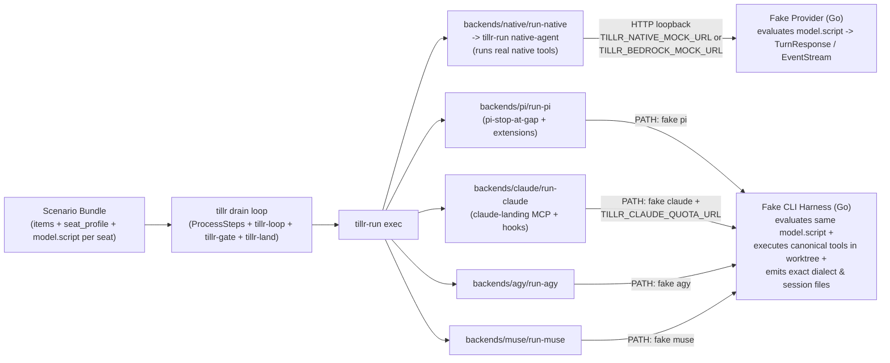
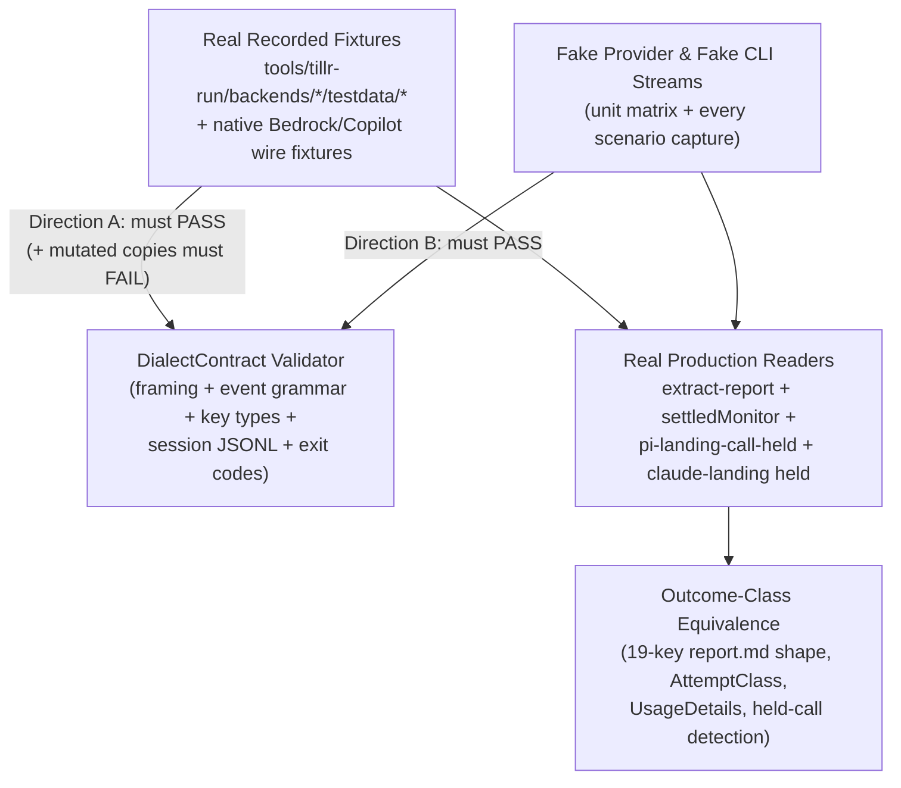

# Drive all of tillr with any backend through scripted fakes

**Status:** 2026-11-27. Proposed; not built at `4e273e02511e` (`rg -n 'fake-harness|tillr-scenario|DialectContract|TILLR_CLAUDE_QUOTA_URL' tools/ tests/` returns nothing). Today `TILLR_NATIVE_MOCK_URL` in [`loop.go`](../../tools/tillr-run/native/loop.go) points `native-agent` at a loopback server, [`stub-adapter.sh`](../../tools/tillr/examples/recorded-verdict/stub-adapter.sh) stubs a non-landing example charter, `tools/tillr-run/backends/{claude,pi,agy,muse}/testdata/` holds static recorded streams for report-extractor unit tests, and `tools/tillr-drain/drain/*_test.go` fakes runs inside Go without starting a real adapter. In the [Decision Ledger](#decision-ledger), [`R-SF1`](#R-SF1) quotes the owner's 2026-11-27 words verbatim; [`D-SF1`](#D-SF1) through [`D-SF7`](#D-SF7) are designer's decisions from the 2026-11-27 operator request that the owner may overturn; and [`OQ-SF1`](#OQ-SF1) and [`OQ-SF2`](#OQ-SF2) await the owner's ruling.

> **In short.** Give `tillr` one backend-neutral way to script the model's side of a conversation and execute full multi-run lifecycles against the real `tillr-drain`, `tillr-run`, `tillr-loop`, `tillr-gate`, and `tillr-land` binaries inside a throwaway Git repository and SQLite store created by a single command. Adapters that talk to an HTTP provider (`native`) point at a loopback fake provider; adapters that spawn a command-line harness (`pi`, `claude`, `agy`, `muse`) find a shared fake CLI binary on `PATH` (paired with a loopback quota endpoint for `tillr-run claude-quota`). Scenarios are pure data — seed repo state, items, an abstract seat profile, and one script per seat — so the exact same scenario proves `native`, `pi`, `claude`, `agy`, `muse`, or a mixed profile, while a two-way dialect validator checks every fake's output against real recorded backend fixtures so fakes cannot drift.

**Why it matters.** Drain unit tests exercise planner and state-machine logic through in-memory Go doubles (`Steps`), while adapter tests feed canned files into `extract-report`. Neither starts `tillr drain loop`, `tillr-run exec`, a real `backends/<name>/run-*` wrapper, `tillr-gate`, `tillr-land`, and `SuperviseHeavyProof` together. Bugs at the seams between them — environment scrubbing, `session-id` handoffs, `landing-offer.json` and `landing-answer.json` replay, `claude-landing` MCP hooks, `pi-stop-at-gap` `SIGUSR1` pauses, `--effort` flag refusals on `run-agy`, quota pool pauses, squash-conflict rebases, and heavy-proof reverts — previously surfaced only on live drains spending real tokens and subscription windows.

**The shape.** Confirm the starting point and how the separate `native` end-to-end test fits with zero rework in [§1](#1-owner-prompt-what-exists-today-and-how-the-native-test-fits), define the unified `model.script` schema and where each of the five adapter fakes sits in [§2](#2-one-model-script-across-all-five-adapters-and-where-each-fake-sits), specify the one-command throwaway sandbox and read-face inspection workflow in [§3](#3-throwaway-repository-store-and-lane-root-in-one-command), define backend-independent scenario bundles in [§4](#4-scenarios-as-backend-independent-data), detail all ten multi-run lifecycle flows in [§5](#5-what-scenarios-cover-beyond-a-single-run), specify two-way honesty checks against recorded backend output in [§6](#6-keeping-fakes-honest-against-real-recorded-output), state the mechanical no-network/no-credential guards and rejected alternatives in [§7](#7-hermetic-isolation-and-rejected-alternatives), and sequence seven ordered build slices in [§8](#8-build-slices).

**Cost.** Two internal Go packages (`tools/tillr/fakes` and `tools/tillr/scenario`), one fake CLI entry point (`tools/tillr/cmd/tillr-fake-harness`), one scenario runner command (`tools/tillr/cmd/tillr-scenario`), two small loopback-only mock-URL hooks (`TILLR_BEDROCK_MOCK_URL` / `TILLR_COPILOT_MOCK_URL` in `native` and `TILLR_CLAUDE_QUOTA_URL` in `claude-quota`), and declarative scenario data under `tools/tillr/scenario/testdata/`. Zero third-party dependencies (`CGO_ENABLED=0`) and zero live API spend.

**Start at:** [§2](#2-one-model-script-across-all-five-adapters-and-where-each-fake-sits) for the unified scripting model and per-adapter fake placement, [§4](#4-scenarios-as-backend-independent-data) and [§5](#5-what-scenarios-cover-beyond-a-single-run) for scenario data and lifecycle coverage, [§6](#6-keeping-fakes-honest-against-real-recorded-output) for drift prevention, and [§8](#8-build-slices) for the build slices.

**Needs your ruling:** [`OQ-SF1`](#OQ-SF1) and [`OQ-SF2`](#OQ-SF2) (plus 7 designer's decisions in [the ledger](#decision-ledger) — [`D-SF1`](#D-SF1) to [`D-SF7`](#D-SF7) — which the owner may overturn).

**Reads with:** [the native agent backend](./tillr-native-agent-backend.md) (`TILLR_NATIVE_MOCK_URL`, `Provider`, and `BedrockProvider`), [the multi-model adapter reference](../reference/tillr-muse-backend.md) (`run-*` argv, report keys, and failover classes), [the Claude backend reference](../reference/tillr-claude-backend.md) (`claude-landing` MCP/hooks and `claude-quota`), [the landing call](./tillr-landing-call.md) (`call-suspends`, `landing-offer.json`, and `landing-answer.json`), [drain seat profiles](./tillr-seat-profiles.md) and [quota profile switching](./tillr-quota-profile-switching.md) (`backend-policy.<name>.json`, quota pools, and profile switching), [conflict avoidance and repair](./tillr-conflict-avoidance-and-repair.md), [item split](./tillr-item-split.md), [restarting tillr](../reference/tillr-restart.md), and [gate check rules](../reference/gate-check-rules.md#a-check-asserts-what-was-recorded-never-elapsed-time).

**Words.** Item, node, run, session, seat, worktree, verdict, and charter keep their meanings in [the vocabulary](./tillr-vocabulary.md#5-the-words); split, part, parent, and donor candidate keep their meanings in [item split](./tillr-item-split.md). Seven terms are used with exact meanings here:

- **Model script** *(coined here)*: a backend-neutral JSON document (`record_version: 1`) describing what a fake model decides on each turn of a seat's conversation — matched on run context and prior tool results — without naming any adapter's wire dialect or CLI flags.
- **Canonical action** *(coined here)*: one backend-neutral step inside a model script turn — workspace operations (`read_file`, `write_file`, `edit_file`, `list_files`, `search_files`, `bash`, `report_progress`, `write_output`), abstract endings (`finish_done`, `finish_obstacle`, `finish_no_change`), or fault/control steps (`provider_refusal`, `repeat_identical_call`, `quota_window`, `wait_for_pause_request`, `stall`, `crash`).
- **Fake provider** *(coined here)*: a loopback-only `net/http` server in `tools/tillr/fakes` that evaluates a model script and serves streaming responses to provider-speaking adapters (`native` over `TILLR_NATIVE_MOCK_URL`, `TILLR_BEDROCK_MOCK_URL`, or `TILLR_COPILOT_MOCK_URL`), plus fake subscription usage windows to `tillr-run claude-quota` over `TILLR_CLAUDE_QUOTA_URL`.
- **Fake CLI harness** *(coined here)*: one compiled Go program (`tillr-fake-harness`, invoked via `PATH` wrappers named `pi`, `claude`, `agy`, and `muse`) that parses the real CLI's flags and probes, evaluates the same model script, executes canonical workspace actions in the target worktree, invokes adapter hooks (`claude-landing` MCP, `land.ts`-equivalent offer files, `SIGUSR1` turn-gap stops), and writes that CLI's exact stdout dialect and session transcript.
- **Scenario bundle** *(coined here)*: a directory or JSON file of pure data combining repository seed files and check declarations, queued items, an abstract seat profile, per-seat model scripts, optional barrier-driven controller steps, and declarative outcome assertions.
- **Throwaway world** *(coined here)*: a self-contained directory holding an initialized Git repository (`main`), `.tillr/state.db`, `--lane-root`, isolated global Git config, `PATH` shims, fake state, and `env.sh` created by one command outside the working checkout.
- **Dialect contract** *(coined here)*: an executable Go validator (`DialectContract`) per adapter that checks event framing, event-order grammar, required JSON key paths and types, session-file structure, and extractor/monitor parity against both real recorded fixtures in `testdata/` and every stream a fake emits.

---

## 1. Owner prompt, what exists today, and how the native test fits

### 1.1 Owner ruling and request scope

On 2026-11-27 the owner stated ([`R-SF1`](#R-SF1)):

> *"I'd like to be able to drive all of this machinery, with any backend, entirely through fakes/mocks/whatever."*

The 2026-11-27 operator request scopes this design to six deliverables plus build slices:

- one way to script a model's side of a run across every backend, naming where the fake sits for provider-speaking adapters and CLI-starting adapters (`claude`, `pi`, `agy`, `muse`);
- a throwaway repository, store, and lane root built by one command and inspectable through the ordinary `tillr` read faces;
- scenarios as backend-independent data (an item, a seat profile, and a script per seat);
- multi-run coverage spanning `plan`, `build`, `verify`, `gate`, `landing`, `trunk proof`, `restart`, `quota pause and resume`, `conflict repair`, and `split`;
- an honesty check tying each backend's fake to real recorded output from that backend; and
- zero live credentials, network traffic, or subscription quota anywhere in the setup, without blocking the separate item building the first `native` end-to-end test.

### 1.2 What exists in the tree at `4e273e02511e`

Four partial pieces exist today, and none connects the real loop, real adapters, and a cross-backend script:

1. **Loopback provider hook on `native` only:** `RunCLI` in [`tools/tillr-run/native/loop.go`](../../tools/tillr-run/native/loop.go) reads `TILLR_NATIVE_MOCK_URL` and constructs `NewLoopbackProvider` ([`provider.go`](../../tools/tillr-run/native/provider.go)), which validates `isLoopbackHost` and streams provider-neutral `TurnRequest` / SSE `loopbackEvent` turns (`delta`, `response`, `error`, `timeout`, HTTP `429` `rate_limit`). `BedrockProvider` in [`bedrock.go`](../../tools/tillr-run/native/bedrock.go) also accepts `BedrockConfig.BaseURL` in Go tests, though `RunCLI` does not yet expose a loopback URL override for Bedrock wire framing.
2. **One non-landing stub adapter:** [`stub-adapter.sh`](../../tools/tillr/examples/recorded-verdict/stub-adapter.sh) drives the [`recorded-verdict` example](../../tools/tillr/examples/recorded-verdict/README.md) (`TestRecordedVerdictExampleREADME` in [`recorded_verdict_example_test.go`](../../tools/tillr-drain/drain/recorded_verdict_example_test.go)). It exercises a custom `completes: "hook"` charter with no Git repository, no `backends/<name>/run-*` wrapper, no `tillr-gate`, and no `tillr-land`.
3. **Static extractor fixtures per CLI backend:** `tools/tillr-run/backends/{claude,pi,agy,muse}/testdata/` holds recorded `complete`, `truncated`, `rate-limited`, and `repeating-call` streams tested against `tillr-run extract-report` ([`report.go`](../../tools/tillr-run/extract/report.go)). None of `run-claude`, `run-pi`, `run-agy`, or `run-muse` can run end to end against a scripted fake CLI.
4. **In-process Go step doubles in `tillr-drain`:** Tests in `tools/tillr-drain/drain/` inject Go structs implementing `Steps`, bypassing `ProcessSteps` ([`steps.go`](../../tools/tillr-drain/drain/steps.go)), `tillr-run exec` ([`exec.go`](../../tools/tillr-run/run/exec.go)), `tillr-loop` ([`tools/tillr-loop/README.md`](../../tools/tillr-loop/README.md)), `tillr-gate`, and `tillr-land`.

### 1.3 Fitting the separate `native` test item without blocking it

*Designer's decision ([`D-SF1`](#D-SF1)); the owner may overturn this.*

A separate item builds the first full-machinery test for the `native` backend on top of `TILLR_NATIVE_MOCK_URL`. Three rules ensure that item lands cleanly first (or in parallel) and folds straight into this architecture with zero throwaway work:

1. **`TILLR_NATIVE_MOCK_URL` and `LoopbackProvider` stay frozen and supported.** Neither the environment variable name, `NewLoopbackProvider`'s `http://127.0.0.1` / `localhost` check, nor the `TurnRequest` POST -> SSE `loopbackEvent` wire schema in [`provider.go`](../../tools/tillr-run/native/provider.go) is renamed or altered.
2. **Disjoint files in early slices.** Slices 1 to 3 of [§8](#8-build-slices) add `tools/tillr/fakes/` and `tools/tillr/cmd/tillr-fake-harness/` without editing `tools/tillr-run/native/*.go` or `tools/tillr-drain/drain/*.go`, preventing merge conflicts with the in-flight `native` test item.
3. **Direct promotion to the seed scenario.** The fake provider in Slice 2 speaks `LoopbackProvider`'s exact SSE protocol as its default `native` dialect. In Slice 4, the standalone `native` test's repository seed, item filing, and scripted turns are lifted into the first declarative scenario bundle (`planned-build-happy`), where the same scenario immediately runs against `pi`, `claude`, `agy`, and `muse` as well.

---

## 2. One model script across all five adapters, and where each fake sits

### 2.1 Why scripting model decisions per turn unifies provider fakes and CLI fakes

*Designer's decision ([`D-SF2`](#D-SF2)); the owner may overturn this.*

Tillr's five adapters divide into two structural shapes:

- **Provider-speaking adapters (`native`):** Tillr's own `tillr-run native-agent` process runs the agent conversation loop, executes worker tools (`read_file`, `list_files`, `search_files`, `write_file`, `edit_file`, `bash`, `report_progress`, `land`, `obstacle`, `no_change`) in-process against the lane worktree, manages `<artifactDir>/sessions/<session-id>.jsonl`, and speaks HTTP to a remote model API.
- **CLI-starting adapters (`pi`, `claude`, `agy`, `muse`):** `run-<name>` validates flags via [`preflight.sh`](../../tools/tillr-run/backends/preflight.sh), sets up `BASH_ENV` tracing and delivery-call extensions or MCP configs, and `exec`s an external command-line binary that *both* converses with its model provider *and* executes tools locally while printing its own JSON or JSONL stream to stdout.

Scripting raw stdout transcripts fails across backends because `native` expects HTTP `TurnResponse` payloads (and executes tools itself), whereas `pi`, `claude`, `agy`, and `muse` expect the child CLI to mutate the worktree and print four distinct JSON dialects. Conversely, scripting only file mutations (`stub-adapter.sh` style) skips `native-agent`'s tool executor, `claude-landing`'s MCP server, `pi-landing-call-held`, `settledMonitor`, and `extract-report`.

A single **model script** bridges both shapes because both shapes share the exact same **decision boundary — what the model chooses to do on turn $k$ given the prompt and prior tool outputs**:



- When driving **`native`**, the **fake provider** evaluates the matching turn in `model.script` and returns canonical tool calls (`write_file`, `edit_file`, `bash`, `land`, `obstacle`, `no_change`) as `tool_use` content blocks in `TurnResponse` (or Bedrock `eventstream` / Copilot SSE frames); `native-agent` itself executes those tools in `<workDir>` and sends back real `tool_result` blocks on turn $k+1$.
- When driving **`pi`, `claude`, `agy`, or `muse`**, the **fake CLI harness** evaluates the *same* `model.script` turn, executes the canonical workspace actions against `<workDir>` using shared Go workspace helpers (running `bash` under the adapter's exported `BASH_ENV` so `tillr-trace` records real spans), feeds the real tool results into turn $k+1$ of the script, honors the adapter's real landing-call protocol (`claude-landing` MCP on `claude`, `landing-offer.json` + `parked` on `pi`, `RESULT:` footer on `agy`/`muse`), and renders stdout and session files in that CLI's exact dialect.

### 2.2 The `model.script` schema

*Designer's decision ([`D-SF2`](#D-SF2)); the owner may overturn this.*

A `model.script` is a strict JSON object (`record_version: 1`) containing an ordered `rules` array. On each model turn, the interpreter inspects the live turn context and selects the first rule whose `when` predicate matches and whose `max_matches` (default `1` per invocation, or `"unbounded"` when explicitly set) is not exhausted, persisting turn/invocation cursors in `<sandbox>/fake-state/cursors/`:

```json
{
  "record_version": 1,
  "seat": "build",
  "rules": [
    {
      "id": "initial-edit-and-test",
      "when": { "node": "work", "session_mode": "new", "turn": 1 },
      "thinking": "Update greet.go and run the package test.",
      "tool_calls": [
        { "tool": "edit_file", "path": "greet/greet.go", "old_string": "\"hello\"", "new_string": "\"salutations\"" },
        { "tool": "bash", "command": "go test ./greet -run '^TestGreet$'" },
        { "tool": "report_progress", "criterion": "c1" }
      ],
      "usage": { "input": 1200, "output": 180, "cache_read": 800, "reasoning": 60, "cost_usd": 0.0042 }
    },
    {
      "id": "commit-and-offer",
      "when": { "node": "work", "turn": 2, "last_tool_is_error": false },
      "tool_calls": [
        { "tool": "bash", "command": "git add greet/greet.go && git commit -m 'feat(greet): update greeting'" }
      ],
      "end": { "kind": "done", "summary": "Updated greeting and verified TestGreet." },
      "usage": { "input": 1450, "output": 95, "cache_read": 1200, "cost_usd": 0.0028 }
    },
    {
      "id": "repair-after-gate-refusal",
      "when": { "node": "work", "has_refusal": true },
      "tool_calls": [
        { "tool": "edit_file", "path": "greet/greet_test.go", "old_string": "\"hello\"", "new_string": "\"salutations\"" },
        { "tool": "bash", "command": "git add greet/greet_test.go && git commit --amend --no-edit" }
      ],
      "end": { "kind": "done", "summary": "Updated greet_test.go after gate refusal." },
      "usage": { "input": 1700, "output": 110, "cache_read": 1400, "cost_usd": 0.0031 }
    }
  ]
}
```

Every construct requested on 2026-11-27 is first-class in `model.script`:

| Capability | `model.script` representation | Lowering on `native` (fake provider) | Lowering on `pi` / `claude` / `agy` / `muse` (fake CLI harness) |
| :--- | :--- | :--- | :--- |
| **Match predicates (`when`)** | `seat`, `node`, `session_mode` (`new`\|`resume`), `invocation`, `turn`, `prompt_contains`, `last_tool_result_contains`, `last_tool_is_error`, `has_refusal` (true on `landing-answer.json` or refusal prompt), `worktree_file_contains` | Matched against `TurnRequest.Messages` (`brief` / `tool_result` blocks) + run cursor | Matched against stdin/`--prompt-file`, resumed session file, `landing-answer.json`, `<workDir>`, and run cursor |
| **Workspace tool calls (`tool_calls`)** | `read_file`, `write_file`, `edit_file`, `list_files`, `search_files`, `bash`, `report_progress`, `write_output` (writes `$TILLR_OUTPUTS_DIR/<name>`, such as `proposal` or `do-it-now`) | Returned as `tool_use` blocks (`write_output` lowers to `write_file` at `$TILLR_OUTPUTS_DIR/<name>`); `native-agent` runs the real tools | Executed directly in `<workDir>` by shared Go helpers (`bash` sources `$BASH_ENV` for `tillr-trace`); emitted as native tool events (`Bash`/`Edit`/`Read` in `claude`, tool messages in `pi`) |
| **Abstract endings (`end`)** | `done`, `obstacle` (`{obstacle_kind, fields}`), `no_change` (`{cause, evidence, why_no_change}`), or raw `footer` (`done`\|`blocked`\|`failed`\|`trunk-broken`\|`omit`) | Reads `<artifactDir>/ending-capability`: emits `land` / `obstacle` / `no_change` `tool_use` when `call-suspends`, or `RESULT: ...` text on `end_turn` when `footer` | Reads `<artifactDir>/ending-capability`: invokes `claude-landing` MCP (`claude`) or writes `landing-offer.json` + emits `parked` (`pi`) when `call-suspends`; appends `OBSTACLE:` / `CAUSE:` / `RESULT:` text when `footer` (`agy`, `muse`, read-only nodes) |
| **Refusals (`refusal`)** | `{"kind": "content_refusal" \| "uncommitted_end_turn" \| "adapter_preflight", "message": "..."}` | Returns assistant `end_turn` refusal prose with no tool call or footer (triggering `native` keep-going nudges or `incomplete` report) | Emits assistant refusal without committing or without `RESULT:` footer (or exits `2` before stream start for `adapter_preflight`) |
| **Repeating-call loops (`repeat_call`)** | `{"tool_call": {...}, "count": 6}` | Returns identical `(name, args)` `tool_use` across `count` consecutive turns so `native-agent` emits `loop_detected` | Executes/records streak and emits `{"type":"loop_detected","action":"ended"}` (`pi`) or hits turn cap (`claude`/`agy`/`muse`) |
| **Quota windows (`quota_window`)** | `{"kind": "five_hour", "utilization": 1.0, "status": "rejected", "reset_after_sec": 3600, "retry_after_ms": 0, "terminal": true}` | Updates fake quota state and returns HTTP `429` (`RateLimitError` / Bedrock `ThrottlingException` + window headers) | Updates fake quota state (read by `claude-quota`) and emits `rate_limit_event` (`status: "rejected"`, `resetsAt`) + exits `1` |
| **Turn-gap & mid-run pause (`pause_barrier`)** | `{"barrier": "mid-work"}` | Signals `<fake-state>/barriers/mid-work.reached`, waits for `.release` or `$TILLR_PAUSE_REQUEST`, then finishes turn so `native-agent` stops at gap | Signals `.reached`, waits for `.release` / `SIGUSR1` (`pi-stop-at-gap`) / `SIGTERM` (`claude`, `agy`, `muse`), and exits per adapter `pause-kind` |
| **Stalls (`stall`)** | `{"phase": "headers" \| "body" \| "after_settled"}` | Holds HTTP response headers or mid-SSE stream open until request context cancels (`run.model-timeout` or `runCtx` `--timeout`) | Holds stdout open before first event, mid-stream, or after `agent_end` (exercising `settledMonitor`'s `settled-idle` reaper and `runCtx` walls) |
| **Crashes (`crash`)** | `{"exit_code": 137, "signal": "SIGKILL", "leave_open_tool_use": true, "corrupt_line": "{bad-json"}` | Drops TCP connection mid-chunk or returns HTTP `502` (`AttemptInfrastructure`) | Writes optional `corrupt_line` or trailing unanswered `tool_use` in `<session-id>.jsonl`, then exits `exit_code` or raises `signal` |

If a run reaches a turn that matches no rule in `model.script`, the fake fails loudly (HTTP `500` with diagnostic body on the fake provider; exit `1` with rule-mismatch dump to `stream.err` on the fake CLI harness) naming `(item_id, run_id, seat, node, session_mode, turn)` so an under-scripted scenario never silently passes or loops.

### 2.3 Where the fake sits for each adapter

*Designer's decision ([`D-SF3`](#D-SF3)); the owner may overturn this.*

Every adapter runs its **unchanged production shell script and Go helpers** under `tools/tillr-run/backends/<name>/`. No scenario ever swaps `backends-dir` to a stub directory:

| Adapter | Production wrapper & helpers run unmodified | Declared capabilities | Exact fake seam | What the fake handles for this adapter |
| :--- | :--- | :--- | :--- | :--- |
| **`native`** | [`backends/native/run-native`](../../tools/tillr-run/backends/native/run-native) -> `tillr-run native-agent` + `extract-report --dialect native` | `ending-capability`: `call-suspends` (static file, zero `--features` probe)<br>`pause-kind`: `stops-at-a-gap` | **Loopback HTTP fake provider** at `http://127.0.0.1:<port>` via `TILLR_NATIVE_MOCK_URL` (default SSE `LoopbackProvider`) or optional wire-level `TILLR_BEDROCK_MOCK_URL` / `TILLR_COPILOT_MOCK_URL` | Validates `TurnRequest` (or SigV4 + Bedrock binary `application/vnd.amazon.eventstream` / Copilot SSE headers + `/copilot_internal/v2/token` refresh); streams `StreamDelta` + `TurnResponse`, HTTP `429` windows, header/body stalls, and disconnects while real `native-agent` runs tools in `<workDir>`. |
| **`pi`** | [`backends/pi/run-pi`](../../tools/tillr-run/backends/pi/run-pi), [`pi-harness.sh`](../../tools/tillr-run/backends/pi/pi-harness.sh), `tillr-run pi-stop-at-gap`, `pi-landing-call-held`, `pi-compact`, `extract-report --dialect pi` | `ending-capability`: `footer` upgraded to `call-suspends` via `pi --features`<br>`pause-kind`: `stops-at-a-gap` | **Fake `pi` executable** at `<sandbox>/bin/pi` first on `PATH`, with `TILLR_PI_BUILDS_DIR=""` and `PI_CODING_AGENT_DIR=<sandbox>/fake-state/pi-agent` | Answers `pi --features` (`["parked-tool-calls"]`, or `[]` when testing `footer` fallback) and `pi --version`; parses `--print --mode json --model <m> --thinking <e> [--session-id\|--session <uuid>] [-e ...]`; reads stdin prompt; writes Pi v3 session JSONL under `$PI_CODING_AGENT_DIR/sessions/` so `pi-landing-call-held` and `pi-compact` run unmodified; writes `landing-offer.json` + emits `{"type":"parked"}` on `call-suspends`; consumes `landing-answer.json` on `--session` resume; catches `SIGUSR1` from `pi-stop-at-gap` to stop cleanly between turns; emits Pi `--mode json` JSONL. |
| **`claude`** | [`backends/claude/run-claude`](../../tools/tillr-run/backends/claude/run-claude), `tillr-run claude-landing` (MCP + `PreToolUse` hook + `held`), `tillr-run claude-quota`, `extract-report --dialect claude` | `ending-capability`: `call-suspends` via `probeClaudeEndingCapability` (`--continue` probe)<br>`pause-kind`: `stops-where-it-stands` | **Fake `claude` executable** at `<sandbox>/bin/claude` on `PATH` + **loopback quota endpoint** via `TILLR_CLAUDE_QUOTA_URL` (`CLAUDE_CONFIG_DIR=<sandbox>/fake-state/claude`) | Answers startup probe `-p --setting-sources "" --continue` (`stderr`: `"No deferred tool marker found in the resumed session"`, exit `1`); parses `-p --output-format stream-json --verbose --model <m> --effort <e> [--session-id\|--resume <uuid>] [--mcp-config <f>] [--settings <f>]`; **spawns the real `PreToolUse` hook and `tillr-run claude-landing` stdio MCP server** from `--settings` / `--mcp-config` when calling `mcp__tillr__land`, `mcp__tillr__obstacle`, or `mcp__tillr__no_change` so real Go validation and `landing-offer.json` writing run; writes deferred-tool session JSONL under `$CLAUDE_CONFIG_DIR/projects/` for `claude-landing held`; emits `stream-json` JSONL; serves `{five_hour, seven_day}` JSON over loopback to `tillr-run claude-quota`. |
| **`agy`** | [`backends/agy/run-agy`](../../tools/tillr-run/backends/agy/run-agy), `extract-report --dialect agy` | `ending-capability`: `footer`<br>`pause-kind`: `cannot-resume` | **Fake `agy` executable** at `<sandbox>/bin/agy` first on `PATH` | Parses `--print --output-format json --model <id-with-tier> [--print-timeout <Ns>] --dangerously-skip-permissions` (note `run-agy` itself refuses `--effort` before `exec`); reads prompt on stdin; runs canonical workspace tools in `<workDir>`; prints the single Agy JSON envelope (`status`, `conversation_id`, `duration_seconds`, `num_turns`, `usage`, `denied_actions`, `response`). |
| **`muse`** | [`backends/muse/run-muse`](../../tools/tillr-run/backends/muse/run-muse), `extract-report --dialect muse` | `ending-capability`: `footer`<br>`pause-kind`: `cannot-resume` | **Fake `muse` executable** at `<sandbox>/bin/muse` first on `PATH` | Answers preflight `muse model-profile show <model> --effort <effort>` (exiting `0` for registered fake models and `1` for unknown models so preflight refusal is testable); parses `muse exec --json --prompt-file <p> --workspace <w> [--session-id <s>] [--provider <prov>] [--permission-profile <id>] [--model <m> --reasoning-effort <e>]`; runs canonical workspace tools in `--workspace`; emits `muse: workspace root: <w> (explicit)` plus `schema_version: 1` JSONL (`run.lifecycle.started`, `run.output.delta`, `run.usage`, `run.terminal.completed`). |

One implementation detail keeps all four CLI fakes tiny and consistent: `<sandbox>/bin/{pi,claude,agy,muse}` are symlinks (or two-line `exec` shims) to the single compiled Go binary `tillr-fake-harness`, which dispatches on `filepath.Base(os.Args[0])` (`pi`, `claude`, `agy`, `muse`) and shares one `model.script` evaluator and workspace tool runner while keeping four isolated flag parsers and dialect emitters.

---

## 3. Throwaway repository, store, and lane root in one command

### 3.1 Layout of a throwaway world

*Designer's decision ([`D-SF4`](#D-SF4)); the owner may overturn this.*

Running one scenario command builds a complete, isolated **throwaway world** at `<dir>` (either a caller-chosen `--dir <path>` or a fresh temporary directory printed on stdout) without touching the working checkout, its `.tillr/state.db`, or the operator's `$HOME`:

```text
<dir>/
  env.sh                        # sourceable shell env for ordinary tillr read faces
  git-global.gitconfig          # isolated GIT_CONFIG_GLOBAL with allowed test author/committer
  bin/                          # PATH head: built tillr/tillr-* binaries + fake pi/claude/agy/muse
  policy/
    backend-policy.primary.json # compiled from scenario seat_profile for target backend
    backend-policy.backup.json  # optional second profile for quota-autoswitch scenarios
  fake-state/
    scenario.json               # resolved scenario bundle
    provider.addr               # 127.0.0.1:<port> of loopback fake provider + quota server
    cursors/                    # per-(item, node) turn and invocation counters
    barriers/                   # deterministic pause/restart/conflict synchronization files
    captures/                   # every raw fake stdout stream + session file for DialectContract check
    pi-agent/                   # isolated PI_CODING_AGENT_DIR
    claude/                     # isolated CLAUDE_CONFIG_DIR (.credentials.json with dummy local token)
  lanes/                        # isolated --lane-root (<dir>/lanes/<item-id>/worktree)
  repo/                         # initialized Git repository (trunk branch `main`)
    .tillr.toml                 # [lanes], [gate] checks_dir, [landing] mode = "after-merge"
    .tillr/
      state.db                  # initialized via `tillr store init` with tillr-loop hooks
    config/tillr/
      deny-list.json
      workflows/                # standard workflow JSONs copied from the tree under test
    tools/gate/checks/          # real fast change/tree checks + heavy trunk-proof checks
    ...                         # scenario seed files committed on `main`
```

Three details make the throwaway repository exercise the real `git-landing` pipeline rather than a toy approximation:

1. **Real `tillr-loop`, `tillr-gate`, and `tillr-land` steps:** `<dir>/repo/.tillr/state.db` is initialized with `tillr store init` using a `git-landing` `definition.json` whose `hooks` wire `{"argv":["tillr-loop"],"names":["gate","land","verdict","fixer-gate","replay","rolling"]}` ([`tools/tillr-loop/README.md`](../../tools/tillr-loop/README.md)). Candidate gating runs real `tillr-gate change`, `plan`, and `run` (`change-gate`) over `<dir>/repo/tools/gate/checks/*.json`; landing runs real `tillr-land pass` (`Trunk.Squash` three-way plumbing merge onto `main`); verdicts run real `tillr-item verdict record`; and after-merge trunk proof runs real `SuperviseHeavyProof` (`--tillr-heavy-proof`) advancing `refs/tillr/green`.
2. **Scope-valid landing identity:** `Trunk.LandingIdentity` in [`trunk.go`](../../tools/tillr-land/land/trunk.go) refuses to land when `user.name` or `user.email` is missing or overridden in `local` or `worktree` Git config. The sandbox sets `GIT_CONFIG_NOSYSTEM=1` and `GIT_CONFIG_GLOBAL=<dir>/git-global.gitconfig` with a fixed test identity (`Tillr Scenario Runner <scenario@example.invalid>`) in **global** scope only, leaving `local` and `worktree` scopes empty so `Trunk.LandingIdentity` and lane `git commit` calls succeed identically on every machine without reading host `~/.gitconfig`.
3. **Inspectable with every ordinary read face:** Sourcing `<dir>/env.sh` sets `PATH=<dir>/bin:$PATH`, `GIT_CEILING_DIRECTORIES=<dir>`, `GIT_CONFIG_NOSYSTEM=1`, `GIT_CONFIG_GLOBAL=<dir>/git-global.gitconfig`, and `TILLR_CONFIG_DIR=<dir>/policy`. From `<dir>/repo`, a person or an agent runs the ordinary `tillr` faces directly with zero special flags:
   - `tillr item list` and `tillr item show --item <id>`
   - `tillr store check` and `tillr store events`
   - `tillr drain why`, `tillr drain plan`, and `tillr drain policy`
   - `tillr run status` and `tillr run lanes`
   - `tillr view status`, `tillr view waiting`, `tillr view passes`, `tillr view lanes`, `tillr view running`, `tillr view events`, `tillr view trace`, and `tillr view serve`
   - `tillr watch` and `tillr trace`
   - `git log --stat main` and `git show refs/tillr/green`

### 3.2 One-command operation and CLI surface ([`OQ-SF1`](#OQ-SF1))

The scenario runner provides four verbs:

- **`run`** (`--scenario <name-or-path> --backend <native|native-bedrock|pi|claude|agy|muse|mixed|all> [--dir <path>] [--keep]`): creates `<dir>`, starts the loopback fake server, seeds the repo and items, runs `tillr drain loop` (plus any barrier-synchronized controller actions) to completion, checks all `expect` assertions and every captured stream's `DialectContract`, prints `<dir>` and `. <dir>/env.sh` when `--dir` or `--keep` is set (or automatically whenever an assertion fails), and removes temporary `<dir>` on clean pass otherwise.
- **`stage`** (`--scenario <name-or-path> --backend <target> --dir <path>`): builds `<dir>`, files the scenario's items, starts the background loopback fake provider (`provider.pid`), and stops *before* starting `tillr drain loop` so an operator can step the queue manually with `tillr drain once`, `tillr drain loop`, or `tillr view serve`.
- **`check`** (`--dir <path>`): re-evaluates the scenario's `expect` assertions and `DialectContract` checks against an existing `<dir>`.
- **`list`**: lists all built-in scenario bundles and their required capabilities.

Whether this command is invoked as a repository-internal developer tool (`go run -C tools/tillr ./cmd/tillr-scenario ...` / `just tillr-scenario ...`) or promoted to a public noun on the installed `tillr` CLI (`tillr scenario ...`) touches `tillr`'s user-facing surface and is left to the owner in [`OQ-SF1`](#OQ-SF1).

---

## 4. Scenarios as backend-independent data

### 4.1 Declarative scenario bundle format

*Designer's decision ([`D-SF5`](#D-SF5)); the owner may overturn this.*

A **scenario bundle** lives at `tools/tillr/scenario/testdata/<scenario-name>/scenario.json` (or any caller-supplied path) and contains **zero Go code and zero backend-specific flags or model strings**:

```json
{
  "record_version": 1,
  "name": "planned-build-happy",
  "description": "plan -> work -> verify -> fast gate -> squash land -> heavy trunk proof",
  "seed": {
    "files": {
      "greet/go.mod": "module example.com/greet\n\ngo 1.24\n",
      "greet/greet.go": "package greet\n\nfunc Hello() string { return \"hello\" }\n",
      "greet/greet_test.go": "package greet\n\nimport \"testing\"\n\nfunc TestGreet(t *testing.T) {\n\tif Hello() != \"hello\" { t.Fatal(Hello()) }\n}\n"
    },
    "fast_checks": [
      { "id": "unit-fast", "scope": "change", "reads": ["greet/"], "command": ["sh", "-c", "cd greet && go test ./..."] }
    ],
    "heavy_checks": [
      { "id": "suite-heavy", "scope": "tree", "reads": ["."], "command": ["sh", "-c", "cd greet && go test -count=1 ./..."] }
    ]
  },
  "seat_profile": {
    "tiers": {
      "plan": "planner",
      "build": "worker",
      "verify": "verifier",
      "design": "designer"
    }
  },
  "items": [
    {
      "id_alias": "greet_item",
      "intake": "request",
      "seat": "build",
      "workflow": "planned-build@v1",
      "title": "Change greeting to salutations",
      "paths": ["greet/"],
      "words": "Change Hello() in greet/greet.go and its test to return \"salutations\"."
    }
  ],
  "scripts": {
    "plan": "scripts/plan.json",
    "build": "scripts/build.json",
    "verify": "scripts/verify.json"
  },
  "expect": {
    "items": {
      "greet_item": { "state": "landed", "all_criteria_done": true }
    },
    "trunk": {
      "commits_added": 1,
      "green_matches_head": true,
      "file_contains": { "greet/greet.go": "\"salutations\"" },
      "no_trailers": ["Tillr-Item:"]
    },
    "events_in_order": ["item.created", "run.started", "land.succeeded", "item.verdict"]
  }
}
```

### 4.2 Compiling abstract seat profiles to any backend

`CompileSeatProfile(profile, targetBackend)` translates the scenario's abstract seat tiers (`fast`, `planner`, `worker`, `verifier`, `designer`) into a valid `backend-policy.primary.json` for whichever `--backend` is under test, respecting each adapter's real policy contract:

- **`--backend native`:** maps every seat to `adapter: "native"`, `model: "loopback/fake-<tier>"`, `effort: "medium"`, pointing `TILLR_NATIVE_MOCK_URL` at the loopback fake provider (`--backend native-bedrock` maps `model: "bedrock/us.anthropic.fake-<tier>-v1:0"` and sets `TILLR_BEDROCK_MOCK_URL` + synthetic local `AWS_ACCESS_KEY_ID` / `AWS_SECRET_ACCESS_KEY` so SigV4 and binary `eventstream` run end to end).
- **`--backend pi`:** maps every seat to `adapter: "pi"`, `model: "fake-provider/fake-<tier>"`, `effort: "medium"`.
- **`--backend claude`:** maps every seat to `adapter: "claude"`, `model: "fake-claude-<tier>"`, `effort: "medium"`, `"account": "subscription"`, and `"quota": ["tillr-run", "claude-quota"]` (sharing one quota pool automatically per [`tillr-quota-profile-switching.md`](./tillr-quota-profile-switching.md)).
- **`--backend agy`:** maps every seat to `adapter: "agy"`, `model: "fake-agy-<tier>-medium"`, and **omits `"effort"`** — honoring `run-agy`'s hard refusal of `--effort` ([`run-agy`](../../tools/tillr-run/backends/agy/run-agy)).
- **`--backend muse`:** maps every seat to `adapter: "muse"`, `model: "fake-muse-<tier>"`, `effort: "medium"`.
- **`--backend mixed`:** maps `plan` to `pi`, `build` to `native`, `verify` to `claude`, and `design` to `claude` (with `agy` on `scout`), proving that a single item's workflow graph hands work, artifacts, and candidate commits cleanly across heterogeneous adapters in one drain pass.

### 4.3 Honest handling of capability differences across adapters

Not every adapter supports every optional capability: `agy` and `muse` statically declare `ending-capability: footer` and `pause-kind: cannot-resume`, whereas `claude` declares `call-suspends` + `stops-where-it-stands`, and `native` and `pi` declare `call-suspends` + `stops-at-a-gap`.

Scenarios stay backend-independent without lying about adapter contracts in two ways:

1. **Core lifecycle invariants hold across all five backends.** Whether an adapter uses `call-suspends` or `footer`, a gate-refusal scenario must return the refusal to the worker, let the worker repair the commit, re-gate, and land one clean commit on `main`. Whether an adapter's `pause-kind` is `stops-at-a-gap`, `stops-where-it-stands`, or `cannot-resume`, a `restart` scenario must replace the loop cleanly without corrupting the lane or losing the item, and finish landing the item.
2. **Capability-scoped sub-assertions verify adapter-specific guarantees.** Inside `expect`, optional `when_ending_capability` (`call-suspends` vs `footer`) and `when_pause_kind` (`stops-at-a-gap` vs `stops-where-it-stands` vs `cannot-resume`) blocks assert the exact store events expected for that class — for example asserting `call.offered` -> `call.answered` -> `call.landed` and identical `session_id` on `call-suspends` backends while asserting `drain.refusal` -> fresh repair run -> `land.succeeded` on `footer` backends.

Proving a brand-new sixth adapter therefore requires **zero edits to existing scenario files**: implement its fake CLI or fake provider wire handler and its `DialectContract`, add its row template to `CompileSeatProfile`, and run the existing scenario corpus with `--backend <new-adapter>`.

---

## 5. What scenarios cover beyond a single run

*Designer's decision ([`D-SF5`](#D-SF5)); the owner may overturn this.*

Ten built-in multi-run scenario bundles exercise the whole of tillr's machinery across workflow stages, gates, landings, background proofs, daemon restarts, quota windows, concurrent lane conflicts, and splits. Synchronization between the scenario controller and in-flight workers uses deterministic barrier files under `<dir>/fake-state/barriers/` and `--now` / fake quota state updates — **never `time.Sleep` or elapsed-time assertions** ([gate check rules](../reference/gate-check-rules.md#a-check-asserts-what-was-recorded-never-elapsed-time), enforced by [`elapsed_time.go`](../../tools/gate/elapsed_time.go)).

| # | Scenario bundle | Machinery exercised end to end | Key assertions over store, Git, and read faces |
| ---: | :--- | :--- | :--- |
| **1** | `planned-build-happy` | **`plan` -> `build` -> `verify` -> `gate` -> `landing` -> `trunk proof`:** [`planned-build@v1.json`](../../config/tillr/workflows/planned-build@v1.json) read-only `plan` passes single piece -> `work` (`build` seat) edits, runs `bash` test, commits, ends `done` -> read-only `verify` runs check independently and cites `node:work` -> `tillr-loop gate` -> `tillr-land pass` -> `tillr-loop verdict` -> detached `SuperviseHeavyProof`. (A companion `plan-do-it-now` variant exercises `plan`'s `do-it-now` unlock.) | `tillr item show` reports `state: landed` and all `verification-only` criteria `done`; `main` has +1 squashed commit with global landing author and zero `Tillr-Item:` trailers; `refs/tillr/green == main`; `tillr trace` shows `bash` commands from both `work` and `verify`. |
| **2** | `planned-build-pieces` | **Piece fan-out (`build-pieces@v1`):** `plan` writes `$TILLR_OUTPUTS_DIR/proposal` (`graph.proposal`) replacing `work` with [`build-pieces@v1.json`](../../config/tillr/workflows/build-pieces@v1.json) across 2 parallel `write` pieces with disjoint `write_scope`s (`pkg/a/` and `pkg/b/`) -> parallel piece checkouts build and join -> `verify` cites `node:piece` -> `gate` -> `land`. | Both `pkg/a/` and `pkg/b/` changes land in one squashed trunk commit; out-of-scope write attempt in a negative sub-case is refused by `CheckWriteTarget` / `fenceViolation`. |
| **3** | `gate-refusal-and-repair` | **`gate` refusal & `call-suspends` / `footer` repair:** `work` commits code that breaks fast check `unit-fast` and offers `done` -> `tillr-loop gate` fails (`exit 1`) -> loop returns failure output to worker -> rule `when.has_refusal` fixes test, amends commit, and re-offers -> `gate` passes -> `land`. | Criteria stay unfrozen during refusal; on `call-suspends` (`native`, `pi`, `claude`), `call.offered` -> `call.answered` -> `call.landed` fire on the **same `session_id`**; on `footer` (`agy`, `muse`), `drain.refusal` returns evidence without spending an escalation step and lands on the next run. |
| **4** | `trunk-proof-revert-and-reland` | **Red `trunk proof` & `auto_revert`:** Candidate passes fast `gate` and squashes onto `main`, then fails heavy check `suite-heavy` in `SuperviseHeavyProof` with `auto_revert = true` -> heavy supervisor bisects culprit, gates and lands `revert-main-<sha12>`, withdraws verdicts, returns item to `in-queue` with heavy failure log -> worker repairs heavy bug -> re-lands and advances `refs/tillr/green`. | `git log main` contains original landing, `revert-main-<sha12>`, and repaired landing; `refs/tillr/green` never pointed at the broken commit and advances to the repaired tip; final item state is `landed`. |
| **5** | `trunk-fixer-and-inherited-pass` | **Pre-existing red trunk check & fixer:** Seeded `main` starts with heavy check `lint-heavy` red on `pkg/broken/` -> loop files deduplicated `fixer-main-<sha12>` while an unrelated item touching `greet/` promotes to `pass-inherited` ([`OQ-GP7`](./tillr-graph-is-the-path.md#OQ-GP7)) and lands without waiting, an intersecting item touching `pkg/broken/` acquits as `trunk-already-red`, and `fixer-main-<sha12>` passes `fixer-gate --only lint-heavy`, lands, and unblocks the waiting item. | Unrelated item lands while trunk check is red; intersecting item waits uncharged in `tillr view waiting` (`trunk-broken`); fixer lands and both `fixer-main-<sha12>` and the unblocked item finish `landed` with `refs/tillr/green` at `main`. |
| **6** | `restart-mid-run` | **`restart` during active worker run ([`tillr-restart.md`](../reference/tillr-restart.md)):** Worker hits `pause_barrier: "turn-1-done"` -> controller runs `tillr drain restart` -> active loop pauses/stops run per `pause-kind`, hands off cleanly, and replacement loop finishes the item. | Zero duplicate landings or orphan runs; on `stops-at-a-gap` (`native`, `pi`), run records `StatePaused` at turn gap and resumes the **same `session_id`** with `pause-notice`; on `stops-where-it-stands` (`claude`), resumes `--resume <session_id>`; on `cannot-resume` (`agy`, `muse`), starts a clean continuation attempt and lands. |
| **7** | `restart-during-trunk-proof` | **`restart` while `SuperviseHeavyProof` is running ([`restart-during-trunk-proof.md`](./restart-during-trunk-proof.md), [`trunk-proof-survives-restart.md`](./trunk-proof-survives-restart.md)):** Heavy check `suite-heavy` pauses on barrier `heavy-mid-flight` after Item A lands while Item B finishes work and `tillr drain restart` is requested -> verifies candidate gating and proof survival/re-execution across restart. | `refs/tillr/green` advances past both Item A and Item B once the barrier releases; `tillr drain why` surfaces accurate state throughout; neither landing is orphaned or double-reverted. |
| **8** | `quota-pause-and-resume` | **`quota pause and resume` (+ multi-profile switch):** With `--lanes 2`, Run 1 hits `quota_window` (`status: "rejected"`, `resetsAt: T0 + 3600`) while Run 2 is at `pause_barrier` on the same quota pool -> loop writes `backend_windows`, pauses Run 2 in `quota_pauses` (`pauseQuotaPeers`), and holds seats -> controller advances clock / fake quota reading past `resetsAt` (`utilization: 0`) -> loop refreshes quota, resumes Run 2 via `resumeQuotaRun` on its lane, re-runs Run 1, and lands both. (A companion `quota-profile-switch` variant configures `[primary, backup]` profiles to verify `drain.profile-switched` to `backup` and timer-free switch-back to `primary`.) | `backend_windows` and `quota_pauses` rows recorded on rejection; zero runs dispatched against the closed pool while shut; after window reset, both items finish `landed` (and `drain.profile-switched` events fire in both directions on the multi-profile variant). |
| **9** | `conflict-repair` | **`conflict repair` ([`tillr-conflict-avoidance-and-repair.md`](./tillr-conflict-avoidance-and-repair.md), [landing principles §2](./landing-principles.md#2-re-application-preserves-the-change-not-the-patch) and [§3](./landing-principles.md#3-gate-what-will-be-the-tip-once)):** Two items (`--lanes 2`) branch from `B0` and edit adjacent/overlapping lines of `shared/routes.go` -> Item 1 gates and squashes onto `main` (`B1`) -> Item 2 gates on `B0`, enters `tillr-land pass`, and receives `result = "squash-conflict"` (`conflict_paths: ["shared/routes.go"]`) -> loop dispatches conflict repair (`conflict-design` / worker rebase onto `B1`), script merges both items' edits cleanly, gates once on `B1`, and lands (`B2`). | `landings` table records `squash-conflict` on Item 2's first landing attempt and `landed` on its repaired candidate; `shared/routes.go` at `B2` contains **both** Item 1's and Item 2's edits; `tillr view passes` shows both landings. |
| **10** | `item-split` | **Oversized item `split` ([`tillr-item-split.md`](./tillr-item-split.md)):** Oversized parent item receives a split call -> `design` seat script emits a valid split statement dividing criteria `c1, c2` and donor-candidate work across two child **part** items (`part-1`, `part-2`) -> store files both parts in one transaction while the **parent** waits -> `part-1` and `part-2` each run `planned-build@v1`, pass gate, and land separate commits on `main` -> read-only closing check verifies the parent's criteria on `main` and closes the parent. | Parent item never builds a second monolithic candidate, waits on `part-1` and `part-2`, and closes only after both parts land and the closing check passes; `main` holds two small commits rather than one oversized diff. |

---

## 6. Keeping fakes honest against real recorded output

### 6.1 Why one-way fixture tests let fakes drift

A fake CLI or fake HTTP server checked only by "did the scenario pass?" can drift silently from the real program it stands for:

- `extract-report` might tolerate a simplified JSON object that the real `claude` or `pi` CLI never emits, hiding a parser bug that breaks on real output; or
- an external CLI upgrade might rename a field or change event ordering (`system/init` before `assistant`, `turn_end` usage nesting in `pi`, `muse`'s `muse: workspace root: ...` stdout line, or `claude`'s deferred-tool session tail), leaving fake-driven scenarios green while live runs fail.

### 6.2 Two-way `DialectContract` verification

*Designer's decision ([`D-SF6`](#D-SF6)); the owner may overturn this.*

Every backend fake is bound to its real backend's recorded corpus by an executable **`DialectContract`** in `tools/tillr/fakes/contracts/` checked in **both directions**:



1. **What each `DialectContract` enforces:**
   - **`native` (`LoopbackContract` + `BedrockEventStreamContract` + future `CopilotSSEContract`):**
     - `LoopbackContract`: validates `TurnRequest` (`session_id` UUID, `model`, strict `user`/`assistant` alternation, every `tool_use` answered by matching `tool_result` `tool_use_id` before next user message) and SSE `data: <loopbackEvent>\n\n` framing, plus `<artifactDir>/sessions/<session-id>.jsonl` structure.
     - `BedrockEventStreamContract`: validates SigV4 `Authorization` (`AWS4-HMAC-SHA256`) or `Authorization: Bearer` headers, big-endian prelude/message CRC32 checksums on every `application/vnd.amazon.eventstream` frame (`messageStart`, `contentBlockStart`, `contentBlockDelta`, `contentBlockStop`, `messageStop`, `metadata`), and `:exception-type` error frames against the recorded vectors in [`eventstream_test.go`](../../tools/tillr-run/native/eventstream_test.go) and [`bedrock_test.go`](../../tools/tillr-run/native/bedrock_test.go).
   - **`pi` (`PiDialectContract`):** validates line-delimited JSON starting with `{"type":"session","version":3,"id":<uuid>,"timestamp":<RFC3339>,"cwd":<string>}`, balanced `message_start` -> `message_update`* -> `message_end` per message `id`, `turn_end` carrying `usage.{input,output,cacheRead,cacheWrite,reasoning,totalTokens,cost.total}`, terminal `parked` (with matching `landing-offer.json` and open tool call in `$PI_CODING_AGENT_DIR/sessions/*.jsonl`) or `loop_detected` or `agent_end`, and zero unparseable lines.
   - **`claude` (`ClaudeDialectContract`):** validates `stream-json` JSONL containing `system` (`subtype: "init"`, `session_id`, `model`, `tools`, `mcp_servers`, `permissionMode`), `assistant` (`message.{id,role,content,usage}`, `session_id`), `user` (`tool_result` referencing prior `tool_use.id`), optional `rate_limit_event` (`rate_limit_info.{status,rateLimitType,utilization,resetsAt}`), and either terminal `result` (`subtype`, `is_error`, `result`, `session_id`, `total_cost_usd`, `num_turns`, `usage`) or an open deferred `mcp__tillr__*` `tool_use` in `$CLAUDE_CONFIG_DIR/projects/` accepted by `tillr-run claude-landing held`.
   - **`agy` (`AgyDialectContract`):** validates a single valid JSON document (exit `0` on complete, truncated/non-zero on crash) with required top-level keys `status` (`"SUCCESS"` or error status), `conversation_id` (UUID), `duration_seconds` (number), `num_turns` (integer), `usage.{input_tokens,output_tokens,thinking_tokens,cache_read_tokens}`, `denied_actions` (array), and `response` (string).
   - **`muse` (`MuseDialectContract`):** validates the allowed `muse: workspace root: <path> (explicit)` banner line plus monotonic `sequence` (`1..N`) `schema_version: 1` JSONL envelopes sharing `stream.{kind:"session",id:<uuid>}` and `causation_id`, beginning with `run.lifecycle.started`, followed by zero or more `run.output.delta` (`record_type: "status"`), `run.usage`, and terminal `run.terminal.completed` (or `failed` / truncated stream on crash).
2. **Direction A — Proving the contract against real recorded fixtures (with negative mutation controls):**
   - `TestDialectContractsAcceptRecordedCorpus` runs each `DialectContract` over every recorded file in `tools/tillr-run/backends/{claude,pi,agy,muse}/testdata/*` and `tools/tillr-run/native/*_test.go` wire fixtures. A contract rule stricter than or incompatible with real recorded backend output fails immediately.
   - `TestDialectContractsRejectMutatedFixtures` mutates each real recorded fixture (dropping a required field, transposing event order, mismatching `session_id` or `tool_use_id`, injecting an unexpected non-JSON line, corrupting `eventstream` CRC32) and asserts `DialectContract` returns an error for every mutation, proving the contract has teeth.
3. **Direction B — Proving every fake stream against the contract and production readers:**
   - Every stream and session file captured under `<dir>/fake-state/captures/` during any `tillr-scenario` run — and across a dedicated per-outcome unit matrix (`done`, `blocked`, `no_change`, `incomplete`, `rate-limited`, `repeating-call`, `parked`, `model-timeout`, `crash`) — must pass `DialectContract` with **zero errors**.
   - `TestFakeAndRecordedExtractorEquivalence` feeds paired recorded and fake streams for each outcome class into the real `tillr-run extract-report`, `settledMonitor`, `ClassifyAttempt` ([`failover.go`](../../tools/tillr-drain/internal/policy/failover.go)), `pi-landing-call-held`, and `claude-landing held`, asserting identical 19-key `report.md` key sets, `complete` / `result` values, exit codes, `.usage.json` schema, and `AttemptClass` classifications.

### 6.3 Attended fixture-refresh tool when a real CLI or API version moves

To keep the recorded golden corpus current when an operator upgrades `pi`, `claude`, `agy`, `muse`, or a live provider model family, `tools/tillr/cmd/capture-backend-fixture` provides a **manual-only, attended** developer utility (never called by `tillr-gate`, `tillr-scenario`, or any automated test, and refusing to run unless `--attended-live-capture` is passed explicitly):

1. Runs a minimal, deterministic two-turn prompt (one benign read/shell tool call + completion, plus optional parked-call capture on `pi`/`claude`) against the real installed backend in a temporary directory.
2. Scrubs usernames, hostnames, absolute workspace paths, and any credential tokens from stdout and the session file, normalizing them to `/fixture/worktree` and synthetic UUIDs.
3. Writes the updated `.jsonl` / `.json` fixture alongside a `testdata/manifest.json` entry recording `harness_version` (`<bin> --version`), `captured_at`, `outcome_class`, and `sha256`.
4. Immediately runs Direction A and Direction B tests: if the upgraded real backend changed its stream shape, Direction A flags the contract gap and Direction B forces the fake CLI/provider to update in the same commit before landing.

---

## 7. Hermetic isolation and rejected alternatives

### 7.1 Four mechanical guards ensuring zero live credentials, network, or quota

*Designer's decision ([`D-SF4`](#D-SF4)); the owner may overturn this.*

No scenario or fake test ever touches live credentials, external network hosts, or subscription quota:

1. **Strict environment allowlist and secret scrubbing at sandbox entry:** Before starting `tillr drain loop`, `tillr-run`, or any helper, the sandbox scrubs `AWS_*`, `ANTHROPIC_*`, `CLAUDE_CODE_*`, `GITHUB_*`, `GH_*`, `COPILOT_*`, `OPENAI_*`, `GEMINI_*`, and every variable matching `*_API_KEY*`, `*_SECRET*`, `*_TOKEN*`, `*_PASSWORD*`, `PI_CODING_AGENT_DIR`, `TILLR_DEPLOYED_PI_AGENT_DIR`, `TILLR_PI_BUILDS_DIR`, `YOLO_SESSION_HOMES`, and `BOARD_DB` (reusing and extending `IsSecretEnvKey` in [`bash.go`](../../tools/tillr-run/native/bash.go)). `HOME`, `XDG_CONFIG_HOME`, `XDG_STATE_HOME`, `PI_CODING_AGENT_DIR`, and `CLAUDE_CONFIG_DIR` are rebound to empty directories inside `<dir>/fake-state/`, so no process can accidentally discover `~/.pi/agent/auth.json`, `~/.claude/.credentials.json`, or `~/.aws/credentials`.
2. **Loopback-only listeners and URL validators:** The fake provider and fake quota server bind strictly to `127.0.0.1:0` (or `[::1]:0`). `NewLoopbackProvider` ([`provider.go`](../../tools/tillr-run/native/provider.go)), the new `TILLR_BEDROCK_MOCK_URL` / `TILLR_COPILOT_MOCK_URL` hooks in `native`, and `TILLR_CLAUDE_QUOTA_URL` in `claude/quota.go` all call the shared `isLoopbackHost` validator and exit `2` on any non-loopback address.
3. **Fail-closed proxy and optional Linux `CLONE_NEWNET` containment:** The sandbox exports `HTTP_PROXY=http://127.0.0.1:1`, `HTTPS_PROXY=http://127.0.0.1:1`, and `NO_PROXY=127.0.0.1,localhost,::1` so any stray `net/http` client dialing an external host fails closed immediately without DNS or outbound TCP. On Linux hosts where unprivileged `CLONE_NEWUSER|CLONE_NEWNET` is permitted (probed with graceful fallback matching [`triage_guard_linux.go`](../../tools/tillr-run/run/triage_guard_linux.go)), the scenario runner also runs the loop inside an isolated network namespace with only `lo` brought up, enforcing zero external packets at the kernel level.
4. **Git ceiling and outer-checkout integrity check:** `GIT_CEILING_DIRECTORIES=<dir>` and `GIT_CONFIG_NOSYSTEM=1` + `GIT_CONFIG_GLOBAL=<dir>/git-global.gitconfig` isolate every Git subprocess. In Go tests, a cleanup assertion verifies that the outer repository's `HEAD` and `git status --porcelain` are byte-identical before and after the scenario.

### 7.2 What is rejected and why

*Designer's decision ([`D-SF7`](#D-SF7)); the owner may overturn this.*

1. **Swapping `--backends-dir` to a shell stub like [`stub-adapter.sh`](../../tools/tillr/examples/recorded-verdict/stub-adapter.sh).** *Rejected:* bypasses `run-native`, `run-pi`, `run-claude`, `run-agy`, and `run-muse` completely, leaving flag parsing, `run-agy`'s `--effort` refusal, `pi --features` and `claude --continue` probes, `claude-landing` MCP/hooks, `pi-stop-at-gap`, `BASH_ENV` shims, and the five dialect extractors untested.
2. **Writing separate per-backend JSONL scripts inside every scenario.** *Rejected:* multiplies authoring cost by five and defeats proving a new backend by running existing scenarios unchanged.
3. **Faking `tillr-gate` or `tillr-land` with stub scripts inside scenarios.** *Rejected:* the request asks to drive *all* of tillr's machinery (`plan`, `build`, `verify`, `gate`, `landing`, `trunk proof`, `restart`, `quota`, `conflict repair`, `split`); running real `tillr-loop`, `tillr-gate`, and `tillr-land` against a tiny throwaway Git repo takes milliseconds per step and tests real verdict binding, `Trunk.Squash` merges, and `SuperviseHeavyProof`.
4. **MITM TLS interception (`/etc/hosts` or custom `SSL_CERT_FILE`) to redirect provider domains.** *Rejected:* requires root or fragile certificate trust chains and risks leaking live requests if misconfigured, whereas explicit loopback-checked mock URLs for HTTP adapters and `PATH` shims for CLI adapters are rootless, deterministic, and fail closed.
5. **Timing sleeps (`time.Sleep`) to orchestrate pauses, restarts, conflicts, or quota resets.** *Rejected:* flaky on loaded machines and forbidden by [`elapsed_time.go`](../../tools/gate/elapsed_time.go); barrier files under `<dir>/fake-state/barriers/` and explicit `--now` / fake quota updates make multi-lane interleavings deterministic.

---

## Open Questions

1. 💬 **OQ-SF1: Should the one-command throwaway scenario runner be a repository-internal developer command, or a public face on the installed `tillr` CLI?**

   Creating and running a scripted throwaway world in one command can live either inside this repository's developer tooling or on the installed `tillr` dispatcher ([`tools/tillr-cli/main.go`](../../tools/tillr-cli/main.go)), which ships to external consumer workspaces and is governed by the stable command contract in [`tillr-separable-parts.md`](./tillr-separable-parts.md#21-the-stable-surface):

   - **A — Keep it internal to this repository (`go run -C tools/tillr ./cmd/tillr-scenario ...` plus a `just tillr-scenario` recipe in `.justfile`).** Gives humans and lane workers one command to create, run, and inspect throwaway scenarios with the ordinary `tillr` read faces while keeping `tillr`'s public noun list (`store`, `item`, `land`, `drain`, `run`, `gate`, `view`, `watch`, `trace`, `notify`, `doctor`) strictly for production queue operations rather than self-test harnesses.
   - **B — Expose it on the installed `tillr` CLI (`tillr scenario ...` / `tillr-scenario`, or `tillr drain scenario ...`).** Ships the scenario runner in `yolo-packs/tillr` (`just pack-sync`) so consumer repositories can also run scripted scenarios against their custom `definition.json` charters without checking out tillr's source tree, at the cost of adding a new binary/face to the public contract and `tillrdocs` `--help` suite.

   <!-- vantage: question id=OQ-SF1 leaning="A — keep tillr-scenario as a repository-internal command (go run -C tools/tillr ./cmd/tillr-scenario and just tillr-scenario) so tillr's public CLI surface stays focused on operating queues while developers and lane workers still get a single command." -->

   _Leaning:_ **A** — keep `tillr-scenario` as a repository-internal command (`go run -C tools/tillr ./cmd/tillr-scenario` and `just tillr-scenario`), leaving the installed `tillr` noun list untouched unless you also want external consumer repos to run scripted fake scenarios from an installed pack.

   **Answer:**

   > _(empty — fill in when decided)_

2. 💬 **OQ-SF2: In the repository gate, should all ten lifecycle scenarios run across all five adapters on every heavy proof, or should the full matrix run on active adapters (`native`, `pi`, `claude`) while `agy` and parked `muse` run dialect-honesty plus core smoke scenarios?**

   All five adapter fakes (`native`, `pi`, `claude`, `agy`, `muse`) are built and kept honest by `DialectContract`, and `--backend all` runs any scenario across all five on demand. In the automated heavy gate, however, `muse` is parked in the roadmap's Icebox and both `agy` and `muse` are `footer` + `cannot-resume` adapters:

   - **A — Run `DialectContract` honesty checks plus core smoke scenarios (`planned-build-happy`, `gate-refusal-and-repair`, `restart-mid-run`) on all five adapters, and run the full ten-scenario lifecycle matrix on active adapters (`native`, `pi`, `claude` + `mixed`), expanding to the full matrix on `agy` or `muse` whenever `tools/tillr-run/backends/{agy,muse}/` changes.** Keeps every fake honest and runnable against any scenario while saving ~40% of multi-process Git/SQLite drain invocations on unrelated heavy proofs.
   - **B — Run every compatible scenario in the ten-scenario suite across all five adapters (`native`, `pi`, `claude`, `agy`, `muse`, and `mixed`) on every heavy proof.** Exercises every adapter against every lifecycle path unconditionally, at the cost of ~20 additional multi-run Git/SQLite loop executions when the heavy suite runs.

   <!-- vantage: question id=OQ-SF2 leaning="A — run DialectContract honesty plus core smoke scenarios on all five adapters and run the full ten-scenario lifecycle matrix on active adapters (native, pi, claude, mixed) unless backends/agy or backends/muse changes." -->

   _Leaning:_ **A** — run `DialectContract` honesty plus core smoke scenarios across all five adapters, and run the full ten-scenario lifecycle matrix on active adapters (`native`, `pi`, `claude`, `mixed`) unless `backends/agy/` or `backends/muse/` is touched.

   **Answer:**

   > _(empty — fill in when decided)_

---

## Decision Ledger

Per [decision provenance review §6](../tillr/decision-provenance-review.md#6-how-this-stops-happening) (`D-PR1`, `D-PR2`), [`R-SF1`](#R-SF1) quotes the owner's dated words verbatim; [`D-SF1`](#D-SF1) through [`D-SF7`](#D-SF7) are designer's decisions written from the 2026-11-27 operator request, and the owner may overturn any of them. Under [`OQ-PR8`](../tillr/decision-provenance-review.md#OQ-PR8), open questions [`OQ-SF1`](#OQ-SF1) and [`OQ-SF2`](#OQ-SF2) hold only the public CLI exposure part of Slice 4 and the final heavy-gate matrix scope in Slice 7; Slices 1, 2, 3, 5, and 6 build without waiting.

| ID | Ruling / Decision | Date | Settled in | Built |
| :--- | :--- | :--- | :--- | :--- |
| <a id="R-SF1"></a>`R-SF1` | **Owner ruling:** *"I'd like to be able to drive all of this machinery, with any backend, entirely through fakes/mocks/whatever."* | 2026-11-27 | [§1.1](#11-owner-ruling-and-request-scope) | No |
| <a id="D-SF1"></a>`D-SF1` | **Designer's decision; the owner may overturn this.** Preserve `TILLR_NATIVE_MOCK_URL` and `LoopbackProvider`'s SSE wire schema in `tools/tillr-run/native/` verbatim, touch zero `tools/tillr-run/native/` or `tools/tillr-drain/` files in Slices 1 to 3 so the separate in-flight `native` end-to-end test item lands without conflict, and promote that test's item and turns into the seed `planned-build-happy` scenario in Slice 4. | 2026-11-27, designer | [§1.3](#13-fitting-the-separate-native-test-item-without-blocking-it) | No |
| <a id="D-SF2"></a>`D-SF2` | **Designer's decision; the owner may overturn this.** Script the model's side of a run once in a backend-neutral JSON `model.script` (`record_version: 1`) matching turn context (`seat`, `node`, `session_mode`, `invocation`, `turn`, prompt/tool-result substrings, `has_refusal`, `worktree_file_contains`) to canonical workspace actions (`read_file`, `write_file`, `edit_file`, `list_files`, `search_files`, `bash`, `report_progress`, `write_output`), abstract capability-lowered endings (`done`, `obstacle`, `no_change`, raw `footer`), and fault/control actions (`refusal`, `repeat_call`, `quota_window`, `pause_barrier`, `stall`, `crash`), failing closed on any unmatched turn. **Rejected:** per-backend raw JSONL scripts in scenarios. | 2026-11-27, designer | [§2.1](#21-why-scripting-model-decisions-per-turn-unifies-provider-fakes-and-cli-fakes), [§2.2](#22-the-modelscript-schema) | No |
| <a id="D-SF3"></a>`D-SF3` | **Designer's decision; the owner may overturn this.** Run every adapter's real `tools/tillr-run/backends/<name>/run-*` wrapper and Go helpers unmodified: sit `native`'s fake behind loopback HTTP (`TILLR_NATIVE_MOCK_URL` for `LoopbackProvider`, plus loopback-checked `TILLR_BEDROCK_MOCK_URL` and future `TILLR_COPILOT_MOCK_URL` for provider wire codecs); sit `pi`, `claude`, `agy`, and `muse` behind one shared Go `tillr-fake-harness` binary placed first on `PATH` (with `TILLR_PI_BUILDS_DIR=""` for `pi`, real `claude-landing` stdio MCP + `PreToolUse` hook execution and loopback `TILLR_CLAUDE_QUOTA_URL` for `claude`, `--effort`-less model IDs for `agy`, and `model-profile show` preflight support for `muse`). **Rejected:** replacing `backends-dir` with stub shell adapters. | 2026-11-27, designer | [§2.3](#23-where-the-fake-sits-for-each-adapter) | No |
| <a id="D-SF4"></a>`D-SF4` | **Designer's decision; the owner may overturn this.** Build a self-contained throwaway world (`<dir>/{repo,lanes,bin,policy,fake-state,git-global.gitconfig,env.sh}`) wired with real `tillr store init`, `tillr-loop` (`gate`, `land`, `verdict`, `fixer-gate`, `replay`, `rolling`), `tillr-gate`, `tillr-land`, global-scope test Git identity, `GIT_CEILING_DIRECTORIES`, secret-env scrubbing, loopback-only listeners (`127.0.0.1:0`), fail-closed `HTTP_PROXY`/`HTTPS_PROXY` (plus Linux `CLONE_NEWNET` `lo`-only isolation when permitted), and `env.sh` so every ordinary `tillr` read face inspects `<dir>/repo` unchanged. | 2026-11-27, designer | [§3.1](#31-layout-of-a-throwaway-world), [§7.1](#71-four-mechanical-guards-ensuring-zero-live-credentials-network-or-quota) | No |
| <a id="D-SF5"></a>`D-SF5` | **Designer's decision; the owner may overturn this.** Represent scenarios as pure declarative JSON bundles (`seed`, `seat_profile`, `items`, `scripts`, barrier-driven `timeline`, and `expect` with optional `when_ending_capability` / `when_pause_kind` sub-assertions) compiled across `native`, `native-bedrock`, `pi`, `claude`, `agy`, `muse`, and `mixed` profiles without Go code, covering the ten multi-run flows of [§5](#5-what-scenarios-cover-beyond-a-single-run) with zero `time.Sleep` or elapsed-time assertions. | 2026-11-27, designer | [§4](#4-scenarios-as-backend-independent-data), [§5](#5-what-scenarios-cover-beyond-a-single-run) | No |
| <a id="D-SF6"></a>`D-SF6` | **Designer's decision; the owner may overturn this.** Enforce fake honesty with a per-dialect `DialectContract` validated in two directions: Direction A runs every contract over real recorded fixtures in `tools/tillr-run/backends/*/testdata/` and `native` wire fixtures plus negative mutation controls; Direction B runs the same contract plus real `extract-report`, `settledMonitor`, `pi-landing-call-held`, and `claude-landing held` parity checks over every fake stream emitted in unit tests and scenario runs, paired with an attended-only `capture-backend-fixture` refresh utility. | 2026-11-27, designer | [§6.2](#62-two-way-dialectcontract-verification), [§6.3](#63-attended-fixture-refresh-tool-when-a-real-cli-or-api-version-moves) | No |
| <a id="D-SF7"></a>`D-SF7` | **Designer's decision; the owner may overturn this.** Record the five rejected alternatives in [§7.2](#72-what-is-rejected-and-why) (shell `stub-adapter.sh` swaps, per-backend scenario transcripts, stubbed gate/lander steps, TLS/DNS MITM interception, and wall-clock `sleep` choreography) and sequence implementation into the seven build slices of [§8](#8-build-slices). | 2026-11-27, designer | [§7.2](#72-what-is-rejected-and-why), [§8](#8-build-slices) | No |

---

## 8. Build slices

*Designer's sequencing decision ([`D-SF7`](#D-SF7)); the owner may overturn this.*

Every slice ships with targeted Go tests in the same commit and runs `just pack-sync` whenever any `tools/tillr*` path changes. Slices 1, 2, 3, 5, and 6 depend on **no open question** under [`OQ-PR8`](../tillr/decision-provenance-review.md#OQ-PR8), and Slices 1 to 3 touch **zero files in `tools/tillr-run/native/` or `tools/tillr-drain/`**, leaving the separate `native` end-to-end test item completely unblocked ([`D-SF1`](#D-SF1)).

| Slice | Scope (smallest first) | Depends on | Files touched (`+ just pack-sync`) | Verification in the same commit |
| ---: | :--- | :--- | :--- | :--- |
| **1** | **`DialectContract` validators for all five adapters and Direction A golden-corpus + mutation tests** | None | `tools/tillr/fakes/contracts/{contract.go,native.go,pi.go,claude.go,agy.go,muse.go,contract_test.go}` | `cd tools/tillr && go test ./fakes/contracts -run '^TestDialectContracts'`: proves every real recorded fixture in `tools/tillr-run/backends/{claude,pi,agy,muse}/testdata/` and `native` loopback/EventStream vectors passes its contract, and every structural/order/CRC mutation fails |
| **2** | **Backend-neutral `model.script` engine, canonical workspace executor, and loopback fake provider for `native`** | Slice 1 | `tools/tillr/fakes/{script.go,workspace.go,barriers.go,provider_server.go,provider_server_test.go}` (plus optional loopback-checked `TILLR_BEDROCK_MOCK_URL` in `tools/tillr-run/native/loop.go` once the separate `native` test item has landed) | `cd tools/tillr && go test ./fakes -run '^TestFakeProvider'`: drives real `tillr-run exec` + `backends/native/run-native` over `TILLR_NATIVE_MOCK_URL` (and Bedrock `eventstream`) across tool calls, `call-suspends` `land`/`obstacle`/`no_change`, `footer` mode, `repeat_call`, `quota_window`, `pause_barrier`, `stall`, and `crash`, passing Direction B `DialectContract` + `extract-report` checks |
| **3** | **Shared fake CLI harness (`pi`, `claude`, `agy`, `muse`) + loopback `TILLR_CLAUDE_QUOTA_URL` and Direction B extractor/monitor parity** | Slices 1–2 | `tools/tillr/fakes/{cli_pi.go,cli_claude.go,cli_agy.go,cli_muse.go,parity_test.go}`, `tools/tillr/cmd/tillr-fake-harness/main.go`, `tools/tillr-run/claude/{quota.go,quota_test.go}` (`TILLR_CLAUDE_QUOTA_URL` with `isLoopbackHost`) | `cd tools/tillr && go test ./fakes -run '^TestFakeCLI|^TestFakeAndRecordedExtractorEquivalence'` and `cd tools/tillr-run && go test ./claude -run '^TestQuotaLoopback'`: executes real `run-pi` (including `pi-stop-at-gap`, `pi-landing-call-held`, `pi-compact`), `run-claude` (spawning real `claude-landing` MCP + `PreToolUse` hook + `claude-landing held` + `claude-quota`), `run-agy` (verifying `--effort` refusal), and `run-muse` (`model-profile show` preflight), asserting 100% `DialectContract` and 19-key `report.md` parity with recorded fixtures |
| **4** | **Throwaway world builder, `CompileSeatProfile`, hermetic isolation guards, seed `planned-build-happy` scenario (absorbing the standalone `native` test), and one-command runner** | Slices 2–3 (public CLI wiring gated on [`OQ-SF1`](#OQ-SF1); internal `tools/tillr/cmd/tillr-scenario` builds immediately) | `tools/tillr/scenario/{world.go,profile.go,isolation.go,runner.go,assert.go,scenario_test.go}`, `tools/tillr/scenario/testdata/planned-build-happy/`, `tools/tillr/cmd/tillr-scenario/main.go` (plus `.justfile` or `tools/tillr-cli/main.go` per [`OQ-SF1`](#OQ-SF1)) | `cd tools/tillr && go test ./scenario -run '^TestPlannedBuildHappy|^TestHermeticIsolation|^TestReadFacesOnThrowawayWorld'`: runs `planned-build-happy` unchanged across `native`, `pi`, `claude`, `agy`, `muse`, and `mixed`; verifies `tillr item/store/drain/run/view/watch/trace` read faces via `env.sh`; verifies secret scrubbing, non-loopback refusal, and untouched outer checkout |
| **5** | **Workflow fan-out, gate-refusal repair, and item `split` scenario bundles** | Slice 4 | `tools/tillr/scenario/testdata/{planned-build-pieces,gate-refusal-and-repair,item-split}/`, `tools/tillr/scenario/workflows_test.go` | `cd tools/tillr && go test ./scenario -run '^TestScenario(Pieces|GateRefusal|ItemSplit)$'`: proves `build-pieces@v1` parallel `write_scope` joins, `call-suspends` (`call.offered` -> `call.answered` -> `call.landed` on same session) and `footer` (`drain.refusal` repair) loops, and parent -> parts `split` + closing check across backends |
| **6** | **After-merge `trunk proof`, `auto_revert`, `fixer-main`, and concurrent `conflict repair` scenario bundles** | Slice 4 | `tools/tillr/scenario/testdata/{trunk-proof-revert-and-reland,trunk-fixer-and-inherited-pass,conflict-repair}/`, `tools/tillr/scenario/landing_lifecycle_test.go` | `cd tools/tillr && go test ./scenario -run '^TestScenario(TrunkProofRevert|TrunkFixer|ConflictRepair)$'`: proves `SuperviseHeavyProof` culprit bisect + `revert-main-<sha12>` + repair re-land, `pass-inherited` + `fixer-gate --only` + `trunk-already-red` unblock, and two-lane `squash-conflict` rebase/merge repair |
| **7** | **Barrier-driven `restart`, `quota pause and resume` (+ profile autoswitch), attended `capture-backend-fixture` helper, and gate matrix wiring** | Slices 5–6 and [`OQ-SF2`](#OQ-SF2) | `tools/tillr/scenario/testdata/{restart-mid-run,restart-during-trunk-proof,quota-pause-and-resume}/`, `tools/tillr/scenario/daemon_lifecycle_test.go`, `tools/tillr/cmd/capture-backend-fixture/main.go` | `cd tools/tillr && go test ./scenario -run '^TestScenario(Restart|Quota)'` and `cd tools/tillr && go test ./cmd/capture-backend-fixture`: proves `stops-at-a-gap`, `stops-where-it-stands`, and `cannot-resume` restarts, `SuperviseHeavyProof` restart survival, `quota_pauses` pool freeze/resume + `drain.profile-switched`, `--attended-live-capture` refusal when unattended, and zero elapsed-time hits under `tools/gate/repo-gate elapsed-time` |
