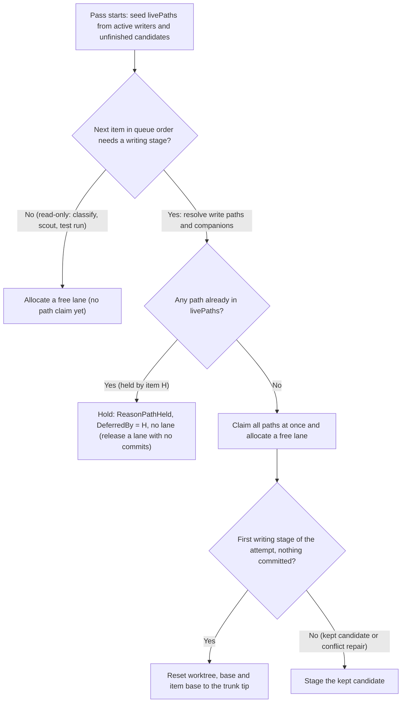

# Hold a second writer before lane allocation when its target files overlap an active or pending item

**Status:** nothing here is built. `rg -n 'ReasonPathHeld|shared-path-held|livePaths|write_paths' tools config -g '!*.md'` returns nothing. `D-SPS1` through `D-SPS7` are designer's decisions that await the owner's review in the [Decision Ledger](#decision-ledger).

> **In short.** Before allocating a lane to any writing stage, the drain's planner claims the exact repository-relative files the item will write, and the one-to-one generated mirrors of those files. A second item that wants a claimed file is held outside the lane pool until the holder lands, and then starts from the trunk tip that holds the holder's change. Exact-file claims cost nothing on disjoint work at any landing rate, and no lane sits idle while uncontended ready items can fill the pool.

**Why it matters.** Two items that edit one file concurrently end in a squash conflict, and each conflict costs a repair run and another gate run. Measured over one 145-minute window of drain activity, 31 landings succeeded and 12 stopped on a squash conflict; all 12 struck a file two items edited concurrently, and replaying the window under this design avoids 11 of them deterministically (the twelfth when its item declares the one file it touched incidentally).

**The shape.** Four claim sources ([Section 3.2](#32-four-authoritative-claim-sources-across-every-intake-and-workflow-d-sps3-d-sps5)) feed one planner table, `livePaths`, in [plan.go](../../tools/tillr-drain/drain/plan.go). The table is paired with an all-or-nothing hold before lane allocation ([Section 4.1](#41-pre-lane-all-or-nothing-hold-lane-release-and-base-refresh-on-wake-d-sps1-d-sps4-d-sps7)) and a base refresh in [stage.go](../../tools/tillr-drain/drain/stage.go).

**Cost.** The design removes the `do-it-now` commit inside the read-only `plan` stage (`D-SPS5`). It adds idle lanes, at no model spend, only when ready disjoint work cannot fill the pool ([Section 4.2](#42-idle-lane-cost-formula-and-behavior-as-lanes-l-increase)).

**Needs your ruling:** None.

**Awaits your review:** `D-SPS1` through `D-SPS7` in the [Decision Ledger](#decision-ledger); you may overturn any of them.

**Reads with:** [Landing principles](./landing-principles.md), [Seat and plan-step selection](./tillr-plan-step-and-seat-selection.md) ([OQ-PSS1](./tillr-plan-step-and-seat-selection.md#OQ-PSS1), [OQ-PSS2](./tillr-plan-step-and-seat-selection.md#OQ-PSS2)), [Designer scouts](./tillr-designer-scouts.md) ([OQ-RD1](./tillr-designer-scouts.md#OQ-RD1)), [Conflict-answer check](./tillr-conflict-answer-check.md) (`conflict-answer@v1`), [Judge and lifecycle](./tillr-judge-and-lifecycle.md) (`D-JL10`, `D-JL32`), and [Decision provenance review](../tillr/decision-provenance-review.md) ([OQ-PR4](../tillr/decision-provenance-review.md#decision-ledger), [OQ-PR21](../tillr/decision-provenance-review.md#decision-ledger)).

---

## 1. Why the drain starts colliding writers

Five gaps in the dispatch pipeline let two items start on one file:

1. **Document desks cover only comment items and configured design items.** In [comments.go](../../tools/tillr-drain/drain/comments.go), `deskDocument` assigns a single-writer lane per document (`ReasonDocumentDeskBusy`) only for comment items, or for a `design` item when comment intake is configured and the item's fence names a single Markdown file. A repository whose [.tillr.toml](../../.tillr.toml) declares no `[comments]` section gets no desk, and `deskDocument` never inspects a `conflict-design` or `build` item.
2. **A `conflict-design` run takes an ordinary lane with no document claim.** In [blocked.go](../../tools/tillr-drain/drain/blocked.go), `conflictDecision` dispatches a raised `OBSTACLE: definition` conflict onto a free lane without reserving the design files that `blockConflictPaths` in [stage.go](../../tools/tillr-drain/drain/stage.go) already extracts.
3. **`ReasonForkHeld` serializes shared forks, never repository files.** `planDelivery` in [delivery.go](../../tools/tillr-drain/drain/delivery.go) runs a read-only step that writes a delivery decision, and `liveForks` in [pass.go](../../tools/tillr-drain/drain/pass.go) holds any second item naming the same fork. A delivery of kind `repo` carries no file list, so the planner cannot hold a colliding repository writer.
4. **`do-it-now` commits inside a read-only stage before the planner sees a file list.** In [planned-build@v1.json](../../config/tillr/workflows/planned-build@v1.json) the `plan` stage is declared read-only, yet `quickWayFile = "do-it-now"` in [workflow.go](../../tools/tillr-drain/drain/workflow.go) lets it edit and commit directly. `deliveryPrompt` forbids `do-it-now` only for fork deliveries.
5. **A workflow continuation with no commits keeps its first stage's base, and a conflict-repair run holds no claim.** When a workflow advances from a read-only stage to its first writing stage with nothing committed, staging reads the item's base from the first stage's run directory rather than moving it to the trunk tip, so the writer starts on a trunk that may already lack a landed change to its file. Two conflict-repair runs on one file can also start side by side and collide again.

---

## 2. Vocabulary and inherited owner rulings

### 2.1 Defined terms

Item, lane, seat, workflow, node, candidate, gate, lander, and trunk keep their meanings in [tillr-vocabulary.md](./tillr-vocabulary.md) and [item graphs](../reference/tillr-item-graphs.md). Four terms are coined here:

| Term | Meaning | What it is not |
| :--- | :--- | :--- |
| **Write-path set** *(coined here)* | The normalized set of exact repository-relative file paths an item expects to create or modify in its next writing stage. Once the item commits, the set becomes the paths its candidate diff actually touches, plus any paths a squash conflict named. | Not a directory prefix (`docs/design/`), not the fence that bounds what an item may touch (`fencePaths`), and not files the item only reads. |
| **Companion mirror path** *(coined here)* | A generated repository path that must change in lockstep with a declared source path, one for one: `tools/<tillr-module>/<rel>` and its copy under `yolo-packs/tillr/files/local/share/tillr/<tillr-module>/<rel>`. | Not shared module documentation or a shared test (`tillrSkillPath`, `tillrDocsTest`), which the fence permits without requiring every change to edit. |
| **Path claim** *(coined here)* | A planner reservation of an item's write-path set, held from the pass that dispatches its first writing stage until the candidate lands, the item ends, or the item parks with no active run and no landable candidate. | Not a stored lock row that needs cleanup, and not a hold during read-only orientation (`classify`, `open`, `scout`). |
| **Pre-lane hold** *(coined here)* | A planner hold decision (`ReasonPathHeld`, no lane, no run request, `DeferredBy` naming the holding item) that defers a colliding writer before a lane is assigned and releases any lane it kept from a read-only stage that committed nothing. | Not parking an item while its lane worktree stays leased and idle. |

### 2.2 Inherited owner rulings and boundaries

The design works inside boundaries the owner has already fixed:

- **The lane count is measured by wasted work.** The measure for the lane count is work wasted on conflicts and rework, and a rule whose cost rises with trunk activity is pointed the wrong way ([Landing principles §2](./landing-principles.md#2-re-application-preserves-the-change-not-the-patch) and [§3](./landing-principles.md#3-gate-what-will-be-the-tip-once)).
- **How the loop steps through the queue is engineering detail** ([OQ-PR4](../tillr/decision-provenance-review.md#decision-ledger)). Choices that touch documents, repository layout, money, models, or operator surfaces are separated from engineering detail ([OQ-PR21](../tillr/decision-provenance-review.md#decision-ledger)), so every designer choice here is marked for owner review.
- **A hold names a live mover and never waits on a timer** (`D-JL10` in [Judge and lifecycle](./tillr-judge-and-lifecycle.md); [Landing principles §11](./landing-principles.md#11-a-failure-is-diagnosed-not-waited-out) and [§13](./landing-principles.md#13-a-held-state-names-a-mover-that-can-still-act)). A writer released from a wait starts from a trunk that holds what it waited for (`D-JL32`).
- **The workflow simplifications stand.** [OQ-PSS2](./tillr-plan-step-and-seat-selection.md#OQ-PSS2) rules that the `plan` step of `planned-build@v1` gives way to builder-led execution while the lightweight read-only `classify` step stays, and [OQ-RD1](./tillr-designer-scouts.md#OQ-RD1) rules on the `open` stage of `scouted-design@v1`. Path claims therefore work with those stages present or absent, and never add a cold planning session.

---

## 3. How the drain knows before dispatch that two items will edit the same file

### 3.1 Exact file granularity and 1-to-1 mirror expansion (`D-SPS2`)

Two shortcuts fail:

1. **A directory or package prefix has the wrong polarity.** Locking `docs/design/`, `config/tillr/watch/` or `tools/tillr-drain/drain/` makes contention grow with total trunk throughput even when items touch distinct files. In the measured window, 19 of the 31 clean landings were on distinct files inside directories that also held a contended file; a prefix lock would have serialized them all.
2. **Reading paths out of the request's words fails in both directions.** A build item cites its design document as something to read, so scraping the words for `.md` paths holds code slices behind a document they never edit. A request written in plain prose names no path at all, yet edits a shared document.

Every path claim therefore uses exact normalized repository-relative file paths (`filepath.ToSlash(filepath.Clean(p))`). An empty string, `.`, `..`, a leading or trailing `/`, a glob, and a path that names an existing directory are rejected.

`claimCompanionPaths` expands a claim only to the companion mirror paths:

- `tools/<tillr-module>/<rel>` and `yolo-packs/tillr/files/local/share/tillr/<tillr-module>/<rel>`, the pairing [pack-sync.json](../../tools/gate/checks/pack-sync.json) checks.
- `tools/tillr-loop/tillr-loop` and `tools/tillr-drain/drain/tillr-loop.py`, with its mirror.

Unlike `fencePaths` in [stage.go](../../tools/tillr-drain/drain/stage.go), `claimCompanionPaths` never adds the shared optional companions (`yolo-packs/tillr/skills/tillr-operating/SKILL.md`, `tools/tillr/tillrdocs/`) unless an item declares them, because claiming those two files on every tillr module item would serialize all tillr module work.

### 3.2 Four authoritative claim sources across every intake and workflow (`D-SPS3`, `D-SPS5`)

Before the planner allocates a lane to a stage with write access, or to a writing run outside a workflow, it resolves the item's write-path set from four sources, ordered from committed fact to declaration:

| Source | Applies to | How the paths are known before the writing run starts | Extra model runs |
| :--- | :--- | :--- | :--- |
| **1. Committed candidate diff and conflict paths** | Any unfinished item that has committed, through piece join, verify, review, gate, landing, a return with evidence, and conflict repair | `git diff-tree -r --no-commit-id --name-only <item_base_sha> <head_sha>`, joined with any conflict paths recorded on `landings`, expanded by `claimCompanionPaths`. | None |
| **2. A raised conflict's target documents** | `conflict-design` (`conflictDecision`, the `answer` stage of `conflict-answer@v1`) | A required list of documents on `OBSTACLE: definition`, joined with the item's design document and exact tracked `docs/**/*.md` paths in the conflict text. | None |
| **3. Static document-intake metadata** | Comment items, document triage, document-declared `design` and `docs` stages, and a `design` request filed with a target document | The item's design document, whether or not `[comments]` is configured, plus the document its block reference names only when the dispatched stage's seat is `design` or `docs` (never when a build slice reads its specification from a plan document). | None |
| **4. Read-only classification** | A request with no document anchor, and a multi-piece workflow before its first writing stage | `planDelivery` extends the delivery decision the `classify` seat already writes with a required `write_paths` list. While `planned-build@v1` and `scouted-design@v1` are in the tree, `plan` (delivery and the `write_scope` of `build-pieces@v1`) and `open` (delivery) write the same field. | None on a build, where `classify` already runs; one `classify` run on an unanchored `design` request |

Three details keep source 4 fast:

1. **The delivery decision gains one field.** For kinds `repo` and `both`:
   ```json
   {
     "kind": "repo",
     "write_paths": [
       "config/tillr/watch/drain-repeated-item-conflicts.toml",
       "tools/tillr-watch/repeated_item_conflicts_rule_test.go"
     ]
   }
   ```
   For kind `fork`, `ReasonForkHeld` already serializes the fork. For kind `both`, the fork piece runs first under `ReasonForkHeld`, and the repository piece then enters the planner gated on `write_paths`.
2. **`do-it-now` stops committing in a read-only stage (`D-SPS5`).** A read-only `plan` node that commits bypasses the planner's check. Removing that aligns repository delivery with fork delivery, which already rejects `do-it-now`.
3. **A `design` item keeps one warm session.** Block-backed design items, comment items, document triage, `conflict-design`, and requests naming a target document resolve through sources 2 and 3 with no extra run. A `design` request with no anchor runs the `classify` step to name its target files before its single `design` session starts. If the owner prefers no step before an unanchored `design` request, a first-turn tool that claims paths, suspends the session and releases the lane on collision is the alternative; `classify` is chosen because `planDelivery` and the `classify` seat exist.

### 3.3 Undeclared incidental edits, degenerate inputs, and failure paths (`D-SPS6`)

- **An empty `write_paths`** is rejected for kinds `repo` and `both`. Every repository-writing item modifies or creates at least one file, and naming a new file's path prevents two identical new-file items from colliding.
- **A directory, glob, or out-of-repository entry** is rejected with a validation error returned to `classify`, never widened into a directory lock and never ignored.
- **A `conflict-design` with no Markdown path** is refused when the obstacle is raised: `OBSTACLE: definition` requires at least one repository-relative `docs/.../*.md` path. A stored conflict without one goes to `classify` before `answer` rather than locking `docs/` whole.
- **An undeclared incidental edit is never a candidate refusal.** A worker sometimes finds mid-run that a helper or a shared test must also change. Refusing a valid candidate because an unheld file was absent from its declaration would violate [Landing principles §1](./landing-principles.md#1-a-refusal-must-be-a-verdict). Instead:
  - As soon as the run commits, source 1 replaces the item's claim with its committed diff, which protects every touched file through verify, gate, landing, and any conflict repair.
  - If the undeclared file was unheld, the squash lands in one pass.
  - A collision reaches the lander only when two items concurrently edit a file that at least one omitted, before either commits. Conflict repair handles it, with the full diff now claimed, so no second conflict follows.

---

## 4. What the drain does with the second item, and how cost scales with lane count

### 4.1 Pre-lane all-or-nothing hold, lane release, and base refresh on wake (`D-SPS1`, `D-SPS4`, `D-SPS7`)



Five invariants govern planning and staging:

1. **Seed `livePaths` before scanning ready items (`D-SPS1`).** Mirroring `liveForks` in [pass.go](../../tools/tillr-drain/drain/pass.go), `planWithDetails` in [plan.go](../../tools/tillr-drain/drain/plan.go) computes a map from normalized path to holding item id from every leased writing run and from every unfinished item that holds a committed candidate (source 1) or a return that re-enters a writing run on the next pass.
2. **Claim all or nothing, in queue order (`D-SPS1`).** An item about to dispatch a writing stage checks every path in its expanded write-path set against `livePaths`.
   - **All free, and every other dispatch precondition passes, including a free lane:** the planner records each path under the item and assigns the lane. An item that ends up held for want of a lane, a backend window or quota is never added to `livePaths`; otherwise a lane-starved item would block lower-priority items in another pool.
   - **Any path held by another item:** the planner claims none of the item's paths and returns a hold with reason `ReasonPathHeld` (`"shared-path-held"`), `DeferredBy` naming the holder, no lane, and no run request.
   - **Why this cannot deadlock:** no held item holds a path while waiting on another path or a lane, so every wait points directly at an active or landing holder and the wait graph has no cycle. If item 2 wants files A and B while item 1 holds A, item 3 wanting only B dispatches at once.
3. **A held item gives its lane back (`D-SPS1`).** When an item finishes a read-only stage on a lane with nothing committed and its next stage is held, the loop releases the lane in the store. If a multi-write workflow is ever held after committing an earlier piece, the loop pins the run's ref and releases the lane through [held_lane.go](../../tools/tillr-drain/drain/held_lane.go). A held item occupies no lane.
4. **A holder that stops moving without a landable candidate releases its claim (`D-SPS7`).** Under [Landing principles §13](./landing-principles.md#13-a-held-state-names-a-mover-that-can-still-act), an item parked on an owner or external hold (`conflict-owner`, open questions, `backend-closed`, `repeating-call`, `trunk-broken`) with no live run and no landing in progress is excluded from `livePaths`, so a parked item never freezes a shared file.
5. **An attempt with no commits moves to the trunk tip on its first write (`D-SPS4`).** When staging moves a workflow attempt into its first writing stage and no earlier stage of the attempt committed, it resets the lane worktree to the trunk tip and writes that sha as both the run's base and the item's base. Without this, an item that ran `classify` at one trunk tip, waited on a holder, and then started writing would still check out the old tip and collide with the change it waited for. This generalizes `D-JL32`.

`ReasonPathHeld` registers in [holdrules.go](../../tools/tillr-drain/holdrules/holdrules.go) beside `ReasonForkHeld`:

```go
"shared-path-held": {
    Class: "waits on work",
    Where: "queue",
    Mover: "the active lane or landing holding the shared file; the next pass",
},
```

`tillr view waiting` and the observatory show the holding item and the overlapping paths. The registration satisfies `TestEveryReasonConstantHasAHoldRule` ([hold_rules_test.go](../../tools/tillr-drain/drain/hold_rules_test.go)) and `TestWaitingEveryDrainReasonHasARule` ([waiting_internal_test.go](../../tools/tillr-view/waiting_internal_test.go)).

### 4.2 Idle-lane cost formula and behavior as lanes $$L$$ increase

Let $$L$$ be the lane count in a pool, $$\lambda$$ the trunk's landing throughput, and $$R(t) = R_{\text{disjoint}}(t) + R_{\text{contended}}(t)$$ the ready queue at time $$t$$. $$R_{\text{disjoint}}(t)$$ is the largest number of ready items, counting active writers and the first claimant of each file, whose write-path sets are pairwise disjoint. $$R_{\text{contended}}(t)$$ counts the second and later ready items that target a claimed file.

Because the hold happens before lane allocation, the idle lanes serialization adds at time $$t$$ are:

$$\Delta I(t) = \min\!\Big(R_{\text{contended}}(t),\; \max\!\big(0,\, L - R_{\text{disjoint}}(t)\big)\Big)$$

1. **Disjoint work, any $$L$$, any $$\lambda$$ ($$R_{\text{contended}} = 0$$): no cost.** $$\Delta I = 0$$, no extra runs, and throughput scales with $$L$$. A rise in unrelated landings adds no holds and no reruns.
2. **A deep, varied queue ($$R_{\text{disjoint}} \ge L$$): no idle lane.** Even when three items want one document, every lane fills with disjoint work.
3. **A hotspot or a shallow queue ($$R_{\text{disjoint}} < L$$): bounded idle lanes replace paid conflict cascades.** Suppose $$k$$ items all edit one file whose write, gate and landing take $$T_{\text{hold}}$$, and nothing else is ready. No discipline lands a sequentially merged file faster than one per $$T_{\text{hold}}$$.
   - **Optimistic parallel execution:** all $$k$$ lanes run against one stale base. The first lands; the other $$k - 1$$ fail the squash and start $$k - 1$$ repairs at once, which collide again. That yields up to $$k(k-1)/2$$ repairs, each paid, and still finishes in about $$k \cdot T_{\text{hold}}$$.
   - **Pre-lane hold:** one lane works on the file while up to $$\min(k-1, L-1)$$ lanes wait at no model spend and no test load. Exactly $$k$$ clean runs finish in the same $$k \cdot T_{\text{hold}}$$, and each writer reads the previous writer's landed text.

| Mechanism | Cost when $$L$$ lanes touch disjoint files | Idle lanes when $$R_{\text{disjoint}} \ge L$$ | When $$k$$ items hit one file as $$L$$ grows | Verdict |
| :--- | :--- | :--- | :--- | :--- |
| **Pre-lane exact-file hold** | None | None | No conflicts, $$k$$ clean runs; at most $$\min(k-1, L-1)$$ lanes idle at no spend | **Chosen (`D-SPS1`)** |
| **Optimistic parallel runs and conflict repair** | None | None (lanes run doomed work) | Up to $$O(k^2)$$ repairs; worsens faster than $$L$$ | Rejected: fails the wasted-work measure |
| **Directory or module prefix locks** | Rises with $$\lambda$$ | High false starvation | Prevents collisions by serializing whole subsystems | Rejected: pointed the wrong way |
| **Hold after lane allocation** | None | One lane wasted per held item | Can stall every lane behind a holder in another pool | Rejected: wastes capacity |
| **Merging separate items into one** | None | None | Combines unrelated criteria into oversized diffs ([Landing principles §15](./landing-principles.md#15-land-the-smallest-functional-change)) | Rejected: breaks the smallest-change rule |

---

## 5. Consistency with Landing Principles and standalone build slices

### 5.1 Check against Landing Principles

| Principle in [landing-principles.md](./landing-principles.md) | How this design satisfies it |
| :--- | :--- |
| **[§1 A refusal must be a verdict](./landing-principles.md#1-a-refusal-must-be-a-verdict)** | The hold is a queue hold before dispatch, never a failed run or a candidate verdict. Touching an undeclared unheld file is never refused ([Section 3.3](#33-undeclared-incidental-edits-degenerate-inputs-and-failure-paths-d-sps6)). |
| **[§2](./landing-principles.md#2-re-application-preserves-the-change-not-the-patch) and [§3](./landing-principles.md#3-gate-what-will-be-the-tip-once)** | The lander is untouched: disjoint files still squash onto a moved trunk in one gate pass, and exact-file claims add no cost as unrelated landings rise. |
| **[§4 Every outcome is state-changing](./landing-principles.md#4-every-outcome-is-state-changing)** | A held item is not dispatched into repeated conflicts against one tip; it stays held until the holder lands or releases its claim. |
| **[§5](./landing-principles.md#5-only-verdicts-charge) and [§6](./landing-principles.md#6-a-budget-escalates-it-does-not-loop)** | No retry counter or attempt cap is added. A residual undeclared collision still routes through uncounted conflict repair (`D-JL10`). |
| **[§7 A surface that hides parked work is a false report](./landing-principles.md#7-a-surface-that-hides-parked-work-is-a-false-report)** | The reason has a hold rule and is shown with its holder and the contended paths. |
| **[§10 Supersession is a verdict, not a stall](./landing-principles.md#10-supersession-is-a-verdict-not-a-stall)** | A second writer that starts on the tip holding the first writer's change can see that its own change is partly or wholly done. |
| **[§11](./landing-principles.md#11-a-failure-is-diagnosed-not-waited-out) and [§13](./landing-principles.md#13-a-held-state-names-a-mover-that-can-still-act)** | The hold has no timer. It clears when the named holder lands or stops, and `D-SPS7` drops the claim when the holder parks with no live run or landing. |
| **[§14 Convict a run on what it did](./landing-principles.md#14-convict-a-run-on-what-it-did-not-on-what-happened-while-it-ran)** | No check convicts a run for editing an unheld file absent from its declared paths. |
| **[§15 Land the smallest functional change](./landing-principles.md#15-land-the-smallest-functional-change)** | Items are not merged, and the build is six small slices. |
| **[§16 What the operator can settle is settled inside tillr](./landing-principles.md#16-what-the-operator-can-settle-is-settled-inside-tillr)** | The mover is the active lane or landing, never the operator, so nobody throttles or reorders a queue by hand to avoid collisions. |

### 5.2 Standalone build slices

Each slice lands alone with its tests. This document files none of them.

1. **Path normalization, mirror expansion, and the hold rule.** Add `normalizeWritePaths` and `claimCompanionPaths`, export `ReasonPathHeld` in [plan.go](../../tools/tillr-drain/drain/plan.go), and add its entry in [holdrules.go](../../tools/tillr-drain/holdrules/holdrules.go).
2. **Committed diff and conflict-repair serialization (source 1).** Seed `livePaths` from committed diffs and recorded conflict paths across unfinished items, releasing a claim when the item parks (`D-SPS7`). This alone stops parallel repairs on one file.
3. **Base refresh on the first writing stage (`D-SPS4`).** Change [stage.go](../../tools/tillr-drain/drain/stage.go) and [loop.go](../../tools/tillr-drain/drain/loop.go), with staging regression tests.
4. **Document intake and `conflict-design` claims (sources 2 and 3).** Wire the item's design document, a `design` or `docs` seat's block reference, and the target documents of `OBSTACLE: definition` into `livePaths` before a lane is allocated.
5. **`write_paths` in the delivery decision, and the pre-lane hold with lane release (source 4).** Extend `deliveryPrompt` and `classifyDelivery` in [delivery.go](../../tools/tillr-drain/drain/delivery.go), route an unanchored `design` request through `classify`, and release a held item's lane.
6. **Stop `do-it-now` commits in read-only stages (`D-SPS5`).** Change [workflow.go](../../tools/tillr-drain/drain/workflow.go) and [planned-build@v1.json](../../config/tillr/workflows/planned-build@v1.json).

---

## 6. Risks

| Risk | Mitigation |
| :--- | :--- |
| **`classify` names too many paths and causes false holds.** | The prompt asks for only the files the item's statement requires editing, and rejects directories and globs. Touching an undeclared file is never punished ([Section 3.3](#33-undeclared-incidental-edits-degenerate-inputs-and-failure-paths-d-sps6)), so there is no reason to over-claim. |
| **A parked item holds a busy design document.** | `D-SPS7` computes `livePaths` each pass from live writers and from candidates that can land or return, and drops a parked item. |
| **Starvation across pools.** An item claims a file, then finds no free lane, and blocks an item in another pool that has one. | An item's paths enter `livePaths` only after a free lane and every other dispatch check succeed for it in that pass ([Section 4.1](#41-pre-lane-all-or-nothing-hold-lane-release-and-base-refresh-on-wake-d-sps1-d-sps4-d-sps7)). |
| **One more `classify` step on an unanchored `design` request.** | Comment items, document triage, block-backed items, `conflict-design`, and anchored requests pay nothing; the unanchored request pays one cheap read-only step against a full conflict repair. |

---

## Open Questions

None. The governing rules are settled in their home documents ([Section 2.2](#22-inherited-owner-rulings-and-boundaries)). Every choice in the ledger is a designer's decision that the owner may overturn.

---

## Decision Ledger

Inherited rulings ([OQ-PR4](../tillr/decision-provenance-review.md#decision-ledger), [OQ-PR21](../tillr/decision-provenance-review.md#decision-ledger), [OQ-PSS1](./tillr-plan-step-and-seat-selection.md#OQ-PSS1), [OQ-PSS2](./tillr-plan-step-and-seat-selection.md#OQ-PSS2), `D-JL10`, and `D-JL32`) stay in their home ledgers. Every row here is a designer's decision; none is an owner ruling.

| ID | Decision | Date | Settled in | Built |
| :--- | :--- | :--- | :--- | :--- |
| `D-SPS1` | Serialize concurrent writers on overlapping files by holding the second item before lane allocation (`ReasonPathHeld`, `DeferredBy` naming the holder, no lane, no run request), claiming all its paths at once only after a free lane is found, and releasing a lane the item kept from a read-only stage that committed nothing. Rejected: optimistic parallel runs with conflict repair; holding after lane allocation; merging items. | 2026-11-22 | [Section 4.1](#41-pre-lane-all-or-nothing-hold-lane-release-and-base-refresh-on-wake-d-sps1-d-sps4-d-sps7), [Section 4.2](#42-idle-lane-cost-formula-and-behavior-as-lanes-l-increase) | — |
| `D-SPS2` | Key `livePaths` on exact normalized repository-relative file paths plus the one-to-one generated mirrors. Refuse directory prefixes and globs, never read paths out of the request's words, and never claim the shared optional fence companions automatically. Rejected: directory or package locks; scraping request words; claiming the whole fence. | 2026-11-22 | [Section 3.1](#31-exact-file-granularity-and-1-to-1-mirror-expansion-d-sps2) | — |
| `D-SPS3` | Resolve an item's write-path set from four ordered sources: the committed diff and conflict paths, a raised conflict's target documents, static document metadata, and `write_paths` in the read-only classification. Rejected: making the design-document claim depend on `[comments]`; locking a plan document for a build slice; adding a planning step back. | 2026-11-22 | [Section 3.2](#32-four-authoritative-claim-sources-across-every-intake-and-workflow-d-sps3-d-sps5) | — |
| `D-SPS4` | When a workflow attempt with no commits stages its first writing node, reset the worktree, the run's base and the item's base to the trunk tip. Rejected: keeping a read-only predecessor's base across the move to writing. | 2026-11-22 | [Section 4.1](#41-pre-lane-all-or-nothing-hold-lane-release-and-base-refresh-on-wake-d-sps1-d-sps4-d-sps7) | — |
| `D-SPS5` | Stop `do-it-now` commits inside read-only workflow stages, matching fork delivery. Rejected: letting a read-only stage commit before the planner sees its paths. | 2026-11-22 | [Section 1](#1-why-the-drain-starts-colliding-writers), [Section 3.2](#32-four-authoritative-claim-sources-across-every-intake-and-workflow-d-sps3-d-sps5) | — |
| `D-SPS6` | Reject empty, directory, or glob `write_paths`; never refuse a candidate for modifying an undeclared unheld file; replace the claim with the committed diff on commit. Rejected: refusing undeclared edits to unheld files after the fact. | 2026-11-22 | [Section 3.3](#33-undeclared-incidental-edits-degenerate-inputs-and-failure-paths-d-sps6) | — |
| `D-SPS7` | Register `ReasonPathHeld` in the hold rules (class "waits on work", where "queue"), show the holder and contended paths in `tillr view waiting`, and drop an item from `livePaths` when it parks with no live run and no landing. Rejected: keeping a claim across a hold that has no active mover. | 2026-11-22 | [Section 4.1](#41-pre-lane-all-or-nothing-hold-lane-release-and-base-refresh-on-wake-d-sps1-d-sps4-d-sps7), [Section 5.1](#51-check-against-landing-principles) | — |
