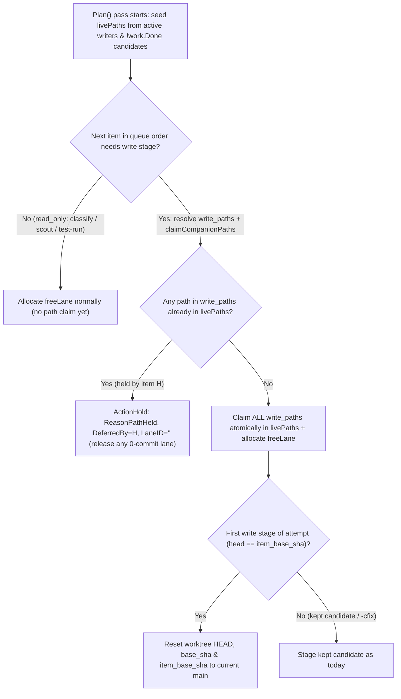

# Hold a second writer before lane allocation when its target files overlap an active or pending item

**Status:** 2026-11-22. Nothing is built; repository behavior verified at `72be8955f8` and store trace measured over `[2026-11-22 02:00:00 ET, 2026-11-22 04:25:00 ET]`. Inherited rulings quote the owner's dated words in [Section 2.2](#22-inherited-owner-rulings-and-boundaries); `D-SPS1` through `D-SPS7` are the designer's decisions from an operator request of 2026-11-22 and await the owner's review in the [Decision Ledger](#decision-ledger).

> **In short.** Before allocating a lane to any writing stage, the drain planner claims exact repository-relative target files (and deterministic 1-to-1 pack mirrors) derived from document intake, raised conflict records, read-only `classify` / `plan` outputs, and committed candidate diffs, holding any second writer (`ReasonPathHeld`) outside the lane pool until the holder lands on `main` and refreshing the waiter's zero-commit base to that new tip. Exact-file claims impose zero tax on disjoint work at any trunk landing rate and zero idle lane time whenever uncontended ready items fill the pool.

**Why it matters.** Between `02:00` and `04:25 AM ET` on 2026-11-22, `31` landings succeeded while `12` landings stopped on `squash-conflict` (`7` on [tillr-watch.md](./tillr-watch.md), `5` across shared rules, classifiers, gate scripts, and [gate-rework.md](./gate-rework.md)), burning `86.6` active lane-minutes and `$9.94` in direct recovery runs (including `$1.01` on `item-request-08791b6f14`).

**The shape.** Four exact-file claim sources ([Section 3.2](#32-four-authoritative-claim-sources-across-every-intake-and-workflow-d-sps3-d-sps5)) feed one planner table `livePaths` in [plan.go](../../tools/tillr-drain/drain/plan.go), paired with pre-lane all-or-nothing `ActionHold` (`ReasonPathHeld`, [Section 4.1](#41-pre-lane-all-or-nothing-hold-lane-release-and-base-refresh-on-wake-d-sps1-d-sps4-d-sps7)) and zero-commit `main` base refresh in [stage.go](../../tools/tillr-drain/drain/stage.go).

**Cost.** Retires `do-it-now` commits inside read-only `plan` nodes (`D-SPS5`) and adds idle lane minutes $$\max(0, L - R_{\text{disjoint}})$$ at `$0` token spend only when ready disjoint work cannot fill $$L$$ lanes ([Section 4.2](#42-idle-lane-cost-formula-and-behavior-as-lanes-l-increase)).

**Start at [Section 3](#3-how-the-drain-knows-before-dispatch-that-two-items-will-edit-the-same-file)** for pre-dispatch path claims, [Section 4.2](#42-idle-lane-cost-formula-and-behavior-as-lanes-l-increase) for scaling with $$L$$ lanes, and [Section 5](#5-backtest-against-the-2026-11-22-record-12-squash-conflicts-vs-31-landings) for the 12-conflict replay.

**Needs your ruling:** None.

**Awaits your review:** `D-SPS1` through `D-SPS7` in the [Decision Ledger](#decision-ledger); you may overturn any of them.

**Reads with:** [Landing principles](./landing-principles.md) ([§1](./landing-principles.md#1-a-refusal-must-be-a-verdict)–[§4](./landing-principles.md#4-every-outcome-is-state-changing), [§7](./landing-principles.md#7-a-surface-that-hides-parked-work-is-a-false-report), [§10](./landing-principles.md#10-supersession-is-a-verdict-not-a-stall)–[§16](./landing-principles.md#16-what-the-operator-can-settle-is-settled-inside-tillr)), [Seat and plan-step selection](./tillr-plan-step-and-seat-selection.md) ([OQ-PSS1](./tillr-plan-step-and-seat-selection.md#OQ-PSS1), [OQ-PSS2](./tillr-plan-step-and-seat-selection.md#OQ-PSS2)), [Designer scouts](./tillr-designer-scouts.md) ([OQ-RD1](./tillr-designer-scouts.md#OQ-RD1)), [Conflict-answer check](./tillr-conflict-answer-check.md) (`conflict-answer@v1`), [Judge and lifecycle](./tillr-judge-and-lifecycle.md) (`D-JL10`, `D-JL32`), and [Decision provenance review](../tillr/decision-provenance-review.md) ([OQ-PR4](../tillr/decision-provenance-review.md#decision-ledger), [OQ-PR21](../tillr/decision-provenance-review.md#decision-ledger)).

---

## 1. What happened on 2026-11-22 (`02:00`–`04:22 AM ET`), and why today's drain missed every collision

### 1.1 The 145-minute window measured

Audited read-only against `.tillr/state.db` (`events.ts BETWEEN 1795330800000 AND 1795339500000`, i.e., `[2026-11-22T07:00:00Z, 2026-11-22T09:25:00Z]` or `02:00:00`–`04:25:00 AM ET`) and trunk history through `72be8955f8`:

```sql
SELECT l.result, COUNT(*)
FROM landings l
JOIN events e
  ON e.kind = 'land.landing'
 AND json_extract(e.payload, '$.run_id') = l.run_id
 AND json_extract(e.payload, '$.head_sha') = l.head_sha
WHERE e.ts BETWEEN 1795330800000 AND 1795339500000
GROUP BY l.result;
-- landed: 31 (first 02:02:15 ET, last 04:24:36 ET)
-- squash-conflict: 12 (first 02:11:26 ET, last 04:22:36 ET)
```

Across those `43` landing attempts (`28%` stopping on `squash-conflict`), every one of the `12` conflicts struck a shared design document, rule file, shared entry point, or shared scan list edited concurrently by two items:

- **`7` conflicts on [tillr-watch.md](./tillr-watch.md)** (`02:12:47` to `03:06:39 ET`, while `8` commits landed on [tillr-watch.md](./tillr-watch.md) in the same window; sibling item `item-request-4b6f5937c9`, *"Stop concurrent tillr-watch rule changes from colliding in the one design document"*, remains `in-queue` as of `72be8955f8` and restructures only that one document).
- **`1` conflict on three gate scripts** ([fork-check.py](../../tools/fork-check.py), [change-gate.py](../../tools/gate/change-gate.py), and [go-build.py](../../tools/gate/checks/go-build.py), `02:11:26 ET`).
- **`1` conflict on the repeated-conflict watch rule and its test** ([drain-repeated-item-conflicts.toml](../../config/tillr/watch/drain-repeated-item-conflicts.toml) and [repeated_item_conflicts_rule_test.go](../../tools/tillr-watch/repeated_item_conflicts_rule_test.go), `03:14:22 ET`).
- **`1` conflict on the classifier source and its pack copy** ([classify.go](../../tools/tillr-gate/classify.go) and its mirror under `yolo-packs/tillr/files/local/share/tillr/tillr-gate/classify.go`, `03:54:49 ET`).
- **`1` conflict on the classifier scan test's list of unmoved sites** ([classification-scan.test.py](../../tools/gate/classification-scan.test.py), `04:17:48 ET`).
- **`1` conflict on [gate-rework.md](./gate-rework.md)** (`04:22:36 ET`, where standalone design item `item-request-5dcb85b495` collided with classifier slice 1d's conflict settlement `6df7e5bf5a` on `item-request-cd3a03bebc`).

Those `12` conflicts triggered `12` direct recovery runs (`10` `-cfix` runs plus `2` restarted `plan` runs after conflicts `#1` and `#3`), consuming **`86.58` active lane-minutes (`5,195 s`)** and **`$9.94` (`$9.9418`)** in direct recovery spend — including `$1.0142` (`$1.01`) on `run-item-request-08791b6f14-a2-cfix` and `$1.6127` on `run-item-request-67986b728f-a15-n1` — plus `12` extra fast-gate runs. Meanwhile, the `31` successful landings included `11` commits on distinct watch rules under `tools/tillr-watch/` and `config/tillr/watch/` and `8` commits on distinct files in `tools/tillr-drain/` and `tools/tillr-gate/` that squashed cleanly onto the moved trunk via `Trunk.Squash` ([trunk.go](../../tools/tillr-land/land/trunk.go)).

### 1.2 Five gaps in today's dispatch pipeline

Inspected at `72be8955f8` across [plan.go](../../tools/tillr-drain/drain/plan.go), [comments.go](../../tools/tillr-drain/drain/comments.go), [blocked.go](../../tools/tillr-drain/drain/blocked.go), [delivery.go](../../tools/tillr-drain/drain/delivery.go), [workflow.go](../../tools/tillr-drain/drain/workflow.go), and [stage.go](../../tools/tillr-drain/drain/stage.go), five concrete gaps allowed all `12` collisions through:

1. **Document desks are off in this repository and blind to requests and conflicts.** In [comments.go](../../tools/tillr-drain/drain/comments.go), `deskDocument(row, comments)` assigns a single-writer `desk-<doc>` lane (`ReasonDocumentDeskBusy`) only for `item-comments-*` or when `row.Seat == "design"`, `comments != nil`, and `row.Allowed` names a single literal `.md` file. Tracked [.tillr.toml](../../.tillr.toml) declares no `[comments]` section (`tick.Comments == nil`), per-item `allowed_paths` fences are empty on filed requests, and `deskDocument` never inspects `conflict-design` or `build` items.
2. **`conflict-design` allocates an ordinary lane with no document claim.** In [blocked.go](../../tools/tillr-drain/drain/blocked.go), `conflictDecision` dispatches raised `OBSTACLE: definition` conflicts onto `p.freeLane(row.Express)` without reserving the target design file(s) that `blockConflictPaths` in [stage.go](../../tools/tillr-drain/drain/stage.go) already extracts. On 2026-11-22, `0e8ee5496b-a2` (`02:38:22 ET`) and `08791b6f14-a2` (`02:40:25 ET`) launched `2m 03s` apart onto [tillr-watch.md](./tillr-watch.md) while `69fb993f0a-a2-n1-cfix` (`02:33:13`–`02:41:27 ET`) was already repairing [tillr-watch.md](./tillr-watch.md).
3. **`ReasonForkHeld` serializes shared forks, never repository files.** In [delivery.go](../../tools/tillr-drain/drain/delivery.go) and [pass.go](../../tools/tillr-drain/drain/pass.go), `planDelivery` runs a read-only `classify` / `plan` step that emits `artifacts/delivery` JSON, and `liveForks` holds any second item naming the same `activeFork()` (`ActionHold`, `ReasonForkHeld`, `LaneID == ""`) from pre-write through `landCandidate`. Pure `"repo"` deliveries emit `"kind": "repo"` with no file list, so `Plan` cannot hold colliding repository writers.
4. **`do-it-now` commits inside a `"read_only"` stage before `Plan` ever sees a file list.** In [planned-build@v1.json](../../config/tillr/workflows/planned-build@v1.json) and [workflow.go](../../tools/tillr-drain/drain/workflow.go) (`quickWayFile = "do-it-now"`), `plan` is declared `"access": "read_only"` yet is allowed to edit and commit directly inside node 0 (`classifyDelivery` in [delivery.go](../../tools/tillr-drain/drain/delivery.go) forbids `do-it-now` only for fork deliveries). Five of the `12` conflicts (`#3`, `#4`, `#9`, `#10`, `#11`) were committed directly inside `plan` via `do-it-now` (`4` to `28` files each) without returning a scope to `Plan`.
5. **Zero-commit workflow continuations keep node 0's stale `item_base_sha`, and `-cfix` runs hold no claim.** In [stage.go](../../tools/tillr-drain/drain/stage.go), when a workflow advances from a read-only stage (`open` in [scouted-design@v1.json](../../config/tillr/workflows/scouted-design@v1.json) or `plan`) to its first `write` stage with `spec.Continue == true` and zero commits made so far, staging reads `ItemBaseSHAFile` from node 0's run directory instead of advancing `(HEAD, base_sha, item_base_sha)` to current `main`. In conflict `#12`, `5dcb85b495-a1-n1` (`open`) started at `03:48:49 ET` on `4ca1a67aab`, so `a1-n2` (`write`) at `04:09:04 ET` still branched from `4ca1a67aab` even after `28e0b8a725` (`04:00:26 ET`) had modified [gate-rework.md](./gate-rework.md). Likewise, once conflicts `#6` and `#7` hit `11` seconds apart (`02:57:41` and `02:57:52 ET`), both `-cfix` repair runs launched side by side onto [tillr-watch.md](./tillr-watch.md), causing cascade conflict `#8`.

---

## 2. Vocabulary and inherited owner rulings

### 2.1 Defined terms

Item, lane, seat, workflow, node, candidate, gate, lander, and trunk keep their meanings in [tillr-vocabulary.md](./tillr-vocabulary.md) and [item graphs](../reference/tillr-item-graphs.md). Four terms are coined here:

| Term | Meaning | What it is not |
| :--- | :--- | :--- |
| **Write-path set** *(coined here)* | The normalized set of exact repository-relative file paths an item expects to create or modify in its next writing stage, upgraded once committed to its actual `item_base_sha..head_sha` diff paths (plus any `squash-conflict` paths). | Not a directory prefix (`docs/design/`), not an escape fence (`fencePaths`), and not files the item only reads. |
| **Companion mirror path** *(coined here)* | A deterministic 1-to-1 generated repository path that must change in lockstep with a declared source path (specifically `tools/<tillr-module>/<rel>` and `yolo-packs/tillr/files/local/share/tillr/<tillr-module>/<rel>` under `just pack-sync`). | Not shared module documentation or test harnesses (`tillrSkillPath`, `tillrDocsTest`) that `fencePaths` permits without requiring every change to edit. |
| **Path claim** *(coined here)* | An active planner reservation of an item's write-path set held from the pass that dispatches its first writing stage until the candidate lands, exits terminally, or parks without an active run or landable candidate. | Not a persistent lock row requiring manual cleanup, and not a hold during read-only orientation (`classify`, `open`, `scout`). |
| **Pre-lane hold** *(coined here)* | A planner `ActionHold` decision (`ReasonPathHeld`, `LaneID == ""`, `RunRequest == nil`, `DeferredBy == <holder_item_id>`) that defers a colliding writer before `freeLane` / `assignLane` runs and releases any zero-commit lane lease from a prior read-only stage. | Not parking an item while keeping a `lane-*` or `express-*` worktree leased idle. |

### 2.2 Inherited owner rulings and boundaries

Every policy boundary this design builds within is already fixed by dated owner statements; nothing below invents an owner ruling:

- **Lane-count measure and trunk-activity polarity (saved request statement, 2026-11-22):** *"The owner's stated measure for the lane count is wasted work from conflicts and rework... A rule whose cost rises with trunk activity is pointed the wrong way, so state how the choice behaves as lanes increase."* Paired with [Landing Principles §2](./landing-principles.md#2-re-application-preserves-the-change-not-the-patch) and [§3](./landing-principles.md#3-gate-what-will-be-the-tip-once).
- **Queue-stepping mechanics versus owner-reserved decisions ([OQ-PR4](../tillr/decision-provenance-review.md#decision-ledger) of 2026-11-20 and [OQ-PR21](../tillr/decision-provenance-review.md#decision-ledger) of 2026-11-19):** Under [OQ-PR4](../tillr/decision-provenance-review.md#decision-ledger), how the loop steps through the queue is engineering detail left to the engineers; under [OQ-PR21](../tillr/decision-provenance-review.md#decision-ledger), choices touching documents, repository layout, money, models, or operator surfaces are separated from engineering detail, and every designer choice below (`D-SPS1`–`D-SPS7`) is marked explicitly for owner review and overturn.
- **Uncounted returns, named clearing conditions, and fresh-trunk wakes (`D-JL10` of 2026-11-17 and `D-JL32` in [Judge and lifecycle](./tillr-judge-and-lifecycle.md#44-how-a-worker-runs-ending-moves-its-item-d-jl10), plus [Landing Principles §11](./landing-principles.md#11-a-failure-is-diagnosed-not-waited-out) and [§13](./landing-principles.md#13-a-held-state-names-a-mover-that-can-still-act)):** Holds never wait on timers or consume budgets; every hold names a live mover (`DeferredBy`), and a resumed or unblocked writer starts from a trunk holding the dependency it waited for (`D-JL32`).
- **Alignment with settled workflow simplifications ([OQ-PSS1](./tillr-plan-step-and-seat-selection.md#OQ-PSS1) and [OQ-PSS2](./tillr-plan-step-and-seat-selection.md#OQ-PSS2) of 2026-11-20, plus [OQ-RD1](./tillr-designer-scouts.md#OQ-RD1) and `conflict-answer@v1` in [Conflict-answer check](./tillr-conflict-answer-check.md)):** On 2026-11-20 the owner ruled Option A on [OQ-PSS1](./tillr-plan-step-and-seat-selection.md#OQ-PSS1) (unseated CLI request filing) and Option A on [OQ-PSS2](./tillr-plan-step-and-seat-selection.md#OQ-PSS2) (retiring `planned-build@v1`'s heavyweight upfront `plan` step in favor of builder-led execution while keeping `delivery.go`'s lightweight read-only `classify` step). Path claims must therefore work both across today's workflows and after `planned-build@v1` (and `scouted-design@v1`'s frontier `open` node under [OQ-RD1](./tillr-designer-scouts.md#OQ-RD1)) are retired, without re-introducing a cold frontier planning session.

---

## 3. How the drain knows before dispatch that two items will edit the same file

### 3.1 Exact file granularity and 1-to-1 mirror expansion (`D-SPS2`)

*Designer's decision (from an operator request of 2026-11-22); the owner may overturn this (`D-SPS2`).*

Two tempting shortcuts fail the 2026-11-22 data immediately:

1. **Why directory or package prefixes fail (wrong polarity).** Locking `docs/design/`, `config/tillr/watch/`, `tools/tillr-drain/drain/`, or `tools/tillr-gate/` makes contention grow with total trunk throughput $$\lambda$$ even when items touch completely distinct files. On 2026-11-22 between `02:00` and `04:25 AM ET`, `11` commits landed cleanly on distinct rule files under `config/tillr/watch/` and `tools/tillr-watch/`, [tillr-conflict-answer-check.md](./tillr-conflict-answer-check.md) (`72be8955f8`) landed cleanly in `docs/design/` alongside [tillr-watch.md](./tillr-watch.md) and [gate-rework.md](./gate-rework.md) work, and `8` commits landed cleanly on disjoint files across `tools/tillr-drain/` and `tools/tillr-gate/`. A directory prefix would have falsely serialized nearly the entire night's queue.
2. **Why regex-scraping `request_words` fails in both directions.** Inspected in `.tillr/state.db` (`request_words` table), all four parallel classifier build slices — `item-request-ddd6272be6` (slice 1b), `item-request-cd3a03bebc` (slice 1d), `item-request-1e59676a75` (slice 1f), and `item-request-36fedb0ad0` (slice 1g) — contained the literal string `docs/design/gate-rework.md` in `request_words` *as a reading citation* (*"This is one planned slice of the check-result classifier in docs/design/gate-rework.md..."*). Scraping `request_words` for `.md` paths would have falsely serialized four code slices behind [gate-rework.md](./gate-rework.md) even when their `build` runs never edited [gate-rework.md](./gate-rework.md). Conversely, `item-request-0e8ee5496b`, `item-request-08791b6f14`, `item-request-a040fc2269`, and `item-request-5dcb85b495` contained **zero** repository file paths in `request_words` (`paths = []`), because they were written in plain prose per `tillr-prose-style` — yet all four edited [tillr-watch.md](./tillr-watch.md) or [gate-rework.md](./gate-rework.md) and collided.

Every path claim therefore uses **exact normalized repository-relative file paths** (`filepath.ToSlash(filepath.Clean(p))`), rejecting empty strings, `.`, `..`, leading `/`, trailing `/`, globs (`*?[]`), and paths matching existing directories in the tree.

To prevent dual-tree drift without requiring classifiers to list generated mirrors twice, `claimCompanionPaths(paths)` expands **only deterministic 1-to-1 generated copies**:

- `tools/<tillr-module>/<rel>` $$\leftrightarrow$$ `yolo-packs/tillr/files/local/share/tillr/<tillr-module>/<rel>` (matching [pack-sync.json](../../tools/gate/checks/pack-sync.json), which caused the paired conflict on [classify.go](../../tools/tillr-gate/classify.go) and its pack mirror in conflict `#10`).
- `tools/tillr-loop/tillr-loop` $$\leftrightarrow$$ `tools/tillr-drain/drain/tillr-loop.py` and its pack mirror.

Unlike `fencePaths` in [stage.go](../../tools/tillr-drain/drain/stage.go), `claimCompanionPaths` **never** adds shared optional fence companions (`yolo-packs/tillr/skills/tillr-operating/SKILL.md` or `tests/tillr-docs.test.py`) unless an item explicitly declares them in `write_paths`, because claiming those two files on every `tools/tillr-*` item would serialize all `tillr` module work globally.

### 3.2 Four authoritative claim sources across every intake and workflow (`D-SPS3`, `D-SPS5`)

*Designer's decision (from an operator request of 2026-11-22); the owner may overturn this (`D-SPS3`, `D-SPS5`).*

Before `Plan()` in [plan.go](../../tools/tillr-drain/drain/plan.go) allocates a lane to any stage with `access == "write"` (or an unworkflowed writing run), it resolves the item's write-path set from four authoritative sources, ordered from most specific (committed fact) to pre-write declaration:

| Source | Applies to | How `write_paths` is known before a writing run starts | Extra model runs |
| :--- | :--- | :--- | :--- |
| **1. Post-commit candidate diff & conflict paths** | Any unfinished item (`!work.Done`) that has already committed `head_sha != item_base_sha` — across `piece` join, `verify`, `review`, `tillr-gate`, `tillr-land`, `returned-with-evidence`, and `conflict-fix` (`-cfix`) | Exact `git diff-tree -r --no-commit-id --name-only <item_base_sha> <head_sha>` unioned with any `conflict_paths` recorded on `landings`, expanded via `claimCompanionPaths`. | **0 (`$0`)** |
| **2. Raised `conflict-design` target documents** | `ReasonConflictDesign` (`conflictDecision` in [blocked.go](../../tools/tillr-drain/drain/blocked.go), `conflict-answer@v1` `answer`) | Required `DOCUMENTS:` / `paths` field on `OBSTACLE: definition` (the `obstacle` extension tool and `obstacles/read.go`), unioned with `bodyRefDocument(c.BodyRef)`, `triageDocument(row.DesignDoc)`, and exact tracked `docs/**/*.md` matches in `c.Text`. | **0 (`$0`)** |
| **3. Static document-intake metadata** | `item-comments-*`, `doc-triage`, document-declared `design` / `docs` stages (`BodyRef != ""`), and `design` requests filed with an explicit target document | `row.DesignDoc` directly (active regardless of whether [.tillr.toml](../../.tillr.toml) configures `[comments]`), plus `bodyRefDocument(row.BodyRef)` **only** when the dispatched stage's seat is `design` or `docs` (never when a `build` slice reads its spec from `-plan.md`). | **0 (`$0`)** |
| **4. Lightweight read-only classification (`delivery` JSON & `write_scope`)** | Unanchored CLI requests (`build`, `design`, `docs`, `edit`, `tricky`) and multi-piece workflows before their first `write` stage | `planDelivery` in [delivery.go](../../tools/tillr-drain/drain/delivery.go) extends `artifacts/delivery` JSON on the read-only `classify` seat (`~$0.02`, ~15–30s) with required `"write_paths": ["<file>", ...]`; while `planned-build@v1` and `scouted-design@v1` remain in tree, `plan` (`delivery` + `build-pieces@v1` `write_scope`) and `open` (`delivery`) emit the same field, and `do-it-now` commits inside read-only stages are retired (`D-SPS5`). | **0 extra on `build` (`classify` already runs); 1 Tier-1 `classify` (`~$0.02`) on unanchored `design` requests** |

Three details keep Source 4 fast and compatible with every settled sibling design:

1. **Extended `artifacts/delivery` JSON contract ([delivery.go](../../tools/tillr-drain/drain/delivery.go)).** Today `classifyDelivery` already decodes `artifacts/delivery` strictly (`DisallowUnknownFields()`) on every `single-worker` and initial `planned-build@v1` item. Extending `deliveryDecision` adds one required slice for `"repo"` and `"both"` deliveries:
   ```json
   {
     "kind": "repo",
     "write_paths": [
       "config/tillr/watch/drain-repeated-item-conflicts.toml",
       "tools/tillr-watch/repeated_item_conflicts_rule_test.go"
     ]
   }
   ```
   For `"kind": "fork"`, `ReasonForkHeld` already serializes the fork's `patch/<fork>` branch. For `"kind": "both"`, the fork piece runs first under `ReasonForkHeld`, and once the fork lands (`d.ForkLanded != ""`), the repository piece enters `Plan()` gated on `write_paths`.
2. **Retiring `do-it-now` on read-only stages (`D-SPS5`).** In [workflow.go](../../tools/tillr-drain/drain/workflow.go) and [planned-build@v1.json](../../config/tillr/workflows/planned-build@v1.json), `quickWayFile = "do-it-now"` allowed a `"read_only"` `plan` node to write commits before `Plan()` could check `write_paths` — causing `5` of the `12` conflicts on 2026-11-22 (`#3`, `#4`, `#9`, `#10`, `#11`). Retiring `do-it-now` aligns repository delivery with fork delivery (which already rejects `do-it-now` in `classifyDelivery`) and anticipates [OQ-PSS2](./tillr-plan-step-and-seat-selection.md#OQ-PSS2)'s retirement of `planned-build@v1`.
3. **Preserving one warm `design` session under [OQ-RD1](./tillr-designer-scouts.md#OQ-RD1).** When [OQ-RD1](./tillr-designer-scouts.md#OQ-RD1) retires [scouted-design@v1.json](../../config/tillr/workflows/scouted-design@v1.json)'s frontier `open` stage, block-backed `design` items, `item-comments-*`, `doc-triage`, `conflict-design`, and requests naming a target document resolve via Sources 2–3 with **zero** upfront runs, while unanchored blockless `design` requests (such as `a040fc2269` and `5dcb85b495`) run the cheap Tier-1 `classify` step (`seat: "classify"`, `~$0.02`) to identify target `.md` files before launching their **single** warm frontier `design` session. *(If the owner later prefers zero pre-step even on unanchored `design` requests, `parked-tool-calls` can expose a first-turn `claim_paths` tool that suspends the session and releases the lane on collision; `classify` is chosen in `D-SPS3` because `planDelivery` and `seat: "classify"` are already built and tested.)*

### 3.3 Undeclared incidental edits, degenerate inputs, and failure paths (`D-SPS6`)

*Designer's decision (from an operator request of 2026-11-22); the owner may overturn this (`D-SPS6`).*

- **Empty `write_paths` (`[]`).** Rejected by `classifyDelivery` for `"repo"` and `"both"` deliveries: every repository-writing item either modifies at least one existing file or creates at least one new file path (for example `"docs/design/tillr-shared-path-serialization.md"`), and naming its chosen new file path costs nothing while preventing two identical new-file items from colliding.
- **Directory, glob, or out-of-repo entries in `write_paths`.** Rejected by `classifyDelivery` with an explicit validation error returned to `classify` (`returned-with-evidence`), never silently widened into a directory lock and never silently ignored.
- **`conflict-design` with no extractable `.md` path.** Refused at `OBSTACLE: definition` validation (`obstacle` tool / `obstacles/read.go` requires at least one repo-relative `docs/.../*.md` path when raising `definition`, and legacy stored conflicts without one fall back to `classify` before `answer` rather than locking `docs/` whole).
- **Undeclared incidental file edits during `work` or `write` are never a candidate refusal.** A builder or designer occasionally discovers mid-run that a helper or scan test (such as `verdictWord` in [classify.go](../../tools/tillr-gate/classify.go) during slice 1b, or [drain-repeated-item-conflicts.toml](../../config/tillr/watch/drain-repeated-item-conflicts.toml) during `a040fc2269`) must also change. Refusing a valid candidate at the boundary or gate merely because an unheld file was absent from `classify`'s pre-write `write_paths` would violate [Landing Principle §1 (A refusal must be a verdict)](./landing-principles.md#1-a-refusal-must-be-a-verdict). Instead:
  - As soon as the run commits `head_sha`, Source 1 **upgrades** the item's live claim to its actual committed diff (`git diff-tree`), protecting every touched file through `verify`, `gate`, `land`, and any `-cfix` run.
  - If the undeclared file was unheld, `Trunk.Squash` lands cleanly in one pass.
  - Only in the narrow window where two items concurrently edit a file that *at least one* omitted from `write_paths` *before either commits* does a collision reach `Trunk.Squash`, where existing `-cfix` recovery handles it with its full diff now claimed so no cascade conflict can follow.

---

## 4. What the drain does with the second item, and how cost scales with lane count

### 4.1 Pre-lane all-or-nothing hold, lane release, and base refresh on wake (`D-SPS1`, `D-SPS4`, `D-SPS7`)

*Designer's decision (from an operator request of 2026-11-22); the owner may overturn this (`D-SPS1`, `D-SPS4`, `D-SPS7`).*



Five planner and staging invariants govern execution:

1. **Seed `livePaths` before scanning ready items (`D-SPS1`).** Mirroring `liveForks(r, at, works)` in [pass.go](../../tools/tillr-drain/drain/pass.go), `planWithDetails` in [plan.go](../../tools/tillr-drain/drain/plan.go) computes `livePaths(r, at, works) map[string]string` (mapping normalized `path -> holder_item_id`) from:
   - Every currently leased writing run (`held[lane] == true` where the active stage is not `read_only`).
   - Every unfinished `pendingWork` (`!work.Done`) that holds either a committed candidate (`head_sha != item_base_sha`, using actual diff + `conflict_paths` via Source 1) or a live writing return (`returned-with-evidence`, `conflict-fix`) that will re-enter a writing run on the next pass.
2. **All-or-nothing atomic claiming in queue order (`D-SPS1`).** As `planItems` walks items in priority/queue order, an item about to dispatch a writing stage checks every path `p` in its expanded `write_paths` against `livePaths`:
   - **If all paths are free** and the item passes all other dispatch preconditions (including `freeLane` availability — **never** add an item to `livePaths` if it ultimately holds on `ReasonNoLane`, `backend-window`, or `quota`, or a lane-starved item would block lower-priority items in another pool such as `express` vs `worker`!): `Plan()` records `livePaths[p] = item.ItemID` for every `p` in `write_paths` and assigns the lane.
   - **If any path is already in `livePaths`** (held by `holder != item.ItemID`): `Plan()` claims **none** of the item's paths and returns `ActionHold` with `Reason = ReasonPathHeld` (`"shared-path-held"`), `DeferredBy = holder`, `LaneID = ""`, and `RunRequest = nil`.
   - **Why all-or-nothing + post-`freeLane` commit prevents deadlocks and false chains:** No held item ever holds a path while waiting on another path or a lane, so the wait-for graph has out-degree $$\le 1$$ directly into an active or landing holder (cycle-free by construction), and if Item 2 wants `{watch.md, rule_b.toml}` while Item 1 holds `watch.md`, Item 3 wanting only `{rule_b.toml}` dispatches immediately!
3. **Immediate lane release when a post-`classify` item enters `ReasonPathHeld` (`D-SPS1`).** When an item finishes a read-only stage (`classify`, `open`, `plan`) on `lane-k` with zero commits (`head == item_base_sha`) and its next stage (`work` / `write`) hits `ReasonPathHeld`, the loop marks `work.LaneReleased = true` and releases `lane-k` in the store (and if a future multi-write workflow ever hits `ReasonPathHeld` *after* committing an earlier write piece, pins `refs/tillr/runs/<run_id>` and releases the lane via [held_lane.go](../../tools/tillr-drain/drain/held_lane.go)). Consequently, a held item occupies **zero** lanes.
4. **Immediate claim release when a holder stops moving without a landable candidate (`D-SPS7`).** Under [Landing Principle §13](./landing-principles.md#13-a-held-state-names-a-mover-that-can-still-act), if an item parks on an owner or external hold (`conflict-owner`, open `OQ-*` questions, `backend-closed`, `repeating-call`, `trunk-broken`) with no live run and no landing in progress, `livePaths` excludes it immediately so a parked item never freezes a shared design document or rule file.
5. **Refresh zero-commit attempts to current `main` on first write (`D-SPS4`).** In [stage.go](../../tools/tillr-drain/drain/stage.go) and [loop.go](../../tools/tillr-drain/drain/loop.go), whenever staging transitions a workflow attempt (`spec.Continue == true`, `spec.KeptHeadSHA == ""`) into its **first** writing stage and no prior stage in the attempt committed anything (`laneHead == itemBaseSHA`), staging resets the lane worktree to current `spec.BaseSHA` (`main`) and writes `spec.BaseSHA` to both `BaseSHAFile` and `ItemBaseSHAFile`. Without this rule, an item that ran `classify` or `open` at `main = S0`, waited on `ReasonPathHeld` while the holder landed `S1`, and then started `write` would still check out `S0` and collide with `S1` anyway (as happened in conflicts `#7` and `#12`). Generalizing [`D-JL32`](./tillr-judge-and-lifecycle.md#419-a-worker-returned-by-a-design-answer-starts-from-a-trunk-that-holds-the-answer-d-jl32) guarantees the waiter edits *atop* the landed commit it waited for.

For observability under [Landing Principle §7](./landing-principles.md#7-a-surface-that-hides-parked-work-is-a-false-report), `ReasonPathHeld` (`"shared-path-held"`) registers in [holdrules.go](../../tools/tillr-drain/holdrules/holdrules.go) alongside `ReasonForkHeld`:

```go
"shared-path-held": {
    Class: "waits on work",
    Where: "queue",
    Mover: "the active lane or landing holding the shared file; the next pass",
},
```

`tillr view waiting` and Observatory display `DeferredBy` (the holding item ID) and the overlapping file path(s), satisfying both `TestEveryReasonConstantHasAHoldRule` ([hold_rules_test.go](../../tools/tillr-drain/drain/hold_rules_test.go)) and `TestWaitingEveryDrainReasonHasARule` ([waiting_internal_test.go](../../tools/tillr-view/waiting_internal_test.go)).

### 4.2 Idle-lane cost formula and behavior as lanes $$L$$ increase

Let $$L$$ be the configured lane count in a pool (on 2026-11-22, $$L_{\text{worker}} = 6$$ and $$L_{\text{express}} = 2$$, $$L = 8$$ total), $$\lambda$$ be total trunk landing throughput, and $$R(t) = R_{\text{disjoint}}(t) + R_{\text{contended}}(t)$$ be the ready unblocked queue at time $$t$$, where $$R_{\text{disjoint}}(t)$$ is the maximum number of ready items (including active writers and first claimants on each file) with pairwise disjoint `write_paths`, and $$R_{\text{contended}}(t)$$ is the count of second-and-later ready items targeting an already-claimed file.

Because `ReasonPathHeld` holds **before** lane allocation (`LaneID == ""`), the instantaneous idle-lane cost added by serialization at time $$t$$ is:

$$\Delta I(t) = \min\!\Big(R_{\text{contended}}(t),\; \max\!\big(0,\, L - R_{\text{disjoint}}(t)\big)\Big)$$

Evaluating $$\Delta I(t)$$ across regimes shows how the choice behaves as trunk activity $$\lambda$$ and lane count $$L$$ increase:

1. **Disjoint work at any lane count $$L$$ and any trunk velocity $$\lambda$$ ($$R_{\text{contended}}(t) = 0$$): zero cost, right polarity.**
   When $$L$$ items edit $$L$$ disjoint file sets, $$\Delta I(t) = 0$$, extra runs $$= 0$$, and throughput scales linearly $$\lambda \propto L$$ (up to `land.lock`'s sub-second plumbing `merge-tree` swap). Unlike re-gating on trunk moves ([Landing Principle §3](./landing-principles.md#3-gate-what-will-be-the-tip-once)) or directory locks (`docs/design/`, `tools/tillr-drain/`), a rise in unrelated trunk landings imposes **zero** holds and **zero** reruns.
2. **Deep diverse queue as $$L$$ grows ($$R_{\text{disjoint}}(t) \ge L$$): zero idle lane time.**
   Even when `3` items want [tillr-watch.md](./tillr-watch.md) at once ($$R_{\text{contended}} = 2$$), as long as at least $$L$$ disjoint items are ready in the queue, `freeLane()` fills every lane immediately with disjoint work: $$\Delta I(t) = 0$$ idle lane-minutes and `$0` wasted repair spend.
3. **Hotspot or shallow queue as $$L$$ grows past $$R_{\text{disjoint}}(t)$$ ($$R_{\text{disjoint}}(t) < L$$): bounded `$0` idle lanes replace paid $$O(k^2)$$ conflict cascades.**
   Suppose $$k$$ items all append to one hot file whose single-item write + gate + land hold duration is $$T_{\text{hold}}$$, and no other ready work exists ($$R_{\text{disjoint}} = 1$$, $$R_{\text{contended}} = k - 1$$). Adding lanes beyond $$L = 1$$ cannot make one sequentially merged file land faster than Amdahl's serial ceiling $$1 / T_{\text{hold}}$$ under *any* discipline:
   - **Under optimistic parallel execution (today):** All $$k$$ lanes run simultaneously against stale base $$S_0$$. Item 1 lands $$S_1$$; the other $$k - 1$$ items fail `Trunk.Squash` and spawn $$k - 1$$ `-cfix` runs at once against $$S_1$$. Item 2's `-cfix` lands $$S_2$$; the remaining $$k - 2$$ `-cfix` runs collide *again* (exactly conflict `#8` on `a040fc2269-a1-n2-cfix` and `#4` on `69fb993f0a-a2-n1`!), producing up to $$k(k-1)/2$$ conflict repairs, burning paid frontier/builder tokens and test slots while **still finishing serially at $$\approx k \cdot T_{\text{hold}}$$**.
   - **Under `ReasonPathHeld` (this design):** Only `1` lane works on the hot file at a time while $$\min(k-1, L-1)$$ lanes wait idle at **`$0.00` token spend and `0` test-slot load** (ready the instant a disjoint item arrives), executing exactly $$k$$ clean runs (`0` `-cfix` runs) in the same $$\approx k \cdot T_{\text{hold}}$$ serial wall time — and each writer reads the previous writer's landed prose or list entries directly on `main`.

| Mechanism | Cost when $$L$$ lanes touch disjoint files (busy trunk $$\lambda$$) | Idle lane time when $$R_{\text{disjoint}} \ge L$$ | Behavior when $$k$$ items hit 1 hot file ([tillr-watch.md](./tillr-watch.md)) as $$L$$ grows | Verdict |
| :--- | :--- | :--- | :--- | :--- |
| **Pre-lane exact-file hold (`ReasonPathHeld`, chosen)** | **`0` holds, `$0` extra spend** (scales cleanly with $$L$$) | **`0` min** (lane goes to disjoint ready item) | `0` conflicts, $$k$$ clean runs; $$\le \min(k-1, L-1)$$ lanes idle at `$0` when queue lacks disjoint work | **Chosen (`D-SPS1`)** |
| **Optimistic parallel + `-cfix` (status quo)** | `0` holds | `0` min (lanes look "busy" running doomed work) | Up to $$O(k^2)$$ `-cfix` cascades (`12` conflicts, `86.6` repair min, `$9.94` on 2026-11-22); worsens superlinearly with $$L$$ | **Rejected:** violates owner's wasted-work measure |
| **Directory / module prefix locks (`docs/design/`, `tools/tillr-gate/`)** | **Rises with $$\lambda$$** (blocks unrelated docs, watch rules, and packages) | High false starvation even on diverse queues | Prevents file collisions at the price of serializing whole subsystems | **Rejected:** pointed the wrong way as $$\lambda$$ and $$L$$ grow |
| **Hold *after* lane allocation (park claimed `lane-*` worktree)** | `0` holds | **Wastes `1` lane per held item** even when `20` disjoint items wait! | Deadlocks all $$L$$ lanes if $$L$$ items wait behind a holder in another pool | **Rejected:** wastes capacity & risks pool deadlock |
| **Auto-batching / merging separate items into one super-item** | `0` holds | `0` min | Combines unrelated criteria and authors into oversized diffs that fail verification `3x` more often ([Landing Principle §15](./landing-principles.md#15-land-the-smallest-functional-change)) | **Rejected:** violates smallest-functional-change rule |

---

## 5. Backtest against the 2026-11-22 record (`12` squash conflicts vs `31` landings)

### 5.1 Conflict-by-conflict replay

Replaying all `12` `squash-conflict` rows recorded in `[2026-11-22 02:00:00 ET, 2026-11-22 04:25:00 ET]` against the `31` concurrent `landed` commits (every trunk SHA below verified as an ancestor of `72be8955f8`):

| # | Conflict ET & item (`run`) | Contended path(s) | Concurrent winner(s) on `main` & overlap | How `livePaths` + `D-SPS4` catches it before write | Shifted wait (`min`) | Direct repair saved | Avoided? |
| :- | :--- | :--- | :--- | :--- | :--- | :--- | :--- |
| **1** | `02:11:26` `item-request-67986b728f` (`a14-n5`, `express-2`) | [fork-check.py](../../tools/fork-check.py), [change-gate.py](../../tools/gate/change-gate.py), [go-build.py](../../tools/gate/checks/go-build.py) | `item-request-40f4d1335c` (`5f3c021bec`, committed `22:29:08`, landed `22:55:13 ET`); `67986b728f`'s writer `a9-n3` started `22:52:33 ET` (`160s` early!) on `ca5d2ff477` | **Sources 1 & 4:** `40f4d1335c` already held all 3 files in its committed diff (`22:29:08 ET`), and `67986b728f`'s `a9-n1` `graph.proposal` `write_scope` named all 3; `a9-n3` holds `2.67m` until `5f3c021bec` lands and refreshes base to `5f3c021bec`. | `2.67m` | `19.02m`, `$1.61` (`a15-n1`) | **Yes** |
| **2** | `02:12:47` `item-request-cf7347a73d` (`a2` `conflict-design`, `lane-2`) | [tillr-watch.md](./tillr-watch.md) *(1/7)* | `item-request-98da4ca218` (`a3` `conflict-design` `01:49:07`–`02:01:24`, landed `b99fb2b3d9` at `02:02:20 ET`); `cf7347a73d-a2` launched `02:02:20 ET` on stale `f057bb4eb1` | **Source 2 + `D-SPS4`:** Both `item.conflict` payloads named [tillr-watch.md](./tillr-watch.md); `98da4ca218` holds [tillr-watch.md](./tillr-watch.md) through `landCandidate` (`02:02:20 ET`), and `cf7347a73d-a2` starts on next pass at `b99fb2b3d9`. | `0.08m` | `7.40m`, `$0.71` (`a2-cfix`) | **Yes** |
| **3** | `02:18:27` `item-request-69fb993f0a` (`a1-n1-restart` `plan` `do-it-now`, `lane-3`) | [tillr-watch.md](./tillr-watch.md) *(2/7)* | `item-request-98da4ca218` (`b99fb2b3d9`, started `01:49:07` while `69fb993f0a-a1-n1` ran `01:40:10`–`02:15:48` on stale `63c241ec5b` missing `454f915f00`) | **Source 4 + `D-SPS5` + `D-SPS4`:** `do-it-now` is retired; `69fb993f0a` explicitly updates [tillr-watch.md](./tillr-watch.md)'s status line (`write_paths`), starts `work` on current `main` (containing `454f915f00`), and holds `98da4ca218-a3` until `69fb993f0a` lands. | `29.28m` *(on `98da4ca218`)* | `11.17m`, `$1.55` (`a2-n1`) | **Yes** |
| **4** | `02:32:48` `item-request-69fb993f0a` (`a2-n1` `plan` `do-it-now`, `lane-6`) | [tillr-watch.md](./tillr-watch.md) *(3/7)* | `item-request-cf7347a73d` (`a2-cfix` `02:12:49`–`02:21:35`, landed `08997a523c`); `a2-n1` started `02:19:01 ET` mid-repair | **Cascade of `#2` & `#3` + Source 1:** `69fb993f0a` already landed cleanly in `#3`, and even independently `cf7347a73d-a2-cfix` holds [tillr-watch.md](./tillr-watch.md) until `02:21:35 ET`. | `0.00m` *(cascade)* | `6.83m`, `$0.67` (`a2-n1-cfix`) | **Yes** |
| **5** | `02:50:43` `item-request-0e8ee5496b` (`a2` `conflict-design`, `lane-2`) | [tillr-watch.md](./tillr-watch.md) *(4/7)* | `item-request-69fb993f0a` (`a2-n1-cfix` `02:33:13`–`02:41:27`, landed `01521a1bc0`) & `08997a523c` (missed via stale `510cf085c1`); `0e8ee5496b-a2` started `02:38:22 ET` | **Sources 1 & 2 + `D-SPS4`:** `0e8ee5496b`'s `item.conflict` named [tillr-watch.md](./tillr-watch.md); holds `3.08m` behind `69fb993f0a` until `01521a1bc0` lands (`02:41:27 ET`) and starts on `01521a1bc0`. | `3.08m` | `3.88m`, `$0.53` (`a2-cfix`) | **Yes** |
| **6** | `02:57:41` `item-request-08791b6f14` (`a2` `conflict-design`, `lane-4`) | [tillr-watch.md](./tillr-watch.md) *(5/7)* | `69fb993f0a` (`01521a1bc0`) and `0e8ee5496b-a2` (`02:38:22`–`02:55:49`, `d8d9e55d58`); `08791b6f14-a2` started `02:40:25 ET` (`2m 03s` after `#5`) | **Source 2 + `D-SPS4`:** `08791b6f14`'s `item.conflict` named [tillr-watch.md](./tillr-watch.md); holds behind `0e8ee5496b-a2` and starts on `d8d9e55d58`, saving the `$1.01` (`$1.0142`) repair run. | `12.83m` | `7.05m`, **`$1.01`** (`a2-cfix`) | **Yes** |
| **7** | `02:57:52` `item-request-a040fc2269` (`a1-n2` `write`, `lane-5`) | [tillr-watch.md](./tillr-watch.md) *(6/7)* | `0e8ee5496b-a2` (`d8d9e55d58`) and `08791b6f14-a2` (`89d05d7f01`); `a040fc2269-a1-n2` started `02:49:53 ET` on stale `510cf085c1` | **Source 4 + `D-SPS4`:** Pre-write `a1-n1` (`open` / `classify`) already named [tillr-watch.md](./tillr-watch.md); `a1-n2` releases `lane-5` while holding behind `#5` and `#6`, then refreshes zero-commit base to `89d05d7f01`. | `15.52m` | `7.88m`, `$1.02` (`a1-n2-cfix`) | **Yes** |
| **8** | `03:06:39` `item-request-a040fc2269` (`a1-n2-cfix`, `lane-5`) | [tillr-watch.md](./tillr-watch.md) *(7/7)* | `item-request-08791b6f14` (`a2-cfix` `02:57:44`–`03:05:24`, landed `89d05d7f01`); `a1-n2-cfix` started `02:57:55 ET` (`11s` later!) | **Cascade of `#6` & `#7` + Source 1:** Neither `#6` nor `#7` conflicts, and Source 1 serializes `-cfix` runs on `conflict_paths` so two repairs on [tillr-watch.md](./tillr-watch.md) can never run side by side. | `0.00m` *(cascade)* | `5.50m`, `$0.83` (`a1-n2-cfix-cfix`) | **Yes** |
| **9** | `03:14:22` `item-request-0e8ee5496b` (`a4-n1` `plan` `do-it-now`, `lane-2`) | [drain-repeated-item-conflicts.toml](../../config/tillr/watch/drain-repeated-item-conflicts.toml), [repeated_item_conflicts_rule_test.go](../../tools/tillr-watch/repeated_item_conflicts_rule_test.go) | `item-request-a040fc2269` (`f884d3bda9`, landed `03:13:29 ET`; its candidate committed both files at `02:56:52 ET`), while `0e8ee5496b-a4-n1` started `03:06:02 ET` | **Sources 1 & 4 + `D-SPS5`:** `a040fc2269`'s committed diff already held both files at `02:56:52 ET`, and `0e8ee5496b`'s answered conflict named [drain-repeated-item-conflicts.toml](../../config/tillr/watch/drain-repeated-item-conflicts.toml); retiring `do-it-now` holds `0e8ee5496b`'s writer `7.45m` until `f884d3bda9` lands. | `7.45m` | `2.87m`, `$0.34` (`a4-n1-cfix`) | **Yes** |
| **10** | `03:54:49` `item-request-ddd6272be6` (`a1-n1` `plan` `do-it-now`, `lane-1`) | [classify.go](../../tools/tillr-gate/classify.go) + pack mirror `.../tillr-gate/classify.go` | `item-request-1e59676a75` (slice 1f, `03:38:24`–`03:46:32 ET`, landed `4ca1a67aab`) overtook `ddd6272be6` (slice 1b, `03:17:20`–`03:53:08 ET`) | **Boundary case (`D-SPS2` + Source 4):** Slice 1f unambiguously claims [classify.go](../../tools/tillr-gate/classify.go) (+ pack mirror via `claimCompanionPaths`). If slice 1b's `classify` includes [classify.go](../../tools/tillr-gate/classify.go) alongside G1–G12 files, slice 1f holds `16.42m` and `#10` is avoided; if slice 1b adds `verdictWord` to [classify.go](../../tools/tillr-gate/classify.go) mid-build undeclared, `#10` remains the `1` residual `-cfix` case. | `0m` or `16.42m` | `4.00m`, `$0.48` *(if declared)* | **Conditional (`12th` case)** |
| **11** | `04:17:48` `item-request-36fedb0ad0` (`a1-n1-restart` `plan` `do-it-now`, `lane-5`) | [classification-scan.test.py](../../tools/gate/classification-scan.test.py) | `item-request-ddd6272be6` (committed [classification-scan.test.py](../../tools/gate/classification-scan.test.py) at `03:53:08 ET`, landed `28e0b8a725` at `04:00:26 ET`); `36fedb0ad0-a1-n1` started `03:56:15 ET` | **Sources 1 & 4 + `D-SPS5` + `D-SPS4`:** `ddd6272be6` already held [classification-scan.test.py](../../tools/gate/classification-scan.test.py) in its committed candidate `3m 07s` before `36fedb0ad0` started, and slice 1g's spec in [gate-rework.md](./gate-rework.md) explicitly edits `UNMOVED_PYTHON` in [classification-scan.test.py](../../tools/gate/classification-scan.test.py); holds `4.18m` until `28e0b8a725` lands. | `4.18m` | `4.95m`, `$0.43` (`a1-n1-restart-cfix`) | **Yes** |
| **12** | `04:22:36` `item-request-5dcb85b495` (`a1-n2` `write`, `express-1`) | [gate-rework.md](./gate-rework.md) | `item-request-cd3a03bebc` (`a2` `conflict-design` `03:46:36`–`04:13:25 ET`, landed `6df7e5bf5a`) & `28e0b8a725` (`04:00:26 ET`); `5dcb85b495-a1-n2` started `04:09:04 ET` on stale `4ca1a67aab` | **Sources 2 & 4 + `D-SPS4`:** `cd3a03bebc-a2` already held [gate-rework.md](./gate-rework.md) since `03:46:36 ET` and `5dcb85b495`'s `a1-n1` (`open`) named [gate-rework.md](./gate-rework.md); `a1-n2` holds `4.35m` until `6df7e5bf5a` lands (`04:13:25 ET`) and refreshes zero-commit base to `6df7e5bf5a` (containing both `28e0b8a725` and `6df7e5bf5a`). | `4.35m` | `6.03m`, `$0.75` (`a1-n2-cfix`) | **Yes** |

### 5.2 Aggregate effect on landings, spend, and idle lane time

Sampled every `10 s` across `[02:00:00, 04:23:00 ET]` in `.tillr/state.db`, the `6` worker lanes averaged `4.59` active lanes (`6/6` full `33.9%` of the window) and the `2` express lanes averaged `1.12` active lanes (`2/2` full `36.0%` of the window), with `0` `no-lane` holds recorded in the passes that dispatched the `12` colliding runs:

| Metric on `[02:00, 04:25 AM ET]` (`145 min`) | Recorded on 2026-11-22 (no path claims) | With exact-file `ReasonPathHeld` (11 deterministic) | With exact-file `ReasonPathHeld` (all 12, `#10` declared) |
| :--- | :--- | :--- | :--- |
| **Landings completed** | `31` | `31` (`0` disjoint landings delayed) | `31` (`0` disjoint landings delayed) |
| **`squash-conflict` stops** | `12` (`7` on [tillr-watch.md](./tillr-watch.md)) | **`1`** (`0` on [tillr-watch.md](./tillr-watch.md), `0` on [gate-rework.md](./gate-rework.md)) | **`0`** |
| **Direct recovery runs (`-cfix` + restarted `plan`)** | `12` runs, **`86.58` active lane-min**, **`$9.94`** | `1` run, **`4.00` active lane-min**, **`$0.48`** *(saves `82.58m`, `$9.46`)* | `0` runs, **`0.00` min**, **`$0.00`** *(saves `86.58m`, `$9.94`)* |
| **Shifted pre-write wait / upper-bound idle lane-minutes** | `0.00m` (`86.58m` burned active in repair instead) | **`79.45m` at `$0.00`** when queue has spare lanes (`0.00m` whenever $$R_{\text{disjoint}} \ge L$$) | **`95.87m` at `$0.00`** when queue has spare lanes (`0.00m` whenever $$R_{\text{disjoint}} \ge L$$) |
| **False holds on disjoint watch rules / code files** | `0` | **`0`** | **`0`** |

Even on a window where spare lanes sat open (`0` waiting `no-lane` items to absorb freed lanes), `79.5m` of `$0` pre-write waiting replaces `82.6m` of *active* paid repair runs (`$9.46`), `11` extra fast-gate runs, and two multi-item conflict pileups — without lengthening serial completion on [tillr-watch.md](./tillr-watch.md), because the `4` colliding items already had to land sequentially behind `-cfix` repairs (`02:41` $$\to$$ `02:55` $$\to$$ `03:05` $$\to$$ `03:13 ET`).

---

## 6. Consistency with Landing Principles and standalone build slices

### 6.1 Check against Landing Principles

| Principle in [landing-principles.md](./landing-principles.md) | How this design satisfies it |
| :--- | :--- |
| **[§1 A refusal must be a verdict](./landing-principles.md#1-a-refusal-must-be-a-verdict)** | `ReasonPathHeld` is a pre-dispatch queue hold (`ActionHold`), never a failed run or candidate verdict. Touching an undeclared *unheld* file is never refused ([Section 3.3](#33-undeclared-incidental-edits-degenerate-inputs-and-failure-paths-d-sps6)). |
| **[§2 Re-application preserves the change](./landing-principles.md#2-re-application-preserves-the-change-not-the-patch) & [§3 Gate what will be the tip, once](./landing-principles.md#3-gate-what-will-be-the-tip-once)** | `tillr-land` is untouched: disjoint files (`31` landings on 2026-11-22) still three-way squash onto a moved `main` in one gate pass (`gated_tree != landed_tree`), and exact-file claims add zero cost as unrelated trunk velocity $$\lambda$$ rises. |
| **[§4 Every outcome is state-changing](./landing-principles.md#4-every-outcome-is-state-changing)** | A held item is not re-dispatched into repeated conflicts against the same tip; it stays in `ReasonPathHeld` until the holder lands (moving `main` to a new tip) or releases its claim. |
| **[§5](./landing-principles.md#5-only-verdicts-charge) & [§6](./landing-principles.md#6-a-budget-escalates-it-does-not-loop) (`D-JL9`, `D-JL10`)** | No retry counter or numeric attempt cap is introduced; any residual undeclared collision (`#10`) still routes through `D-JL10`'s uncounted `-cfix` and identical-repeat rules. |
| **[§7 A surface that hides parked work is a false report](./landing-principles.md#7-a-surface-that-hides-parked-work-is-a-false-report)** | `ReasonPathHeld` registers in [holdrules.go](../../tools/tillr-drain/holdrules/holdrules.go) and renders in `tillr view waiting` and Observatory with `DeferredBy` and the contended path(s). |
| **[§10 Supersession is a verdict, not a stall](./landing-principles.md#10-supersession-is-a-verdict-not-a-stall)** | Starting the second writer on the new `main` tip after the holder lands lets the writer see if the holder already satisfied part or all of the change, avoiding duplicate edits or exiting cleanly via `already-on-trunk`. |
| **[§11 A failure is diagnosed, not waited out](./landing-principles.md#11-a-failure-is-diagnosed-not-waited-out) & [§13 A held state names a mover that can still act](./landing-principles.md#13-a-held-state-names-a-mover-that-can-still-act)** | `ReasonPathHeld` has zero timers or cooldowns: its clearing condition is the named `DeferredBy` item landing or leaving active execution, and `D-SPS7` drops the claim immediately if the holder parks on `owner` or `trunk-broken` without a live run or landing. |
| **[§14 Convict a run on what it did](./landing-principles.md#14-convict-a-run-on-what-it-did-not-on-what-happened-while-it-ran)** | Neither boundary checks nor gate checks convict a run for editing an unheld file absent from its pre-write `write_paths` estimate. |
| **[§15 Land the smallest functional change](./landing-principles.md#15-land-the-smallest-functional-change)** | Avoids merging independent items into fragile mega-items, and decomposes its own implementation into six small standalone slices below. |
| **[§16 What the operator can settle is settled inside tillr](./landing-principles.md#16-what-the-operator-can-settle-is-settled-inside-tillr)** | Replaces manual operator throttling/reordering of `tillr-watch` and `gate-rework` queues (`Mover` is the active lane/landing, never `"operator"`). |

### 6.2 Standalone build slices (filing nothing here)

Per [Landing Principle §15](./landing-principles.md#15-land-the-smallest-functional-change) and Criterion 7, implementation decomposes into six small, independently landable slices (each running `just pack-sync` with targeted tests; **nothing is filed by this document**):

1. **Slice 1 — Exact-path normalization, 1-to-1 mirror expansion, and `ReasonPathHeld` view rule.** Add `normalizeWritePaths` and `claimCompanionPaths` (`tools/<tillr-module>/<rel>` $$\leftrightarrow$$ pack mirror), export `ReasonPathHeld = "shared-path-held"` in [plan.go](../../tools/tillr-drain/drain/plan.go), and add its display entry in [holdrules.go](../../tools/tillr-drain/holdrules/holdrules.go) with unit tests in `drain` and `tillr-view`.
2. **Slice 2 — Post-commit candidate diff and `conflict-fix` serialization (Source 1).** Seed `livePaths` in [pass.go](../../tools/tillr-drain/drain/pass.go) and [plan.go](../../tools/tillr-drain/drain/plan.go) from committed `item_base_sha..head_sha` diffs and `squash-conflict` `conflict_paths` across `!work.Done` (releasing claims when an item parks on `owner` / `trunk-broken` per `D-SPS7`), immediately preventing parallel `-cfix` cascades (`#4`, `#8`) and post-commit overlaps (`#1`, `#9`, `#11`).
3. **Slice 3 — Zero-commit `main` base refresh on first write stage (`D-SPS4`).** Update [stage.go](../../tools/tillr-drain/drain/stage.go) and [loop.go](../../tools/tillr-drain/drain/loop.go) so transitioning from read-only stage(s) (`head == item_base_sha`, `KeptHeadSHA == ""`) into an attempt's first `write` stage resets `(HEAD, BaseSHAFile, ItemBaseSHAFile)` to current `main`, with staging regression tests.
4. **Slice 4 — Static document-intake and `conflict-design` path claims (Sources 2 & 3).** Wire `DesignDoc`, `design`/`docs`-seat `BodyRef` (excluding `build` slices), and `OBSTACLE: definition` target `.md` paths (`obstacle` tool + `blockConflictPaths` extraction) into `livePaths` before `conflictDecision` and `decide` allocate a lane, eliminating `conflict-design` document collisions (`#2`, `#5`, `#6`, `#12`).
5. **Slice 5 — `write_paths` in `artifacts/delivery` JSON and pre-lane `ActionHold` + zero-commit lane release (Source 4).** Extend `deliveryPrompt` and `classifyDelivery` in [delivery.go](../../tools/tillr-drain/drain/delivery.go) (and `open` / `build-pieces@v1` `write_scope` while in tree) with validated `write_paths`, route unanchored standalone `design` requests through `classify` before `write`, and release the prior read-only stage's lane whenever `ReasonPathHeld` holds a zero-commit item (`#7`, `#10`, `#12`).
6. **Slice 6 — Retire `do-it-now` commits on read-only stages (`D-SPS5`).** Remove `quickWayFile = "do-it-now"` mutation bypasses on `"access": "read_only"` stages in [workflow.go](../../tools/tillr-drain/drain/workflow.go) and [planned-build@v1.json](../../config/tillr/workflows/planned-build@v1.json) (until [OQ-PSS2](./tillr-plan-step-and-seat-selection.md#OQ-PSS2) retires `planned-build@v1` outright), closing `#3`, `#4`, `#9`, `#10`, and `#11`.

---

## 7. Risks

| Risk | Mitigation |
| :--- | :--- |
| **Over-broad `write_paths` prediction from `classify` causes false holds.** A classifier lists 15 files "just in case", blocking unrelated items. | `deliveryPrompt` instructs `classify` to name only files the item's statement directly requires editing (rejecting directories and globs), never read-only reference docs; touching an undeclared file later is never punished ([Section 3.3](#33-undeclared-incidental-edits-degenerate-inputs-and-failure-paths-d-sps6)), removing any incentive for defensive over-claiming. |
| **Parked item holds a hot design document indefinitely.** An item claims [tillr-watch.md](./tillr-watch.md), then stops on `OBSTACLE: owner` or open `OQ-*` questions. | `D-SPS7` computes `livePaths` per pass strictly from live leased writers and active landable/returning candidates, dropping any item parked on `owner`, open questions, `backend-closed`, `repeating-call`, or `trunk-broken`. |
| **Cross-pool starvation (`express` vs `worker`).** An item in `worker` claims `watch.md`, then fails `freeLane(false)` (`ReasonNoLane`), blocking a ready `express` item when an express lane *is* free. | [Section 4.1](#41-pre-lane-all-or-nothing-hold-lane-release-and-base-refresh-on-wake-d-sps1-d-sps4-d-sps7) commits an item's `write_paths` into `livePaths` **only after** `freeLane` and all other dispatch checks succeed for that item in that pass. |
| **Added `~15–30s` / `~$0.02` `classify` step on unanchored standalone `design` requests.** | `item-comments-*`, `doc-triage`, `BodyRef`-backed items, `conflict-design` (`60%` of `design` spend), and `--doc`-anchored requests pay `0` extra runs (`$0`); on unanchored `design` requests, `~$0.02` avoids `$0.75`–`$1.02` frontier `-cfix` runs while keeping [OQ-RD1](./tillr-designer-scouts.md#OQ-RD1)'s single warm `design` session. |

---

## Open Questions

None. The governing policy rules — measuring lane scaling by wasted conflict/rework work, rejecting mechanisms whose cost rises with unrelated trunk activity ([Landing Principles §2](./landing-principles.md#2-re-application-preserves-the-change-not-the-patch), [§3](./landing-principles.md#3-gate-what-will-be-the-tip-once)), leaving queue-stepping mechanics to engineering ([OQ-PR4](../tillr/decision-provenance-review.md#decision-ledger)), retiring `planned-build@v1`'s heavyweight `plan` node while keeping lightweight `classify` ([OQ-PSS2](./tillr-plan-step-and-seat-selection.md#OQ-PSS2)), and starting unblocked writers on a trunk holding the change they waited for (`D-JL32`) — are already settled by dated owner rulings. All architectural choices below (`D-SPS1`–`D-SPS7`) are the designer's decisions from the 2026-11-22 operator request and may be overturned by the owner.

---

## Decision Ledger

Inherited owner rulings ([OQ-PR4](../tillr/decision-provenance-review.md#decision-ledger), [OQ-PR21](../tillr/decision-provenance-review.md#decision-ledger), [OQ-PSS1](./tillr-plan-step-and-seat-selection.md#OQ-PSS1), [OQ-PSS2](./tillr-plan-step-and-seat-selection.md#OQ-PSS2), `D-JL10`, and `D-JL32`) remain owned by their home ledgers and are cited in [Section 2.2](#22-inherited-owner-rulings-and-boundaries). Every `D-SPS*` row below is a designer's decision made from an operator request of 2026-11-22; none is an owner ruling, and the owner may overturn any of them.

| ID | Decision | Date & actor | Settled in | Built |
| :--- | :--- | :--- | :--- | :--- |
| `D-SPS1` | **Designer's decision (from an operator request of 2026-11-22); the owner may overturn this.** Serialize concurrent writers on overlapping repository files by holding the second item **before lane allocation** (`ActionHold`, `ReasonPathHeld = "shared-path-held"`, `DeferredBy = <holder_item_id>`, `LaneID = ""`, `RunRequest = nil`), claiming all `write_paths` atomically only after `freeLane` succeeds, and immediately releasing any zero-commit lane from a preceding read-only stage (`work.LaneReleased = true`). **Evidence:** Consumes `0` lanes when disjoint work is ready (`0` idle cost when $$R_{\text{disjoint}} \ge L$$), eliminates $$O(k^2)$$ `-cfix` cascades (`86.6m` / `$9.94` on 2026-11-22), and prevents cross-pool deadlocks. **Rejected:** optimistic parallel runs + `-cfix`; holding after lane allocation; auto-merging items. | 2026-11-22, designer (from operator request) | [Section 4.1](#41-pre-lane-all-or-nothing-hold-lane-release-and-base-refresh-on-wake-d-sps1-d-sps4-d-sps7), [Section 4.2](#42-idle-lane-cost-formula-and-behavior-as-lanes-l-increase) | — |
| `D-SPS2` | **Designer's decision (from an operator request of 2026-11-22); the owner may overturn this.** Key `livePaths` strictly on exact normalized repository-relative file paths plus deterministic 1-to-1 generated pack mirrors (`claimCompanionPaths`: `tools/<tillr-module>/<rel>` $$\leftrightarrow$$ `yolo-packs/tillr/files/local/share/tillr/<tillr-module>/<rel>`), refusing directory prefixes and globs, never regex-scraping `request_words`, and never auto-claiming shared optional fence companions (`tillrSkillPath`, `tillrDocsTest`). **Evidence:** On 2026-11-22, `11` watch-rule commits and `8` drain/gate commits landed cleanly in shared directories, while slices `1b`/`1d`/`1f`/`1g` all cited [gate-rework.md](./gate-rework.md) in `request_words` as read-only context. **Rejected:** directory/package locks; regex-scraping `request_words`; claiming `fencePaths` whole. | 2026-11-22, designer (from operator request) | [Section 3.1](#31-exact-file-granularity-and-1-to-1-mirror-expansion-d-sps2) | — |
| `D-SPS3` | **Designer's decision (from an operator request of 2026-11-22); the owner may overturn this.** Resolve an item's write-path set across four ordered sources: (1) actual committed diff `item_base_sha..head_sha` + `conflict_paths` once a commit exists, (2) target `.md` paths on raised `OBSTACLE: definition` conflicts (`DOCUMENTS:` / `blockConflictPaths`), (3) `DesignDoc` (independent of `[comments]` config) and `design`/`docs`-seat `BodyRef` (excluding `build` slices), and (4) `write_paths` in [delivery.go](../../tools/tillr-drain/drain/delivery.go)'s read-only `classify` JSON (plus `open` and `build-pieces@v1` `write_scope` while in tree) for unanchored `build` and `design` requests. **Evidence:** Catches `11` of `12` (`12` of `12` when slice 1b names [classify.go](../../tools/tillr-gate/classify.go)) 2026-11-22 conflicts while preserving [OQ-PSS2](./tillr-plan-step-and-seat-selection.md#OQ-PSS2) and [OQ-RD1](./tillr-designer-scouts.md#OQ-RD1)'s single warm writer session. **Rejected:** gating `DesignDoc` on `[comments]`; locking `-plan.md` on `build` slices; re-introducing a frontier `open`/`plan` step. | 2026-11-22, designer (from operator request) | [Section 3.2](#32-four-authoritative-claim-sources-across-every-intake-and-workflow-d-sps3-d-sps5) | — |
| `D-SPS4` | **Designer's decision (from an operator request of 2026-11-22); the owner may overturn this.** Whenever a workflow attempt with zero commits (`laneHead == itemBaseSHA`, `KeptHeadSHA == ""`) stages its first `write`-access node, reset `(HEAD, BaseSHAFile, ItemBaseSHAFile)` to current `main` (`spec.BaseSHA`). **Evidence:** Without refreshing node 0's read-only `item_base_sha`, an item that ran `open` or `classify` before waiting on `ReasonPathHeld` still branches from the pre-hold tip and conflicts (`#7` `a040fc2269`, `#12` `5dcb85b495`); generalizes `D-JL32`. **Rejected:** retaining a read-only predecessor's `item_base_sha` across a zero-commit transition to `write`. | 2026-11-22, designer (from operator request) | [Section 4.1](#41-pre-lane-all-or-nothing-hold-lane-release-and-base-refresh-on-wake-d-sps1-d-sps4-d-sps7) | — |
| `D-SPS5` | **Designer's decision (from an operator request of 2026-11-22); the owner may overturn this.** Retire `quickWayFile = "do-it-now"` mutation commits inside `"access": "read_only"` workflow stages (`planned-build@v1` `plan`), matching fork delivery's existing prohibition in `classifyDelivery`. **Evidence:** `5` of the `12` 2026-11-22 conflicts (`#3`, `#4`, `#9`, `#10`, `#11`) bypassed `Plan()` because `plan` edited and committed `4`–`28` files inside node 0 via `do-it-now`. **Rejected:** allowing read-only stages to commit repository changes before returning `write_paths` to `Plan()`. | 2026-11-22, designer (from operator request) | [Section 1.2](#12-five-gaps-in-todays-dispatch-pipeline), [Section 3.2](#32-four-authoritative-claim-sources-across-every-intake-and-workflow-d-sps3-d-sps5) | — |
| `D-SPS6` | **Designer's decision (from an operator request of 2026-11-22); the owner may overturn this.** Reject empty, directory, or glob `write_paths` in `classifyDelivery`, never convict or refuse a candidate for modifying an undeclared *unheld* file during `work`/`write`, and upgrade the item's live claim to its actual committed diff immediately upon commit. **Evidence:** Honors [Landing Principle §1](./landing-principles.md#1-a-refusal-must-be-a-verdict) and [§14](./landing-principles.md#14-convict-a-run-on-what-it-did-not-on-what-happened-while-it-ran), prevents defensive over-claiming, and eliminated `#9` and `#11` via committed-diff upgrade on the 2026-11-22 trace. **Rejected:** post-hoc fence refusal on undeclared edits to unheld files. | 2026-11-22, designer (from operator request) | [Section 3.3](#33-undeclared-incidental-edits-degenerate-inputs-and-failure-paths-d-sps6) | — |
| `D-SPS7` | **Designer's decision (from an operator request of 2026-11-22); the owner may overturn this.** Register `ReasonPathHeld` (`"shared-path-held"`) in [holdrules.go](../../tools/tillr-drain/holdrules/holdrules.go) (`Class: "waits on work"`, `Where: "queue"`) showing `DeferredBy` and contended path(s) in `tillr view waiting`, and drop an item from `livePaths` whenever it parks on `owner`, open questions, `backend-closed`, `repeating-call`, or `trunk-broken` without a live run or active landing. **Evidence:** Satisfies [Landing Principle §7](./landing-principles.md#7-a-surface-that-hides-parked-work-is-a-false-report) and [§13](./landing-principles.md#13-a-held-state-names-a-mover-that-can-still-act) plus `TestEveryReasonConstantHasAHoldRule` and `TestWaitingEveryDrainReasonHasARule`. **Rejected:** retaining path claims across owner/fault holds with no active mover. | 2026-11-22, designer (from operator request) | [Section 4.1](#41-pre-lane-all-or-nothing-hold-lane-release-and-base-refresh-on-wake-d-sps1-d-sps4-d-sps7), [Section 6.1](#61-check-against-landing-principles) | — |
