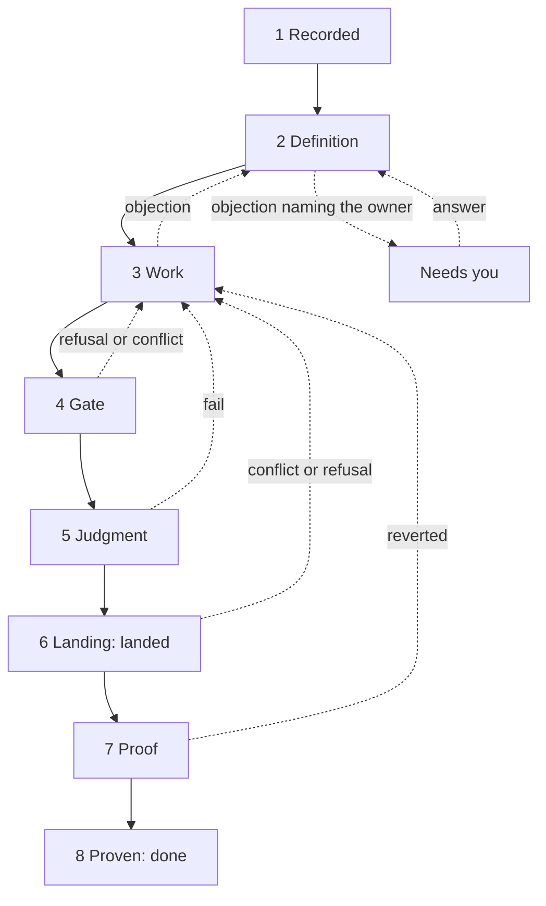

# One word per thing: the vocabulary of tillr's items, nodes, runs, sessions and worktrees

**Status:** every question is ruled. Built: the deny-list that replaces per-item fences ([Section 5.1](#51-the-work-and-its-statement)), the `git-landing` name, item-owned worktrees and ended-item scratch collection (slice 2 of [Section 9](#9-drafted-items), with `<root>/.tillr/items` as the default lane root on fresh checkouts), and worktree count/disk bounds and on-demand restoration (slice 3 of [Section 9](#9-drafted-items)). Not built: the running-agent limit, per-writer checkouts and joins, the Observatory's Running work view, and the `proven` item state. Existing checkouts that already have `<root>/.tillr/lanes` keep it until moved with `--lane-root` (`D-VO18`). Where shipped code uses a word differently, the entry says so.

> **In short:** Three words carried several meanings each (item, run, lane), and that is why the stages of a change could not be told in one breath. This document gives each word one meaning, retires the words that have none left, and names the stages of a change once.

- **Why it matters:** saying what an item that lands a change delivers needed "run" in three senses and "lane" in four.
- **The shape:** an **item** has one **graph**; the graph's started nodes are the item's **path**; execution data (**segments**, lease, log, outputs, ending, spend — what stored tables and flags call a **run**) belongs to its **node** ([`D-VO3`](#D-VO3)); an agent node speaks in one **session**, which later nodes resume or fork; an item owns one **item branch** and acquires one primary **worktree**, plus an isolated checkout per concurrent writer when its plan runs writers in parallel ([`R-VO3`](#R-VO3), [`D-VO15`](#D-VO15)).
- **Cost:** "lane", "attempt", "node run", "hold" and eight other words leave the documents and what the owner reads; flags, stored names and paths that carry them stay as aliases ([Section 6](#6-renames)).
- **Start at:** [Section 4](#4-the-stages-of-a-change) for the stages, then the three sections before it for the three words.
- **Needs your ruling:** None.
- **Designer's decisions:** the `D-VO` rows of [the ledger](#decision-ledger) other than `D-VO3` are engineering decisions, not the owner's rulings, and the owner may overturn any of them. Under [`OQ-PR21`](../tillr/decision-provenance-review.md#OQ-PR21) they do not hold up building.
- **Reads with:** [the graph design](./tillr-graph-is-the-path.md) (the direction these words must fit; its own terms are linked here, not redefined), [the direction document](./tillr-core-and-git-landing.md) (whose naming question is settled here as [OQ-VO4](#OQ-VO4) and [OQ-VO5](#OQ-VO5)), [the landing call](./tillr-landing-call.md) (keeping a worktree after landing rests on [Section 3.3](#33-the-life-of-a-worktree)). There is no companion plan: [Section 9](#9-drafted-items) holds the work this design surfaced.

---

## 1. What an item is

**An item is one piece of work the queue tracks under one id, with one deliverable and one ending.** It exists from the moment it is recorded. A document block is not what makes it an item: the block is the written form of the item's definition, and an item gains one during the definition stage.

"Work declared in tracked Markdown" is the intuitive definition and it is wrong: the store holds items that no document declares, and the triage procedure exists to give such an item its block. [The design index](../tillr/design-status.md#read-this-first) defines an item this way too.

**The test for "is this an item?"** Does it have a deliverable of its own that lands on the trunk, and an ending of its own? Then it is an item. Does it act on another item's deliverable? Then it is a node in that item's graph.

| What exists today | In this vocabulary | Why |
| :--- | :--- | :--- |
| Something filed with no block (`tillr item apply`) | An item; specifically a **request** | It is the work. Giving it a block is a triage node in its own graph |
| The owner's saved words (`item-idea-…`) | An item; specifically an **idea** | Its deliverable is the blocks or the questions it lands |
| An item declared by a block | An item | The ordinary case |
| Trunk fixer (`fixer-main-…`) | An item; a **generated item** called the **mechanic** | It lands its own commit and has its own criterion |
| Tooling-defect item (`defect-…`) | An item; a generated item | It lands its own commit, and other items wait on it |
| Comment item (`item-comments-…`) | An item; a generated item | It lands its own replies |
| Rewrite item (`rewrite-<id>`) | **Not an item.** A rewrite node in the original item's graph | It changes the original's block and delivers nothing of its own. The stored item is a stand-in until the graph design's rewrite kind is built |
| Revert (`revert-main-…`) | **Not an item.** A land attempt node in the graph of the item it reverts | It carries no model and no deliverable. The code stores no item for it |
| Triage, design answer, conflict fix | **Not items.** Nodes | Each acts on its item's definition or branch |
| Gate-budget alarm (`gate-budget-…`) | **Neither.** A reported measurement | A measurement has no deliverable |

So a generated item is an item in every respect but one: it has a definition (its criteria, held in the store) and never a block. It is listed with the items people wrote and carries a "generated" mark, and it counts in "draining" like any other (`D-VO11`).

---

## 2. What a run is

**Execution data belongs to the node in the item's graph ([`D-VO3`](#decision-ledger), an owner ruling).** An item has a graph, the graph has nodes, and each node holds the data about what it executed. A node executes at most once for its whole life across interruptions. What the stored tables (`runs`, `node_runs`) and the command-line flags of [`tools/tillr-run/`](../../tools/tillr-run/) and [`tools/tillr-drain/`](../../tools/tillr-drain/) call a **run** is that node's own execution record: its process segments, log, lease, declared outputs, ending and spend. It does not stand beside the graph as a peer entity, and it is never the unit in which an item's progress is told.

"Run" is used in three senses: one process execution (the `runs` table), an item's whole try (the observatory's help text: "one recorded attempt by an agent to work on an item in a lane"), and a node's single execution across crashes ([the graph design](./tillr-graph-is-the-path.md#32-what-is-fixed-and-when)). This vocabulary keeps the third, as data on the node, which contains the first as segments, and gives the second its own word, **path**.

| The question | The word | Notes |
| :--- | :--- | :--- |
| What is the whole thing that happened to an item? | Its **path** | The started nodes of its graph, in order |
| What is the unit of progress? | The **node** | One act. "Item X is at node 7 of 10" |
| What is one agent node's execution record? | The node's execution (an **agent run** in tables and flags) | Belongs to the agent node |
| What is one command node's execution record? | The node's execution (a **command run** in tables and flags) | Belongs to the command node. No model, no session, no spend |
| What is the conversation? | A **session** | One harness conversation. It outlives the node that started it |
| What is one process lifetime? | A **segment** | A node killed twice has three segments in its execution record and is still one node |

**How a session spans nodes.** A session is an asset a node leaves behind. A **resume** node continues it with one new message: same session, new node, with its own execution record. A **fork** node starts from a copy: a new session whose history begins as the old one's. A **backend move** starts a new session that reads the old transcript as a file. Recovery after a crash is none of these: it is the same node, the same execution record (a new segment) and, where the harness can reopen it, the same session.

**A worked example: one item whose graph has ten nodes, eight agents and two commands.**

- **One item, one graph, one path.** That is the answer to "how is it going": the path so far, and the stage it is in.
- **Ten nodes:** eight agent nodes and two command nodes.
- **Ten execution records** (stored as ten `runs` rows and ten `node_runs` rows), one belonging to each node, with ids `run-<item>-a1-n1` to `-n10`. Nobody counts them apart from their nodes.
- **Between one and eight sessions.** Each agent node either starts a session or resumes one. The two command nodes have none.
- **If node 6 is killed twice by a host restart:** still ten nodes. Node 6's execution record has three segments and two exception records.
- **If the gate refuses the result:** an eleventh node is added, a resume of the node that wrote the change, with its own execution record and no new session. The path grows; nothing restarts, and there is no second "attempt".

Under the graph design the take-in, the gate run and the land attempt are nodes too, so the same item's path shows them after the ten. Today they are a bracket outside the graph with no node of their own.

---

## 3. What a lane was, and the worktree as a resource

**The word "lane" is retired.** It names four things at once: a slot in a fixed pool, a git worktree, a directory of per-run scratch, and a lease. Each has its own word: the **running-agent limit**, the **worktree**, the **scratch** and the **lease**. Nothing is left for "lane" to mean, so documents, the view and every new flag or record stop using it. The flags, stored rows, paths and events that carry it stay as aliases, including the three names [the stable surface](./tillr-separable-parts.md#21-the-stable-surface) gives consumers (`--lane-root`, `TILLR_LANE_ID` and `tillr run lanes`). [Section 6](#6-renames) lists each.

Two owner rulings set the model:

- **A worktree is a resource acquired by whatever needs it, and that is the item** ([`OQ-VO1`](#OQ-VO1), [`OQ-VO2`](#OQ-VO2)). The number of worktrees outstanding is bounded, because they cost disk space and performance, and the bound is met by a lifecycle and collection, not by a fixed pool that work is shuffled through.
- **A lane has no life of its own** ([`R-VO4`](#decision-ledger)). An item is scheduled, it runs, and its execution has a worktree.

None of this section is built: the drain schedules onto `.tillr/lanes/lane-N`, and `tillr drain scale --lanes` sets how many there are. [The graph design](./tillr-graph-is-the-path.md) carries the matching rules ([Section 7](#7-what-the-graph-design-carries)).

### 3.1 Where the disk goes

Measured with `du -sh` over `.tillr/lanes` in a checkout running twenty lanes: one lane's worktree is about 62 MB, one lane's per-run scratch is 14 GB to 21 GB, the largest scratch directory of a single run is 2.0 GB, and all lanes together hold 140 GB.

Twenty worktrees are about 1.2 GB. The rest is scratch: test binaries and build output of runs that have ended. A lifecycle that covers only worktrees would address one percent of the bytes, so the scratch is part of the resource.

### 3.2 Who holds what

- **A worktree has exactly one owner.** For sequential item work the owner is the item; for concurrent writing nodes of one item, each writer owns its per-node checkout until the writers join back onto the item branch. The full suite and a revert each use a worktree owned by their own node, deleted at that node's ending. A worktree with no owner is a defect and is collected.
- **An item owns one item branch and one primary worktree, and its plan decides when writers run in parallel** ([`R-VO3`](#decision-ledger), an owner ruling that overturns [`OQ-IG3`](../reference/tillr-item-graphs.md#why-its-this-way)). The primary worktree (`.tillr/items/<item-id>/worktree`) is a checkout of the item branch at a path derived from the item's id; every single writing node, and any read-only nodes sharing a frontier, run there.
- **Concurrent writers get isolated checkouts and an explicit join** ([`D-VO15`](#decision-ledger), specified in [the graph design, Section 3.8](./tillr-graph-is-the-path.md#38-concurrent-writers-checkouts-and-the-join)). When a plan places two or more writing nodes in parallel with no ordering edge between them, each acquires its own node checkout (`.tillr/items/<item-id>/nodes/<node-id>/worktree`, with node-scoped scratch beside it) cut from their shared item-branch frontier commit, and commits to its own pinned node ref. They reconverge at a **`join`** command node that three-way merges the sibling trees (`git merge-tree --write-tree`) onto the item branch before `verify` or `gate` runs. When the siblings cannot merge cleanly, neither commit is discarded: policy routes to a conflict-reconcile writer node on the primary worktree, and an identical repeat goes to `design`. Once joined, or pinned on a conflicted join, the per-node checkouts and their scratch are deleted; while active they count toward the bounds of [Section 3.4](#34-the-bound-and-what-happens-at-it). Shipped code serializes an item's writers on one checkout (`claimParallelWithShut` in [`parallel.go`](../../tools/tillr-drain/drain/parallel.go)).
- **An item has one primary scratch directory beside its worktree,** outside the tracked tree. It is a cache. Nothing in it is evidence, a node's declared outputs are copied out of it at the node's ending, and nothing in it is promised to survive the node that wrote it.
- **The item branch is not the worktree.** The store pins the branch head, and each parallel writer's node commit, so deleting a worktree loses no commit.

### 3.3 The life of a worktree

| State | Meaning | Enters when |
| :--- | :--- | :--- |
| **None** | The item has no worktree | The item is recorded |
| **In use** | A node of the item is running in it | The claim of a node that needs it. The claim creates it from the latest trunk, or restores it at the item-branch head, then takes the trunk in |
| **Idle** | It exists and no node of the item is running | The last node running in it ends |
| **Collected** | The directory and the scratch are deleted. The branch head is pinned and the worktree can be restored | Collection (below) |

Restoring puts the worktree back at the same path, because some harnesses find a session by its working directory. A session must not live only in a directory that collection deletes: its id and transcript location are part of the ending of the node that produced it.

**Collection runs at three moments and on no timer:** when a node ends, when an item ends, and before a claim that needs a worktree. It deletes, in this order:

1. **The worktree and scratch of an ended item** (proven, resolved elsewhere or closed). Always, at once.
2. **The worktree and scratch of an idle item whose wait names the owner or another item.** Always, at once: those waits are long, and restoring costs one checkout.
3. **Other idle worktrees, least recently used first,** only while the bound of [Section 3.4](#34-the-bound-and-what-happens-at-it) is exceeded. An item between its build and its gate keeps a warm worktree unless disk is short.

A landed item's worktree is idle, not ended: a revert sends the failure back to the session that wrote the change, which resumes there. It is collected for good when the landing is proven.

| Kept after collection | Deleted by collection |
| :--- | :--- |
| The item-branch head, pinned by a ref | The working directory |
| The path: every node, ending and exception record | The scratch: build output, test binaries, temporary files |
| Each node's declared outputs and its report | Untracked files in the worktree |
| The run logs, and the sessions with their transcripts | |

Run logs of ended items are records, not scratch. They are kept, and their total is reported beside the worktree figures; a bound on them is not designed here.

**Failure paths.** A collection that cannot delete a directory leaves it, reports it, and tries again at the next collection; nothing is counted. A restore that fails is an exception: the node has no ending and the same node resumes. Collection and claim are serialized per item, and a claim wins: an in-use worktree is never collected, and neither is one whose running node was interrupted, because that node has no ending yet.

**State that already exists.** Every per-run scratch directory under `.tillr/lanes` belongs to a run that has ended or to a lane no item owns, so all of it is collectable when the lifecycle first runs.

### 3.4 The bound, and what happens at it

The owner's ruling requires a bound and names both costs, disk space and performance. The bound is therefore **two settings, and collection starts at whichever is reached first** (`D-VO10`):

| Setting | What it bounds | Default | Why that default |
| :--- | :--- | :--- | :--- |
| **Disk budget** | Bytes of all worktrees and scratch together | 4 GB times the running-agent limit: 80 GB at a limit of 20 | The largest scratch of one run measured 2.0 GB, so twenty running agents can hold 40 GB in use at once. Twice that leaves room for idle worktrees, so the loop does not sit at its bound |
| **Worktree count** | Worktrees on disk, in use and idle | Twice the running-agent limit: 40 at a limit of 20 | One in use and one idle per running agent. A backstop for the cost of many checkouts, which is not measured |

Both are settings with these defaults; neither is a fixed number in code. The disk budget is the one that binds in practice. A budget below the working set (20 GB to 40 GB at a limit of 20) would keep every new node waiting.

**At the bound, no work fails.** Idle worktrees are collected until the total is under the bound. If every worktree is in use, no new one is created: the node that needs one stays in fog, and the wait it produces names its mover, the ending of a node now running in a worktree, by that node's id. A running node is never stopped for exceeding the budget; the overshoot is reported with the largest scratch directories named.

### 3.5 What limits how many agents run at once

With a pool, `--lanes N` means N agents because it means N worktrees. This design separates the two, and **the running-agent limit** (`D-VO6`) replaces the lane count across scheduling, flags and runtime configuration:

- **The running-agent limit** is the number of agent nodes in progress at once, overall and per backend. It is set by `--max-agents` and stored as `running_agents`, with `--lanes` and `tillr drain scale --lanes` kept as documented aliases (`D-VO9`). It replaces the numbered pool and the express slot reservation of `.tillr.toml`'s `[lanes]` table. It is a scheduling setting in the sense of [the graph design's scheduling section](./tillr-graph-is-the-path.md#6-scheduling): it ends, refuses and re-routes nothing. Its default is the `--lanes` default. Parallel nodes of one item take one slot per running agent, and run one after another when the limit is `1`.
- **At the limit,** ready ordinary nodes stay in fog with the wait reason `agent-limit` (replacing `no-lane`), naming the running agent nodes as mover.
- **Work the owner is waiting on** (`express = true`) runs outside the limit, with no pool directories set aside for it, as `D-IG10` of [item graphs](../reference/tillr-item-graphs.md#why-its-this-way) rules. That replaces "express lanes".
- **Command executions** (`gate run`, `join`, `take-in`, `land attempt`) do not count against the limit. Landing is one at a time because one program moves the trunk; how many gate executions run together is a resource setting whose default is the implementer's to measure.

### 3.6 What the Observatory shows instead of lanes

What replaces the lane surfaces in [`tools/tillr-view/`](../../tools/tillr-view/) (`D-VO16`):

- **Header bar:** `R of L running`, the active ordinary agent nodes against the running-agent limit, with the count of owner-awaited nodes running outside the limit, or `0 of L running · idle`. It replaces the `LanePill` in `ObservatoryHeaderBar.tsx`. Idle worktrees on disk are never counted as slots.
- **Home:** a **Running work** section in place of `LaneStrip`: a summary line with `R of L running`, the worktrees on disk, and the bytes of worktrees and scratch against the bounds of `D-VO10`, then one row per running node with its item, node id and kind, seat, backend, elapsed time, liveness, latest action and spend. When nothing is running there are no rows.
- **Item page:** segments, logs, lease, declared outputs, ending and spend are shown on each node of the item's drawn graph, because execution data belongs to its node ([`D-VO3`](#D-VO3)). The lane page (`LanePage.tsx`) stops being a primary screen and stays only as a route to stored lane records (`D-VO9`).
- **Glossary** ([`glossary.json`](../../tools/tillr-view/web/src/models/glossary.json)): `run` is one node's execution record, `lane` is marked retired, `session` is one harness conversation and the loop's lifetime is a `loop`, `hold` becomes `wait`, and `node` and `path` are added (`D-VO12`).

---

## 4. The stages of a change

**What an item that lands a change delivers:** one squashed commit on the trunk that makes every criterion true, passes the gate and survives the proof. Its block is deleted in that same commit, because a block declares open work only.

**Stage** *(coined here for this sense)* is one of the eight named steps below. A step of a workflow, which item graphs call a stage, is a **step**.

| # | Stage | Who acts | What it produces | Each kind of "no", and where it goes |
| :--- | :--- | :--- | :--- | :--- |
| 1 | **Recorded** | The owner, an agent, or the loop for a generated item | An item: an id and what was asked | None |
| 2 | **Definition** | The design seat (triage, design answer); a cheap seat (rewrite); the owner, by answering | The item's definition and criteria | An **objection** naming the owner, with a written question: the item is in "needs you" until the owner answers. A finding of duplicate or already done: the item ends **resolved elsewhere** or **closed** |
| 3 | **Work** | The build or design seat | Commits on the item branch; the head is the **candidate** | An **objection**, with one **obstacle kind**. It goes to the actor it names. The work itself ends `submitted` |
| 4 | **Gate** | Commands: the take-in, then the gate run | A **gate verdict** bound to the candidate as taken in | A **refusal**, with the failing checks, back to the session that wrote the change. A **conflict** at the take-in, with paths, back to the session that last wrote them |
| 5 | **Judgment** | A judge: a read-only agent that did not write the candidate | A **criterion verdict** for each criterion | A fail with findings, back to the session that wrote the change |
| 6 | **Landing** | A command: the lander | One commit on the trunk tip. The item is **landed** | A **conflict** with paths, or a lander **refusal** with a reason from its closed list. Both go back to the session that wrote the change |
| 7 | **Proof** | A command: the full suite on a trunk commit | A green pointer that has moved to or past the landing | **Reverted:** the proof named this landing, an automatic revert landed, and the failing check's output goes back to the session that wrote the change. If a revert is unsafe or does not repair, the mechanic is filed instead |
| 8 | **Proven** | Nobody | The item's ending, **done**. The proven commit is pushed | None |

Where the judge sits relative to the gate is the workflow's choice; both come before the landing. A gate or a suite that could not run is not a "no": it is an exception, and the same node resumes.

**Landed and proven are different, because the landing strategy is after-merge.** The item is finished at the second ([OQ-VO6](#OQ-VO6)).

| | Landed | Proven |
| :--- | :--- | :--- |
| What is true | The lander put the item's commit on the local trunk | A proof passed on a trunk commit that contains the landing, and no revert removed it |
| What the item has delivered | The change, provisionally: later work builds on it, and it can still be reverted | The change, finally |
| Pushed | No | Yes. Only the proven commit is pushed (`R-VO1`, a working assumption the owner asked to keep open) |
| The item | Not ended. Its worktree is idle | Ended **done**. Its worktree and scratch are collected |
| Where it shows | "Draining" | Finished |

Today `landed` is the last state the store has. The `git-landing` charter (in shipped code, the landing definition) lists one move out of it, `landed` to `in-queue`, which a revert uses. There is no `proven` item state: the difference lives in the green pointer, and the drain closes a landing call with the outcome `proven` (`landing_call_lifecycle.go`), which is a call event and not an item state. That is the largest gap between these words and the store.

**What is built for the ruling, in this order.** Neither step is built.

1. **A derived "proven" mark in the view.** The view shows an item as finished once the green pointer contains its landing and no revert has removed it, and until then shows it under "draining" as landed and awaiting its proof. Nothing is stored; the mark is read from the green pointer and the item's landing, so it cannot disagree with them. Work that depends on the item still starts when it lands.
2. **A stored state.** A "proven" item state, which is the `git-landing` charter's to add, with the move out of `landed` that a revert uses kept. A revert never takes a finished item back.

---

## 5. The words

Each term has one meaning. A term owned by another document is linked, not redefined. The last column marks where built code or another document uses the word differently.

### 5.1 The work and its statement

**There is no per-item fence** (`R-VO2`, an owner ruling). A list of allowed paths per item cannot be written correctly in advance, and an item held for a wider list is waste. The brief says: change what the work needs, nothing else. Filing, sync, staging and graph expansion need no list; a `paths` attribute on an existing block is ignored, not migrated.

Before the gate, every candidate is checked against one tracked deny-list, [`config/tillr/deny-list.json`](../../config/tillr/deny-list.json). A refusal names the matched entry and its reason and returns to the worker. Passing the check does not establish scope: the judge receives the changed paths and the diff, and names any path the request's words do not account for.

**Which worker may add a declaration (`D-VO13`).** The deny-list protects item-declaration comments, and two turns exist to add them: a saved idea's turn is briefed to write item blocks, and a triage turn on a stored request is briefed to write that request's block (`validateIdea` and `triageTask` in [`tools/tillr-drain/drain/`](../../tools/tillr-drain/drain/)). So the declaration entry is a content check with two exceptions:

- **It compares content, not paths.** It reads the candidate's changed Markdown files at the base and at the head, and compares the item-declaration comments by item id and by text. A declaration moved unchanged, within a file or between files, is neither an edit nor a removal.
- **Editing or removing a declaration that the base holds is refused for every worker.** There is no exception: not for a saved idea, a triage, a rewrite or a design answer.
- **Adding a declaration is refused, except in two turns.** A saved idea's turn may add declarations whose id is new (in no document at the base and on no row of the store) and which carry `from="<the idea's id>"`. A triage turn may add one declaration, with the id of the item it triages.
- **The loop decides which turn it is, from what it recorded:** the idea's intake record or the triage staging, never the candidate or the worker's report. A worker cannot claim the exception.
- **The turn's own check stays.** The checks before the gate still require the idea's or the triage's outcome; this entry bounds what else the same candidate may do to declarations.

> [!WARNING]
> Do not exempt a saved idea's turn from the declaration check as a whole. Its turn could then edit or delete any other item's declaration.

An idea that needs the owner's answer leaves one design-seat item to cut it into build items. That later item is neither of the two turns, so its added declarations are refused. How a design-seat turn's document becomes queue items is not decided here.

**What the check reads (`D-VO14`).** The deny-list judges the candidate's committed change and nothing that merely moved while the run was open:

- **Its input is the branch's commits from the pinned base to the pinned head:** the changed paths, and for the declaration entry the file contents at both ends. That change is the worker's by construction, so every refusal rests on evidence that the run itself made the change.
- **The path entries cover what a commit can carry.** A committed path under `.tillr/` (the store and every lane directory) or under the fork checkouts directory is refused. The list has no entry for refs or Git internals, because no committed path can name them; an entry that could never match would only read as protection.
- **Shared state outside the commit stays with the run boundary check.** That check compares the repository before and after each run (`CompareRunObserved` in [`boundary.go`](../../tools/tillr-drain/internal/boundary/boundary.go)). It convicts the two things it can attribute, a write into an idle sibling lane's worktree and the run's own worktree going away. It records, without holding the item or refusing the candidate, a moved ref, another worktree's registration and a branch switch in the main checkout.
- **The brief still tells the worker what is not its to touch:** the refs, the store, other lanes and fork checkouts other than its own. That is an instruction, not a check.

> [!WARNING]
> Do not refuse a candidate because a protected ref moved during its run. A before-and-after difference cannot say who moved a ref: the owner's own Git use and a worker's write leave the same difference, and [landing principle 14](./landing-principles.md#14-convict-a-run-on-what-it-did-not-on-what-happened-while-it-ran) rules that ordinary Git use during a run never convicts it (`TestOrdinaryGitUseDuringARunNeverConvictsIt`).

**Not enforced:** a worker that moves a shared ref, writes the store directly or edits the shared fork cache without committing the result is recorded at most, and nothing stops it. Closing that gap needs evidence that names the actor, a sandbox per run or a record of which process made each write, which is a design of its own and would add convictions to the run boundary check, not entries to the deny-list.

**Stopping Git walk-up from lane directories and handling stray tracked `.tillr/` paths (`D-VO17`).** *(Designer's decision from an operator request of 2026-11-25 and an operator retry instruction of 2026-11-26; not an owner ruling, and the owner may overturn any part of it.)* On 2026-11-25, a test inside a lane's scratch tree ran `git commit` in a fixture directory that was not its own repository; because `.tillr/lanes/` sits inside the operated checkout, Git walked up to the trunk checkout and created unlanded commit `75e374025eef468eb798d6bf58cf31566bf95db6` (`"first"`, author and committer `"tillr"`) on `main` tracking `.tillr/lanes/lane-4/durable/run-item-request-aab6839c65-a1-n2/tmp/go-shards-1n3lyhlr/package-3-shard-1/TestLandingCallDeliversRefusalsA-4118807249/001/lanes/item-a/worktree/.forks/outside.txt`, and on the same day a lane worktree directory lacking `.git` caused loop Git calls there to act on the trunk checkout until `GIT_CEILING_DIRECTORIES` was set at `.tillr`. Five rules close that hole without narrowing `D-VO14` or rewriting history:

- **The `.tillr` deny-list entry refuses deletions too, and removing the stray `.tillr/` file from `main` is withdrawn from lane work.** `denyListViolation` in [`deny_list.go`](../../tools/tillr-drain/internal/boundary/deny_list.go) rightly refuses every `BaseSHA..HeadSHA` diff entry under `.tillr/` — additions, edits, and deletions alike. Removing commit `75e374025eef468eb798d6bf58cf31566bf95db6` (or its tracked `.tillr/` file) from `main` is the owner's decision outside lane fencing. Per the operator's 2026-11-26 revised instruction, a lane candidate must not delete or modify that stray tracked `.tillr/` file, and any request criterion asking a lane to remove it is withdrawn as not applicable; under `planned-build@v1`, `verify` records `verdict: "done"` on a withdrawn criterion with `reason` stating that it is not applicable as withdrawn by the operator's retry instruction and `evidence` naming `node:<id>` and `docs/design/tillr-vocabulary.md#D-VO17` (because `CheckJudge` in [`judge.go`](../../tools/tillr-item/item/judge.go) requires `verdict: "done"` across all stored criteria on `outcome: "pass"` while [`tillr-request-amendment.md`](./tillr-request-amendment.md) is not built).
- **The `tracked-tillr` fast whole-tree check refuses any tracked path under `.tillr/`, exempting only the one pre-existing stray path until the owner removes commit `75e374025eef468eb798d6bf58cf31566bf95db6`.** A fast `scope: "tree"` check `tracked-tillr` (`tools/gate/checks/tracked-tillr.json`, implemented in [`tree_common.go`](../../tools/gate/tree_common.go) via `git ls-files -z -- .tillr` under [the gate reference](../reference/gate.md)) refuses every tracked path under `.tillr/` except the exact pre-existing path `.tillr/lanes/lane-4/durable/run-item-request-aab6839c65-a1-n2/tmp/go-shards-1n3lyhlr/package-3-shard-1/TestLandingCallDeliversRefusalsA-4118807249/001/lanes/item-a/worktree/.forks/outside.txt` from commit `75e374025eef468eb798d6bf58cf31566bf95db6` (modeled on `scratchExceptions` in [`tree_common.go`](../../tools/gate/tree_common.go), without failing when that path is absent in clean test repositories or once the owner removes commit `75e374025eef468eb798d6bf58cf31566bf95db6`). That lets `tracked-tillr` pass `change-gate` and after-merge proof on `main` while catching any new tracked `.tillr/` path immediately.
- **Git discovery ceilings and worktree `.git` checks bound every lane, gate, proof, hook, shard, and loop Git call.** `Exec` in [`exec.go`](../../tools/tillr-run/run/exec.go), subprocess invocations in `ProcessSteps` ([`steps.go`](../../tools/tillr-drain/drain/steps.go)), Go test shard and affected-package environments ([`shards/`](../../tools/tillr-gate/shards/), [`goaffected/`](../../tools/tillr-gate/goaffected/)), and the drain's own lane worktree Git calls (`Loop.git` in [`loop.go`](../../tools/tillr-drain/drain/loop.go), `LaneStager` in [`stage.go`](../../tools/tillr-drain/drain/stage.go)) set `GIT_CEILING_DIRECTORIES` so Git never walks past `.tillr` (or scratch) into the operated trunk checkout, and refuse a lane worktree directory that lacks its own `.git`.
- **Fixture Git helpers refuse `git commit` / `git commit-tree` outside a fixture's own repository.** Test Git helpers verify with `GIT_CEILING_DIRECTORIES` set to `filepath.Dir(absDir)` that the target directory is its own Git repository before running `commit` or `commit-tree`.
- **Unrecorded trunk commits neither advance `refs/tillr/green` nor push, and raise an alarm.** Before advancing `refs/tillr/green` (`HeavyRunner.RunAttempt` and `HasLandingRecord` in [`heavy.go`](../../tools/tillr-drain/heavyrun/heavy.go)) or pushing the trunk (`Loop.pushTipOnce` in [`remote_sync.go`](../../tools/tillr-drain/drain/remote_sync.go)), tillr checks that every first-parent commit in `green..tip` has a `landings` record; an unrecorded commit withholds both `refs/tillr/green` and push and records an `unrecorded-trunk-commit` alarm ([`alarms/`](../../tools/tillr-drain/alarms/)).

| Term | What it is | What it is not | Identified by; belongs to; has | Today's usage differs |
| :--- | :--- | :--- | :--- | :--- |
| **Item** | One piece of work the queue tracks under one id, with one deliverable and one ending | Not a document block, and not anything that acts on another item's deliverable | Its id, chosen by its author or made by the tool that filed it. Has one definition, one graph, one item branch, one primary worktree (plus temporary per-node checkouts while parallel writers run) | Sync and the planner still treat an item with no block as incomplete |
| **Request** | An item that has no block yet | Not the record handed to `tillr run exec`, and not a row of the idempotency table | Any item id | The code also says request for `run.Request` and `item_requests` |
| **Idea** | A request saved from the owner's own words, whose deliverable is the blocks or questions it lands | Not a kind column; none is built | `item-idea-` and ten hash digits | — |
| **Generated item** | An item the loop files for work nobody asked for by hand: the mechanic, a defect item, a comment item | Not a rewrite, a revert or an alarm ([Section 1](#1-what-an-item-is)) | An id prefix. Has criteria and no block | The code's generated set also holds `rewrite-`, `revert-main-` and `gate-budget-` |
| **Mechanic** | The owner's word for the generated item that makes a red trunk green | Not a revert | `fixer-main-` and twelve hex digits of the red commit | Code and ids say "fixer" |
| **Defect item** | The generated item filed when a worker's objection names broken tooling | Not a failure of the item that reported it | `defect-` and twelve hex digits | — |
| **Definition** | What an item is to deliver: title, reason, criteria and dependencies | Not the file that turns the core into one use, which the owner named the charter and shipped code still calls a definition ([OQ-VO4](#OQ-VO4)), and not a node's kind and brief | Belongs to one item. The one in force is the latest revision in the item's graph | Three meanings; see [Section 6](#6-renames) |
| **Block** | The written form of a definition: a heading and an item directive in a tracked document | Not the item. An item can exist without one | The item id in the directive | — |
| **Criterion** | One testable condition of a definition | Not a gate check | An id within its item | — |
| **Fence** (retired) | A per-item list of allowed paths | Not the deny-list, which is one list for every worker | A `paths` attribute on a block neither grants nor withholds permission | Sync ignores the attribute |
| **Deliverable** | The one squashed commit an item puts on the trunk | Not a fork's delivery, which goes to that fork's delivery branch | The landing's trunk commit | — |
| **Charter** *(the owner's word, ruled in [OQ-VO4](#OQ-VO4); shipped code still says "definition")* | The statement of one use of tillr: its purpose, and the rules that follow from it. In the tree it is a data file (item states, allowed moves, prerequisites and the completion rule) with one hook program beside it | Not an item's definition | A name, such as `git-landing` (that name is [OQ-VO5](#OQ-VO5)) | Shipped as the flag `tillr store init --definition`, the stored key `store.definition`, the event `store.definition.set` and one Go package. Documents say "the landing charter" for the Git one; the code rename is not built |

### 5.2 The graph, and what executes

`Item graph`, `in fog`, `fixed`, `done`, `claim`, `ending`, `asset`, `event`, `exception`, `premise`, `fact`, `policy function`, `take-in` and `seat` keep the meanings of [the graph design's word table](./tillr-graph-is-the-path.md#2-the-words).

| Term | What it is | What it is not | Identified by; belongs to; has | Today's usage differs |
| :--- | :--- | :--- | :--- | :--- |
| **Path** *(coined here; the word is from the graph design's title)* | The nodes of an item's graph that have started, in order: what has happened to the item | Not the fog, and not one pass of several | The item. Has nodes | The grouping the code calls an attempt (`a1`, `a2`) |
| **Workflow** | A tracked, reviewed file of steps that an item's graph starts as | Not the graph, which changes as nodes are added | A file name. Has steps | The graph design says "template" |
| **Step** | One entry of a workflow; it becomes one node or names another workflow | Not a stage of a change | An id within its workflow | Item graphs and the code say "stage" |
| **Node** | One act on an item: an agent's invocation, a command, a landing, or a question put to the owner | Not a step, and not a separate peer of its own execution record | A path id within its item. Has a kind, a claim, an ending and its own execution data ([`D-VO3`](#D-VO3)) | The gate and the landing are not nodes yet; execution data sits in separate `runs` and `node_runs` tables |
| **Agent node, command node, person node** | A node executed by a harness, by a tracked command, or by a person | — | — | — |
| **Run** | The storage name for one agent or command node's execution data, from its claim to its ending, across every interruption ([`D-VO3`](#D-VO3)) | Not an independent entity beside the node, not the item's whole try, and not a unit of progress | Belongs to its node and shares its identity. Holds one or more segments, a log, a lease, outputs and a spend | [Section 2](#2-what-a-run-is). The observatory's help text defines it as an attempt |
| **Segment** | One process lifetime within a run | Not a run. A new segment is never a new node | An ordinal within its run | The code records `run.resume` events, not segments |
| **Recovery** | Carrying on the same node after an exception: a new segment of the same run | Not a resume, which is a new node | — | `tillr run exec --resume` and `run.resume` mean this |
| **Resume** | A node that continues an earlier node's session with one new message | Not recovery | Its own node id | The code's "returned turn" (`session_turn`): a new run id in the retained session |
| **Fork** | A node that starts from a copy of an earlier node's session | Not a resume: the original is untouched | Its own node id | — |
| **Session** | One conversation with a harness: the transcript a model continues from | Not the loop's process lifetime, and not the owner's own interactive session | The harness's session id. Produced by one node, used by any number of later ones | Four other senses; see [Section 6](#6-renames) |
| **Hoisted child** | A sub-agent of a running node, recorded as a node within it ([the graph design](./tillr-graph-is-the-path.md#9-subagent-hoisting)) | — | — | Item graphs: "child session", never a node |
| **Harness** | The agent program that holds a session: pi, Claude Code and the like | Not a backend | — | — |
| **Backend** | One row of the backend policy: a harness, a model route and its limits | Not a seat. A seat is the role; the backend fills it | A name in the backend policy | — |
| **Adapter** | The program that starts one harness for tillr and turns its output into one report | Not the harness | — | — |

### 5.3 Places and capacity

| Term | What it is | What it is not | Identified by; belongs to; has | Today's usage differs |
| :--- | :--- | :--- | :--- | :--- |
| **Item branch** | The commits an item's nodes have made, on top of the trunk commit last taken in | Not the worktree | A head pinned in the store. Belongs to one item | Today the branch is the lane's: `tillr/<scope>/<lane>` |
| **Worktree** | A [git worktree](https://git-scm.com/docs/git-worktree) checked out at an item branch (or at a parallel writer's shared frontier commit), acquired by the item | Not a slot. Primary item worktrees can be deleted and restored without loss; per-node writer checkouts are deleted once joined | Its item's id (plus node id for concurrent writers) | Part of a lane; deleted and recreated at each staging |
| **Scratch** *(coined here)* | The directory beside a worktree where nodes put build output, test binaries and temporary files | Not evidence, and not where a declared output lives | Its item's id (plus node id for concurrent writers) | One directory per run under the lane, never deleted |
| **Collection** *(coined here)* | Deleting a worktree and its scratch while keeping the item branch and the records | Not the end of the item | — | Only refs are swept today |
| **Running-agent limit** | The number of agent runs in progress at once | Not a bound on worktrees or on disk | A setting, overall and per backend | `--lanes N` |
| **Lease** | The liveness record of a running run | Not a claim, and not a hold on anything. Its lapse is an exception | Its run | A lane's lease, with an expiry |
| **Lane** | **Retired.** | — | — | A pool slot with a worktree, a scratch directory and a lease |

### 5.4 Checking and landing

| Term | What it is | What it is not | Identified by; belongs to; has | Today's usage differs |
| :--- | :--- | :--- | :--- | :--- |
| **Candidate** | An item-branch head offered for landing, together with the trunk commit it was taken in on | Not a stored row and not a queue entry | A base commit and a head commit | — |
| **Gate** | The fast checks a candidate must pass before it lands, inside a tested ten-second budget ([gate reference](../reference/gate.md)) | Not the full suite, and not the repository's `just done` | — | Also used for the full suite ("the full, untiered gate") and for the loop step |
| **Check** | One declared test the gate or the full suite runs | Not a criterion | A file under the checks directory | — |
| **Gate verdict** | The gate's recorded answer on one candidate: pass, fail, or could not judge | Not a criterion verdict. "Verdict" is never used bare | Bound to a base commit and a head tree | — |
| **Criterion verdict** | A judge's or the owner's recorded answer on one criterion: done, not-done, blocked or defective | Not a gate verdict | The item and the criterion id | — |
| **Judge** | A read-only agent node that evaluates a candidate it did not write | Not the gate, and not the loop's examination of a finished run | Its node id | The loop action `judge` also means examination |
| **Lander** | The one program that moves the trunk | Not a queue | — | — |
| **Landing** | One act of the lander that put a commit on the trunk | Not the item's ending | A landing id. Belongs to one land attempt node | One row for every landed commit, design answers and triage included |
| **Landed** | An item whose deliverable is on the trunk and not yet proven: a **provisional landing** | Not finished | — | The final stored state |
| **Proof** | One run of the full suite on one trunk commit | Not the gate | The trunk commit | "Heavy tier", "rolling", "after-merge heavy run", "rolling audit" |
| **Proven** | A landing contained in a trunk commit whose proof passed, and not reverted: a **proven landing** | Not merely unreverted so far | The green pointer at or past the landing | No `proven` item state (`landing_call_lifecycle.go` closes a landing call with outcome `proven`) |
| **Full suite** | Every check, as the proof runs them | Not the gate | — | "Heavy tier" |
| **Trunk; tip** | The repository's shared branch; its newest commit | — | — | — |
| **Green pointer** | The ref naming the newest proven trunk commit ([gate reference](../reference/gate.md)) | Not a branch | `refs/tillr/green` | — |
| **Red** | The trunk after a proof ended in failure | Not "unproven". An unproven trunk is not red | The failing trunk commit | The red cap also holds on "unproven" |
| **Revert** | A landing, with no model in it, that removes one proven-bad landing | Not an item, and not the mechanic | `revert-main-` and twelve hex digits. A land attempt node of the reverted item | Also an item state move out of `landed` |
| **Pin** | A git ref whose only job is to keep a commit reachable for a record | Not a model pin and not a session pin | `refs/tillr/…` | — |

### 5.5 Saying no, and waiting

| Term | What it is | What it is not | Identified by; belongs to; has | Today's usage differs |
| :--- | :--- | :--- | :--- | :--- |
| **Objection** | The ending by which an actor says it should not continue and names who acts next ([the graph design](./tillr-graph-is-the-path.md#33-endings)) | Not a failure, and not a refusal | Its node | "Blocked", and a stored "conflict" (`conflict-<run id>`) |
| **Obstacle kind** | The kind of a worker's objection, from a closed set: definition, trunk, tooling, seat, owner ([`D-JL11`](./tillr-judge-and-lifecycle.md#45-what-a-worker-may-end-with-d-jl11)), plus `delivery`, proposed in [`D-JL15`](./tillr-judge-and-lifecycle.md#48-planning-time-fork-delivery-the-delivery-obstacle-and-patch-branch-refusal-d-jl15) | Not an open list | The `OBSTACLE:` line of a report | — |
| **Refusal** | A checker's "no" about what the candidate is, with evidence: from the gate, from tillr's checks at a node's end, or from the lander | Not an objection (the worker's "no"), not an exception (the machinery failed), not a rejection | The ending of the checking node | Also used for a lane that staging refuses and for a store command that is rejected |
| **Rejection** | The store declining a command | Not about a candidate | — | `item.rejection`; READMEs also say "refusal" |
| **Conflict** | Two changes to the same lines, found at a take-in or at a landing, with the paths | Not an objection | The paths | Also the stored record of an objection |
| **Return** | Sending a refusal, a conflict or a revert back to the session that wrote the change, as a resume node carrying the evidence | Not a retry: nothing is counted | The resume node | Reason `returned-with-evidence` |
| **Reverted** | The state of a landing that a proof proved bad and a revert removed | Not red | — | Reason `landing-reverted` |
| **Wait** | A derived statement that nothing is added after some ending yet, with the reason and the mover (the graph design) | Not stored, and not cleared by anyone | — | A stored "hold" with a reason, the item state `blocked`, the position `held` |
| **Mover** | The actor or fact a wait names ([landing principles](./landing-principles.md#13-a-held-state-names-a-mover-that-can-still-act)) | Never "someone" | — | — |
| **Draining; needs you** | The owner's two categories of unfinished items: every item whose wait names the owner by a question is "needs you"; every other is "draining" | Not states of the store | — | The view shows more categories |
| **Owner question** | A numbered question in a design document that only the owner rules on; in the graph, a person node from asked to answered | Not a ledger row, though both carry an `OQ-` id | Its `OQ-` id | — |
| **Supersession** | The finding that an item's change is already on the trunk | Not a refusal of the work | Lander reason `already-on-trunk` | Also a retry replacing a run, and a document replacing a document |

### 5.6 The machinery

| Term | What it is | What it is not | Today's usage differs |
| :--- | :--- | :--- | :--- |
| **Whale** *(coined here)* | The coordinating AI session the owner talks to, which operates tillr on the owner's behalf: it files items, starts and watches the drain, clears faults, and records delegated decisions under `whale` ([authority reference](../reference/authority-not-approval.md#terms)) | Not a lane worker (a worker builds one item in one lane; the whale steers the whole drain and never is a lane), and not the owner | Also called "the operator" or "the operating agent" in older docs; the store's `decided_by` field already spells it `whale` |
| **The drain** | The program that moves items along their paths; "draining" is the queue emptying | Not one process | — |
| **Loop** | One long-running process of the drain | Not a session | Its lifetime is called a "session" (`drain_sessions`) |
| **Pass** | One review of the queue by the loop | Not a tick | "Tick" survives in a table and a column name |
| **Generation** | The ordinal of a pass ([drain successor](../reference/tillr-drain-successor.md#generations-timing-and-the-trigger-loop)) | — | — |
| **Dispatch** | Starting a node's run | Not a decision to start one | — |
| **Backend policy; gate policy** | The file mapping seats to backends; the file of landing settings | "Policy" is never used bare; neither is the graph design's policy function | — |
| **Gate plan; queue plan** | The list of checks a gate run will run; the graph design's queue-level node | "Plan" is never used bare | Also the loop's pass plan and `tillr drain plan` |
| **Operator retry** | The owner's or an operator's command that adds a node after an ending the rule table adds nothing for | Not a count and not a budget | A stored authorization that starts a new attempt |
| **Pause** | An exception requested on purpose: the run stops between tool calls and recovers later | Not an ending | "An attempt outcome" |

### 5.7 Words for "a landing is a suspended tool call"

[The landing call](./tillr-landing-call.md) works out that mechanism. These are the words it needs; nothing here decides how it works.

| Term | What it is | What it is not |
| :--- | :--- | :--- |
| **The call** *(coined here)* | The tool call by which a worker's session says its candidate is ready and asks for it to be landed. It is the written form of the work node's `submitted` ending | Not a command the worker runs itself, and not the landing |
| **Suspension** | The state of a session whose call has no answer yet. No process runs and no node is running; the session is an asset with an open call | Not a pause, which is an exception, and not a wait, which belongs to the policy function |
| **The answer** | The result delivered to the call. It arrives as the first message of a resume node | Not an event the session must poll for |
| **A refusal** (as an answer) | An answer that carries a "no" from [Section 4](#4-the-stages-of-a-change): a gate refusal, a conflict, a lander refusal or a revert. It is the only answer that makes the session work again | Not an objection, which is the worker's own ending |
| **Provisional landing; proven landing** | The landed and proven of [Section 4](#4-the-stages-of-a-change), as answers | — |

Which of the two landings ends the suspension is that design's question, not this one's.

### 5.8 Retired words

| Word | What to say now |
| :--- | :--- |
| **Attempt** | Nothing. Returned work is new nodes on the same path |
| **Lane; express lane; lane cap** | Worktree, scratch, running-agent limit; "work the owner is waiting on" |
| **Desk** | The comment item's worktree and the document's session. [Designer sessions](../reference/tillr-designer-sessions.md#the-desk) owns the word and decides whether it stays |
| **Node run** | Run |
| **Child session** | Hoisted child |
| **Hold; held; blocked** | Wait, with its mover |
| **Tick** | Pass |
| **Fixer; repair item** | Mechanic; generated item |
| **Template** (of a graph) | Workflow |
| **Stage** (of a workflow) | Step |
| **Continuation** | Recovery, or a resume, whichever it was |
| **Heavy tier; rolling; landing tier** | Full suite and proof; the gate |

---

## 6. Renames

"Alias" means the old spelling stays in code or in stored data and is documented as meaning the new word. No rename is planned here. Each verdict in the last column is a designer's decision (`D-VO12`).

| Today | Settled word | Where it appears | Rename, or alias? |
| :--- | :--- | :--- | :--- |
| "run = one recorded attempt by an agent" | Run = one node's execution; the whole is the **path** | The observatory's [`glossary.json`](../../tools/tillr-view/web/src/models/glossary.json); view labels | **Rename the text.** It is what the owner reads |
| `runs` table, `run_id`, `run.*` events | Run | Store, events | Alias. The meaning already matches |
| `node_runs`, "node run" | Run | Store; [item graphs](../reference/tillr-item-graphs.md#the-words) | Alias in the store; reword the document |
| `a<N>` in `run-<item>-a<N>-n<k>`, `node_runs.attempt`, `Decision.Attempt`, `AttemptClass` | None: attempt is retired | Run and transition ids, code | Alias for stored ids. New ids stop carrying it when the graph design's storage is built |
| `exec --resume`, `run.resume` | **Recovery** | [tillr-run README](../../tools/tillr-run/README.md), events | Alias, documented. Worth renaming only with the resume node kind, when two things would otherwise share the word |
| `session_turn`, "returned turn", `returned-with-evidence` | **Resume** node; **return** | Run request, planner reason | Alias until the graph design's resume kind is built |
| "session" = the loop's process lifetime; `drain_sessions` | A **loop**'s lifetime | The observatory's glossary, store | **Rename the text**; alias the table |
| `lane-<n>`, `express-<n>`, `desk-<doc>`, `lanes` table, `.tillr/lanes/`, `--lanes`, `lanes leased: M/K`, `no-lane`, `drain.lane-*` | Worktree, scratch, running-agent limit (`--max-agents`), `agent-limit` | Flags, store, paths, events, scheduler | **Replace in scheduling and add `--max-agents`** ([Section 3.5](#35-what-limits-how-many-agents-run-at-once)); keep `--lanes`, stored rows and old events as aliases |
| Observatory `Lanes` (`LaneStrip`), `N/M lanes running` (`LanePill`), `#/lane/<id>` (`LanePage`) | **Running work**, `R of L running`, node execution on `#/item/<id>` | [`tools/tillr-view/`](../../tools/tillr-view/) ([Section 3.6](#36-what-the-observatory-shows-instead-of-lanes)) | **Replace the view surfaces** (`D-VO16`); keep `#/lane/<id>` as a route to stored lane records |
| `--lane-root`, `TILLR_LANE_ID`, `tillr run lanes` | Worktree, scratch | [The stable surface](./tillr-separable-parts.md#21-the-stable-surface) | **Alias, and say so in that contract.** Consumers rely on them |
| `<lane>/durable/<run_id>` | **Scratch** | Paths, the worker's brief | **Rename with the lifecycle.** It is the directory that fills the disk |
| Item state `landed` as final | **Landed** (provisional), then **proven** | The `git-landing` charter (in code, the landing definition), view | **To change ([OQ-VO6](#OQ-VO6)):** a derived "proven" shown in the view first; then a stored state, which is the charter's to add ([Section 4](#4-the-stages-of-a-change)) |
| `fixer-main-…`, "trunk fixer" | **Mechanic** | Ids, code, events `drain.fixer-*` | Alias the id; say mechanic in the view and in documents |
| `item.Conflict`, `conflict-<run id>`, reasons `conflict-design`, `conflict-owner` | **Objection** | Store, ids, hold reasons | Alias. They disappear when waits replace holds |
| `squash-conflict`, `conflict-fix`, `-cfix` | **Conflict** | Lander result, run-id suffix | Keep. This is the surviving meaning |
| Hold reasons, `ActionHold`, position `held`, state `blocked` | **Wait** | Planner, view, store | Alias until the rule table is built; the view says "waiting on" now |
| `rewrite-<id>` item | A rewrite **node** | Sync, store | Alias until the rewrite kind is built |
| "definition" = the file for one use; `--definition`, `store.definition`, `store.definition.set`, the `definition` package | **Charter** ([OQ-VO4](#OQ-VO4)) | [The direction document](./tillr-core-and-git-landing.md), code, the worked example | Not built. The shipped flag and stored key keep working as aliases |
| "definition" of a node | The node's kind, inputs and brief | The graph design | Reword when that document is next edited |
| `WorkflowStage`, "stage" | **Step** | Code, item graphs | Alias in code; reword the document |
| "template" | **Workflow** | The graph design | Reword |
| `rolling_*` tables, `--tier rolling`, "heavy tier" | **Proof**; **full suite** | Store, flags, [gate reference](../reference/gate.md) | Alias |
| `drain_ticks`, `tick_id` | **Pass**; **generation** | Store, beside the newer `drain_passes` | Alias |

---

## 7. What the graph design carries

[The graph design](./tillr-graph-is-the-path.md) states the same model in its own sections, and the two documents must agree on these points:

| Where in the graph design | What it says |
| :--- | :--- |
| The word table, row "Item branch" | The branch survives the collection of the item's worktree; the worktree is a checkout the item acquires, and it can be deleted and restored |
| Node kinds, row "owner question" | It needs no worktree and no process |
| Scheduling | The scheduler does not choose a worktree: a node that needs one runs in its item's, which the claim creates or restores. A worktree is idle, not free, when a node ends. Work the owner is waiting on runs first, outside the running-agent limit |
| [Concurrent writers, checkouts and the join](./tillr-graph-is-the-path.md#38-concurrent-writers-checkouts-and-the-join) | Writers placed in parallel by the item's plan run in per-node checkouts and join onto the item branch; a graph still runs with a running-agent limit of `1` |

The phrase "running-agent limit" there is this document's (`D-VO6`).

---

## 8. What this does not cover

- **How any rename is carried out.** [Section 6](#6-renames) judges; it does not plan.
- **The storage of nodes, runs and segments.** That is the graph design's storage section.
- **The mechanism of the suspended landing call,** and **how a design answer reaches the trunk early** ([early design landing](./tillr-early-design-landing.md)). Only their words are fixed here.
- **A bound on run logs and transcripts.** They are records; [Section 3.3](#33-the-life-of-a-worktree) only requires that they are kept and reported.
- **Fork checkouts.** They are not item worktrees and keep their own rules.

**Not verified,** and stated as such where used: whether each harness finds a session by its working directory; which run id a workflow's gate record attaches to; the route by which a design answer's commit is recorded as a landing of its item.

---

## 9. Drafted items

The work this design surfaced is five slices, one behavior each, in an order where each builds on the one before. Slices 2 and 3 are built; the remaining slices are not.

1. **Replace the fixed lane pool with the running-agent limit** (`D-VO6`). Scheduling stops reading a pool of free lanes and reads one integer limit, set by `--max-agents` with `--lanes` kept as an alias (`D-VO9`). A node at the limit waits on `agent-limit`, naming the running nodes, and work the owner is waiting on bypasses the limit without reserved slots.
2. **Move worktree and scratch ownership from lanes onto items** (`D-VO5`, [`R-VO4`](#R-VO4)) — **Built.** An item acquires `.tillr/items/<item-id>/worktree` and its scratch across its sequential nodes, the store pins the item branch, and an ended item's worktree and scratch are deleted while its logs and pinned refs remain. `--lane-root` and `TILLR_LANE_ID` stay as aliases.
3. **Bound idle worktrees and scratch by count and by disk** ([`OQ-VO2`](#OQ-VO2), `D-VO10`) — **Built.** Idle worktrees are collected in the order of [Section 3.3](#33-the-life-of-a-worktree) when either bound is reached, a collected worktree is restored on demand from the pinned branch, and a node waits, naming a running node as mover, when every worktree at the bound is in use.
4. **Replace the Observatory's lane surfaces** ([`D-VO3`](#D-VO3), `D-VO12`, [`D-VO16`](#D-VO16)). The header and Home show running work against the limit with disk totals, execution data is shown on the nodes of the item's graph, and the glossary says run, session, node and path as this document does.
5. **Run planned parallel writers in per-node checkouts and join them** ([`R-VO3`](#R-VO3), [`D-VO15`](#D-VO15)). The serial-writer rule is lifted when an item's plan leaves writing nodes unordered, and an overlapping join routes to a conflict-reconcile node before `verify` and `gate`.

What done looks like for the first three: a test ends a fixture item and finds its worktree and scratch gone and its branch head, records and logs present; scratch of a running node is never deleted; a collected worktree is restored at the same path with the same head; with every worktree in use at the bound, a node that needs a new one is neither started nor failed, and `tillr drain why` names a running node as its mover; the status view shows the worktrees on disk and the bytes of worktrees and scratch.

---

## Decision Ledger

Two kinds of row, kept apart on purpose.

### The owner's rulings

| ID | Ruling | Date | Settled in | Built |
| :--- | :--- | :--- | :--- | :--- |
| OQ-VO1 | The lane, as a slot in a fixed pool that work is shuffled through, goes. A worktree is a resource acquired by the entity that needs it, the item, with a lifecycle and collection in place of a hard cap. How far the rename reaches is the designer's `D-VO9`. | 2026-11-18 | [Section 3](#3-what-a-lane-was-and-the-worktree-as-a-resource) | — |
| OQ-VO2 | Outstanding worktrees are bounded, because they cost disk space and performance, and the bound is met by a lifecycle and collection, not by a cap. The ruling names no numbers; which measures start collection, and their defaults, are the designer's `D-VO10`. | 2026-11-18 | [Section 3.4](#34-the-bound-and-what-happens-at-it) | ✅ |
| OQ-VO4 | The file that turns tillr into one use is a **charter**: it states the purpose of one use, and its rules (item states, allowed moves, prerequisites, the completion rule) follow from that purpose. The shipped flag `--definition` and the stored key keep working as aliases. "Definition" means only an item's. | 2026-11-18 | [Section 5.1](#51-the-work-and-its-statement) | — (the code says "definition") |
| OQ-VO5 | tillr's first use, landing changes in a Git repository, is called **`git-landing`**: it is the shipped name and it says what the use does. With [OQ-VO4](#OQ-VO4) this reads "the `git-landing` charter". | 2026-11-18 | [Section 5.1](#51-the-work-and-its-statement) | ✅ |
| OQ-VO6 | **An item is finished when the full suite has passed on a trunk commit that contains its change, not when it lands.** A finished count that can go back down is one nobody trusts, and it matches pushing only what is green. Until then the item shows under "draining" as landed and awaiting its proof; a revert never takes a finished item back; work that depends on the item still starts when it lands. | 2026-11-18 | [Section 4](#4-the-stages-of-a-change) | — |
| `R-VO1` | Only what is green is pushed, as a working assumption the owner asked to keep open. | 2026-11-18 | [Section 4](#4-the-stages-of-a-change) | ✅ |
| `R-VO2` | Per-item fences are retired as impossible to write correctly and wasteful to wait on. The deny-list mechanism that replaces them is the designer's `D-VO13` and `D-VO14`. | 2026-11-19 | [Section 5.1](#51-the-work-and-its-statement) | ✅ |
| `D-VO3` | **Execution data belongs to the node in the item's graph** (what stored tables and flags call a run: segments, lease, log, outputs, ending and spend). It is not a peer entity beside the graph and not a unit of progress; the whole of what happened to an item is its path, and one process lifetime is a segment. Drafted by the designer and confirmed by the owner. | 2026-11-18; confirmed 2026-11-23 | [Section 2](#2-what-a-run-is), [Section 5.2](#52-the-graph-and-what-executes) | — |
| `R-VO3` | **Whether writing nodes of an item run in parallel is up to the item's plan.** Overturns the serial-writer rule of [`OQ-IG3`](../reference/tillr-item-graphs.md#why-its-this-way) and amends `D-VO5`'s single worktree. How concurrent writers isolate, join and reconcile is the designer's `D-VO15`. | 2026-11-23 | [Section 3.2](#32-who-holds-what) | — |
| `R-VO4` | **Lanes have no life of their own:** an item is scheduled, runs, and acquires its worktree when its execution needs one. Confirms [OQ-VO1](#OQ-VO1) and [OQ-VO2](#OQ-VO2). | 2026-11-23 | [Section 3](#3-what-a-lane-was-and-the-worktree-as-a-resource) | ✅ |

### The designer's decisions

Each row below is an engineering decision the designer made from the evidence named. None is the owner's ruling, and the owner may overturn any of them; under [`OQ-PR21`](../tillr/decision-provenance-review.md#OQ-PR21), engineering detail marked as the designer's may be built on once the owner's product-direction rulings are in.

| ID | Decision | Date | Settled in | Built |
| :--- | :--- | :--- | :--- | :--- |
| `D-VO1` | An item is tracked work with its own deliverable and ending; a block is the written form of its definition and is not required for it to exist. **Rejected:** "an item is a block in a document", which the store contradicts. | 2026-11-18 | [Section 1](#1-what-an-item-is) | — |
| `D-VO2` | What acts on another item's deliverable is a node, not an item: rewrites, reverts, triage and design answers. **Rejected:** an item per act, which gives one change several ids and several endings. | 2026-11-18 | [Section 1](#1-what-an-item-is) | — |
| `D-VO4` | "Resume" is a node; carrying on the same node after an exception is "recovery". **Rejected:** one word for both, which is the code's usage. | 2026-11-18 | [Section 5.2](#52-the-graph-and-what-executes) | — |
| `D-VO5` | A primary worktree and its scratch belong to an item; parallel writers acquire per-node checkouts and scratch that are deleted as soon as they join. Idle worktrees and scratch are collected at three moments and on no timer, in the order ended items, then items waiting on the owner or another item, then least recently used. A landed item's worktree is idle, not ended; a collected primary worktree is restored on demand at the same path; the bound never fails work. **Evidence:** scratch is 99 percent of the bytes ([Section 3.1](#31-where-the-disk-goes)). **Rejected:** a fixed pool that any node may take, which is the shuffling the owner ruled out; and a lifecycle for worktrees alone. | 2026-11-18, amended 2026-11-23 | [Section 3](#3-what-a-lane-was-and-the-worktree-as-a-resource) | ✅ |
| `D-VO6` | How many agents run at once is a setting of its own, the running-agent limit (`--max-agents`, stored as `running_agents`, with `--lanes` as an alias), defaulting to the `--lanes` default. It replaces the numbered pool, the express slot reservation and the `no-lane` hold, with `agent-limit` naming running agent nodes as mover. **Rejected:** deriving concurrency from the worktree bound or from directories set aside in advance. | 2026-11-18, amended 2026-11-23 | [Section 3.5](#35-what-limits-how-many-agents-run-at-once) | — |
| `D-VO7` | **Not a decision.** "Landed is provisional and proven is final" changes what the owner reads as finished, so it was asked as [OQ-VO6](#OQ-VO6) and ruled there. The id is kept so that no later decision reuses it. | 2026-11-18 | [Section 4](#4-the-stages-of-a-change) | — |
| `D-VO8` | "Stage" names the eight stages of a change, and a workflow's unit is a "step". "Conflict" means a merge conflict, and the worker's "no" is an objection. "Verdict", "policy" and "plan" are never used bare. | 2026-11-18 | [Section 5](#5-the-words) | — |
| `D-VO9` | The word "lane" leaves documents, the view and every new flag, record and event. Existing flags, stored rows, paths and events keep it as documented aliases, and so do the three names of the stable surface (`--lane-root`, `TILLR_LANE_ID`, `tillr run lanes`). **Evidence:** a count of the word found 4,439 non-test Go lines in the drain alone and 4,196 lines across 271 documents, so a rename everywhere is weeks of churn for no change in behavior. **Rejected:** keeping the word for "a running agent's use of its item's worktree", which gives every stored record a second reading; and renaming stored data, which breaks a consumer. | 2026-11-18 | [Section 6](#6-renames) | — |
| `D-VO10` | Collection starts at whichever of two settings is reached first: a disk budget defaulting to 4 GB times the running-agent limit, and a worktree count defaulting to twice that limit. **Evidence:** the measurements of [Section 3.1](#31-where-the-disk-goes). **Rejected:** disk only, which leaves the performance cost unbounded; count only, which lets a few items with large scratch fill the disk; and a fixed 25 GB, which is below what twenty running agents hold in use. | 2026-11-18 | [Section 3.4](#34-the-bound-and-what-happens-at-it) | ✅ |
| `D-VO11` | Work tillr files for itself (the mechanic, a defect item, a comment item) is an item, listed with the others under a "generated" mark. **Evidence:** each lands its own commit and has its own ending. **Rejected:** a separate list of "repairs", which is a second place to look for why the queue is not moving. | 2026-11-18 | [Section 1](#1-what-an-item-is) | — |
| OQ-VO3 | "Is work that tillr files for itself an item?" Closed by the designer's `D-VO11`, not by the owner: yes, an item with a "generated" mark. | 2026-11-18 | [Section 1](#1-what-an-item-is) | — |
| `D-VO12` | The retired words of [Section 5.8](#58-retired-words) and the rename-or-alias verdict on each row of [Section 6](#6-renames), as a set: reword what the owner reads, alias what is stored. **Rejected:** renaming stored tables, ids and events, which rewrites records for a word. The owner may overturn this row by row. | 2026-11-18 | [Section 6](#6-renames) | — |
| `D-VO13` | The deny-list's protection of item-declaration comments refuses an edit or a removal from every worker, and refuses an addition except in the two turns whose own check before the gate requires one: a saved idea's turn and a triage turn. The loop reads which turn it is from the store, never from the candidate. **Rejected:** a universal ban with a saved-idea outcome that writes no declaration, which contradicts the definition of an idea; and exempting saved ideas from the whole check. | 2026-11-21 | [Section 5.1](#51-the-work-and-its-statement) | ✅ |
| `D-VO14` | The deny-list judges only the candidate's committed change. Its path entries refuse a committed path under `.tillr/` or the fork checkouts directory; it has no entry for refs or Git internals, which no committed path can name. Shared state outside the commit stays with the run boundary check, which convicts only what it can attribute and records the rest. **Rejected:** refusing a candidate when a protected ref moved during its run, which contradicts landing principle 14; and, for now, a sandbox per run or a record of which process made each write. **Not enforced:** an uncommitted write to shared state is recorded at most. | 2026-11-21 | [Section 5.1](#51-the-work-and-its-statement) | ✅ |
| `D-VO15` | When an item's plan places writing nodes in parallel, each writer stages an isolated checkout from the shared item-branch frontier commit, commits to a pinned node ref, and reconverges at an explicit `join` command node that three-way merges the sibling trees onto the item branch and deletes the per-node checkouts. An overlapping edit at `join` discards neither commit and routes to a conflict-reconcile writer node on the primary worktree. Detailed as `D-GP16` and `D-GP17` in [the graph design](./tillr-graph-is-the-path.md#38-concurrent-writers-checkouts-and-the-join). | 2026-11-23 | [Section 3.2](#32-who-holds-what) | — |
| `D-VO16` | In the view, the header shows `R of L running` against the running-agent limit, Home shows **Running work** with no rows for idle slots, node execution data is shown on each node of the item's graph, and the glossary rewords `run`, `lane`, `session` and `hold` and adds `node` and `path`. **Rejected:** showing idle item worktrees as pool slots on Home, which recreates the retired model. | 2026-11-23 | [Section 3.6](#36-what-the-observatory-shows-instead-of-lanes) | — |
| `D-VO17` | **Designer's decision from an operator request and operator retry instruction (not an owner ruling; the owner may overturn it).** Keeps `D-VO14`'s `.tillr` deny-list refusal across deletions as well as additions and edits, withdraws lane-side removal of the stray `.tillr/lanes/…/outside.txt` file added on `main` by commit `75e374025eef468eb798d6bf58cf31566bf95db6` as not applicable (leaving removal of that commit to the owner, with `verify` recording `verdict: "done"` and a not-applicable withdrawal reason on the withdrawn criterion), exempts only that exact historical path in the new fast `tracked-tillr` whole-tree check (`git ls-files -z -- .tillr`) until the owner removes the commit, bounds `GIT_CEILING_DIRECTORIES` and worktree `.git` presence across `tillr-run`, `tillr-drain`, and `tillr-gate`, guards test fixture `git commit` / `commit-tree` helpers against parent-repo walk-up, and refuses to advance `refs/tillr/green` or push (raising an `unrecorded-trunk-commit` alarm) when any commit in `green..tip` lacks a `landings` record (`rg -n 'tracked-tillr|unrecorded-trunk-commit' tools` returns nothing today). **Rejected:** narrowing `denyListViolation` to allow lane deletions under `.tillr/`; adding `tracked-tillr` with no exemption while the stray `.tillr/` file remains on `main` (which fails `change-gate` on every candidate); or rewriting `main` history from a lane. | 2026-11-26, designer | [Section 5.1](#51-the-work-and-its-statement) | — |
| `D-VO18` | **Designer's decision from the slice-2 split (not an owner ruling; the owner may overturn it).** Three rules added while splitting slice 2 of [Section 9](#9-drafted-items): (1) when `--lane-root` is not given, the lane root is `<root>/.tillr/items`, unless `<root>/.tillr/lanes` exists, in which case it stays `<root>/.tillr/lanes`, and an explicit `--lane-root` always wins (so a live loop restarting in place does not strand active runs); (2) an ended item's idle row in the `lanes` table is deleted together with its directory; (3) scratch under a pool lane is deleted by the ended-item rule. | 2026-11-27, designer | [Section 9](#9-drafted-items) | ✅ |

---

## Open Questions

None open. Every question is recorded in [the ledger](#decision-ledger) above.
