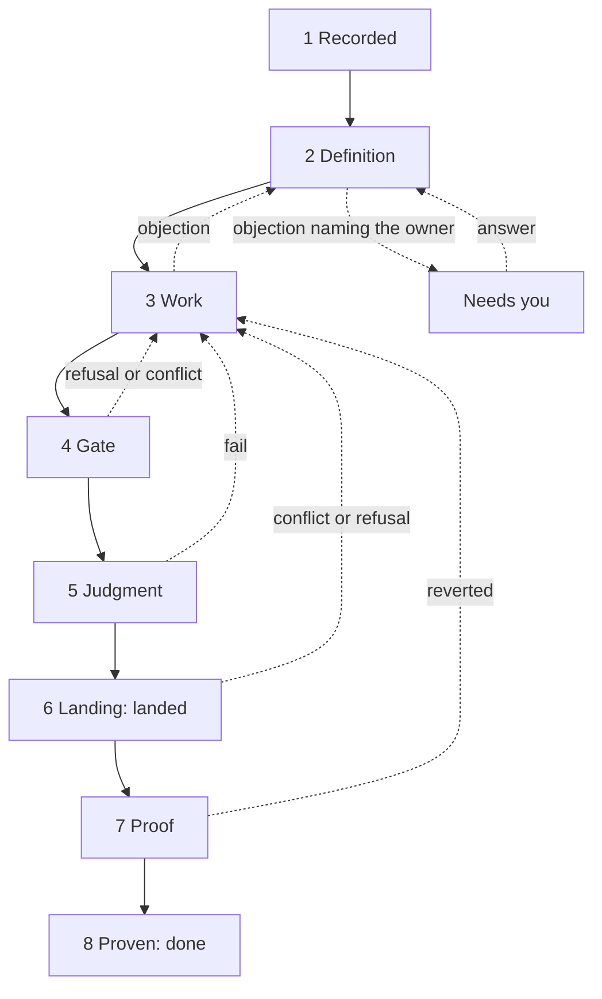

# One word per thing: the vocabulary of tillr's items, nodes, runs, sessions and worktrees

**Status:** 2026-11-18. Written from a read of the tracked documents and the code's tables, ids and event kinds on that date. Nothing here is built; where the code uses a word differently, the entry says so. Two questions were closed on the owner's own words and one by a designer's decision; every designer's decision in [the ledger](#decision-ledger) awaits the owner's review, and nothing is to be built on one before he has seen it.

> **In short:** Three words carried several meanings each (item, run, lane), and that is why the stages of a change could not be told in one breath. This document gives each word one meaning, retires the words that had none left, and names the stages of a change once.

- **Why it matters:** the owner asked on 2026-11-18 what an item that lands a change delivers, and the answer needed "run" in three senses and "lane" in four.
- **The shape:** an **item** has one **graph**; the graph's started nodes are the item's **path**; a **node** has at most one **run**; an agent run speaks in one **session**, which later nodes resume or fork; an item acquires one **worktree**, which is collected and restored.
- **Cost:** "lane", "attempt", "node run", "hold" and eight other words are retired from documents and from what the owner reads; flags, stored names and paths that carry them stay as aliases ([Section 6](#6-renames)).
- **Start at:** [Section 4](#4-the-stages-of-a-change) for the stages, then the three sections before it for the three words.
- **Needs your ruling:** nothing now. **Ruled on 2026-11-18:** [OQ-VO4](#OQ-VO4), the charter; [OQ-VO5](#OQ-VO5), `git-landing`; [OQ-VO6](#OQ-VO6), an item is finished when the suite has passed on it. The designer's decisions in the ledger still await your review.
- **Awaits your review:** the designer's decisions `D-VO1` to `D-VO12` in [the ledger](#decision-ledger). You may overturn any of them.
- **Reads with:** [the graph design](./tillr-graph-is-the-path.md) (the direction these words must fit; its own terms are linked here, not redefined), [the direction document](./tillr-core-and-git-landing.md) (whose naming question is asked here as [OQ-VO4](#OQ-VO4) and [OQ-VO5](#OQ-VO5)), [the landing call](./tillr-landing-call.md) (its question on keeping a worktree after landing rests on [Section 3.3](#33-the-life-of-a-worktree)). There is no companion plan: [Section 9](#9-drafted-items) holds the work this design surfaced, as prose.

---

## 1. What an item is

**An item is one piece of work the queue tracks under one id, with one deliverable and one ending.** It exists from the moment it is recorded. A document block is not what makes it an item: the block is the written form of the item's definition, and an item gains one during the definition stage.

"Work declared in tracked Markdown" is the intuitive definition and it is wrong: the store already holds items that no document declares, and the triage procedure exists to give such an item its block. [The design index](../tillr/design-status.md#read-this-first) defines an item this way too.

**The test for "is this an item?"** Does it have a deliverable of its own that lands on the trunk, and an ending of its own? Then it is an item. Does it act on another item's deliverable? Then it is a node in that item's graph.

| What exists today | In this vocabulary | Why |
| :--- | :--- | :--- |
| Something filed with no block (`tillr item apply`) | An item; specifically a **request** | It is the work. Giving it a block is a triage node in its own graph |
| The owner's saved words (`item-idea-…`) | An item; specifically an **idea** | Its deliverable is the blocks or the questions it lands |
| An item declared by a block | An item | The ordinary case |
| Trunk fixer (`fixer-main-…`) | An item; a **generated item** called the **mechanic** | It lands its own commit and has its own criterion |
| Tooling-defect item (`defect-…`) | An item; a generated item | It lands its own commit, and other items wait on it |
| Comment item (`item-comments-…`) | An item; a generated item | It lands its own replies |
| Rewrite item (`rewrite-<id>`) | **Not an item.** A rewrite node in the original item's graph | It changes the original's block and delivers nothing of its own. The stored item is a stand-in until the graph design's rewrite kind is built |
| Revert (`revert-main-…`) | **Not an item.** A land attempt node in the graph of the item it reverts | It carries no model and no deliverable. The code already stores no item for it |
| Triage, design answer, conflict fix | **Not items.** Nodes | Each acts on its item's definition or branch |
| Gate-budget alarm (`gate-budget-…`) | **Neither.** A reported measurement | A measurement has no deliverable. The store still holds such rows, one of them dated 2026-11-18 |

So a generated item is an item in every respect but one: it has a definition (its criteria, held in the store) and never a block. It is listed with the items people wrote and carries a "generated" mark, and it counts in "draining" like any other (`D-VO11`). The owner already calls the mechanic an item: "A high-priority 'mechanic' (fixer) item is fine."

---

## 2. What a run is

**A run is the execution of one node by a program tillr starts. A node has at most one, for its whole life.** It is bookkeeping: the processes, the log, the lease and the spend. It is never the unit in which an item's progress is told.

"Run" had three meanings: one process execution (the `runs` table), an item's whole try (the observatory's help text: "one recorded attempt by an agent to work on an item in a lane"), and a node's single execution across crashes ([the graph design](./tillr-graph-is-the-path.md#32-what-is-fixed-and-when)). This document keeps the third, which contains the first, and gives the second its own word.

| The question | The word | Notes |
| :--- | :--- | :--- |
| What is the whole thing that happened to an item? | Its **path** | The started nodes of its graph, in order |
| What is the unit of progress? | The **node** | One act. "Item X is at node 7 of 10" |
| What is one agent's execution? | An **agent run** | The run of an agent node |
| What is a command's execution? | A **command run** | The run of a command node. No model, no session, no spend |
| What is the conversation? | A **session** | One harness conversation. It outlives the node that started it |
| What is one process lifetime? | A **segment** | A run that was killed twice has three segments and is still one run |

**How a session spans nodes.** A session is an asset a node leaves behind. A **resume** node continues it with one new message: same session, new node, new run. A **fork** node starts from a copy: a new session whose history begins as the old one's. A **backend move** starts a new session that reads the old transcript as a file. Recovery after a crash is none of these: it is the same node, the same run and, where the harness can reopen it, the same session.

**The owner's example: one item whose graph has ten nodes, eight agents and two commands.**

- **One item, one graph, one path.** That is the answer to "how is it going": the path so far, and the stage it is in.
- **Ten nodes:** eight agent nodes and two command nodes.
- **Ten runs:** eight agent runs and two command runs, one per node. That is correct as bookkeeping and it is what the store holds today: ten `runs` rows and ten `node_runs` rows, with ids `run-<item>-a1-n1` to `-n10`. Nobody counts them. "Eight runs for one item" sounded wrong because "run" was also the word for the item's whole try; that sense is now the path.
- **Between one and eight sessions.** Each agent node either starts a session or resumes one. The two command nodes have none.
- **If node 6 is killed twice by a host restart:** still ten nodes and ten runs. Run 6 has three segments and two exception records.
- **If the gate refuses the result:** an eleventh node is added, a resume of the node that wrote the change, with an eleventh run and no new session. The path grows; nothing restarts, and there is no second "attempt".

Under the graph design the take-in, the gate run and the land attempt are nodes too, so the same item's path shows them after the ten. Today they are a bracket outside the graph with no node of their own.

---

## 3. What a lane was, and the worktree as a resource

**The word "lane" is retired.** It named four things at once: a slot in a fixed pool, a git worktree, a directory of per-run scratch, and a lease. Each now has its own word: the **running-agent limit**, the **worktree**, the **scratch** and the **lease**. Nothing is left for "lane" to mean, so documents, the view and every new flag or record stop using it; the flags, stored rows, paths and events that already carry it stay as aliases, including the three names another project was promised (`--lane-root`, `TILLR_LANE_ID` and `tillr run lanes`). [Section 6](#6-renames) lists each.

The owner ruled on 2026-11-18:

> I think a worktree should be a resource that's acquired by whatever entity, like an item, that needs it. Sounds like we'll probably attach it to an item. We do need to bound the number of worktrees that are outstanding because that destroys my disk space and performance. That's important. But I don't think that means that we just have a hard cap and then shuffle between them. That just means we need a lifecycle, garbage collection policies, that sort of thing.

This section designs that. The slot in a fixed pool is the thing his words rule out, and he has said he dislikes the concept of a lane. [The graph design](./tillr-graph-is-the-path.md) carries the same reading ([Section 7](#7-amendments-to-the-graph-design)).

### 3.1 Where the disk goes

Measured on the evening of 2026-11-18 in this repository, with twenty lanes:

| Measurement | Command | Result |
| :--- | :--- | :--- |
| One lane's worktree | `du -sh .tillr/lanes/lane-1/worktree` (and lanes 2 and 3) | 62 MB, 63 MB, 62 MB |
| One lane's per-run scratch | `du -sh .tillr/lanes/lane-1/durable` (and lanes 2 and 3) | 21 GB, 15 GB, 14 GB |
| The largest scratch directories of single runs | `du -sh` over `lane-1/durable/<run id>` | 2.0 GB, 1.0 GB, 0.98 GB, 0.85 GB |
| Run directories in one lane | entries of `lane-1/durable` | 196 |
| All lanes | `du -sh .tillr/lanes` | 140 GB, up from 133 GB that morning |
| The volume | `df -h` on the repository's volume | 3.7 TB, 51 percent used |
| Worktrees registered | `git worktree list` | 22: the main checkout, twenty lanes, and one agent's own worktree outside tillr |
| Code that deletes per-run scratch or run logs | `rg 'RemoveAll' tools/tillr-drain tools/tillr-run tools/tillr-land --glob '!*_test.go'` | None: only worktree clearing at staging, the full-suite worktree and temporary directories |

Twenty worktrees are about 1.2 GB. The other 139 GB is scratch: test binaries and build output of runs that ended long ago. A lifecycle that covers only worktrees would fix one percent of the problem, so the scratch is part of the resource. Test runs remove their own binary directories since `item-test-runs-remove-their-binary-directories` landed, which slows the growth and deletes nothing that is already there.

### 3.2 Who holds what

- **A worktree has exactly one owner.** For item work the owner is the item. The full suite and a revert each use a worktree owned by their own node, deleted at that node's ending. A worktree with no owner is a defect and is collected.
- **An item has at most one worktree,** a checkout of its item branch at a path derived from the item's id. Every node of the item that needs files runs there. Two writing nodes of one item never run at once; read-only nodes of one item may share it.
- **An item has one scratch directory beside its worktree,** outside the tracked tree. It is a cache. Nothing in it is evidence, and a node's declared outputs are copied out of it at the node's ending. Nothing in scratch is promised to survive the node that wrote it.
- **The item branch is not the worktree.** The store pins the branch head, so deleting the worktree loses no commit.

### 3.3 The life of a worktree

| State | Meaning | Enters when |
| :--- | :--- | :--- |
| **None** | The item has no worktree | The item is recorded |
| **In use** | A node of the item is running in it | The claim of a node that needs it. The claim creates it from the latest trunk, or restores it at the item-branch head, then takes the trunk in |
| **Idle** | It exists and no node of the item is running | The last node running in it ends |
| **Collected** | The directory and the scratch are deleted. The branch head is pinned and the worktree can be restored | Collection (below) |

Restoring puts the worktree back at the same path, because some harnesses find a session by its working directory (not verified per adapter on 2026-11-18). A session must not live only in a directory that collection deletes: its id and transcript location are part of the ending of the node that produced it.

**Collection runs at three moments and on no timer:** when a node ends, when an item ends, and before a claim that needs a worktree. It deletes, in this order:

1. **The worktree and scratch of an ended item** (proven, resolved elsewhere or closed). Always, at once.
2. **The worktree and scratch of an idle item whose wait names the owner or another item.** Always, at once: those waits are long, and restoring costs one checkout.
3. **Other idle worktrees, least recently used first,** only while the bound of [Section 3.4](#34-the-bound-and-what-happens-at-it) is exceeded. An item between its build and its gate keeps a warm worktree unless disk is short.

A landed item's worktree is idle, not ended: a revert sends the failure back to the session that wrote the change, which resumes there. It is collected for good when the landing is proven. [The landing call](./tillr-landing-call.md) asks the owner whether an item keeps its worktree after it lands; this lifecycle is what that question's item-owned option means.

| Kept after collection | Deleted by collection |
| :--- | :--- |
| The item-branch head, pinned by a ref | The working directory |
| The path: every node, ending and exception record | The scratch: build output, test binaries, temporary files |
| Each node's declared outputs and its report | Untracked files in the worktree |
| The run logs, and the sessions with their transcripts | |

Run logs of ended items are records, not scratch. They are kept, and their total is reported beside the worktree figures; a bound on them is not designed here.

**Failure paths.** A collection that cannot delete a directory leaves it, reports it, and tries again at the next collection; nothing is counted. A restore that fails is an exception: the node has no ending and the same node resumes. Collection and claim are serialized per item, and a claim wins: an in-use worktree is never collected, and neither is one whose running node was interrupted, because that node has no ending yet.

**State that already exists.** Every per-run scratch directory under `.tillr/lanes` belongs to a run that has ended or to a lane no item owns. All of it is collectable on the first day, which frees about 139 GB here.

### 3.4 The bound, and what happens at it

The owner's ruling requires a bound and names both costs, disk space and performance. The bound is therefore **two settings, and collection starts at whichever is reached first** (`D-VO10`):

| Setting | What it bounds | Default | Why that default |
| :--- | :--- | :--- | :--- |
| **Disk budget** | Bytes of all worktrees and scratch together | 4 GB times the running-agent limit: 80 GB at a limit of 20 | The largest scratch of one run measured 2.0 GB, so twenty running agents can hold 40 GB in use at once. Twice that leaves room for idle worktrees, so the loop does not sit at its bound |
| **Worktree count** | Worktrees on disk, in use and idle | Twice the running-agent limit: 40 at a limit of 20 | One in use and one idle per running agent. A backstop for the cost of many checkouts, which is not measured |

Both are settings with these defaults; neither is a fixed number in code. The disk budget is the one that binds in practice, by the measurements above. A budget below the working set (20 GB to 40 GB at a limit of 20) would keep every new node waiting, which is why a smaller round number was rejected.

**At the bound, no work fails.** Idle worktrees are collected until the total is under the bound. If every worktree is in use, no new one is created: the node that needs one stays in fog, and the wait it produces names its mover, the ending of a node now running in a worktree, by that node's id. A running node is never stopped for exceeding the budget; the overshoot is reported with the largest scratch directories named.

### 3.5 What limits how many agents run at once

The pool used to do this by accident: `--lanes N` meant N agents because it meant N worktrees. The two are now separate settings.

- **The running-agent limit** is the number of agent runs in progress at once, overall and per backend. It is a scheduling setting in the sense of [the graph design's scheduling section](./tillr-graph-is-the-path.md#6-scheduling): it ends, refuses and re-routes nothing. Its default is today's `--lanes` value.
- **At the limit,** ready nodes stay in fog, and the wait names the next ending of a running agent node as its mover.
- **Work the owner is waiting on** runs outside the limit, as `D-IG10` of [item graphs](./tillr-item-graphs.md#71-decision-ledger) rules. That replaces "express lanes".
- **Command runs** do not count against it. Landing is one at a time because one program moves the trunk; how many gate runs go together is a resource setting whose default is the implementer's to measure.

---

## 4. The stages of a change

**What an item that lands a change delivers:** one squashed commit on the trunk, inside the item's fence, that makes every criterion true, passes the gate and survives the proof. Its block is deleted in that same commit, because a block declares open work only.

**Stage** *(coined here for this sense)* is one of the eight named steps below. A step of a workflow, which item graphs called a stage, is a **step**.

| # | Stage | Who acts | What it produces | Each kind of "no", and where it goes |
| :--- | :--- | :--- | :--- | :--- |
| 1 | **Recorded** | The owner, an agent, or the loop for a generated item | An item: an id and what was asked | None |
| 2 | **Definition** | The design seat (triage, design answer); a cheap seat (rewrite); the owner, by answering | The item's definition: fence and criteria, as a block | An **objection** naming the owner, with a written question: the item is in "needs you" until he answers. A finding of duplicate or already done: the item ends **resolved elsewhere** or **closed** |
| 3 | **Work** | The build or design seat | Commits on the item branch; the head is the **candidate** | An **objection**, with one **obstacle kind**: definition, fence, trunk, tooling, seat, owner. It goes to the actor it names. The work itself ends `submitted` |
| 4 | **Gate** | Commands: the take-in, then the gate run | A **gate verdict** bound to the candidate as taken in | A **refusal**, with the failing checks, back to the session that wrote the change. A **conflict** at the take-in, with paths, back to the session that last wrote them |
| 5 | **Judgment** | A judge: a read-only agent that did not write the candidate | A **criterion verdict** for each criterion | A fail with findings, back to the session that wrote the change |
| 6 | **Landing** | A command: the lander | One commit on the trunk tip. The item is **landed** | A **conflict** with paths, or a lander **refusal** with a reason from its closed list. Both go back to the session that wrote the change |
| 7 | **Proof** | A command: the full suite on a trunk commit | A green pointer that has moved to or past the landing | **Reverted:** the proof named this landing, an automatic revert landed, and the failing check's output goes back to the session that wrote the change. If a revert is unsafe or does not repair, the mechanic is filed instead |
| 8 | **Proven** | Nobody | The item's ending, **done**. The proven commit is pushed | None |

Where the judge sits relative to the gate is the workflow's choice; both come before the landing. A gate or a suite that could not run is not a "no": it is an exception, and the same node resumes.

**Landed and proven are different, because the landing strategy is after-merge.** The owner ruled on 2026-11-18 that the item is *finished* at the second, [OQ-VO6](#OQ-VO6); the table and the stages above are written to that ruling, finished when proven.

| | Landed | Proven |
| :--- | :--- | :--- |
| What is true | The lander put the item's commit on the local trunk | A proof passed on a trunk commit that contains the landing, and no revert removed it |
| What the item has delivered | The change, provisionally: later work builds on it, and it can still be reverted | The change, finally |
| Pushed | No | Yes. Only the proven commit is pushed. The owner, 2026-11-18: "I think I agree with only pushing on green. Let's assume that for now, but at least keep it in the conversation" |
| The item | Not ended. Its worktree is idle | Ended **done**. Its worktree and scratch are collected |
| Where it shows | "Draining" | Finished |

Today `landed` is the last state the store has. Raw writes and `reopen` refuse to move a landed item, the `git-landing` charter (in shipped code, the landing definition) lists one explicit move out of it (`landed` to `in-queue`, which a revert uses), and there is no state for proven: the difference lives only in the green pointer. That is the largest gap between these words and the store ([Section 6](#6-renames)).

**What must be built for the ruling, in this order.** Neither step is built.

1. **A derived "proven" mark in the view.** The view shows an item as finished once the green pointer contains its landing and no revert has removed it, and until then shows it under "draining" as landed and awaiting its proof. Nothing is stored; the mark is read from the green pointer and the item's landing, so it cannot disagree with them. Work that depends on the item still starts when it lands.
2. **A stored state later.** A "proven" item state, which is the `git-landing` charter's to add, with the move out of `landed` that a revert uses kept. A revert never takes a finished item back.

---

## 5. The words

Each term has one meaning. A term owned by another document is linked, not redefined. "Today" marks where built code or an accepted document uses the word differently.

### 5.1 The work and its statement

| Term | What it is | What it is not | Identified by; belongs to; has | Today's usage differs |
| :--- | :--- | :--- | :--- | :--- |
| **Item** | One piece of work the queue tracks under one id, with one deliverable and one ending | Not a document block, and not anything that acts on another item's deliverable | Its id, chosen by its author or made by the tool that filed it. Has one definition, one graph, one item branch, at most one worktree | Sync and the planner still treat an item with no block as incomplete |
| **Request** | An item that has no block yet | Not the record handed to `tillr run exec`, and not a row of the idempotency table | Any item id | The code also says request for `run.Request` and `item_requests` |
| **Idea** | A request saved from the owner's own words, whose deliverable is the blocks or questions it lands | Not a kind column; none is built | `item-idea-` and ten hash digits | — |
| **Generated item** | An item the loop files for work nobody asked for by hand: the mechanic, a defect item, a comment item | Not a rewrite, a revert or an alarm ([Section 1](#1-what-an-item-is)) | An id prefix. Has criteria and no block | The code's generated set also holds `rewrite-`, `revert-main-` and `gate-budget-` |
| **Mechanic** | The owner's word for the generated item that makes a red trunk green | Not a revert | `fixer-main-` and twelve hex digits of the red commit | Code and ids say "fixer" |
| **Defect item** | The generated item filed when a worker's objection names broken tooling | Not a failure of the item that reported it | `defect-` and twelve hex digits | — |
| **Definition** | What an item is to deliver: title, reason, fence, criteria and dependencies | Not the file that turns the core into one use, which the owner named the charter and shipped code still calls a definition ([OQ-VO4](#OQ-VO4)), and not a node's kind and brief | Belongs to one item. The one in force is the latest revision in the item's graph | Three meanings; see [Section 6](#6-renames) |
| **Block** | The written form of a definition: a heading and an item directive in a tracked document | Not the item. An item can exist without one | The item id in the directive | — |
| **Criterion** | One testable condition of a definition | Not a gate check | An id within its item | — |
| **Fence** | The path prefixes an item may change | Not a node's write scope, which is a subset | The block's `paths` attribute | — |
| **Deliverable** | The one squashed commit an item puts on the trunk | Not a fork's delivery, which is the patch series that deploys | The landing's trunk commit | — |
| **Charter** *(the owner's word, ruled in [OQ-VO4](#OQ-VO4); shipped code still says "definition")* | The statement of one use of tillr: its purpose, and the rules that follow from it. In the tree it is a data file (item states, allowed moves, prerequisites and the completion rule) with one hook program beside it | Not an item's definition | A name, such as `git-landing` (that name is [OQ-VO5](#OQ-VO5)) | Shipped as the flag `tillr store init --definition`, the stored key `store.definition`, the event `store.definition.set` and one Go package. Documents say "the landing charter" for the Git one; the code rename is not built |

### 5.2 The graph, and what executes

`Item graph`, `in fog`, `fixed`, `done`, `claim`, `ending`, `asset`, `event`, `exception`, `premise`, `fact`, `policy function`, `take-in` and `seat` keep the meanings of [the graph design's word table](./tillr-graph-is-the-path.md#2-the-words).

| Term | What it is | What it is not | Identified by; belongs to; has | Today's usage differs |
| :--- | :--- | :--- | :--- | :--- |
| **Path** *(coined here; the word is from the graph design's title)* | The nodes of an item's graph that have started, in order: what has happened to the item | Not the fog, and not one pass of several | The item. Has nodes | The grouping the code calls an attempt (`a1`, `a2`) |
| **Workflow** | A tracked, reviewed file of steps that an item's graph starts as | Not the graph, which changes as nodes are added | A file name. Has steps | The graph design says "template" |
| **Step** | One entry of a workflow; it becomes one node or names another workflow | Not a stage of a change | An id within its workflow | Item graphs and the code say "stage" |
| **Node** | One act on an item: an agent's invocation, a command, a landing, or a question put to the owner | Not a step, and not a run | A path id within its item. Has a kind, a claim, an ending and at most one run | The gate and the landing are not nodes yet |
| **Agent node, command node, person node** | A node executed by a harness, by a tracked command, or by a person | — | — | — |
| **Run** | The execution of one agent or command node, from its claim to its ending, across every interruption | Not the item's whole try, and not a unit of progress | The same id as its node. Has one or more segments, a log, a lease and a spend | [Section 2](#2-what-a-run-is). The observatory's help text defines it as an attempt |
| **Segment** | One process lifetime within a run | Not a run. A new segment is never a new node | An ordinal within its run | The code records `run.resume` events, not segments |
| **Recovery** | Carrying on the same node after an exception: a new segment of the same run | Not a resume, which is a new node | — | `tillr run exec --resume` and `run.resume` mean this |
| **Resume** | A node that continues an earlier node's session with one new message | Not recovery | Its own node id | The code's "returned turn" (`session_turn`): a new run id in the retained session |
| **Fork** | A node that starts from a copy of an earlier node's session | Not a resume: the original is untouched | Its own node id | — |
| **Session** | One conversation with a harness: the transcript a model continues from | Not the loop's process lifetime, and not the owner's own interactive session | The harness's session id. Produced by one node, used by any number of later ones | Four other senses; see [Section 6](#6-renames) |
| **Hoisted child** | A sub-agent of a running node, recorded as a node within it ([the graph design](./tillr-graph-is-the-path.md#9-subagent-hoisting)) | — | — | Item graphs: "child session", never a node |
| **Harness** | The agent program that holds a session: pi, Claude Code and the like | Not a backend | — | — |
| **Backend** | One row of the backend policy: a harness, a model route and its limits | Not a seat. A seat is the role; the backend fills it | A name in the backend policy | — |
| **Adapter** | The program that starts one harness for tillr and turns its output into one report | Not the harness | — | — |

### 5.3 Places and capacity

| Term | What it is | What it is not | Identified by; belongs to; has | Today's usage differs |
| :--- | :--- | :--- | :--- | :--- |
| **Item branch** | The commits an item's nodes have made, on top of the trunk commit last taken in | Not the worktree | A head pinned in the store. Belongs to one item | Today the branch is the lane's: `tillr/<scope>/<lane>` |
| **Worktree** | A [git worktree](https://git-scm.com/docs/git-worktree) checked out at an item branch, acquired by the item | Not a slot. It can be deleted and restored without loss | Its item's id | Part of a lane; deleted and recreated at each staging |
| **Scratch** *(coined here)* | The directory beside a worktree where nodes put build output, test binaries and temporary files | Not evidence, and not where a declared output lives | Its item's id | One directory per run under the lane, never deleted |
| **Collection** *(coined here)* | Deleting a worktree and its scratch while keeping the item branch and the records | Not the end of the item | — | Only refs are swept today |
| **Running-agent limit** | The number of agent runs in progress at once | Not a bound on worktrees or on disk | A setting, overall and per backend | `--lanes N` |
| **Lease** | The liveness record of a running run | Not a claim, and not a hold on anything. Its lapse is an exception | Its run | A lane's lease, with an expiry |
| **Lane** | **Retired.** | — | — | A pool slot with a worktree, a scratch directory and a lease |

### 5.4 Checking and landing

| Term | What it is | What it is not | Identified by; belongs to; has | Today's usage differs |
| :--- | :--- | :--- | :--- | :--- |
| **Candidate** | An item-branch head offered for landing, together with the trunk commit it was taken in on | Not a stored row and not a queue entry | A base commit and a head commit | — |
| **Gate** | The fast checks a candidate must pass before it lands, inside a tested ten-second budget ([gate rework](./gate-rework.md)) | Not the full suite, and not the repository's `just done` | — | Also used for the full suite ("the full, untiered gate") and for the loop step |
| **Check** | One declared test the gate or the full suite runs | Not a criterion | A file under the checks directory | — |
| **Gate verdict** | The gate's recorded answer on one candidate: pass, fail, or could not judge | Not a criterion verdict. "Verdict" is never used bare | Bound to a base commit and a head tree | — |
| **Criterion verdict** | A judge's or the owner's recorded answer on one criterion: done, not-done, blocked or defective | Not a gate verdict | The item and the criterion id | — |
| **Judge** | A read-only agent node that evaluates a candidate it did not write | Not the gate, and not the loop's examination of a finished run | Its node id | The loop action `judge` also means examination |
| **Lander** | The one program that moves the trunk | Not a queue | — | — |
| **Landing** | One act of the lander that put a commit on the trunk | Not the item's ending | A landing id. Belongs to one land attempt node | One row for every landed commit, design answers and triage included |
| **Landed** | An item whose deliverable is on the trunk and not yet proven: a **provisional landing** | Not finished | — | The final stored state |
| **Proof** | One run of the full suite on one trunk commit | Not the gate | The trunk commit | "Heavy tier", "rolling", "after-merge heavy run", "rolling audit" |
| **Proven** | A landing contained in a trunk commit whose proof passed, and not reverted: a **proven landing** | Not merely unreverted so far | The green pointer at or past the landing | No stored state |
| **Full suite** | Every check, as the proof runs them | Not the gate | — | "Heavy tier" |
| **Trunk; tip** | The repository's shared branch; its newest commit | — | — | — |
| **Green pointer** | The ref naming the newest proven trunk commit ([gate rework](./gate-rework.md)) | Not a branch | `refs/tillr/green` | — |
| **Red** | The trunk after a proof ended in failure | Not "unproven". An unproven trunk is not red | The failing trunk commit | The red cap also holds on "unproven" |
| **Revert** | A landing, with no model in it, that removes one proven-bad landing | Not an item, and not the mechanic | `revert-main-` and twelve hex digits. A land attempt node of the reverted item | Also an item state move out of `landed` |
| **Pin** | A git ref whose only job is to keep a commit reachable for a record | Not a model pin and not a session pin | `refs/tillr/…` | — |

### 5.5 Saying no, and waiting

| Term | What it is | What it is not | Identified by; belongs to; has | Today's usage differs |
| :--- | :--- | :--- | :--- | :--- |
| **Objection** | The ending by which an actor says it should not continue and names who acts next ([the graph design](./tillr-graph-is-the-path.md#33-endings)) | Not a failure, and not a refusal | Its node | "Blocked", and a stored "conflict" (`conflict-<run id>`) |
| **Obstacle kind** | The kind of a worker's objection, from a closed set: definition, fence, trunk, tooling, seat, owner ([`D-JL11`](./tillr-judge-and-lifecycle.md#45-what-a-worker-may-end-with-d-jl11)) | Not an open list | The `OBSTACLE:` line of a report | — |
| **Refusal** | A checker's "no" about what the candidate is, with evidence: from the gate, from tillr's checks at a node's end, or from the lander | Not an objection (the worker's "no"), not an exception (the machinery failed), not a rejection | The ending of the checking node | Also used for a lane that staging refuses and for a store command that is rejected |
| **Rejection** | The store declining a command | Not about a candidate | — | `item.rejection`; READMEs also say "refusal" |
| **Conflict** | Two changes to the same lines, found at a take-in or at a landing, with the paths | Not an objection | The paths | Also the stored record of an objection |
| **Return** | Sending a refusal, a conflict or a revert back to the session that wrote the change, as a resume node carrying the evidence | Not a retry: nothing is counted | The resume node | Reason `returned-with-evidence` |
| **Reverted** | The state of a landing that a proof proved bad and a revert removed | Not red | — | Reason `landing-reverted` |
| **Wait** | A derived statement that nothing is added after some ending yet, with the reason and the mover (the graph design) | Not stored, and not cleared by anyone | — | A stored "hold" with a reason, the item state `blocked`, the position `held` |
| **Mover** | The actor or fact a wait names ([landing principles](./landing-principles.md#13-a-held-state-names-a-mover-that-can-still-act)) | Never "someone" | — | — |
| **Draining; needs you** | The owner's two categories of unfinished items: every item whose wait names the owner by a question is "needs you"; every other is "draining" | Not states of the store | — | The view shows more categories |
| **Owner question** | A numbered question in a design document that only the owner rules on; in the graph, a person node from asked to answered | Not a ledger row, though both carry an `OQ-` id | Its `OQ-` id | — |
| **Supersession** | The finding that an item's change is already on the trunk | Not a refusal of the work | Lander reason `already-on-trunk` | Also a retry replacing a run, and a document replacing a document |

### 5.6 The machinery

| Term | What it is | What it is not | Today's usage differs |
| :--- | :--- | :--- | :--- |
| **The drain** | The program that moves items along their paths; "draining" is the queue emptying | Not one process | — |
| **Loop** | One long-running process of the drain | Not a session | Its lifetime is called a "session" (`drain_sessions`) |
| **Pass** | One review of the queue by the loop | Not a tick | "Tick" survives in a table and a column name |
| **Generation** | The ordinal of a pass ([drain successor](./tillr-drain-successor.md)) | — | — |
| **Dispatch** | Starting a node's run | Not a decision to start one | — |
| **Backend policy; gate policy** | The file mapping seats to backends; the file of landing settings | "Policy" is never used bare; neither is the graph design's policy function | — |
| **Gate plan; queue plan** | The list of checks a gate run will run; the graph design's queue-level node | "Plan" is never used bare | Also the loop's pass plan and `tillr drain plan` |
| **Operator retry** | The owner's or an operator's command that adds a node after an ending the rule table adds nothing for | Not a count and not a budget | A stored authorization that starts a new attempt |
| **Pause** | An exception requested on purpose: the run stops between tool calls and recovers later | Not an ending | "An attempt outcome" |

### 5.7 Words for "a landing is a suspended tool call"

A separate design works out that mechanism. These are the words it needs; nothing here decides how it works.

| Term | What it is | What it is not |
| :--- | :--- | :--- |
| **The call** *(coined here)* | The tool call by which a worker's session says its candidate is ready and asks for it to be landed. It is the written form of the work node's `submitted` ending | Not a command the worker runs itself, and not the landing |
| **Suspension** | The state of a session whose call has no answer yet. No process runs and no node is running; the session is an asset with an open call | Not a pause, which is an exception, and not a wait, which belongs to the policy function |
| **The answer** | The result delivered to the call. It arrives as the first message of a resume node | Not an event the session must poll for |
| **A refusal** (as an answer) | An answer that carries a "no" from [Section 4](#4-the-stages-of-a-change): a gate refusal, a conflict, a lander refusal or a revert. It is the only answer that makes the session work again | Not an objection, which is the worker's own ending |
| **Provisional landing; proven landing** | The landed and proven of [Section 4](#4-the-stages-of-a-change), as answers | — |

Which of the two landings ends the suspension is that design's question, not this one's.

### 5.8 Retired words

| Word | What to say now |
| :--- | :--- |
| **Attempt** | Nothing. Returned work is new nodes on the same path |
| **Lane; express lane; lane cap** | Worktree, scratch, running-agent limit; "work the owner is waiting on" |
| **Desk** | The comment item's worktree and the document's session. [Designer sessions](./tillr-designer-sessions.md) owns the word and decides whether it stays |
| **Node run** | Run |
| **Child session** | Hoisted child |
| **Hold; held; blocked** | Wait, with its mover |
| **Tick** | Pass |
| **Fixer; repair item** | Mechanic; generated item |
| **Template** (of a graph) | Workflow |
| **Stage** (of a workflow) | Step |
| **Continuation** | Recovery, or a resume, whichever it was |
| **Heavy tier; rolling; landing tier** | Full suite and proof; the gate |

---

## 6. Renames

"Alias" means the old spelling stays in code or in stored data and is documented as meaning the new word. No rename is planned here. Each verdict in the last column is a designer's decision (`D-VO12`).

| Today | Settled word | Where it appears | Rename, or alias? |
| :--- | :--- | :--- | :--- |
| "run = one recorded attempt by an agent" | Run = one node's execution; the whole is the **path** | The observatory's [`glossary.json`](../../tools/tillr-view/web/src/models/glossary.json); view labels | **Rename the text.** It is what the owner reads |
| `runs` table, `run_id`, `run.*` events | Run | Store, events | Alias. The meaning already matches |
| `node_runs`, "node run" | Run | Store; [item graphs](./tillr-item-graphs.md#the-words) | Alias in the store; reword the document |
| `a<N>` in `run-<item>-a<N>-n<k>`, `node_runs.attempt`, `Decision.Attempt`, `AttemptClass` | None: attempt is retired | Run and transition ids, code | Alias for stored ids. New ids stop carrying it when the graph design's storage is built |
| `exec --resume`, `run.resume` | **Recovery** | [tillr-run README](../../tools/tillr-run/README.md), events | Alias, documented. Worth renaming only with the resume node kind, when two things would otherwise share the word |
| `session_turn`, "returned turn", `returned-with-evidence` | **Resume** node; **return** | Run request, planner reason | Alias until the graph design's resume kind is built |
| "session" = the loop's process lifetime; `drain_sessions` | A **loop**'s lifetime | The observatory's glossary, store | **Rename the text**; alias the table |
| `lane-<n>`, `express-<n>`, `desk-<doc>`, `lanes` table, `.tillr/lanes/`, `--lanes`, `lanes leased: M/K`, `drain.lane-*` | Worktree, scratch, running-agent limit | Flags, store, paths, events, view | **Rename the flag and the view label** when the worktree lifecycle is built; alias stored rows and old events |
| `--lane-root`, `TILLR_LANE_ID`, `tillr run lanes` | Worktree, scratch | The surface [promised to Product QA](./tillr-separable-parts.md#21-the-stable-surface) | **Alias, and say so in that contract.** A consumer was told to rely on them |
| `<lane>/durable/<run_id>` | **Scratch** | Paths, the worker's brief | **Rename with the lifecycle.** It is the directory that fills the disk |
| Item state `landed` as final | **Landed** (provisional), then **proven** | The `git-landing` charter (in code, the landing definition), view | **To change, as [OQ-VO6](#OQ-VO6) was ruled on 2026-11-18:** a derived "proven" shown in the view first; a stored state is the charter's to add later ([Section 4](#4-the-stages-of-a-change)) |
| `fixer-main-…`, "trunk fixer" | **Mechanic** | Ids, code, events `drain.fixer-*` | Alias the id; say mechanic in the view and in documents |
| `item.Conflict`, `conflict-<run id>`, reasons `conflict-design`, `conflict-owner` | **Objection** | Store, ids, hold reasons | Alias. They disappear when waits replace holds |
| `squash-conflict`, `conflict-fix`, `-cfix` | **Conflict** | Lander result, run-id suffix | Keep. This is the surviving meaning |
| Hold reasons, `ActionHold`, position `held`, state `blocked` | **Wait** | Planner, view, store | Alias until the rule table is built; the view says "waiting on" now |
| `rewrite-<id>` item | A rewrite **node** | Sync, store | Alias until the rewrite kind is built |
| "definition" = the file for one use; `--definition`, `store.definition`, `store.definition.set`, the `definition` package | **Charter** ([OQ-VO4](#OQ-VO4), ruled 2026-11-18) | [The direction document](./tillr-core-and-git-landing.md), code, Product QA's worked example | Not built. The shipped flag and stored key keep working as aliases |
| "definition" of a node | The node's kind, inputs and brief | The graph design | Reword when that document is next edited |
| `WorkflowStage`, "stage" | **Step** | Code, item graphs | Alias in code; reword the document |
| "template" | **Workflow** | The graph design | Reword |
| `rolling_*` tables, `--tier rolling`, "heavy tier" | **Proof**; **full suite** | Store, flags, [gate rework](./gate-rework.md) | Alias |
| `drain_ticks`, `tick_id` | **Pass**; **generation** | Store, beside the newer `drain_passes` | Alias |

---

## 7. Amendments to the graph design

[The graph design](./tillr-graph-is-the-path.md) read `D-IG8` of item graphs as "a lane belongs to a running node". The owner's ruling quoted in [Section 3](#3-what-a-lane-was-and-the-worktree-as-a-resource) attaches the worktree to the item instead, and six passages of that design were amended on 2026-11-18 to say so:

| Passage in the graph design | What it says now |
| :--- | :--- |
| The word table, row "Item branch" | The branch survives the collection of the item's worktree; the worktree is a checkout the item acquires, and it can be deleted and restored |
| Node kinds, row "owner question" | It needs no worktree and no process |
| Scheduling, "What the scheduler chooses" | The scheduler does not choose a worktree: a node that needs one runs in its item's, which the claim creates or restores |
| Scheduling, the paragraph that was "Lanes" | Now "Worktrees": a worktree belongs to an item and is idle, not free, when a node ends |
| Scheduling, "Order" | Work the owner is waiting on runs first, outside the running-agent limit |
| The item graph ledger, row `D-IG8` | Amended, not superseded: the item keeps one worktree across its nodes; what survives is that a graph runs correctly with one agent running at a time |

Still to reword there, by that design's author: its build step whose criterion reads "A lane is released when its node ends, and the item's commits are restored from the store onto whichever lane runs its next node", and its other uses of "lane" for a worktree. The phrase "running-agent limit" in the amended text is this document's (`D-VO6`).

---

## 8. What this does not cover

- **How any rename is carried out.** [Section 6](#6-renames) judges; it does not plan.
- **The storage of nodes, runs and segments.** That is the graph design's storage section and its open question on the store.
- **The mechanism of the suspended landing call,** and **how a design answer reaches the trunk early** ([early design landing](./tillr-early-design-landing.md)). Only their words are fixed here.
- **A bound on run logs and transcripts.** They are records; [Section 3.3](#33-the-life-of-a-worktree) only requires that they are kept and reported.
- **Fork checkouts under `.forks/`.** They are not item worktrees and keep their own rules.

**Not verified on 2026-11-18,** and stated as such where used: whether each harness finds a session by its working directory; which run id a workflow's gate record attaches to; the route by which a design answer's commit is recorded as a landing of its item; whether anything outside tillr prunes the per-run scratch.

---

## 9. Drafted items

These are proposals, written as prose so that nothing reads them as queued work. The first two wait on no ruling: the first is the part of the worktree lifecycle that the owner's words already cover, and scratch grew by 7 GB during 2026-11-18 while nothing deleted any. How any of them becomes an item waits on the owner's review, begun on 2026-11-18, of how work written in a document enters the queue.

#### Delete an ended item's scratch and worktree

Per-run scratch is never deleted: on 2026-11-18 twenty lanes held 140 GB, almost all of it test binaries of runs that had ended. This item makes the scratch and worktree of an ended item go when the item ends, and reports what is on disk, which is the part of the worktree lifecycle that needs no ruling.

- **Paths:** `tools/tillr-drain/`, `tools/tillr-run/`, `tools/tillr-view/`, `docs/`
- **Waits on:** nothing.
- **c1:** When an item ends, its per-run scratch directories and its worktree are deleted, and its branch head, records and run logs remain. A test ends a fixture item and asserts both halves.
- **c2:** Scratch of a run that is still running, or of an item that has not ended, is never deleted. A test asserts it for a running fixture run.
- **c3:** A command lists scratch whose item has ended or is unknown, with sizes, and deletes it when asked. A test runs it against a fixture tree holding one live and one ended item.
- **c4:** The status view shows the number of worktrees on disk and the bytes of worktrees and scratch.

#### Say run, session and path one way in the observatory

The observatory's help text defines a run as an item's attempt and a session as the loop's lifetime, which matches neither the store nor the documents. This item makes the words the owner reads match the vocabulary.

- **Paths:** `tools/tillr-view/`, `docs/`
- **Waits on:** nothing.
- **c1:** The help text defines run, session, lane and hold as the vocabulary document does, and adds path and node. A test asserts each entry's text.
- **c2:** An item's page shows its nodes in order as its path, and no label counts runs as progress.

#### Split the lane cap into a running-agent limit and a worktree bound

One flag sets both how many agents run and how many worktrees exist. This item separates them, so that idle worktrees are collected against a bound while the number of running agents is set by itself.

- **Paths:** `tools/tillr-drain/`, `tools/tillr-run/`, `tools/tillr/settings/`, `tools/tillr-view/`, `docs/`
- **Waits on:** Delete an ended item's scratch and worktree; the owner's review of `D-VO5`, `D-VO6`, `D-VO9` and `D-VO10`.
- **c1:** A worktree is keyed by its item and is restored at the same path after collection. A test collects and restores a fixture item's worktree and asserts the head and the path.
- **c2:** Past the bound, idle worktrees are collected in the order the vocabulary document states, and no in-use worktree is. A test asserts the order.
- **c3:** With every worktree in use at the bound, a node that needs a new one is not started and is not failed, and `drain why` names a running node as its mover. A test asserts both.
- **c4:** The running-agent limit is a setting of its own, and work the owner is waiting on runs outside it. A test asserts each.

---

## Decision Ledger

Two kinds of row, kept apart on purpose. Nothing here is built.

### The owner's rulings

Each row quotes or cites words the owner said. These are the only rulings in this document.

| ID | Ruling | Date | Settled in | Built |
| :--- | :--- | :--- | :--- | :--- |
| OQ-VO1 | The lane, as a slot in a fixed pool that work is shuffled through, goes. The owner: "I don't think that means that we just have a hard cap and then shuffle between them. That just means we need a lifecycle, garbage collection policies, that sort of thing"; he has also said he dislikes the concept of a lane. The question asked whether the word might stay with a new meaning; his words leave it nothing to mean. How far the rename reaches is the designer's `D-VO9`. | 2026-11-18 | [Section 3](#3-what-a-lane-was-and-the-worktree-as-a-resource) | — |
| OQ-VO2 | Outstanding worktrees are bounded, and the bound is met by a lifecycle and collection, not by a cap. The owner: "We do need to bound the number of worktrees that are outstanding because that destroys my disk space and performance. That's important." He named no numbers. Which measures start collection, and their defaults, are the designer's `D-VO10`. | 2026-11-18 | [Section 3.4](#34-the-bound-and-what-happens-at-it) | — |
| OQ-VO4 | The file that turns tillr into one use is a **charter**. The owner: "I think I like the term charter because basically we're saying like the charter for the base tillr, whatever the git landing is, is basically maintain velocity from coming up with ideas, maintain momentum of that idea through design and implementation, clearing all blockers along the way. And then what falls from that is all of the rules and how we use the tillr tools to get there." He gave a second example: "an AutoQA charter would be find all bugs. How do you do that? And you queue things and you churn through them." So a charter states the purpose of one use, and its rules (item states, allowed moves, prerequisites, the completion rule) follow from that purpose. The shipped flag `--definition` and the stored key keep working as aliases; the rename in code, the view and the documents is not built. "Definition" now means only an item's. | 2026-11-18 | [Section 5.1](#51-the-work-and-its-statement) | — |
| OQ-VO5 | tillr's first use, landing changes in a Git repository, is called **`git-landing`**. The owner took the stated leaning in review: "git-landing, by taste: it is what shipped, it says what the use does, and nothing argues for the other two." With [OQ-VO4](#OQ-VO4) this reads "the `git-landing` charter". Nothing changes in the tree. | 2026-11-18 | [Section 5.1](#51-the-work-and-its-statement) | Built (the name is the shipped one) |
| OQ-VO6 | **An item is finished when the full test suite has passed on a trunk commit that contains its change, not when it lands.** The owner took the stated leaning in review: "A, finished when the suite has passed: a finished count that can go back down is one you stop trusting, and it matches pushing only what is green." Until then the item shows under "draining" as landed and awaiting its proof; a revert never takes a finished item back; work that depends on the item still starts when it lands. To build: a "proven" mark derived in the view first, a stored state later. | 2026-11-18 | [Section 4](#4-the-stages-of-a-change) | — |
| `R-VO1` | Only what is green is pushed, as a working assumption he asked to keep open: "I think I agree with only pushing on green. Let's assume that for now, but at least keep it in the conversation." | 2026-11-18 | [Section 4](#4-the-stages-of-a-change) | — |

### The designer's decisions, awaiting the owner's review

Each `D-VO` row is a decision the designer made on 2026-11-18 from the evidence named. None is the owner's ruling, the owner may overturn any of them, and nothing is to be built on one before he has seen it.

| ID | Decision | Date | Settled in | Built |
| :--- | :--- | :--- | :--- | :--- |
| `D-VO1` | An item is tracked work with its own deliverable and ending; a block is the written form of its definition and is not required for it to exist. **Rejected:** "an item is a block in a document", which the store already contradicts. The owner may overturn this. | 2026-11-18 | [Section 1](#1-what-an-item-is) | — |
| `D-VO2` | What acts on another item's deliverable is a node, not an item: rewrites, reverts, triage and design answers. **Rejected:** an item per act, which gives one change several ids and several endings. The owner may overturn this. | 2026-11-18 | [Section 1](#1-what-an-item-is) | — |
| `D-VO3` | A run is one node's execution and is never a unit of progress; the whole is the path; a process lifetime is a segment. **Rejected:** "run" for the item's whole try, which leaves the store's ten rows without a name. The owner may overturn this. | 2026-11-18 | [Section 2](#2-what-a-run-is) | — |
| `D-VO4` | "Resume" is a node; carrying on the same node after an exception is "recovery". **Rejected:** one word for both, which is today's usage. The owner may overturn this. | 2026-11-18 | [Section 5.2](#52-the-graph-and-what-executes) | — |
| `D-VO5` | A worktree and its scratch belong to an item. They are collected at three moments (a node ends, an item ends, before a claim that needs a worktree) and on no timer, in the order ended items, then items waiting on the owner or another item, then least recently used; a landed item's worktree is idle, not ended; a collected worktree is restored on demand at the same path; the bound never fails work. **Evidence:** the owner's worktree ruling, and scratch being 99 percent of the bytes. **Rejected:** a fixed pool that any node may take, which is the shuffling the owner ruled out; and a lifecycle for worktrees alone, which leaves 99 percent of the disk. The owner may overturn this. | 2026-11-18 | [Section 3](#3-what-a-lane-was-and-the-worktree-as-a-resource) | — |
| `D-VO6` | How many agents run at once is a setting of its own, the running-agent limit, defaulting to today's `--lanes` value. **Rejected:** deriving it from the worktree bound. The owner may overturn this. | 2026-11-18 | [Section 3.5](#35-what-limits-how-many-agents-run-at-once) | — |
| `D-VO7` | **Not a decision.** "Landed is provisional and proven is final; the item ends at proven" changes what the owner reads as finished, and he has not seen it. It was asked as [OQ-VO6](#OQ-VO6), which the owner ruled on 2026-11-18 for "finished at proven", and the body is written to that question's leaning. | 2026-11-18 | [Section 4](#4-the-stages-of-a-change) | — |
| `D-VO8` | "Stage" names the eight stages of a change, and a workflow's unit is a "step". "Conflict" means a merge conflict, and the worker's "no" is an objection. "Verdict", "policy" and "plan" are never used bare. The owner may overturn this. | 2026-11-18 | [Section 5](#5-the-words) | — |
| `D-VO9` | The word "lane" leaves documents, the view and every new flag, record and event. Existing flags, stored rows, paths and events keep it as documented aliases, and so do the three names promised to Product QA (`--lane-root`, `TILLR_LANE_ID`, `tillr run lanes`). **Evidence:** on 2026-11-18 the word is on 4,439 non-test Go lines in the drain alone and on 4,196 lines of 271 documents, so a rename everywhere is weeks of churn for no change in behavior. **Rejected:** keeping the word for "a running agent's use of its item's worktree", which gives every old record a second reading; and renaming stored data, which breaks a consumer. Closes the remainder of [OQ-VO1](#OQ-VO1). The owner may overturn this. | 2026-11-18 | [Section 6](#6-renames) | — |
| `D-VO10` | Collection starts at whichever of two settings is reached first: a disk budget defaulting to 4 GB times the running-agent limit, and a worktree count defaulting to twice that limit. **Evidence:** the measurements of [Section 3.1](#31-where-the-disk-goes). **Rejected:** disk only, which leaves the performance cost the owner named unbounded; count only, which lets a few items with large scratch fill the disk; and the fixed 25 GB and 40 first proposed, because 25 GB is below what twenty running agents hold in use. Closes the remainder of [OQ-VO2](#OQ-VO2). The owner may overturn this. | 2026-11-18 | [Section 3.4](#34-the-bound-and-what-happens-at-it) | — |
| `D-VO11` | Work tillr files for itself (the mechanic, a defect item, a comment item) is an item, listed with the others under a "generated" mark. **Evidence:** each lands its own commit and has its own ending, the view already lists `fixer-main-` and `defect-` rows beside the rest, and the owner calls the mechanic an item. **Rejected:** a separate list of "repairs", which is a second place to look for why the queue is not moving. The owner may overturn this. | 2026-11-18 | [Section 1](#1-what-an-item-is) | — |
| OQ-VO3 | "Is work that tillr files for itself an item?" Closed by the designer's `D-VO11`, not by the owner: yes, an item with a "generated" mark. The owner may overturn this. | 2026-11-18 | [Section 1](#1-what-an-item-is) | — |
| `D-VO12` | The retired words of [Section 5.8](#58-retired-words) and the rename-or-alias verdict on each row of [Section 6](#6-renames), as a set: reword what the owner reads, alias what is stored. **Rejected:** renaming stored tables, ids and events, which rewrites history for a word. The owner may overturn this, row by row. | 2026-11-18 | [Section 6](#6-renames) | — |

---

## Open Questions

None open. [OQ-VO4](#OQ-VO4), [OQ-VO5](#OQ-VO5) and [OQ-VO6](#OQ-VO6) were ruled by the owner on 2026-11-18 and are rows of the ledger above.
