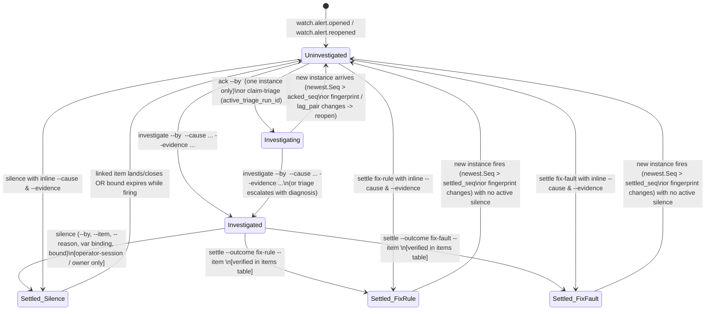

# Every alert gets an investigation and one recorded outcome, and silences bind a rule, variable, item, and bound

**Status:** 2026-11-23. Accepted (`DECIDED`); all owner questions ([OQ-AW1](#OQ-AW1)–[OQ-AW3](#OQ-AW3) and companion [OQ-AT1](./tillr-alert-triage-seat.md#OQ-AT1)–[OQ-AT3](./tillr-alert-triage-seat.md#OQ-AT3)) were ruled by the owner on 2026-11-23 and compacted into the [Decision Ledger](#decision-ledger), and all eight build slices of this design (`item-request-d4e06efb9b` through `item-request-37c66283c7`, continuing into `item-request-100ea9b269` through `item-request-12ef582a85`) are filed as `--blocked-by`-chained ordinary queue items starting with single-instance `ack` ([§8](#8-the-build-in-slices-that-each-land-alone)). Read at `ff3f38b0e3`, [`tools/tillr/watch/eval.go`](../../tools/tillr/watch/eval.go), [`tools/tillr/watch/lifecycle.go`](../../tools/tillr/watch/lifecycle.go), [`tools/tillr/watch/status.go`](../../tools/tillr/watch/status.go), and [`tools/tillr-watch/lifecycle.go`](../../tools/tillr-watch/lifecycle.go) already build `alert_episodes`, six registered `watch.alert.*` lifecycle events (`opened`, `acknowledged`, `tracked`, `silenced`, `reopened`, `resolved`), item-subject auto-closure ([D-TW63](./tillr-watch.md#D-TW63), `8ac1b77ed6`), per-rule load baselines ([D-TW66](./tillr-watch.md#D-TW66), `dd17e3283f`), and interim `tracking_item_id` via `tillr watch track` / `ack --item` ([D-TW67](./tillr-watch.md#D-TW67), `1ab969e2ab`) — which produced 14 `acknowledged` episodes on 2026-11-23 by treating `ack` as a multi-instance mute ([§2](#2-what-tillr-watch-does-today--and-where-alerts-slip-through)). By contrast, **nothing from the single-instance `ack`, mandatory-settlement, item-linked `watch_silences`, `alert_item_links`, or Observatory surfaces is built**: `rg -n 'alert_episodes|watch\.alert|watch_silences|tracking_item_id' tools/tillr-view tools/tillr-item` returns nothing, and `rg -n 'settlement_state|watch_silences|investigated_by|acked_seq|settled_seq|alert_item_links' tools/` returns nothing (while [`docs/design/tillr-alert-triage-seat.md`](./tillr-alert-triage-seat.md) in `7a5a8fa687` and [Section 6.8 of the tillr-watch design](./tillr-watch.md#68-alert-investigation-mandatory-outcomes-tracking-item-links-and-variable-scoped-silences-d-tw64-d-tw65) in `40ccc02d63` remain design only). Only the owner's dated words quoted in [§1](#1-what-the-owner-said) are owner rulings ([R-AW1](#R-AW1)–[R-AW6](#R-AW6), [OQ-AW1](#OQ-AW1)–[OQ-AW3](#OQ-AW3)); every other mechanism, route, command shape, table, column, variable rule, and slice boundary is the designer's decision (`D-AW1`–`D-AW13`, from operator requests) and is marked so in prose and in the [Decision Ledger](#decision-ledger) for the owner to overturn.

**The shape.** Separating live condition state (`open`, single-instance `acknowledged`, `silenced`, `resolved`) from workflow settlement (`uninvestigated` -> `investigating` -> `investigated` -> `settled`) so `tillr watch ack` covers one observed instance only ([§2](#2-what-tillr-watch-does-today--and-where-alerts-slip-through), [§5](#5-shared-tracking-item-binding-and-repeat-counting-without-waking)), every episode (including auto-resolved ones) requires a recorded cause and evidence before settling into `silence`, `fix-rule`, or `fix-fault` ([§3](#3-the-alert-workflow-from-opened-to-investigated-to-settled)), every continuing suppression is a `watch_silences` row scoped by `(rule_id, vars_json)` that names an open item, carries `--until` or `--until-change`, and lifts automatically when that item lands or closes or when the bound expires ([§4](#4-parameterizing-rules-by-variables-and-scoping-silences-to-rule_id-variable_binding)), and durable `alert_item_links` plus read-only Observatory pages (`#/alerts`, `#/alert/<id>`, `Home`, and `#/item/<id>`) make every alert, transition, actor, and linked item visible ([§5.2](#52-why-scalar-tracking_item_id-alone-is-not-enough--and-durable-bidirectional-alert_item_links), [§6](#6-making-unsettled-alerts-unmistakable--and-showing-every-alert-transition-and-linked-item-in-the-observatory)).

**Reads with:** [the observatory reference](../reference/observatory-redesign.md) (`P1`–`P7`, `D-OR1`–`D-OR5`, which every `tillr-view` alert surface follows), [the alert triage seat design](./tillr-alert-triage-seat.md) (which shares the investigation record, closed three-outcome schema, and `tracking_item_id` binding for internal triage runs while mechanically forbidding automated `silence`), [the tillr-watch design](./tillr-watch.md) ([Section 6.8](./tillr-watch.md#68-alert-investigation-mandatory-outcomes-tracking-item-links-and-variable-scoped-silences-d-tw64-d-tw65), [D-TW64](./tillr-watch.md#D-TW64), [D-TW65](./tillr-watch.md#D-TW65), and [D-TW67](./tillr-watch.md#D-TW67)), [the general agent watch design](./general-agent-watch.md) (whose domain-neutral `Evaluator` and per-owner `delivery_cursors` this extends without adding `tillr-item` or `tillr-drain` imports to `tools/tillr/watch`), and the utility contracts for [`tillr-watch`](./tillr-utility-contracts/tillr-watch.md), [`tillr-view`](./tillr-utility-contracts/tillr-view.md), and [`tillr-item`](./tillr-utility-contracts/tillr-item.md).

---

## 1. What the owner said

On 2026-11-22, after ten open episodes sat unacted on for roughly twelve hours and a check-in explained three noisy rules in prose as understood without filing items to fix them, the owner gave the governing workflow ruling verbatim ([D-TW64](./tillr-watch.md#D-TW64), `R-AW1`):

> "I think we need some sort of workflow for alerts. Like an alert comes in, you have to decide what to do with it. You can say this alert is useful, but this specific instance of the alert is not useful and you silence that one. One alert rule shouldn't just have one silence. If it's an alert rule for like package, like they should be parameterized with variables. Like if one package say for instance has like frequent red you should be able to silence just that one for that rule so you can silence it or you can fix it I don't know if there's well so I guess it could be something's wrong with the rules you need to file something to make the rule better or you need to file something to you know fix the actual issue it's finding like I don't want this list of where it was not useful then you tell me I understand them, but I didn't file them because I didn't want to or whatever. There shouldn't be a know about and don't file. There also shouldn't be an alert that we don't know why it fired, so we need an investigation and action."

Four owner rules sit directly in those words:

1. **Every alert gets an investigation and an action.** No alert may sit with an unknown cause, and no alert may be put down without recording what was found and what action settles it.
2. **The disposition set is closed at three actions:** silence this parameterized instance of the rule, file work to make the rule better (`fix-rule`), or file work to fix the actual fault the rule found (`fix-fault`).
3. **No "known about, chose not to file" disposition.** Explaining why an alert was noisy or understood while filing nothing and silencing nothing is forbidden.
4. **Rules are parameterized by variables, and silences bind a rule and variable value.** A rule does not have one blanket silence; silencing one variable value (such as one package or one check) mutes only that value for that rule and leaves every other variable value on the rule live.

Three other verbatim owner rulings from 2026-11-20 through 2026-11-22 also bind this workflow and its Observatory surfaces:

- **Watching finds and fixes issues rather than covering them ([OQ-TW2](./tillr-watch.md#OQ-TW2), 2026-11-21, `R-AW2`):** *"Every single one of these sounds like a fallback to cover an issue. We don't cover issues. We use this to find the issues and fix them."* `tillr-watch` executes zero automatic remedies, and automated triage cannot silence its own alerts.
- **No silent fallbacks and no work caps (2026-11-20, [the judge and lifecycle design](./tillr-judge-and-lifecycle.md#415-no-automatic-move-to-another-model-d-jl24-to-d-jl27); [D-TW2](./tillr-watch.md#D-TW2), `R-AW3`):** *"I hate fallbacks... We need deliberate choices, not fallbacks."* Missing items, unknown variable names, and uninvestigated settlements fail loudly rather than degrading to prose notes, and alerts never cap, bench, or fail queue items.
- **Every alert, its state-change timeline, and the queue items filed or linked because of it belong in the Observatory (2026-11-22, [`R-AW6`](#R-AW6)):**

  > "I want to see Taylor Watch alarms in the observatory. I want to see their current status, when they fired, if any actions were taken based on it. Basically, we want to link items that are filed because of alerts to that alert, so that should be visible in the observatory as well. That basically is the action, so we don't need any other way to track actions."

On 2026-11-23 (about 01:02 ET), after inspecting 14 episodes sitting in `state = 'acknowledged'` ([§2](#2-what-tillr-watch-does-today--and-where-alerts-slip-through)), the owner gave three further rulings verbatim (`R-AW4`, `R-AW5`, and [OQ-AW1](#OQ-AW1)–[OQ-AW3](#OQ-AW3)):

> "Being able to acknowledge an alert just seems wrong. I mean, like, yes, you should be able to acknowledge it, but it shouldn't ignore it like you go and fix it. And it's only you should be able to acknowledge one instance of that event, although I guess you don't want to get flooded by... A million things, but we need to be able to parameterize what is ignored and that needs to then be linked to an item. And then that needs, once that item is in, that alert needs to be automatically, you know, unignored."
>
> "How do we have 14 things that are in this state right now?"
>
> "aw1. A. aw2. B. aw3. yes, they ahve to work the same way otherwise they have all the issues of unsilencable, they will be ignroed. at1. A. with conservative escalate options. at2. B. at3. A"

Five additional owner rules follow directly from those words:

1. **Acknowledgement covers one instance only (`R-AW4`).** `tillr watch ack` marks only the single currently observed instance of an alert as seen/in-hand; it never settles the episode and never ignores a subsequent instance of that condition.
2. **Continuing suppression is a parameterized silence linked to an item, and lifts automatically when that item is in (`R-AW5`).** Avoiding a flood of repeat notifications is done by a `silence` parameterized by rule and variable binding and linked to an open queue item (`--item <item-id>`), which unignores automatically once that item lands or closes.
3. **Every silence also carries an explicit `--until` or `--until-change` bound ([OQ-AW1](#OQ-AW1) = Option A).** Reconciled with `R-AW5`, every silence names an open item *and* carries `--until` or `--until-change`; whichever comes first — the linked item landing/closing or the bound expiring — lifts the silence automatically.
4. **Auto-resolved episodes still require investigation and a recorded outcome ([OQ-AW2](#OQ-AW2) = Option B).** Both `condition-cleared` and `item-<state>` (`item-finished` / `item-closed`) auto-resolutions stay `unsettled` until investigated and settled via `silence`, `fix-rule`, or `fix-fault`.
5. **Zero-variable `global` rules use the same silence path ([OQ-AW3](#OQ-AW3) = Option A).** `global` rules take bounded, item-linked silences (`vars_json = "{}"`) through the exact same `watch_silences` path as parameterized rules, because an unsilenceable noisy rule trains operators to ignore alerts altogether.

Everything beyond these quoted owner rulings (`R-AW1`–`R-AW6`, [`OQ-AW1`](#OQ-AW1)–[`OQ-AW3`](#OQ-AW3)) — the CLI syntax, state columns, `watch_silences` and `alert_item_links` schemas, `tillr item request --alert`, `[rule.variables]` parsing, instance watermarks, unsettled reminder cadence, Observatory routes/panels (`#/alerts`, `#/alert/<id>`, `Home`, `#/item/<id>`, `tillr-view alerts`), actor provenance marks, and build-slice boundaries — is the designer's decision (`D-AW1`–`D-AW13`, from operator requests) that the owner may overturn.

---

## 2. What `tillr watch` does today — and where alerts slip through

Read at `ff3f38b0e3` across [`tools/tillr/watch/eval.go`](../../tools/tillr/watch/eval.go), [`tools/tillr/watch/lifecycle.go`](../../tools/tillr/watch/lifecycle.go), [`tools/tillr/watch/delivery.go`](../../tools/tillr/watch/delivery.go), [`tools/tillr/watch/status.go`](../../tools/tillr/watch/status.go), [`tools/tillr/watch/rules.go`](../../tools/tillr/watch/rules.go), [`tools/tillr-watch/lifecycle.go`](../../tools/tillr-watch/lifecycle.go), [`tools/tillr-item/request.go`](../../tools/tillr-item/request.go), and `tools/tillr-view/`, three gaps explain why **14 episodes** sat in `state = 'acknowledged'` on 2026-11-23 ("How do we have 14 things that are in this state right now?") and why alert history and item links are invisible in the Observatory:

1. **Untracked `ack` muted all future observations forever.** `Pending` ([`delivery.go`](../../tools/tillr/watch/delivery.go)) queries `WHERE a.state = 'open'`. Once `Evaluator.Ack` set `state = 'acknowledged'`, `reconcile` in [`eval.go`](../../tools/tillr/watch/eval.go) incremented `observation_count` and advanced `last_observed_seq` in place on newer events without ever reopening `state` to `'open'` (`reopenCause` checked only `state == "silenced"`).
2. **Interim `track` / `ack --item` (`1ab969e2ab`, [D-TW67](./tillr-watch.md#D-TW67)) turned `acknowledged` into an unbounded multi-instance mute and blocked `condition-cleared` resolution.** Episodes acknowledged with `--item <id>` stayed in `state = 'acknowledged'` across 46–59 repeats (`trunk-proof-lag`, `fast-gate-median-slow`, `fast-gate-run-slow`) with **no `--until` or `--until-change` bound** — hiding a brand-new red trunk-proof test failure behind an 8-hour-old `trunk-proof-lag` acknowledgement (`item-request-ec6e7bbfbc`, addressed immediately for `trunk-proof-lag` via `reopen_when` / `reopen_summary` and `acked_seq` in [D-TW75](./tillr-watch.md#D-TW75) ahead of Slice 1 below) — while simultaneously suppressing `condition-cleared` resolution on one-shot episodes (`drain-item-fault`, `drain-heavy-fault`, `drain-repeated-item-conflicts`, `drain-judge-unreadable`) hours after their 1-hour windows had cleared (`item-request-ebfabe4ecd`, addressed in `25d8c30173` under [D-TW72](./tillr-watch.md#D-TW72)).
3. **Scalar `tracking_item_id` loses historical links, and Observatory (`tillr-view`) does not read alerts at all.** `reopenTracked` clears `tracking_item_id = NULL` on recurrence, `tillr item request` cannot record a source alert atomically or link an already-`resolved` episode, and `tools/tillr-view` exposes zero alert CLI commands, HTTP endpoints, WebSocket topics, or UI pages.

Here is the exact gap between what exists at `ff3f38b0e3` and what changes (`D-AW1`, `D-AW2`, `D-AW4`, `D-AW6`, `D-AW11`–`D-AW13` — designer's decisions; the owner may overturn them):

| Surface | What `tillr watch` & `tillr-view` do today (`ff3f38b0e3`) | Why it failed on 2026-11-22 and 2026-11-23 | What changes in this design |
| :--- | :--- | :--- | :--- |
| **`tillr watch ack` (and `track` / `ack --item`)** | `ack <alert-id> [--item <id>]` and `track <alert-id> --item <id>` set `state = 'acknowledged'`. Untracked `ack` never reopens on later events; tracked `ack --item` mutes all repeats with no bound until `<id>` finishes and (prior to `25d8c30173`, [D-TW72](./tillr-watch.md#D-TW72), and [D-TW75](./tillr-watch.md#D-TW75)) blocked `condition-cleared` and red-proof re-delivery. | Produced the 14-episode `acknowledged` backlog, muted 8 hours of new `trunk-proof-lag` failures behind one acknowledged instance, and let episodes sit acknowledged with no investigation or outcome. | **`ack` covers one observed instance only** (`acked_seq`, `acked_fingerprint`, `acked_lag_pair`, `D-AW11`, building on `acked_seq` and `lag_behind` `reopen_when` / `reopen_summary` from [D-TW75](./tillr-watch.md#D-TW75)) and drops `--item` (retiring unbounded `track` in Slice 3). Any new matching event (`newest.Seq > acked_seq`), `lag_behind` `reopen_when` match (`cause = "reopen-when"`, rendering `reopen_summary` naming failing checks), changed `condition_fingerprint`, or changed `lag_behind` pair immediately reopens `state = 'open'` (`cause = "new-instance"` unless `"reopen-when"` applies first). `ack` never settles an episode (`settlement_state` stays unsettled). |
| **Alert <-> item links & `tillr item request`** | Only scalar `alert_episodes.tracking_item_id` exists; `tillr item request` has no `--alert` flag; `reopenTracked` wipes `tracking_item_id = NULL`; `resolved` episodes reject item links. | Filing an item for a transient overnight `condition-cleared` alert cannot link the alert; recurring episodes forget prior items; `tillr item show` and `#/item/<id>` have no indexed back-link to alerts. | Durable many-to-many `alert_item_links` (`D-AW12`) + repeatable `tillr item request --alert <alert-id>` (working on open and `resolved` episodes without placing a multi-instance mute), populated on `request --alert`, `settle --item`, and `silence --item`, and surfaced on both `#/alert/<id>` and `#/item/<id>`. |
| **`tillr watch silence`** | `tillr watch silence <alert-id> --store <path> (--until <dur\|time> \| --until-change) [--reason <text>]`. Per `alert_id` row only; refuses tracked alerts; `--reason` is optional, `--by` and `--item` do not exist; vanishes across `condition-cleared` lulls. | 1. Cannot parameterize by rule and variable binding (`slowest_check=go-affected`).<br>2. Links no queue item (`R-AW5`) and requires no investigation.<br>3. Loses `--until` across transient quiet windows when `alert_episodes` resolves. | Becomes **the sole continuing suppression path**: durable `(rule_id, vars_json)` rows in `watch_silences` (`vars_json = "{}"` on zero-variable `global` rules per [OQ-AW3](#OQ-AW3)), requiring recorded investigation, `--by` (forbidding `tillr-triage`), non-empty `--reason`, an open `--item <item-id>`, and `--until` or `--until-change` ([OQ-AW1](#OQ-AW1)), lifting automatically when `<item-id>` lands/closes or when the bound expires, whichever comes first ([R-AW5](#R-AW5)). |
| **`tillr watch resolve`** | `tillr watch resolve <alert-id> --store <path> --reason <text>`. Accepts any free-text `--reason` with neither `--by` nor an item check; sets `state = 'resolved'` and `resolved_reason = 'manual'`. | Directly implements the forbidden *"understood, chose not to file"* dismissal: prose alone closes the episode with zero filed item and zero rule fix. | **Prose-only manual `resolve` is removed.** `state = 'resolved'` is reserved for objective engine endings (`"condition-cleared"` and `"item-" + item.state` under [D-TW63](./tillr-watch.md#D-TW63)), and **both** auto-resolutions keep `settlement_state` unsettled until investigated and settled ([OQ-AW2](#OQ-AW2)). Non-silenced alerts settle via `tillr watch settle <alert-id> --by <actor> --outcome <fix-rule\|fix-fault> --item <item-id>`. |
| **Investigation step** | None. Neither `alert_episodes` nor `watch.alert.*` records why an alert fired or what evidence was read. | Alerts could sit open or acknowledged with unknown cause, or be muted/resolved on a guess without reading event logs or timing files. | Adds `tillr watch investigate <alert-id> --by <actor> --cause <text> --evidence <text>` (and inline `--cause` / `--evidence` on `settle` and `silence`). `Evaluator` refuses to settle any episode lacking recorded `investigation_cause` and `investigation_evidence`. |
| **`wait`, `seen`, `status`, and `drain why`** | `wait` prints `ack:` / `track:`; once `seen` / `--seen-through` advances `seen_seq`, an unacted-on episode never wakes `wait` again, `status` shows no `unsettled` count, and `tillr drain why` ignores `alert_episodes`. | Once a wakeup scrolled past and `--seen-through` advanced, ten episodes sat `open` for 12 hours and three unfiled rule faults carried zero standing alarm. | `seen_seq` confirms receipt of the initial print, **not** settlement: unsettled episodes (including auto-resolved ones under [OQ-AW2](#OQ-AW2)) re-wake `wait` after `unsettled_remind_after`, `wait` prints `investigate` / `settle` / `silence` / `ack (1x)`, `status` (`--unsettled`) leads with unsettled counts and ages, and `tillr drain why` raises a standing `unsettled-watch-alerts` alarm. |
| **Observatory (`tillr-view`)** | Zero alert CLI commands, HTTP endpoints, WebSocket invalidations, or web UI pages (`ObservatoryShell.tsx` shows only `BackendAlarms`). | The owner has no Observatory view of current or historical watch alarms, when they fired, every state transition (`fired`, `acknowledged`, `silenced`, `settled`, `resolved`, `re-fired`), or which items were filed/linked for an alert ([`R-AW6`](#R-AW6)). | Read-only `tillr-view alerts`, `GET /api/v1/alerts*`, `#/alerts`, `#/alert/<id>`, `Home` watch-alerts card, and `#/item/<id>` `linked_alerts` section (`D-AW13`), plus settlement and `watch_silences` panels in the shared tail slice (`item-request-12ef582a85`). |

---

## 3. The alert workflow: from opened to investigated to settled

### 3.1 Separating condition state, single-instance `ack`, and workflow settlement

An alert episode separates live condition state from workflow settlement (`D-AW1`, `D-AW11` — designer's decisions; the owner may overturn them):

1. **Condition state (`state`):** Is the watched condition currently firing, and has its current single instance been seen or silenced?
   - `open` (firing, unsilenced, current instance unacknowledged), `acknowledged` (firing, **current single instance** seen at `acked_seq` / `acked_fingerprint` / `acked_lag_pair`; any new instance immediately reopens `state = 'open'` with `cause = "new-instance"`), `silenced` (firing under an active item-linked, bounded `watch_silences` row), or `resolved` (live condition ended objectively via `resolved_reason = "condition-cleared"` or [D-TW63](./tillr-watch.md#D-TW63)'s `"item-" + item.state`).
2. **Workflow settlement (`settlement_state`):** Have we established why this episode fired and recorded its required action?
   - `uninvestigated` -> `investigating` *(optional working claim)* -> `investigated` -> `settled` (`outcome IN ('silence', 'fix-rule', 'fix-fault')`).
   - Under [OQ-AW2](#OQ-AW2) (Option B), transitioning `state` to `'resolved'` via `condition-cleared` or `item-<state>` **never** changes `settlement_state` to `'settled'`: an unsettled episode stays unsettled after auto-resolution until investigated and given `silence`, `fix-rule`, or `fix-fault`.



### 3.2 Step 1 — Mandatory investigation before any settlement

Under `R-AW1` (*"There also shouldn't be an alert that we don't know why it fired, so we need an investigation and action"*), an alert whose cause is unknown cannot be settled (`D-AW1`, `D-AW2` — designer's decisions; the owner may overturn them):

- **Standalone investigation command:**
  ```text
  tillr watch investigate <alert-id> --store <path> --by <actor> --cause <text> --evidence <text>
  ```
  Writes `investigated_by`, `investigated_at`, `investigation_cause`, and `investigation_evidence` onto `alert_episodes`, sets `settlement_state = 'investigated'` (unless already `'settled'`, in which case it updates the diagnosis audit trail only when explicitly re-investigating), and appends `watch.alert.investigated`.
- **What `evidence` and `cause` hold:** `investigation_evidence` names the concrete facts read — event `seq` numbers, `gate.timing.jsonl` durations, lane run logs, heavy verdict paths, or commit SHAs — and `investigation_cause` states the root mechanism established from those facts (never `"unknown"` or whitespace-only text).
- **One-step convenience without skipping investigation:** When an actor has just read the logs and already filed or identified the item (or decided to silence a specific variable value), `tillr watch settle` and `tillr watch silence` accept `--cause <text> --evidence <text>` in the same transaction, recording the investigation and the outcome atomically. If an episode has no prior `investigation_cause` / `investigation_evidence` on its row and the settlement call omits either flag, `Evaluator` refuses the command with exit `2` (`alert <id> has no recorded investigation; run 'tillr watch investigate' first or pass --cause and --evidence`) and changes nothing.
- **When cause is genuinely not yet clear:** The actor claims the episode (`ack` or `claim-triage`), reads the logs named in `[rule.guidance].check`, or — for [the alert triage seat](./tillr-alert-triage-seat.md) — records what it read so far and escalates upward (`watch.alert.escalated`). At no point may an unknown cause settle the episode.

### 3.3 Step 2 — The closed set of three outcomes

Once investigated, an episode can reach `settlement_state = 'settled'` through **only** one of three outcomes (`R-AW1`, `D-AW2` — command shapes and verification checks are the designer's decisions, subject to overturn by the owner):

| Outcome | Meaning | Command | Mechanical preconditions enforced by `Evaluator` |
| :--- | :--- | :--- | :--- |
| **`silence`** | The rule is useful overall, and this specific variable binding (or zero-variable `global` rule under [OQ-AW3](#OQ-AW3)) should be suppressed while a linked open queue item is in flight. | `tillr watch silence [<alert-id> \| --rule <id> [--var <k>=<v>...]] --store <path> [--rules <dir>] --by <actor> --item <item-id> --reason <text> [--cause <text> --evidence <text>] (--until <dur\|time> \| --until-change)` | 1. Recorded `investigation_cause` + `investigation_evidence`.<br>2. Non-empty `--by` and non-empty `--reason`.<br>3. Actor is **not** `tillr-triage` ([D-AT6](./tillr-alert-triage-seat.md#decision-ledger)).<br>4. Open `<item-id>` verified in `.tillr/state.db` `items` ([R-AW5](#R-AW5); also recorded in `alert_item_links` once Slice 6 lands).<br>5. Non-empty variable binding on any parameterized rule, or `vars_json = "{}"` on a zero-variable `global` rule ([OQ-AW3](#OQ-AW3) = Option A; [§4.2](#42-durable-watch_silences-and-how-one-variable-is-muted-without-muting-others)).<br>6. Explicit bound `--until <dur\|time>` or `--until-change` ([OQ-AW1](#OQ-AW1) = Option A; no `--until-lifted`). |
| **`fix-rule`** | This episode fired because the rule itself triggered falsely, too eagerly, with a missing projection filter, or with the wrong variable grouping. | `tillr watch settle <alert-id> --store <path> --by <actor> --outcome fix-rule --item <item-id> [--cause <text> --evidence <text>]` | 1. Recorded `investigation_cause` + `investigation_evidence`.<br>2. Non-empty `--by`.<br>3. `<item-id>` exists in `.tillr/state.db` `items` (`SELECT state FROM items WHERE item_id = ?`) and is not `closed`.<br>4. If `<item-id>` is already in `charter.finished`, its terminal event `seq` must be `>= episode.last_observed_seq` (see below). |
| **`fix-fault`** | This episode found a real defect in repository code, tests, configuration, or tooling/host machinery. | `tillr watch settle <alert-id> --store <path> --by <actor> --outcome fix-fault --item <item-id> [--cause <text> --evidence <text>]` | Same four preconditions as `fix-rule`, recording `outcome = 'fix-fault'` and `tracking_item_id = <item-id>` (plus `(alert_id, item_id)` in `alert_item_links` once Slice 6 lands). |

**Filing vs linking an existing item (`item_link_kind`).** Both `fix-rule` and `fix-fault` require `--item <item-id>` naming a real row in `items`. When this alert investigation created `<item-id>` (via `tillr item request --alert <alert-id>` once Slice 6 lands, or `tillr item request` followed by `settle`), `item_link_kind` is `"filed"`; when `<item-id>` was already open in the queue for the same root cause (for instance an active `fixer-main-*` item or an open gate-speedup request), `item_link_kind` is `"linked"`. Both leave a real queue item owning the fix in `.tillr/state.db` — never a prose promise.

**Refusing closed or stale finished items on `settle` (and requiring an open item on `silence`).**
- On `tillr watch silence`, `<item-id>` must be **currently open** (`item.state != charter.closed and item.state not in charter.finished`), because a silence suppresses future matching instances until `<item-id>` lands or closes ([R-AW5](#R-AW5)).
- On `tillr watch settle`, `closed` (unlanded) items are refused, and if `<item-id>` is already in `charter.finished`, `Evaluator` compares `episode.last_observed_seq` against the item's terminal event sequence in `events`:
  - When `episode.last_observed_seq <= item_terminal_seq`, `<item-id>` genuinely landed *after* the events that triggered the episode (for example, an express hotfix that landed while the episode's window still held pre-landing events), so linking `<item-id>` succeeds and settles that episode.
  - When `episode.last_observed_seq > item_terminal_seq`, the condition fired **after** `<item-id>` had already finished — proving `<item-id>` did not stop the condition — so `Evaluator` refuses `--item <item-id>` (`item <id> finished at seq <S>, before observation seq <O>; file a new item for the recurring cause`).

### 3.4 Alignment with the alert triage seat and benign triggers

This workflow and [the alert triage seat design](./tillr-alert-triage-seat.md) share one store schema and one actor-neutral `Evaluator` API ([D-TW65](./tillr-watch.md#D-TW65), `D-AW2` — designer's decision; the owner may overturn it):

1. **Same operations, `--by <actor>` provenance.** Today (while rules set `receiver = "foreground"`), `--owner operator-session` runs `investigate`, `settle`, and `silence` with `--by operator-session`. Once [the alert triage seat](./tillr-alert-triage-seat.md)'s slices land, the triage runner invokes the exact same `investigate` and `settle` store operations via `record-triage` with `--by tillr-triage` (`run_id` attached via `active_triage_run_id`).
2. **Exact outcome mapping with zero competing columns.**
   - Triage's `filed` and `linked` outcomes ([§5.3 of the alert triage seat design](./tillr-alert-triage-seat.md#53-the-structured-triage-outcomes)) supply `item_link_kind = "filed" | "linked"` together with `outcome = "fix-fault" | "fix-rule"` and write the single shared `tracking_item_id` column on `alert_episodes` (plus `alert_item_links` in [§5.2](#52-why-scalar-tracking_item_id-alone-is-not-enough--and-durable-bidirectional-alert_item_links)).
   - Triage's `escalated` outcome records the completed investigation (`settlement_state = 'investigated'`, `investigation_cause`, `investigation_evidence`, `escalated_to = 'operator-session' | 'owner'`). On Group B alerts ([§3 of the alert triage seat design](./tillr-alert-triage-seat.md#3-sorting-the-26-live-rules-by-what-settles-them)) such as `drain-lane-refused`, triage files the root-cause defect item (`outcome = 'fix-fault'`, `tracking_item_id = <item-id>`, `settlement_state = 'settled'`) *and* sets `escalated_to = 'operator-session'` so the operating session still wakes to perform manual lane cleanup ([D-TW48](./tillr-watch.md#D-TW48)). When triage escalates *without* filing an item (because cause is ambiguous under conservative escalation, or because choosing an item-linked `silence` requires the operator or owner), `settlement_state` remains `'investigated'` (**unsettled**) until the operator or owner records one of the three outcomes.
   - Triage remains mechanically forbidden ([D-AT6](./tillr-alert-triage-seat.md#decision-ledger)) from invoking `tillr watch silence`: only `operator-session` or `owner` may decide that a rule/variable binding should be silenced rather than alerting on every new instance.
3. **No evidence-only / `expected` settlement on benign triggers ([OQ-AT2](./tillr-alert-triage-seat.md#OQ-AT2) = Option B).** On 2026-11-23 the owner ruled Option B on [OQ-AT2](./tillr-alert-triage-seat.md#OQ-AT2) (*"at2. B."*): there is no fourth `expected` outcome. A benign operation that fires a rule (such as a documented restart firing `drain-unrequested-start`) is settled only by filing or linking a **`fix-rule`** item (such as `item-request-2f9dd43db2`) so the restart path and rule stop false-firing.
4. **Auto-resolutions remain unsettled until investigated and settled ([OQ-AW2](#OQ-AW2) = Option B).** On 2026-11-23 the owner ruled Option B on [OQ-AW2](#OQ-AW2) (*"aw2. B."*): when an episode's live condition ends via `resolved_reason = "condition-cleared"` or [D-TW63](./tillr-watch.md#D-TW63)'s `resolved_reason = "item-" + item.state` (`"item-landed"`, `"item-closed"`), `state` transitions to `'resolved'` while `settlement_state` stays unchanged (`'uninvestigated'`, `'investigating'`, or `'investigated'`). Every episode that fired must still be investigated and given `silence`, `fix-rule`, or `fix-fault`, preventing transient overnight faults and noisy per-item rules from disappearing uninvestigated when their window expires or their subject item lands. (Pre-migration historical `resolved` rows already in `.tillr/state.db` when Slice 3 adds `settlement_state` are backfilled once as `settled_by = 'schema-migration'` so schema upgrade does not flood the queue with pre-ruling history.)

---

## 4. Parameterizing rules by variables and scoping silences to `(rule_id, variable_binding)`

### 4.1 How rules declare and expose named variables

To support *"If it's an alert rule for like package, like they should be parameterized with variables. Like if one package say for instance has like frequent red you should be able to silence just that one for that rule"* while keeping all 23 existing rule files (26 rules) in `config/tillr/watch/` valid without edits, rule variables work at two levels (`D-AW3` — designer's decision; the owner may overturn it):

1. **Automatic derivation from `[rule.when].group_by` (zero config migration).**
   - Every rule with a single non-`"global"` `group_by = "<path>"` exposes one variable whose default name is the final dot-separated segment of `<path>` (for example, `group_by = "slowest_check"` exposes `slowest_check`; `group_by = "detail.package"` exposes `package`).
   - Every rule with a composite `group_by = ["<p1>", "<p2>", ...]` ([D-TW50](./tillr-watch.md#D-TW50)) exposes those ordered variables (`drain-lane-refused` exposes `lane_id` and `reason`; `drain-repeated-step-dispatches` exposes `item_id` and `node`), decoded losslessly from `subject_key` via `decodeCompositeSubject`.
   - Every rule with `group_by = "global"` and no `[rule.variables]` table exposes zero variables (`variables = {}`).
2. **Optional explicit `[rule.variables]` table in rule TOML.**
   A rule may declare `[rule.variables]` mapping clean variable identifiers (`[A-Za-z_][A-Za-z0-9_]*`) to event field paths:
   ```toml
   [[rule]]
   id = "package-frequent-red"
   scope = "core"
   severity = "warning"

   [rule.reads]
   events = ["gate.package-result"]

   [rule.variables]
   package = "detail.package"
   suite = "detail.suite"

   [rule.when]
   group_by = ["detail.package"]
   pattern = "count_in_window"
   match = 'event.outcome == "fail"'
   threshold = 3
   window = "2h"

   [rule.guidance]
   summary = "Package {{var.package}} failed {{count}} times in 2 hours (suite {{var.suite}})."
   check = ["Inspect the failing test output for {{var.package}}."]
   do = ["Fix the flaky or broken package, fix the rule, or silence package={{var.package}}."]

   [rule.delivery]
   receiver = "triage"
   ```
   - **When `[rule.variables]` names a `group_by` path** (`package = "detail.package"` above, or `check = "slowest_check"` on `fast-gate-run-slow`), it aliases the derived variable name cleanly (`--var package=tools/tillr-drain/drain`, `--var check=go-affected`), while accepting the raw `group_by` field name as a synonym if unambiguous.
   - **When `[rule.variables]` names an additional string field from the newest counted event** (`suite = "detail.suite"` above, or `backend = "backend"` on `run-model-timeout` whose `group_by = "run_id"` changes every run), `Evaluator` extracts those string values alongside `group_by` and stores the complete map in `alert_episodes.variables_json` (for example `{"package":"tools/tillr-drain/drain","suite":"unit"}`).
   - **`tillr watch lint` validation:** `lint` verifies that `[rule.variables]` keys are valid identifiers without duplicates, that every path passes `validEventPath`, that `lag_behind` rules (which read no events) do not declare event variables, and that `{{var.<name>}}` guidance placeholders reference declared or derived variables of that rule.

Across the 26 shipped rules (23 TOML files) in `config/tillr/watch/` today (`ff3f38b0e3`), automatic derivation immediately parameterizes 19 rules with zero TOML edits, while the 7 `global` rules use the same `watch_silences` path with `vars_json = "{}"` ([OQ-AW3](#OQ-AW3) = Option A):

| Variable shape today | Rules in `config/tillr/watch/` | Exposed variable(s) | Example `--var` binding |
| :--- | :--- | :--- | :--- |
| **Check / config / git artifact (4 rules)** | `fast-gate-run-slow`, `drain-trunk-core-worktree`, `gate-repeated-stall`, `drain-heavy-fault` | `slowest_check`; `config_path`; `tree_sha`; `tip_sha` | `--var slowest_check=go-affected` |
| **Composite tuple (2 rules)** | `drain-lane-refused`, `drain-repeated-step-dispatches` | `lane_id, reason`; `item_id, node` | `--var lane_id=lane-2 --var reason=lane-holds-uncommitted-work` (or `--var item_id=item-request-...`) |
| **Item / landing / run / object (13 rules)** | `drain-item-fault`, `drain-judge-unreadable`, `drain-obstacle-hold`, `drain-plan-output-unparseable`, `drain-repeated-item-conflicts`, `drain-repeated-verifier-refusals`, `drain-trunk-fixer-filed`, `land-squash-conflict`; `drain-landing-reverted`, `drain-revert-not-possible`; `run-model-timeout`; `drain-dispatch-declined`, `drain-backend-closed` | `item_id` (8); `landing` (2); `run_id` (1); `object_id` (2) | `--var item_id=item-request-...` or `--var object_id=pi-tricky` |
| **Global, zero variables (7 rules)** | `trunk-proof-lag`, `trunk-proof-stalled`, `fast-gate-median-slow`, `drain-store-busy`, `drain-loop-no-pass`, `drain-loop-fault`, `drain-unrequested-start` | *(none unless parameterized later in `[rule.variables]`)* | `vars_json = "{}"` (no `--var` flags; same `--item` + `--until` / `--until-change` path per [OQ-AW3](#OQ-AW3)) |

### 4.2 Durable `watch_silences` and how one variable is muted without muting others

Instead of keeping silence state exclusively on one ephemeral `alert_episodes` row — which vanishes as soon as `reconcile` marks that episode `condition-cleared` during a quiet window — silences live in a first-class `watch_silences` table linked to an open queue item and carrying an explicit bound (`R-AW5`, [OQ-AW1](#OQ-AW1) = Option A, [OQ-AW3](#OQ-AW3) = Option A, `D-AW4` — schema and CLI shape are the designer's decisions; the owner may overturn them):

```sql
CREATE TABLE IF NOT EXISTS watch_silences (
    silence_id             TEXT PRIMARY KEY,          -- "sil-" + 16 random hex bytes
    rule_id                TEXT NOT NULL,
    vars_json              TEXT NOT NULL,             -- canonical sorted JSON object {"k":"v",...} ("{}" on global rules)
    tracking_item_id       TEXT NOT NULL,             -- open queue item owning the fix (R-AW5)
    created_by             TEXT NOT NULL,
    created_at             INTEGER NOT NULL,
    reason                 TEXT NOT NULL,
    investigation_cause    TEXT NOT NULL,
    investigation_evidence TEXT NOT NULL,
    source_alert_id        TEXT,                      -- alert settled by this silence, if any
    silence_until_ms       INTEGER,                   -- set for --until (OQ-AW1 = A)
    silence_on_fingerprint TEXT,                      -- set for --until-change (OQ-AW1 = A)
    lifted_at              INTEGER,
    lifted_by              TEXT,
    lifted_reason          TEXT
);
CREATE UNIQUE INDEX IF NOT EXISTS watch_silences_active_scope
    ON watch_silences(rule_id, vars_json) WHERE lifted_at IS NULL;
```

**How `(rule_id, variable_binding)` matching, item linkage, and automatic unignoring work:**

1. **Variable binding on parameterized rules and `vars_json = "{}"` on `global` rules ([OQ-AW3](#OQ-AW3) = Option A).**
   - When `rule_id` exposes one or more variables, `tillr watch silence` **requires** at least one `--var <name>=<value>` (or an `<alert-id>` argument, from which `Evaluator` reads `alert_episodes.variables_json` as the default full binding). Passing zero variables on a parameterized rule is refused with exit `2`, naming the rule's variables. Every `<name>` in `--var <name>=<value>` is checked against `rule_id`'s effective variables; an unknown variable name is refused with exit `2`.
   - When `rule_id` is a zero-variable `global` rule (`group_by = "global"` with no `[rule.variables]`), `tillr watch silence` uses the **exact same `watch_silences` path** with `vars_json = "{}"` (refusing unknown `--var` flags), requiring the same investigation, `--by`, `--reason`, open `--item <item-id>`, and `--until` or `--until-change` bound ([OQ-AW3](#OQ-AW3)).
2. **Required open `--item <item-id>` and explicit bound ([R-AW5](#R-AW5), [OQ-AW1](#OQ-AW1) = Option A).**
   - Every `tillr watch silence` call requires `--item <item-id>` naming a currently **open** row in `.tillr/state.db` `items` (`item.state != charter.closed and item.state not in charter.finished`) *and* either `--until <dur|time>` or `--until-change` (no `--until-lifted` standing silences exist).
3. **Isolating one variable instance from all others.** A `watch_silences` row matches an episode of `rule_id` if and only if:
   - `lifted_at IS NULL`;
   - `tracking_item_id` is still open in `items`;
   - its bound still holds (`silence_until_ms` is in the future at `eval_now`, or `silence_on_fingerprint` equals the episode's computed `condition_fingerprint`); and
   - **every `(k, v)` entry in `watch_silences.vars_json` equals `episode.variables[k]`** (vacuously true when `vars_json == "{}"` on a `global` rule).
   Consequently:
   - On `package-frequent-red`, `tillr watch silence --rule package-frequent-red --var package=tools/flaky --item item-request-... --until 24h --by operator-session --reason "..." --cause "..." --evidence "..."` matches **only** `package == "tools/flaky"`. When `package == "tools/tillr-land"` fails three times in the very same evaluation pass, `vars_json` does not match, so `tools/tillr-land` opens an unsilenced `open` / `uninvestigated` episode and wakes its receiver immediately.
   - On composite rules such as `drain-repeated-step-dispatches` (`variables: item_id, node`), silencing `<alert-id>` defaults to the full tuple `--var item_id=<id> --var node=verify`, muting only `verify` on that item; passing `--var item_id=<id>` explicitly matches any `node` of `<id>` while leaving every other item active.
4. **Episodes still record silenced observations and survive quiet gaps.** While a matching `watch_silences` row holds:
   - If an unresolved episode already exists for `(rule_id, subject_key)`, `silence` sets `state = 'silenced'`, `settlement_state = 'settled'`, `outcome = 'silence'`, `silence_id = <silence_id>`, `tracking_item_id = <item_id>`, `settled_by`, and `settled_at` (and upserts `(alert_id, item_id)` into `alert_item_links` once Slice 6 lands).
   - If that episode later resolves (`condition-cleared`) during a quiet hour and `(rule_id, subject_key)` fires again while the silence still holds, `changes.open` sees the active `watch_silences` match and opens `episode_num + 1` **directly in `state = 'silenced'`, `settlement_state = 'settled'`, `outcome = 'silence'`, `silence_id = <silence_id>`, `tracking_item_id = <item_id>`** — incrementing `observation_count` for auditability while appending `watch.alert.opened` with `"silenced": true` so neither `Pending` (`wait`) nor `tillr-triage` wakes.
5. **Automatic lift on item completion OR bound expiry, plus manual lift (`silence list` and `silence lift`).**
   - **Whichever comes first lifts the silence automatically ([R-AW5](#R-AW5), [OQ-AW1](#OQ-AW1)):**
     1. *Linked item lands or closes:* on the first evaluation pass where `tracking_item_id` is in `charter.finished` or `charter.closed`, `reconcile` sets `lifted_at = eval_now`, `lifted_by = "tillr-watch"`, `lifted_reason = "item-" + item.state` (`"item-landed"` or `"item-closed"`), and appends `watch.silence.lifted`. If the condition is still firing (with `newest.Seq > item_terminal_seq` on event rules, or still lagging on `lag_behind` rules), any silenced episode bound to that silence immediately transitions to `state = 'open'`, `settlement_state = 'uninvestigated'`, clears its settlement fields, and appends `watch.alert.reopened` (`cause = "silence-item-" + item.state`, `prior_tracking_item_id = <item_id>`), automatically unignoring the alert.
     2. *Bound expires:* when `eval_now >= silence_until_ms` or `condition_fingerprint != silence_on_fingerprint` while `tracking_item_id` is still open, `reconcile` sets `lifted_at = eval_now`, `lifted_by = "tillr-watch"`, `lifted_reason = "silence-expired"` (or `"fingerprint-changed"`), appends `watch.silence.lifted`, and reopens any firing episode to `state = 'open'`, `settlement_state = 'uninvestigated'` (`cause = "silence-expired"` or `"fingerprint-changed"`).
   - `tillr watch silence list --store <path>` lists active (and with `--all`, expired/lifted) silences with `silence_id`, `rule_id`, `vars`, `item_id`, `by`, `until` / `fingerprint`, `reason`, and matched episode count.
   - `tillr watch silence lift <silence-id> --store <path> --by <actor> --reason <text>` sets `lifted_at`, `lifted_by`, `lifted_reason`, appends `watch.silence.lifted`, and reopens any active firing episode that relied on `<silence-id>` on the next evaluation pass.
   - Note on `--until-change` across episodes: `--until-change` requires the rule to declare `[rule.when].fingerprint` ([D-TW32](./tillr-watch.md#D-TW32)) and binds `silence_on_fingerprint` from the target `<alert-id>` (refused if called preemptively with no active episode for those variables, since no fingerprint exists yet to pin).

### 4.3 Preserving domain neutrality for standalone `--state` users

Under [the general agent watch design](./general-agent-watch.md) (`D-GW9`), `tools/tillr/watch` carries zero imports of `tillr-item` or `tillr-drain`. Variable extraction (`variables_json`), `watch_silences`, `alert_item_links`, `investigate`, and `settlement_state` are 100% domain-general SQLite tables that work identically in standalone `--state <watch.db>` mode outside `tillr`. Only the `items.item_id` existence and terminal-state lookup on `settle --outcome fix-rule|fix-fault` and `silence --item <item-id>` is injected through an optional `ItemVerifier` / `ObservationSource.Project("charter", "items")` seam provided by `TillrStoreSource`; in standalone `--state` mode with no `tillr` store, `--item <ref>` accepts any non-empty external tracker string (`GH-142`, `JIRA-9`, commit/task ID) without importing `tillr` (`D-AW10`).

---

## 5. Shared tracking-item binding and repeat counting without waking

### 5.1 Single-instance watermarks on `ack` and `settle` versus active silence suppression

Single-instance `ack` (`R-AW4`), single-instance `settle` (`fix-rule` / `fix-fault`), and continuing suppression via `watch_silences` (`R-AW5`) share one `alert_episodes` schema and one `tracking_item_id` column ([D-TW65](./tillr-watch.md#D-TW65), `D-AW5`, `D-AW11` — schema and watermark mechanics are the designer's decisions; the owner may overturn them):

```sql
-- Additive columns on alert_episodes (alongside existing columns in eval.go):
acked_seq              INTEGER,                   -- single-instance watermark for ack (D-AW11)
acked_fingerprint      TEXT,                      -- single-instance fingerprint for ack (D-AW11)
acked_lag_pair         TEXT,                      -- single-instance leader:follower OID pair for lag_behind ack (D-AW11)
variables_json         TEXT NOT NULL DEFAULT '{}',
settlement_state       TEXT NOT NULL DEFAULT 'uninvestigated'
                       CHECK (settlement_state IN ('uninvestigated', 'investigating', 'investigated', 'settled')),
investigated_by        TEXT,
investigated_at        INTEGER,
investigation_cause    TEXT,
investigation_evidence TEXT,
outcome                TEXT CHECK (outcome IN ('silence', 'fix-rule', 'fix-fault')),
item_link_kind         TEXT CHECK (item_link_kind IN ('filed', 'linked')),
tracking_item_id       TEXT,
silence_id             TEXT,
settled_by             TEXT,
settled_at             INTEGER,
settled_seq            INTEGER,                   -- event seq covered by settle (D-AW5)
settled_fingerprint    TEXT,                      -- fingerprint covered by settle (D-AW5)
settled_lag_pair       TEXT,                      -- lag_behind pair covered by settle (D-AW5)
reopen_count_for_item  INTEGER NOT NULL DEFAULT 0,
escalated_to           TEXT CHECK (escalated_to IN ('operator-session', 'owner')),
last_reminded_at       INTEGER
```

**How single-instance `ack`, single-instance `settle`, and item-linked `watch_silences` interact:**

1. **`ack` covers one observed instance only (`R-AW4`, `D-AW11`, sequenced with [D-TW75](./tillr-watch.md#D-TW75)).**
   - Ahead of Slice 1 (`item-request-d4e06efb9b`), `item-request-ec6e7bbfbc` ([D-TW75](./tillr-watch.md#D-TW75)) lands `alert_episodes.acked_seq` (`EventHeadSeq()` at `ack` / `ack --item` / `track`) together with `HeavyProgressFact.failing_checks` and declarative `lag_behind` `reopen_when` / `reopen_summary` on `trunk-proof-lag` only, leaving other rules' acknowledgement behavior unchanged until Slice 1 lands.
   - In Slice 1, `Evaluator.Ack` (`tillr watch ack <alert-id> --store <path> --by <actor> [--note <text>]`, with `--item` removed) reuses `acked_seq` (recording `max(last_observed_seq, EventHeadSeq())`), adds `acked_fingerprint = condition_fingerprint`, and (on `lag_behind` rules) adds `acked_lag_pair = leaderOID + ":" + followerOID`, setting `state = 'acknowledged'` and `settlement_state = 'investigating'` (if `'uninvestigated'`).
   - While evaluation re-reads that **exact same instance** (`newest.Seq <= acked_seq`, no `lag_behind` `reopen_when` match after `acked_seq`, `condition_fingerprint == acked_fingerprint`, and `lagPair == acked_lag_pair`), `state` stays `'acknowledged'` (though `settlement_state` remains unsettled and triggers `unsettled_remind_after` if left unacted-on).
   - The moment a **later instance** arrives (`newest.Seq > acked_seq`, a `lag_behind` `reopen_when` event with `seq > acked_seq`, `condition_fingerprint != acked_fingerprint`, or `lagPair != acked_lag_pair`) and no active `watch_silences` row matches, `reconcile` clears `acked_*`, reopens `state = 'open'`, resets `settlement_state = 'uninvestigated'`, and appends `watch.alert.reopened` — preserving `cause = "reopen-when"` and `reopen_summary` (`{{event.failing_checks}}`) whenever `reopen_when` matched on `lag_behind` ([D-TW75](./tillr-watch.md#D-TW75)), and otherwise recording `cause = "new-instance"` — waking the receiver immediately.
   - `condition-cleared` is **never** suppressed by `acknowledged` or `tracking_item_id`: when `!firing` or `c.clears` holds, `state` resolves cleanly (`resolved_reason = "condition-cleared"`) while `settlement_state` remains unsettled until investigated and settled ([OQ-AW2](#OQ-AW2) = Option B).
2. **`settle` (`fix-rule` | `fix-fault`) settles the observed instance without acting as an unbounded silence (`R-AW4`, `R-AW5`, `D-AW5`).**
   - `settle` sets `settlement_state = 'settled'`, `outcome = 'fix-rule' | 'fix-fault'`, `tracking_item_id = <item-id>`, `settled_seq = last_observed_seq`, `settled_fingerprint = condition_fingerprint`, `settled_lag_pair = lagPair` (and `state = 'acknowledged'` if still firing), appending `watch.alert.settled` plus bidirectional `alert_item_links` metadata ([§5.2](#52-why-scalar-tracking_item_id-alone-is-not-enough--and-durable-bidirectional-alert_item_links), [D-AT9](./tillr-alert-triage-seat.md#decision-ledger)).
   - Re-evaluating the **same already-settled window** (`newest.Seq == settled_seq`, unchanged fingerprint, and unchanged `lag_behind` pair) keeps the episode `settled` without re-waking.
   - **Continuing suppression across *new* instances requires `watch_silences` ([R-AW5](#R-AW5), [OQ-AW1](#OQ-AW1)).** If a new instance fires (`newest.Seq > settled_seq`, `condition_fingerprint != settled_fingerprint`, or `lagPair != settled_lag_pair`) and **no active `watch_silences` row** covers `(rule_id, vars)`:
     - When `tracking_item_id` is still open, `reconcile` increments `reopen_count_for_item` (preserving `tracking_item_id` for context) and reopens `state = 'open'`, `settlement_state = 'uninvestigated'` (`cause = "new-instance"`). On `triage`-routed rules, [the alert triage seat](./tillr-alert-triage-seat.md) checks whether the new instance shares the open item's root cause (catching new faults immediately instead of going blind behind an open item) and, under conservative escalation ([`D-AT11`](./tillr-alert-triage-seat.md#decision-ledger)), escalates to `operator-session` once `reopen_count_for_item >= 3` so the operator can place a bounded item-linked `tillr watch silence --item <item-id> --until <dur>` if appropriate.
     - When `tracking_item_id` has already landed or closed (`newest.Seq > item_terminal_seq`), `reconcile` clears `tracking_item_id` into `prior_tracking_item_id`, resets `reopen_count_for_item = 0`, and reopens `state = 'open'`, `settlement_state = 'uninvestigated'` (`cause = "recurred-after-item-" + item.state`), proving the landed item did not eliminate the fault.
   - Interim `tillr watch track` ([D-TW67](./tillr-watch.md#D-TW67)) is retired in Slice 3 in favor of `tillr watch settle --outcome fix-fault|fix-rule --item <id>` (to settle an instance) and `tillr watch silence --item <id> (--until <dur> | --until-change)` (to suppress repeat instances while `<id>` is open).

### 5.2 Why scalar `tracking_item_id` alone is not enough — and durable bidirectional `alert_item_links`

Inspecting [`tools/tillr/watch/eval.go`](../../tools/tillr/watch/eval.go), [`tools/tillr/watch/lifecycle.go`](../../tools/tillr/watch/lifecycle.go), and [`tools/tillr-item/request.go`](../../tools/tillr-item/request.go) at `ff3f38b0e3` shows four concrete reasons why scalar `alert_episodes.tracking_item_id` is **not sufficient** on its own to answer *"if any actions were taken based on it... link items that are filed because of alerts to that alert"* ([`R-AW6`](#R-AW6)):

1. **Cleared on post-landing recurrence:** Whenever an attached item finishes and the condition recurs on a newer event (`recurred-after-item-<state>`), `alert_episodes.tracking_item_id` is cleared or replaced by the follow-up item. Reading scalar `tracking_item_id` loses the fact that the earlier item was filed because of that alert.
2. **Overwritten when multiple items apply to one episode:** `tracking_item_id` is a single scalar column. If one episode requires both a `fix-fault` item and a `fix-rule` item, or links an additional item during a later silence or recurrence, scalar `tracking_item_id` holds only the latest item.
3. **Filing an item from a `resolved` episode:** Under [OQ-AW2](#OQ-AW2) (Option B), transient overnight episodes that already reached `state = 'resolved'` (`condition-cleared` or `item-<state>`) still require investigation and item filing, so filing via `tillr item request --alert <alert-id>` must link `resolved` episodes cleanly without mutating `state` back to `'acknowledged'`.
4. **Two-transaction gap and unindexed reverse lookup when filing:** `tillr item request` (`tools/tillr-item/request.go`) cannot record the source alert inside the filing transaction today, and `tillr item show` / `GET /api/v1/items/{id}` have no indexed table mapping `item_id -> alert_id` without scanning `events` JSON payloads.

To close all four gaps while keeping `alert_episodes.tracking_item_id` as the active episode's current item pointer and adding **no separate non-item action log** ([`R-AW6`](#R-AW6)), every alert-to-item link is recorded in a durable many-to-many join table owned by `github.com/mschulkind-oss/tillr/watch` (`D-AW12` — designer's decision from an operator request; the owner may overturn it):

```sql
CREATE TABLE IF NOT EXISTS alert_item_links (
    alert_id   TEXT NOT NULL REFERENCES alert_episodes(alert_id),
    item_id    TEXT NOT NULL,
    relation   TEXT NOT NULL CHECK (relation IN ('filed', 'silence', 'fix-fault', 'fix-rule', 'tracked')),
    linked_at  INTEGER NOT NULL,
    linked_by  TEXT,                   -- NULL only on backfilled legacy `track` events without `--by`
    note       TEXT,
    event_seq  INTEGER NOT NULL,       -- seq of the event that recorded or updated the link
    PRIMARY KEY (alert_id, item_id)
);
CREATE INDEX IF NOT EXISTS alert_item_links_by_item
    ON alert_item_links(item_id, linked_at, alert_id);
```

**Where and how every alert <-> item link is written and read (`D-AW12`):**

1. **Filing an item directly from an alert (`tillr item request --alert <alert-id>`):**
   - `tillr item request` ([`tools/tillr-item/request.go`](../../tools/tillr-item/request.go), [`tools/tillr-item/item/request.go`](../../tools/tillr-item/item/request.go)) gains a repeatable `--alert <alert-id>` flag (sorted and deduplicated in `RequestFiling.AlertIDs`, included in `requestInputHash` so identical retries remain idempotent while conflicting `--alert` sets refuse with `request-differs`, and echoed as `"alert_ids"` on the `item.request` envelope).
   - Inside the **same `WriteTx`** that inserts `items` and `request_words`, `FileRequest` calls `watch.LinkFiledItem(tx, alertID, id, f.By, f.At)` (`tools/tillr-item` already imports `github.com/mschulkind-oss/tillr`, while `tools/tillr/watch` imports neither `tillr-item` nor `tillr-drain`, preserving `D-GW9`):
     - Verifies that `<alert-id>` exists in `alert_episodes`; if `alert_episodes` is absent or `<alert-id>` does not exist, returns a structured refusal (`alert-not-found`) rolling back the entire filing transaction so no half-linked item is created ([`R-AW3`](#R-AW3)).
     - Works on **every** episode state — `open`, `acknowledged`, `silenced`, **and `resolved`** — appending `watch.alert.item-linked` (`item_id`, `by`, `relation: "filed"`) and inserting `(alert_id, id, relation = 'filed', linked_at = f.At.UnixMilli(), linked_by = f.By, note = NULL, event_seq)` into `alert_item_links`.
     - Reconciled with [`R-AW4`](#R-AW4) and [`R-AW5`](#R-AW5), `LinkFiledItem` **never** places an unbounded multi-instance `acknowledged` mute and **never** bypasses mandatory investigation: the actor still runs `tillr watch settle <alert-id> --outcome fix-fault|fix-rule --item <id>` (which upgrades `relation` to `'fix-fault'` or `'fix-rule'`) or `tillr watch silence <alert-id> --item <id> --until ...` (if bounded suppression across repeats is needed).
2. **Settling or silencing an episode (`Evaluator.Settle` and `Evaluator.Silence`):**
   - `Evaluator.Settle` upserts `(alert_id, item_id, relation = 'fix-fault' | 'fix-rule', linked_at, linked_by, note, event_seq)` into `alert_item_links` (`ON CONFLICT(alert_id, item_id) DO UPDATE`), and `Evaluator.Silence` (when `source_alert_id` or matching active `alert_id` is present) upserts `relation = 'silence'` unless already marked `'fix-fault'` or `'fix-rule'`.
   - When a later recurrence clears or replaces `alert_episodes.tracking_item_id`, **every prior row in `alert_item_links` stays intact**.
3. **Migration backfill and read-only pre-migration compatibility:**
   - Opening a store via `store.OpenMigrated` creates `alert_item_links` and backfills (`INSERT OR IGNORE`) any existing links from `events WHERE kind IN ('watch.alert.acknowledged', 'watch.alert.tracked', 'watch.alert.settled', 'watch.alert.item-linked') AND json_extract(payload, '$.item_id') IS NOT NULL` plus `alert_episodes WHERE tracking_item_id IS NOT NULL` (preserving legacy `relation = 'tracked'` for historical [D-TW67](./tillr-watch.md#D-TW67) rows).
   - Read-only callers (`tillr-view`, `tillr watch status`, `tillr item show`) call `watch.ReadAlerts`, `watch.ReadAlertDetail`, and `watch.ReadLinkedAlerts(rd *store.Reader, itemID string)`: if `tableExists(rd, "alert_item_links")` is true, they read the indexed table; if false on an unmigrated read-only store, they project the exact union from `alert_episodes.tracking_item_id` and `watch.alert.*` events without writing a byte.

---

## 6. Making unsettled alerts unmistakable — and showing every alert, transition, and linked item in the Observatory

### 6.1 CLI `status`, `wait` reminders, and the standing drain alarm

To prevent any alert from sitting seen-and-forgotten (the 12-hour stale-alert failure and the 14-episode `acknowledged` pileup) or understood-and-unfiled (the three verbal rule-fault explanations on 2026-11-22), unsettled status — **including auto-resolved `condition-cleared` and `item-<state>` episodes under [OQ-AW2](#OQ-AW2) = Option B** — is surfaced across CLI and drain check-ins (`D-AW6` — designer's decision; the owner may overturn it):

1. **`tillr watch status` and `tillr watch status --unsettled` (text and `--json`).**
   - `ReadStatus` remains strictly read-only ([D-TW34](./tillr-watch.md#D-TW34)) and adds a top-level summary line and JSON block covering all unresolved episodes *plus* any `state = 'resolved'` episodes whose `settlement_state != 'settled'` ([OQ-AW2](#OQ-AW2)):
     ```text
     summary unsettled=2 (uninvestigated=1 investigating=0 investigated=1) settled=2 active_silences=1
     alert alrt-01950b10 rule=fast-gate-run-slow subject="go-build" vars={"slowest_check":"go-build"} state=open settlement=uninvestigated unsettled_for=14m severity=warning opened=2026-11-23T05:02:00Z observed=2
     alert alrt-019509f4 rule=drain-repeated-verifier-refusals subject="item-request-b478edf600" vars={"item_id":"item-request-b478edf600"} state=resolved resolved_reason=item-landed settlement=investigated unsettled_for=22m severity=warning opened=2026-11-23T04:40:00Z observed=1
     silence sil-9f31a004 rule=package-frequent-red vars={"package":"tools/flaky"} item="item-request-8f21bc04d1" by="operator-session" until=2026-11-24T05:00:00Z matched_alerts=3 reason="Known fixture flake while rewrite item runs"
     ```
   - Passing `--unsettled` filters `alerts` to episodes where `settlement_state != 'settled'` across both active (`open`, `acknowledged`) and auto-resolved (`condition-cleared`, `item-<state>`) states so an operator or script sees every owed decision in one call.
2. **`tillr watch wait` unsettled reminders and settlement prompt.**
   - Advancing `seen_seq` via `--seen-through <seq>` or `tillr watch seen` confirms **delivery of the initial notice**, preventing an immediate tight re-print loop while the agent reads logs. It **no longer permanently silences an unsettled episode**.
   - If an episode routed or escalated to `--owner operator-session` still has `settlement_state != 'settled'` (including an episode that auto-resolved via `condition-cleared` or `item-<state>` before settlement per [OQ-AW2](#OQ-AW2), and excluding episodes with `escalated_to = 'owner'` waiting on an owner ruling) once `now - max(opened_at, shown_at, last_reminded_at) >= unsettled_remind_after` (default `15m`, matching one check-in interval), `Pending` re-emits the notice with banner `[UNSETTLED 15m — action required: silence | fix-rule | fix-fault]` and updates `last_reminded_at` when shown.
   - The `wait` output footer prints the concrete settlement templates (with `ack` clearly labeled single-instance only):
     ```text
     investigate: tillr watch investigate <alert_id> --by <owner> --store <path> --cause "..." --evidence "..."
     settle:      tillr watch settle <alert_id> --by <owner> --store <path> --outcome fix-fault|fix-rule --item <item_id>
     silence:     tillr watch silence <alert_id> --by <owner> --store <path> --item <item_id> --until <dur> --reason "..."
     ack (1x):    tillr watch ack <alert_id> --by <owner> --store <path>
     ```
3. **Standing `unsettled-watch-alerts` alarm in `tillr drain why` and check-in completion rule.**
   - `tillr drain why` inspects unsettled episodes (including unsettled `resolved` rows under [OQ-AW2](#OQ-AW2), excluding episodes currently claimed by a live `active_triage_run_id` within normal execution or waiting on `escalated_to = 'owner'`) and adds a standing `unsettled-watch-alerts` entry to `alarms` naming the count, oldest unsettled age, and `alert_id`s.
   - [The timed drain check-in skill](../../.agents/skills/drain-timed-checkin/SKILL.md) treats any non-`owner` `unsettled` alert in `tillr watch status --unsettled` as mandatory in-pass work: the operating agent must investigate and record `silence`, `fix-rule --item <id>`, or `fix-fault --item <id>` *before* delivering its check-in report, eliminating verbal *"understood, didn't file"* reports.

### 6.2 Observatory surfaces: what is built today versus what is new

- **Already built in `tillr` / `tillr-watch` at `ff3f38b0e3`:** `alert_episodes` and six `watch.alert.*` transition events (`opened`, `acknowledged`, `tracked`, `silenced`, `reopened`, `resolved`), item-subject auto-closure (`8ac1b77ed6`, [D-TW63](./tillr-watch.md#D-TW63)), and rule load baselines (`dd17e3283f`, [D-TW66](./tillr-watch.md#D-TW66)).
- **Already built in `tools/tillr-view` and `tools/tillr-item` at `ff3f38b0e3`:** **Nothing.** `rg -n 'alert_episodes|watch\.alert|watch_silences|tracking_item_id' tools/tillr-view tools/tillr-item` exits `1` with zero matches: `ObservatoryShell.tsx` renders only backend-availability `BackendAlarms`, `EntityLink.tsx` has no `"alert"` entity kind, `App.tsx` has no `#/alerts` or `#/alert/<id>` route, `tillr-view` has no `alerts` CLI subcommand or `/api/v1/alerts*` route, and `ItemPage` / `tillr item show` have no back-links to alerts.
- **What lands across Slices 6–8 and the shared Observatory tail slice (`D-AW13` — designer's decision from an operator request; the owner may overturn it):** Follow `P1`–`P7` and `D-OR1`–`D-OR5` of [the observatory reference](../reference/observatory-redesign.md) so complete alert visibility, transition history, and bidirectional item links are exposed read-only across CLI, HTTP, WebSocket, and web UI:

| Surface | Address / Face | Role |
| :--- | :--- | :--- |
| **Alerts ledger page** | `#/alerts` (`?state=`, `?rule=`, `?severity=`, `?settlement=`) — `Alerts` link in `ObservatoryShell.tsx` `NAV`; `AlertsView` in `tools/tillr-view/web/src/components/AlertsView.tsx` | Full filterable ledger of active and resolved `tillr-watch` episodes plus `Active Silences` (`watch_silences`), wrapped in `useStableList` with `j` / `k` / `Enter` / `[` / `]` / `u` keyboard navigation (`P7`, [`OQ-OR2`](../reference/observatory-redesign.md#why-its-this-way)). |
| **Single-alert entity page** | `#/alert/<alert-id>` — `AlertPage` in `AlertsView.tsx`; `"alert"` added to `ENTITY_KINDS` in `EntityLink.tsx` and `alrt-[0-9a-f]+` matched in `EntityText` (`Home.tsx`) | Canonical shareable page (`P2`, `D-OR1`) for one episode: header metadata, complete chronological state-change ledger with timestamps and actors, linked queue items with live states, captured `Bundle` summary/guidance/events, and sibling episode links for `(rule_id, subject_key)`. |
| **Home watch-alerts panel** | `#/` (`Home.tsx`) | Compact **Watch alerts** panel in the right rail above `Last passes` (and promoted to the top of the left triage column whenever an `open` `high`-severity alert, unsettled alert, or `escalated_to = 'owner'` alert is active), showing unsettled/active counts, up to `5` unsettled or active alert rows, and `all → Alerts` (`#/alerts`). |
| **Item-page linked alerts** | `#/item/<item-id>` (`ItemPage` in `ItemRunPages.tsx` / `ItemDetailPane.tsx`) | **Linked watch alerts** section listing every alert in `alert_item_links` for `<item-id>` with `EntityLink` `kind="alert"` (`#/alert/<alert_id>`), rule, subject, current alert state, when it fired, and link relation (`filed`, `silence`, `fix-fault`, `fix-rule`, or legacy `tracked`), or explicit `"not filed or linked from a watch alert"` when empty. |
| **CLI & HTTP read faces + WebSocket** | `tillr-view alerts [--state ...] [--rule ...] [--severity ...] [--settlement ...] [--alert <id>] [--json]`; `GET /api/v1/alerts`, `GET /api/v1/alerts/{id}`, `GET /api/v1/items/{id}` (`linked_alerts`), and `GET /api/v1/ws` (`alerts`, `alerts:<id>`, `items:<id>`) | Shared read-only Go projections (`P6`, `D-OR5`) calling `github.com/mschulkind-oss/tillr/watch` read helpers over `server.store` (never opening SQLite writable, stripping any dollar fields, and returning `alerts: []` with `table_present: false` rather than HTTP `500` when `alert_episodes` has not been created yet). |

### 6.3 What each alert row shows on `#/alerts` and `Home`

On `#/alerts` (`?state=all` default so transient overnight alerts that already auto-resolved stay visible alongside active episodes; filterable to `active`, `open`, `acknowledged`, `silenced`, or `resolved`, plus `?settlement=unsettled|settled`, sorted unsettled-and-active first then `last_transition_at_ms` descending with `alert_id` tie-breaker), every alert row shows eight facts (`D-AW13` — designer's decision; the owner may overturn it):

1. **Alert (`alert_id`):** `EntityLink` (`kind="alert"`, `#/alert/<alert_id>`) with three-way `StateGlyph` (colour, symbol, and state word per `P3`).
2. **Rule (`rule_id`):** Exact rule identifier (`fast-gate-run-slow`, `drain-backend-closed`, `land-squash-conflict`, …), clickable to filter `#/alerts?rule=<rule_id>`.
3. **Subject (`subject_key` and decoded variables):** The episode's `subject_key` rendered through `EntityText` when it names an item, lane, or run, plus `variables` key-value chips from `variables_json`.
4. **Severity (`severity`):** `high`, `warning`, or `info`.
5. **Current condition & settlement state (`state`, `settlement_state`):** `open`, single-instance `acknowledged`, `silenced` (with `item=<tracking_item_id>` and `until <RFC3339>` or `until fingerprint change`), or `resolved` (with `resolved_reason`: `condition-cleared`, `item-landed`, `item-closed`, or legacy `manual`), paired with `settlement_state` and `unsettled_for` age anchored to `snapshot.generated_at`.
6. **When it fired (`opened_at_ms`, `episode_num`, `observation_count`):** Exact UTC timestamp (`YYYY-MM-DDTHH:MM:SS.sssZ`) and server-anchored relative age, an `episode #N (re-fired)` chip whenever `episode_num > 1` on `(rule_id, subject_key)`, and repeat count `×<observation_count>` (`last_observed_at_ms`).
7. **Latest state change (`last_transition`):** Most recent transition kind (`fired`, `acknowledged`, `investigated`, `settled`, `silenced`, `resolved`, or `re-fired`), its UTC timestamp, and its actor (or `not recorded` `EpistemicBadge state="absent"` when a historical stored event carries no actor).
8. **Linked queue items (`linked_items`):** Every queue item in `alert_item_links` for this `alert_id`, rendered as an `EntityLink` (`kind="item"`, `#/item/<item_id>`) with that item's **current projected state** (`in-queue`, `in-progress`, `blocked`, `landed`, `closed`, `resolved-elsewhere`, or `missing` if absent from `items`) and link `relation` (`filed`, `silence`, `fix-fault`, `fix-rule`, or legacy `tracked`), or muted `"no linked item"` when zero items are linked.

### 6.4 Full state-change history on `#/alert/<id>` with time and actor

`GET /api/v1/alerts/{id}` (`tillr-view alerts --alert <id>`) and `AlertPage` (`#/alert/<id>`) reconstruct the episode's complete chronological transition ledger from `events WHERE object_type = 'alert' AND object_id = ? ORDER BY seq ASC` (plus any `watch.silence.lifted` event referencing `silence_id`). Every transition row displays `seq`, exact timestamp (`at_ms` in ISO-8601 UTC), normalized state-change label, actor, and transition detail (`D-AW13` — designer's decision; the owner may overturn it):

| State change | Stored event kind (and cross-episode form) | Recorded timestamp | Recorded actor & `P3` provenance rule | Transition details shown |
| :--- | :--- | :--- | :--- | :--- |
| **`fired`** | `watch.alert.opened` (`episode_num == 1`) | `events.ts` (`opened_at`) + `events.seq` (`payload.opened_seq`) | `watch evaluator` (`actor_kind = "evaluator"`, rule `<rule_id>`) — machine evaluation, never attributed to a person | `severity`, `receiver`, `opened_seq` (and `"opened silenced under <silence_id>"` when `payload.silenced == true`) |
| **`acknowledged`** | `watch.alert.acknowledged` | `events.ts` (`acked_at`) + `events.seq` | `payload.by` (required non-empty `--by` in `Evaluator.Ack`, `actor_kind = "actor"`) | Single-instance watermark (`acked_seq` / `acked_fingerprint` / `acked_lag_pair`) and optional `payload.note` (plus legacy `#/item/<item_id>` on historical pre-Slice-1 rows) |
| **`investigated` / `settled`** | `watch.alert.investigated`, `watch.alert.settled`, `watch.alert.item-linked` (plus historical `watch.alert.tracked`) | `events.ts` + `events.seq` | `payload.by` (`operator-session`, `owner`, `tillr-triage` + `#/run/<run_id>`, etc.); **`null` rendered with `EpistemicBadge state="absent"` (`not recorded`)** on historical `watch.alert.tracked` rows without `--by` | `cause` + `evidence`, `outcome` (`fix-fault`, `fix-rule`, `silence`), linked `#/item/<item_id>` (`EntityLink` with live item state), `settled_seq`, and `relation` |
| **`silenced` / `silence-lifted`** | `watch.alert.silenced` and `watch.silence.lifted` | `events.ts` + `events.seq` | `payload.by` (`operator-session` / `owner`, or `watch evaluator` on automatic item-completion / bound-expiry lift); **`null` rendered with `EpistemicBadge state="absent"` (`not recorded`)** on pre-Slice-4 events where `Evaluator.Silence` recorded no `--by` | `silence_id`, `vars`, linked `#/item/<tracking_item_id>`, `until <RFC3339>` or `until fingerprint change`, `reason`, and `lifted_reason` (`item-landed`, `item-closed`, `silence-expired`, `fingerprint-changed`, or manual lift reason) |
| **`resolved`** | `watch.alert.resolved` | `events.ts` (`resolved_at`) + `events.seq` (`payload.resolved_seq`) | For `reason == "condition-cleared"` or `"item-" + state`: `watch evaluator` (`actor_kind = "evaluator"`). For legacy `reason == "manual"` (`Evaluator.Resolve`, which took no `--by` flag): **`null` rendered with `EpistemicBadge state="absent"` (`not recorded`)** | `payload.reason` (`condition-cleared`, `item-landed`, `item-closed`, or historical `manual`), `resolved_seq`, and whether `settlement_state` is still unsettled under [OQ-AW2](#OQ-AW2) |
| **`re-fired`** | 1. **In-episode reopen:** `watch.alert.reopened` on an unresolved `acknowledged`, `settled`, or `silenced` episode.<br>2. **Cross-episode re-fire:** `watch.alert.opened` with `episode_num > 1` on `(rule_id, subject_key)` after episode `episode_num - 1` resolved. | `events.ts` + `events.seq` | `watch evaluator` (`actor_kind = "evaluator"`) | For `watch.alert.reopened`: `payload.cause` (`new-instance`, `silence-item-landed`, `silence-item-closed`, `silence-expired`, `fingerprint-changed`, or `recurred-after-item-<state>`) plus `#/item/<payload.prior_tracking_item_id>` when present. For `episode_num > 1`: labeled `re-fired (episode #N)` and accompanied by an **Episode chain** table listing all episodes `#1..#K` of `(rule_id, subject_key)`. |

Once triage Slice 1 (`item-request-100ea9b269`) lands, `watch.alert.triage-started`, `watch.alert.triaged`, and `watch.alert.escalated` events for `object_id = alert_id` appear in the same `seq`-ordered table carrying their recorded `by` / `run_id` (`EntityLink` `kind="run"`), `finding`, and `escalated_to`. If a synthetic fixture inserted an `alert_episodes` row directly with zero `events` rows for `alert_id`, `AlertPage` renders an explicit `unobserved_seam` notice (`no watch.alert.* transition events recorded in events for this episode`) alongside the row's stored timestamps rather than fabricating synthetic events (`P3`).

### 6.5 Bidirectional alert and item links across `#/alert/<id>`, `#/item/<id>`, and CLI faces

Every link stored in `alert_item_links` ([§5.2](#52-why-scalar-tracking_item_id-alone-is-not-enough--and-durable-bidirectional-alert_item_links)) navigates cleanly in both directions (`D-AW12`, `D-AW13` — designer's decisions; the owner may overturn them):

1. **Alert -> Items (`#/alerts`, `#/alert/<id>`, `GET /api/v1/alerts*`, and `tillr-view alerts`):**
   - Each alert carries `linked_items: AlertLinkedItem[]` ordered by `(linked_at_ms, event_seq, item_id)` with `item_id`, `title`, live projected `state` ([`tillr-item-states.md`](../reference/tillr-item-states.md) — `in-queue`, `in-progress`, `blocked`, `landed`, `closed`, `resolved-elsewhere`, or `"missing"`), `raw_state`, `relation` (`filed` | `silence` | `fix-fault` | `fix-rule` | `tracked`), `active_silence` (`true` when an unlifted `watch_silences` row currently links `item_id`), `linked_at_ms`, `linked_by`, and `note`.
2. **Item -> Alerts (`#/item/<id>`, `GET /api/v1/items/{id}`, and `tillr item show <id>`):**
   - `GET /api/v1/items/{id}` and `tillr item show <id>` include `linked_alerts: ItemLinkedAlert[]` (from `watch.ReadLinkedAlerts(rd, itemID)`, ordered by `(linked_at_ms, alert_id)`), and `#/item/<id>` (`ItemDetailPane.tsx`) renders **Linked watch alerts** with `EntityLink` (`kind="alert"`, `#/alert/<alert_id>`), `rule_id`, `subject_key`, `state`, `settlement_state`, `relation`, and `opened_at_ms`.
3. **No separate action log ([`R-AW6`](#R-AW6)):** Per the owner's 2026-11-22 ruling in [§1](#1-what-the-owner-said), `linked_items` on `#/alert/<id>` (paired with `watch_silences` and the transition ledger in [§6.4](#64-full-state-change-history-on-alertid-with-time-and-actor)) is the complete record of what was done because of an alert; Observatory exposes no free-text "log an action" button or non-item action table.

---

## 7. Edge cases, concurrency, and failure modes

These failure and race cases are resolved deterministically (`D-AW7`, `D-AW12`, `D-AW13` — designer's decisions; the owner may overturn them):

| Case | Deterministic behavior |
| :--- | :--- |
| **Operator runs `tillr watch ack <alert-id>` and a second matching event arrives 2 minutes later** | `newest.Seq > acked_seq` holds, so `reconcile` clears `acked_*`, reopens `state = 'open'`, sets `settlement_state = 'uninvestigated'`, and appends `watch.alert.reopened` (`cause = "new-instance"`), waking the receiver immediately (`R-AW4`, `D-AW11`). |
| **Two actors race to settle the same `alert_id`** | Both run inside `store.EditExisting` (`WriteTx` / `IMMEDIATE`). The first commits `settlement_state = 'settled'`; the second sees `settlement_state == 'settled'` and exits `1` reporting who settled it, with which outcome and `tracking_item_id` or `silence_id` (idempotent exit `0` only when actor, outcome, and `item_id` are identical). |
| **Rule fires on `package=A` (silenced) and `package=B` (unsilenced) in the same pass** | `watch_silences` matches `(rule_id, {"package":"A"})` only. `package=A`'s episode stays `state = 'silenced'`, `settlement_state = 'settled'`, incrementing `observation_count` quietly; `package=B` opens `state = 'open'`, `settlement_state = 'uninvestigated'` and wakes the receiver. |
| **Silenced variable binding (or silenced `global` rule) goes quiet for 2 hours, then fires again while `tracking_item_id` is still open and `--until 24h` has not expired** | The first episode resolves (`condition-cleared`) during the quiet window; the durable `watch_silences` row remains active. When it fires again at hour 3, `episode_num + 1` opens directly as `silenced` / `settled` bound to `silence_id` and `tracking_item_id`, waking nobody. |
| **Linked `tracking_item_id` on an active `watch_silences` row lands (`item-landed`) 3 hours into a `--until 24h` silence** | Whichever comes first wins (`R-AW5`, [OQ-AW1](#OQ-AW1)): `reconcile` immediately lifts the silence (`lifted_reason = "item-landed"`, `watch.silence.lifted`) even though 21 hours remained on `--until`. If the condition fires again after `item_terminal_seq`, it opens unsilenced as `open` / `uninvestigated` (`cause = "silence-item-landed"`). |
| **Episode auto-resolves via `condition-cleared` or `item-landed` before anyone investigates or files an item** | `state` becomes `'resolved'`, while `settlement_state` remains `'uninvestigated'` ([OQ-AW2](#OQ-AW2) = Option B). It stays in `status --unsettled`, `wait` unsettled reminders, `tillr drain why`, and triage dispatch until investigated and settled; `tillr item request --alert <alert-id>` links the filed item atomically in `alert_item_links` without reopening `state`. |
| **`tillr item request --alert alrt-does-not-exist`, `--item item-nonexistent`, a closed item on `silence`, or `--outcome expected`** | `Evaluator` and `watch.LinkFiledItem` refuse before mutating any row or appending any event (rolling back `items` and `request_words` on `alert-not-found`, restricting `outcome` to `fix-rule` \| `fix-fault` on `settle`, requiring an open `items` row on `silence`, and forbidding `expected` under [OQ-AT2](./tillr-alert-triage-seat.md#OQ-AT2) = Option B). |
| **Multiple items filed or settled for the same `alert_id` across recurrences** | `alert_episodes.tracking_item_id` holds the episode's latest settled/silence item pointer, while `alert_item_links` (`PRIMARY KEY (alert_id, item_id)`) retains **every** item ever filed, settled, or silence-linked for `alert_id` with its live projected item state. |
| **Legacy `watch.alert.silenced`, `watch.alert.tracked` (without `--by`), or manual `watch.alert.resolved` events carry no actor; or Observatory opens an unmigrated/empty store** | `watch.ReadAlertDetail` returns `actor: null` (`actor_kind: "absent"`), rendered with `EpistemicBadge state="absent"` (`not recorded`) per `P3`. If `alert_episodes` is absent, `/api/v1/alerts` returns `alerts: [], table_present: false` (`200 OK`); if `alert_item_links` is absent on a read-only store, links project read-only from `tracking_item_id` + `watch.alert.*` events. |
| **`tillr-triage` seat attempts `tillr watch silence`** | Refused twice: blocked at the command shim ([§5.2 of the alert triage seat design](./tillr-alert-triage-seat.md#52-forbidden-actions-hard-mechanical-boundary)) with exit `2`, and refused in `Evaluator.Silence` when `by == "tillr-triage"` or starts with `"run-"` on a triage run. |
| **Existing `open`, `acknowledged`, `silenced`, and historical `resolved` rows on upgrade** | Slice 1 populates `acked_seq = last_observed_seq`, `acked_fingerprint = condition_fingerprint` on existing `acknowledged` rows so their *next* new instance reopens cleanly. Slice 3 defaults existing `open` and `acknowledged` rows to `settlement_state = 'uninvestigated'` (with `settled` only where a verified `tracking_item_id` already settled that observation seq) and backfills pre-migration historical `state = 'resolved'` rows once as `settlement_state = 'settled'`, `settled_by = 'schema-migration'`. Slice 6 backfills `alert_item_links` from `tracking_item_id` and historical `watch.alert.*` events. |

---

## 8. The build, in slices that each land alone

All eight build slices of this workflow and Observatory design are filed in `.tillr/state.db` as ordinary queue items (`tillr item request --ordinary`) chained sequentially via `--blocked-by`, starting with the smallest slice that stops `tillr watch ack` from muting later alert instances, and continuing directly into the seven companion slices of [the alert triage seat §9](./tillr-alert-triage-seat.md#9-the-build-in-slices-that-each-land-alone) (`item-request-100ea9b269` through `item-request-12ef582a85`, where `item-request-12ef582a85` completes the shared Observatory triage, settlement, and `watch_silences` UI enrichment) (`D-AW8` — slice boundaries are the designer's decision; the owner may overturn them):

| Slice | Filed item | What lands (one behavior per slice) | Done when | `--blocked-by` |
| :--- | :--- | :--- | :--- | :--- |
| **1** | `item-request-d4e06efb9b` | **Stop `tillr watch ack` from muting later alert instances (`R-AW4`, `D-AW11`, preserving [D-TW75](./tillr-watch.md#D-TW75)).** Reuse `acked_seq` (from [D-TW75](./tillr-watch.md#D-TW75) if already landed, else register it) and add `acked_fingerprint` and `acked_lag_pair` on `ack`; remove `ack --item`; reopen `acknowledged` episodes to `state = 'open'` (`cause = "reopen-when"` with `reopen_summary` when a `lag_behind` rule's `reopen_when` matches at `seq > acked_seq`, else `cause = "new-instance"`) on any newer event, `reopen_when` match, changed fingerprint, or changed `lag_behind` OID pair; keep `condition-cleared` unblocked (`25d8c30173`, [D-TW72](./tillr-watch.md#D-TW72)). | Unit and CLI tests prove `ack` mutes only the single acknowledged observation, preserves `reopen_when` / `reopen_summary` failing-check rendering on `trunk-proof-lag` ([D-TW75](./tillr-watch.md#D-TW75)), and reopens immediately on the next event, `reopen_when` match, fingerprint change, or lag-pair change while allowing `condition-cleared` when `!firing`. | `item-request-0d3e48abb9` *(this design item)* |
| **2** | `item-request-5f7f79fac4` | **Rule variables (`[rule.variables]` + `group_by` derivation) and `tillr watch lint` checks (`D-AW3`).** Derive named variables from single and composite `group_by`, parse optional `[rule.variables]`, persist `variables_json` on `alert_episodes`, interpolate `[rule.guidance]` variable placeholders, and validate variable declarations in `tillr watch lint`. | Fast tests in `tools/tillr/watch` verify automatic variable extraction across all 26 rules (23 files) in `config/tillr/watch/`, custom `[rule.variables]` mapping, and `lint` refusals on invalid variable names or `lag_behind` event variables. | `item-request-d4e06efb9b` |
| **3** | `item-request-57d8ad86e7` | **Mandatory investigation and item-verified `settle` (`fix-rule` \| `fix-fault`) while keeping auto-resolutions unsettled ([OQ-AW2](#OQ-AW2) = Option B, `D-AW1`, `D-AW2`, `D-AW5`).** Add `settlement_state` and investigation/settlement columns, implement `investigate` and single-instance `settle` (`settled_seq`, `settled_fingerprint`, `settled_lag_pair`, `reopen_count_for_item`), retire prose-only `resolve` and unbounded `track`, and keep post-migration `condition-cleared` and `item-<state>` resolutions unsettled until investigated and settled. | Unit and CLI tests prove uninvestigated `settle` fails, nonexistent/closed/stale-finished `--item` fails, prose `resolve` and `track` are retired cleanly, new instances after `settled_seq` reopen as `new-instance`, and both `condition-cleared` and `item-landed` keep `settlement_state` unsettled. | `item-request-5f7f79fac4` |
| **4** | `item-request-02013eeb74` | **Item-linked, bounded `watch_silences` for parameterized and `global` rules with automatic lift (`R-AW5`, [OQ-AW1](#OQ-AW1) = Option A, [OQ-AW3](#OQ-AW3) = Option A, `D-AW4`).** Implement `watch_silences` keyed by `(rule_id, vars_json)` (`vars_json = "{}"` on `global` rules), requiring investigation, non-triage `--by`, `--reason`, open `--item <item-id>`, and `--until` or `--until-change`, plus `silence list` / `silence lift` and automatic lift when `<item-id>` lands/closes or the bound expires, whichever comes first. | Tests prove silencing `--var slowest_check=go-affected` mutes `go-affected` across episode clears while `slowest_check=go-build` wakes normally, `global` rules silence with `vars_json = "{}"`, and landing/closing `<item-id>` or expiring `--until` / `--until-change` immediately lifts the silence and reopens firing episodes. | `item-request-57d8ad86e7` |
| **5** | `item-request-fff91ceea2` | **Surface unsettled watch alerts across `status --unsettled`, `wait` reminders, `tillr drain why`, and timed check-ins (`D-AW6`).** Add `settlement_summary`, `--unsettled`, and `watch_silences` output to `tillr watch status`; add `unsettled_remind_after = 15m` re-delivery and updated action footer to `tillr watch wait`; add standing `unsettled-watch-alerts` alarm to `tillr drain why`; update [`.agents/skills/drain-timed-checkin/SKILL.md`](../../.agents/skills/drain-timed-checkin/SKILL.md). | Tests verify `seen_seq` alone does not suppress `unsettled_remind_after` re-delivery on active or auto-resolved unsettled alerts, `status --unsettled` stays read-only, and `tillr drain why` raises `unsettled-watch-alerts` until settled. | `item-request-02013eeb74` |
| **6** | `item-request-72b180e9e6` | **Durable bidirectional `alert_item_links`, `tillr item request --alert`, `tillr item show` `linked_alerts`, and watch alert read helpers ([`R-AW6`](#R-AW6), `D-AW12`).** Register `alert_item_links` (with migration backfill and read-only fallback) and `LinkFiledItem` / `ReadAlerts` / `ReadAlertDetail` / `ReadLinkedAlerts` in `tools/tillr/watch`; upsert `alert_item_links` in `Settle` and `Silence`; add repeatable `--alert <alert-id>` to `tillr item request` (working on open and `resolved` episodes without placing a multi-instance mute) and `linked_alerts` to `tillr item show` (plus `just pack-sync` mirror). | Scratch-store tests in `tools/tillr/watch`, `tools/tillr-watch`, and `tools/tillr-item` verify multiple items per alert survive recurrences, `tillr item request --alert` links open and `resolved` episodes atomically without bypassing `settle` or muting future instances, unknown alert IDs roll back cleanly, and `tillr item show` outputs `linked_alerts`. | `item-request-fff91ceea2` |
| **7** | `item-request-2a9b36b435` | **Read-only `tillr-view alerts` CLI face, `/api/v1/alerts*` HTTP routes, Item API `linked_alerts`, and WebSocket invalidation ([`R-AW6`](#R-AW6), `D-AW13`).** Add `tillr-view alerts` (`--state`, `--rule`, `--severity`, `--settlement`, `--alert`, `--json`), `GET /api/v1/alerts`, and `GET /api/v1/alerts/{id}` joining `watch.ReadAlerts` / `ReadAlertDetail` with live projected item states; add `linked_alerts` to `GET /api/v1/items/{id}`; emit `alerts`, `alerts:<id>`, and cross-linked `items:<id>` invalidations in `servews.go` (plus `just pack-sync` mirror). | Go tests in `tools/tillr-view` verify CLI/HTTP parity (`P6`), all transition rows (`fired`, `acknowledged`, `investigated`/`settled`, `silenced`/`silence-lifted`, `resolved`, `re-fired` + episode chain) with recorded vs `not recorded` actors, live item-state projection, empty-store safety (`table_present: false`), dollar stripping, and WebSocket invalidation frames. | `item-request-72b180e9e6` |
| **8** | `item-request-37c66283c7` | **Observatory web UI: `#/alerts`, `#/alert/<id>`, `EntityLink` (`kind="alert"`), `Home` watch-alerts card, and `ItemPage` linked alerts ([`R-AW6`](#R-AW6), `D-AW13`).** Add `"alert"` to `ENTITY_KINDS` (`EntityLink.tsx`) and `alrt-[0-9a-f]+` matching to `EntityText` (`Home.tsx`); add `Alerts` to `NAV` (`ObservatoryShell.tsx`) and mount `AlertsView` (`#/alerts` with `useStableList` and `j`/`k`/`Enter`/`[`/`]`/`u` keys) and `AlertPage` (`#/alert/<id>` with header, transition ledger, `EpistemicBadge` `not recorded` actor marks, linked items, captured `Bundle`, and episode chain); add the `Home` **Watch alerts** summary and `#/item/<id>` **Linked watch alerts** section. *(Triage outcomes and `watch_silences` panels complete in `item-request-12ef582a85`, Slice 7 of [tillr-alert-triage-seat.md](./tillr-alert-triage-seat.md#9-the-build-in-slices-that-each-land-alone).)* | Vitest tests in `tools/tillr-view/web` verify `#/alerts` filtering and stable-list row pinning, `#/alert/<id>` rendering of transitions and `not recorded` actor badges, clickable `#/alert/<id>` <-> `#/item/<id>` navigation with live item states, `Home` active-alert summary, and stale-server `unknown-route` handling. | `item-request-2a9b36b435` |

---

## 9. What this does not do

- **It builds no separate action log outside queue items and silences ([`R-AW6`](#R-AW6)).** Actions taken because of an alert are recorded by linking the queue items filed or settled for it (`alert_item_links` and `watch_silences`), never through a separate free-form action table or Observatory form.
- **It opens no writable store handle in `tillr-view`.** Every Observatory CLI face, HTTP route, and WebSocket poll stays strictly read-only ([observatory reference](../reference/observatory-redesign.md)).
- **It executes no automatic remedies ([OQ-TW2](./tillr-watch.md#OQ-TW2)).** Recording `silence`, `fix-rule`, or `fix-fault` updates watch/item records only; it never cleans a worktree, restarts a process, clears a hold, or edits a rule file automatically.
- **It never lets `tillr watch ack` ignore future instances (`R-AW4`) or lets silences stand without an open item and bound (`R-AW5`, [OQ-AW1](#OQ-AW1)).** `ack` covers one instance only, and every continuing suppression is a bounded, item-linked `watch_silences` row.
- **It never lets automated triage silence alerts ([D-AT6](./tillr-alert-triage-seat.md#decision-ledger)).** Only `operator-session` or `owner` may create or lift a silence.
- **It adds zero `tillr-item` or `tillr-drain` imports to the general watch engine (`D-GW9`).** Standalone `--state` users get named rule variables, `watch_silences`, `alert_item_links`, `investigate`, and `settle` without `.tillr/state.db` ([§4.3](#43-preserving-domain-neutrality-for-standalone---state-users)).
- **It edits zero watch rule TOML files in this design commit.** Existing rule-content gaps in `config/tillr/watch/*.toml` (such as benign-restart wording in `drain-unrequested-start.toml` or optional `[rule.variables]` additions on `run-model-timeout.toml` and `global` rules) are handled as separate rule-fix items rather than silently rewriting rules here.

---

## 10. Alternatives considered

These rejections are the designer's decisions (`D-AW9`), which the owner may overturn:

| Alternative | Verdict |
| :--- | :--- |
| **Keep `tillr watch resolve --reason <text>` (or a fourth `expected` outcome) alongside `settle` for "benign / understood" alerts** | **Rejected:** leaves open the exact *"I understand them, chose not to file"* escape hatch the owner ruled out on 2026-11-22 (`R-AW1`) and confirmed on 2026-11-23 ([OQ-AT2](./tillr-alert-triage-seat.md#OQ-AT2) = Option B). Every settled alert leaves either an item-linked bounded silence or a verified queue item (`fix-rule` / `fix-fault`). |
| **Keep `ack --item` / `track` as an unbounded multi-instance mute while a tracking item is open** | **Rejected:** produced the 2026-11-23 failure where 14 episodes sat in `acknowledged` with no expiry bound and an 8-hour red trunk-proof test failure hid behind an earlier `trunk-proof-lag` acknowledgement (`R-AW4`, `R-AW5`, [OQ-AW1](#OQ-AW1)). Continuing suppression across instances belongs exclusively in bounded, item-linked `watch_silences`. |
| **Rely on scalar `alert_episodes.tracking_item_id` (or scan `events` JSON on every request) instead of `alert_item_links` for Observatory item links** | **Rejected:** scalar `tracking_item_id` loses historical items on recurrence or multi-item episodes, and scanning `events` JSON on every `GET /api/v1/items/{id}` scales poorly and misses `items.item_id` indexing (`D-AW12`). |
| **Build a separate `alert_actions` prose table in Observatory instead of linking queue items** | **Rejected:** directly contradicts [`R-AW6`](#R-AW6) (*"link items that are filed because of alerts to that alert... That basically is the action, so we don't need any other way to track actions"*). |
| **Keep silences as columns on `alert_episodes` only, adding `--rule` and `--var` as a query that updates currently open rows** | **Rejected:** fails both when no episode is currently open and whenever a silenced condition clears briefly (`condition-cleared`) and fires again an hour later as `episode_num + 1` unsilenced. A durable `watch_silences` table keyed by `(rule_id, vars_json)` survives transient clears cleanly and lifts automatically when its linked item finishes. |
| **Silence a rule variable by rewriting the rule's `match` expression in `watch_rule_overrides` (`and event.package != "x"`)** | **Rejected:** mutates rule logic via string surgery, hides silenced observations completely from `observation_count` and `status`, cannot express `--until 24h`, `--until-change`, or item-completion auto-lift cleanly, and conflicts with `tillr watch rule tune` / `export`. |
| **Maintain separate `triage_item_id` (for triage seat) and `tracking_item_id` (for foreground workflow) columns** | **Rejected:** creates split-brain state when triage escalates an investigated alert or when `tillr watch status` checks which queue item owns an episode ([D-TW65](./tillr-watch.md#D-TW65)). One `tracking_item_id` + `alert_item_links` + `outcome` (`silence` \| `fix-rule` \| `fix-fault`) serves every actor. |
| **Make `--seen-through` refuse to advance `seen_seq` on unsettled alerts** | **Rejected:** `wait` without `--follow` exits immediately whenever `Pending` is non-empty; refusing to advance `seen_seq` would cause the background watcher to exit in a sub-second loop while the agent is mid-investigation. Advancing `seen_seq` on receipt and re-queuing unsettled episodes after `unsettled_remind_after` (`15m`) gives time to investigate without ever dropping an unsettled alert. |

---

## 11. Risks

| Risk | Mitigation |
| :--- | :--- |
| **An operator settles a noisy alert by filing a vague placeholder item (`fix-rule`) or over-broad variable silence** | `investigate` requires concrete `evidence` + `cause`; parameterized `silence` refuses empty `--var` bindings, requires an open `--item <item-id>` and `--until` / `--until-change`, lifts automatically when `<item-id>` finishes, and stays visible in `tillr watch status` and Observatory (`#/alerts`). |
| **A composite rule silenced on a single outer variable (`--var lane_id=lane-2`) mutes an unrelated second reason on that lane** | Silencing `<alert-id>` defaults to the episode's **full** variable tuple (`lane_id=lane-2, reason=lane-holds-uncommitted-work`); partial subset matching happens only when the operator explicitly writes `--rule ... --var lane_id=lane-2`, and `status` and Observatory display the exact `vars` map. |
| **Auto-resolved episodes ([OQ-AW2](#OQ-AW2) = Option B) create a sudden backlog of ancient pre-migration `resolved` episodes on rollout** | Slice 3 backfills pre-migration historical `state = 'resolved'` rows once (`settled_by = 'schema-migration'`) while leaving existing `open` / `acknowledged` rows unsettled and enforcing [OQ-AW2](#OQ-AW2) = Option B on every post-migration auto-resolution. |
| **Historical `watch.alert.silenced`, `watch.alert.tracked`, and manual `watch.alert.resolved` events carry no actor** | `AlertPage` (`#/alert/<id>`) renders `EpistemicBadge state="absent"` (`not recorded`) per `P3` rather than fabricating an actor, while Slices 3–6 record `--by` on every new transition. |
| **Unsettled reminder wakes (`15m`) fire repeatedly while an item awaits an owner ruling** | Episodes escalated with `escalated_to = 'owner'` (carrying a concrete question and options) sit on the owner's *Needs attention* surface and suppress 15-minute agent re-pages until the owner answers ([§6.1](#61-cli-status-wait-reminders-and-the-standing-drain-alarm)). |

---

## Open Questions

None. [OQ-AW1](#OQ-AW1), [OQ-AW2](#OQ-AW2), and [OQ-AW3](#OQ-AW3) were ruled by the owner on 2026-11-23 and compacted into the [Decision Ledger](#decision-ledger).

---

## Decision Ledger

**Who decided each row.** Rows `R-AW1` to `R-AW6` and [`OQ-AW1`](#OQ-AW1) to [`OQ-AW3`](#OQ-AW3) quote dated statements of the owner verbatim and are the only owner rulings in this document. Every `D-AW*` row is the designer's decision (made from an operator-filed request without the owner), and the owner may overturn any of them. Build slices `item-request-d4e06efb9b` through `item-request-37c66283c7` (plus shared Observatory tail slice `item-request-12ef582a85`) are filed in `.tillr/state.db` and not yet landed.

| ID | Ruling / Decision | Date | Settled in | Built |
| :--- | :--- | :--- | :--- | :--- |
| <a id="R-AW1"></a>**R-AW1** | **Owner ruling ([D-TW64](./tillr-watch.md#D-TW64)).** Every alert gets an investigation establishing why it fired and a recorded action from three real dispositions — silence this parameterized instance, file work to improve the rule, or file work to fix the fault — with rules parameterized by variables so silences bind one variable instance of a rule rather than one blanket silence per rule, and with no "know about and don't file" disposition (*"I think we need some sort of workflow for alerts. Like an alert comes in, you have to decide what to do with it. You can say this alert is useful, but this specific instance of the alert is not useful and you silence that one. One alert rule shouldn't just have one silence. If it's an alert rule for like package, like they should be parameterized with variables. Like if one package say for instance has like frequent red you should be able to silence just that one for that rule so you can silence it or you can fix it I don't know if there's well so I guess it could be something's wrong with the rules you need to file something to make the rule better or you need to file something to you know fix the actual issue it's finding like I don't want this list of where it was not useful then you tell me I understand them, but I didn't file them because I didn't want to or whatever. There shouldn't be a know about and don't file. There also shouldn't be an alert that we don't know why it fired, so we need an investigation and action."*). | 2026-11-22, owner | [§1](#1-what-the-owner-said), [§3](#3-the-alert-workflow-from-opened-to-investigated-to-settled), [§4](#4-parameterizing-rules-by-variables-and-scoping-silences-to-rule_id-variable_binding) | — |
| <a id="R-AW2"></a>**R-AW2** | **Owner ruling ([OQ-TW2](./tillr-watch.md#OQ-TW2)).** Watch rules and alert handling apply no automatic remedies (*"Every single one of these sounds like a fallback to cover an issue. We don't cover issues. We use this to find the issues and fix them."*). | 2026-11-21, owner | [§1](#1-what-the-owner-said), [§9](#9-what-this-does-not-do) | — |
| <a id="R-AW3"></a>**R-AW3** | **Owner ruling ([the judge and lifecycle design](./tillr-judge-and-lifecycle.md#415-no-automatic-move-to-another-model-d-jl24-to-d-jl27), [D-TW2](./tillr-watch.md#D-TW2)).** No silent fallbacks (*"I hate fallbacks... We need deliberate choices, not fallbacks"*), and alerts never fail, bench, or cap queue work. | 2026-11-20 & 2026-11-21, owner | [§1](#1-what-the-owner-said), [§3](#3-the-alert-workflow-from-opened-to-investigated-to-settled) | — |
| <a id="R-AW4"></a>**R-AW4** | **Owner ruling.** Acknowledging an alert covers **one instance of that event only** and must never ignore later instances instead of fixing the underlying problem (*"Being able to acknowledge an alert just seems wrong. I mean, like, yes, you should be able to acknowledge it, but it shouldn't ignore it like you go and fix it. And it's only you should be able to acknowledge one instance of that event..."*; *"How do we have 14 things that are in this state right now?"*). | 2026-11-23, owner | [§1](#1-what-the-owner-said), [§2](#2-what-tillr-watch-does-today--and-where-alerts-slip-through), [§5.1](#51-single-instance-watermarks-on-ack-and-settle-versus-active-silence-suppression) | — (`item-request-d4e06efb9b`) |
| <a id="R-AW5"></a>**R-AW5** | **Owner ruling.** Continuing suppression to prevent an alert flood is parameterized by what is ignored, linked to an open queue item, and automatically unignored once that item is in (*"...although I guess you don't want to get flooded by... A million things, but we need to be able to parameterize what is ignored and that needs to then be linked to an item. And then that needs, once that item is in, that alert needs to be automatically, you know, unignored."*). | 2026-11-23, owner | [§1](#1-what-the-owner-said), [§3.3](#33-step-2--the-closed-set-of-three-outcomes), [§4.2](#42-durable-watch_silences-and-how-one-variable-is-muted-without-muting-others) | — (`item-request-02013eeb74`) |
| <a id="R-AW6"></a>**R-AW6** | **Owner ruling.** Watch alarms are visible in the Observatory showing current status, when they fired, and what actions were taken, with linked queue items filed or settled because of an alert serving as the sole action tracking mechanism (*"I want to see Taylor Watch alarms in the observatory. I want to see their current status, when they fired, if any actions were taken based on it. Basically, we want to link items that are filed because of alerts to that alert, so that should be visible in the observatory as well. That basically is the action, so we don't need any other way to track actions."*). | 2026-11-22, owner | [§1](#1-what-the-owner-said), [§5.2](#52-why-scalar-tracking_item_id-alone-is-not-enough--and-durable-bidirectional-alert_item_links), [§6.2](#62-observatory-surfaces-what-is-built-today-versus-what-is-new)–[§6.5](#65-bidirectional-alert-and-item-links-across-alertid-itemid-and-cli-faces), [§9](#9-what-this-does-not-do) | — (`item-request-72b180e9e6`, `item-request-2a9b36b435`, `item-request-37c66283c7`) |
| <a id="OQ-AW1"></a>[`OQ-AW1`](#OQ-AW1) | **Owner ruling (Option A, reconciled with [R-AW5](#R-AW5)).** Every silence carries an explicit `--until <duration\|time>` or `--until-change` bound (no `--until-lifted` standing silences) in addition to naming an open queue item under [R-AW5](#R-AW5); whichever comes first — the linked item landing or closing, or the bound expiring — lifts the silence automatically (*"aw1. A."* alongside *"that needs to then be linked to an item. And then that needs, once that item is in, that alert needs to be automatically, you know, unignored."*). | 2026-11-23, owner | [§1](#1-what-the-owner-said), [§3.3](#33-step-2--the-closed-set-of-three-outcomes), [§4.2](#42-durable-watch_silences-and-how-one-variable-is-muted-without-muting-others) | — (`item-request-02013eeb74`) |
| <a id="OQ-AW2"></a>[`OQ-AW2`](#OQ-AW2) | **Owner ruling (Option B).** Both `condition-cleared` and `item-<state>` (`item-finished` / `item-closed`) auto-resolutions remain `unsettled` until investigated and given one of the three outcomes (`silence`, `fix-rule`, or `fix-fault`) (*"aw2. B."*). | 2026-11-23, owner | [§1](#1-what-the-owner-said), [§3.1](#31-separating-condition-state-single-instance-ack-and-workflow-settlement), [§3.4](#34-alignment-with-the-alert-triage-seat-and-benign-triggers), [§6.1](#61-cli-status-wait-reminders-and-the-standing-drain-alarm) | — (`item-request-57d8ad86e7`, `item-request-fff91ceea2`) |
| <a id="OQ-AW3"></a>[`OQ-AW3`](#OQ-AW3) | **Owner ruling (Option A).** Zero-variable `global` rules use the exact same item-linked, bounded `watch_silences` path (`vars_json = "{}"`) as parameterized rules so they do not become unsilenceable rules that train operators to ignore alerts (*"aw3. yes, they ahve to work the same way otherwise they have all the issues of unsilencable, they will be ignroed."*). | 2026-11-23, owner | [§1](#1-what-the-owner-said), [§3.3](#33-step-2--the-closed-set-of-three-outcomes), [§4.1](#41-how-rules-declare-and-expose-named-variables), [§4.2](#42-durable-watch_silences-and-how-one-variable-is-muted-without-muting-others) | — (`item-request-02013eeb74`) |
| <a id="D-AW1"></a>**D-AW1** | **Designer's decision (from an operator request); the owner may overturn it.** Track workflow settlement (`settlement_state IN ('uninvestigated', 'investigating', 'investigated', 'settled')`) orthogonally to condition liveness (`state IN ('open', 'acknowledged', 'silenced', 'resolved')`), add `tillr watch investigate` (`--by`, `--cause`, `--evidence`), refuse any settlement whose episode has no recorded investigation, and keep auto-resolved episodes unsettled under [OQ-AW2](#OQ-AW2) (with one-time schema-migration backfill of pre-migration historical `resolved` rows). | 2026-11-22 & 2026-11-23, designer | [§2](#2-what-tillr-watch-does-today--and-where-alerts-slip-through), [§3.1](#31-separating-condition-state-single-instance-ack-and-workflow-settlement), [§3.2](#32-step-1--mandatory-investigation-before-any-settlement) | — (`item-request-57d8ad86e7`) |
| <a id="D-AW2"></a>**D-AW2** | **Designer's decision (from an operator request); the owner may overturn it.** Retire prose-only `tillr watch resolve <id> --reason <text>` (`resolved_reason = 'manual'`) and interim `tillr watch track`, and enforce the strict closed three-outcome set (`silence`, `fix-rule`, `fix-fault`; no `expected` outcome per [OQ-AT2](./tillr-alert-triage-seat.md#OQ-AT2) = Option B) through actor-neutral `Evaluator.Silence` and `Evaluator.Settle` (`tillr watch settle <id> --by <actor> --outcome fix-rule\|fix-fault --item <item-id>`), verifying `<item-id>` in `.tillr/state.db` `items` (refusing closed items and already-finished items whose completion precedes `last_observed_seq`) and sharing one store seam with [tillr-alert-triage-seat.md](./tillr-alert-triage-seat.md) (`item_link_kind = 'filed' \| 'linked'`, triage forbidden from `silence`). | 2026-11-22 & 2026-11-23, designer | [§2](#2-what-tillr-watch-does-today--and-where-alerts-slip-through), [§3.3](#33-step-2--the-closed-set-of-three-outcomes), [§3.4](#34-alignment-with-the-alert-triage-seat-and-benign-triggers) | — (`item-request-57d8ad86e7`) |
| <a id="D-AW3"></a>**D-AW3** | **Designer's decision (from an operator request); the owner may overturn it.** Parameterize rules backward-compatibly by deriving named variables automatically from single and composite `[rule.when].group_by` across all 26 rules (23 files) in `config/tillr/watch/*.toml` and supporting optional `[rule.variables]` `<var> = "<event_path>"` declarations (plus `{{var.<name>}}` guidance placeholders and `tillr watch lint` checks), storing extracted string maps in `alert_episodes.variables_json`. | 2026-11-22 & 2026-11-23, designer | [§4.1](#41-how-rules-declare-and-expose-named-variables) | — (`item-request-5f7f79fac4`) |
| <a id="D-AW4"></a>**D-AW4** | **Designer's decision (from an operator request); the owner may overturn it.** Persist silences in `watch_silences` keyed by `(rule_id, canonical vars_json)` (`vars_json = "{}"` on `global` rules under [OQ-AW3](#OQ-AW3)) with required investigation, non-triage `--by`, non-empty `--reason`, open `tracking_item_id` ([R-AW5](#R-AW5)), and `--until` or `--until-change` ([OQ-AW1](#OQ-AW1)), plus `silence list` and `silence lift`; refuse empty `--var` bindings on parameterized rules; keep silences active across transient `condition-cleared` gaps while counting silenced observations; and lift automatically (`watch.silence.lifted`) as soon as `tracking_item_id` lands/closes or the bound expires, whichever comes first. | 2026-11-22 & 2026-11-23, designer | [§4.2](#42-durable-watch_silences-and-how-one-variable-is-muted-without-muting-others), [§4.3](#43-preserving-domain-neutrality-for-standalone---state-users) | — (`item-request-02013eeb74`) |
| <a id="D-AW5"></a>**D-AW5** | **Designer's decision (from an operator request); the owner may overturn it.** Share a single `alert_episodes.tracking_item_id` column across `settle`, `watch_silences`, and [tillr-alert-triage-seat.md](./tillr-alert-triage-seat.md)'s `filed` / `linked` outcomes while bounding `settle` to the settled instance (`settled_seq`, `settled_fingerprint`, `settled_lag_pair`, `reopen_count_for_item`) so `settle` never acts as an unbounded multi-instance mute ([R-AW4](#R-AW4), [R-AW5](#R-AW5)): new instances without an active `watch_silences` row reopen as `new-instance` (or `recurred-after-item-<state>` once `tracking_item_id` finishes). | 2026-11-22 & 2026-11-23, designer | [§5.1](#51-single-instance-watermarks-on-ack-and-settle-versus-active-silence-suppression) | — (`item-request-57d8ad86e7`) |
| <a id="D-AW6"></a>**D-AW6** | **Designer's decision (from an operator request); the owner may overturn it.** Surface unsettled alerts (including auto-resolved episodes under [OQ-AW2](#OQ-AW2)) across four layers so none sits known-about and unfiled: `tillr watch status` (`settlement_summary`, unsettled ages, `watch_silences`, and `--unsettled`), `tillr watch wait` (`unsettled_remind_after = 15m` re-delivery after `seen_seq` receipt and settlement command footer), `tillr drain why` standing `unsettled-watch-alerts` alarm + timed check-in completion requirement, and `tillr-view` Observatory panels. | 2026-11-22 & 2026-11-23, designer | [§6.1](#61-cli-status-wait-reminders-and-the-standing-drain-alarm)–[§6.3](#63-what-each-alert-row-shows-on-alerts-and-home) | — (`item-request-fff91ceea2`, `item-request-12ef582a85`) |
| <a id="D-AW7"></a>**D-AW7** | **Designer's decision; the owner may overturn it.** Enforce the concurrency, single-instance reopen, silence auto-lift, shim-refusal, and additive schema-migration invariants of [§7](#7-edge-cases-concurrency-and-failure-modes). | 2026-11-22 & 2026-11-23, designer | [§7](#7-edge-cases-concurrency-and-failure-modes) | — (`item-request-d4e06efb9b`–`item-request-72b180e9e6`) |
| <a id="D-AW8"></a>**D-AW8** | **Designer's decision; the owner may overturn it.** Decompose implementation into the eight single-behavior ordinary queue items of [§8](#8-the-build-in-slices-that-each-land-alone) (`item-request-d4e06efb9b` through `item-request-37c66283c7`), starting with single-instance `ack` (`item-request-d4e06efb9b`) and chaining directly into the seven triage-seat slices (`item-request-100ea9b269` through `item-request-12ef582a85`). | 2026-11-23, designer | [§8](#8-the-build-in-slices-that-each-land-alone) | — |
| <a id="D-AW9"></a>**D-AW9** | **Designer's decision; the owner may overturn it.** Reject keeping prose-only `resolve` or `expected`, keeping unbounded `ack --item` / `track` muting, relying on scalar `tracking_item_id` or `events` scans instead of `alert_item_links`, building a separate non-item `alert_actions` table, episode-row-only silences, rule-`match` string-rewrite silences, competing `triage_item_id` / `tracking_item_id` columns, and blocking `seen_seq` receipt confirmation ([§10](#10-alternatives-considered)). | 2026-11-22 & 2026-11-23, designer | [§10](#10-alternatives-considered) | — |
| <a id="D-AW10"></a>**D-AW10** | **Designer's decision; the owner may overturn it.** Inject `.tillr/state.db` `items` verification via an optional callback / `ObservationSource.Project` seam on `TillrStoreSource` rather than importing `tillr-item` or `tillr-drain` in `tools/tillr/watch`, preserving `D-GW9` of [general-agent-watch.md](./general-agent-watch.md) for standalone `--state` users. | 2026-11-22, designer | [§4.3](#43-preserving-domain-neutrality-for-standalone---state-users), [§9](#9-what-this-does-not-do) | — (`item-request-57d8ad86e7`, `item-request-02013eeb74`) |
| <a id="D-AW11"></a>**D-AW11** | **Designer's decision; the owner may overturn it.** Implement [R-AW4](#R-AW4) single-instance acknowledgement via `acked_seq`, `acked_fingerprint`, and `acked_lag_pair` watermarks on `alert_episodes`, sequenced cleanly with `item-request-ec6e7bbfbc` ([D-TW75](./tillr-watch.md#D-TW75), which lands `acked_seq` and `lag_behind` `reopen_when` / `reopen_summary` first for `trunk-proof-lag` only without altering other rules' `ack` behavior): in Slice 1 (`item-request-d4e06efb9b`), `tillr watch ack` drops `--item`, keeps `condition-cleared` unblocked ([D-TW72](./tillr-watch.md#D-TW72)), and reopens `acknowledged` episodes to `state = 'open'` whenever `newest.Seq > acked_seq`, a `lag_behind` `reopen_when` event arrives after `acked_seq` (preserving `cause = "reopen-when"` and `reopen_summary` failing-check rendering from [D-TW75](./tillr-watch.md#D-TW75)), `condition_fingerprint != acked_fingerprint`, or `lagPair != acked_lag_pair` (`cause = "new-instance"`) without an active `watch_silences` match. | 2026-11-23; amended 2026-11-24, designer | [§2](#2-what-tillr-watch-does-today--and-where-alerts-slip-through), [§5.1](#51-single-instance-watermarks-on-ack-and-settle-versus-active-silence-suppression), [§8](#8-the-build-in-slices-that-each-land-alone) | — (`item-request-d4e06efb9b`) |
| <a id="D-AW12"></a>**D-AW12** | **Designer's decision (from an operator request); the owner may overturn it.** Persist bidirectional alert-to-item links in `alert_item_links` (`PRIMARY KEY (alert_id, item_id)` with `alert_item_links_by_item` index, migration backfill, and read-only pre-migration fallback) in `tools/tillr/watch`, populated by `Evaluator.Settle`, `Evaluator.Silence`, and `tillr item request --alert <alert-id>` (`watch.LinkFiledItem` in the same `WriteTx`, working on both active and `resolved` episodes without placing a multi-instance mute or bypassing `settle`), and surfaced on `tillr item show` (`linked_alerts`). | 2026-11-22 & 2026-11-23, designer | [§5.2](#52-why-scalar-tracking_item_id-alone-is-not-enough--and-durable-bidirectional-alert_item_links), [§6.5](#65-bidirectional-alert-and-item-links-across-alertid-itemid-and-cli-faces), [§7](#7-edge-cases-concurrency-and-failure-modes) | — (`item-request-72b180e9e6`) |
| <a id="D-AW13"></a>**D-AW13** | **Designer's decision (from an operator request); the owner may overturn it.** Expose read-only Observatory alert faces following `P1`–`P7` and `D-OR1`–`D-OR5` of [the observatory reference](../reference/observatory-redesign.md): `tillr-view alerts` (`--state`, `--rule`, `--severity`, `--settlement`, `--alert`, `--json`), `GET /api/v1/alerts`, `GET /api/v1/alerts/{id}`, `linked_alerts` on `GET /api/v1/items/{id}`, `alerts` / `alerts:<id>` / `items:<id>` WebSocket invalidations, `#/alerts` (`AlertsView` with `useStableList`), `#/alert/<id>` (`AlertPage` with chronological transition ledger and `EpistemicBadge state="absent"` for unrecorded legacy actors), `Home` **Watch alerts** summary, and `#/item/<id>` **Linked watch alerts** section. | 2026-11-22 & 2026-11-23, designer | [§6.2](#62-observatory-surfaces-what-is-built-today-versus-what-is-new)–[§6.5](#65-bidirectional-alert-and-item-links-across-alertid-itemid-and-cli-faces), [§7](#7-edge-cases-concurrency-and-failure-modes), [§8](#8-the-build-in-slices-that-each-land-alone) | — (`item-request-2a9b36b435`, `item-request-37c66283c7`, `item-request-12ef582a85`) |
