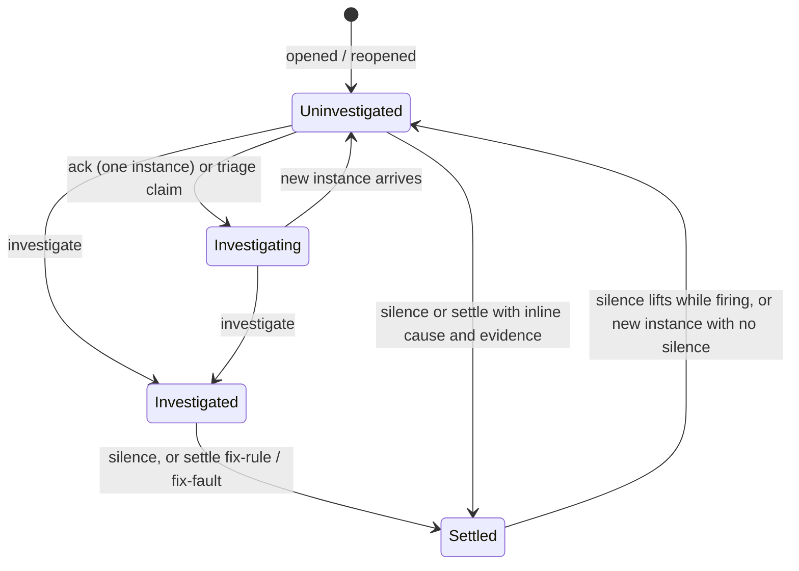

# Every alert gets an investigation and one recorded outcome, and silences bind a rule, variable, item, and bound

**Status:** Every question is ruled. Slice 1 of [§8](#8-the-build-in-slices-that-each-land-alone), single-instance `ack`, is built (`acked_seq`, `acked_fingerprint` and `acked_lag_pair` in [`lifecycle.go`](../../tools/tillr/watch/lifecycle.go)). Nothing else is: `rg -n 'settlement_state|watch_silences|alert_item_links|variables_json|investigation_cause' tools` and `rg -n 'alert_episodes|watch\.alert' tools/tillr-view tools/tillr-item` both return nothing. [§2](#2-what-tillr-watch-does-today--and-where-alerts-slip-through) states what exists.

> **In short.** An alert has two independent facts: whether its condition is firing, and whether anyone has established why and recorded what settles it. Keeping them apart is the design. `ack` marks one instance seen; only a recorded investigation plus a silence, a `fix-rule` item or a `fix-fault` item settles an episode.

**The shape.** Condition state (`open`, `acknowledged`, `silenced`, `resolved`) is tracked apart from settlement (`uninvestigated`, `investigating`, `investigated`, `settled`). Continuing suppression lives in a `watch_silences` row scoped by `(rule_id, vars_json)` that names an open item and a bound. Every alert-to-item link is kept in `alert_item_links` and shown in both directions in the Observatory.

**Start at** [§3](#3-the-alert-workflow-from-opened-to-investigated-to-settled).

**Needs your ruling:** None.

**Reads with:** [the observatory reference](../reference/observatory-redesign.md) (the principles every `tillr-view` alert surface follows), [the alert triage seat design](./tillr-alert-triage-seat.md) (which shares the investigation record, the outcome set and `tracking_item_id`, and may not silence), [the tillr-watch design](./tillr-watch.md) ([Section 6.8](./tillr-watch.md#68-alert-investigation-mandatory-outcomes-tracking-item-links-and-variable-scoped-silences-d-tw64-d-tw65), [D-TW64](./tillr-watch.md#D-TW64), [D-TW65](./tillr-watch.md#D-TW65), [D-TW67](./tillr-watch.md#D-TW67)), [the general agent watch design](./general-agent-watch.md), and the contracts for [`tillr-watch`](./tillr-utility-contracts/tillr-watch.md), [`tillr-view`](./tillr-utility-contracts/tillr-view.md) and [`tillr-item`](./tillr-utility-contracts/tillr-item.md).

---

## 1. What the owner said

The owner rulings this design rests on, each recorded in the [Decision Ledger](#decision-ledger):

- Every alert gets an investigation and an action. The action is one of three: silence this parameterized instance, file work to make the rule better, or file work to fix the fault. There is no "known about, chose not to file" disposition. Rules are parameterized by variables, and a silence binds one variable value of a rule, never the whole rule ([R-AW1](#R-AW1)).
- Watching finds and fixes issues; it applies no remedy ([R-AW2](#R-AW2)).
- No silent fallbacks, and an alert never caps, benches or fails queue work ([R-AW3](#R-AW3)).
- Acknowledging covers one instance and never ignores a later one ([R-AW4](#R-AW4)).
- Continuing suppression is parameterized, linked to an open queue item, and lifted automatically once that item is in ([R-AW5](#R-AW5)).
- Alerts, their status, when they fired and the items filed because of them are visible in the Observatory; the linked items are the record of action, and there is no other action log ([R-AW6](#R-AW6)).
- Every silence also carries an explicit bound ([OQ-AW1](#OQ-AW1)).
- An episode that resolves on its own still owes an investigation and an outcome ([OQ-AW2](#OQ-AW2)).
- A rule with no variables is silenced through the same path as a parameterized one ([OQ-AW3](#OQ-AW3)).

Every mechanism, command shape, table and slice boundary below is the designer's decision (`D-AW1` to `D-AW13`), which the owner may overturn.

---

## 2. What `tillr watch` does today — and where alerts slip through

| Surface | Today | Gap | This design |
| :--- | :--- | :--- | :--- |
| **`ack`** | Built as designed: `tillr watch ack <alert-id> --by <actor>` records the acknowledged instance (`acked_seq`, `acked_fingerprint`, `acked_lag_pair`), refuses `--item`, and a newer instance reopens the episode with `cause = "new-instance"` (or `"reopen-when"` on a `lag_behind` rule that declares `reopen_when`, [D-TW75](./tillr-watch.md#D-TW75)). | `ack` records no investigation and settles nothing. | Unchanged; `ack` additionally moves settlement to `investigating`. |
| **`track`** | `tillr watch track <alert-id> --item <id>` sets `tracking_item_id` and mutes repeats, with no bound, until the item finishes ([D-TW67](./tillr-watch.md#D-TW67)). | An unbounded mute across instances: a new fault can hide behind an open item. | Retired in favor of `settle` (one instance) and `silence` (bounded suppression). |
| **Alert-to-item links** | One scalar `tracking_item_id` per episode, cleared on recurrence; `tillr item request` has no alert flag. | Earlier links are lost; a resolved episode cannot be linked; an item has no back-link. | `alert_item_links` and `tillr item request --alert` ([§5.2](#52-why-scalar-tracking_item_id-alone-is-not-enough--and-durable-bidirectional-alert_item_links)). |
| **`silence`** | Per `alert_id`, with `--until` or `--until-change` and an optional `--reason`. | Not scoped by variable, linked to no item, and lost when the episode resolves in a quiet window. | The only continuing suppression: a durable, item-linked, bounded `watch_silences` row ([§4.2](#42-durable-watch_silences-and-how-one-variable-is-muted-without-muting-others)). |
| **`resolve`** | `tillr watch resolve <alert-id> --reason <text>` closes an episode on prose alone (`resolved_reason = 'manual'`). | This is the forbidden "understood, not filed" dismissal. | Removed. `resolved` is reserved for the engine's own endings, and settlement goes through `settle`. |
| **Investigation** | None recorded. | An alert can be muted or closed on a guess. | `tillr watch investigate`, required before any settlement ([§3.2](#32-step-1--mandatory-investigation-before-any-settlement)). |
| **`wait`, `status`, `drain why`** | Once `seen_seq` passes an episode it never wakes `wait` again; neither `status` nor `tillr drain why` counts unsettled alerts. | A seen alert can sit unacted on indefinitely. | Unsettled reminders, `status --unsettled`, and a standing drain alarm ([§6.1](#61-cli-status-wait-reminders-and-the-standing-drain-alarm)). |
| **The Observatory** | No alert command, route or page. | The owner cannot see alerts or what was done about them. | Read-only alert faces and pages ([§6.2](#62-observatory-surfaces-what-is-built-today-versus-what-is-new)). |

---

## 3. The alert workflow: from opened to investigated to settled

### 3.1 Separating condition state, single-instance `ack`, and workflow settlement

An episode carries two independent states (`D-AW1`, `D-AW11`):

1. **Condition state (`state`).** `open` (firing, current instance unacknowledged), `acknowledged` (firing, the current instance seen), `silenced` (firing under an active silence), or `resolved` (the condition ended: `condition-cleared`, or the subject item reached a final state, [D-TW63](./tillr-watch.md#D-TW63)).
2. **Settlement (`settlement_state`).** `uninvestigated`, then optionally `investigating`, then `investigated`, then `settled` with an outcome of `silence`, `fix-rule` or `fix-fault`.

Resolution never settles: an unsettled episode that resolves stays unsettled until it is investigated and given an outcome ([OQ-AW2](#OQ-AW2)).



### 3.2 Step 1 — Mandatory investigation before any settlement

An alert whose cause is unknown cannot be settled (`D-AW1`, `D-AW2`).

```text
tillr watch investigate <alert-id> --store <path> --by <actor> --cause <text> --evidence <text>
```

- The command records who investigated, when, the cause and the evidence on the episode, sets `settlement_state = 'investigated'`, and appends `watch.alert.investigated`.
- `--evidence` names the concrete facts read (event sequences, timing records, run logs, verdict paths). `--cause` states the mechanism established from them; `"unknown"` and blank text are refused.
- `settle` and `silence` accept `--cause` and `--evidence` inline, recording the investigation and the outcome in one transaction. A settlement on an episode with no recorded investigation and no inline flags is refused with exit `2` and changes nothing.
- When the cause is not yet clear, the actor claims the episode (`ack`, or the triage claim) and keeps reading, or escalates. An unknown cause never settles an episode.

### 3.3 Step 2 — The closed set of three outcomes

| Outcome | Meaning | Command | Preconditions |
| :--- | :--- | :--- | :--- |
| **`silence`** | The rule is useful, and this variable binding should be suppressed while an open item is in flight. | `tillr watch silence [<alert-id> \| --rule <id> [--var <k>=<v>...]] --by <actor> --item <item-id> --reason <text> (--until <dur\|time> \| --until-change)` | A recorded investigation; non-empty `--by` and `--reason`; the actor is not the triage seat; `<item-id>` is open; a variable binding on a parameterized rule; an explicit bound. |
| **`fix-rule`** | The rule fired falsely, too eagerly, or with the wrong grouping. | `tillr watch settle <alert-id> --by <actor> --outcome fix-rule --item <item-id>` | A recorded investigation; non-empty `--by`; `<item-id>` exists and is not closed; if it already finished, it finished after the episode's last observation. |
| **`fix-fault`** | The episode found a real defect in code, tests, configuration or tooling. | `tillr watch settle <alert-id> --by <actor> --outcome fix-fault --item <item-id>` | Same as `fix-rule`. |

**Filed or linked.** Both item outcomes name a real item. `item_link_kind` is `"filed"` when the investigation created the item and `"linked"` when the item was already open for the same cause.

**Finished items.** `settle` refuses a closed item. For a finished item it compares the episode's last observed sequence with the item's final event: an item that finished after the observation settles the episode; an item that finished before it did not stop the condition and is refused, with a message telling the actor to file a new item. `silence` requires an item that is open now, because the silence lasts until that item lands or closes.

### 3.4 Alignment with the alert triage seat and benign triggers

This workflow and [the alert triage seat](./tillr-alert-triage-seat.md) share one schema and one actor-neutral evaluator interface ([D-TW65](./tillr-watch.md#D-TW65), `D-AW2`):

1. **Same operations, different `--by`.** The operating session runs `investigate`, `settle` and `silence` as `operator-session`; the triage runner performs the same `investigate` and `settle` store operations as `tillr-triage`.
2. **One outcome mapping.** Triage's `filed` and `linked` outcomes ([§5.3 of the triage seat design](./tillr-alert-triage-seat.md#53-the-structured-triage-outcomes)) supply `item_link_kind` together with `fix-fault` or `fix-rule`, and write the same `tracking_item_id`. Triage's `escalated` outcome records the investigation; the episode is settled only if an item is attached, and otherwise stays investigated and unsettled until the operator or owner records an outcome.
3. **Triage never silences** ([D-AT6](./tillr-alert-triage-seat.md#decision-ledger)).
4. **No `expected` outcome** ([OQ-AT2](./tillr-alert-triage-seat.md#OQ-AT2)). A benign operation that fires a rule is settled by a `fix-rule` item.
5. **Auto-resolution leaves settlement untouched** ([OQ-AW2](#OQ-AW2)). Rows already `resolved` when the settlement columns are added are marked settled once, by the schema migration, so the upgrade does not create a backlog.

---

## 4. Parameterizing rules by variables and scoping silences to `(rule_id, variable_binding)`

### 4.1 How rules declare and expose named variables

Variables come from two places, and no existing rule file needs an edit (`D-AW3`):

1. **Derived from `[rule.when].group_by`.** A single non-global path exposes one variable named after the path's last segment (`group_by = "slowest_check"` exposes `slowest_check`). A composite `group_by` ([D-TW50](./tillr-watch.md#D-TW50)) exposes its ordered variables (`drain-lane-refused` exposes `lane_id` and `reason`). `group_by = "global"` exposes none. Of the 36 rules in `config/tillr/watch/`, 25 expose variables this way and 11 are global (`rg -N 'group_by' config/tillr/watch`).
2. **Declared in an optional `[rule.variables]` table**, mapping an identifier to an event field path:

   ```toml
   [rule.variables]
   package = "detail.package"
   suite = "detail.suite"

   [rule.when]
   group_by = ["detail.package"]

   [rule.guidance]
   summary = "Package {{var.package}} failed {{count}} times (suite {{var.suite}})."
   ```

   A declared name for a `group_by` path aliases the derived variable. A declared name for another string field of the newest counted event adds that field. The full map is stored on the episode as `variables_json`.

`tillr watch lint` checks that declared names are unique valid identifiers, that every path is a valid event path, that a `lag_behind` rule (which reads no events) declares none, and that each `{{var.<name>}}` placeholder names a variable of its rule.

### 4.2 Durable `watch_silences` and how one variable is muted without muting others

A silence kept on an episode row disappears when that episode resolves in a quiet window. Silences therefore live in their own table (`D-AW4`):

```sql
CREATE TABLE IF NOT EXISTS watch_silences (
    silence_id             TEXT PRIMARY KEY,
    rule_id                TEXT NOT NULL,
    vars_json              TEXT NOT NULL,   -- canonical sorted JSON object; "{}" on a global rule
    tracking_item_id       TEXT NOT NULL,   -- open queue item owning the fix
    created_by             TEXT NOT NULL,
    created_at             INTEGER NOT NULL,
    reason                 TEXT NOT NULL,
    investigation_cause    TEXT NOT NULL,
    investigation_evidence TEXT NOT NULL,
    source_alert_id        TEXT,
    silence_until_ms       INTEGER,         -- --until
    silence_on_fingerprint TEXT,            -- --until-change
    lifted_at              INTEGER,
    lifted_by              TEXT,
    lifted_reason          TEXT
);
CREATE UNIQUE INDEX IF NOT EXISTS watch_silences_active_scope
    ON watch_silences(rule_id, vars_json) WHERE lifted_at IS NULL;
```

1. **Binding.** On a parameterized rule, `silence` requires at least one `--var <name>=<value>`, or an alert id whose `variables_json` becomes the full binding. No binding, or an unknown variable name, is refused with exit `2`. On a global rule the same path is used with `vars_json = "{}"` ([OQ-AW3](#OQ-AW3)).
2. **Item and bound.** Every silence names an open item and carries `--until` or `--until-change` ([R-AW5](#R-AW5), [OQ-AW1](#OQ-AW1)). There is no standing silence.
3. **Matching.** A silence matches an episode of its rule when it is not lifted, its item is still open, its bound still holds, and every entry of `vars_json` equals the episode's variable of that name. Silencing `package=tools/flaky` leaves every other package live. Silencing an alert of a composite rule binds the full tuple by default; an explicit partial `--var` matches any value of the unnamed variables.
4. **Quiet gaps.** While a silence holds, a matching episode is `silenced` and `settled` with outcome `silence`, and keeps counting observations. If it resolves and the condition fires again under the same silence, the next episode opens directly as silenced and wakes nobody.
5. **Lifting.** Whichever comes first lifts the silence: the linked item lands or closes (`lifted_reason = "item-landed"` or `"item-closed"`), or the bound expires (`"silence-expired"` or `"fingerprint-changed"`). The lift appends `watch.silence.lifted`; an episode still firing reopens as `open` and `uninvestigated`. `tillr watch silence list` shows silences, and `tillr watch silence lift <silence-id> --by <actor> --reason <text>` lifts one by hand.
6. **`--until-change`** needs a rule that declares a fingerprint ([D-TW32](./tillr-watch.md#D-TW32)) and an active episode to take the fingerprint from.

### 4.3 Preserving domain neutrality for standalone `--state` users

The watch engine imports neither `tillr-item` nor `tillr-drain` (`D-GW9` of [the general agent watch design](./general-agent-watch.md)). Variables, silences, links, investigation and settlement are plain tables that work the same in a standalone watch state file. Only the check that `--item` names a real queue item is injected, through an optional seam provided by `TillrStoreSource`; without a `tillr` store, `--item` accepts any non-empty external reference (`D-AW10`).

---

## 5. Shared tracking-item binding and repeat counting without waking

### 5.1 Single-instance watermarks on `ack` and `settle` versus active silence suppression

`ack`, `settle` and silences share one episode schema and one `tracking_item_id` column ([D-TW65](./tillr-watch.md#D-TW65), `D-AW5`, `D-AW11`). The `acked_*` columns exist; the rest are additions:

```sql
variables_json         TEXT NOT NULL DEFAULT '{}',
settlement_state       TEXT NOT NULL DEFAULT 'uninvestigated',
investigated_by        TEXT,
investigated_at        INTEGER,
investigation_cause    TEXT,
investigation_evidence TEXT,
outcome                TEXT,      -- 'silence' | 'fix-rule' | 'fix-fault'
item_link_kind         TEXT,      -- 'filed' | 'linked'
silence_id             TEXT,
settled_by             TEXT,
settled_at             INTEGER,
settled_seq            INTEGER,   -- event seq covered by settle
settled_fingerprint    TEXT,
settled_lag_pair       TEXT,
reopen_count_for_item  INTEGER NOT NULL DEFAULT 0,
escalated_to           TEXT,      -- 'operator-session' | 'owner'
last_reminded_at       INTEGER
```

1. **`ack` covers one observed instance** ([R-AW4](#R-AW4), `D-AW11`). While evaluation re-reads the same instance the episode stays `acknowledged` and unsettled. A later instance (a newer matching event, a `reopen_when` match, a changed fingerprint or a changed lag pair) with no matching silence reopens it and wakes the receiver. `acknowledged` never blocks `condition-cleared` ([D-TW72](./tillr-watch.md#D-TW72)).
2. **`settle` covers one observed instance** (`D-AW5`). It records the outcome, the item and the settled sequence, fingerprint and lag pair. Re-reading the same settled window does not wake anyone. A new instance with no active silence reopens the episode:
   - if the tracking item is still open, the repeat count rises and the item id is kept for context (on a `triage` rule, the seat checks whether the new instance shares the item's cause and escalates at the third reopen, [D-AT11](./tillr-alert-triage-seat.md#decision-ledger));
   - if the tracking item has landed or closed, the episode reopens with `cause = "recurred-after-item-<state>"`: the item did not remove the fault.
3. **Suppression across instances needs a silence** ([R-AW5](#R-AW5)).

### 5.2 Why scalar `tracking_item_id` alone is not enough — and durable bidirectional `alert_item_links`

One scalar column cannot answer "which items were filed because of this alert" ([R-AW6](#R-AW6)): it is cleared on recurrence, it holds one item where an episode may need two, it cannot be set on a resolved episode without reopening it, and it gives an item no indexed way back to its alerts. The scalar stays as the episode's current item pointer, and every link is also kept in a join table owned by the watch package (`D-AW12`):

```sql
CREATE TABLE IF NOT EXISTS alert_item_links (
    alert_id   TEXT NOT NULL REFERENCES alert_episodes(alert_id),
    item_id    TEXT NOT NULL,
    relation   TEXT NOT NULL,   -- 'filed' | 'silence' | 'fix-fault' | 'fix-rule' | 'tracked'
    linked_at  INTEGER NOT NULL,
    linked_by  TEXT,
    note       TEXT,
    event_seq  INTEGER NOT NULL,
    PRIMARY KEY (alert_id, item_id)
);
CREATE INDEX IF NOT EXISTS alert_item_links_by_item
    ON alert_item_links(item_id, linked_at, alert_id);
```

- **Filing from an alert.** `tillr item request` takes a repeatable `--alert <alert-id>`. The link is written in the same transaction as the item; an unknown alert id refuses and rolls the filing back. It works on an episode in any state, including `resolved`, appends `watch.alert.item-linked`, and neither mutes later instances nor replaces `settle`.
- **Settling or silencing.** `settle` upserts the link with relation `fix-fault` or `fix-rule`; `silence` upserts `silence` unless a fix relation is already recorded. A later recurrence leaves every earlier link in place.
- **Existing stores.** Opening a store for writing creates the table and backfills it from `tracking_item_id` and the stored `watch.alert.*` events, with relation `tracked` for links made by `track`. A read-only caller on a store without the table projects the same links from those sources and writes nothing.

---

## 6. Making unsettled alerts unmistakable — and showing every alert, transition, and linked item in the Observatory

### 6.1 CLI `status`, `wait` reminders, and the standing drain alarm

Unsettled episodes, including resolved ones, are surfaced in three places (`D-AW6`):

1. **`tillr watch status`** stays read-only ([D-TW34](./tillr-watch.md#D-TW34)) and leads with a summary of unsettled, settled and silenced counts. `--unsettled` lists every episode that still owes a decision.

   ```text
   summary unsettled=2 (uninvestigated=1 investigating=0 investigated=1) settled=2 active_silences=1
   alert <alert-id> rule=fast-gate-run-slow vars={"slowest_check":"go-build"} state=open settlement=uninvestigated unsettled_for=14m
   silence <silence-id> rule=package-frequent-red vars={"package":"tools/flaky"} item="<item-id>" by="operator-session" until=<time> matched_alerts=3
   ```

2. **`tillr watch wait`.** Advancing `seen_seq` confirms delivery of the first notice; it does not retire an unsettled episode. An episode routed or escalated to the operating session that is still unsettled after `unsettled_remind_after` (default `15m`) is re-emitted with an `UNSETTLED` banner. Episodes escalated to the owner are excluded. The notice footer prints the `investigate`, `settle`, `silence` and `ack` command templates.
3. **`tillr drain why`** raises a standing `unsettled-watch-alerts` alarm with the count, the oldest age and the alert ids, excluding episodes under a live triage claim or waiting on the owner. [The timed drain check-in skill](../../.agents/skills/drain-timed-checkin/SKILL.md) treats each such alert as work to finish before the check-in report.

### 6.2 Observatory surfaces: what is built today versus what is new

Built: the `alert_episodes` table and the `watch.alert.*` events (`opened`, `acknowledged`, `tracked`, `silenced`, `reopened`, `resolved`), item-subject auto-closure ([D-TW63](./tillr-watch.md#D-TW63)) and rule load baselines ([D-TW66](./tillr-watch.md#D-TW66)). `tillr-view` and `tillr-item` read none of it.

New, all read-only and following the principles of [the observatory reference](../reference/observatory-redesign.md) (`D-AW13`):

| Surface | Address | Role |
| :--- | :--- | :--- |
| **Alerts ledger** | `#/alerts`, filterable by state, rule, severity and settlement | Every active and resolved episode, plus active silences. |
| **Alert page** | `#/alert/<alert-id>` | One episode: its metadata, the full transition history with times and actors, linked items with their live states, the captured bundle, and the other episodes of the same rule and subject. |
| **Home panel** | `#/` | Counts and the first few unsettled or active alerts; promoted to the top when a high-severity, unsettled or owner-escalated alert is active. |
| **Item page section** | `#/item/<item-id>` | Every alert linked to the item, or an explicit statement that there is none. |
| **CLI, HTTP and WebSocket** | `tillr-view alerts`, `GET /api/v1/alerts`, `GET /api/v1/alerts/{id}`, `linked_alerts` on `GET /api/v1/items/{id}`, invalidation topics for alerts and items | The same Go projections behind every face; a store with no alert table returns an empty list flagged as such rather than an error. |

### 6.3 What each alert row shows on `#/alerts` and `Home`

Each row shows the alert id with its state mark, the rule (clickable as a filter), the subject and its variables, the severity, the condition and settlement states with the unsettled age, when it fired with its episode number and observation count, the latest transition with its time and actor, and every linked item with that item's current state and link relation. Rows default to all states, unsettled and active first.

### 6.4 Full state-change history on `#/alert/<id>` with time and actor

The alert page rebuilds the episode's history from its stored events in sequence order. Each row shows the sequence, the timestamp, the state change, the actor and the detail:

| State change | Stored event | Actor |
| :--- | :--- | :--- |
| `fired` | `watch.alert.opened`, first episode | The evaluator; never a person. |
| `acknowledged` | `watch.alert.acknowledged` | The `--by` value. |
| `investigated`, `settled` | `watch.alert.investigated`, `watch.alert.settled`, `watch.alert.item-linked`, `watch.alert.tracked` | The `--by` value. |
| `silenced`, `silence-lifted` | `watch.alert.silenced`, `watch.silence.lifted` | The `--by` value, or the evaluator on an automatic lift. |
| `resolved` | `watch.alert.resolved` | The evaluator for `condition-cleared` and item endings. |
| `re-fired` | `watch.alert.reopened`, or `watch.alert.opened` on a later episode | The evaluator. |

A stored event that carries no actor (a `track` or `silence` without `--by`, a manual `resolve`) is shown as "not recorded", never with an invented actor. An episode with no events shows that explicitly beside its stored timestamps. Triage events appear in the same table once the triage seat is built.

### 6.5 Bidirectional alert and item links across `#/alert/<id>`, `#/item/<id>`, and CLI faces

- **Alert to items.** Each alert carries its linked items, ordered by link time, with each item's title, current state ([item states](../reference/tillr-item-states.md)), relation, whether an active silence links it, and who linked it.
- **Item to alerts.** `GET /api/v1/items/{id}`, `tillr item show` and the item page list every linked alert with its rule, subject, states and relation.
- **No separate action log** ([R-AW6](#R-AW6)). The linked items, the silences and the transition history are the complete record of what was done because of an alert.

---

## 7. Edge cases, concurrency, and failure modes

| Case | Behavior (`D-AW7`) |
| :--- | :--- |
| **A second matching event arrives after `ack`** | The episode reopens as `open` and `uninvestigated` with `cause = "new-instance"` and wakes the receiver. |
| **Two actors settle the same alert** | Both run in a write transaction. The second sees the episode settled and exits `1`, reporting who settled it and how; it exits `0` only if actor, outcome and item are identical. |
| **One rule fires on a silenced and an unsilenced binding in one pass** | The silenced binding counts quietly; the other opens and wakes the receiver. |
| **A silenced binding goes quiet, then fires again while the silence holds** | The first episode resolves; the next opens directly as silenced. |
| **The silence's item lands before `--until` expires** | The silence lifts at once. A later firing opens unsilenced with `cause = "silence-item-landed"`. |
| **An episode resolves before anyone investigates** | It stays unsettled in `status --unsettled`, reminders, `tillr drain why` and triage dispatch; `tillr item request --alert` links an item without reopening it. |
| **An unknown alert id, a missing item, a closed item on `silence`, or `--outcome expected`** | Refused before any row or event is written. |
| **Several items for one alert across recurrences** | `tracking_item_id` holds the latest; `alert_item_links` keeps all. |
| **The triage seat attempts `silence`** | Refused twice: by the command shim ([§5.2 of the triage seat design](./tillr-alert-triage-seat.md#52-forbidden-actions-hard-mechanical-boundary)) and by the evaluator on the actor. |
| **Rows that exist when the columns are added** | `open` and `acknowledged` rows default to `uninvestigated`; `resolved` rows are marked settled by the migration; links are backfilled. |

---

## 8. The build, in slices that each land alone

Eight slices in order (`D-AW8`), followed by the seven slices of [the alert triage seat](./tillr-alert-triage-seat.md#9-the-build-in-slices-that-each-land-alone), whose last slice completes the Observatory panels for triage outcomes and silences.

| Slice | What lands | Done when | Built |
| :--- | :--- | :--- | :--- |
| **1** | `ack` covers one instance: the `acked_*` watermarks, `--item` refused on `ack`, reopen on any newer instance ([R-AW4](#R-AW4), `D-AW11`). | Tests show `ack` mutes only the acknowledged observation and never blocks `condition-cleared`. | Yes |
| **2** | Rule variables: derivation from `group_by`, `[rule.variables]`, `variables_json`, guidance placeholders and lint checks (`D-AW3`). | Tests cover derivation for every rule in `config/tillr/watch/`, declared mappings and lint refusals. | No |
| **3** | Mandatory investigation and item-verified `settle`; `resolve` and `track` retired; auto-resolution left unsettled (`D-AW1`, `D-AW2`, `D-AW5`). | Tests show an uninvestigated `settle` fails, a missing, closed or stale-finished item fails, and a new instance after `settled_seq` reopens. | No |
| **4** | Item-linked, bounded `watch_silences` for parameterized and global rules, with `list`, `lift` and automatic lift (`D-AW4`). | Tests show one binding muted across episode clears while another wakes, and the lift on item completion or bound expiry. | No |
| **5** | Unsettled alerts in `status --unsettled`, `wait` reminders, `tillr drain why` and the check-in skill (`D-AW6`). | Tests show `seen_seq` alone does not suppress a reminder and the drain alarm stands until settlement. | No |
| **6** | `alert_item_links`, `tillr item request --alert`, `linked_alerts` on `tillr item show`, and the watch read helpers (`D-AW12`). | Tests show several items per alert survive recurrences and an unknown alert id rolls the filing back. | No |
| **7** | `tillr-view alerts`, the alert HTTP routes, `linked_alerts` on the item route, and WebSocket invalidation (`D-AW13`). | Tests show CLI and HTTP agree, every transition row renders with a recorded or "not recorded" actor, and an empty store is safe. | No |
| **8** | The Observatory pages: the ledger, the alert page, the Home panel and the item page section (`D-AW13`). | UI tests cover filtering, the transition history, and navigation between alert and item pages. | No |

---

## 9. What this does not do

- It builds no action log apart from queue items and silences.
- It opens no writable store handle in `tillr-view`.
- It executes no remedy: recording an outcome changes watch and item records only.
- It never lets `ack` ignore a later instance, or a silence stand without an open item and a bound.
- It never lets automated triage silence an alert.
- It adds no `tillr-item` or `tillr-drain` import to the watch engine.
- It changes no rule file; a rule that fires falsely is fixed by its own `fix-rule` item.

---

## 10. Alternatives considered

| Alternative | Verdict (`D-AW9`) |
| :--- | :--- |
| Keep `resolve --reason`, or add an `expected` outcome | Rejected: it is the "understood, not filed" disposition ([R-AW1](#R-AW1), [OQ-AT2](./tillr-alert-triage-seat.md#OQ-AT2)). |
| Keep `track` as an unbounded mute while an item is open | Rejected: a new fault hides behind the open item ([R-AW4](#R-AW4), [R-AW5](#R-AW5)). |
| Rely on scalar `tracking_item_id`, or scan events on every request | Rejected: the scalar loses history, and a scan per item request does not scale. |
| A separate table of free-text actions | Rejected: contradicts [R-AW6](#R-AW6). |
| Keep silences as episode columns | Rejected: fails when no episode is open and when a silenced condition clears and fires again. |
| Silence by rewriting the rule's `match` expression | Rejected: hides silenced observations, cannot express a bound or an item lift, and conflicts with rule tuning. |
| Separate item columns for triage and for the foreground workflow | Rejected: two sources of truth for which item owns an episode ([D-TW65](./tillr-watch.md#D-TW65)). |
| Refuse to advance `seen_seq` on an unsettled alert | Rejected: a non-following `wait` would exit in a tight loop while the agent is investigating. Reminders after `unsettled_remind_after` give time without dropping the alert. |

---

## 11. Risks

| Risk | Mitigation |
| :--- | :--- |
| A noisy alert is settled with a vague placeholder item or an over-broad silence | Investigation requires concrete cause and evidence; a silence needs a binding, an open item and a bound, lifts when the item finishes, and stays visible in status and the Observatory. |
| A partial binding on a composite rule mutes an unrelated subject | Silencing an alert binds its full tuple; a partial binding happens only when written explicitly, and the exact binding is displayed. |
| Leaving auto-resolved episodes unsettled creates a backlog on rollout | Rows already resolved at migration are marked settled once. |
| Stored events carry no actor | The page shows "not recorded"; every new transition records `--by`. |
| Reminders repeat while an alert waits on the owner | Episodes escalated to the owner are excluded from reminders. |

---

## Open Questions

None.

---

## Decision Ledger

Rows `R-AW1` to `R-AW6` and [OQ-AW1](#OQ-AW1) to [OQ-AW3](#OQ-AW3) are owner rulings. Every `D-AW` row is the designer's decision, and the owner may overturn it.

| ID | Ruling / Decision | Date | Settled in | Built |
| :--- | :--- | :--- | :--- | :--- |
| <a id="R-AW1"></a>**R-AW1** | **Owner ruling ([D-TW64](./tillr-watch.md#D-TW64)).** Every alert gets an investigation that establishes why it fired and one of three actions: silence this parameterized instance, file work to improve the rule, or file work to fix the fault. Rules are parameterized by variables so a silence binds one variable value. There is no "known about, not filed" disposition. | 2026-11-22 | [§3](#3-the-alert-workflow-from-opened-to-investigated-to-settled), [§4](#4-parameterizing-rules-by-variables-and-scoping-silences-to-rule_id-variable_binding) | No |
| <a id="R-AW2"></a>**R-AW2** | **Owner ruling ([OQ-TW2](./tillr-watch.md#OQ-TW2)).** Watch rules and alert handling apply no automatic remedies. | 2026-11-21 | [§9](#9-what-this-does-not-do) | — |
| <a id="R-AW3"></a>**R-AW3** | **Owner ruling ([the judge and lifecycle design](./tillr-judge-and-lifecycle.md#415-no-automatic-move-to-another-model-d-jl24-to-d-jl27), [D-TW2](./tillr-watch.md#D-TW2)).** No silent fallbacks; alerts never fail, bench or cap queue work. | 2026-11-20, 2026-11-21 | [§3](#3-the-alert-workflow-from-opened-to-investigated-to-settled) | — |
| <a id="R-AW4"></a>**R-AW4** | **Owner ruling.** Acknowledging an alert covers one instance only and never ignores later instances. | 2026-11-23 | [§5.1](#51-single-instance-watermarks-on-ack-and-settle-versus-active-silence-suppression) | Yes |
| <a id="R-AW5"></a>**R-AW5** | **Owner ruling.** Continuing suppression is parameterized by what is ignored, linked to an open queue item, and lifted automatically once that item is in. | 2026-11-23 | [§3.3](#33-step-2--the-closed-set-of-three-outcomes), [§4.2](#42-durable-watch_silences-and-how-one-variable-is-muted-without-muting-others) | No |
| <a id="R-AW6"></a>**R-AW6** | **Owner ruling.** Watch alerts are visible in the Observatory with their current status, when they fired and what was done; the queue items linked to an alert are the record of action, and no other action tracking exists. | 2026-11-22 | [§5.2](#52-why-scalar-tracking_item_id-alone-is-not-enough--and-durable-bidirectional-alert_item_links), [§6](#6-making-unsettled-alerts-unmistakable--and-showing-every-alert-transition-and-linked-item-in-the-observatory) | No |
| <a id="OQ-AW1"></a>[OQ-AW1](#OQ-AW1) | **Owner ruling.** Every silence carries `--until` or `--until-change` in addition to its open item; whichever comes first lifts it. There is no standing silence. | 2026-11-23 | [§3.3](#33-step-2--the-closed-set-of-three-outcomes), [§4.2](#42-durable-watch_silences-and-how-one-variable-is-muted-without-muting-others) | No |
| <a id="OQ-AW2"></a>[OQ-AW2](#OQ-AW2) | **Owner ruling.** An episode that resolves on its own (`condition-cleared`, or its subject item finishing or closing) stays unsettled until it is investigated and given one of the three outcomes. | 2026-11-23 | [§3.1](#31-separating-condition-state-single-instance-ack-and-workflow-settlement), [§3.4](#34-alignment-with-the-alert-triage-seat-and-benign-triggers) | No |
| <a id="OQ-AW3"></a>[OQ-AW3](#OQ-AW3) | **Owner ruling.** A zero-variable global rule uses the same item-linked, bounded silence path, because a rule that cannot be silenced trains operators to ignore alerts. | 2026-11-23 | [§4.1](#41-how-rules-declare-and-expose-named-variables), [§4.2](#42-durable-watch_silences-and-how-one-variable-is-muted-without-muting-others) | No |
| <a id="D-AW1"></a>**D-AW1** | Track settlement apart from condition state, add `tillr watch investigate`, refuse any settlement without a recorded investigation, and keep auto-resolved episodes unsettled. | 2026-11-23 | [§3.1](#31-separating-condition-state-single-instance-ack-and-workflow-settlement), [§3.2](#32-step-1--mandatory-investigation-before-any-settlement) | No |
| <a id="D-AW2"></a>**D-AW2** | Retire prose-only `resolve` and `track`; enforce the closed outcome set through actor-neutral `silence` and `settle` that verify the item, sharing one store seam with the triage seat. | 2026-11-23 | [§3.3](#33-step-2--the-closed-set-of-three-outcomes), [§3.4](#34-alignment-with-the-alert-triage-seat-and-benign-triggers) | No |
| <a id="D-AW3"></a>**D-AW3** | Derive named variables from `group_by`, support an optional `[rule.variables]` table, and store the resulting map in `variables_json`. | 2026-11-23 | [§4.1](#41-how-rules-declare-and-expose-named-variables) | No |
| <a id="D-AW4"></a>**D-AW4** | Persist silences in `watch_silences` keyed by rule and canonical variable binding, with a required investigation, actor, reason, open item and bound; keep them across quiet gaps; lift them on item completion or bound expiry. | 2026-11-23 | [§4.2](#42-durable-watch_silences-and-how-one-variable-is-muted-without-muting-others) | No |
| <a id="D-AW5"></a>**D-AW5** | Share one `tracking_item_id` across `settle`, silences and triage outcomes, and bound `settle` to the settled instance so it never acts as a mute across instances. | 2026-11-23 | [§5.1](#51-single-instance-watermarks-on-ack-and-settle-versus-active-silence-suppression) | No |
| <a id="D-AW6"></a>**D-AW6** | Surface unsettled alerts in `tillr watch status`, `tillr watch wait` reminders (default `15m`), a standing `tillr drain why` alarm, and the Observatory. | 2026-11-23 | [§6.1](#61-cli-status-wait-reminders-and-the-standing-drain-alarm) | No |
| <a id="D-AW7"></a>**D-AW7** | Enforce the concurrency, reopen, auto-lift, refusal and migration behavior of [§7](#7-edge-cases-concurrency-and-failure-modes). | 2026-11-23 | [§7](#7-edge-cases-concurrency-and-failure-modes) | No |
| <a id="D-AW8"></a>**D-AW8** | Build in the eight slices of [§8](#8-the-build-in-slices-that-each-land-alone), single-instance `ack` first, followed by the triage-seat slices. | 2026-11-23 | [§8](#8-the-build-in-slices-that-each-land-alone) | Slice 1 |
| <a id="D-AW9"></a>**D-AW9** | Reject the alternatives of [§10](#10-alternatives-considered). | 2026-11-23 | [§10](#10-alternatives-considered) | — |
| <a id="D-AW10"></a>**D-AW10** | Inject queue-item verification through an optional seam on `TillrStoreSource` rather than importing `tillr-item` or `tillr-drain` into the watch engine. | 2026-11-22 | [§4.3](#43-preserving-domain-neutrality-for-standalone---state-users) | No |
| <a id="D-AW11"></a>**D-AW11** | Implement single-instance acknowledgement with the `acked_seq`, `acked_fingerprint` and `acked_lag_pair` watermarks: `ack` refuses `--item`, never blocks `condition-cleared` ([D-TW72](./tillr-watch.md#D-TW72)), and a newer instance reopens the episode, keeping `cause = "reopen-when"` where a `lag_behind` rule's `reopen_when` matched ([D-TW75](./tillr-watch.md#D-TW75)). | 2026-11-24 | [§5.1](#51-single-instance-watermarks-on-ack-and-settle-versus-active-silence-suppression) | Yes |
| <a id="D-AW12"></a>**D-AW12** | Persist alert-to-item links in `alert_item_links`, written by `settle`, `silence` and `tillr item request --alert`, with a backfill and a read-only projection for stores without the table. | 2026-11-23 | [§5.2](#52-why-scalar-tracking_item_id-alone-is-not-enough--and-durable-bidirectional-alert_item_links), [§6.5](#65-bidirectional-alert-and-item-links-across-alertid-itemid-and-cli-faces) | No |
| <a id="D-AW13"></a>**D-AW13** | Expose read-only Observatory alert faces: the `tillr-view alerts` command, the alert HTTP routes and WebSocket topics, the alerts ledger, the alert page, the Home panel and the item page section. | 2026-11-23 | [§6.2](#62-observatory-surfaces-what-is-built-today-versus-what-is-new) | No |
