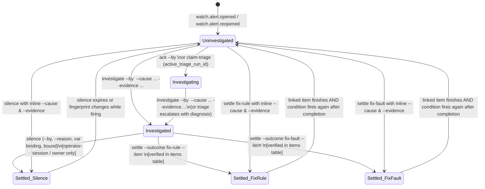

# Every alert gets an investigation and one recorded outcome, and silences bind a rule and variable

**Status:** 2026-11-22. Nothing in this workflow layer is built. Read at `40ccc02d63`, [`tools/tillr/watch/eval.go`](../../tools/tillr/watch/eval.go), [`tools/tillr/watch/lifecycle.go`](../../tools/tillr/watch/lifecycle.go), and [`tools/tillr-watch/lifecycle.go`](../../tools/tillr-watch/lifecycle.go) implement per-`alert_id` `ack`, `silence` (`--until` or `--until-change`), and prose-only `resolve`, while [`docs/design/tillr-alert-triage-seat.md`](./tillr-alert-triage-seat.md) (`7a5a8fa687`), item-subject auto-closure ([D-TW63](./tillr-watch.md#D-TW63), `9cee3dfdec`), and the cross-item seams of [Section 6.8 of the tillr-watch design](./tillr-watch.md#68-alert-investigation-mandatory-outcomes-tracking-item-links-and-variable-scoped-silences-d-tw64-d-tw65) (`40ccc02d63`) are landed as design only (`rg -n 'tracking_item|settlement_state|watch_silences|investigate' tools/ config/` returns nothing). Only the owner's dated words quoted in [§1](#1-what-the-owner-said) are owner rulings (`R-AW1`–`R-AW3`); every other mechanism, command shape, table, column, variable rule, and slice boundary is the designer's decision (from an operator request) and is marked in prose and in the [Decision Ledger](#decision-ledger) as the designer's for the owner to overturn. No companion `-plan.md` seed is opened while [OQ-AW1](#OQ-AW1)–[OQ-AW3](#OQ-AW3) (and [OQ-AT2](./tillr-alert-triage-seat.md#OQ-AT2)) are open, and zero build items are filed by this document.

> **In short.** Every `tillr-watch` episode that opens must first record an investigation establishing *why* it fired, and can settle only through one of three recorded outcomes: **silence** this `(rule_id, variable_binding)` instance with a reason, **fix-rule** naming a verified queue item that improves the rule, or **fix-fault** naming a verified queue item that repairs the defect — while any unsettled alert stays loud across `wait`, `status`, `tillr drain why`, and Observatory until settled.

**Why it matters.** On 2026-11-22, ten alerts sat `open` for twelve hours after their items had finished, and the operating session diagnosed three noisy rules (`trunk-proof-lag`, `drain-repeated-item-conflicts`, `trunk-proof-stalled`) and explained them verbally to the owner without filing items to fix them. Today's `ack`, prose-only `resolve`, per-`alert_id` `silence`, and one-shot `seen_seq` allow alerts to sit known-about and unfiled, vanish across brief quiet windows when silenced, or get waved away without fixing either the fault or the rule ([§2](#2-what-tillr-watch-does-today--and-where-alerts-slip-through)).

**The shape.** Orthogonal condition and settlement tracking on `alert_episodes`, actor-neutral `investigate` and `settle` (`--outcome fix-rule|fix-fault --item <id>`) operations shared by the operating session and [the alert triage seat](./tillr-alert-triage-seat.md), backward-compatible named rule variables backed by durable `(rule_id, variable_binding)` rows in `watch_silences`, single-column `tracking_item_id` repeat counting while a linked item is open, and unsettled reminders and standing alarms so no alert disappears between receipt and action ([§3](#3-the-alert-workflow-from-opened-to-investigated-to-settled)–[§6](#6-making-unsettled-alerts-unmistakable-so-none-sits-known-about-and-unfiled)).

**Cost.** One new `watch_silences` table, additive investigation and settlement columns on `alert_episodes`, replacement of prose-only `tillr watch resolve` with item-verified `tillr watch settle`, and unsettled status/reminder wiring across `tillr-watch`, `tillr-drain`, and `tillr-view`.

**Start at** [§2](#2-what-tillr-watch-does-today--and-where-alerts-slip-through) for the exact comparison with today's commands, then [§3](#3-the-alert-workflow-from-opened-to-investigated-to-settled) for the lifecycle and closed outcome set, [§4](#4-parameterizing-rules-by-variables-and-scoping-silences-to-rule_id-variable_binding) for rule variables and scoped silences, and [§5](#5-shared-tracking-item-binding-and-repeat-counting-without-waking)–[§6](#6-making-unsettled-alerts-unmistakable-so-none-sits-known-about-and-unfiled) for tracking-item repeat counting and unsettled visibility.

**Needs your ruling:** [OQ-AW1](#OQ-AW1), [OQ-AW2](#OQ-AW2), [OQ-AW3](#OQ-AW3) (plus companion [OQ-AT2](./tillr-alert-triage-seat.md#OQ-AT2)).

**Awaits your review:** the designer's decisions `D-AW1` to `D-AW10` in the [Decision Ledger](#decision-ledger).

**Reads with:** [the alert triage seat design](./tillr-alert-triage-seat.md) (which owns internal triage dispatch, the read-and-file command boundary, and upward escalation, using the actor-neutral investigation and outcome store operations specified here), [the tillr-watch design](./tillr-watch.md) (specifically [§6.1](./tillr-watch.md#61-one-record-per-condition-never-per-pass-the-alert-episode-state-machine-d-tw5), [§6.7](./tillr-watch.md#67-the-second-build-the-remaining-patterns-projections-and-the-alert-commands-d-tw27), and [§6.8](./tillr-watch.md#68-alert-investigation-mandatory-outcomes-tracking-item-links-and-variable-scoped-silences-d-tw64-d-tw65)), [the general agent watch design](./general-agent-watch.md) (whose domain-neutral engine and `--state` store stay free of `tillr` imports), and [the tillr-watch contract](./tillr-utility-contracts/tillr-watch.md).

**Words.** **Item**, **lane**, **seat**, and **verdict** keep their meanings from [the vocabulary](./tillr-vocabulary.md#5-the-words). **Episode**, **subject key**, **condition fingerprint**, and **`TimelineBundle`** keep their meanings from [the tillr-watch design](./tillr-watch.md#61-one-record-per-condition-never-per-pass-the-alert-episode-state-machine-d-tw5). **Alert triage** and **upward escalation** keep their meanings from [the alert triage seat design](./tillr-alert-triage-seat.md). Four terms are coined here:

- **Alert investigation** *(coined here)*: the recorded diagnosis on an episode (`investigated_by`, `investigated_at`, `investigation_cause`, and `investigation_evidence` citing concrete event sequences, logs, checks, or commits) establishing why the rule fired before an outcome is chosen.
- **Alert settlement** *(coined here)*: recording one outcome from the closed three-outcome set (`silence`, `fix-rule`, or `fix-fault`) on an investigated episode — linking either a durable `(rule_id, variable_binding)` silence or a verified queue item in `.tillr/state.db`. An episode lacking a recorded outcome is **unsettled**.
- **Rule variable** *(coined here)*: a named string dimension exposed by a rule — derived automatically from `[rule.when].group_by` or declared in `[rule.variables]` (such as `package`, `slowest_check`, `lane_id`, or `node`) — whose per-episode values parameterize both alert identity and silences.
- **Variable-scoped silence** *(coined here)*: a durable record in `watch_silences` keyed by `(rule_id, variable_binding)` that mutes wakeups and triage dispatch for matching variable bindings of that rule (with a recorded investigation, actor, reason, and bound) while leaving every other variable binding on the same rule active.

---

## 1. What the owner said

On 2026-11-22, after ten alerts sat open for twelve hours past item completion and the operating session explained three rule faults without filing them, the owner gave this direction verbatim (`R-AW1`, recorded in [D-TW64](./tillr-watch.md#D-TW64)):

> "I think we need some sort of workflow for alerts. Like an alert comes in, you have to decide what to do with it. You can say this alert is useful, but this specific instance of the alert is not useful and you silence that one. One alert rule shouldn't just have one silence. If it's an alert rule for like package, like they should be parameterized with variables. Like if one package say for instance has like frequent red you should be able to silence just that one for that rule so you can silence it or you can fix it I don't know if there's well so I guess it could be something's wrong with the rules you need to file something to make the rule better or you need to file something to you know fix the actual issue it's finding like I don't want this list of where it was not useful then you tell me I understand them, but I didn't file them because I didn't want to or whatever. There shouldn't be a know about and don't file. There also shouldn't be an alert that we don't know why it fired, so we need an investigation and action."

Four requirements in those words are direct owner rulings (`R-AW1`):

1. **Every alert gets an investigation establishing why it fired.** There must never be an alert whose cause is unknown and left uninvestigated.
2. **Every investigated alert gets an action from three dispositions.** Either silence this specific non-actionable instance of a generally useful rule, file work to improve the rule, or file work to fix the underlying fault the rule found.
3. **No "known about, chose not to file" disposition.** Explaining why an alert was noisy or understood while filing nothing and silencing nothing is forbidden.
4. **Rules are parameterized by variables, and silences bind a rule and variable value.** A rule does not have one blanket silence; silencing one variable value (such as one package or one check) mutes only that value for that rule and leaves every other variable value on the rule live.

Two earlier verbatim owner rulings also bind this workflow:

- **Watching finds and fixes issues rather than covering them ([OQ-TW2](./tillr-watch.md#OQ-TW2), 2026-11-21, `R-AW2`):** *"Every single one of these sounds like a fallback to cover an issue. We don't cover issues. We use this to find the issues and fix them."* `tillr-watch` executes zero automatic remedies, and automated triage cannot silence its own alerts.
- **No silent fallbacks and no work caps (2026-11-20, [the judge and lifecycle design](./tillr-judge-and-lifecycle.md#415-no-automatic-move-to-another-model-d-jl24-to-d-jl27); [D-TW2](./tillr-watch.md#D-TW2), `R-AW3`):** *"I hate fallbacks... We need deliberate choices, not fallbacks."* Missing items, unknown variable names, and uninvestigated settlements fail loudly rather than degrading to prose notes, and alerts never cap, bench, or fail queue items.

Everything beyond these quoted owner rulings — the CLI syntax, state columns, `watch_silences` table, `[rule.variables]` schema, tracking-item repeat mechanics, unsettled reminder cadence, and build slices — is the designer's decision (`D-AW1`–`D-AW10`, from an operator request) that the owner may overturn, or an open question left for the owner in [OQ-AW1](#OQ-AW1)–[OQ-AW3](#OQ-AW3) (and [OQ-AT2](./tillr-alert-triage-seat.md#OQ-AT2)).

---

## 2. What `tillr watch` does today — and where alerts slip through

Read at `40ccc02d63` across [`tools/tillr/watch/eval.go`](../../tools/tillr/watch/eval.go), [`tools/tillr/watch/lifecycle.go`](../../tools/tillr/watch/lifecycle.go), [`tools/tillr/watch/delivery.go`](../../tools/tillr/watch/delivery.go), [`tools/tillr/watch/status.go`](../../tools/tillr/watch/status.go), [`tools/tillr/watch/rules.go`](../../tools/tillr/watch/rules.go), and [`tools/tillr-watch/lifecycle.go`](../../tools/tillr-watch/lifecycle.go), here is the exact gap between what exists today and what changes (`D-AW1`, `D-AW2`, `D-AW4`, `D-AW6` — designer's decisions; the owner may overturn them):

| Surface | What `tillr watch` does today (`40ccc02d63`) | Why it failed on 2026-11-22 | What changes in this design |
| :--- | :--- | :--- | :--- |
| **`tillr watch ack`** | `tillr watch ack <alert-id> --store <path> --by <actor> [--note <text>]`. Requires `state == "open"`; sets `state = 'acknowledged'`, `acked_by`, `acked_note`, `acked_at`; appends `watch.alert.acknowledged`. | `Pending` ([`delivery.go`](../../tools/tillr/watch/delivery.go)) queries `WHERE a.state = 'open'`. Running `ack` stops all wakeups permanently with **no investigation, no filed item, and no reminder**, letting an episode sit acknowledged and unfiled forever. | `ack` becomes strictly a **working claim** (`settlement_state = 'investigating'`, recording `acked_by` / `acked_at`). It **never** settles an episode; an acknowledged episode without a recorded outcome remains visibly `unsettled` in `status`, `drain why`, and `wait` reminders. |
| **`tillr watch silence`** | `tillr watch silence <alert-id> --store <path> (--until <dur\|time> \| --until-change) [--reason <text>]`. Per `alert_id` only; `--reason` is optional and `--by` does not exist in [`tools/tillr-watch/lifecycle.go`](../../tools/tillr-watch/lifecycle.go); writes `silence_until_ms` or `silence_on_fingerprint` on that single `alert_episodes` row only. | 1. Cannot state *"silence `slowest_check=go-affected` on `fast-gate-run-slow`"*.<br>2. Requires neither `--by`, `--reason`, nor an investigation.<br>3. When the condition clears briefly (`!firing`), `reconcile` resolves that `alert_episodes` row; the next firing opens `episode_num + 1` **unsilenced** even when hours remain on `--until`. | Generalizes to durable `(rule_id, variable_binding)` rows in `watch_silences` (`tillr watch silence [<alert-id> \| --rule <id> --var <k>=<v>...] --by <actor> --reason <text> [--cause ... --evidence ...] (--until ... \| --until-change)` plus `silence list` and `silence lift`). Requires investigation, `--by`, non-empty `--reason`, and at least one variable on parameterized rules; survives transient episode clears until its bound expires or is lifted. |
| **`tillr watch resolve`** | `tillr watch resolve <alert-id> --store <path> --reason <text>`. Per `alert_id` only; accepts any non-empty free-text `--reason` (with neither `--by` nor an item check in [`tools/tillr-watch/lifecycle.go`](../../tools/tillr-watch/lifecycle.go)); sets `state = 'resolved'` and `resolved_reason = 'manual'`. | Directly implements the forbidden *"understood, chose not to file"* dismissal: prose alone closes the episode with zero filed item and zero rule fix. | **Prose-only manual `resolve` is removed.** `state = 'resolved'` is reserved for objective engine endings (`"condition-cleared"` and `"item-" + item.state` under [D-TW63](./tillr-watch.md#D-TW63)). Actors settle non-silenced alerts via `tillr watch settle <alert-id> --by <actor> --outcome <fix-rule\|fix-fault> --item <item-id>`, verified against `.tillr/state.db` `items`. |
| **Investigation step** | None. Neither `alert_episodes` nor `watch.alert.*` records why an alert fired or what evidence was read. | Alerts could sit open with unknown cause, or be muted/resolved on a guess without reading event logs or timing files. | Adds `tillr watch investigate <alert-id> --by <actor> --cause <text> --evidence <text>` (and inline `--cause` / `--evidence` on `settle` and `silence`). `Evaluator` refuses to settle any episode lacking recorded `investigation_cause` and `investigation_evidence`. |
| **`wait`, `seen`, `status`, and `drain why`** | `wait` prints `ack:` as the suggested action; once `seen` / `--seen-through` advances `seen_seq`, an unacted-on `open` episode never wakes `wait` again, `status` shows no `unsettled` count, and `tillr drain why` ignores `alert_episodes` altogether. | Once a wakeup scrolled past and `--seen-through` advanced, ten episodes sat `open` for 12 hours and three unfiled rule faults carried zero standing alarm. | `seen_seq` acknowledges receipt of the initial print, **not** settlement: unsettled episodes re-wake `wait` after `unsettled_remind_after`, `wait` prints `investigate` / `settle` / `silence` instead of `ack`, `status` (`--unsettled`) leads with unsettled counts and ages, and `tillr drain why` raises a standing `unsettled-watch-alerts` alarm. |

---

## 3. The alert workflow: from opened to investigated to settled

### 3.1 Separating condition state from workflow settlement

An alert episode answers two distinct questions that today's four-value `alert_episodes.state` (`open`, `acknowledged`, `silenced`, `resolved`) conflates (`D-AW1` — designer's decision; the owner may overturn it):

1. **Condition state (`state`):** Is the watched condition currently firing in the source?
   - `open` (firing, unsilenced, unacknowledged), `acknowledged` (firing, claimed or item-tracked), `silenced` (firing under an active `watch_silences` record), or `resolved` (condition ended objectively via `resolved_reason = "condition-cleared"` or [D-TW63](./tillr-watch.md#D-TW63)'s `"item-" + item.state`).
2. **Workflow settlement (`settlement_state`):** Have we established why this episode fired and recorded its required action?
   - `uninvestigated` -> `investigating` *(optional claim)* -> `investigated` -> `settled` (`outcome IN ('silence', 'fix-rule', 'fix-fault')`).



### 3.2 Step 1 — Mandatory investigation before any settlement

Under `R-AW1` (*"There also shouldn't be an alert that we don't know why it fired, so we need an investigation and action"*), an alert whose cause is unknown cannot be settled (`D-AW1`, `D-AW2` — designer's decisions; the owner may overturn them):

- **Standalone investigation command:**
  ```text
  tillr watch investigate <alert-id> --store <path> --by <actor> --cause <text> --evidence <text>
  ```
  Writes `investigated_by`, `investigated_at`, `investigation_cause`, and `investigation_evidence` onto `alert_episodes`, sets `settlement_state = 'investigated'` (unless already `'settled'`, in which case it updates the diagnosis audit trail only when explicitly re-investigating), and appends `watch.alert.investigated`.
- **What `evidence` and `cause` hold:** `investigation_evidence` names the concrete facts read — event `seq` numbers, `gate.timing.jsonl` durations, lane run logs, heavy verdict paths, or commit SHAs — and `investigation_cause` states the root mechanism established from those facts (never `"unknown"` or whitespace-only text).
- **One-step convenience without skipping investigation:** When an actor has just read the logs and already filed or identified the item (or decided to silence a specific variable value), `tillr watch settle` and `tillr watch silence` accept `--cause <text> --evidence <text>` in the same transaction, recording the investigation and the outcome atomically. If an episode has no prior `investigation_cause` / `investigation_evidence` on its row and the settlement call omits either flag, `Evaluator` refuses the command with exit `2` (`alert <id> has no recorded investigation; run 'tillr watch investigate' first or pass --cause and --evidence`) and changes nothing.
- **When cause is genuinely not yet clear:** The actor claims the episode (`ack` or `claim-triage`), reads the logs named in `[rule.guidance].check`, or — for [the alert triage seat](./tillr-alert-triage-seat.md) — records what it read so far and escalates upward (`watch.alert.escalated`). At no point may an unknown cause settle the episode.

### 3.3 Step 2 — The closed set of three outcomes

Once investigated, an episode can reach `settlement_state = 'settled'` through **only** one of three outcomes (`R-AW1`, `D-AW2` — command shapes and verification checks are the designer's decisions, subject to overturn by the owner):

| Outcome | Meaning | Command | Mechanical preconditions enforced by `Evaluator` |
| :--- | :--- | :--- | :--- |
| **`silence`** | The rule is useful overall, and this specific variable binding is non-actionable right now. | `tillr watch silence <alert-id> --store <path> [--rules <dir>] [--var <k>=<v>...] --by <actor> --reason <text> [--cause <text> --evidence <text>] (--until <dur\|time> \| --until-change)` | 1. Recorded `investigation_cause` + `investigation_evidence`.<br>2. Non-empty `--by` and non-empty `--reason`.<br>3. Actor is **not** `tillr-triage` ([D-AT6](./tillr-alert-triage-seat.md#decision-ledger)).<br>4. Non-empty variable binding on any parameterized rule ([§4.2](#42-durable-watch_silences-and-how-one-variable-is-muted-without-muting-others); `global` rules governed by [OQ-AW3](#OQ-AW3)).<br>5. Explicit bound (`--until` or `--until-change`, or `--until-lifted` only if [OQ-AW1](#OQ-AW1) chooses Option B). |
| **`fix-rule`** | The rule itself fired falsely, too eagerly, with a missing projection filter, or with the wrong variable grouping. | `tillr watch settle <alert-id> --store <path> --by <actor> --outcome fix-rule --item <item-id> [--cause <text> --evidence <text>]` | 1. Recorded `investigation_cause` + `investigation_evidence`.<br>2. Non-empty `--by`.<br>3. `<item-id>` exists in `.tillr/state.db` `items` (`SELECT state FROM items WHERE item_id = ?`).<br>4. If `<item-id>` is already in `charter.closed` or `charter.finished`, its terminal event `seq` must be `>= episode.last_observed_seq` (see below). |
| **`fix-fault`** | The rule found a real defect in repository code, tests, configuration, or tooling/host machinery. | `tillr watch settle <alert-id> --store <path> --by <actor> --outcome fix-fault --item <item-id> [--cause <text> --evidence <text>]` | Same four preconditions as `fix-rule`, recording `outcome = 'fix-fault'` and `tracking_item_id = <item-id>`. |

**Filing vs linking an existing item (`item_link_kind`).** Both `fix-rule` and `fix-fault` require `--item <item-id>` naming a real row in `items`. When this alert investigation created `<item-id>` (via `tillr item request`), `item_link_kind` is `"filed"`; when `<item-id>` was already open in the queue for the same root cause (for instance an active `fixer-main-*` item or an open gate-speedup request), `item_link_kind` is `"linked"`. Both satisfy `c5` because a real queue item owns the fix in `.tillr/state.db` — never a prose promise.

**Refusing stale finished items.** If `<item-id>` is already `landed` or `closed` in `items`, `Evaluator` compares `episode.last_observed_seq` against the item's terminal event sequence in `events`:

- When `episode.last_observed_seq <= item_terminal_seq`, the item genuinely landed *after* the events that triggered the alert (for example, a conflict repair or rule fix that landed while the episode's lookback window still held pre-landing events), so linking `<item-id>` succeeds and settles the episode.
- When `episode.last_observed_seq > item_terminal_seq`, the condition fired **after** `<item-id>` had already finished — proving `<item-id>` did not stop the condition — so `Evaluator` refuses `--item <item-id>` (`item <id> finished at seq <S>, before observation seq <O>; file a new item for the recurring cause`).

### 3.4 Alignment with the alert triage seat and benign triggers

This workflow and [the alert triage seat design](./tillr-alert-triage-seat.md) share one store schema and one actor-neutral `Evaluator` API ([D-TW65](./tillr-watch.md#D-TW65), `D-AW2` — designer's decision; the owner may overturn it):

1. **Same operations, `--by <actor>` provenance.** Today (while rules set `receiver = "foreground"`), `--owner operator-session` runs `investigate`, `settle`, and `silence` with `--by operator-session`. Once [the alert triage seat](./tillr-alert-triage-seat.md)'s slices land, the triage runner invokes the exact same `investigate` and `settle` operations with `--by tillr-triage` (`run_id` attached via `active_triage_run_id`).
2. **Exact outcome mapping with zero competing columns.**
   - Triage's `filed` and `linked` outcomes ([§5.3 of the alert triage seat design](./tillr-alert-triage-seat.md#53-the-structured-triage-outcomes)) supply `item_link_kind = "filed" | "linked"` together with `outcome = "fix-fault" | "fix-rule"` and write the single shared `tracking_item_id` column on `alert_episodes` ([§5](#5-shared-tracking-item-binding-and-repeat-counting-without-waking)).
   - Triage's `escalated` outcome records the completed investigation (`settlement_state = 'investigated'`, `investigation_cause`, `investigation_evidence`, `escalated_to = 'operator-session' | 'owner'`). On Group B alerts ([§3 of the alert triage seat design](./tillr-alert-triage-seat.md#3-sorting-the-23-live-rules-by-what-settles-them)) such as `drain-lane-refused`, triage files the root-cause defect item (`outcome = 'fix-fault'`, `tracking_item_id = <item-id>`, `settlement_state = 'settled'`) *and* sets `escalated_to = 'operator-session'` so the whale still wakes to perform manual lane cleanup ([D-TW48](./tillr-watch.md#D-TW48)). When triage escalates *without* filing an item (because choosing between `silence`, `fix-rule`, and `fix-fault` requires the operator or owner), `settlement_state` remains `'investigated'` (**unsettled**) until the operator or owner records one of the three outcomes.
   - Triage remains mechanically forbidden ([D-AT6](./tillr-alert-triage-seat.md#decision-ledger)) from invoking `tillr watch silence`: only `operator-session` or `owner` may decide that a variable instance should be silenced rather than fixed.
3. **Reconciling [OQ-AT2](./tillr-alert-triage-seat.md#OQ-AT2) without contradiction.** [OQ-AT2](./tillr-alert-triage-seat.md#OQ-AT2) in [the alert triage seat design](./tillr-alert-triage-seat.md) asks the owner whether verified benign triggers (such as an explicit `just tillr-restart` firing `drain-unrequested-start`) may settle as `expected (verified_seq)` with no item (Option A) or must file an item or escalate (Option B). Under the owner's 2026-11-22 ruling in [§1](#1-what-the-owner-said), a rule that fires on a routine requested restart is a **`fix-rule`** case (teach the restart path or rule to distinguish requested restarts so the rule stops false-firing), which corresponds to Option B of [OQ-AT2](./tillr-alert-triage-seat.md#OQ-AT2). Because only the owner may rule [OQ-AT2](./tillr-alert-triage-seat.md#OQ-AT2) (`c4`), this design enforces the strict three-outcome closed set (`silence`, `fix-rule`, `fix-fault`) and leaves [OQ-AT2](./tillr-alert-triage-seat.md#OQ-AT2) open in its owning document: if the owner rules Option B on [OQ-AT2](./tillr-alert-triage-seat.md#OQ-AT2), nothing changes; if he rules Option A, `expected` slots into `outcome` as an owner-authorized fourth value requiring `verified_seq` + `investigation_evidence`.
4. **Interaction with automatic engine resolutions (`condition-cleared` and [D-TW63](./tillr-watch.md#D-TW63) `"item-" + state`).** When a rule's lookback window ages out or `clear_when` holds (`resolved_reason = "condition-cleared"`), or when an episode's item subject lands or closes (`resolved_reason = "item-landed"` / `"item-closed"` under [D-TW63](./tillr-watch.md#D-TW63)), `state` transitions to `'resolved'`. Because `settlement_state` is separate from `state`, resolving the live condition does not erase whether the episode was investigated and settled. Whether [D-TW63](./tillr-watch.md#D-TW63) finished-item closures auto-settle while `condition-cleared` episodes stay `unsettled` is left to the owner in [OQ-AW2](#OQ-AW2).

---

## 4. Parameterizing rules by variables and scoping silences to `(rule_id, variable_binding)`

### 4.1 How rules declare and expose named variables

To support *"If it's an alert rule for like package, like they should be parameterized with variables. Like if one package say for instance has like frequent red you should be able to silence just that one for that rule"* while keeping all 20 existing rule files in `config/tillr/watch/` valid without edits, rule variables work at two levels (`D-AW3` — designer's decision; the owner may overturn it):

1. **Automatic derivation from `[rule.when].group_by` (zero config migration).**
   - Every rule with a single non-`"global"` `group_by = "<path>"` exposes one variable whose default name is the final dot-separated segment of `<path>` (for example, `group_by = "slowest_check"` exposes `slowest_check`; `group_by = "detail.package"` exposes `package`).
   - Every rule with a composite `group_by = ["<p1>", "<p2>", ...]` ([D-TW50](./tillr-watch.md#D-TW50)) exposes those ordered variables (`drain-lane-refused` exposes `lane_id` and `reason`; `drain-repeated-step-dispatches` exposes `item_id` and `node`), decoded losslessly from `subject_key` via `decodeCompositeSubject`.
   - Every rule with `group_by = "global"` and no `[rule.variables]` table exposes zero variables (`variables = {}`).
2. **Optional explicit `[rule.variables]` table in rule TOML.**
   A rule may declare `[rule.variables]` mapping clean variable identifiers (`[A-Za-z_][A-Za-z0-9_]*`) to event field paths:
   ```toml
   [[rule]]
   id = "package-frequent-red"
   scope = "core"
   severity = "warning"

   [rule.reads]
   events = ["gate.package-result"]

   [rule.variables]
   package = "detail.package"
   suite = "detail.suite"

   [rule.when]
   group_by = ["detail.package"]
   pattern = "count_in_window"
   match = 'event.outcome == "fail"'
   threshold = 3
   window = "2h"

   [rule.guidance]
   summary = "Package {{var.package}} failed {{count}} times in 2 hours (suite {{var.suite}})."
   check = ["Inspect the failing test output for {{var.package}}."]
   do = ["Fix the flaky or broken package, fix the rule, or silence package={{var.package}}."]

   [rule.delivery]
   receiver = "triage"
   ```
   - **When `[rule.variables]` names a `group_by` path** (`package = "detail.package"` above, or `check = "slowest_check"` on `fast-gate-run-slow`), it aliases the derived variable name cleanly (`--var package=tools/tillr-drain/drain`, `--var check=go-affected`), while accepting the raw `group_by` field name as a synonym if unambiguous.
   - **When `[rule.variables]` names an additional string field from the newest counted event** (`suite = "detail.suite"` above, or `backend = "backend"` on `run-model-timeout` whose `group_by = "run_id"` changes every run), `Evaluator` extracts those string values alongside `group_by` and stores the complete map in `alert_episodes.variables_json` (for example `{"package":"tools/tillr-drain/drain","suite":"unit"}`).
   - **`tillr watch lint` validation:** `lint` verifies that `[rule.variables]` keys are valid identifiers without duplicates, that every path passes `validEventPath`, that `lag_behind` rules (which read no events) do not declare event variables, and that `{{var.<name>}}` guidance placeholders reference declared or derived variables of that rule.

Across the 23 shipped rules in `config/tillr/watch/` today (`40ccc02d63`), automatic derivation immediately parameterizes 16 rules with zero TOML edits, leaving 7 `global` rules:

| Variable shape today | Rules in `config/tillr/watch/` | Exposed variable(s) | Example `--var` binding |
| :--- | :--- | :--- | :--- |
| **Check / config / git artifact (4 rules)** | `fast-gate-run-slow`, `drain-trunk-core-worktree`, `gate-repeated-stall`, `drain-heavy-fault` | `slowest_check`; `config_path`; `tree_sha`; `tip_sha` | `--var slowest_check=go-affected` |
| **Composite tuple (2 rules)** | `drain-lane-refused`, `drain-repeated-step-dispatches` | `lane_id, reason`; `item_id, node` | `--var lane_id=lane-2 --var reason=lane-holds-uncommitted-work` (or `--var item_id=item-request-...`) |
| **Item / landing / run / object (10 rules)** | `drain-item-fault`, `drain-obstacle-hold`, `drain-plan-output-unparseable`, `drain-repeated-item-conflicts`, `drain-repeated-verifier-refusals`, `drain-trunk-fixer-filed`, `land-squash-conflict`; `drain-landing-reverted`, `drain-revert-not-possible`; `run-model-timeout`; `drain-dispatch-declined` | `item_id` (7); `landing` (2); `run_id` (1); `object_id` (1) | `--var item_id=item-request-...` |
| **Global, zero variables (7 rules)** | `trunk-proof-lag`, `trunk-proof-stalled`, `fast-gate-median-slow`, `drain-store-busy`, `drain-loop-no-pass`, `drain-loop-fault`, `drain-unrequested-start` | *(none unless parameterized later)* | Governed by [OQ-AW3](#OQ-AW3) |

### 4.2 Durable `watch_silences` and how one variable is muted without muting others

Instead of keeping silence state exclusively on one ephemeral `alert_episodes` row — which vanishes as soon as `reconcile` marks that episode `condition-cleared` during a quiet window — silences live in a first-class `watch_silences` table (`D-AW4` — designer's decision; the owner may overturn it):

```sql
CREATE TABLE IF NOT EXISTS watch_silences (
    silence_id             TEXT PRIMARY KEY,          -- "sil-" + 16 random hex bytes
    rule_id                TEXT NOT NULL,
    vars_json              TEXT NOT NULL,             -- canonical sorted JSON object {"k":"v",...}
    created_by             TEXT NOT NULL,
    created_at             INTEGER NOT NULL,
    reason                 TEXT NOT NULL,
    investigation_cause    TEXT NOT NULL,
    investigation_evidence TEXT NOT NULL,
    source_alert_id        TEXT,                      -- alert settled by this silence, if any
    silence_until_ms       INTEGER,                   -- set for --until
    silence_on_fingerprint TEXT,                      -- set for --until-change
    lifted_at              INTEGER,
    lifted_by              TEXT,
    lifted_reason          TEXT
);
CREATE UNIQUE INDEX IF NOT EXISTS watch_silences_active_scope
    ON watch_silences(rule_id, vars_json) WHERE lifted_at IS NULL;
```

**How `(rule_id, variable_binding)` matching works:**

1. **No blanket rule mute on parameterized rules.** When `rule_id` exposes one or more variables, `tillr watch silence` **requires** at least one `--var <name>=<value>` (or an `<alert-id>` argument, from which `Evaluator` reads `alert_episodes.variables_json` as the default full binding). Passing zero variables on a parameterized rule is refused with exit `2`, naming the rule's variables. Every `<name>` in `--var <name>=<value>` is checked against `rule_id`'s effective variables; an unknown variable name is refused with exit `2`.
2. **Isolating one variable instance from all others.** A `watch_silences` row matches an episode of `rule_id` if and only if:
   - `lifted_at IS NULL`;
   - its bound still holds (`silence_until_ms` is in the future at `eval_now`, or `silence_on_fingerprint` equals the episode's computed `condition_fingerprint`, or both are `NULL` if [OQ-AW1](#OQ-AW1) allows `--until-lifted`); and
   - **every `(k, v)` entry in `watch_silences.vars_json` equals `episode.variables[k]`**.
   Consequently:
   - On `package-frequent-red`, `tillr watch silence --rule package-frequent-red --var package=tools/flaky --until 24h --by operator-session --reason "..." --cause "..." --evidence "..."` matches **only** `package == "tools/flaky"`. When `package == "tools/tillr-land"` fails three times in the very same evaluation pass, `vars_json` does not match, so `tools/tillr-land` opens an unsilenced `open` / `uninvestigated` episode and wakes its receiver immediately.
   - On composite rules such as `drain-repeated-step-dispatches` (`variables: item_id, node`), silencing `<alert-id>` defaults to the full tuple `--var item_id=<id> --var node=verify`, muting only `verify` on that item; passing `--var item_id=<id>` explicitly matches any `node` of `<id>` while leaving every other item active.
3. **Episodes still record silenced observations and survive quiet gaps.** While a matching `watch_silences` row holds:
   - If an unresolved episode already exists for `(rule_id, subject_key)`, `silence` sets `state = 'silenced'`, `settlement_state = 'settled'`, `outcome = 'silence'`, `silence_id = <silence_id>`, `settled_by`, and `settled_at`.
   - If that episode later resolves (`condition-cleared`) during a quiet hour and `(rule_id, subject_key)` fires again before `silence_until_ms` expires, `changes.open` sees the active `watch_silences` match and opens `episode_num + 1` **directly in `state = 'silenced'`, `settlement_state = 'settled'`, `outcome = 'silence'`, `silence_id = <silence_id>`** — incrementing `observation_count` for auditability while appending `watch.alert.opened` with `"silenced": true` so neither `Pending` (`wait`) nor `tillr-triage` wakes.
4. **Expiry and manual lift (`silence list` and `silence lift`).**
   - When `eval_now >= silence_until_ms` (or `condition_fingerprint != silence_on_fingerprint`), the `watch_silences` row ceases to match. Any currently firing `silenced` episode bound to it transitions to `state = 'open'`, `settlement_state = 'uninvestigated'`, clears its settlement fields, and appends `watch.alert.reopened` (`cause = "silence-expired"` or `"fingerprint-changed"`), waking the receiver for fresh investigation.
   - `tillr watch silence list --store <path>` lists active (and with `--all`, expired/lifted) variable silences with `silence_id`, `rule_id`, `vars`, `by`, `until`, `reason`, and matched episode count.
   - `tillr watch silence lift <silence-id> --store <path> --by <actor> --reason <text>` sets `lifted_at`, `lifted_by`, `lifted_reason`, appends `watch.silence.lifted`, and immediately marks any active firing episode that relied on `<silence-id>` ready to reopen on the next evaluation pass.
   - Note on `--until-change` across episodes: `--until-change` requires the rule to declare `[rule.when].fingerprint` ([D-TW32](./tillr-watch.md#D-TW32)) and binds `silence_on_fingerprint` from the target `<alert-id>` (refused if called preemptively with no active episode for those variables, since no fingerprint exists yet to pin).

### 4.3 Preserving domain neutrality for standalone `--state` users

Under [the general agent watch design](./general-agent-watch.md) (`D-GW9`), `tools/tillr/watch` carries zero imports of `tillr-item` or `tillr-drain`. Variable extraction (`variables_json`), `watch_silences`, `investigate`, and `settlement_state` are 100% domain-general SQLite tables that work identically in standalone `--state <watch.db>` mode outside `tillr`. Only the `items.item_id` existence and terminal-state lookup on `settle --outcome fix-rule|fix-fault` is injected through an optional `ItemVerifier` callback provided by `TillrStoreSource` (when `--store .tillr/state.db` is used, or cross-checked against `.tillr/state.db` if [OQ-GW3](./general-agent-watch.md#OQ-GW3) chooses a sidecar `.tillr/watch.db`); in standalone `--state` mode with no `tillr` store, `--item <ref>` accepts any non-empty external tracker string (`GH-142`, `JIRA-9`, commit/task ID) without importing `tillr`.

---

## 5. Shared tracking-item binding and repeat counting without waking

Building directly on `item-request-a386b7eb1b` and [D-TW65](./tillr-watch.md#D-TW65) (3), settling an alert via `fix-rule --item <item-id>` or `fix-fault --item <item-id>` (whether by `operator-session` or by [the alert triage seat](./tillr-alert-triage-seat.md)'s `filed` / `linked` outcomes) writes one shared tracking-item binding on `alert_episodes` (`D-AW5` — designer's decision; the owner may overturn it):

```sql
-- Additive columns on alert_episodes (alongside existing columns in eval.go):
variables_json         TEXT NOT NULL DEFAULT '{}',
settlement_state       TEXT NOT NULL DEFAULT 'uninvestigated'
                       CHECK (settlement_state IN ('uninvestigated', 'investigating', 'investigated', 'settled')),
investigated_by        TEXT,
investigated_at        INTEGER,
investigation_cause    TEXT,
investigation_evidence TEXT,
outcome                TEXT CHECK (outcome IN ('silence', 'fix-rule', 'fix-fault')),
item_link_kind         TEXT CHECK (item_link_kind IN ('filed', 'linked')),
tracking_item_id       TEXT,
silence_id             TEXT,
settled_by             TEXT,
settled_at             INTEGER,
escalated_to           TEXT CHECK (escalated_to IN ('operator-session', 'owner')),
last_reminded_at       INTEGER
```

**Exact repeat-counting and re-wake rules for `tracking_item_id`:**

1. **While `tracking_item_id` is open (`item.state != charter.closed and item.state not in charter.finished`):**
   - `settle` sets `state = 'acknowledged'` (unless already `'resolved'`), `settlement_state = 'settled'`, `outcome = 'fix-rule' | 'fix-fault'`, `tracking_item_id = <item-id>`, and appends `watch.alert.settled` (plus bidirectional `linked_alerts` metadata for `tillr item show` and `tillr drain why` per [D-AT9](./tillr-alert-triage-seat.md#decision-ledger)).
   - On every subsequent evaluation where `(rule_id, subject_key)` still satisfies `when`, `reconcile` increments `observation_count` and advances `last_observed_seq`, `last_observed_at`, and `condition_fingerprint` in place **without** waking `--owner operator-session` (`Pending` excludes settled episodes whose `tracking_item_id` is open) and **without** dispatching another triage run.
   - **Carry-forward across brief `condition-cleared` lulls:** If `(rule_id, subject_key)` temporarily drops below threshold (`resolved_reason = 'condition-cleared'`, for example during an idle hour on `fast-gate-run-slow`) and fires again while the latest episode's `tracking_item_id` is **still open** and (for fingerprinted rules) `condition_fingerprint` matches, `changes.open` carries forward `tracking_item_id`, `outcome`, `investigation_*`, and `settlement_state = 'settled'` (`state = 'acknowledged'`), incrementing `observation_count` quietly rather than waking the operator a second time for an already-queued fix.
2. **Once `tracking_item_id` finishes or closes (`item.state == charter.closed or item.state in charter.finished`):**
   - **Episode's own subject is that finished item ([D-TW63](./tillr-watch.md#D-TW63)):** If the episode's subject is itself that item (`drain-repeated-verifier-refusals` on `item-request-b478edf600`), [D-TW63](./tillr-watch.md#D-TW63) resolves the episode with `resolved_reason = "item-" + item.state` and suppresses reopening while the item stays terminal.
   - **Episode's subject is a system/check/lane/package dimension (for example `slowest_check = "go-affected"` tracked by `item-request-8f21bc04d1`):** Once `item-request-8f21bc04d1` reaches `landed` or `closed` at `item_terminal_seq`, muting ends for new occurrences. Any evaluation whose `newest.Seq <= item_terminal_seq` stays quiet (those events predate the landed fix); the first firing observation with **`newest.Seq > item_terminal_seq`** reopens (or opens `episode_num + 1`) in `state = 'open'`, `settlement_state = 'uninvestigated'`, appending `watch.alert.reopened` (`cause = "recurred-after-item-" + item.state`, `prior_tracking_item_id = "item-request-8f21bc04d1"`). The receiver wakes immediately with proof that the landed item did not eliminate the fault.

---

## 6. Making unsettled alerts unmistakable so none sits known-about and unfiled

To prevent any alert from sitting seen-and-forgotten (the 12-hour stale-alert failure) or understood-and-unfiled (the three verbal rule-fault explanations on 2026-11-22), unsettled status is surfaced across four independent layers (`D-AW6` — designer's decision; the owner may overturn it):

1. **`tillr watch status` and `tillr watch status --unsettled` (text and `--json`).**
   - `ReadStatus` remains strictly read-only ([D-TW34](./tillr-watch.md#D-TW34)) and adds a top-level summary line and JSON block:
     ```text
     summary unsettled=1 (uninvestigated=1 investigating=0 investigated=0) settled=2 active_silences=1
     alert alrt-01950b10 rule=fast-gate-run-slow subject="go-build" vars={"slowest_check":"go-build"} state=open settlement=uninvestigated unsettled_for=14m severity=warning opened=2026-11-22T17:02:00Z observed=2
     alert alrt-01950a2c rule=fast-gate-run-slow subject="go-affected" vars={"slowest_check":"go-affected"} state=acknowledged settlement=settled outcome=fix-fault item="item-request-8f21bc04d1" by="tillr-triage" severity=warning opened=2026-11-22T15:10:04Z observed=6
     silence sil-9f31a004 rule=package-frequent-red vars={"package":"tools/flaky"} by="operator-session" until=2026-11-23T15:00:00Z matched_alerts=1 reason="Known upstream flake tracked outside gate while fixture rewrite runs"
     ```
   - Passing `--unsettled` filters `alerts` to episodes where `settlement_state != 'settled'` (including `acknowledged` claims and — under [OQ-AW2](#OQ-AW2) Option A or B — unsettled `resolved` episodes inside the lookback window) so an operator or script sees every owed decision in one call.
2. **`tillr watch wait` unsettled reminders and settlement prompt.**
   - Advancing `seen_seq` via `--seen-through <seq>` or `tillr watch seen` confirms **delivery of the initial notice**, preventing an immediate tight re-print loop while the agent reads logs. It **no longer permanently silences an unsettled episode**.
   - If an episode routed or escalated to `--owner operator-session` still has `settlement_state != 'settled'` (and is not `escalated_to = 'owner'` waiting on an owner question) once `now - max(opened_at, shown_at, last_reminded_at) >= unsettled_remind_after` (default `15m`, matching one check-in interval), `Pending` re-emits the notice with banner `[UNSETTLED 15m — action required: silence | fix-rule | fix-fault]` and updates `last_reminded_at` when shown.
   - The `wait` output footer replaces today's `ack: tillr watch ack <alert_id> ...` line with the concrete settlement templates:
     ```text
     investigate: tillr watch investigate <alert_id> --by <owner> --store <path> --cause "..." --evidence "..."
     settle:      tillr watch settle <alert_id> --by <owner> --store <path> --outcome fix-fault|fix-rule --item <item_id>
     silence:     tillr watch silence <alert_id> --by <owner> --store <path> --until <dur> --reason "..."
     ```
3. **Standing `unsettled-watch-alerts` alarm in `tillr drain why` and check-in completion rule.**
   - `tillr drain why` inspects unsettled episodes (excluding episodes currently claimed by a live `active_triage_run_id` within normal execution or waiting on `escalated_to = 'owner'`) and adds a standing `unsettled-watch-alerts` entry to `alarms` naming the count, oldest unsettled age, and `alert_id`s.
   - [The timed drain check-in skill](../../.agents/skills/drain-timed-checkin/SKILL.md) treats any non-`owner` `unsettled` alert in `tillr watch status --unsettled` as mandatory in-pass work: the operating agent must investigate and record `silence`, `fix-rule --item <id>`, or `fix-fault --item <id>` *before* delivering its check-in report, eliminating verbal *"understood, didn't file"* reports.
4. **Observatory (`tillr-view`) *Unsettled Alerts*, *Tracked Alerts*, and *Active Silences* panels.**
   - Extending [§7 of the alert triage seat design](./tillr-alert-triage-seat.md#7-how-every-triage-outcome-is-visible), Observatory leads with **Unsettled Alerts** (highlighting age, decoded `vars`, investigation state, and owner questions), followed by **Tracked by Queue Items** (`fix-fault` and `fix-rule` links with live `observation_count` repeats) and **Active Variable Silences** (`watch_silences` rows with rule, variable binding, actor, reason, and expiry).

---

## 7. Edge cases, concurrency, and failure modes

These failure and race cases are resolved deterministically (`D-AW7` — designer's decision; the owner may overturn it):

| Case | Deterministic behavior |
| :--- | :--- |
| **Two actors race to settle the same `alert_id`** | Both run inside `store.EditExisting` (`WriteTx` / `IMMEDIATE`). The first commits `settlement_state = 'settled'`; the second sees `settlement_state == 'settled'` and exits `1` reporting who settled it, with which outcome and `tracking_item_id` or `silence_id` (idempotent exit `0` only when actor, outcome, and `item_id` are identical). |
| **Rule fires on `package=A` (silenced) and `package=B` (unsilenced) in the same pass** | `watch_silences` matches `(rule_id, {"package":"A"})` only. `package=A`'s episode stays `state = 'silenced'`, `settlement_state = 'settled'`, incrementing `observation_count` quietly; `package=B` opens `state = 'open'`, `settlement_state = 'uninvestigated'` and wakes the receiver. |
| **Silenced variable binding goes quiet for 2 hours, then fires again inside `--until 24h`** | The first episode resolves (`condition-cleared`) during the quiet window; the durable `watch_silences` row remains active. When `package=A` fires again at hour 3, `episode_num + 1` opens directly as `silenced` / `settled` bound to `silence_id`, waking nobody. |
| **`fix-fault` / `fix-rule` episode dips below window while `tracking_item_id` is still `in-queue`, then fires again** | `changes.open` sees the prior episode's open `tracking_item_id` (and matching fingerprint, if any), carries forward `tracking_item_id` and `settlement_state = 'settled'`, and counts the repeat without re-waking ([§5](#5-shared-tracking-item-binding-and-repeat-counting-without-waking)). |
| **`tracking_item_id` lands (`item-landed`), and the same variable fires again on a newer event** | `newest.Seq > item_terminal_seq` holds, so carry-forward is refused: a fresh `open` / `uninvestigated` episode opens carrying `prior_tracking_item_id` in its bundle and wakes the receiver to investigate why the landed fix did not resolve the issue. |
| **Actor passes `--item item-nonexistent` or `--outcome understood`** | `Evaluator` refuses with exit `2` before mutating any row or appending any event (`outcome` restricted to `fix-rule` \| `fix-fault` on `settle`; `items` lookup required). |
| **`tillr-triage` seat attempts `tillr watch silence`** | Refused twice: blocked at the command shim ([§5.2 of the alert triage seat design](./tillr-alert-triage-seat.md#52-forbidden-actions-hard-mechanical-boundary)) with exit `2`, and refused in `Evaluator.Silence` when `by == "tillr-triage"` or starts with `"run-"` on a triage run. |
| **Existing `open`, `acknowledged`, and `silenced` rows on upgrade** | Schema migration adds the new columns with safe defaults (`variables_json` backfilled from `subject_key` + rule `group_by` on next pass; existing `open` and `acknowledged` rows default to `settlement_state = 'uninvestigated'` so existing stale alerts immediately surface for proper settlement; existing unexpired `silenced` rows migrate one `watch_silences` record carrying `reason = COALESCE(last_silence_event_reason, 'migrated episode silence')`). |

---

## 8. The build, in slices that each land alone

Per the request (*"Design only; file no build work"*), **zero queue items are filed by this run**. Once reviewed (with Slices 1, 2, and 3 independent of [OQ-AW1](#OQ-AW1)–[OQ-AW3](#OQ-AW3) by shipping bounded `--until` / `--until-change` parameterized silences first), the build splits into five independently landable slices (`D-AW8` — designer's decision; the owner may overturn it):

| Slice | What lands | Done when | Follows |
| :--- | :--- | :--- | :--- |
| **1** | **Rule variables (`[rule.variables]` + `group_by` derivation) and `tillr watch lint` checks.** Expose named variables on `Rule`, store `variables_json` on `alert_episodes`, support `{{var.<name>}}` in guidance, and add `lint` checks for `[rule.variables]` and `{{var.*}}`. | Fast tests in `tools/tillr/watch` verify automatic variable extraction across all 23 rules in `config/tillr/watch/`, custom `[rule.variables]` mapping, and `lint` refusals on invalid variable names or `lag_behind` event variables. | — |
| **2** | **Mandatory investigation, `settle` (`fix-rule` / `fix-fault`), removal of prose-only `resolve`, and shared `tracking_item_id` repeat counting.** Add investigation and settlement columns on `alert_episodes`, implement `Evaluator.Investigate` and `Evaluator.Settle` with `items` verification and post-landing recurrence detection, replace `tillr watch resolve` with `settle`, and suppress repeat wakes while `tracking_item_id` is open. | Unit and CLI tests prove: uninvestigated `settle` fails; nonexistent or pre-observation landed `--item` fails; prose `resolve` fails with migration guidance; open `tracking_item_id` increments `observation_count` across steady and dipping windows without waking; post-landing recurrence wakes with `prior_tracking_item_id`. | Slice 1 (replaces / merges cleanly with Slice 1 of [tillr-alert-triage-seat.md](./tillr-alert-triage-seat.md#9-the-build-in-slices-that-each-land-alone)) |
| **3** | **Durable `watch_silences` table and variable-scoped `tillr watch silence` (`list` / `lift`).** Implement `watch_silences` keyed by `(rule_id, vars_json)` with `--until` and `--until-change`, `--by`, `--reason`, and mandatory investigation; enforce non-empty `--var` on parameterized rules; preserve silences across `condition-cleared` quiet gaps. (Apply [OQ-AW1](#OQ-AW1) and [OQ-AW3](#OQ-AW3) once ruled.) | Tests prove silencing `--var slowest_check=go-affected` mutes `go-affected` across episode clears while `slowest_check=go-build` on the same rule opens and wakes normally; blanket silence on a parameterized rule is refused; `silence lift` and expiry reopen active episodes. | Slices 1, 2 ([OQ-AW1](#OQ-AW1) and [OQ-AW3](#OQ-AW3) govern `--until-lifted` and `global` rules) |
| **4** | **Unsettled visibility: `status --unsettled`, `wait` reminders, `tillr drain why` alarm, and check-in skill update.** Add `settlement_summary`, `--unsettled`, and `watch_silences` output to `tillr watch status`; add `unsettled_remind_after` re-delivery and new action footer to `tillr watch wait`; surface `unsettled-watch-alerts` in `tillr drain why`; apply [OQ-AW2](#OQ-AW2) to auto-resolved episodes; update [the timed drain check-in skill](../../.agents/skills/drain-timed-checkin/SKILL.md). | Tests verify `seen_seq` alone does not stop `unsettled_remind_after` re-delivery, `status --unsettled` remains read-only, and `tillr drain why` raises `unsettled-watch-alerts` until settled. | Slices 2, 3, [OQ-AW2](#OQ-AW2) |
| **5** | **Observatory (`tillr-view`) unsettled, tracked, and variable-silence views.** Render *Unsettled Alerts*, *Tracked by Queue Items* (with repeat counts), and *Active Variable Silences* in `tillr-view`, joining Slice 6 of [tillr-alert-triage-seat.md](./tillr-alert-triage-seat.md#9-the-build-in-slices-that-each-land-alone). | `tillr-view` contract and UI tests verify rendering of unsettled ages, `fix-rule` / `fix-fault` item links, repeat counts, and active variable silences. | Slices 2, 3, 4 |

---

## 9. What this does not do

- **It executes no automatic remedies ([OQ-TW2](./tillr-watch.md#OQ-TW2)).** Recording `silence`, `fix-rule`, or `fix-fault` updates watch/item records only; it never cleans a worktree, restarts a process, clears a hold, or edits a rule file automatically.
- **It never lets automated triage silence alerts ([D-AT6](./tillr-alert-triage-seat.md#decision-ledger)).** Only `operator-session` or `owner` may create or lift a silence.
- **It adds zero `tillr` imports to the general watch engine (`D-GW9`).** Standalone `--state` users get named rule variables, `watch_silences`, `investigate`, and `settle` without `.tillr/state.db` ([§4.3](#43-preserving-domain-neutrality-for-standalone---state-users)).
- **It guesses no owner policy decisions (`c4`).** Silence bounds ([OQ-AW1](#OQ-AW1)), auto-resolved episode settlement ([OQ-AW2](#OQ-AW2)), `global`-rule silences ([OQ-AW3](#OQ-AW3)), and benign-trigger exceptions ([OQ-AT2](./tillr-alert-triage-seat.md#OQ-AT2)) are left explicitly to the owner.
- **It files no build work.** Per the request's instruction, this run delivers only the design.

---

## 10. Alternatives considered

These rejections are the designer's decisions (`D-AW9`), which the owner may overturn:

| Alternative | Verdict |
| :--- | :--- |
| **Keep `tillr watch resolve --reason <text>` alongside `settle` for "benign / understood" alerts** | **Rejected:** leaves open the exact *"I understand them, chose not to file"* escape hatch the owner ruled out on 2026-11-22 (`R-AW1`). Every settled alert must leave either a scoped silence or a verified queue item (`fix-rule` / `fix-fault`), subject only to the owner's ruling on [OQ-AT2](./tillr-alert-triage-seat.md#OQ-AT2). |
| **Keep silences as columns on `alert_episodes` only, adding `--rule` and `--var` as a query that updates currently open rows** | **Rejected:** fails both when no episode is currently open and whenever a silenced condition clears briefly (`condition-cleared`) and fires again an hour later as `episode_num + 1` unsilenced. A durable `watch_silences` table keyed by `(rule_id, vars_json)` survives transient clears cleanly. |
| **Silence a rule variable by rewriting the rule's `match` expression in `watch_rule_overrides` (`and event.package != "x"`)** | **Rejected:** mutates rule logic via string surgery, hides silenced observations completely from `observation_count` and `status`, cannot express `--until 24h` or `--until-change` without background rule-rewriting timers, and conflicts with `tillr watch rule tune` / `export`. |
| **Maintain separate `triage_item_id` (for triage seat) and `tracking_item_id` (for foreground workflow) columns** | **Rejected:** creates split-brain state when triage escalates an investigated alert or when `tillr watch status` and repeat counting check whether an open item owns the episode ([D-TW65](./tillr-watch.md#D-TW65)). One `tracking_item_id` + `outcome` (`fix-rule` \| `fix-fault`) + `item_link_kind` (`filed` \| `linked`) serves every actor. |
| **Make `--seen-through` refuse to advance `seen_seq` on unsettled alerts** | **Rejected:** `wait` without `--follow` exits immediately whenever `Pending` is non-empty; refusing to advance `seen_seq` would cause the background watcher to exit in a sub-second loop while the agent is mid-investigation. Advancing `seen_seq` on receipt and re-queuing unsettled episodes after `unsettled_remind_after` (`15m`) gives time to investigate without ever dropping an unsettled alert. |

---

## 11. Risks

| Risk | Mitigation |
| :--- | :--- |
| **An operator settles a noisy alert by filing a vague placeholder item (`fix-rule`) or over-broad variable silence** | `investigate` requires concrete `evidence` + `cause`; parameterized `silence` refuses empty `--var` bindings and stays visible in `tillr watch status` and Observatory; and `fix-rule` items enter the real drain queue where a worker actually repairs the rule. |
| **A composite rule silenced on a single outer variable (`--var lane_id=lane-2`) mutes an unrelated second reason on that lane** | Silencing `<alert-id>` defaults to the episode's **full** variable tuple (`lane_id=lane-2, reason=lane-holds-uncommitted-work`); partial subset matching happens only when the operator explicitly writes `--rule ... --var lane_id=lane-2`, and `status` displays the exact `vars` map. |
| **Unsettled reminder wakes (`15m`) fire repeatedly while an item awaits an owner ruling** | Episodes escalated with `escalated_to = 'owner'` (carrying a concrete question and options) sit on the owner's *Needs attention* surface and suppress 15-minute agent re-pages until the owner answers ([§6](#6-making-unsettled-alerts-unmistakable-so-none-sits-known-about-and-unfiled)). |

---

## Open Questions

1. 💬 **OQ-AW1: Must every `(rule_id, variable_binding)` silence carry an expiry bound, or may an operator set a standing variable silence until lifted?**

   Suppose one experimental package has frequent red runs that are known and accepted for weeks while other packages on the same rule must keep alerting.

   - **A — Require `--until <duration|time>` or `--until-change` on every variable silence.** No silence can sit forgotten forever; when the bound expires and the package is still failing, the alert reopens for fresh review.

   - **B — Also allow `--until-lifted` standing silences on `(rule_id, variable_binding)`, shown continuously in `tillr watch status` and Observatory.** Avoids periodic re-silencing of permanently accepted outliers, at the risk of a standing silence outliving its reason.

   <!-- vantage: question id=OQ-AW1 leaning="A (Require --until or --until-change on every variable silence) — aligns with OQ-TW2 ('we don't cover issues') so every muted variable binding has a deliberate review horizon rather than becoming a permanent blind spot." -->

   _Leaning:_ A (Require `--until` or `--until-change` on every variable silence) — aligns with [OQ-TW2](./tillr-watch.md#OQ-TW2) (*"we don't cover issues"*) so every muted variable binding has a deliberate review horizon rather than becoming a permanent blind spot.

   **Answer:**
   > _(empty — fill in when decided)_

2. 💬 **OQ-AW2: When an episode's condition auto-resolves before anyone settles it, does it still require investigation and one of the three outcomes?**

   Two auto-resolutions exist: `condition-cleared` (a lookback window ages out or `clear_when` holds overnight) and [D-TW63](./tillr-watch.md#D-TW63)'s `item-<state>` (the episode's own item subject landed or closed).

   - **A — `item-<state>` auto-settles when the subject item finished; `condition-cleared` stays visibly `unsettled` until investigated and settled.** Prevents transient overnight faults or bad rules from vanishing when their window ages out, without requiring posthumous settlement on already-landed items.

   - **B — Both stay `unsettled` until investigated and given `silence`, `fix-rule`, or `fix-fault`.** Even on a landed item that hit seven verifier refusals, someone still investigates why the alert fired.

   - **C — Both clear `unsettled` status on auto-resolution.** Only currently active conditions require an outcome, at the cost of missing transient overnight faults.

   <!-- vantage: question id=OQ-AW2 leaning="A (item-<state> auto-settles when the subject item finished; condition-cleared stays unsettled until investigated and settled) — closes the 10 stale finished-item alerts measured on 2026-11-22 automatically while ensuring a transient 3 AM fault or noisy rule never vanishes uninvestigated when its 1h window expires." -->

   _Leaning:_ A (`item-<state>` auto-settles when the subject item finished; `condition-cleared` stays `unsettled` until investigated and settled) — closes the 10 stale finished-item alerts measured on 2026-11-22 automatically while ensuring a transient 3 AM fault or noisy rule never vanishes uninvestigated when its `1h` window expires.

   **Answer:**
   > _(empty — fill in when decided)_

3. 💬 **OQ-AW3: May a `group_by = "global"` rule (which exposes zero variables) take a bounded episode silence, or must it only settle via `fix-fault` or `fix-rule`?**

   Seven shipped rules (`trunk-proof-lag`, `trunk-proof-stalled`, `fast-gate-median-slow`, `drain-store-busy`, `drain-loop-no-pass`, `drain-loop-fault`, `drain-unrequested-start`) have `group_by = "global"` and no variable dimension.

   - **A — Allow bounded `--until` / `--until-change` episode silences on `global` rules (except loop-liveness rules) with investigation and reason.** Lets an operator mute a known 30-minute maintenance window without disabling the rule, while parameterized rules still require `--var`.

   - **B — Forbid `silence` on zero-variable `global` rules altogether.** Every `global` alert must file/link a `fix-fault` item or a `fix-rule` item (for example, adding a variable or refining the rule's `match` predicate).

   <!-- vantage: question id=OQ-AW3 leaning="B (Forbid silence on zero-variable global rules) — honors 'One alert rule shouldn't just have one silence' strictly: if an open fixer item owns a trunk lag, fix-fault --item <fixer> already suppresses repeat wakes, and if a global rule fires during a benign state, fix-rule refines or parameterizes the rule." -->

   _Leaning:_ B (Forbid `silence` on zero-variable `global` rules) — honors *"One alert rule shouldn't just have one silence"* strictly: if an open fixer item owns a trunk lag, `fix-fault --item <fixer>` already suppresses repeat wakes, and if a `global` rule fires during a benign state, `fix-rule` refines or parameterizes the rule.

   **Answer:**
   > _(empty — fill in when decided)_

---

## Decision Ledger

**Who decided each row.** Rows `R-AW1` to `R-AW3` quote dated statements of the owner verbatim and are the only owner rulings in this document. Every `D-AW*` row is the designer's decision of 2026-11-22, made from an operator-filed request without the owner, and the owner may overturn any of them. Nothing in `D-AW1` to `D-AW10` is built.

| ID | Ruling / Decision | Date | Settled in | Built |
| :--- | :--- | :--- | :--- | :--- |
| <a id="R-AW1"></a>**R-AW1** | **Owner ruling ([D-TW64](./tillr-watch.md#D-TW64)).** Every alert gets an investigation establishing why it fired and a recorded action from three real dispositions — silence this parameterized instance, file work to improve the rule, or file work to fix the fault — with rules parameterized by variables so silences bind one variable instance of a rule rather than one blanket silence per rule, and with no "know about and don't file" disposition (*"I think we need some sort of workflow for alerts. Like an alert comes in, you have to decide what to do with it. You can say this alert is useful, but this specific instance of the alert is not useful and you silence that one. One alert rule shouldn't just have one silence. If it's an alert rule for like package, like they should be parameterized with variables. Like if one package say for instance has like frequent red you should be able to silence just that one for that rule so you can silence it or you can fix it I don't know if there's well so I guess it could be something's wrong with the rules you need to file something to make the rule better or you need to file something to you know fix the actual issue it's finding like I don't want this list of where it was not useful then you tell me I understand them, but I didn't file them because I didn't want to or whatever. There shouldn't be a know about and don't file. There also shouldn't be an alert that we don't know why it fired, so we need an investigation and action."*). | 2026-11-22, owner | [§1](#1-what-the-owner-said), [§3](#3-the-alert-workflow-from-opened-to-investigated-to-settled), [§4](#4-parameterizing-rules-by-variables-and-scoping-silences-to-rule_id-variable_binding) | — |
| <a id="R-AW2"></a>**R-AW2** | **Owner ruling ([OQ-TW2](./tillr-watch.md#OQ-TW2)).** Watch rules and alert handling apply no automatic remedies (*"Every single one of these sounds like a fallback to cover an issue. We don't cover issues. We use this to find the issues and fix them."*). | 2026-11-21, owner | [§1](#1-what-the-owner-said), [§9](#9-what-this-does-not-do) | — |
| <a id="R-AW3"></a>**R-AW3** | **Owner ruling ([the judge and lifecycle design](./tillr-judge-and-lifecycle.md#415-no-automatic-move-to-another-model-d-jl24-to-d-jl27), [D-TW2](./tillr-watch.md#D-TW2)).** No silent fallbacks (*"I hate fallbacks... We need deliberate choices, not fallbacks"*), and alerts never fail, bench, or cap queue work. | 2026-11-20 & 2026-11-21, owner | [§1](#1-what-the-owner-said), [§3](#3-the-alert-workflow-from-opened-to-investigated-to-settled) | — |
| <a id="D-AW1"></a>**D-AW1** | **Designer's decision (from an operator request); the owner may overturn it.** Track workflow settlement (`settlement_state IN ('uninvestigated', 'investigating', 'investigated', 'settled')`) orthogonally to condition liveness (`state IN ('open', 'acknowledged', 'silenced', 'resolved')`), demote `tillr watch ack` to a non-settling working claim (`settlement_state = 'investigating'`), add `tillr watch investigate` (`--by`, `--cause`, `--evidence`), and refuse any settlement whose episode has no recorded investigation. | 2026-11-22, designer | [§2](#2-what-tillr-watch-does-today--and-where-alerts-slip-through), [§3.1](#31-separating-condition-state-from-workflow-settlement), [§3.2](#32-step-1--mandatory-investigation-before-any-settlement) | — |
| <a id="D-AW2"></a>**D-AW2** | **Designer's decision (from an operator request); the owner may overturn it.** Retire prose-only `tillr watch resolve <id> --reason <text>` (`resolved_reason = 'manual'`) and enforce the closed three-outcome set (`silence`, `fix-rule`, `fix-fault`) through actor-neutral `Evaluator.Silence` and `Evaluator.Settle` (`tillr watch settle <id> --by <actor> --outcome fix-rule\|fix-fault --item <item-id>`), verifying `<item-id>` in `.tillr/state.db` `items` (refusing already-finished items whose completion precedes `last_observed_seq`) and sharing one store seam with [tillr-alert-triage-seat.md](./tillr-alert-triage-seat.md) (`item_link_kind = 'filed' \| 'linked'`, triage forbidden from `silence`, [OQ-AT2](./tillr-alert-triage-seat.md#OQ-AT2) left open for the owner). | 2026-11-22, designer | [§2](#2-what-tillr-watch-does-today--and-where-alerts-slip-through), [§3.3](#33-step-2--the-closed-set-of-three-outcomes), [§3.4](#34-alignment-with-the-alert-triage-seat-and-benign-triggers) | — |
| <a id="D-AW3"></a>**D-AW3** | **Designer's decision (from an operator request); the owner may overturn it.** Parameterize rules backward-compatibly by deriving named variables automatically from single and composite `[rule.when].group_by` across all existing `config/tillr/watch/*.toml` files and supporting optional `[rule.variables]` `<var> = "<event_path>"` declarations (plus `{{var.<name>}}` guidance placeholders and `tillr watch lint` checks), storing extracted string maps in `alert_episodes.variables_json`. | 2026-11-22, designer | [§4.1](#41-how-rules-declare-and-expose-named-variables) | — |
| <a id="D-AW4"></a>**D-AW4** | **Designer's decision (from an operator request); the owner may overturn it.** Persist silences in `watch_silences` keyed by `(rule_id, canonical vars_json)` with required investigation, `--by`, non-empty `--reason`, and bound (`--until` or `--until-change`, subject to [OQ-AW1](#OQ-AW1)), plus `silence list` and `silence lift`; refuse empty `--var` bindings on parameterized rules ([OQ-AW3](#OQ-AW3) governs `global` rules); match episodes whose `variables_json` is a superset of `vars_json` so other variable values on the same rule keep opening and waking; and keep silences active across transient `condition-cleared` gaps while counting silenced observations. | 2026-11-22, designer | [§4.2](#42-durable-watch_silences-and-how-one-variable-is-muted-without-muting-others), [§4.3](#43-preserving-domain-neutrality-for-standalone---state-users) | — |
| <a id="D-AW5"></a>**D-AW5** | **Designer's decision (from an operator request); the owner may overturn it.** Unify `fix-rule` / `fix-fault`, `item-request-a386b7eb1b`, and [tillr-alert-triage-seat.md](./tillr-alert-triage-seat.md)'s `filed` / `linked` outcomes on one shared `alert_episodes.tracking_item_id` column ([D-TW65](./tillr-watch.md#D-TW65)): while `tracking_item_id` is open (`item.state != charter.closed and item.state not in charter.finished`), increment `observation_count` (including across brief `condition-cleared` lulls with unchanged fingerprint) without waking `operator-session` or re-dispatching triage; once `tracking_item_id` finishes, wake on any firing observation with `newest.Seq > item_terminal_seq` carrying `prior_tracking_item_id`. | 2026-11-22, designer | [§5](#5-shared-tracking-item-binding-and-repeat-counting-without-waking) | — |
| <a id="D-AW6"></a>**D-AW6** | **Designer's decision (from an operator request); the owner may overturn it.** Surface unsettled alerts across four layers so none sits known-about and unfiled: `tillr watch status` (`settlement_summary`, unsettled ages, `watch_silences`, and `--unsettled`), `tillr watch wait` (`unsettled_remind_after = 15m` re-delivery after `seen_seq` receipt and settlement command footer replacing `ack:`), `tillr drain why` standing `unsettled-watch-alerts` alarm + timed check-in completion requirement, and `tillr-view` Observatory panels. | 2026-11-22, designer | [§6](#6-making-unsettled-alerts-unmistakable-so-none-sits-known-about-and-unfiled) | — |
| <a id="D-AW7"></a>**D-AW7** | **Designer's decision; the owner may overturn it.** Enforce the concurrency, race, shim-refusal, and additive schema-migration invariants of [§7](#7-edge-cases-concurrency-and-failure-modes) so existing open and acknowledged alerts upgrade visibly as `uninvestigated` rather than disappearing. | 2026-11-22, designer | [§7](#7-edge-cases-concurrency-and-failure-modes) | — |
| <a id="D-AW8"></a>**D-AW8** | **Designer's decision; the owner may overturn it.** Decompose implementation into the five independently landable slices of [§8](#8-the-build-in-slices-that-each-land-alone), with Slices 1–3 independent of [OQ-AW1](#OQ-AW1)–[OQ-AW3](#OQ-AW3) and zero queue items filed by this design run. | 2026-11-22, designer | [§8](#8-the-build-in-slices-that-each-land-alone) | — |
| <a id="D-AW9"></a>**D-AW9** | **Designer's decision; the owner may overturn it.** Reject keeping prose-only `resolve`, episode-row-only silences, rule-`match` string-rewrite silences, competing `triage_item_id` / `tracking_item_id` columns, and blocking `seen_seq` receipt confirmation ([§10](#10-alternatives-considered)). | 2026-11-22, designer | [§10](#10-alternatives-considered) | — |
| <a id="D-AW10"></a>**D-AW10** | **Designer's decision; the owner may overturn it.** Inject `.tillr/state.db` `items` verification via an optional callback on `TillrStoreSource` rather than importing `tillr-item` or `tillr-drain` in `tools/tillr/watch`, preserving `D-GW9` of [general-agent-watch.md](./general-agent-watch.md) for standalone `--state` users. | 2026-11-22, designer | [§4.3](#43-preserving-domain-neutrality-for-standalone---state-users), [§9](#9-what-this-does-not-do) | — |
