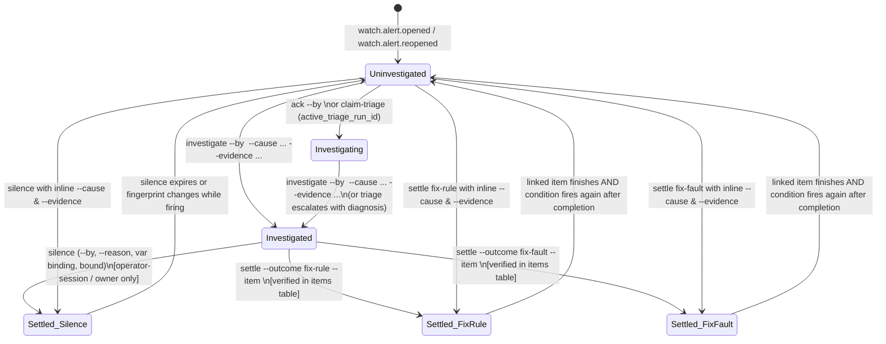

# Every alert gets an investigation and one recorded outcome, and silences bind a rule and variable

**Status:** 2026-11-23. Read at `ff3f38b0e3`, [`tools/tillr/watch/eval.go`](../../tools/tillr/watch/eval.go), [`tools/tillr/watch/lifecycle.go`](../../tools/tillr/watch/lifecycle.go), [`tools/tillr/watch/status.go`](../../tools/tillr/watch/status.go), and [`tools/tillr-watch/lifecycle.go`](../../tools/tillr-watch/lifecycle.go) already build `alert_episodes`, six registered `watch.alert.*` lifecycle events (`opened`, `acknowledged`, `tracked`, `silenced`, `reopened`, `resolved`), item-subject auto-closure ([D-TW63](./tillr-watch.md#D-TW63), `8ac1b77ed6`), per-rule load baselines ([D-TW66](./tillr-watch.md#D-TW66), `dd17e3283f`), and active single-column item tracking via `tillr watch track --item` and `tillr watch ack --item` ([D-TW67](./tillr-watch.md#D-TW67), `1ab969e2ab`). By contrast, **nothing from the Observatory slice or the mandatory-settlement and variable-silence workflow is built**: `rg -n 'alert_episodes|watch\.alert|watch_silences|tracking_item_id' tools/tillr-view tools/tillr-item` returns nothing (`tools/tillr-view` has zero alert pages, HTTP routes, CLI faces, or item back-links, and `tillr item request` cannot name a source alert), and `rg -n 'settlement_state|watch_silences|investigated_by|alert_item_links' tools/` returns nothing (while [`docs/design/tillr-alert-triage-seat.md`](./tillr-alert-triage-seat.md) in `7a5a8fa687` and [Section 6.8 of the tillr-watch design](./tillr-watch.md#68-alert-investigation-mandatory-outcomes-tracking-item-links-and-variable-scoped-silences-d-tw64-d-tw65) in `40ccc02d63` remain design only). Only the owner's dated words quoted in [§1](#1-what-the-owner-said) are owner rulings ([`R-AW1`](#R-AW1)–[`R-AW4`](#R-AW4)); every other mechanism, route, command shape, table, column, variable rule, and slice boundary is the designer's decision (from an operator request) and is marked in prose and in the [Decision Ledger](#decision-ledger) as the designer's for the owner to overturn. No companion `-plan.md` seed is opened while [OQ-AW1](#OQ-AW1)–[OQ-AW3](#OQ-AW3) (and [OQ-AT2](./tillr-alert-triage-seat.md#OQ-AT2)) are open, and zero build items are filed by this document.

> **In short.** Every `tillr-watch` episode that opens must record an investigation establishing *why* it fired and settle through one of three recorded outcomes (**silence** this `(rule_id, variable_binding)` instance with a reason, **fix-rule** naming a verified queue item, or **fix-fault** naming a verified queue item), while the Observatory (`#/alerts`, `#/alert/<id>`, `Home`, `#/item/<id>`, and `tillr-view alerts`) shows every alert, its complete state-change history (`fired`, `acknowledged`, `silenced`, `tracked`, `resolved`, `re-fired`) with time and actor, and bidirectional links to every queue item filed or tracked because of it.

**Why it matters.** On 2026-11-22, ten alerts sat `open` for twelve hours after their items had finished, three rule faults (`trunk-proof-lag`, `drain-repeated-item-conflicts`, `trunk-proof-stalled`) were explained verbally without filing items, and the owner had no Observatory view of what alerts had gone off, how their states changed over time, or which items were filed in response ([§1](#1-what-the-owner-said), [§2](#2-what-tillr-watch-does-today--and-where-alerts-slip-through)).

**The shape.** Orthogonal condition and settlement tracking on `alert_episodes`, actor-neutral `investigate` and `settle` (`--outcome fix-rule|fix-fault --item <id>`) operations shared by the operating session and [the alert triage seat](./tillr-alert-triage-seat.md), backward-compatible named rule variables backed by durable `(rule_id, variable_binding)` rows in `watch_silences`, active `tracking_item_id` repeat suppression paired with durable many-to-many `alert_item_links` (including `tillr item request --alert <alert-id>`), unsettled reminders, and full read-only Observatory alert, transition-history, and bidirectional item-link surfaces that ship first over today's store schema ([§3](#3-the-alert-workflow-from-opened-to-investigated-to-settled)–[§8](#8-the-build-in-slices-that-each-land-alone)).

**Cost.** Two new watch tables (`alert_item_links` and `watch_silences`), `--alert` on `tillr item request` and `linked_alerts` on `tillr item show`, additive investigation/settlement columns on `alert_episodes`, replacement of prose-only `tillr watch resolve` with item-verified `tillr watch settle`, and read-only `tillr-view` alert routes, CLI face, and browser pages.

**Start at** [§2](#2-what-tillr-watch-does-today--and-where-alerts-slip-through) for the exact comparison with today's commands and surfaces, then [§3](#3-the-alert-workflow-from-opened-to-investigated-to-settled)–[§4](#4-parameterizing-rules-by-variables-and-scoping-silences-to-rule_id-variable_binding) for the settlement workflow and variable silences, [§5](#5-shared-tracking-item-binding-and-repeat-counting-without-waking) for `tracking_item_id` and durable bidirectional `alert_item_links`, [§6](#6-making-unsettled-alerts-unmistakable--and-showing-every-alert-transition-and-linked-item-in-the-observatory) for unsettled reminders and the Observatory design, and [§8](#8-the-build-in-slices-that-each-land-alone) for what is built vs new and the eight build slices.

**Needs your ruling:** [OQ-AW1](#OQ-AW1), [OQ-AW2](#OQ-AW2), [OQ-AW3](#OQ-AW3) (plus companion [OQ-AT2](./tillr-alert-triage-seat.md#OQ-AT2)). Slices 5–7 (Observatory & alert-item links) and Slices 1–3 do not wait on those rulings.

**Awaits your review:** the designer's decisions [`D-AW1`](#D-AW1) to [`D-AW12`](#D-AW12) in the [Decision Ledger](#decision-ledger).

**Reads with:** [the observatory reference](../reference/observatory-redesign.md) (whose linked entity pages, CLI/HTTP parity, stable lists, and six-mark provenance contract govern `#/alerts`, `#/alert/<id>`, and `#/item/<id>`), [the alert triage seat design](./tillr-alert-triage-seat.md) (which owns internal triage dispatch, the read-and-file command boundary, and upward escalation), [the tillr-watch design](./tillr-watch.md) (specifically [§6.1](./tillr-watch.md#61-one-record-per-condition-never-per-pass-the-alert-episode-state-machine-d-tw5), [§6.7](./tillr-watch.md#67-the-second-build-the-remaining-patterns-projections-and-the-alert-commands-d-tw27), [§6.8](./tillr-watch.md#68-alert-investigation-mandatory-outcomes-tracking-item-links-and-variable-scoped-silences-d-tw64-d-tw65), and [§6.10](./tillr-watch.md#610-tracking-an-alert-cause-with-an-open-queue-item-d-tw67)), [the general agent watch design](./general-agent-watch.md) (whose domain-neutral engine stays free of `tillr-item` and `tillr-drain` imports), and the utility contracts for [`tillr-watch`](./tillr-utility-contracts/tillr-watch.md), [`tillr-view`](./tillr-utility-contracts/tillr-view.md), and [`tillr-item`](./tillr-utility-contracts/tillr-item.md).

**Words.** **Item**, **lane**, **seat**, and **verdict** keep their meanings from [the vocabulary](./tillr-vocabulary.md#5-the-words). **Episode**, **subject key**, **condition fingerprint**, and **`TimelineBundle`** keep their meanings from [the tillr-watch design](./tillr-watch.md#61-one-record-per-condition-never-per-pass-the-alert-episode-state-machine-d-tw5). **Alert triage** and **upward escalation** keep their meanings from [the alert triage seat design](./tillr-alert-triage-seat.md). Four terms are coined here:

- **Alert investigation** *(coined here)*: the recorded diagnosis on an episode (`investigated_by`, `investigated_at`, `investigation_cause`, and `investigation_evidence` citing concrete event sequences, logs, checks, or commits) establishing why the rule fired before an outcome is chosen.
- **Alert settlement** *(coined here)*: recording one outcome from the closed three-outcome set (`silence`, `fix-rule`, or `fix-fault`) on an investigated episode — linking either a durable `(rule_id, variable_binding)` silence or a verified queue item in `.tillr/state.db`. An episode lacking a recorded outcome is **unsettled**.
- **Rule variable** *(coined here)*: a named string dimension exposed by a rule — derived automatically from `[rule.when].group_by` or declared in `[rule.variables]` (such as `package`, `slowest_check`, `lane_id`, or `node`) — whose per-episode values parameterize both alert identity and silences.
- **Variable-scoped silence** *(coined here)*: a durable record in `watch_silences` keyed by `(rule_id, variable_binding)` that mutes wakeups and triage dispatch for matching variable bindings of that rule (with a recorded investigation, actor, reason, and bound) while leaving every other variable binding on the same rule active.

---

## 1. What the owner said

On 2026-11-22, after ten alerts sat open for twelve hours past item completion and the operating session explained three rule faults without filing them, the owner gave this direction verbatim (`R-AW1`, recorded in [D-TW64](./tillr-watch.md#D-TW64)):

> "I think we need some sort of workflow for alerts. Like an alert comes in, you have to decide what to do with it. You can say this alert is useful, but this specific instance of the alert is not useful and you silence that one. One alert rule shouldn't just have one silence. If it's an alert rule for like package, like they should be parameterized with variables. Like if one package say for instance has like frequent red you should be able to silence just that one for that rule so you can silence it or you can fix it I don't know if there's well so I guess it could be something's wrong with the rules you need to file something to make the rule better or you need to file something to you know fix the actual issue it's finding like I don't want this list of where it was not useful then you tell me I understand them, but I didn't file them because I didn't want to or whatever. There shouldn't be a know about and don't file. There also shouldn't be an alert that we don't know why it fired, so we need an investigation and action."

Four requirements in those words are direct owner rulings (`R-AW1`):

1. **Every alert gets an investigation establishing why it fired.** There must never be an alert whose cause is unknown and left uninvestigated.
2. **Every investigated alert gets an action from three dispositions.** Either silence this specific non-actionable instance of a generally useful rule, file work to improve the rule, or file work to fix the underlying fault the rule found.
3. **No "known about, chose not to file" disposition.** Explaining why an alert was noisy or understood while filing nothing and silencing nothing is forbidden.
4. **Rules are parameterized by variables, and silences bind a rule and variable value.** A rule does not have one blanket silence; silencing one variable value (such as one package or one check) mutes only that value for that rule and leaves every other variable value on the rule live.

Two earlier verbatim owner rulings also bind this workflow:

- **Watching finds and fixes issues rather than covering them ([OQ-TW2](./tillr-watch.md#OQ-TW2), 2026-11-21, `R-AW2`):** *"Every single one of these sounds like a fallback to cover an issue. We don't cover issues. We use this to find the issues and fix them."* `tillr-watch` executes zero automatic remedies, and automated triage cannot silence its own alerts.
- **No silent fallbacks and no work caps (2026-11-20, [the judge and lifecycle design](./tillr-judge-and-lifecycle.md#415-no-automatic-move-to-another-model-d-jl24-to-d-jl27); [D-TW2](./tillr-watch.md#D-TW2), `R-AW3`):** *"I hate fallbacks... We need deliberate choices, not fallbacks."* Missing items, missing alert IDs, unknown variable names, and uninvestigated settlements fail loudly rather than degrading to prose notes, and alerts never cap, bench, or fail queue items.

Also on 2026-11-22, the owner stated what the Observatory must show for `tillr-watch` alerts and how actions taken on an alert are recorded (`R-AW4`; speech-to-text transcribed `"tillr-watch"` as `"Taylor Watch"`):

> "I want to see Taylor Watch alarms in the observatory. I want to know what, when it went off, when it was silenced or acknowledged, all state changes of alerts. I also want to know if any actions were taken based on it.Basically, it should just link items that are filed because of alerts to that alert. I think that's probably sufficient for what I need to know about what was done because of it, because everything should be done through items anyway."

Three requirements in those words are direct owner rulings (`R-AW4`):

1. **`tillr-watch` alerts are visible in the Observatory.** An operator or the owner opening the Observatory can see the alerts `tillr-watch` has raised rather than only backend-availability alarms or CLI output.
2. **Each alert shows what fired, when it went off, and every state change.** All transitions — including when an alert fired, was acknowledged, silenced, tracked, resolved, or re-fired — are shown with their timestamps.
3. **Linked queue items are the complete record of actions taken — no separate action log.** Items filed (or tracked) because of an alert link to that alert and back; because substantive work goes through queue items, no separate free-text action ledger is built alongside items.

Everything beyond these quoted owner rulings (`R-AW1`–`R-AW4`) — the CLI syntax, state columns, `alert_item_links` and `watch_silences` tables, `tillr item request --alert`, `[rule.variables]` schema, tracking-item repeat mechanics, unsettled reminder cadence, Observatory routes/panels (`#/alerts`, `#/alert/<id>`, `Home`, `#/item/<id>`, `tillr-view alerts`), actor provenance marks, and build slices — is the designer's decision (`D-AW1`–`D-AW12`, from operator requests) that the owner may overturn, or an open question left for the owner in [OQ-AW1](#OQ-AW1)–[OQ-AW3](#OQ-AW3) (and [OQ-AT2](./tillr-alert-triage-seat.md#OQ-AT2)).

---

## 2. What `tillr watch` does today — and where alerts slip through

Read at `ff3f38b0e3` across [`tools/tillr/watch/eval.go`](../../tools/tillr/watch/eval.go), [`tools/tillr/watch/lifecycle.go`](../../tools/tillr/watch/lifecycle.go), [`tools/tillr/watch/delivery.go`](../../tools/tillr/watch/delivery.go), [`tools/tillr/watch/status.go`](../../tools/tillr/watch/status.go), [`tools/tillr/watch/rules.go`](../../tools/tillr/watch/rules.go), [`tools/tillr-watch/lifecycle.go`](../../tools/tillr-watch/lifecycle.go), [`tools/tillr-item/request.go`](../../tools/tillr-item/request.go), and [`tools/tillr-view/serve.go`](../../tools/tillr-view/serve.go), here is the exact gap between what exists today and what changes (`D-AW1`, `D-AW2`, `D-AW4`, `D-AW6`, `D-AW11`, `D-AW12` — designer's decisions; the owner may overturn them):

| Surface | What `tillr` does today (`ff3f38b0e3`) | Why it falls short | What changes in this design |
| :--- | :--- | :--- | :--- |
| **`tillr watch ack`** | `tillr watch ack <alert-id> --store <path> --by <actor> [--note <text>] [--item <item-id>]` ([D-TW67](./tillr-watch.md#D-TW67), `1ab969e2ab`). Requires `state == "open"`; sets `state = 'acknowledged'`, `acked_by`, `acked_note`, `acked_at`, and optional `tracking_item_id`; appends `watch.alert.acknowledged`. | `Pending` ([`delivery.go`](../../tools/tillr/watch/delivery.go)) queries `WHERE a.state = 'open'`. Running `ack` without `--item` still stops all wakeups permanently with **no investigation, no filed item, and no reminder**, letting an episode sit acknowledged and unfiled forever. | Plain `ack` (without `--item`) becomes strictly a **working claim** (`settlement_state = 'investigating'`, recording `acked_by` / `acked_at`). It **never** settles an episode; an acknowledged episode without a recorded outcome remains visibly `unsettled` in `status`, `drain why`, `wait` reminders, and Observatory. |
| **`tillr watch track` & `tillr item request`** | `tillr watch track <alert-id> --item <item-id> [--by <actor>] [--note <text>] --store <path>` ([D-TW67](./tillr-watch.md#D-TW67), `1ab969e2ab`) sets scalar `alert_episodes.tracking_item_id` on an unresolved episode; `tillr item request` (`request.go`) has no `--alert` flag and `tillr item show` (`item/show.go`) knows nothing about alerts. | 1. `reopenTracked` clears `tracking_item_id = NULL` on recurrence, erasing historical item provenance on the episode row.<br>2. Scalar `tracking_item_id` is overwritten if a second item is attached.<br>3. Both `track` and `ack --item` refuse `state == "resolved"`, so an item filed for an overnight alert that already `condition-cleared` cannot be linked.<br>4. Filing an item requires a separate `track` call, and items have no indexed back-link to their alerts. | Adds durable many-to-many `alert_item_links(alert_id, item_id, ...)` in `tools/tillr/watch`, repeatable `tillr item request --alert <alert-id>` (atomic in the filing transaction on open or `resolved` alerts), and `linked_alerts` on `tillr item show` and `#/item/<id>`, while keeping `tracking_item_id` for active open-item repeat muting ([§5.2](#52-why-ack---item-and-track---item-alone-are-not-enough--and-durable-bidirectional-alert_item_links)). |
| **`tillr watch silence`** | `tillr watch silence <alert-id> --store <path> (--until <dur\|time> \| --until-change) [--reason <text>]`. Per `alert_id` only; `--reason` is optional and `--by` does not exist in [`tools/tillr-watch/lifecycle.go`](../../tools/tillr-watch/lifecycle.go); writes `silence_until_ms` or `silence_on_fingerprint` on that single `alert_episodes` row only. | 1. Records no actor (`payload.by` absent) and cannot state *"silence `slowest_check=go-affected` on `fast-gate-run-slow`"*.<br>2. Requires neither `--by`, `--reason`, nor an investigation.<br>3. When the condition clears briefly (`!firing`), `reconcile` resolves that `alert_episodes` row; the next firing opens `episode_num + 1` **unsilenced** even when hours remain on `--until`. | Adds optional `--by <actor>` immediately in Slice 5 so new episode silences record actor provenance, then generalizes in Slice 3 to durable `(rule_id, variable_binding)` rows in `watch_silences` (`silence list`, `silence lift`) requiring investigation, `--by`, non-empty `--reason`, and at least one variable on parameterized rules, surviving transient episode clears. |
| **`tillr watch resolve`** | `tillr watch resolve <alert-id> --store <path> --reason <text>`. Per `alert_id` only; accepts any non-empty free-text `--reason` (with neither `--by` nor an item check in [`tools/tillr-watch/lifecycle.go`](../../tools/tillr-watch/lifecycle.go)); sets `state = 'resolved'` and `resolved_reason = 'manual'`. | Directly implements the forbidden *"understood, chose not to file"* dismissal: prose alone closes the episode with zero filed item, zero rule fix, and no recorded actor. | **Prose-only manual `resolve` is removed in Slice 2.** `state = 'resolved'` is reserved for objective engine endings (`"condition-cleared"` and `"item-" + item.state` under [D-TW63](./tillr-watch.md#D-TW63)). Actors settle non-silenced alerts via `tillr watch settle <alert-id> --by <actor> --outcome <fix-rule\|fix-fault> --item <item-id>`, verified against `.tillr/state.db` `items`. |
| **Investigation step** | None. Neither `alert_episodes` nor `watch.alert.*` records why an alert fired or what evidence was read. | Alerts could sit open with unknown cause, or be muted/resolved on a guess without reading event logs or timing files. | Adds `tillr watch investigate <alert-id> --by <actor> --cause <text> --evidence <text>` (and inline `--cause` / `--evidence` on `settle` and `silence`). `Evaluator` refuses to settle any episode lacking recorded `investigation_cause` and `investigation_evidence`. |
| **`wait`, `seen`, `status`, and `drain why`** | `wait` prints `ack:` and `track:` hints; once `seen` / `--seen-through` advances `seen_seq`, an unacted-on `open` episode never wakes `wait` again, `status` omits resolved episodes and `unsettled` counts, and `tillr drain why` ignores `alert_episodes` altogether. | Once a wakeup scrolled past and `--seen-through` advanced, ten episodes sat `open` for 12 hours and three unfiled rule faults carried zero standing alarm. | `seen_seq` acknowledges receipt of the initial print, **not** settlement: unsettled episodes re-wake `wait` after `unsettled_remind_after`, `wait` prints `investigate` / `settle` / `silence`, `status` (`--unsettled`) leads with unsettled counts and ages, and `tillr drain why` raises a standing `unsettled-watch-alerts` alarm. |
| **Observatory (`tillr-view`)** | Shows backend-availability `alarms` (`BackendAlarms.tsx`) only; `tools/tillr-view` has zero reads of `alert_episodes` or `watch.alert.*` (`rg` returns nothing). | Neither the owner nor an operator in the browser can see which `tillr-watch` alerts fired, when they were acknowledged/silenced/resolved/re-fired, who acted, or which items were filed for them (`R-AW4`). | Adds `tillr-view alerts`, `GET /api/v1/alerts`, `GET /api/v1/alerts/{id}`, `#/alerts`, `#/alert/<id>`, `EntityLink` (`kind="alert"`), `Home` watch-alerts attention card, and `#/item/<id>` `linked_alerts` in Slices 6–7 (over today's schema), enriched with settlement and `watch_silences` panels in Slice 8 ([§6.2](#62-observatory-surfaces-what-is-built-today-versus-what-is-new)–[§6.5](#65-bidirectional-alert-and-item-links-across-alertid-itemid-and-cli-faces)). |

---

## 3. The alert workflow: from opened to investigated to settled

### 3.1 Separating condition state from workflow settlement

An alert episode answers two distinct questions that today's four-value `alert_episodes.state` (`open`, `acknowledged`, `silenced`, `resolved`) conflates (`D-AW1` — designer's decision; the owner may overturn it):

1. **Condition state (`state`):** Is the watched condition currently firing in the source?
   - `open` (firing, unsilenced, unacknowledged), `acknowledged` (firing, claimed or item-tracked), `silenced` (firing under an active `watch_silences` record), or `resolved` (condition ended objectively via `resolved_reason = "condition-cleared"` or [D-TW63](./tillr-watch.md#D-TW63)'s `"item-" + item.state`).
2. **Workflow settlement (`settlement_state`):** Have we established why this episode fired and recorded its required action?
   - `uninvestigated` -> `investigating` *(optional claim)* -> `investigated` -> `settled` (`outcome IN ('silence', 'fix-rule', 'fix-fault')`).



### 3.2 Step 1 — Mandatory investigation before any settlement

Under `R-AW1` (*"There also shouldn't be an alert that we don't know why it fired, so we need an investigation and action"*), an alert whose cause is unknown cannot be settled (`D-AW1`, `D-AW2` — designer's decisions; the owner may overturn them):

- **Standalone investigation command:**
  ```text
  tillr watch investigate <alert-id> --store <path> --by <actor> --cause <text> --evidence <text>
  ```
  Writes `investigated_by`, `investigated_at`, `investigation_cause`, and `investigation_evidence` onto `alert_episodes`, sets `settlement_state = 'investigated'` (unless already `'settled'`, in which case it updates the diagnosis audit trail only when explicitly re-investigating), and appends `watch.alert.investigated`.
- **What `evidence` and `cause` hold:** `investigation_evidence` names the concrete facts read — event `seq` numbers, `gate.timing.jsonl` durations, lane run logs, heavy verdict paths, or commit SHAs — and `investigation_cause` states the root mechanism established from those facts (never `"unknown"` or whitespace-only text).
- **One-step convenience without skipping investigation:** When an actor has just read the logs and already filed or identified the item (or decided to silence a specific variable value), `tillr watch settle` and `tillr watch silence` accept `--cause <text> --evidence <text>` in the same transaction, recording the investigation and the outcome atomically. If an episode has no prior `investigation_cause` / `investigation_evidence` on its row and the settlement call omits either flag, `Evaluator` refuses the command with exit `2` (`alert <id> has no recorded investigation; run 'tillr watch investigate' first or pass --cause and --evidence`) and changes nothing.
- **When cause is genuinely not yet clear:** The actor claims the episode (`ack` or `claim-triage`), reads the logs named in `[rule.guidance].check`, or — for [the alert triage seat](./tillr-alert-triage-seat.md) — records what it read so far and escalates upward (`watch.alert.escalated`). At no point may an unknown cause settle the episode.

### 3.3 Step 2 — The closed set of three outcomes

Once investigated, an episode can reach `settlement_state = 'settled'` through **only** one of three outcomes (`R-AW1`, `D-AW2` — command shapes and verification checks are the designer's decisions, subject to overturn by the owner):

| Outcome | Meaning | Command | Mechanical preconditions enforced by `Evaluator` |
| :--- | :--- | :--- | :--- |
| **`silence`** | The rule is useful overall, and this specific variable binding is non-actionable right now. | `tillr watch silence <alert-id> --store <path> [--rules <dir>] [--var <k>=<v>...] --by <actor> --reason <text> [--cause <text> --evidence <text>] (--until <dur\|time> \| --until-change)` | 1. Recorded `investigation_cause` + `investigation_evidence`.<br>2. Non-empty `--by` and non-empty `--reason`.<br>3. Actor is **not** `tillr-triage` ([D-AT6](./tillr-alert-triage-seat.md#decision-ledger)).<br>4. Non-empty variable binding on any parameterized rule ([§4.2](#42-durable-watch_silences-and-how-one-variable-is-muted-without-muting-others); `global` rules governed by [OQ-AW3](#OQ-AW3)).<br>5. Explicit bound (`--until` or `--until-change`, or `--until-lifted` only if [OQ-AW1](#OQ-AW1) chooses Option B). |
| **`fix-rule`** | The rule itself fired falsely, too eagerly, with a missing projection filter, or with the wrong variable grouping. | `tillr watch settle <alert-id> --store <path> --by <actor> --outcome fix-rule --item <item-id> [--cause <text> --evidence <text>]` | 1. Recorded `investigation_cause` + `investigation_evidence`.<br>2. Non-empty `--by`.<br>3. `<item-id>` exists in `.tillr/state.db` `items` (`SELECT state FROM items WHERE item_id = ?`).<br>4. If `<item-id>` is already in `charter.closed` or `charter.finished`, its terminal event `seq` must be `>= episode.last_observed_seq` (see below). |
| **`fix-fault`** | The rule found a real defect in repository code, tests, configuration, or tooling/host machinery. | `tillr watch settle <alert-id> --store <path> --by <actor> --outcome fix-fault --item <item-id> [--cause <text> --evidence <text>]` | Same four preconditions as `fix-rule`, recording `outcome = 'fix-fault'` and `tracking_item_id = <item-id>`. |

**Filing vs linking an existing item (`item_link_kind`).** Both `fix-rule` and `fix-fault` require `--item <item-id>` naming a real row in `items`. When this alert investigation created `<item-id>` (via `tillr item request`), `item_link_kind` is `"filed"`; when `<item-id>` was already open in the queue for the same root cause (for instance an active `fixer-main-*` item or an open gate-speedup request), `item_link_kind` is `"linked"`. Both satisfy `c5` because a real queue item owns the fix in `.tillr/state.db` — never a prose promise.

**Refusing stale finished items.** If `<item-id>` is already `landed` or `closed` in `items`, `Evaluator` compares `episode.last_observed_seq` against the item's terminal event sequence in `events`:

- When `episode.last_observed_seq <= item_terminal_seq`, the item genuinely landed *after* the events that triggered the alert (for example, a conflict repair or rule fix that landed while the episode's lookback window still held pre-landing events), so linking `<item-id>` succeeds and settles the episode.
- When `episode.last_observed_seq > item_terminal_seq`, the condition fired **after** `<item-id>` had already finished — proving `<item-id>` did not stop the condition — so `Evaluator` refuses `--item <item-id>` (`item <id> finished at seq <S>, before observation seq <O>; file a new item for the recurring cause`).

### 3.4 Alignment with the alert triage seat and benign triggers

This workflow and [the alert triage seat design](./tillr-alert-triage-seat.md) share one store schema and one actor-neutral `Evaluator` API ([D-TW65](./tillr-watch.md#D-TW65), `D-AW2` — designer's decision; the owner may overturn it):

1. **Same operations, `--by <actor>` provenance.** Today (while rules set `receiver = "foreground"`), `--owner operator-session` runs `investigate`, `settle`, and `silence` with `--by operator-session`. Once [the alert triage seat](./tillr-alert-triage-seat.md)'s slices land, the triage runner invokes the exact same `investigate` and `settle` operations with `--by tillr-triage` (`run_id` attached via `active_triage_run_id`).
2. **Exact outcome mapping with zero competing columns.**
   - Triage's `filed` and `linked` outcomes ([§5.3 of the alert triage seat design](./tillr-alert-triage-seat.md#53-the-structured-triage-outcomes)) supply `item_link_kind = "filed" | "linked"` together with `outcome = "fix-fault" | "fix-rule"` and write the single shared `tracking_item_id` column on `alert_episodes` ([§5](#5-shared-tracking-item-binding-and-repeat-counting-without-waking)).
   - Triage's `escalated` outcome records the completed investigation (`settlement_state = 'investigated'`, `investigation_cause`, `investigation_evidence`, `escalated_to = 'operator-session' | 'owner'`). On Group B alerts ([§3 of the alert triage seat design](./tillr-alert-triage-seat.md#3-sorting-the-23-live-rules-by-what-settles-them)) such as `drain-lane-refused`, triage files the root-cause defect item (`outcome = 'fix-fault'`, `tracking_item_id = <item-id>`, `settlement_state = 'settled'`) *and* sets `escalated_to = 'operator-session'` so the whale still wakes to perform manual lane cleanup ([D-TW48](./tillr-watch.md#D-TW48)). When triage escalates *without* filing an item (because choosing between `silence`, `fix-rule`, and `fix-fault` requires the operator or owner), `settlement_state` remains `'investigated'` (**unsettled**) until the operator or owner records one of the three outcomes.
   - Triage remains mechanically forbidden ([D-AT6](./tillr-alert-triage-seat.md#decision-ledger)) from invoking `tillr watch silence`: only `operator-session` or `owner` may decide that a variable instance should be silenced rather than fixed.
3. **Reconciling [OQ-AT2](./tillr-alert-triage-seat.md#OQ-AT2) without contradiction.** [OQ-AT2](./tillr-alert-triage-seat.md#OQ-AT2) in [the alert triage seat design](./tillr-alert-triage-seat.md) asks the owner whether verified benign triggers (such as an explicit `just tillr-restart` firing `drain-unrequested-start`) may settle as `expected (verified_seq)` with no item (Option A) or must file an item or escalate (Option B). Under the owner's 2026-11-22 ruling in [§1](#1-what-the-owner-said), a rule that fires on a routine requested restart is a **`fix-rule`** case (teach the restart path or rule to distinguish requested restarts so the rule stops false-firing), which corresponds to Option B of [OQ-AT2](./tillr-alert-triage-seat.md#OQ-AT2). Because only the owner may rule [OQ-AT2](./tillr-alert-triage-seat.md#OQ-AT2) (`c4`), this design enforces the strict three-outcome closed set (`silence`, `fix-rule`, `fix-fault`) and leaves [OQ-AT2](./tillr-alert-triage-seat.md#OQ-AT2) open in its owning document: if the owner rules Option B on [OQ-AT2](./tillr-alert-triage-seat.md#OQ-AT2), nothing changes; if he rules Option A, `expected` slots into `outcome` as an owner-authorized fourth value requiring `verified_seq` + `investigation_evidence`.
4. **Interaction with automatic engine resolutions (`condition-cleared` and [D-TW63](./tillr-watch.md#D-TW63) `"item-" + state`).** When a rule's lookback window ages out or `clear_when` holds (`resolved_reason = "condition-cleared"`), or when an episode's item subject lands or closes (`resolved_reason = "item-landed"` / `"item-closed"` under [D-TW63](./tillr-watch.md#D-TW63)), `state` transitions to `'resolved'`. Because `settlement_state` is separate from `state`, resolving the live condition does not erase whether the episode was investigated and settled. Whether [D-TW63](./tillr-watch.md#D-TW63) finished-item closures auto-settle while `condition-cleared` episodes stay `unsettled` is left to the owner in [OQ-AW2](#OQ-AW2).

---

## 4. Parameterizing rules by variables and scoping silences to `(rule_id, variable_binding)`

### 4.1 How rules declare and expose named variables

To support *"If it's an alert rule for like package, like they should be parameterized with variables. Like if one package say for instance has like frequent red you should be able to silence just that one for that rule"* while keeping all 20 existing rule files in `config/tillr/watch/` valid without edits, rule variables work at two levels (`D-AW3` — designer's decision; the owner may overturn it):

1. **Automatic derivation from `[rule.when].group_by` (zero config migration).**
   - Every rule with a single non-`"global"` `group_by = "<path>"` exposes one variable whose default name is the final dot-separated segment of `<path>` (for example, `group_by = "slowest_check"` exposes `slowest_check`; `group_by = "detail.package"` exposes `package`).
   - Every rule with a composite `group_by = ["<p1>", "<p2>", ...]` ([D-TW50](./tillr-watch.md#D-TW50)) exposes those ordered variables (`drain-lane-refused` exposes `lane_id` and `reason`; `drain-repeated-step-dispatches` exposes `item_id` and `node`), decoded losslessly from `subject_key` via `decodeCompositeSubject`.
   - Every rule with `group_by = "global"` and no `[rule.variables]` table exposes zero variables (`variables = {}`).
2. **Optional explicit `[rule.variables]` table in rule TOML.**
   A rule may declare `[rule.variables]` mapping clean variable identifiers (`[A-Za-z_][A-Za-z0-9_]*`) to event field paths:
   ```toml
   [[rule]]
   id = "package-frequent-red"
   scope = "core"
   severity = "warning"

   [rule.reads]
   events = ["gate.package-result"]

   [rule.variables]
   package = "detail.package"
   suite = "detail.suite"

   [rule.when]
   group_by = ["detail.package"]
   pattern = "count_in_window"
   match = 'event.outcome == "fail"'
   threshold = 3
   window = "2h"

   [rule.guidance]
   summary = "Package {{var.package}} failed {{count}} times in 2 hours (suite {{var.suite}})."
   check = ["Inspect the failing test output for {{var.package}}."]
   do = ["Fix the flaky or broken package, fix the rule, or silence package={{var.package}}."]

   [rule.delivery]
   receiver = "triage"
   ```
   - **When `[rule.variables]` names a `group_by` path** (`package = "detail.package"` above, or `check = "slowest_check"` on `fast-gate-run-slow`), it aliases the derived variable name cleanly (`--var package=tools/tillr-drain/drain`, `--var check=go-affected`), while accepting the raw `group_by` field name as a synonym if unambiguous.
   - **When `[rule.variables]` names an additional string field from the newest counted event** (`suite = "detail.suite"` above, or `backend = "backend"` on `run-model-timeout` whose `group_by = "run_id"` changes every run), `Evaluator` extracts those string values alongside `group_by` and stores the complete map in `alert_episodes.variables_json` (for example `{"package":"tools/tillr-drain/drain","suite":"unit"}`).
   - **`tillr watch lint` validation:** `lint` verifies that `[rule.variables]` keys are valid identifiers without duplicates, that every path passes `validEventPath`, that `lag_behind` rules (which read no events) do not declare event variables, and that `{{var.<name>}}` guidance placeholders reference declared or derived variables of that rule.

Across the 25 shipped rules in 23 TOML files under `config/tillr/watch/` today (`ff3f38b0e3`), automatic derivation immediately parameterizes 18 rules with zero TOML edits, leaving 7 `global` rules:

| Variable shape today | Rules in `config/tillr/watch/` | Exposed variable(s) | Example `--var` binding |
| :--- | :--- | :--- | :--- |
| **Check / config / git artifact (4 rules)** | `fast-gate-run-slow`, `drain-trunk-core-worktree`, `gate-repeated-stall`, `drain-heavy-fault` | `slowest_check`; `config_path`; `tree_sha`; `tip_sha` | `--var slowest_check=go-affected` |
| **Composite tuple (2 rules)** | `drain-lane-refused`, `drain-repeated-step-dispatches` | `lane_id, reason`; `item_id, node` | `--var lane_id=lane-2 --var reason=lane-holds-uncommitted-work` (or `--var item_id=item-request-...`) |
| **Item / landing / run / object (12 rules)** | `drain-item-fault`, `drain-judge-unreadable`, `drain-obstacle-hold`, `drain-plan-output-unparseable`, `drain-repeated-item-conflicts`, `drain-repeated-verifier-refusals`, `drain-trunk-fixer-filed`, `land-squash-conflict`; `drain-landing-reverted`, `drain-revert-not-possible`; `run-model-timeout`; `drain-backend-closed`, `drain-dispatch-declined` | `item_id` (8); `landing` (2); `run_id` (1); `object_id` (2) | `--var item_id=item-request-...` |
| **Global, zero variables (7 rules)** | `trunk-proof-lag`, `trunk-proof-stalled`, `fast-gate-median-slow`, `drain-store-busy`, `drain-loop-no-pass`, `drain-loop-fault`, `drain-unrequested-start` | *(none unless parameterized later)* | Governed by [OQ-AW3](#OQ-AW3) |

### 4.2 Durable `watch_silences` and how one variable is muted without muting others

Instead of keeping silence state exclusively on one ephemeral `alert_episodes` row — which vanishes as soon as `reconcile` marks that episode `condition-cleared` during a quiet window — silences live in a first-class `watch_silences` table (`D-AW4` — designer's decision; the owner may overturn it):

```sql
CREATE TABLE IF NOT EXISTS watch_silences (
    silence_id             TEXT PRIMARY KEY,          -- "sil-" + 16 random hex bytes
    rule_id                TEXT NOT NULL,
    vars_json              TEXT NOT NULL,             -- canonical sorted JSON object {"k":"v",...}
    created_by             TEXT NOT NULL,
    created_at             INTEGER NOT NULL,
    reason                 TEXT NOT NULL,
    investigation_cause    TEXT NOT NULL,
    investigation_evidence TEXT NOT NULL,
    source_alert_id        TEXT,                      -- alert settled by this silence, if any
    silence_until_ms       INTEGER,                   -- set for --until
    silence_on_fingerprint TEXT,                      -- set for --until-change
    lifted_at              INTEGER,
    lifted_by              TEXT,
    lifted_reason          TEXT
);
CREATE UNIQUE INDEX IF NOT EXISTS watch_silences_active_scope
    ON watch_silences(rule_id, vars_json) WHERE lifted_at IS NULL;
```

**How `(rule_id, variable_binding)` matching works:**

1. **No blanket rule mute on parameterized rules.** When `rule_id` exposes one or more variables, `tillr watch silence` **requires** at least one `--var <name>=<value>` (or an `<alert-id>` argument, from which `Evaluator` reads `alert_episodes.variables_json` as the default full binding). Passing zero variables on a parameterized rule is refused with exit `2`, naming the rule's variables. Every `<name>` in `--var <name>=<value>` is checked against `rule_id`'s effective variables; an unknown variable name is refused with exit `2`.
2. **Isolating one variable instance from all others.** A `watch_silences` row matches an episode of `rule_id` if and only if:
   - `lifted_at IS NULL`;
   - its bound still holds (`silence_until_ms` is in the future at `eval_now`, or `silence_on_fingerprint` equals the episode's computed `condition_fingerprint`, or both are `NULL` if [OQ-AW1](#OQ-AW1) allows `--until-lifted`); and
   - **every `(k, v)` entry in `watch_silences.vars_json` equals `episode.variables[k]`**.
   Consequently:
   - On `package-frequent-red`, `tillr watch silence --rule package-frequent-red --var package=tools/flaky --until 24h --by operator-session --reason "..." --cause "..." --evidence "..."` matches **only** `package == "tools/flaky"`. When `package == "tools/tillr-land"` fails three times in the very same evaluation pass, `vars_json` does not match, so `tools/tillr-land` opens an unsilenced `open` / `uninvestigated` episode and wakes its receiver immediately.
   - On composite rules such as `drain-repeated-step-dispatches` (`variables: item_id, node`), silencing `<alert-id>` defaults to the full tuple `--var item_id=<id> --var node=verify`, muting only `verify` on that item; passing `--var item_id=<id>` explicitly matches any `node` of `<id>` while leaving every other item active.
3. **Episodes still record silenced observations and survive quiet gaps.** While a matching `watch_silences` row holds:
   - If an unresolved episode already exists for `(rule_id, subject_key)`, `silence` sets `state = 'silenced'`, `settlement_state = 'settled'`, `outcome = 'silence'`, `silence_id = <silence_id>`, `settled_by`, and `settled_at`.
   - If that episode later resolves (`condition-cleared`) during a quiet hour and `(rule_id, subject_key)` fires again before `silence_until_ms` expires, `changes.open` sees the active `watch_silences` match and opens `episode_num + 1` **directly in `state = 'silenced'`, `settlement_state = 'settled'`, `outcome = 'silence'`, `silence_id = <silence_id>`** — incrementing `observation_count` for auditability while appending `watch.alert.opened` with `"silenced": true` so neither `Pending` (`wait`) nor `tillr-triage` wakes.
4. **Expiry and manual lift (`silence list` and `silence lift`).**
   - When `eval_now >= silence_until_ms` (or `condition_fingerprint != silence_on_fingerprint`), the `watch_silences` row ceases to match. Any currently firing `silenced` episode bound to it transitions to `state = 'open'`, `settlement_state = 'uninvestigated'`, clears its settlement fields, and appends `watch.alert.reopened` (`cause = "silence-expired"` or `"fingerprint-changed"`), waking the receiver for fresh investigation.
   - `tillr watch silence list --store <path>` lists active (and with `--all`, expired/lifted) variable silences with `silence_id`, `rule_id`, `vars`, `by`, `until`, `reason`, and matched episode count.
   - `tillr watch silence lift <silence-id> --store <path> --by <actor> --reason <text>` sets `lifted_at`, `lifted_by`, `lifted_reason`, appends `watch.silence.lifted`, and immediately marks any active firing episode that relied on `<silence-id>` ready to reopen on the next evaluation pass.
   - Note on `--until-change` across episodes: `--until-change` requires the rule to declare `[rule.when].fingerprint` ([D-TW32](./tillr-watch.md#D-TW32)) and binds `silence_on_fingerprint` from the target `<alert-id>` (refused if called preemptively with no active episode for those variables, since no fingerprint exists yet to pin).

### 4.3 Preserving domain neutrality for standalone `--state` users

Under [the general agent watch design](./general-agent-watch.md) (`D-GW9`), `tools/tillr/watch` carries zero imports of `tillr-item` or `tillr-drain`. Variable extraction (`variables_json`), `watch_silences`, `investigate`, and `settlement_state` are 100% domain-general SQLite tables that work identically in standalone `--state <watch.db>` mode outside `tillr`. Only the `items.item_id` existence and terminal-state lookup on `settle --outcome fix-rule|fix-fault` is injected through an optional `ItemVerifier` callback provided by `TillrStoreSource` (when `--store .tillr/state.db` is used, or cross-checked against `.tillr/state.db` if [OQ-GW3](./general-agent-watch.md#OQ-GW3) chooses a sidecar `.tillr/watch.db`); in standalone `--state` mode with no `tillr` store, `--item <ref>` accepts any non-empty external tracker string (`GH-142`, `JIRA-9`, commit/task ID) without importing `tillr`.

---

## 5. Shared tracking-item binding and repeat counting without waking

### 5.1 Active repeat suppression via `tracking_item_id`

`alert_episodes.tracking_item_id` (landed in `1ab969e2ab` under [D-TW67](./tillr-watch.md#D-TW67), shared across [D-TW65](./tillr-watch.md#D-TW65) (3) and [the alert triage seat](./tillr-alert-triage-seat.md)) holds the single **currently open** queue item muting repeat wakeups on an unresolved episode. Once workflow Slice 2 lands, settling an alert via `fix-rule --item <item-id>` or `fix-fault --item <item-id>` writes into the same column alongside additive settlement metadata (`D-AW5` — designer's decision; the owner may overturn it):

```sql
-- Additive columns on alert_episodes (alongside tracking_item_id and tracked_lag_pair in eval.go):
variables_json         TEXT NOT NULL DEFAULT '{}',
settlement_state       TEXT NOT NULL DEFAULT 'uninvestigated'
                       CHECK (settlement_state IN ('uninvestigated', 'investigating', 'investigated', 'settled')),
investigated_by        TEXT,
investigated_at        INTEGER,
investigation_cause    TEXT,
investigation_evidence TEXT,
outcome                TEXT CHECK (outcome IN ('silence', 'fix-rule', 'fix-fault')),
item_link_kind         TEXT CHECK (item_link_kind IN ('filed', 'linked')),
silence_id             TEXT,
settled_by             TEXT,
settled_at             INTEGER,
escalated_to           TEXT CHECK (escalated_to IN ('operator-session', 'owner')),
last_reminded_at       INTEGER
```

**Exact repeat-counting and re-wake rules for `tracking_item_id`:**

1. **While `tracking_item_id` is open (`item.state != charter.closed and item.state not in charter.finished`):**
   - `track --item` / `ack --item` today (`1ab969e2ab`) and `settle --outcome fix-rule|fix-fault --item <item-id>` in Slice 2 set `state = 'acknowledged'` (unless already `'resolved'`), `tracking_item_id = <item-id>`, and — in Slice 2 — `settlement_state = 'settled'` and `outcome = 'fix-rule' | 'fix-fault'`.
   - On every subsequent evaluation where `(rule_id, subject_key)` still satisfies `when`, `reconcile` increments `observation_count` and advances `last_observed_seq`, `last_observed_at`, and `condition_fingerprint` (or `tracked_lag_pair`) in place **without** waking `--owner operator-session` and **without** dispatching another triage run, suppressing resolution across intermittent `!firing` / `c.clears` dips while `tracking_item_id` stays open ([D-TW67](./tillr-watch.md#D-TW67)).
2. **Once `tracking_item_id` finishes or closes (`item.state == charter.closed or item.state in charter.finished`):**
   - **Episode's own subject is that finished item ([D-TW63](./tillr-watch.md#D-TW63)):** `reconcile` resolves the episode with `resolved_reason = "item-" + item.state` and suppresses reopening while the item stays terminal.
   - **Episode's subject is a system/check/lane/package dimension (for example `slowest_check = "go-affected"` tracked by `item-request-8f21bc04d1`):** If `!firing`, `reconcile` resolves quietly (`condition-cleared` carrying `item_id`). If still firing, `reopenTracked` clears `tracking_item_id` to `NULL`, sets `state = 'open'` (and `settlement_state = 'uninvestigated'` in Slice 2), prefixes `Bundle.Guidance.Summary` with `"tracked fix <item_id> landed|closed and the condition persists: "`, and appends `watch.alert.reopened` (`cause = "tracked-item-landed"` or `"tracked-item-closed"`, `item_id`, `item_state`), waking the receiver once.

### 5.2 Why `ack --item` and `track --item` alone are not enough — and durable bidirectional `alert_item_links`

Inspecting [`tools/tillr/watch/eval.go`](../../tools/tillr/watch/eval.go), [`tools/tillr/watch/lifecycle.go`](../../tools/tillr/watch/lifecycle.go), and [`tools/tillr-item/request.go`](../../tools/tillr-item/request.go) at `ff3f38b0e3` shows four concrete reasons why `tillr watch ack --item` and `tillr watch track --item` writing scalar `alert_episodes.tracking_item_id` are **not sufficient** on their own to answer *"if any actions were taken based on it... link items that are filed because of alerts to that alert"* ([`R-AW4`](#R-AW4)):

1. **Cleared to `NULL` on recurrence:** In `eval.go`, `reopenTracked` executes `UPDATE alert_episodes SET state='open', tracking_item_id=NULL ...` whenever the tracked item finishes and the condition persists. Reading `alert_episodes.tracking_item_id` loses the fact that the earlier item was filed because of that alert.
2. **Overwritten when a second item is attached:** `tracking_item_id` is a single scalar column. If one alert requires both a fault-fix item and a rule-fix item, or requires a second item after the first item lands and the alert re-fires, `Evaluator.Track` overwrites the first `item_id` on the row.
3. **Refused on already-`resolved` alerts:** Both `AckWithItem` (`if a.state != "open"`) and `Track` (`if a.state == "resolved"`) refuse resolved episodes (`alert <id> is resolved`, pinned by `TestWatchTrackRefusalsAndPreMigrationStorePreservation` in [`tools/tillr-watch/track_test.go`](../../tools/tillr-watch/track_test.go)). When a transient 3 AM alert fires and auto-resolves via `condition-cleared` before an operator or check-in files the root-cause item, neither `ack --item` nor `track --item` can link the filed item to that alert.
4. **Two-transaction gap and unindexed reverse lookup when filing:** `tillr item request` (`tools/tillr-item/request.go`) cannot record the source alert inside the filing transaction, and `tillr item show` / `GET /api/v1/items/{id}` have no indexed table mapping `item_id -> alert_id` without scanning `events` JSON payloads.

To close all four gaps while keeping `alert_episodes.tracking_item_id` untouched as the active muting pointer and adding **no separate non-item action log** ([`R-AW4`](#R-AW4)), the link is recorded in a durable many-to-many join table owned by `github.com/mschulkind-oss/tillr/watch` (`D-AW11` — designer's decision from an operator request; the owner may overturn it):

```sql
CREATE TABLE IF NOT EXISTS alert_item_links (
    alert_id   TEXT NOT NULL REFERENCES alert_episodes(alert_id),
    item_id    TEXT NOT NULL,
    relation   TEXT NOT NULL CHECK (relation IN ('filed', 'tracked', 'fix-fault', 'fix-rule')),
    linked_at  INTEGER NOT NULL,
    linked_by  TEXT,                   -- NULL when caller recorded no actor (e.g. `track` without `--by`)
    note       TEXT,
    event_seq  INTEGER NOT NULL,       -- seq of the event that recorded or updated the link
    PRIMARY KEY (alert_id, item_id)
);
CREATE INDEX IF NOT EXISTS alert_item_links_by_item
    ON alert_item_links(item_id, linked_at, alert_id);
```

**Where and how every alert <-> item link is written and read (`D-AW11`):**

1. **Filing an item directly from an alert (`tillr item request --alert <alert-id>`):**
   - `tillr item request` ([`tools/tillr-item/request.go`](../../tools/tillr-item/request.go), [`tools/tillr-item/item/request.go`](../../tools/tillr-item/item/request.go)) gains a repeatable `--alert <alert-id>` flag (sorted and deduplicated in `RequestFiling.AlertIDs`, included in `requestInputHash` so identical retries remain idempotent while conflicting `--alert` sets refuse with `request-differs`, and echoed as `"alert_ids"` on the `item.request` envelope).
   - Inside the **same `WriteTx`** that inserts `items` and `request_words`, `FileRequest` calls `watch.LinkFiledItem(tx, alertID, id, f.By, f.At)` (`tools/tillr-item` already imports `github.com/mschulkind-oss/tillr`, while `tools/tillr/watch` imports neither `tillr-item` nor `tillr-drain`, preserving `D-GW9`):
     - Verifies that `<alert-id>` exists in `alert_episodes`; if `alert_episodes` is absent or `<alert-id>` does not exist, returns a structured refusal (`alert-not-found`) rolling back the entire filing transaction so no half-linked item is created ([`R-AW3`](#R-AW3)).
     - Works on **every** episode state — `open`, `acknowledged`, `silenced`, **and `resolved`** — appending `watch.alert.tracked` (`item_id`, `by`, `link_kind: "filed"`) and inserting `(alert_id, id, relation = 'filed', linked_at = f.At.UnixMilli(), linked_by = f.By, note = NULL, event_seq)` into `alert_item_links` (`CREATE TABLE IF NOT EXISTS alert_item_links` runs inside the write transaction if the store predates Slice 5).
     - When the episode is currently unresolved (`state != 'resolved'`) and has `tracking_item_id IS NULL`, `LinkFiledItem` also sets `state = 'acknowledged'` and `tracking_item_id = id` (clearing `silence_until_ms` and `silence_on_fingerprint`, and setting `acked_by = f.By`, `acked_at = f.At.UnixMilli()` if `acked_by IS NULL`) so one `tillr item request --alert <id>` command both files the item and suppresses repeat wakeups; when the episode is already `resolved` (such as an overnight `condition-cleared` alert), `state = 'resolved'` and `resolved_*` remain untouched while the durable link and event are recorded.
2. **Linking an existing item via `tillr watch ack --item`, `tillr watch track --item`, or `tillr watch settle --item`:**
   - `Evaluator.AckWithItem` and `Evaluator.Track` keep their active-episode validation (open item required; `ack` on `open`, `track` on unresolved `open | acknowledged | silenced`) and upsert `(alert_id, item_id, relation = 'tracked', linked_at, linked_by, note, event_seq)` into `alert_item_links` (`ON CONFLICT(alert_id, item_id) DO UPDATE`, preserving `relation = 'filed'` if the item was originally filed via `request --alert` and upgraded to `'fix-fault'` or `'fix-rule'` when settled via `Evaluator.Settle` in Slice 2).
   - When `reopenTracked` clears `alert_episodes.tracking_item_id = NULL` after an item finishes, or when a second `track --item` attaches a follow-up item, **every row in `alert_item_links` stays intact**.
3. **Migration backfill and read-only pre-migration compatibility:**
   - Opening a store via `store.OpenMigrated` creates `alert_item_links` and backfills (`INSERT OR IGNORE`) any existing links from `events WHERE kind IN ('watch.alert.acknowledged', 'watch.alert.tracked') AND json_extract(payload, '$.item_id') IS NOT NULL` plus `alert_episodes WHERE tracking_item_id IS NOT NULL`.
   - Read-only callers (`tillr-view`, `tillr watch status`, `tillr item show`) call `watch.ReadAlerts`, `watch.ReadAlertDetail`, and `watch.ReadLinkedAlerts(rd *store.Reader, itemID string)`: if `tableExists(rd, "alert_item_links")` is true, they read the indexed table; if false on an unmigrated read-only store, they project the exact union from `alert_episodes.tracking_item_id` and `watch.alert.{acknowledged,tracked}` events without writing a byte.

---

## 6. Making unsettled alerts unmistakable — and showing every alert, transition, and linked item in the Observatory

### 6.1 CLI `status`, `wait` reminders, and the standing drain alarm

To prevent any alert from sitting seen-and-forgotten (the 12-hour stale-alert failure) or understood-and-unfiled (the three verbal rule-fault explanations on 2026-11-22), unsettled status is surfaced across the CLI and drain check-in loop once Slice 4 lands (`D-AW6` — designer's decision; the owner may overturn it):

1. **`tillr watch status` and `tillr watch status --unsettled` (text and `--json`).**
   - `ReadStatus` remains strictly read-only ([D-TW34](./tillr-watch.md#D-TW34)) and adds a top-level summary line and JSON block:
     ```text
     summary unsettled=1 (uninvestigated=1 investigating=0 investigated=0) settled=2 active_silences=1
     alert alrt-01950b10 rule=fast-gate-run-slow subject="go-build" vars={"slowest_check":"go-build"} state=open settlement=uninvestigated unsettled_for=14m severity=warning opened=2026-11-22T17:02:00Z observed=2
     alert alrt-01950a2c rule=fast-gate-run-slow subject="go-affected" vars={"slowest_check":"go-affected"} state=acknowledged settlement=settled outcome=fix-fault item="item-request-8f21bc04d1" by="tillr-triage" severity=warning opened=2026-11-22T15:10:04Z observed=6
     silence sil-9f31a004 rule=package-frequent-red vars={"package":"tools/flaky"} by="operator-session" until=2026-11-23T15:00:00Z matched_alerts=1 reason="Known upstream flake tracked outside gate while fixture rewrite runs"
     ```
   - Passing `--unsettled` filters `alerts` to episodes where `settlement_state != 'settled'` (including `acknowledged` claims and — under [OQ-AW2](#OQ-AW2) Option A or B — unsettled `resolved` episodes inside the lookback window) so an operator or script sees every owed decision in one call.
2. **`tillr watch wait` unsettled reminders and settlement prompt.**
   - Advancing `seen_seq` via `--seen-through <seq>` or `tillr watch seen` confirms **delivery of the initial notice**, preventing an immediate tight re-print loop while the agent reads logs. It **no longer permanently silences an unsettled episode**.
   - If an episode routed or escalated to `--owner operator-session` still has `settlement_state != 'settled'` (and is not `escalated_to = 'owner'` waiting on an owner question) once `now - max(opened_at, shown_at, last_reminded_at) >= unsettled_remind_after` (default `15m`, matching one check-in interval), `Pending` re-emits the notice with banner `[UNSETTLED 15m — action required: silence | fix-rule | fix-fault]` and updates `last_reminded_at` when shown.
   - The `wait` output footer replaces today's `ack:` line with concrete settlement templates:
     ```text
     investigate: tillr watch investigate <alert_id> --by <owner> --store <path> --cause "..." --evidence "..."
     settle:      tillr watch settle <alert_id> --by <owner> --store <path> --outcome fix-fault|fix-rule --item <item_id>
     silence:     tillr watch silence <alert_id> --by <owner> --store <path> --until <dur> --reason "..."
     ```
3. **Standing `unsettled-watch-alerts` alarm in `tillr drain why` and check-in completion rule.**
   - `tillr drain why` inspects unsettled episodes (excluding episodes currently claimed by a live `active_triage_run_id` within normal execution or waiting on `escalated_to = 'owner'`) and adds a standing `unsettled-watch-alerts` entry to `alarms` naming the count, oldest unsettled age, and `alert_id`s.
   - [The timed drain check-in skill](../../.agents/skills/drain-timed-checkin/SKILL.md) treats any non-`owner` `unsettled` alert in `tillr watch status --unsettled` as mandatory in-pass work before delivering a check-in report.

### 6.2 Observatory surfaces: what is built today versus what is new

**What is already built versus what is new (`c7`):**

- **Already built in `tillr` / `tillr-watch` at `ff3f38b0e3`:** `alert_episodes` and all six `watch.alert.*` transition events (`opened`, `acknowledged`, `tracked`, `silenced`, `reopened`, `resolved`), item-subject auto-closure (`8ac1b77ed6`, [D-TW63](./tillr-watch.md#D-TW63)), rule load baselines (`dd17e3283f`, [D-TW66](./tillr-watch.md#D-TW66)), and active single-item `tracking_item_id` via `tillr watch track --item` / `ack --item` (`1ab969e2ab`, [D-TW67](./tillr-watch.md#D-TW67)).
- **Already built from this design's Observatory slice (and Slice 6 of [tillr-alert-triage-seat.md](./tillr-alert-triage-seat.md)):** **Nothing.** At `ff3f38b0e3`, `rg -n 'alert_episodes|watch\.alert|watch_silences|tracking_item_id' tools/tillr-view tools/tillr-item` exits `1` with zero matches: `ObservatoryShell.tsx` renders only backend-availability `BackendAlarms`, `EntityLink.tsx` has no `"alert"` entity kind, `App.tsx` has no `#/alerts` or `#/alert/<id>` route, `tillr-view` has no `alerts` CLI subcommand or `/api/v1/alerts*` route, and `ItemPage` / `tillr item show` have no back-links to alerts.
- **What is new here (`D-AW12` — designer's decision from an operator request; the owner may overturn it):** Follow `P1`–`P7` and `D-OR1`–`D-OR5` of [the observatory reference](../reference/observatory-redesign.md) so alert visibility, complete transition history, and bidirectional item links ship **immediately over today's `alert_episodes` + `watch.alert.*` + `alert_item_links` schema** (Slices 5–7 in [§8](#8-the-build-in-slices-that-each-land-alone)), with workflow settlement and variable silences layered on in Slice 8 once Slices 2–4 land:

| Surface | Address / Face | Role |
| :--- | :--- | :--- |
| **Alerts ledger page** | `#/alerts` (`?state=`, `?rule=`, `?severity=`, `?settlement=`) — `Alerts` link in `ObservatoryShell.tsx` `NAV`; `AlertsView` in `tools/tillr-view/web/src/components/AlertsView.tsx` | Full filterable ledger of active and resolved `tillr-watch` episodes (plus `Active Variable Silences` once Slice 3 lands), wrapped in `useStableList` with `j` / `k` / `Enter` / `[` / `]` / `u` keyboard navigation (`P7`, [`OQ-OR2`](../reference/observatory-redesign.md#why-its-this-way)). |
| **Single-alert entity page** | `#/alert/<alert-id>` — `AlertPage` in `AlertsView.tsx`; `"alert"` added to `ENTITY_KINDS` in `EntityLink.tsx` and `alrt-[0-9a-f]+` matched in `EntityText` (`Home.tsx`) | Canonical shareable page (`P2`, `D-OR1`) for one episode: header metadata, complete chronological state-change ledger with timestamps and actors, linked queue items with live states, captured `Bundle` summary/guidance/events, and sibling episode links for `(rule_id, subject_key)`. |
| **Home watch-alerts panel** | `#/` (`Home.tsx`) | Compact **Watch alerts** panel in the right rail above `Last passes` (and promoted to the top of the left triage column whenever an `open` `high`-severity alert or `escalated_to = 'owner'` alert is active), showing active counts by state (`open`, `acknowledged`, `silenced`), up to `5` active/unsettled alert rows, and `all → Alerts` (`#/alerts`). |
| **Item-page linked alerts** | `#/item/<item-id>` (`ItemPage` in `ItemRunPages.tsx` / `ItemDetailPane.tsx`) | **Linked watch alerts** section listing every alert in `alert_item_links` for `<item-id>` with `EntityLink` `kind="alert"` (`#/alert/<alert_id>`), rule, subject, current alert state, when it fired, and link relation (`filed`, `tracked`, `fix-fault`, `fix-rule`), or explicit `"not filed or tracked from a watch alert"` when empty. |
| **CLI & HTTP read faces + WebSocket** | `tillr-view alerts [--state ...] [--rule ...] [--severity ...] [--alert <id>] [--json]`; `GET /api/v1/alerts`, `GET /api/v1/alerts/{id}`, `GET /api/v1/items/{id}` (`linked_alerts`), and `GET /api/v1/ws` (`alerts`, `alerts:<id>`, `items:<id>`) | Shared read-only Go projections (`P6`, `D-OR5`) calling `github.com/mschulkind-oss/tillr/watch` read helpers over `server.store` (never opening SQLite writable, stripping any dollar fields, and returning `alerts: []` with `table_present: false` rather than HTTP `500` when `alert_episodes` has not been created yet). |

### 6.3 What each alert row shows on `#/alerts` and `Home`

On `#/alerts` (`?state=all` default so transient overnight alerts that already auto-resolved stay visible alongside active episodes; filterable to `active`, `open`, `acknowledged`, `silenced`, or `resolved`, and sorted active-first then `last_transition_at_ms` descending with `alert_id` tie-breaker), every alert row shows eight facts (`c5`, `c6`, `D-AW12` — designer's decision; the owner may overturn it):

1. **Alert (`alert_id`):** `EntityLink` (`kind="alert"`, `#/alert/<alert_id>`) with three-way `StateGlyph` (colour, symbol, and state word per `P3`).
2. **Rule (`rule_id`):** Exact rule identifier (`fast-gate-run-slow`, `drain-backend-closed`, `land-squash-conflict`, …), clickable to filter `#/alerts?rule=<rule_id>`.
3. **Subject (`subject_key` and decoded variables):** The episode's `subject_key` rendered through `EntityText` when it names an item, lane, or run (for example `#/item/item-request-...` on item-grouped rules or `lane-2, lane-holds-uncommitted-work` decoded from composite `group_by`), plus `variables` key-value chips once Slice 1 populates `variables_json`.
4. **Severity (`severity`):** `high`, `warning`, or `info`.
5. **Current state (`state`, plus settlement in Slice 8):** `open`, `acknowledged`, `silenced` (with `until <RFC3339>` or `until fingerprint change`), or `resolved` (with `resolved_reason`: `condition-cleared`, `item-landed`, `item-closed`, or legacy `manual`); once Slice 8 lands, also shows `settlement_state` and `unsettled_for` age anchored to `snapshot.generated_at`.
6. **When it fired (`opened_at_ms`, `episode_num`, `observation_count`):** Exact UTC timestamp (`YYYY-MM-DDTHH:MM:SS.sssZ`) and server-anchored relative age, an `episode #N (re-fired)` chip whenever `episode_num > 1` on `(rule_id, subject_key)`, and repeat count `×<observation_count>` (`last_observed_at_ms`).
7. **Latest state change (`last_transition`):** Most recent transition kind (`fired`, `acknowledged`, `silenced`, `tracked`, `resolved`, or `re-fired`), its UTC timestamp, and its actor (or `not recorded` `EpistemicBadge state="absent"` when the stored event carries no actor).
8. **Linked queue items (`linked_items`):** Every queue item in `alert_item_links` for this `alert_id`, rendered as an `EntityLink` (`kind="item"`, `#/item/<item_id>`) with that item's **current projected state** (`in-queue`, `in-progress`, `blocked`, `landed`, `closed`, `resolved-elsewhere`, or `missing` if absent from `items`) and link `relation` (`filed`, `tracked`, `fix-fault`, `fix-rule`), or muted `"no linked item"` when zero items are linked.

### 6.4 Full state-change history on `#/alert/<id>` with time and actor

`GET /api/v1/alerts/{id}` (`tillr-view alerts --alert <id>`) and `AlertPage` (`#/alert/<id>`) reconstruct the episode's complete chronological transition ledger from `events WHERE object_type = 'alert' AND object_id = ? ORDER BY seq ASC` (plus any `watch.silence.lifted` event referencing `silence_id` once Slice 3 lands). Every transition row displays `seq`, exact timestamp (`at_ms` in ISO-8601 UTC), normalized state-change label, actor, and transition detail (`c5`, `D-AW12` — designer's decision; the owner may overturn it):

| State change (`c5`) | Stored event kind (and cross-episode form) | Recorded timestamp | Recorded actor & `P3` provenance rule | Transition details shown |
| :--- | :--- | :--- | :--- | :--- |
| **`fired`** | `watch.alert.opened` (`episode_num == 1`) | `events.ts` (`opened_at`) + `events.seq` (`payload.opened_seq`) | `watch evaluator` (`actor_kind = "evaluator"`, rule `<rule_id>`) — machine evaluation, never attributed to a person | `severity`, `receiver`, `opened_seq` (and `"opened silenced under <silence_id>"` when `payload.silenced == true` in Slice 3) |
| **`acknowledged`** | `watch.alert.acknowledged` | `events.ts` (`acked_at`) + `events.seq` | `payload.by` (required non-empty `--by` in `Evaluator.Ack` / `AckWithItem`, `actor_kind = "actor"`) | Optional `payload.note`; when `ack --item <item_id>` was used ([D-TW67](./tillr-watch.md#D-TW67)), links `#/item/<item_id>` (`"acknowledged and tracked by <item_id>"`) |
| **`silenced`** | `watch.alert.silenced` (plus `watch.silence.lifted` when lifted in Slice 3) | `events.ts` + `events.seq` | `payload.by` when recorded (`--by <actor>` added as optional on `tillr watch silence` in Slice 5 and required in Slice 3); **`null` rendered with `EpistemicBadge state="absent"` (`not recorded`)** on pre-Slice-5 events where `Evaluator.Silence` recorded no `--by` | `until <RFC3339>` or `until fingerprint change` (`payload.until_change == true`), `payload.reason` (or `reason not recorded` when omitted on legacy rows), and `silence_id` / `vars` in Slice 8 |
| **`tracked`** | `watch.alert.tracked` (from `tillr watch track --item` or `tillr item request --alert`), plus `watch.alert.settled` with `--item` in Slice 2 | `events.ts` + `events.seq` | `payload.by` when supplied (`request --by`, `track --by`, `settle --by`); **`null` rendered with `EpistemicBadge state="absent"` (`not recorded`)** when `tillr watch track` was called without optional `--by` | Linked `#/item/<item_id>` (`EntityLink` with live item state), `relation` (`filed` from `tillr item request --alert`, `tracked` from `track`, or `fix-fault` / `fix-rule` from `settle`), and optional `payload.note` |
| **`resolved`** | `watch.alert.resolved` | `events.ts` (`resolved_at`) + `events.seq` (`payload.resolved_seq`) | For `reason == "condition-cleared"` or `"item-" + state`: `watch evaluator` (`actor_kind = "evaluator"`). For legacy `reason == "manual"` (`Evaluator.Resolve`, which took no `--by` flag): **`null` rendered with `EpistemicBadge state="absent"` (`not recorded`)** | `payload.reason` (`condition-cleared`, `item-landed`, `item-closed`, or `manual`), `resolved_seq`, optional manual `payload.note`, and optional `payload.item_id` (`#/item/<item_id>`) |
| **`re-fired`** | 1. **In-episode reopen:** `watch.alert.reopened` on an unresolved `silenced` or item-`acknowledged` episode.<br>2. **Cross-episode re-fire:** `watch.alert.opened` with `episode_num > 1` on `(rule_id, subject_key)` after episode `episode_num - 1` resolved. | `events.ts` + `events.seq` | `watch evaluator` (`actor_kind = "evaluator"`) | For `watch.alert.reopened`: `payload.cause` (`silence-expired`, `fingerprint-changed`, `tracked-item-landed`, `tracked-item-closed`, or Slice 2 `recurred-after-item-<state>`) plus `#/item/<payload.item_id>` (`payload.item_state`) when present. For `episode_num > 1`: labeled `re-fired (episode #N)` on the opening row and accompanied by an **Episode chain** table listing all episodes `#1..#K` of `(rule_id, subject_key)` with `#/alert/<episode_alert_id>`, `opened_at`, `resolved_at`, and `resolved_reason`. |

**Forward-compatible workflow and triage events:** Once workflow Slices 2–3 and triage Slice 1 land, any `watch.alert.investigated`, `watch.alert.settled`, `watch.alert.triage-started`, `watch.alert.triaged`, and `watch.alert.escalated` events for `object_id = alert_id` appear in the same `seq`-ordered table carrying their recorded `by` / `run_id` (`EntityLink` `kind="run"` when a triage run ID is present), `cause` / `evidence`, and `escalated_to`. If an `alert_episodes` row was inserted directly in a synthetic fixture with zero `events` rows for `alert_id`, `AlertPage` renders an explicit `unobserved_seam` notice (`no watch.alert.* transition events recorded in events for this episode`) alongside the row's stored timestamps rather than fabricating synthetic events (`P3`).

### 6.5 Bidirectional alert and item links across `#/alert/<id>`, `#/item/<id>`, and CLI faces

Every link stored in `alert_item_links` ([§5.2](#52-why-ack---item-and-track---item-alone-are-not-enough--and-durable-bidirectional-alert_item_links)) navigates cleanly in both directions (`c6`, `D-AW11`, `D-AW12` — designer's decisions; the owner may overturn them):

1. **Alert -> Items (`#/alerts`, `#/alert/<id>`, `GET /api/v1/alerts*`, and `tillr-view alerts`):**
   - Each alert carries `linked_items: AlertLinkedItem[]` ordered by `(linked_at_ms, event_seq, item_id)`:
     ```json
     {
       "item_id": "item-request-8f21bc04d1",
       "title": "Cache unaffected packages in fast gate",
       "state": "in-progress",
       "raw_state": "in-progress",
       "relation": "filed",
       "active_tracking": true,
       "linked_at_ms": 1763824204000,
       "linked_by": "operator-session",
       "note": null
     }
     ```
   - `state` is computed live at read time through `tillr-view`'s item-state projection ([`tillr-item-states.md`](../reference/tillr-item-states.md) — `in-queue`, `in-progress`, `blocked`, `landed`, `closed`, `resolved-elsewhere`, or `"missing"` with a warning glyph if the item ID is absent from `items`). `active_tracking` is `true` when `alert_episodes.tracking_item_id == item_id` and `false` once the item has finished or been superseded by a newer tracking item, so the reader sees both historical items and which open item currently suppresses repeat wakeups.
2. **Item -> Alerts (`#/item/<id>`, `GET /api/v1/items/{id}`, and `tillr item show <id>`):**
   - `GET /api/v1/items/{id}` and `tillr item show <id>` include `linked_alerts: ItemLinkedAlert[]` (from `watch.ReadLinkedAlerts(rd, itemID)`, ordered by `(linked_at_ms, alert_id)`):
     ```json
     {
       "alert_id": "alrt-01950a2c",
       "rule_id": "fast-gate-run-slow",
       "subject_key": "go-affected",
       "episode_num": 1,
       "severity": "warning",
       "state": "acknowledged",
       "opened_at_ms": 1763824204000,
       "resolved_at_ms": null,
       "resolved_reason": null,
       "relation": "filed",
       "linked_at_ms": 1763824260000,
       "linked_by": "operator-session"
     }
     ```
   - On `#/item/<id>` (`ItemDetailPane.tsx`), **Linked watch alerts** renders each entry with `EntityLink` (`kind="alert"`, `#/alert/<alert_id>`, `state={alert.state}`), `rule_id`, `subject_key`, `relation`, and when the alert fired (`opened_at_ms`), clicking straight back to `#/alert/<alert_id>`'s full state-change timeline.
3. **No separate action log (`R-AW4`):** Per the owner's ruling in [§1](#1-what-the-owner-said), `linked_items` on `#/alert/<id>` (paired with the transition ledger in [§6.4](#64-full-state-change-history-on-alertid-with-time-and-actor)) is the complete record of what was done because of an alert; Observatory exposes no free-text "log an action" button or non-item action table.

---

## 7. Edge cases, concurrency, and failure modes

These failure and race cases are resolved deterministically (`D-AW7`, `D-AW11`, `D-AW12` — designer's decisions; the owner may overturn them):

| Case | Deterministic behavior |
| :--- | :--- |
| **Filing an item for a transient overnight alert that already `condition-cleared` (`state == 'resolved'`)** | `tillr item request --alert <alert-id> ...` succeeds in one `WriteTx`: inserts the `items` and `request_words` rows, writes `(alert_id, item_id, relation='filed', ...)` to `alert_item_links`, and appends `watch.alert.tracked` while leaving `alert_episodes.state = 'resolved'` untouched. `#/alert/<alert-id>` and `#/item/<item-id>` immediately cross-link. |
| **`tillr item request --alert alrt-does-not-exist`** | `watch.LinkFiledItem` refuses with `alert-not-found` inside `WriteTx`, rolling back `items` and `request_words` so zero orphan item or event is written ([`R-AW3`](#R-AW3)). |
| **Multiple items filed or tracked for the same `alert_id`, or `reopenTracked` clears `tracking_item_id = NULL`** | `alert_episodes.tracking_item_id` holds at most one currently open muting item (or `NULL` after `reopenTracked`), while `alert_item_links` (`PRIMARY KEY (alert_id, item_id)`) retains **every** item ever filed or tracked for `alert_id` with its live projected item state and `active_tracking` flag. |
| **Legacy `watch.alert.silenced`, `watch.alert.tracked` (without `--by`), or manual `watch.alert.resolved` events carry no actor** | `watch.ReadAlertDetail` returns `actor: null` (`actor_kind: "absent"`), and `AlertPage` renders `EpistemicBadge state="absent"` (`not recorded`) rather than guessing `"operator"` or `"unknown"` (`P3`, `D-OR4`). |
| **Observatory opens a fresh store with no `alert_episodes` table, or a pre-Slice-5 store without `alert_item_links`** | `watch.ReadAlerts` checks `tableExists` read-only: if `alert_episodes` is absent, `/api/v1/alerts` returns `alerts: [], table_present: false` (`200 OK`); if `alert_episodes` exists without `alert_item_links`, links are projected read-only from `alert_episodes.tracking_item_id` unioned with `watch.alert.{acknowledged,tracked}` event payloads without mutating the store. |
| **Two actors race to settle the same `alert_id`** | Both run inside `store.EditExisting` (`WriteTx` / `IMMEDIATE`). The first commits `settlement_state = 'settled'`; the second sees `settlement_state == 'settled'` and exits `1` reporting who settled it, with which outcome and `tracking_item_id` or `silence_id` (idempotent exit `0` only when actor, outcome, and `item_id` are identical). |
| **Rule fires on `package=A` (silenced) and `package=B` (unsilenced) in the same pass** | `watch_silences` matches `(rule_id, {"package":"A"})` only. `package=A`'s episode stays `state = 'silenced'`, `settlement_state = 'settled'`, incrementing `observation_count` quietly; `package=B` opens `state = 'open'`, `settlement_state = 'uninvestigated'` and wakes the receiver. |
| **Silenced variable binding goes quiet for 2 hours, then fires again inside `--until 24h`** | The first episode resolves (`condition-cleared`) during the quiet window; the durable `watch_silences` row remains active. When `package=A` fires again at hour 3, `episode_num + 1` opens directly as `silenced` / `settled` bound to `silence_id`, waking nobody. |
| **`fix-fault` / `fix-rule` episode dips below window while `tracking_item_id` is still `in-queue`, then fires again** | While `tracking_item_id` is open, [D-TW67](./tillr-watch.md#D-TW67) suppresses `!firing` resolution (and if previously resolved before linking, Slice 2 carries forward open `tracking_item_id` and `settlement_state = 'settled'`), counting repeats without re-waking ([§5.1](#51-active-repeat-suppression-via-tracking_item_id)). |
| **`tracking_item_id` lands (`item-landed`), and the same variable fires again on a newer event** | `newest.Seq > item_terminal_seq` holds, so muting ends: the episode reopens (or opens `episode_num + 1`) as `open` / `uninvestigated` carrying the prior item in `alert_item_links` and wakes the receiver to investigate why the landed fix did not resolve the issue. |
| **Actor passes `--item item-nonexistent` or `--outcome understood`** | `Evaluator` refuses before mutating any row or appending any event (`outcome` restricted to `fix-rule` \| `fix-fault` on `settle`; `items` lookup required). |
| **`tillr-triage` seat attempts `tillr watch silence`** | Refused twice: blocked at the command shim ([§5.2 of the alert triage seat design](./tillr-alert-triage-seat.md#52-forbidden-actions-hard-mechanical-boundary)) with exit `2`, and refused in `Evaluator.Silence` when `by == "tillr-triage"` or starts with `"run-"` on a triage run. |
| **Existing `open`, `acknowledged`, and `silenced` rows on upgrade** | Schema migration backfills `alert_item_links` from `tracking_item_id` and `watch.alert.{acknowledged,tracked}` events, and (in Slices 1–3) adds settlement/variable columns with safe defaults (`existing open/acknowledged` -> `uninvestigated`; unexpired `silenced` -> migrated `watch_silences` row). |

---

## 8. The build, in slices that each land alone

**What is already built versus what is new (`c7`):**

- **Already built at `ff3f38b0e3`:** `alert_episodes` and the six `watch.alert.*` lifecycle events (`opened`, `acknowledged`, `tracked`, `silenced`, `reopened`, `resolved`), item-subject auto-closure (`8ac1b77ed6`, [D-TW63](./tillr-watch.md#D-TW63)), per-rule load baselines (`dd17e3283f`, [D-TW66](./tillr-watch.md#D-TW66)), and active single-column item tracking via `tillr watch track --item` / `ack --item` (`1ab969e2ab`, [D-TW67](./tillr-watch.md#D-TW67)) in `tools/tillr/watch` and `tools/tillr-watch`.
- **Unbuilt everywhere (`ff3f38b0e3`):** **Zero** code from the earlier Observatory slice (or Slice 6 of [tillr-alert-triage-seat.md](./tillr-alert-triage-seat.md)) exists in `tools/tillr-view` or `tools/tillr-item`, and **zero** code from workflow Slices 1–4 exists in `tools/tillr/watch` or `tools/tillr-drain`.

**Zero queue items are filed by this design run.** Rather than holding Observatory alert visibility behind workflow Slices 1–4 and [OQ-AW1](#OQ-AW1)–[OQ-AW3](#OQ-AW3), the new Observatory and bidirectional alert-item link work splits into **four smallest independently landable slices (Slices 5–8)** alongside workflow **Slices 1–4** — where **Slices 5, 6, and 7 depend on none of Slices 1–4 or [OQ-AW1](#OQ-AW1)–[OQ-AW3](#OQ-AW3)** and can ship immediately on top of `ff3f38b0e3` (`D-AW8` — designer's decision; the owner may overturn it):

| Slice | What lands | Done when | Follows |
| :--- | :--- | :--- | :--- |
| **1** | **Rule variables (`[rule.variables]` + `group_by` derivation) and `tillr watch lint` checks.** Expose named variables on `Rule`, store `variables_json` on `alert_episodes`, support `{{var.<name>}}` in guidance, and add `lint` checks for `[rule.variables]` and `{{var.*}}` (plus `just pack-sync` mirror). | Fast tests in `tools/tillr/watch` verify automatic variable extraction across all 25 rules in `config/tillr/watch/`, custom `[rule.variables]` mapping, and `lint` refusals on invalid variable names or `lag_behind` event variables. | — |
| **2** | **Mandatory investigation, `settle` (`fix-rule` / `fix-fault`), and removal of prose-only `resolve`.** Add investigation and settlement columns on `alert_episodes`, implement `Evaluator.Investigate` and `Evaluator.Settle` with `items` verification (writing `fix-rule` / `fix-fault` into `alert_item_links` and `tracking_item_id`) and post-landing recurrence detection, and replace `tillr watch resolve` with `settle`. | Unit and CLI tests prove: uninvestigated `settle` fails; nonexistent or pre-observation landed `--item` fails; prose `resolve` fails with migration guidance; post-landing recurrence wakes with prior item preserved in `alert_item_links`. | Slice 1 (unifies cleanly with Slice 1 of [tillr-alert-triage-seat.md](./tillr-alert-triage-seat.md#9-the-build-in-slices-that-each-land-alone)) |
| **3** | **Durable `watch_silences` table and variable-scoped `tillr watch silence` (`list` / `lift`).** Implement `watch_silences` keyed by `(rule_id, vars_json)` with `--until` and `--until-change`, required `--by`, `--reason`, and mandatory investigation; enforce non-empty `--var` on parameterized rules; preserve silences across `condition-cleared` quiet gaps. (Apply [OQ-AW1](#OQ-AW1) and [OQ-AW3](#OQ-AW3) once ruled.) | Tests prove silencing `--var slowest_check=go-affected` mutes `go-affected` across episode clears while `slowest_check=go-build` on the same rule opens and wakes normally; blanket silence on a parameterized rule is refused; `silence lift` and expiry reopen active episodes. | Slices 1, 2 ([OQ-AW1](#OQ-AW1) and [OQ-AW3](#OQ-AW3) govern `--until-lifted` and `global` rules) |
| **4** | **Unsettled CLI/drain visibility: `status --unsettled`, `wait` reminders, `tillr drain why` alarm, and check-in skill update.** Add `settlement_summary`, `--unsettled`, and `watch_silences` output to `tillr watch status`; add `unsettled_remind_after` re-delivery and settlement footer to `tillr watch wait`; surface `unsettled-watch-alerts` in `tillr drain why`; apply [OQ-AW2](#OQ-AW2) to auto-resolved episodes; update [the timed drain check-in skill](../../.agents/skills/drain-timed-checkin/SKILL.md). | Tests verify `seen_seq` alone does not stop `unsettled_remind_after` re-delivery, `status --unsettled` remains read-only, and `tillr drain why` raises `unsettled-watch-alerts` until settled. | Slices 2, 3, [OQ-AW2](#OQ-AW2) |
| **5** | **Durable bidirectional `alert_item_links`, `tillr item request --alert`, `tillr item show` `linked_alerts`, and optional `--by` on `tillr watch silence`.** Register `alert_item_links` (with migration backfill and read-only pre-migration fallback) and exported `LinkFiledItem` / `ReadAlerts` / `ReadAlertDetail` / `ReadLinkedAlerts` helpers in `tools/tillr/watch`; upsert `alert_item_links` in `AckWithItem` and `Track`; add optional `--by <actor>` to `tillr watch silence`; add repeatable `--alert <alert-id>` to `tillr item request` (working on both open and `resolved` episodes) and `linked_alerts` to `tillr item show` (plus `just pack-sync` mirror). | Scratch-store tests in `tools/tillr/watch`, `tools/tillr-watch`, and `tools/tillr-item` verify: multiple items per alert survive `reopenTracked` (`tracking_item_id = NULL`); `tillr item request --alert` links `resolved` (`condition-cleared`) episodes, auto-tracks unresolved untracked episodes, and refuses unknown alert IDs atomically; `tillr item show` outputs `linked_alerts`; pre-migration read-only stores project links from `tracking_item_id` + `watch.alert.*`; and `silence --by` records `payload.by`. | — *(ships immediately on `ff3f38b0e3`)* |
| **6** | **Read-only `tillr-view` alert CLI face, `/api/v1/alerts*` routes, Item API `linked_alerts`, and WebSocket invalidation.** Add `tillr-view alerts` (`--state`, `--rule`, `--severity`, `--alert`, `--json`), `GET /api/v1/alerts`, and `GET /api/v1/alerts/{id}` joining `watch.ReadAlerts` / `ReadAlertDetail` with live projected item states; add `linked_alerts` to `GET /api/v1/items/{id}`; emit `alerts`, `alerts:<id>`, and cross-linked `items:<id>` invalidations in `servews.go` (plus `just pack-sync` mirror). | Go tests in `tools/tillr-view` verify CLI/HTTP parity (`P6`), all six state changes (`fired`, `acknowledged`, `silenced`, `tracked`, `resolved`, `re-fired` + episode chain) with recorded vs `not recorded` actors, live item-state projection, `GET /api/v1/items/{id}` `linked_alerts`, empty-store safety (`table_present: false`), dollar stripping, and WebSocket invalidation frames. | Slice 5 |
| **7** | **Observatory web UI: `#/alerts`, `#/alert/<id>`, `EntityLink` (`kind="alert"`), `Home` watch-alerts card, and `ItemPage` linked alerts.** Add `"alert"` to `ENTITY_KINDS` (`EntityLink.tsx`) and `alrt-[0-9a-f]+` matching to `EntityText` (`Home.tsx`); add `Alerts` to `NAV` (`ObservatoryShell.tsx`) and mount `AlertsView` (`#/alerts` with `useStableList` and `j`/`k`/`Enter`/`[`/`]`/`u` keys) and `AlertPage` (`#/alert/<id>` with header, six-transition ledger, `EpistemicBadge` `not recorded` actor marks, linked items, captured `Bundle`, and episode chain); add the `Home` **Watch alerts** summary and `#/item/<id>` **Linked watch alerts** section (plus `just pack-sync` mirror). | Vitest tests in `tools/tillr-view/web` verify `#/alerts` filtering and stable-list row pinning, `#/alert/<id>` rendering of all six transitions and `not recorded` actor badges, clickable `#/alert/<id>` <-> `#/item/<id>` navigation with live item states, `Home` active-alert summary, and stale-server `unknown-route` handling. | Slice 6 |
| **8** | **Observatory workflow-settlement and variable-silence enrichment.** Surface `settlement_state`, `unsettled_for` age, `investigation_cause` / `investigation_evidence`, `fix-rule` vs `fix-fault` badges, `escalated_to = 'owner'` questions, workflow/triage transition events, and the **Active Variable Silences** (`watch_silences` + `watch.silence.lifted`) panel across `#/alerts`, `#/alert/<id>`, and `Home` (completing Slice 6 of [tillr-alert-triage-seat.md](./tillr-alert-triage-seat.md#9-the-build-in-slices-that-each-land-alone)). | `tillr-view` Go and Vitest tests verify `?settlement=unsettled` filtering, investigation/outcome rendering, owner-question callouts, and `watch_silences` panels while stores without Slice 2/3 columns still render cleanly. | Slices 2, 3, 4, 7 |

---

## 9. What this does not do

- **It builds no separate action log outside queue items ([`R-AW4`](#R-AW4)).** Actions taken because of an alert are recorded by linking the queue items filed or tracked for it (`alert_item_links`), never through a separate free-form action table or Observatory form.
- **It opens no writable store handle in `tillr-view`.** Every Observatory CLI face, HTTP route, and WebSocket poll stays strictly read-only ([observatory reference](../reference/observatory-redesign.md)).
- **It executes no automatic remedies ([OQ-TW2](./tillr-watch.md#OQ-TW2)).** Recording `silence`, `fix-rule`, or `fix-fault` updates watch/item records only; it never cleans a worktree, restarts a process, clears a hold, or edits a rule file automatically.
- **It never lets automated triage silence alerts ([D-AT6](./tillr-alert-triage-seat.md#decision-ledger)).** Only `operator-session` or `owner` may create or lift a silence.
- **It adds zero `tillr-item` or `tillr-drain` imports to the general watch engine (`D-GW9`).** Standalone `--state` users get named rule variables, `watch_silences`, `investigate`, and `settle` without `.tillr/state.db` ([§4.3](#43-preserving-domain-neutrality-for-standalone---state-users)).
- **It guesses no owner policy decisions (`c4`).** Silence bounds ([OQ-AW1](#OQ-AW1)), auto-resolved episode settlement ([OQ-AW2](#OQ-AW2)), `global`-rule silences ([OQ-AW3](#OQ-AW3)), and benign-trigger exceptions ([OQ-AT2](./tillr-alert-triage-seat.md#OQ-AT2)) are left explicitly to the owner.
- **It files no build work.** Per the request's instruction, this run delivers only the design.

---

## 10. Alternatives considered

These rejections are the designer's decisions (`D-AW9`), which the owner may overturn:

| Alternative | Verdict |
| :--- | :--- |
| **Rely solely on `alert_episodes.tracking_item_id` (`tillr watch ack --item` / `track --item`) without `alert_item_links` or `tillr item request --alert`** | **Rejected:** `reopenTracked` clears `tracking_item_id` to `NULL` on recurrence, attaching a second item overwrites the first, `track` and `ack --item` refuse `resolved` episodes (stranding transient overnight alerts that already `condition-cleared` before an item is filed), and two-step CLI filing leaves `tillr item show` / `#/item/<id>` with no indexed reverse lookup ([§5.2](#52-why-ack---item-and-track---item-alone-are-not-enough--and-durable-bidirectional-alert_item_links)). |
| **Add a separate `alert_actions` table or manual "action taken" log in Observatory** | **Rejected:** directly contradicts the owner's 2026-11-22 ruling ([`R-AW4`](#R-AW4): *"Basically, it should just link items that are filed because of alerts to that alert... everything should be done through items anyway"*) and creates a prose side-channel outside the queue. |
| **Block all Observatory alert views (`#/alerts`, `#/alert/<id>`) behind workflow Slices 1–4 (`investigate`, `settle`, `watch_silences`)** | **Rejected:** `alert_episodes` and all six `watch.alert.*` lifecycle events already exist in `.tillr/state.db` at `ff3f38b0e3`; decoupling Slices 5–7 from Slice 8 ships full alert visibility, transition history, and bidirectional item links immediately without waiting on open workflow rulings. |
| **Write raw SQL queries against `alert_episodes` and `events` JSON inside `tools/tillr-view`** | **Rejected:** introduces a new cross-utility table/JSON reach-in contrary to [Contract: tillr-view](./tillr-utility-contracts/tillr-view.md); exporting read-only helpers from `github.com/mschulkind-oss/tillr/watch` keeps schema decoding in the owning library package with zero `tillr-item` / `tillr-drain` imports. |
| **Keep `tillr watch resolve --reason <text>` alongside `settle` for "benign / understood" alerts** | **Rejected:** leaves open the exact *"I understand them, chose not to file"* escape hatch the owner ruled out on 2026-11-22 (`R-AW1`). Every settled alert must leave either a scoped silence or a verified queue item (`fix-rule` / `fix-fault`), subject only to the owner's ruling on [OQ-AT2](./tillr-alert-triage-seat.md#OQ-AT2). |
| **Keep silences as columns on `alert_episodes` only, adding `--rule` and `--var` as a query that updates currently open rows** | **Rejected:** fails both when no episode is currently open and whenever a silenced condition clears briefly (`condition-cleared`) and fires again an hour later as `episode_num + 1` unsilenced. A durable `watch_silences` table keyed by `(rule_id, vars_json)` survives transient clears cleanly. |
| **Silence a rule variable by rewriting the rule's `match` expression in `watch_rule_overrides` (`and event.package != "x"`)** | **Rejected:** mutates rule logic via string surgery, hides silenced observations completely from `observation_count` and `status`, cannot express `--until 24h` or `--until-change` without background rule-rewriting timers, and conflicts with `tillr watch rule tune` / `export`. |
| **Maintain separate `triage_item_id` (for triage seat) and `tracking_item_id` (for foreground workflow) columns** | **Rejected:** creates split-brain state when triage escalates an investigated alert or when `tillr watch status` and repeat counting check whether an open item owns the episode ([D-TW65](./tillr-watch.md#D-TW65)). One active `tracking_item_id` + durable `alert_item_links` serves every actor. |
| **Make `--seen-through` refuse to advance `seen_seq` on unsettled alerts** | **Rejected:** `wait` without `--follow` exits immediately whenever `Pending` is non-empty; refusing to advance `seen_seq` would cause the background watcher to exit in a sub-second loop while the agent is mid-investigation. Advancing `seen_seq` on receipt and re-queuing unsettled episodes after `unsettled_remind_after` (`15m`) gives time to investigate without ever dropping an unsettled alert. |

---

## 11. Risks

| Risk | Mitigation |
| :--- | :--- |
| **An operator settles a noisy alert by filing a vague placeholder item (`fix-rule`) or over-broad variable silence** | `investigate` requires concrete `evidence` + `cause`; parameterized `silence` refuses empty `--var` bindings and stays visible in `tillr watch status` and Observatory; and `fix-rule` items enter the real drain queue where a worker actually repairs the rule. |
| **A composite rule silenced on a single outer variable (`--var lane_id=lane-2`) mutes an unrelated second reason on that lane** | Silencing `<alert-id>` defaults to the episode's **full** variable tuple (`lane_id=lane-2, reason=lane-holds-uncommitted-work`); partial subset matching happens only when the operator explicitly writes `--rule ... --var lane_id=lane-2`, and `status` displays the exact `vars` map. |
| **Unsettled reminder wakes (`15m`) fire repeatedly while an item awaits an owner ruling** | Episodes escalated with `escalated_to = 'owner'` (carrying a concrete question and options) sit on the owner's *Needs attention* surface and suppress 15-minute agent re-pages until the owner answers ([§6](#6-making-unsettled-alerts-unmistakable--and-showing-every-alert-transition-and-linked-item-in-the-observatory)). |

---

## Open Questions

1. 💬 **OQ-AW1: Must every `(rule_id, variable_binding)` silence carry an expiry bound, or may an operator set a standing variable silence until lifted?**

   Suppose one experimental package has frequent red runs that are known and accepted for weeks while other packages on the same rule must keep alerting.

   - **A — Require `--until <duration|time>` or `--until-change` on every variable silence.** No silence can sit forgotten forever; when the bound expires and the package is still failing, the alert reopens for fresh review.

   - **B — Also allow `--until-lifted` standing silences on `(rule_id, variable_binding)`, shown continuously in `tillr watch status` and Observatory.** Avoids periodic re-silencing of permanently accepted outliers, at the risk of a standing silence outliving its reason.

   <!-- vantage: question id=OQ-AW1 leaning="A (Require --until or --until-change on every variable silence) — aligns with OQ-TW2 ('we don't cover issues') so every muted variable binding has a deliberate review horizon rather than becoming a permanent blind spot." -->

   _Leaning:_ A (Require `--until` or `--until-change` on every variable silence) — aligns with [OQ-TW2](./tillr-watch.md#OQ-TW2) (*"we don't cover issues"*) so every muted variable binding has a deliberate review horizon rather than becoming a permanent blind spot.

   **Answer:**
   > _(empty — fill in when decided)_

2. 💬 **OQ-AW2: When an episode's condition auto-resolves before anyone settles it, does it still require investigation and one of the three outcomes?**

   Two auto-resolutions exist: `condition-cleared` (a lookback window ages out or `clear_when` holds overnight) and [D-TW63](./tillr-watch.md#D-TW63)'s `item-<state>` (the episode's own item subject landed or closed).

   - **A — `item-<state>` auto-settles when the subject item finished; `condition-cleared` stays visibly `unsettled` until investigated and settled.** Prevents transient overnight faults or bad rules from vanishing when their window ages out, without requiring posthumous settlement on already-landed items.

   - **B — Both stay `unsettled` until investigated and given `silence`, `fix-rule`, or `fix-fault`.** Even on a landed item that hit seven verifier refusals, someone still investigates why the alert fired.

   - **C — Both clear `unsettled` status on auto-resolution.** Only currently active conditions require an outcome, at the cost of missing transient overnight faults.

   <!-- vantage: question id=OQ-AW2 leaning="A (item-<state> auto-settles when the subject item finished; condition-cleared stays unsettled until investigated and settled) — closes the 10 stale finished-item alerts measured on 2026-11-22 automatically while ensuring a transient 3 AM fault or noisy rule never vanishes uninvestigated when its 1h window expires." -->

   _Leaning:_ A (`item-<state>` auto-settles when the subject item finished; `condition-cleared` stays `unsettled` until investigated and settled) — closes the 10 stale finished-item alerts measured on 2026-11-22 automatically while ensuring a transient 3 AM fault or noisy rule never vanishes uninvestigated when its `1h` window expires.

   **Answer:**
   > _(empty — fill in when decided)_

3. 💬 **OQ-AW3: May a `group_by = "global"` rule (which exposes zero variables) take a bounded episode silence, or must it only settle via `fix-fault` or `fix-rule`?**

   Seven shipped rules (`trunk-proof-lag`, `trunk-proof-stalled`, `fast-gate-median-slow`, `drain-store-busy`, `drain-loop-no-pass`, `drain-loop-fault`, `drain-unrequested-start`) have `group_by = "global"` and no variable dimension.

   - **A — Allow bounded `--until` / `--until-change` episode silences on `global` rules (except loop-liveness rules) with investigation and reason.** Lets an operator mute a known 30-minute maintenance window without disabling the rule, while parameterized rules still require `--var`.

   - **B — Forbid `silence` on zero-variable `global` rules altogether.** Every `global` alert must file/link a `fix-fault` item or a `fix-rule` item (for example, adding a variable or refining the rule's `match` predicate).

   <!-- vantage: question id=OQ-AW3 leaning="B (Forbid silence on zero-variable global rules) — honors 'One alert rule shouldn't just have one silence' strictly: if an open fixer item owns a trunk lag, fix-fault --item <fixer> already suppresses repeat wakes, and if a global rule fires during a benign state, fix-rule refines or parameterizes the rule." -->

   _Leaning:_ B (Forbid `silence` on zero-variable `global` rules) — honors *"One alert rule shouldn't just have one silence"* strictly: if an open fixer item owns a trunk lag, `fix-fault --item <fixer>` already suppresses repeat wakes, and if a `global` rule fires during a benign state, `fix-rule` refines or parameterizes the rule.

   **Answer:**
   > _(empty — fill in when decided)_

---

## Decision Ledger

**Who decided each row.** Rows [`R-AW1`](#R-AW1) to [`R-AW4`](#R-AW4) quote dated statements of the owner verbatim and are the only owner rulings in this document. Every `D-AW*` row is the designer's decision (made from operator-filed requests on 2026-11-22 and 2026-11-23 without the owner), and the owner may overturn any of them. Aside from active `tracking_item_id` repeat suppression landed in `1ab969e2ab` ([D-TW67](./tillr-watch.md#D-TW67)), nothing in `D-AW1` to `D-AW12` is built.

| ID | Ruling / Decision | Date | Settled in | Built |
| :--- | :--- | :--- | :--- | :--- |
| <a id="R-AW1"></a>**R-AW1** | **Owner ruling ([D-TW64](./tillr-watch.md#D-TW64)).** Every alert gets an investigation establishing why it fired and a recorded action from three real dispositions — silence this parameterized instance, file work to improve the rule, or file work to fix the fault — with rules parameterized by variables so silences bind one variable instance of a rule rather than one blanket silence per rule, and with no "know about and don't file" disposition (*"I think we need some sort of workflow for alerts. Like an alert comes in, you have to decide what to do with it. You can say this alert is useful, but this specific instance of the alert is not useful and you silence that one. One alert rule shouldn't just have one silence. If it's an alert rule for like package, like they should be parameterized with variables. Like if one package say for instance has like frequent red you should be able to silence just that one for that rule so you can silence it or you can fix it I don't know if there's well so I guess it could be something's wrong with the rules you need to file something to make the rule better or you need to file something to you know fix the actual issue it's finding like I don't want this list of where it was not useful then you tell me I understand them, but I didn't file them because I didn't want to or whatever. There shouldn't be a know about and don't file. There also shouldn't be an alert that we don't know why it fired, so we need an investigation and action."*). | 2026-11-22, owner | [§1](#1-what-the-owner-said), [§3](#3-the-alert-workflow-from-opened-to-investigated-to-settled), [§4](#4-parameterizing-rules-by-variables-and-scoping-silences-to-rule_id-variable_binding) | — |
| <a id="R-AW2"></a>**R-AW2** | **Owner ruling ([OQ-TW2](./tillr-watch.md#OQ-TW2)).** Watch rules and alert handling apply no automatic remedies (*"Every single one of these sounds like a fallback to cover an issue. We don't cover issues. We use this to find the issues and fix them."*). | 2026-11-21, owner | [§1](#1-what-the-owner-said), [§9](#9-what-this-does-not-do) | — |
| <a id="R-AW3"></a>**R-AW3** | **Owner ruling ([the judge and lifecycle design](./tillr-judge-and-lifecycle.md#415-no-automatic-move-to-another-model-d-jl24-to-d-jl27), [D-TW2](./tillr-watch.md#D-TW2)).** No silent fallbacks (*"I hate fallbacks... We need deliberate choices, not fallbacks"*), and alerts never fail, bench, or cap queue work. | 2026-11-20 & 2026-11-21, owner | [§1](#1-what-the-owner-said), [§3](#3-the-alert-workflow-from-opened-to-investigated-to-settled), [§5.2](#52-why-ack---item-and-track---item-alone-are-not-enough--and-durable-bidirectional-alert_item_links) | — |
| <a id="R-AW4"></a>**R-AW4** | **Owner ruling.** Show `tillr-watch` alerts in the Observatory with what fired, when it went off, and all state changes of each alert (including when silenced or acknowledged), and represent actions taken because of an alert by linking the queue items filed because of it rather than building a separate action log (*"I want to see Taylor Watch alarms in the observatory. I want to know what, when it went off, when it was silenced or acknowledged, all state changes of alerts. I also want to know if any actions were taken based on it.Basically, it should just link items that are filed because of alerts to that alert. I think that's probably sufficient for what I need to know about what was done because of it, because everything should be done through items anyway."*). | 2026-11-22, owner | [§1](#1-what-the-owner-said), [§5.2](#52-why-ack---item-and-track---item-alone-are-not-enough--and-durable-bidirectional-alert_item_links), [§6.2](#62-observatory-surfaces-what-is-built-today-versus-what-is-new)–[§6.5](#65-bidirectional-alert-and-item-links-across-alertid-itemid-and-cli-faces), [§9](#9-what-this-does-not-do) | — |
| <a id="D-AW1"></a>**D-AW1** | **Designer's decision (from an operator request); the owner may overturn it.** Track workflow settlement (`settlement_state IN ('uninvestigated', 'investigating', 'investigated', 'settled')`) orthogonally to condition liveness (`state IN ('open', 'acknowledged', 'silenced', 'resolved')`), demote plain `tillr watch ack` to a non-settling working claim (`settlement_state = 'investigating'`), add `tillr watch investigate` (`--by`, `--cause`, `--evidence`), and refuse any settlement whose episode has no recorded investigation. | 2026-11-22, designer | [§2](#2-what-tillr-watch-does-today--and-where-alerts-slip-through), [§3.1](#31-separating-condition-state-from-workflow-settlement), [§3.2](#32-step-1--mandatory-investigation-before-any-settlement) | — |
| <a id="D-AW2"></a>**D-AW2** | **Designer's decision (from an operator request); the owner may overturn it.** Retire prose-only `tillr watch resolve <id> --reason <text>` (`resolved_reason = 'manual'`) and enforce the closed three-outcome set (`silence`, `fix-rule`, `fix-fault`) through actor-neutral `Evaluator.Silence` and `Evaluator.Settle` (`tillr watch settle <id> --by <actor> --outcome fix-rule\|fix-fault --item <item-id>`), verifying `<item-id>` in `.tillr/state.db` `items` (refusing already-finished items whose completion precedes `last_observed_seq`) and sharing one store seam with [tillr-alert-triage-seat.md](./tillr-alert-triage-seat.md) (`item_link_kind = 'filed' \| 'linked'`, triage forbidden from `silence`, [OQ-AT2](./tillr-alert-triage-seat.md#OQ-AT2) left open for the owner). | 2026-11-22, designer | [§2](#2-what-tillr-watch-does-today--and-where-alerts-slip-through), [§3.3](#33-step-2--the-closed-set-of-three-outcomes), [§3.4](#34-alignment-with-the-alert-triage-seat-and-benign-triggers) | — |
| <a id="D-AW3"></a>**D-AW3** | **Designer's decision (from an operator request); the owner may overturn it.** Parameterize rules backward-compatibly by deriving named variables automatically from single and composite `[rule.when].group_by` across all existing `config/tillr/watch/*.toml` files and supporting optional `[rule.variables]` `<var> = "<event_path>"` declarations (plus `{{var.<name>}}` guidance placeholders and `tillr watch lint` checks), storing extracted string maps in `alert_episodes.variables_json`. | 2026-11-22, designer | [§4.1](#41-how-rules-declare-and-expose-named-variables) | — |
| <a id="D-AW4"></a>**D-AW4** | **Designer's decision (from an operator request); the owner may overturn it.** Persist silences in `watch_silences` keyed by `(rule_id, canonical vars_json)` with required investigation, `--by`, non-empty `--reason`, and bound (`--until` or `--until-change`, subject to [OQ-AW1](#OQ-AW1)), plus `silence list` and `silence lift`; refuse empty `--var` bindings on parameterized rules ([OQ-AW3](#OQ-AW3) governs `global` rules); match episodes whose `variables_json` is a superset of `vars_json` so other variable values on the same rule keep opening and waking; and keep silences active across transient `condition-cleared` gaps while counting silenced observations. | 2026-11-22, designer | [§4.2](#42-durable-watch_silences-and-how-one-variable-is-muted-without-muting-others), [§4.3](#43-preserving-domain-neutrality-for-standalone---state-users) | — |
| <a id="D-AW5"></a>**D-AW5** | **Designer's decision (from an operator request); the owner may overturn it.** Unify `fix-rule` / `fix-fault`, `item-request-a386b7eb1b` ([D-TW67](./tillr-watch.md#D-TW67)), and [tillr-alert-triage-seat.md](./tillr-alert-triage-seat.md)'s `filed` / `linked` outcomes on shared `alert_episodes.tracking_item_id` ([D-TW65](./tillr-watch.md#D-TW65)) for active open-item repeat muting: while `tracking_item_id` is open, increment `observation_count` across steady and dipping windows without waking `operator-session` or re-dispatching triage; once `tracking_item_id` finishes, wake on persisting conditions while preserving historical item links in `alert_item_links` (`D-AW11`). | 2026-11-22 & 2026-11-23, designer | [§5.1](#51-active-repeat-suppression-via-tracking_item_id), [§5.2](#52-why-ack---item-and-track---item-alone-are-not-enough--and-durable-bidirectional-alert_item_links) | `tracking_item_id` repeat suppression built in `1ab969e2ab` ([D-TW67](./tillr-watch.md#D-TW67)); `settle` & `alert_item_links` unbuilt |
| <a id="D-AW6"></a>**D-AW6** | **Designer's decision (from an operator request); the owner may overturn it.** Surface unsettled alerts across CLI and drain layers (`tillr watch status --unsettled`, `tillr watch wait` `unsettled_remind_after = 15m` re-delivery and settlement footer, `tillr drain why` standing `unsettled-watch-alerts` alarm, and timed check-in completion rule) alongside full Observatory alert, history, and item-link surfaces (`D-AW12`). | 2026-11-22 & 2026-11-23, designer | [§6.1](#61-cli-status-wait-reminders-and-the-standing-drain-alarm)–[§6.5](#65-bidirectional-alert-and-item-links-across-alertid-itemid-and-cli-faces) | — |
| <a id="D-AW7"></a>**D-AW7** | **Designer's decision; the owner may overturn it.** Enforce the concurrency, race, shim-refusal, atomic rollback on missing alert/item IDs, and additive/read-only schema-compatibility invariants of [§7](#7-edge-cases-concurrency-and-failure-modes). | 2026-11-22 & 2026-11-23, designer | [§7](#7-edge-cases-concurrency-and-failure-modes) | — |
| <a id="D-AW8"></a>**D-AW8** | **Designer's decision (from an operator request); the owner may overturn it.** Split implementation into eight smallest independently landable slices ([§8](#8-the-build-in-slices-that-each-land-alone)): workflow Slices 1–4 and Observatory/item-link Slices 5–8, where Slices 5–7 (`alert_item_links` + `tillr item request --alert`, `tillr-view` alert CLI/API + WS, and `#/alerts` + `#/alert/<id>` + `Home` + `#/item/<id>` UI) depend on none of Slices 1–4 or [OQ-AW1](#OQ-AW1)–[OQ-AW3](#OQ-AW3) and ship immediately on `ff3f38b0e3`, followed by Slice 8 for workflow settlement and `watch_silences` panels. Zero queue items are filed by this design run. | 2026-11-22 & 2026-11-23, designer | [§8](#8-the-build-in-slices-that-each-land-alone) | — |
| <a id="D-AW9"></a>**D-AW9** | **Designer's decision; the owner may overturn it.** Reject relying solely on scalar `alert_episodes.tracking_item_id`, adding a separate non-item `alert_actions` log, blocking Observatory alert views behind Slices 1–4, writing raw `alert_episodes` / `events` SQL inside `tools/tillr-view`, keeping prose-only `resolve`, episode-row-only silences, rule-`match` string-rewrite silences, competing tracking-item columns, and blocking `seen_seq` receipt confirmation ([§10](#10-alternatives-considered)). | 2026-11-22 & 2026-11-23, designer | [§10](#10-alternatives-considered) | — |
| <a id="D-AW10"></a>**D-AW10** | **Designer's decision; the owner may overturn it.** Inject `.tillr/state.db` `items` verification via an optional callback on `TillrStoreSource` rather than importing `tillr-item` or `tillr-drain` in `tools/tillr/watch`, preserving `D-GW9` of [general-agent-watch.md](./general-agent-watch.md) for standalone `--state` users. | 2026-11-22, designer | [§4.3](#43-preserving-domain-neutrality-for-standalone---state-users), [§9](#9-what-this-does-not-do) | — |
| <a id="D-AW11"></a>**D-AW11** | **Designer's decision (from an operator request); the owner may overturn it.** Record durable many-to-many bidirectional alert-to-item links in `alert_item_links(alert_id, item_id, relation, linked_at, linked_by, note, event_seq)` (`PRIMARY KEY (alert_id, item_id)` + `alert_item_links_by_item`) owned by `github.com/mschulkind-oss/tillr/watch`: populate it from repeatable `tillr item request --alert <alert-id>` (atomic in the filing `WriteTx` on both open and already-`resolved` episodes, auto-setting `tracking_item_id` when the episode is unresolved and untracked), `Evaluator.AckWithItem`, `Evaluator.Track`, and `Evaluator.Settle`; backfill on `OpenMigrated` and fall back read-only on unmigrated stores to `tracking_item_id` unioned with `watch.alert.{acknowledged,tracked}` payloads; add optional `--by <actor>` to `tillr watch silence`; and expose `linked_alerts` on `tillr item show`. | 2026-11-23, designer | [§5.2](#52-why-ack---item-and-track---item-alone-are-not-enough--and-durable-bidirectional-alert_item_links), [§6.5](#65-bidirectional-alert-and-item-links-across-alertid-itemid-and-cli-faces), [§8](#8-the-build-in-slices-that-each-land-alone) | — |
| <a id="D-AW12"></a>**D-AW12** | **Designer's decision (from an operator request); the owner may overturn it.** Render `tillr-watch` alerts across four read-only Observatory surfaces backed by `tillr-view alerts`, `GET /api/v1/alerts`, `GET /api/v1/alerts/{id}`, `GET /api/v1/items/{id}` (`linked_alerts`), and `/api/v1/ws` (`alerts`, `alerts:<id>`, `items:<id>`): `#/alerts` (`AlertsView`, active + resolved rows showing `alert_id`, `rule_id`, `subject_key`/variables, `severity`, `state`, `opened_at` + episode/observation counts, latest transition + actor, and linked items with live projected states), `#/alert/<id>` (`AlertPage` + `EntityLink` `kind="alert"`, full `seq`-ordered transition table covering `fired`, `acknowledged`, `silenced`, `tracked`, `resolved`, and `re-fired` via `watch.alert.reopened` + sibling `episode_num` chain, rendering `EpistemicBadge state="absent"` `not recorded` whenever legacy events carry no actor), `Home` **Watch alerts** card, and `#/item/<id>` **Linked watch alerts** panel. | 2026-11-23, designer | [§6.2](#62-observatory-surfaces-what-is-built-today-versus-what-is-new)–[§6.5](#65-bidirectional-alert-and-item-links-across-alertid-itemid-and-cli-faces), [§8](#8-the-build-in-slices-that-each-land-alone) | — |
