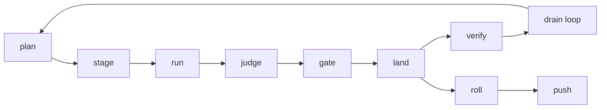
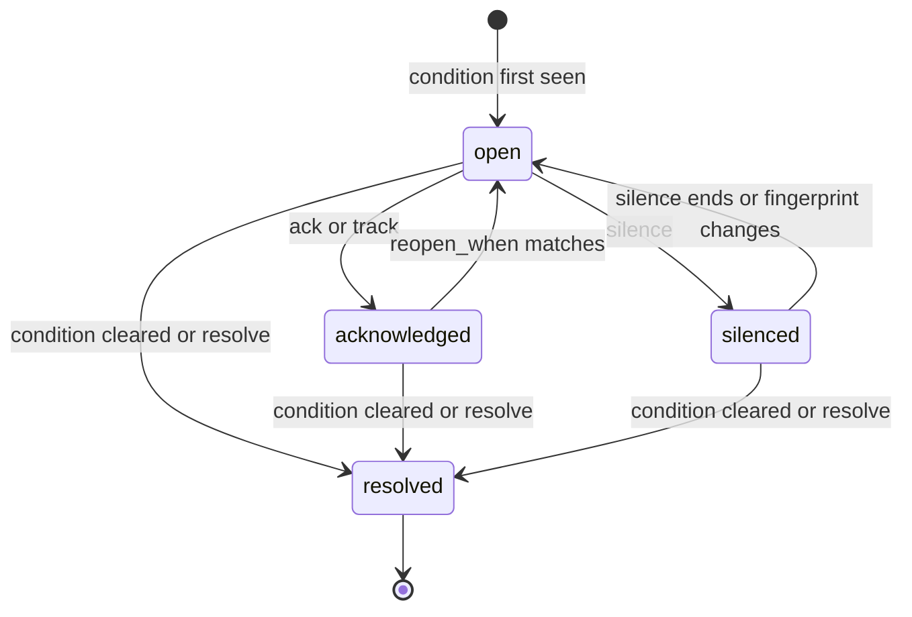

# Agent Alerting and Process Watchdog (`tillr-watch`)

**Status:** every question in [Section 8](#8-open-questions) is ruled; the engine, the command
line, the linter and 36 rules are built; the shipped-versus-repository rule split
([Section 4.3](#43-shipped-rules-pack-delivery-and-repository-overrides-d-tw83-to-d-tw87),
[Section 10](#10-build-slices-for-shipped-and-repository-watch-rules)), agent watches, the
subscribe stream, five designed rules, the session-relaunch provenance on
`drain-unrequested-start`
([Section 5.19](#519-session-relaunch-provenance-on-drain-unrequested-start-d-tw82)), and the
ended-run scratch-process event and rule
([Section 5.20](#520-process-left-alive-under-an-ended-runs-scratch-directory-d-tw89)) are not. The
Built column of the [decision ledger](#9-decision-ledger) says which is which.

> **In short:** `tillr-watch` reads the tillr store, judges it against standing rules written as
> TOML, and keeps one alert per condition until the condition ends. It tells the foreground agent
> and attaches the item's recent history. It never acts on the work it watches.

**Why it matters:** every step of the loop handles its own errors, and the failures that cost the
most are the ones no single step can see: an item bouncing between two steps, a trunk that stays
unproved, a loop that stopped passing. Those need something that reads across steps.

**The shape:** a rule names the events it reads, one of six patterns, a threshold and the guidance
text for whoever answers. An evaluation pass derives every condition from the store, opens or
closes alert episodes, and a waiting process in the foreground agent's session prints the new ones.

**Cost:** one more binary and one directory of rule files. Evaluation is read-only apart from the
episode tables and the `watch.alert.*` events.

**Start at:** [Section 5.1](#51-declarative-rule-schema-d-tw4-oq-tw5) for what a rule is,
[Section 6.1](#61-one-record-per-condition-never-per-pass-the-alert-episode-state-machine-d-tw5)
for what an alert is, [Section 4.3](#43-shipped-rules-pack-delivery-and-repository-overrides-d-tw83-to-d-tw87)
for how `tillr` ships its own rules and merges a consumer's, and
[Section 5.3](#53-which-rules-belong-to-tillr-and-which-stay-with-a-repository-d-tw83) for the
sorted rule catalog.

**Needs your ruling:** nothing in [Section 8](#8-open-questions); the designer's decisions in the
[decision ledger](#9-decision-ledger) — including [D-TW83](#D-TW83) to [D-TW88](#D-TW88) on shipped
versus repository watch rules and [D-TW89](#D-TW89) on live processes under an ended run's scratch
directory — have no owner ruling on the mechanism and may be overturned.

**Reads with:** [`tillr-state-machines.md`](./tillr-state-machines.md) (prevention),
[`tillr-watch-alert-workflow.md`](./tillr-watch-alert-workflow.md) and
[`tillr-alert-triage-seat.md`](./tillr-alert-triage-seat.md) (who answers an alert),
[`tillr-closed-backend-probe.md`](./tillr-closed-backend-probe.md) (the backend-closed rule's
clearing event).

## 1. What `tillr-watch` is for

### 1.1 The problem: nothing watches the hand-offs

tillr moves a piece of work through plan, stage, run, judge, gate, land and verify, and a drain
loop repeats that for a queue. Each step refuses bad input and records why. No step is responsible
for noticing that the same refusal has happened five times, that a landing has waited half an hour
for its proof, or that the loop itself has gone quiet. Without a watcher those conditions are found
by a person reading the store by hand, usually late.

`tillr-watch` is that watcher. Its job ends at telling someone, with enough context to act.

### 1.2 Terms used in this document

| Term | Meaning |
| :--- | :--- |
| **Standing rule** | A declarative rule, stored as TOML, that is judged on every evaluation pass for as long as it is enabled. |
| **Agent watch** | A temporary rule an agent registers for its own session and removes when done. Designed, not built. |
| **Alert episode** | The single record of one condition holding for one subject under one rule, from the pass that first saw it to the pass that saw it end. |
| **Subject** | What a rule groups by: an item, a run, a lane, a tree, or the word `global`. |
| **Condition fingerprint** | A SHA-256 over the values a rule names in its `fingerprint` key, so a silence can end when the condition changes shape. |
| **Timeline bundle** | The JSON attached to an alert: the subject's recent events, cut to fit 8,192 bytes. |
| **Charter** | The definition of a workflow's stages and seats, read by [`definition.go`](../../tools/tillr/definition/definition.go). |
| **Foreground agent** | The agent session a person is talking to, as opposed to a worker the drain started. |
| **Projection** | A read-only view the engine derives once per pass from something other than events: item state, the charter, or Git refs. |

## 2. The ten steps and the seams between them



### 2.1 Step-by-step ownership and unowned seams

| Step | Owns | What it cannot see |
| :--- | :--- | :--- |
| Plan | One item's plan output | The same item being planned again and again |
| Stage | One worktree | A lane left holding work from an earlier item |
| Run | One worker process | A run that ends in seconds, repeatedly |
| Judge | One verdict | A verdict that cannot be read on every attempt |
| Gate | One tree's checks | The same tree stalling the gate several times |
| Land | One squash onto the trunk | Conflicts in a row on one item |
| Verify | One landed item | Refusals piling up on one item |
| Drain loop | One pass | Its own silence when passes stop |
| Roll | One installed revision | A build that started with no request for it |
| Push | One ref update | A trunk that is ahead of its last proof for a long time |

### 2.2 Why local error handling does not see these failures

Each failure in the right-hand column is a pattern over several events, often from different
steps. A step that handles its own error correctly has done its job and still contributed one more
event to the pattern. Only a reader of the whole event log can count them.

## 3. Relation to State Machines, Existing Monitors, and the No-Cap Ruling

### 3.1 Prevention versus detection

| | State machines | `tillr-watch` |
| :--- | :--- | :--- |
| Question answered | Is this transition allowed? | Has something allowed gone on too long or too often? |
| When | Before the write | After the write, on a pass |
| Effect | Refuses the transition | Opens an alert episode |
| Design | [`tillr-state-machines.md`](./tillr-state-machines.md) | This document |

A condition that can be made impossible belongs in the state machine. A rule here is for what
remains possible and still deserves attention ([D-TW2](#D-TW2)).

### 3.2 Standing ruling: an alert never fails, benches, or caps work (`D-TW2`)

A rule may observe and tell. It may not stop a run, fail an item, remove a lane from rotation or
impose a limit. Four rulings elsewhere say the same thing from their own side:

- [Whether a run wall exists at all](../reference/run-wall-ruling.md#no-default-wall).
- [Failure is diagnosed, not waited out](./tillr-judge-and-lifecycle.md#the-four-tests),
  and its [restatement of admission](./tillr-judge-and-lifecycle.md#admission-after-a-failure).
- [Only verdicts charge](./landing-principles.md#5-only-verdicts-charge) and
  [a budget escalates, it does not loop](./landing-principles.md#6-a-budget-escalates-it-does-not-loop).
- [How a worker run's ending moves its item](./tillr-judge-and-lifecycle.md#44-how-a-worker-runs-ending-moves-its-item-d-jl10).

The linter enforces the boundary: a rule that names a remedy is refused with
`watch-lint-forbidden-remedy` ([Section 7.2](#72-tillr-watch-lint-checking-a-workflows-whole-configuration-before-it-runs-d-tw10)).

### 3.3 Relation to One-Breakage Dedup, Steering Timers, and Goal Monitors

- **One-breakage dedup** keeps the drain from filing a second fixer for the same broken trunk. It
  is prevention inside the drain; a rule here reports that a fixer was filed.
- **Steering timers** wake an operating agent on a schedule. A timer asks "is anything wrong"; a
  rule answers it without the agent reading the store.
- **Goal monitors** ([`tillr-goal-monitor.md`](./tillr-goal-monitor.md)) judge progress toward a
  stated goal. They may subscribe to alerts; they do not replace them.

## 4. Utility Boundary and the Three-Layer Split: Core, Workflow, Charter

### 4.1 New utility (`tillr-watch`) vs. face of an existing utility ([D-TW1](#D-TW1), [OQ-TW1](#OQ-TW1))

`tillr-watch` is its own binary. The engine is the package [`tools/tillr/watch`](../../tools/tillr/watch);
the command line is [`tools/tillr-watch`](../../tools/tillr-watch), reached as `tillr watch <command>`.
Putting it inside the drain was rejected because the drain is one of the things being watched.

| Command | Does | Built |
| :--- | :--- | :--- |
| `eval --once` | One evaluation pass | yes |
| `daemon` | Evaluation passes in a loop | yes |
| `wait`, `seen` | Foreground delivery ([Section 6.4](#64-mode-b-persistent-self-registered-foreground-agent-watches-d-tw8-oq-tw3)) | yes |
| `status` | Rules loaded, episodes unresolved, who is attached | yes |
| `ack`, `track`, `silence`, `resolve` | Episode lifecycle | yes |
| `rule list`, `show`, `add`, `tune`, `reset`, `export` | Live rule overrides | yes |
| `lint` | Check a workflow's configuration | yes |
| `add`, `list`, `edit`, `drop` | Agent watches | no |
| `subscribe` | Stream of alert transitions | no |

### 4.2 What belongs in `tillr` core, in a workflow definition, and in the charter ([D-TW3](#D-TW3))

| Layer | Holds | Scope value on a rule |
| :--- | :--- | :--- |
| Core | Rules true of any tillr store: loop passes, store busy, lane left dirty | `core` |
| Workflow | Rules about one workflow's events and stages | `workflow:<name>` |
| Charter | Rules about one charter's seats and states | `charter:<name>` |

A workflow definition may declare what the watcher should know about it. The definition schema
accepts both blocks ([D-TW56](#D-TW56)):

```json
{
  "watch": {
    "cycle_anchor": { "from": "verify", "to": "plan", "max_cycles": 3 },
    "oscillation_pairs": [{ "a": "plan", "b": "build", "threshold": 3, "hint": "..." }]
  },
  "observability": { "progress_event": "run.progress", "rule_pack": "config/tillr/watch" }
}
```

### 4.3 Shipped rules, pack delivery, and repository overrides ([D-TW83](#D-TW83) to [D-TW87](#D-TW87))

On 2026-11-24, this repository and a consumer repository getting its programs from
[`yolo-packs/tillr`](../../yolo-packs/tillr) each carried a copy of the same 33 `.toml` files under
`config/tillr/watch/`. The boundary from the 2026-11-25 request is that rules describing the
drain's own behavior belong to `tillr`, while rules about one repository's own content stay with
that repository. Every choice of classification, delivery, override syntax, runtime resolution, lint
merging and build order here and in
[Section 5.3](#53-which-rules-belong-to-tillr-and-which-stay-with-a-repository-d-tw83),
[Section 7.2](#72-tillr-watch-lint-checking-a-workflows-whole-configuration-before-it-runs-d-tw10)
and [Section 10](#10-build-slices-for-shipped-and-repository-watch-rules) is **the designer's
decision**: the owner has not ruled on the mechanism and may overturn any part of it.

#### How the pack delivers shipped rules ([D-TW84](#D-TW84))

1. **Canonical location in `tillr`.** The 32 `tillr`-owned files (35 rules;
   [Section 5.3](#53-which-rules-belong-to-tillr-and-which-stay-with-a-repository-d-tw83)) move
   from `config/tillr/watch/` to `tools/tillr-watch/rules/*.toml`. Putting them in
   `tools/tillr-watch` rather than `tools/tillr/watch` keeps `tools/tillr` free of sibling-module
   imports ([`boundaries_test.go`](../../tools/tillr-watch/boundaries_test.go)) while placing the
   files beside `tools/tillr-watch`'s event registrations and `*_rule_test.go` suite.
2. **Pack mirror and install.** `just pack-sync`
   ([`tools/tillr/packmirror`](../../tools/tillr/packmirror)) already mirrors every tracked
   file under `tools/tillr-watch` into `yolo-packs/tillr/files/local/share/tillr/tillr-watch/`,
   which `yolo host apply` installs to `$HOME/.local/share/tillr/tillr-watch/rules/*.toml`
   (`$TILLR_INSTALL_ROOT/tillr-watch/rules/*.toml`). A consumer repository carries none of those
   files in its own tree, while operators and agents can still read the plain `.toml` files under
   `$TILLR_INSTALL_ROOT/tillr-watch/rules/`.
3. **Compile-time embedding and launcher stamp.** `tools/tillr-watch` embeds `rules/*.toml` with
   `//go:embed rules/*.toml` (the same pattern [`definition.go`](../../tools/tillr/definition/definition.go)
   uses for `landing.json`), and `list_inputs()` in the pack launcher template
   ([`yolo-packs/tillr/programs/tillr-watch/run`](../../yolo-packs/tillr/programs/tillr-watch/run)
   and sibling `run` scripts checked by [`tools/tillr/cmd/pack-sync-check`](../../tools/tillr/cmd/pack-sync-check))
   hashes `*.toml` and `*.json` alongside `*.go`, `go.mod` and `go.sum`. Editing a shipped rule
   invalidates only `tillr-watch`'s build stamp in the pack cache, and standalone binaries built by
   `just tillr-build` or `tillr-roll` (which compile in a temporary clone removed on exit and run
   without `TILLR_INSTALL_ROOT`) still carry the exact rule set of their commit.

#### How a consumer adds or overrides a rule ([D-TW85](#D-TW85))

A repository keeps its own tracked watch configuration under `<root>/config/tillr/watch/*.toml`.
That directory is optional: a consumer with no repository-specific rules or threshold changes has
no `config/tillr/watch/` directory. Within `<root>/config/tillr/watch/*.toml`, three tracked forms
are supported:

| Need | What the consumer writes in `config/tillr/watch/*.toml` | Effect |
| :--- | :--- | :--- |
| Add a repository-owned rule | `[[rule]]` with an `id` not in the shipped set | Validated as a complete rule and added (`source=file`). |
| Tune or disable a shipped rule without copying it | `[[override]]` naming a shipped `id` plus only the leaf keys to change (`enabled`, `scope`, `severity`, `[override.reads]`, `[override.when]`, `[override.guidance]`, `[override.delivery]`) | Clones the shipped rule's TOML table, overlays the given leaf keys (the same operation `tillr watch rule tune --set` runs in [`rule_store.go`](../../tools/tillr/watch/rule_store.go)), and validates the merged rule (`source=file`). Unmentioned fields inherit future pack updates. |
| Replace a shipped rule wholesale | `[[rule]]` with the same `id` as a shipped rule | Replaces the shipped rule's table in full (`source=file`). Used when changing `when.pattern` so old pattern-specific keys do not survive, and keeps rolling upgrades clean while a consumer still carries unmodified copies of the 32 files. |

```toml
# Disable one shipped rule and raise another's threshold in a consumer repository:
[[override]]
id = "drain-lane-kept"
enabled = false

[[override]]
id = "fast-gate-run-slow"

[override.when]
match = 'event.total_ms > 120000'
```

Refusals within the repository layer:

- Duplicate `id`s *within* `<root>/config/tillr/watch/` (across two `[[rule]]` blocks, two
  `[[override]]` blocks, or a `[[rule]]` and an `[[override]]` naming the same `id`) fail loading
  and `lint`.
- An `[[override]]` with no keys beside `id`, an unknown TOML key, an `id` not present in the
  shipped set, or `--no-shipped-rules` fails loading and `lint`.

Live operator changes in SQLite (`tillr watch rule add|tune|reset`, [OQ-TW5](#OQ-TW5),
[D-TW35](#D-TW35)) remain available above both tracked layers.

#### What `tillr-watch` reads at runtime ([D-TW86](#D-TW86))

Rules resolve in three layers from lowest to highest precedence:

| Precedence | Layer | Where it comes from | `source=` in `rule list` |
| :--- | :--- | :--- | :--- |
| 1 | Shipped | Embedded `tools/tillr-watch/rules/*.toml` (omitted only under `--no-shipped-rules`) | `shipped` |
| 2 | Repository file | `<root>/config/tillr/watch/*.toml` when present, or explicit `--rules <path>` | `file` |
| 3 | Store override | `watch_rule_overrides` in `<root>/.tillr/state.db` | `store` |

Runtime rules:

1. **Optional `--rules` and inferred `<root>`.** `--rules` becomes optional on `eval`, `daemon`,
   `wait`, `status` and `rule` (`rule` also accepts optional `--root`). When `--rules` is omitted,
   `<root>` comes from `--root` or, when `--store` resolves to `<root>/.tillr/<file>`, from
   `--store`'s parent directory; if `<root>/config/tillr/watch` exists as a directory, its `.toml`
   files form layer 2 (a non-directory or broken `.toml` there fails with exit 1; a missing
   directory means layer 2 is empty).
2. **Explicit `--rules <path>` still layers over shipped rules.** Callers and skills that pass
   `--rules <root>/config/tillr/watch` (as
   [`tillr-operating/SKILL.md`](../../yolo-packs/tillr/skills/tillr-operating/SKILL.md) does today)
   require `<path>` to exist and merge `<path>` on top of layer 1, so deleting duplicate files from
   a consumer's `config/tillr/watch/` never drops the 35 shipped rules under existing invocations.
   `--no-shipped-rules` omits layer 1 for isolated unit tests or standalone rule sets and requires
   `--rules` or an existing `<root>/config/tillr/watch`.
3. **`rule tune`, `rule reset` and baseline hashes.** `rule tune <id>` clones the effective rule
   from layers 1–3; `rule reset <id>` deletes the `watch_rule_overrides` row so `<id>` falls back
   to `file` if present, otherwise `shipped`. `watch_rule_baselines` ([D-TW66](#D-TW66)) hashes
   effective rule fields and ignores `source`, so removing an unmodified duplicate `.toml` from a
   consumer repository switches `source=file` to `source=shipped` without resetting episodes or
   event baselines.
4. **Charter check before Git reads.** `Evaluator` and `ReadStatus` check a rule's `charter:<name>`
   scope against the store's charter (`definition.ForReader`) before requiring `--root` or reading
   `git_refs:`. On a non-landing store such as `recorded-verdict`, `trunk-proof-lag`
   (`scope = "charter:git-landing"`) reports `out-of-scope="recorded-verdict"` and needs neither
   `--root` nor `.git`.

| Alternative considered | Designer's reason to reject |
| :--- | :--- |
| Read shipped `.toml` files only from `$TILLR_INSTALL_ROOT` at runtime (no `//go:embed`) | Breaks standalone `just tillr-build` and `tillr-roll` binaries, which compile in a deleted temporary clone and run without `TILLR_INSTALL_ROOT`. |
| Deep-merge partial `[[rule]]` blocks instead of separate `[[override]]` and wholesale `[[rule]]` | `[rule.when]` is a pattern-discriminated union; deep-merging a pattern change leaves forbidden keys from the shipped pattern behind. |
| Make `--rules <dir>` omit shipped rules by default | Existing `--rules <root>/config/tillr/watch` invocations in consumer sessions would silently lose all 35 drain rules once duplicate files are deleted. |

## 5. Alert Rules as Tunable Data and the Starting Rule Catalog

### 5.1 Declarative rule schema ([D-TW4](#D-TW4), [OQ-TW5](#OQ-TW5))

A rule is data. It contains no code and names no command to run. Today the loader walks
[`config/tillr/watch`](../../tools/tillr-watch/rules) for `.toml` files; under
[Section 4.3](#43-shipped-rules-pack-delivery-and-repository-overrides-d-tw83-to-d-tw87)
([D-TW84](#D-TW84) to [D-TW86](#D-TW86), not yet built) it layers `<root>/config/tillr/watch` over
`tillr`'s embedded `tools/tillr-watch/rules/*.toml`. A file may hold more than one rule. A row in
the store table `watch_rule_overrides` replaces the whole file or shipped rule with the same id,
so a threshold can be tuned without a commit, and `rule export` prints the override as TOML to
commit later ([D-TW35](#D-TW35)).

| Key | Meaning |
| :--- | :--- |
| `id`, `severity`, `scope`, `enabled` | Identity, `warning` or `high`, layer, on/off |
| `reads.events` | Event kinds the rule reads |
| `reads.projections` | `items`, `charter`, or `git_refs:<ref>,<ref>` |
| `when.group_by` | The subject: `global`, one event field, or a list of fields |
| `when.pattern` | One of the six patterns below |
| `when.match`, `clear_when`, `reset`, `after`, `reopen_when` | Expressions; which apply depends on the pattern |
| `when.threshold`, `threshold_duration`, `threshold_commits`, `window` | Limits |
| `when.distinct_by` | Count distinct values of one field instead of events ([D-TW76](#D-TW76)) |
| `fingerprint` | Names whose values form the condition fingerprint ([D-TW32](#D-TW32)) |
| `guidance.summary`, `guidance.action` | Text shown to the receiver |

| Pattern | Holds when |
| :--- | :--- |
| `predicate_match` | An event in the window matches `match` and no later one matches `clear_when` |
| `count_in_window` | At least `threshold` matching events fall inside `window` |
| `consecutive_count` | At least `threshold` matching events in a row with no `reset` event between |
| `alternating_pair` | The subject has gone back and forth between two values `threshold` times |
| `lag_behind` | A follower ref trails a leader ref by commits, by time, or both |
| `duration_without_event` | A start event (`after`) has no end event (`match`) for `threshold_duration` |

The expression grammar is total: comparison, `and`, `or`, `not`, `in`, `matches`, `empty()` and
`age()` over `event.<field>` and projection names. An expression cannot loop, call out or fail; a
missing field is empty.

Semantics settled by decision:

- Every pass derives each count from the store again; the engine keeps no running counters
  ([D-TW13](#D-TW13)).
- The window is applied first, then `match` and `reset` ([D-TW23](#D-TW23)).
- `alternating_pair` counts observations of the pair, and several pairs on one rule share one
  count ([D-TW12](#D-TW12), [D-TW18](#D-TW18)).
- `group_by` reads JSON strings only; an event whose field is absent or not a string is skipped and
  the skip is counted per rule ([D-TW22](#D-TW22)).
- A list-valued `group_by` forms a composite subject, and a clearing event that carries only the
  leading fields clears every subject with that prefix ([D-TW50](#D-TW50)).
- A clearing event ends the episode. If the condition returns, that is a new episode
  ([D-TW17](#D-TW17)).
- Guidance placeholders are `{{subject}}`, `{{rule_id}}`, `{{alert_id}}`, `{{count}}`,
  `{{elapsed}}`, `{{pair_a}}`, `{{pair_b}}`, `{{leader}}`, `{{follower}}`, `{{leader_short}}`,
  `{{follower_short}}`, `{{distinct_values}}` and `{{event.<name>}}`; the loader refuses any other
  ([D-TW16](#D-TW16)).

### 5.2 The planned rule catalog

The catalog is the list of conditions the design set out to cover. The ids are design names; the
shipped rule that covers a condition, where one exists, is named beside it.

| Catalog id | Condition | Shipped as |
| :--- | :--- | :--- |
| `verify-refusal` | Verifier refuses one item repeatedly | `drain-repeated-verifier-refusals` |
| `plan-verify-cycles` | Item cycles from verify back to plan | not shipped |
| `worker-hours-without-completion` | A worker runs for hours with no completion | not shipped |
| `short-run-under-5s` | Runs ending in under five seconds | not shipped |
| `run-failover-suffix` | Runs repeatedly falling over to another backend | not shipped |
| `outside-allowed-paths-refusal` | Work refused for touching paths outside its allowance | not shipped |
| `gate-refusal` | Gate refuses the same tree repeatedly | `gate-repeated-stall` |
| `operator-hold` | Item held for an operator | `drain-obstacle-hold` |
| `unproved-trunk-lag` | Trunk ahead of its last proof | `trunk-proof-lag` |
| `post-landing-roll-failing` | Roll failing after a landing | not shipped |
| `step-oscillation` | Item bouncing between two steps | test fixture only |
| `multiple-landings-build-unlanded` | Several landings while a build stays unlanded | not shipped |
| `dead-run-holding-lane` | A dead run still holding a lane | `drain-lane-kept` |
| `store-write-locked` | Store write refused as busy | `drain-store-busy` |
| `empty-reason-record` | A refusal recorded with no reason | not shipped |
| `high-attempt-diagnostic` | An item on a high attempt number | `drain-item-fifth-attempt` |

### 5.3 Which rules belong to `tillr` and which stay with a repository ([D-TW83](#D-TW83))

[`config/tillr/watch`](../../tools/tillr-watch/rules) currently holds 36 rules in 33 `.toml` files, each
with a loader-and-evaluation test in [`tools/tillr-watch`](../../tools/tillr-watch)
([D-TW42](#D-TW42)). All are `warning` except `drain-backend-closed`, which is `high`. Three files
carry two rules each (`drain-revert.toml`: `drain-landing-reverted` and
`drain-revert-not-possible`; `fast-gate-slow.toml`: `fast-gate-run-slow` and
`fast-gate-median-slow`; `trunk-proof-lag.toml`: `trunk-proof-lag` and `trunk-proof-stalled`); each
remaining file is `<id>.toml`.

Under the designer's classification ([D-TW83](#D-TW83), not yet built; the owner may overturn it):

- **32 files (35 rules) describe `tillr`'s own behavior and move to `tools/tillr-watch/rules/`.**
  Every event and projection they read is emitted by `tillr-drain`, `tillr-run`, `tillr-gate`,
  `tillr-land`, `tillr-item` or `tillr`'s Git-landing charter. Thirty-four keep `scope = "core"`
  (on a non-landing charter, event-only landing and gate rules never see matching events and stay
  quiet; [D-TW21](#D-TW21)); `trunk-proof-lag` moves from `scope = "core"` to
  `scope = "charter:git-landing"` because its `git_refs:refs/heads/main,refs/tillr/green`
  projection belongs specifically to `git-landing` and otherwise fails `watch-lint-unknown-signal`
  on hook-completed charters. Seven shipped rules carry default limits calibrated on this
  repository (`drain-checkpoint-not-restarted`, `drain-restart-unanswered`, `drain-lane-kept`,
  `gate-verdict-overdue`, `gate-drain-stalls`, `fast-gate-run-slow`, `fast-gate-median-slow`) that
  a consumer tunes with `[[override]]` ([D-TW85](#D-TW85)).
- **1 file (1 rule) describes one repository's own content and stays in that repository's
  `config/tillr/watch/`.** `drain-pi-build-stale.toml`
  (`drain-pi-build-stale`) watches `drain.pi-build-stale` and `drain.pi-build-current` and directs
  the operator to `refs/heads/patch/pi`, `pi-builds/current.json` and `bin/pi-forks build-pi` —
  artifacts of the consumer repository that maintains the `pi` patch-series fork
  (`git for-each-ref refs/heads/patch/` and `fd pi-forks bin` return nothing in this repository,
  where fork handling is slated for removal under
  [roadmap entry 4](../tillr/roadmap.md#2-a-core-that-carries-only-its-own-code)). It stays in
  `<consumer>/config/tillr/watch/drain-pi-build-stale.toml` and is removed from `tillr`.

| Rule | Home & target scope | Reads | Pattern | Subject | Limit |
| :--- | :--- | :--- | :--- | :--- | :--- |
| `drain-loop-fault` | `tillr` (`core`) | `drain.loop-ended` | `predicate_match` | global | 1h window |
| `drain-loop-no-pass` | `tillr` (`core`) | `drain.loop-pass` | `duration_without_event` | global | 5m |
| `drain-unrequested-start` | `tillr` (`core`) | `drain.build-started` | `predicate_match` | global | 1h window |
| `drain-checkpoint-not-restarted` | `tillr` (`core`) | `drain.checkpoint-not-restarted` | `predicate_match` | global | 3m window |
| `drain-restart-unanswered` | `tillr` (`core`) | `drain.restart-request`, `drain.restart-answer` | `duration_without_event` | `object_id` | 35m |
| `drain-store-busy` | `tillr` (`core`) | `drain.store-busy` | `predicate_match` | global | 1h window |
| `drain-backend-closed` | `tillr` (`core`) | `drain.backend-outcome`, `drain.backend-probe` | `predicate_match` | `object_id` | until cleared |
| `drain-dispatch-declined` | `tillr` (`core`) | `drain.dispatch-declined` | `count_in_window` | `object_id` | 3 in 10m |
| `drain-repeated-step-dispatches` | `tillr` (`core`) | `run.allocate` | `count_in_window` | `item_id`, `node` | 5 in 10m |
| `drain-item-fifth-attempt` | `tillr` (`core`) | `run.allocate`, `land.landing` | `predicate_match` | `item_id` | until cleared |
| `drain-item-fault` | `tillr` (`core`) | `drain.item-fault` | `predicate_match` | `item_id` | 1h window |
| `drain-obstacle-hold` | `tillr` (`core`) | `drain.obstacle-hold` | `predicate_match` | `item_id` | 1h window |
| `drain-plan-output-unparseable` | `tillr` (`core`) | `drain.refusal` | `predicate_match` | `item_id` | 24h window |
| `drain-judge-unreadable` | `tillr` (`core`) | `drain.refusal` | `predicate_match` | `item_id` | 1h window |
| `drain-repeated-verifier-refusals` | `tillr` (`core`) | `drain.refusal` | `count_in_window` | `item_id` | 5 in 24h |
| `drain-repeated-refusal` | `tillr` (`core`) | `drain.refusal`, `land.landing` | `consecutive_count` | global | 2 distinct items in 24h |
| `drain-repeated-item-conflicts` | `tillr` (`core`) | `item.conflict`, `items` and `charter` projections | `count_in_window` | `item_id` | 2 in 24h |
| `drain-trunk-fixer-filed` | `tillr` (`core`) | `item.add` | `predicate_match` | `item_id` | 1h window |
| `drain-landing-reverted` | `tillr` (`core`) | `drain.revert` | `predicate_match` | `landing` | 1h window |
| `drain-revert-not-possible` | `tillr` (`core`) | `drain.revert` | `predicate_match` | `landing` | 1h window |
| `drain-heavy-fault` | `tillr` (`core`) | `drain.heavy-fault` | `predicate_match` | `tip_sha` | 1h window |
| `drain-lane-refused` | `tillr` (`core`) | `drain.lane-refused`, `drain.lane-restored` | `predicate_match` | `lane_id`, `reason` | until cleared |
| `drain-lane-kept` | `tillr` (`core`) | `drain.lane-kept`, `drain.lane-released`, `run.release` | `duration_without_event` | `lane_id` | 15m |
| `drain-test-slots-free-with-waiters` | `tillr` (`core`) | `drain.test-slots-free-with-waiters`, `drain.test-slots-cleared` | `predicate_match` | `lock_dir` | until cleared |
| `drain-trunk-core-worktree` | `tillr` (`core`) | `drain.trunk-core-worktree` | `predicate_match` | `config_path` | 1h window |
| `land-squash-conflict` | `tillr` (`core`) | `land.landing` | `predicate_match` | `item_id` | 1h window |
| `land-repeated-squash-conflicts` | `tillr` (`core`) | `land.landing` | `consecutive_count` | `item_id` | 3 in 24h |
| `gate-verdict-overdue` | `tillr` (`core`) | `gate.started`, `gate.verdict` | `duration_without_event` | `object_id` | 3650s |
| `gate-repeated-stall` | `tillr` (`core`) | `gate.verdict` | `count_in_window` | `tree_sha` | 3 in 24h |
| `gate-drain-stalls` | `tillr` (`core`) | `gate.verdict` | `count_in_window` | global | 3 in 4h |
| `fast-gate-run-slow` | `tillr` (`core`) | `drain.fast-gate-timing` | `predicate_match` | `slowest_check` | 1h window |
| `fast-gate-median-slow` | `tillr` (`core`) | `drain.fast-gate-timing` | `predicate_match` | global | 24h window |
| `run-model-timeout` | `tillr` (`core`) | `run.model-timeout`, `run.finish` | `predicate_match` | `run_id` | until cleared |
| `trunk-proof-lag` | `tillr` (`charter:git-landing`) | `land.landing`, `drain.revert`, `drain.heavy-progress`, Git refs | `lag_behind` | global | 30m |
| `trunk-proof-stalled` | `tillr` (`core`) | `drain.heavy-progress`, `drain.heavy-fault`, `drain.loop-ended`, `drain.build-started` | `duration_without_event` | global | 10m |
| `drain-pi-build-stale` | fork-owning repo (`core`) | `drain.pi-build-stale`, `drain.pi-build-current` | `predicate_match` | global | until cleared |

Two rules about rule text apply to every file. Guidance may name the command that answers the
alert, since naming is not executing ([D-TW42](#D-TW42)). No rule or alert text calls a firing
alarm "expected": an alert that is expected is a rule to fix ([D-TW73](#D-TW73)).

### 5.4 The ten drain conditions ([D-TW39](#D-TW39))

These are the conditions an agent operating the drain otherwise checks by hand. The numbering is
cited from the rule files.

| # | Condition | Rule |
| :--- | :--- | :--- |
| 1 | The loop exited on a fault | `drain-loop-fault` |
| 2 | One item refused by the verifier repeatedly | `drain-repeated-verifier-refusals` |
| 3 | One item bouncing between a build obstacle and a design answer | `drain-repeated-item-conflicts` |
| 4 | An item held for an operator | `drain-obstacle-hold` |
| 5 | A landing reverted, or a revert that could not be made | `drain-landing-reverted`, `drain-revert-not-possible` |
| 6 | A trunk fixer filed | `drain-trunk-fixer-filed` |
| 7 | A squash conflict stopped a landing | `land-squash-conflict` |
| 8 | An item fault | `drain-item-fault` |
| 9 | Trunk unproved for 30 minutes, or its proof stalled for 10 | `trunk-proof-lag`, `trunk-proof-stalled` |
| 10 | An ordinary lane idle while items wait for one | not shipped |

Condition 5 is two rules over one event kind, and a heavy-proof failure has no rule of its own
because the revert it causes already alerts ([D-TW40](#D-TW40)). A heavy-proof *fault*, where the
proof could not run, is `drain-heavy-fault`, grouped by trunk tip ([D-TW47](#D-TW47)).

Two rules watch the loop itself. The drain records `drain.loop-pass` about once a minute and
`drain-loop-no-pass` opens after five minutes without one ([D-TW45](#D-TW45)).
`drain-unrequested-start` opens when a drain build starts that nobody asked for
([D-TW44](#D-TW44), [Section 5.12](#512-requested-stop-and-start-quiet-on-drain-unrequested-start-d-tw71)).

Verifying a rule never writes to the repository's own store; tests build a store of their own
([D-TW41](#D-TW41)).

### 5.5 Fast-gate time: two rules and the event they read ([D-TW43](#D-TW43))

The fast gate is the set of checks the drain runs on a candidate before landing. After each run the
drain records `drain.fast-gate-timing` with `item_id`, `run_id`, `wall_ms`, `exit_code`,
`slowest_check` (or `unmeasured`), `slowest_check_ms` and `median20_wall_ms`, the median wall time
of the last twenty runs.

| Rule | Subject | Opens when | Clears when |
| :--- | :--- | :--- | :--- |
| `fast-gate-run-slow` | `slowest_check` | `event.wall_ms > 60000` ([D-TW52](#D-TW52)) | Window of 1h passes |
| `fast-gate-median-slow` | global | `event.median20_wall_ms > 90000` | `event.median20_wall_ms <= 90000` |

The per-run rule groups by the slowest check so the alert names what to speed up. The thresholds
come from one measurement: ten consecutive fast-gate runs had a median of 65.4 seconds and a
slowest run of 123.3 seconds, against a target of about 40 seconds recorded in the
[gate reference](../reference/gate.md#affected-go-tests-before-the-merge).

### 5.6 A rule brought forward: a store write refused as busy ([D-TW46](#D-TW46))

The store is one SQLite file with one writer at a time. When the drain's write is refused as busy
it records `drain.store-busy`, and the rule `drain-store-busy` opens one global episode for the
hour. The catalog listed this condition for later; it ships with the drain conditions because a
busy store delays every other event the watcher reads.

### 5.7 Leftover work holding a lane out of rotation ([D-TW48](#D-TW48), [D-TW49](#D-TW49), [D-TW50](#D-TW50))

A lane is a worktree the drain assigns to one item at a time. When the drain finds a lane holding
uncommitted or unlanded work from an earlier item, it refuses to reuse the lane and records
`drain.lane-refused` with `lane_id`, `reason` and `left_by`, the item that left the work.

The owner ruled that this is an alert and that nothing sweeps the lane automatically
([D-TW48](#D-TW48)): the leftover work may be the only copy. The rule `drain-lane-refused` groups
by `["lane_id", "reason"]`, has no window, and clears on `drain.lane-restored` for that lane
whatever the reason was.

### 5.8 Repeated `item.conflict` events on one item ([D-TW51](#D-TW51))

`drain-repeated-item-conflicts` counts `item.conflict` events with `status == "raised"` and opens
at two inside 24 hours. It reads the `items` and `charter` projections so that an item already
landed or closed does not open an episode ([D-TW53](#D-TW53)).

### 5.9 Trunk proof lag and stalled heavy-proof progress ([D-TW54](#D-TW54))

The heavy proof is the full test suite the drain runs against the trunk tip after landings. Two
rules cover it.

- `trunk-proof-lag` is `lag_behind` with leader `refs/heads/main` and follower `refs/tillr/green`,
  on duration only: 30 minutes. Its `reopen_when` returns an acknowledged episode to the foreground
  when a heavy proof ends red, and the event carries `failing_checks` so the notice names them
  ([D-TW75](#D-TW75)).
- `trunk-proof-stalled` is `duration_without_event` over `drain.heavy-progress`: a `started` or
  `progress` phase with no `ended` phase for 10 minutes. It clears on a heavy fault, a loop end or a
  drain build start.

Ten minutes holds because the proof reports from inside a long check:
[`tillr-gate shards`](../../tools/tillr-gate/shards) takes `--progress-file` and the drain turns
each snapshot into a `progress` event ([D-TW62](#D-TW62)). The same contract is specified for the
cached mode of that script ([D-TW70](#D-TW70)).

### 5.10 Repeated squash conflicts in a row on one item ([D-TW68](#D-TW68))

`land-repeated-squash-conflicts` is `consecutive_count` per item: three `land.landing` events with
`result == "squash-conflict"` in a row inside 24 hours, reset by a `landed` result. One conflict is
condition 7; three in a row means the item's base is not being refreshed. The same decision gives
guidance placeholders a plain rendering for a list of scalars.

### 5.11 Backend closed by the drain ([D-TW69](#D-TW69))

A backend is a model service the drain dispatches runs to. When an outcome leads the drain to stop
using one, it records `drain.backend-outcome` with `closes == true` and `drain-backend-closed`
opens at severity `high`, per backend, with no window. It clears on a successful
`drain.backend-probe` or on a later outcome that does not close and was not an interruption. The
probe is specified in [`tillr-closed-backend-probe.md`](./tillr-closed-backend-probe.md).

### 5.12 Requested stop-and-start quiet on `drain-unrequested-start` ([D-TW71](#D-TW71))

`drain.build-started` carries `restart_request`, `stop_request` and `initial`. The rule matches
only a drain build with all three empty or false, so a restart someone asked for, a start after a
requested stop, and the first start of a store are all quiet. The restart protocol is described in
the [restart reference](../reference/tillr-restart.md). The rule's guidance says what to check and
does not describe the start as normal ([D-TW74](#D-TW74)). Unbuilt provenance for a start after
the whole operating session ended is specified in
[Section 5.19](#519-session-relaunch-provenance-on-drain-unrequested-start-d-tw82)
([D-TW82](#D-TW82)).

### 5.13 Drain refusals across different items with no landing between them ([D-TW76](#D-TW76))

`drain-repeated-refusal` is a global `consecutive_count` with `distinct_by = "item_id"` and a
threshold of two: refusals on two different items with no landing between them. One item refused
is that item's problem; two different items refused in a row points at the drain or the trunk.
`{{distinct_values}}` lists the items in the notice.

### 5.14 Item held by a trunk fixer starting a new attempt instead of gating its kept candidate ([D-TW77](#D-TW77))

Designed, not built. A trunk fixer is the item the drain files to repair a red trunk; while it is
open, an item whose candidate is finished should wait and then gate that candidate. The rule opens
when such an item is allocated a fresh run instead. It needs `after` and `reset` on
`predicate_match`; the engine accepts `after` only on `duration_without_event`.

### 5.15 Overlapping and slow base replays ([D-TW78](#D-TW78))

Partly built. A base replay re-applies a candidate onto a newer trunk. The drain records
`drain.base-replay-started` and `drain.base-replay-ended`. The two designed rules, one for replays
overlapping and one for a replay running past 50 minutes, are not shipped, and the `active_replays`
field the overlap rule reads is not recorded.

### 5.16 Gate started for a trunk fixer the drain has already proved ([D-TW79](#D-TW79))

Designed, not built. The events exist (`gate.started`, `drain.fixer-proved`). The rule needs a
`group_by` that matches any of several fields and a `keep_on_terminal_item` key so the episode
survives the fixer closing; the engine has neither.

### 5.17 Trunk fixer still queued after a green proof passed its checks ([D-TW80](#D-TW80))

Designed, not built. This rule holds on projections alone, with no triggering event: a fixer item
is open while the latest green proof already covers the checks it was filed for. It needs
`predicate_match` to accept a rule with no events and two projection names, `fixer_checks` and
`green_proof`; the engine has neither.

### 5.18 Sustained CPU usage over half a core in `tillr watch wait` or `tillr-view serve` ([D-TW81](#D-TW81))

Partly built. Both processes should be idle between events, so sustained CPU in either is a defect
worth an alert. The drain records `drain.process-cpu` samples. The rule and the `for_each` key it
needs, to open one episode per sampled process, are not built.

### 5.19 Session-relaunch provenance on `drain-unrequested-start` ([D-TW82](#D-TW82))

Designed, not built. The loop-restart design graduated in commit `ec98c55f` to the
[restart reference](../reference/tillr-restart.md), which records built behavior only, so unbuilt
loop-start provenance for `drain-unrequested-start` is specified here beside [D-TW44](#D-TW44) and
[D-TW71](#D-TW71) ([Section 5.12](#512-requested-stop-and-start-quiet-on-drain-unrequested-start-d-tw71))
and updates the [restart reference](../reference/tillr-restart.md) in the final build slice below.
This section answers a 2026-11-24 operator request from a **consumer repository** (a repository
whose queue tillr works using the binaries the tillr pack delivers, without carrying tillr's
source). Every mechanism, field name, rule change and rejected alternative below is the designer's
decision, not an owner ruling, and the owner may overturn any of it.

Two terms apply here. A **process domain** is the `<boot_id>:<pid_ns>` pair recorded on
`presence.Owner.Domain` in [`tools/tillr-drain/presence/presence.go`](../../tools/tillr-drain/presence/presence.go)
from `/proc/sys/kernel/random/boot_id` and `/proc/self/ns/pid`, identifying one OS boot and Linux
PID namespace. A **session relaunch** is a `tillr-drain loop` start in a new process domain after
the prior process domain's loop ended without a recorded loop fault, stop request or in-place
restart request.

#### Why `drain-unrequested-start` fires on session relaunch today

When an operating session's container or jail exits (closing PID 1 in a Linux PID namespace sends
`SIGKILL` to every background process in that namespace) or the host reboots,
[`tillr-drain keep`](../../tools/tillr-drain/keep/keep.go) and `tillr-drain loop` vanish
together without running `tillr drain stop` or `endSession`. On the next session launch,
`publishDrainBuild` in [`tools/tillr-drain/drain/restart.go`](../../tools/tillr-drain/drain/restart.go)
sees an earlier `drain.build-started` for `role == "drain"`, no `TILLR_RESTART_REQUEST`, and no
newer `drain.stop-requested` (landed in commit `7afe7a37`), so it appends `drain.build-started`
with `restart_request`, `stop_request` and `initial` all absent — matching
[`config/tillr/watch/drain-unrequested-start.toml`](../../tools/tillr-watch/rules/drain-unrequested-start.toml).

#### Who leaves the record, and what was set aside *(designer's decisions)*

- **The loop (`tillr-drain`), not `tillr-keep`, writes and reads the record.** Consumer
  repositories and manual runs invoke `tillr-drain loop` either under
  [`tillr-drain keep`](../../tools/tillr-drain/keep/keep.go) or directly
  ([`tillr-separable-parts.md`](./tillr-separable-parts.md#21-the-stable-surface)). Recording
  provenance in `tillr-drain` covers both without coupling `tillr-drain` to `tillr-keep` or
  launcher-specific environment variables, and reuses `presence.Owner` in
  [`tools/tillr-drain/presence/presence.go`](../../tools/tillr-drain/presence/presence.go). On a
  bare host where `<boot_id>:<pid_ns>` does not change across foreground shells, `tillr-keep` and
  `tillr-drain loop` run in detached POSIX sessions and are not killed when a foreground shell
  exits.
- **Rejected: a wall-clock heartbeat-age threshold alone.** When `tillr-drain loop` crashes inside
  a live session, `tillr-keep` waits 60 seconds (`INITIAL_BACKOFF`, doubling up to 1,800 seconds)
  before spawning the replacement loop. During that backoff `drain_sessions.refreshed_at` is 60 to
  1,800 seconds old — indistinguishable by age alone from a session closed for 1 to 30 minutes. A
  pure heartbeat-age threshold would silence real in-session crash restarts while still firing on a
  container relaunched within five seconds.
- **Rejected: reading `/proc` or `drain_sessions` inside `tillr-watch`.**
  `drain-unrequested-start` evaluates a `1h` rolling event window ([D-TW4](#D-TW4)). Computing
  provenance once in `publishDrainBuild` and storing it on `drain.build-started` keeps every event
  self-describing and keeps the watch rule declarative ([D-TW44](#D-TW44), [D-TW71](#D-TW71)).

#### Record written while running and read on the next start *(designer's decision)*

1. **Written on startup.** Before `publishDrainBuild` in
   [`tools/tillr-drain/drain/restart.go`](../../tools/tillr-drain/drain/restart.go) opens its write
   transaction (called from `Loop.Run` in [`tools/tillr-drain/drain/loop.go`](../../tools/tillr-drain/drain/loop.go)
   through `adoptRestart`), the loop mints `Loop.sessionID` when unset and calls
   `holdLoopPresence(l.cfg.Store)`, creating `<canonical_store>.loops/<hash>.present` containing
   JSON `presence.Owner` and holding it open for writing; `refreshSession` in
   [`tools/tillr-drain/drain/pass_observation.go`](../../tools/tillr-drain/drain/pass_observation.go)
   reuses that `sessionID` and its `holdLoopPresence` call becomes a no-op. `BuildFact` in
   [`tools/tillr-drain/restart/restart.go`](../../tools/tillr-drain/restart/restart.go) gains
   `SessionID string` (`"session_id,omitempty"`), `LoopOwner *presence.Owner`
   (`"loop_owner,omitempty"`, carrying `{pid, start, domain, uid}`), `SessionRelaunch bool`
   (`"session_relaunch,omitempty"`), and `PriorDomain string` (`"prior_domain,omitempty"`). Even a
   loop killed before its first `refreshSession` leaves `loop_owner` on `drain.build-started` and
   its `.present` file beside the store; while running, `refreshSession` continues updating
   `drain_sessions` every `PassInterval` (`1s`).
2. **Read on the next start.** When `TILLR_RESTART_REQUEST` is empty and no unconsumed
   `drain.stop-requested` precedes this start, `publishDrainBuild` reads the latest prior
   `drain.build-started` with `role == "drain"` (using its `payload.loop_owner` directly when
   present, and falling back to the latest `drain_sessions` row only when upgrading from a
   pre-`loop_owner` build event or a pre-event store) together with any `drain.loop-ended` event
   (`loopEndedKind` in [`tools/tillr-drain/drain/loop_ended.go`](../../tools/tillr-drain/drain/loop_ended.go))
   and `drain_sessions` row for that prior loop. It sets `SessionRelaunch = true` and
   `PriorDomain = prevOwner.Domain` if and only if all three conditions hold:
   - **Process-domain change:** `prevOwner != nil`, `prevOwner.Domain != ""`, `here.Domain != ""`,
     and `prevOwner.Domain != here.Domain` (a new container PID namespace or a new OS `boot_id`).
   - **Prior loop did not fault:** no `drain.loop-ended` event for that prior `session_id` (or at
     a higher `seq` than that prior `drain.build-started`) has `stop == "fault"`. A loop that
     faulted before the session closed was not ended by the session closing and still raises
     `drain-unrequested-start` even if the session relaunches after `drain-loop-fault`'s `1h`
     window expires.
   - **Prior foreign-domain loop is proven dead:** `!presence.SameBoot(prevOwner.Domain, here.Domain)`
     (host reboot), `presence.OpenForWriting(presence.LoopPresencePath(identity, *prevOwner)) == presence.StreamUnwritten`
     (the `.present` file exists and the kernel confirms through `F_SETLEASE` that no writer in any
     namespace holds it open), its `drain_sessions` row has `ended_at IS NOT NULL` (for example
     `SIGTERM` during container shutdown recorded `operator-stop` before the namespace vanished),
     or — when `.present` is `StreamAbsent` on a pre-upgrade row — its `drain_sessions` heartbeat
     is stale (`now.UnixMilli() > next_pass_at + SessionGrace.Milliseconds()`, matching
     `SessionGrace = 5s` in [`tools/tillr-drain/drain/stop.go`](../../tools/tillr-drain/drain/stop.go)).
     If the prior foreign loop is still live (`StreamWritten`, or `StreamAbsent` with a current
     heartbeat), a second container started alongside a live loop and `SessionRelaunch` stays
     `false`.

#### Watch-rule predicate and guidance *(designer's decision)*

[`config/tillr/watch/drain-unrequested-start.toml`](../../tools/tillr-watch/rules/drain-unrequested-start.toml)
updates its `match` expression to:

```toml
match = 'event.role == "drain" and empty(event.restart_request) and empty(event.stop_request) and not (event.initial == true) and not (event.session_relaunch == true)'
```

Guidance keeps [D-TW73](#D-TW73) and [D-TW74](#D-TW74) intact: it never calls any start
`"expected"` (enforced by `TestDrainUnrequestedStartRule` in
[`tools/tillr-watch/drain_unrequested_start_rule_test.go`](../../tools/tillr-watch/drain_unrequested_start_rule_test.go))
and updates `guidance.check` to note that `session_relaunch` quiets starts following a dead prior
process domain without a prior loop fault, so a firing notice points to an unstopped restart in the
same domain, a prior loop `fault` before relaunch, or a second domain started while a foreign loop
was still live.

#### Build slices

1. **Slice 1 — Loop-owner presence and `session_relaunch` provenance on `drain.build-started`**
   ([`tools/tillr-drain/restart/restart.go`](../../tools/tillr-drain/restart/restart.go),
   [`tools/tillr-drain/drain/loop.go`](../../tools/tillr-drain/drain/loop.go),
   [`tools/tillr-drain/drain/restart.go`](../../tools/tillr-drain/drain/restart.go),
   [`tools/tillr-drain/drain/pass_observation.go`](../../tools/tillr-drain/drain/pass_observation.go),
   [`tools/tillr-drain/drain/restart_build_fact_test.go`](../../tools/tillr-drain/drain/restart_build_fact_test.go)):
   mint `sessionID` and call `holdLoopPresence` before `publishDrainBuild`; add `session_id`,
   `loop_owner`, `session_relaunch` and `prior_domain` to `BuildFact`; classify dead
   foreign-domain non-fault starts (including pre-upgrade `drain_sessions` stale-heartbeat
   fallback) as `session_relaunch: true` while keeping same-domain unstopped restarts, prior
   `stop == "fault"` exits, and live foreign-loop collisions unrequested; test all six cases in
   `restart_build_fact_test.go`.
2. **Slice 2 — `drain-unrequested-start` rule predicate and guidance**
   ([`config/tillr/watch/drain-unrequested-start.toml`](../../tools/tillr-watch/rules/drain-unrequested-start.toml),
   [`tools/tillr-watch/drain_unrequested_start_rule_test.go`](../../tools/tillr-watch/drain_unrequested_start_rule_test.go);
   follows Slice 1): add `and not (event.session_relaunch == true)` to `match`, update
   `guidance.check` without calling any start `"expected"` ([D-TW73](#D-TW73)), and add the
   `session_relaunch` case to `TestDrainUnrequestedStartRule`.
3. **Slice 3 — Pack mirror and reference update** (`yolo-packs/tillr/` via `just pack-sync`,
   [`docs/reference/tillr-restart.md`](../reference/tillr-restart.md), `docs/design/tillr-watch.md`;
   follows Slices 1 and 2): mirror the updated `tillr-drain` source and
   `config/tillr/watch/drain-unrequested-start.toml` into `yolo-packs/tillr/` so consumer
   repositories receive them, document `stop_request`, `initial`, `session_id`, `loop_owner`,
   `session_relaunch` and `prior_domain` on `drain.build-started` in
   [`docs/reference/tillr-restart.md`](../reference/tillr-restart.md), and mark [D-TW82](#D-TW82)
   `Built: yes` here.

### 5.20 Process left alive under an ended run's scratch directory ([D-TW89](#D-TW89))

Designed, not built. On 2026-11-24 the operator filed alert-rule request `item-request-ccd99e5fbb`
("one rule, one new file, change nothing else") for a process whose command line names a path under
an ended run's scratch directory while still alive (and not belonging to a live run), then closed it
before a worker ran because no recorded event or projection tracked live processes by ended-run
scratch path. This section answers a follow-up operator request asking which recorded fact that
alert reads, which landed rule pattern it uses, and what follow-up build items implement it. Every
mechanism, event name, payload field, writer choice, rule configuration, rejected alternative and
build split below is the designer's decision answering that operator request — not an owner ruling
— and the owner may overturn any part of it.

#### Why no existing recorded fact covers this state

- **`drain.process-cpu` monitors only three daemon roles.** `ProcessCPUKind` in
  [`tools/tillr-drain/drain/process_cpu.go`](../../tools/tillr-drain/drain/process_cpu.go) samples
  1-minute CPU tick deltas for `drain-loop`, `tillr-watch-wait` and `tillr-view-serve`. Mixing
  arbitrary leaked worker subprocesses into `drain.process-cpu` would conflate daemon CPU profiling
  with ended-run scratch-path liveness and rewrite unrelated monitoring.
- **`survivingRunProcesses` checks environment markers at settlement only.**
  `survivingRunProcesses` in
  [`tools/tillr-drain/drain/surviving_processes.go`](../../tools/tillr-drain/drain/surviving_processes.go)
  scans `/proc/<pid>/environ` for `TILLR_RUN_ID=<run_id>` and `TILLR_LOOP_STORE=<resolved_store>`
  during run settlement (`checkSurvivingRunProcesses` and landing-offer intake), holding the item
  via `drain.item-fault` (`reason = "run-processes-live"`). It misses detached or
  environment-scrubbed processes whose `/proc/<pid>/cmdline` names `<lane-dir>/durable/<run-id>`,
  misses runs started without `TILLR_LOOP_STORE` or processes inspected after settlement, and
  records no clearing event when the process exits.
- **Projections do not read `/proc`.** The watch projections in
  [`tools/tillr/watch/rule_schema.go`](../../tools/tillr/watch/rule_schema.go) (`items`, `charter`,
  `git_refs:`, `fixer_checks`, `green_proof:`) read store tables and Git refs rather than `/proc`,
  and `tillr-watch` rules remain pure declarative store readers ([D-TW4](#D-TW4)).

#### Decided recorded fact: `drain.run-scratch-process` written by `tillr-drain` *(designer's decision)*

- **Event kind and registration.** Register `drain.run-scratch-process` in `tools/tillr-drain/drain/`
  via `event.Register("drain.run-scratch-process", Utility)`, which links into `tillr-watch`
  automatically through `_ "github.com/mschulkind-oss/tillr-drain/drain"` in
  [`tools/tillr-watch/main.go`](../../tools/tillr-watch/main.go). Append each event with
  `object_type = "run"` and `object_id = &runID` so episodes grouped by `run_id` receive the run's
  timeline bundle ([D-TW6](#D-TW6)).
- **One writer: `tillr-drain` (`Loop`).** Sample `/proc` on the existing 1-minute cadence alongside
  `recordProcessCPUIfDue` in [`tools/tillr-drain/drain/loop.go`](../../tools/tillr-drain/drain/loop.go)
  and `keepSessionAlive` in
  [`tools/tillr-drain/drain/pass_observation.go`](../../tools/tillr-drain/drain/pass_observation.go),
  reading `l.procRootPath()` so unit tests supply a synthetic `/proc` tree and logging store write
  errors without faulting the loop.
  - *Rejected: `tillr-run exec` as writer.* `Exec` in
    [`tools/tillr-run/run/exec.go`](../../tools/tillr-run/run/exec.go) exits once `writeTerminal`
    commits and is no longer running minutes later to detect a surviving detached grandchild or
    append a clearing event when that process eventually exits.
  - *Rejected: reading `/proc` inside `tillr-watch`.* Polling OS process state inside the watcher
    violates [D-TW4](#D-TW4) and leaves no durable audit trail in `events` once the process exits.
- **Distinguishing ended runs from live runs (and excluding processes of live runs).**
  1. **Live runs:** from a read snapshot of the store plus in-memory `Loop` state, collect every
     `run_id` leased on `lanes` (`state = 'leased' AND run_id IS NOT NULL AND run_id != ''` in
     `RunDDL`, [`tools/tillr-run/run/schema.go`](../../tools/tillr-run/run/schema.go)), every
     active sibling in `read_only_runs` (`settled = 0` joined to a leased `lanes` row), and every
     run currently in flight in `Loop`. Because `Exec` in
     [`tools/tillr-run/run/exec.go`](../../tools/tillr-run/run/exec.go) claims `lanes` before
     `cmd.Start()` (including on `Resume`) and holds that lease across `cmd.Wait()`,
     `endRunProcesses` ([`tools/tillr-run/run/children.go`](../../tools/tillr-run/run/children.go)),
     and `readSpend` (`extract-report`) until `writeTerminal` commits `runs` and clears `lanes`
     atomically, neither a live worker nor `extract-report` runs outside a live lease.
  2. **Ended runs and their scratch prefixes:** select rows in `runs` whose `run_id` is not in the
     live-run set and whose `finished_at` is at least `5s` before the scan timestamp (the `5s`
     post-`finished_at` grace avoids sub-second pipe-close teardown races such as `--shard-guard`
     in [`tillr-gate shards`](../../tools/tillr-gate/shards)). Map each ended run to
     `run.DurableDir(filepath.Join(laneRoot, lane_id), run_id)` (`<lane-root>/<lane-id>/durable/<run-id>`,
     from `DurableDir` in [`tools/tillr-run/run/exec.go`](../../tools/tillr-run/run/exec.go)) plus
     any `{Kind: "scratch"}` path recorded in `runs.artifact_refs`, matching both raw and
     symlink-resolved paths on a path-component boundary (next byte is `/`, end-of-argument,
     whitespace, quote, `:`, or `;` — never `[A-Za-z0-9._-]`, so `run-1` never matches `run-10`).
  3. **Excluding processes of a live run:** scan live non-zombie (`state != 'Z' && state != 'X'`)
     same-UID `/proc/<pid>` entries (`pid != selfPID`). When `/proc/<pid>/cmdline` names an ended
     run's scratch directory, read `/proc/<pid>/environ` and skip the process if `TILLR_RUN_ID` or
     `TILLR_RUN_EXEC_ID` belongs to a run in the live-run set (for example, a live worker or triage
     run inspecting an earlier run's scratch files).
- **State-change emission (zero idle store writes).** `Loop` maintains
  `activeScratchRuns map[string]string` (`run_id -> process_keys`), seeded once per loop session
  from the store's latest `drain.run-scratch-process` event per `run_id` whose `live_count > 0`. On
  each 1-minute scan:
  - Append nothing when no ended run has matching processes and `activeScratchRuns` is empty.
  - Append `drain.run-scratch-process` (`live_count > 0`) for an ended `run_id` only when `run_id`
    newly enters `activeScratchRuns` or its `process_keys` value changes.
  - Append `drain.run-scratch-process` (`live_count = 0`, `process_keys = ""`,
    `process_summary = ""`, `processes = []`) once when a `run_id` in `activeScratchRuns` has zero
    matching processes on a scan — including on the first scan after a loop restart when a leaked
    process exited while the loop was down, or when `run_id` resumed into the live-run set — then
    delete `run_id` from `activeScratchRuns`.

| Field | JSON type | Meaning |
| :--- | :--- | :--- |
| `session_id` | `string` | `tillr-drain` loop session ID recording the observation |
| `run_id` | `string` | Ended run whose scratch directory appears on `/proc/<pid>/cmdline` |
| `item_id` | `string` (`omitempty`) | `runs.item_id` when the run belonged to an item |
| `lane_id` | `string` | `runs.lane_id` |
| `scratch_dir` | `string` | Canonical scratch directory (`<lane-root>/<lane-id>/durable/<run-id>`) |
| `live_count` | `int` | Count of matching live processes (`> 0` while active, `0` when cleared) |
| `process_keys` | `string` | Comma-joined `<pid>:<start_time>` entries sorted by `pid` (string scalar so `fingerprint` in [`tools/tillr/watch/pattern.go`](../../tools/tillr/watch/pattern.go) hashes it directly) |
| `process_summary` | `string` | `"<pid> (<cmdline>), ..."` summary for guidance placeholders (`""` when cleared) |
| `processes` | `[]RunScratchProcessEntry` | `{pid, start_time, process_key, cmdline, matched_path}` sorted by `pid` (`[]` when cleared) |

#### Decided landed watch-rule pattern: unwindowed `predicate_match` *(designer's decision)*

`drain-run-scratch-process-live` uses the landed `predicate_match` pattern in
[`tools/tillr/watch/rules.go`](../../tools/tillr/watch/rules.go) with `match`, `clear_when` and no
`window` — holding until cleared like
[`drain-lane-refused.toml`](../../tools/tillr-watch/rules/drain-lane-refused.toml) and
[`run-model-timeout.toml`](../../tools/tillr-watch/rules/run-model-timeout.toml), with zero changes to
the rule language or evaluator:

```toml
[[rule]]
id = "drain-run-scratch-process-live"
scope = "core"
severity = "warning"

[rule.variables]
item_id = "item_id"
lane_id = "lane_id"
scratch_dir = "scratch_dir"
process_keys = "process_keys"

[rule.reads]
events = ["drain.run-scratch-process"]

[rule.when]
group_by = "run_id"
pattern = "predicate_match"
match = 'event.live_count > 0'
clear_when = 'event.live_count == 0'
fingerprint = ["process_keys"]

[rule.guidance]
summary = "Ended run {{subject}} on {{event.lane_id}} still has {{event.live_count}} live process(es) naming {{event.scratch_dir}}: {{event.process_summary}}."
check = [
  "Verify /proc/<pid>/stat and /proc/<pid>/cmdline against process_keys ({{event.process_keys}}) to confirm each PID still belongs to the leaked process from {{subject}} (item {{event.item_id}}).",
  "Inspect the run log and scratch directory {{event.scratch_dir}} to see which test, tool or background command detached without exiting when {{subject}} ended."
]
do = [
  "End only verified leaked PIDs individually by exact PID (never pkill, killall or pgrep), and file or track the queue item fixing the detached-process leak."
]

[rule.delivery]
receiver = "foreground"
also_notify = ["subscribers"]
```

- **Why `group_by = "run_id"` and `fingerprint = ["process_keys"]`.** Grouping by `run_id` opens
  one episode per ended run ([D-TW5](#D-TW5)) rather than `N` episodes when one leaked test binary
  holds child workers, and `resolveVariables` in
  [`tools/tillr/watch/variables.go`](../../tools/tillr/watch/variables.go) exposes `run_id`
  alongside `[rule.variables]`. Because `run_id` is not a key in `items`, `itemTerminalChecker` in
  [`tools/tillr/watch/source.go`](../../tools/tillr/watch/source.go) keeps the episode open even
  when `item_id` has already `landed` or `closed` ([D-TW63](#D-TW63)). Fingerprinting
  `process_keys` reopens a `silence --until-change` episode if the surviving `(pid, start_time)`
  set changes ([D-TW32](#D-TW32)). Guidance obeys [D-TW2](#D-TW2) and [D-TW73](#D-TW73).
- **Rejected: `consecutive_count` with `for_each = "processes"` and a rolling `window`.** A rolling
  window (as in [`drain-process-cpu-high.toml`](../../tools/tillr-watch/rules/drain-process-cpu-high.toml))
  would require rewriting store events every minute for the lifetime of a leak, would resolve as
  `condition-cleared` if the drain stopped longer than `window` while the leaked process remained
  alive, and would open multiple episodes for one leaked process tree.

#### Follow-up build items *(designer's decision)*

1. **Build item 1 — Record `drain.run-scratch-process` in `tillr-drain` (the event):** register
   `drain.run-scratch-process` in `tools/tillr-drain/drain/`, scan `l.procRootPath()` once per
   minute from `Loop` and `keepSessionAlive` with startup seeding from un-cleared
   `drain.run-scratch-process` events, a `5s` post-`finished_at` grace, path-component-boundary
   scratch matching (`DurableDir` plus `{Kind: "scratch"}` `artifact_refs`, raw and
   symlink-resolved), and live-run exclusion across `lanes`, `read_only_runs`, in-flight `Loop`
   runs, and `/proc/<pid>/environ` (`TILLR_RUN_ID`, `TILLR_RUN_EXEC_ID`); add unit tests in
   `tools/tillr-drain/drain/run_scratch_process_test.go`; and run `just pack-sync`.
2. **Build item 2 — Add watch rule `drain-run-scratch-process-live` (the rule, after Build item 1):**
   add `drain-run-scratch-process-live.toml` in `config/tillr/watch/` (or `tools/tillr-watch/rules/`
   once [D-TW84](#D-TW84) lands) and `tools/tillr-watch/run_scratch_process_rule_test.go` covering
   `tillr watch lint`, opening on `live_count > 0`, staying open when `item_id` is `landed` or
   `closed`, reopening `silence --until-change` when `process_keys` changes, and resolving with
   `condition-cleared` on `live_count == 0` (plus `just pack-sync` when touching `tools/tillr*`).

## 6. Delivery, Lifecycle, and the Two Operating Modes

### 6.1 One record per condition, never per pass: the Alert Episode state machine ([D-TW5](#D-TW5))

There is at most one unresolved episode per rule and subject. A pass that sees the condition still
holding updates `last_observed_seq` and `observation_count` on that row and writes nothing else.



Each transition writes one event: `watch.alert.opened`, `.acknowledged`, `.tracked`, `.silenced`,
`.reopened` or `.resolved`. A resolved row records why in `resolved_reason`; the engine writes
`condition-cleared`, and for an episode whose subject is an item that landed or closed it writes
`item-landed` or `item-closed` ([D-TW63](#D-TW63)). A resolve made by hand holds until the
condition clears and returns ([D-TW33](#D-TW33)).

### 6.2 How the receiver gets the item's timeline with the alert ([D-TW6](#D-TW6))

The receiver should not have to query the store to understand an alert. Each episode stores a
timeline bundle: the subject's recent events, newest first, with the events that satisfied the
rule marked. The budget is 8,192 bytes of `bundle_json`; when the bundle is over budget the oldest
unmarked events are cut first and the cut is counted in the bundle ([D-TW19](#D-TW19)).

### 6.3 Mode A: Mechanical answers inside `tillr` and non-wasting drain triage ([D-TW7](#D-TW7), [OQ-TW2](#OQ-TW2), [OQ-TW4](#OQ-TW4))

Mode A would have the drain answer some alerts itself by dispatching a triage seat. Two owner
rulings bound it. No rule executes a remedy ([OQ-TW2](#OQ-TW2)). Every alert goes to the foreground
agent, and seat dispatch is designed separately ([OQ-TW4](#OQ-TW4)) in
[`tillr-alert-triage-seat.md`](./tillr-alert-triage-seat.md). Until that is built, Mode A does not
exist and the drain dispatches nothing in response to an alert.

### 6.4 Mode B: Persistent, self-registered foreground agent watches ([D-TW8](#D-TW8), [OQ-TW3](#OQ-TW3))

Mode B is the delivery that exists. The foreground agent starts `tillr watch wait` as a background
process in its own session, with `--store`, `--rules` and `--owner` given explicitly
([D-TW36](#D-TW36); `--rules` becomes optional under [D-TW86](#D-TW86)). `wait` blocks until an
episode needs that owner and then prints it and exits, which is the wake-up every agent harness
already supports; no harness extension is involved ([OQ-TW3](#OQ-TW3), [D-TW11](#D-TW11)).

- **What is printed.** Each open episode whose opening or reopening sequence is greater than the
  owner's `seen_seq`, with its guidance and bundle ([D-TW14](#D-TW14)).
- **Marking seen.** `tillr watch seen --owner <handle> --through <seq>` advances `seen_seq` in the
  `foreground_delivery` table, so a restart of `wait` does not repeat a notice.
- **Attachment.** Whether an owner is listening is asked of the kernel. `wait` holds a shared
  POSIX lock on a file under `<store path>.watch-attached/`, named by the SHA-256 of the owner
  handle; `status` tests the lock. A process that died holds no lock, so no heartbeat is needed
  ([D-TW26](#D-TW26)).
- **Status.** `status` reports an attached owner whose `waiting_since` is null as attached with no
  start time ([D-TW37](#D-TW37)).

Agent watches, the temporary rules an agent registers for itself with `watch add` and removes with
`watch drop`, are designed and not built ([D-TW8](#D-TW8)).

### 6.5 How other mechanisms subscribe to the same alerts ([D-TW9](#D-TW9))

Designed, not built. `tillr watch subscribe` would print one JSON object per line for each episode
transition and keep each consumer's position in a `watch_consumers` table. Until then a consumer
reads the `watch.alert.*` events from the store, which carry the same information.

### 6.6 Event rules, episodes and `wait` ([D-TW15](#D-TW15))

The smallest useful watcher is the binary, the rule loader, an evaluator over events, and
`eval --once`, `wait` and `seen`. Decisions that fix its edges:

- An empty `condition_fingerprint` means the rule declares none ([D-TW20](#D-TW20)).
- A rule of any scope is judged against every event; scope names the layer that owns the rule
  ([D-TW21](#D-TW21), refined by [D-TW31](#D-TW31)).
- The binary is built from source and installed by `tillr-roll`, and is registered with the
  `tillr` command's nouns. A roll to a revision that has no `tools/tillr-watch` removes the
  installed binary ([D-TW24](#D-TW24), [D-TW25](#D-TW25)).

### 6.7 The second build: the remaining patterns, projections and the alert commands ([D-TW27](#D-TW27))

This section specifies the two patterns that need more than events, the projections, and the
lifecycle commands. All of it is built.

- **`lag_behind`** takes `leader` and `follower`, both listed in a `git_refs:` projection,
  `threshold_commits` and/or `threshold_duration`, `mode = "any"` or `"all"` when both are given,
  and optionally `reopen_when`. Its subject is `global` ([D-TW28](#D-TW28)).
- **`duration_without_event`** holds when the newest start-or-end event in the window is a start
  at least `threshold_duration` old ([D-TW29](#D-TW29)).
- **Projections** are read once per pass. `items` gives `item.state`, `item.seat` and
  `item.waiting_on`. `charter` gives `charter.name`, `charter.ready`, `charter.blocked`,
  `charter.closed`, `charter.states` and `charter.finished`. `git_refs:` gives `git.ref("<ref>")`
  ([D-TW30](#D-TW30)).
- **Fingerprint.** `fingerprint` lists names; their values are hashed with SHA-256. It is not
  available on `lag_behind`. `silence --until-change` ends when the hash changes
  ([D-TW32](#D-TW32)).
- **Lifecycle.** `ack ID --by ACTOR [--note]`, `silence ID (--until | --until-change) [--reason]`,
  `resolve ID --reason`. A silenced episode reopens with cause `silence-expired` or
  `fingerprint-changed` ([D-TW33](#D-TW33)).
- **Rule store.** `watch_rule_overrides` holds one whole rule per row: `rule_id`, `rule_toml`,
  `set_by`, `set_at` ([D-TW35](#D-TW35)). A pass reads the stored rules twice and uses the second
  read, so an override written during the pass is not half-applied ([D-TW38](#D-TW38)).

### 6.8 Alert investigation, mandatory outcomes, tracking-item links, and variable-scoped silences ([D-TW64](#D-TW64), [D-TW65](#D-TW65))

Owner ruling: every alert is investigated, and every investigation ends in one of three recorded
actions.

| Outcome | Meaning |
| :--- | :--- |
| Silence this instance | The rule is right in general and this instance is understood |
| Fix the rule | The rule fired on something that is not a problem; change the rule |
| Fix the fault | The rule is right; file or do the work that removes the cause |

A silence is scoped to the values that made this instance, so the same rule still fires for a
different subject or a changed condition. `ack --note`, `silence`, `track` and `resolve --reason`
exist. What is not built: a command that refuses to close an alert without one of the three
outcomes, and a silence scoped by variable values and not by episode. Who performs the
investigation is specified in [`tillr-watch-alert-workflow.md`](./tillr-watch-alert-workflow.md)
and [`tillr-alert-triage-seat.md`](./tillr-alert-triage-seat.md); this document owns the episode
and those own the work ([D-TW65](#D-TW65)).

### 6.9 Rule load baselines: judging only events from a rule's first load onward ([D-TW66](#D-TW66))

A rule added today must not open alerts for last month's events. The table `watch_rule_baselines`
holds one row per rule: `definition_hash`, `enabled`, `first_loaded_seq`, `first_loaded_at`,
`loaded_seq` and `loaded_at`. `first_loaded_seq` is the store sequence at the rule's first load,
and the rule judges only events after it. `definition_hash` and `loaded_seq` record the most recent
load of the current definition, so a changed rule is distinguishable from an unchanged one.

### 6.10 Tracking an alert cause with an open queue item ([D-TW67](#D-TW67))

When the answer to an alert is a queue item, `tillr watch track ID --item ITEM_ID` links them and
writes `watch.alert.tracked`. The episode is then acknowledged and stays quiet while the item is
open, which is the point: the cause has an owner.

| Case | Item | Condition | Episode |
| :--- | :--- | :--- | :--- |
| A | open | still holds | stays acknowledged, no new notice |
| B | landed or closed | still holds | reopens for the foreground: the fix did not work |
| either | any | cleared | resolves with `condition-cleared`, as an untracked episode does ([D-TW72](#D-TW72)) |

## 7. Non-Git Workflows and `tillr watch lint`

### 7.1 Running the same rules against a non-Git workflow

Nothing in the engine assumes Git except the `git_refs:` projection. A workflow whose verdict is
recorded and not derived from a tree, such as the
[`recorded-verdict` example](../../tools/tillr/examples/recorded-verdict/definition.json), writes
the same event kinds for runs and verdicts, so the event rules apply as they stand. Under
[D-TW83](#D-TW83) and [D-TW86](#D-TW86), `trunk-proof-lag` carries `scope = "charter:git-landing"`
and is skipped automatically (`out-of-scope="recorded-verdict"`) without requiring `--root` or a
trimmed rule directory; a non-Git workflow declares its own rules in `config/tillr/watch/` with
scope `workflow:<name>` or `charter:<name>` ([D-TW31](#D-TW31)).

### 7.2 `tillr watch lint`: checking a workflow's whole configuration before it runs ([D-TW10](#D-TW10))

`tillr watch lint [<repo-or-dir>] [--charter FILE] [--workflows DIR] [--policy FILE]... [--rules PATH] [--no-shipped-rules]`
reads a workflow's definition, charter, policies and rules together and reports what would
misbehave at run time. It prints one finding per line and exits non-zero on any finding
([D-TW55](#D-TW55)).

| Code | Finding |
| :--- | :--- |
| `watch-lint-input` | A named file or directory cannot be read |
| `watch-lint-rule-schema` | A rule fails the loader |
| `watch-lint-workflow-schema` | A definition's `watch` or `observability` block is malformed |
| `watch-lint-charter-schema` | The charter is malformed |
| `watch-lint-charter-candidate` | A charter state no candidate can reach |
| `watch-lint-hook-contract` | A hook's declared inputs or outputs do not match its use |
| `watch-lint-seat-unmapped` | A stage names a seat the charter does not map |
| `watch-lint-unbounded-return` | A cycle between stages with no declared bound |
| `watch-lint-unknown-signal` | A rule reads an event kind nothing registers |
| `watch-lint-unknown-stage` | A rule or block names a stage the definition lacks |
| `watch-lint-empty-guidance` | A rule has no guidance text |
| `watch-lint-forbidden-remedy` | A rule names an action to execute |

**What `lint` reads when shipped and repository rules are both present** (designer's decision,
[D-TW87](#D-TW87); not yet built, and the owner may overturn it):

1. Unless `--no-shipped-rules` is passed, `lint` first loads and checks `tillr`'s embedded
   `tools/tillr-watch/rules/*.toml` (`shipped:rules/<file>.toml`).
2. It then checks `<root>/config/tillr/watch` when present, or `--rules <path>` when given
   explicitly (`<path>` must exist; symlinks fail `watch-lint-rule-schema`). Within the repository
   layer, duplicate `id`s across `[[rule]]` and `[[override]]` entries, empty `[[override]]`
   blocks, or `[[override]]` entries naming a non-shipped `id` emit `watch-lint-rule-schema` naming
   the repository file.
3. `lint` merges the two layers by `id` — replacing any shipped rule matched by a repository
   `[[rule]]` or overlaying any shipped rule matched by a repository `[[override]]`, attributing
   the merged entry's `Source` to the repository file — and runs tuple-wide checks
   (`watch-lint-unbounded-return`, `watch-lint-unknown-signal`, `watch-lint-unknown-stage`) over
   the merged effective rule set. A consumer repository running `planned-build@v1` without a local
   copy of `drain-repeated-verifier-refusals.toml` passes `watch-lint-unbounded-return` through the
   shipped rule; if the consumer disables `drain-repeated-verifier-refusals` via `[[override]]`
   without another per-item bound, `lint` catches the unbounded return.

The linter lives in the engine package (`tools/tillr/watch`), receives the embedded rules from
`tools/tillr-watch` alongside the drain's event registrations so that `unknown-signal` knows every
registered kind, and runs in the gate's `workflows` check
([`workflows.go`](../../tools/gate/workflows.go)) on the repository root and on the
`recorded-verdict` example ([D-TW61](#D-TW61)).

## 8. Open Questions

None. The five questions this design raised are ruled and recorded as the first five rows of the
[decision ledger](#9-decision-ledger).

## 9. Decision Ledger

Rows marked "owner" are owner rulings. Every other row is a designer decision the owner may
overturn. Built is checked against the tree: "yes", "no", "partly", or "not checked" where the
code was not read for that row.

| ID | Ruling / Decision | Date | Settled in | Built |
| :--- | :--- | :--- | :--- | :--- |
| <a id="OQ-TW1"></a>**[OQ-TW1](#OQ-TW1)** | Owner: a standalone `tillr-watch` binary backed by `tools/tillr/watch`. | 2026-11-21 | [§4.1](#41-new-utility-tillr-watch-vs-face-of-an-existing-utility-d-tw1-oq-tw1) | yes |
| <a id="OQ-TW2"></a>**[OQ-TW2](#OQ-TW2)** | Owner: no rule executes any remedy. | 2026-11-21 | [§6.3](#63-mode-a-mechanical-answers-inside-tillr-and-non-wasting-drain-triage-d-tw7-oq-tw2-oq-tw4) | yes |
| <a id="OQ-TW3"></a>**[OQ-TW3](#OQ-TW3)** | Owner: foreground delivery is a background watcher the agent runs; no harness extension. | 2026-11-21 | [§6.4](#64-mode-b-persistent-self-registered-foreground-agent-watches-d-tw8-oq-tw3) | yes |
| <a id="OQ-TW4"></a>**[OQ-TW4](#OQ-TW4)** | Owner: every alert goes to the foreground agent; drain-seat dispatch is designed separately. | 2026-11-21 | [§6.3](#63-mode-a-mechanical-answers-inside-tillr-and-non-wasting-drain-triage-d-tw7-oq-tw2-oq-tw4) | yes |
| <a id="OQ-TW5"></a>**[OQ-TW5](#OQ-TW5)** | Owner: live tuning lives in `watch_rule_overrides` over tracked TOML, with `rule export`. | 2026-11-21 | [§5.1](#51-declarative-rule-schema-d-tw4-oq-tw5) | yes |
| <a id="D-TW1"></a>**D-TW1** | Engine in `tools/tillr/watch`, command line in `tools/tillr-watch`, registered with `tillr` and `tillr-roll`. | 2026-11-20 | [§4.1](#41-new-utility-tillr-watch-vs-face-of-an-existing-utility-d-tw1-oq-tw1) | yes |
| <a id="D-TW2"></a>**D-TW2** | State machines prevent, the watcher detects; an alert never fails, benches or caps work. | 2026-11-20 | [§3.2](#32-standing-ruling-an-alert-never-fails-benches-or-caps-work-d-tw2) | yes |
| <a id="D-TW3"></a>**D-TW3** | Three layers of rules: core, workflow, charter. | 2026-11-20 | [§4.2](#42-what-belongs-in-tillr-core-in-a-workflow-definition-and-in-the-charter-d-tw3) | yes |
| <a id="D-TW4"></a>**D-TW4** | Rules are declarative data with a total expression grammar and no code. | 2026-11-20 | [§5.1](#51-declarative-rule-schema-d-tw4-oq-tw5) | yes |
| <a id="D-TW5"></a>**D-TW5** | One unresolved episode per rule and subject. | 2026-11-20 | [§6.1](#61-one-record-per-condition-never-per-pass-the-alert-episode-state-machine-d-tw5) | yes |
| <a id="D-TW6"></a>**D-TW6** | Each alert carries a timeline bundle of at most 8 KiB. | 2026-11-20 | [§6.2](#62-how-the-receiver-gets-the-items-timeline-with-the-alert-d-tw6) | yes |
| <a id="D-TW7"></a>**D-TW7** | Mode A triage inside the drain; set aside by the fourth owner ruling above and kept for seat dispatch. | 2026-11-20 | [§6.3](#63-mode-a-mechanical-answers-inside-tillr-and-non-wasting-drain-triage-d-tw7-oq-tw2-oq-tw4) | no |
| <a id="D-TW8"></a>**D-TW8** | Agents register temporary watches with `watch add`. | 2026-11-20 | [§6.4](#64-mode-b-persistent-self-registered-foreground-agent-watches-d-tw8-oq-tw3) | no |
| <a id="D-TW9"></a>**D-TW9** | `subscribe` streams transitions as JSON lines, with positions in `watch_consumers`. | 2026-11-20 | [§6.5](#65-how-other-mechanisms-subscribe-to-the-same-alerts-d-tw9) | no |
| <a id="D-TW10"></a>**D-TW10** | `tillr watch lint` checks a workflow's configuration and runs in the gate. | 2026-11-20 | [§7.2](#72-tillr-watch-lint-checking-a-workflows-whole-configuration-before-it-runs-d-tw10) | yes |
| <a id="D-TW11"></a>**D-TW11** | `wait` is the one delivery primitive, the same for every harness. | 2026-11-21 | [§6.4](#64-mode-b-persistent-self-registered-foreground-agent-watches-d-tw8-oq-tw3) | yes |
| <a id="D-TW12"></a>**D-TW12** | The `alternating_pair` threshold counts observations. | 2026-11-21 | [§5.1](#51-declarative-rule-schema-d-tw4-oq-tw5) | yes |
| <a id="D-TW13"></a>**D-TW13** | `match` and `reset` semantics; every pass derives counts from the store. | 2026-11-21 | [§5.1](#51-declarative-rule-schema-d-tw4-oq-tw5) | yes |
| <a id="D-TW14"></a>**D-TW14** | `wait` prints open episodes opened or reopened after the owner's `seen_seq`. | 2026-11-21 | [§6.4](#64-mode-b-persistent-self-registered-foreground-agent-watches-d-tw8-oq-tw3) | yes |
| <a id="D-TW15"></a>**D-TW15** | The smallest watcher: binary, loader, event evaluator, `eval --once`, `wait`, `seen`. | 2026-11-21 | [§6.6](#66-event-rules-episodes-and-wait-d-tw15) | yes |
| <a id="D-TW16"></a>**D-TW16** | The rule key table, loader checks and the closed set of guidance placeholders. | 2026-11-21 | [§5.1](#51-declarative-rule-schema-d-tw4-oq-tw5) | yes |
| <a id="D-TW17"></a>**D-TW17** | A clearing event ends the episode; a returning condition opens a new one. | 2026-11-21 | [§5.1](#51-declarative-rule-schema-d-tw4-oq-tw5) | yes |
| <a id="D-TW18"></a>**D-TW18** | Several pairs on one `alternating_pair` rule share one count. | 2026-11-21 | [§5.1](#51-declarative-rule-schema-d-tw4-oq-tw5) | yes |
| <a id="D-TW19"></a>**D-TW19** | Bundle budget is 8,192 bytes of `bundle_json`; oldest unmarked events are cut first. | 2026-11-21 | [§6.2](#62-how-the-receiver-gets-the-items-timeline-with-the-alert-d-tw6) | yes |
| <a id="D-TW20"></a>**D-TW20** | An empty fingerprint means the rule declares none. | 2026-11-21 | [§6.6](#66-event-rules-episodes-and-wait-d-tw15) | yes |
| <a id="D-TW21"></a>**D-TW21** | A rule of any scope is judged against every event. | 2026-11-21 | [§6.6](#66-event-rules-episodes-and-wait-d-tw15) | yes |
| <a id="D-TW22"></a>**D-TW22** | `group_by` reads JSON strings only; skipped events are counted per rule. | 2026-11-21 | [§5.1](#51-declarative-rule-schema-d-tw4-oq-tw5) | yes |
| <a id="D-TW23"></a>**D-TW23** | The window is applied before `match` and `reset`. | 2026-11-21 | [§5.1](#51-declarative-rule-schema-d-tw4-oq-tw5) | yes |
| <a id="D-TW24"></a>**D-TW24** | The binary is built from source by `tillr-roll` and registered with the `tillr` nouns. | 2026-11-21 | [§6.6](#66-event-rules-episodes-and-wait-d-tw15) | yes |
| <a id="D-TW25"></a>**D-TW25** | A roll to a revision without `tools/tillr-watch` removes the installed binary. | 2026-11-21 | [§6.6](#66-event-rules-episodes-and-wait-d-tw15) | yes |
| <a id="D-TW26"></a>**D-TW26** | Attachment is a shared POSIX lock under `<store path>.watch-attached/`. | 2026-11-21 | [§6.4](#64-mode-b-persistent-self-registered-foreground-agent-watches-d-tw8-oq-tw3) | yes |
| <a id="D-TW27"></a>**D-TW27** | `lag_behind`, `duration_without_event`, projections, named scopes, fingerprint, lifecycle commands, `status`, `daemon`, rule store. | 2026-11-21 | [§6.7](#67-the-second-build-the-remaining-patterns-projections-and-the-alert-commands-d-tw27) | yes |
| <a id="D-TW28"></a>**D-TW28** | `lag_behind` keys: `leader`, `follower`, commit and duration thresholds, `mode`, `reopen_when`. | 2026-11-21 | [§6.7](#67-the-second-build-the-remaining-patterns-projections-and-the-alert-commands-d-tw27) | yes |
| <a id="D-TW29"></a>**D-TW29** | `duration_without_event` holds when the newest start-or-end event is a start older than the threshold. | 2026-11-21 | [§6.7](#67-the-second-build-the-remaining-patterns-projections-and-the-alert-commands-d-tw27) | yes |
| <a id="D-TW30"></a>**D-TW30** | Three projections, `items`, `charter`, `git_refs:`, read once per pass. | 2026-11-21 | [§6.7](#67-the-second-build-the-remaining-patterns-projections-and-the-alert-commands-d-tw27) | yes |
| <a id="D-TW31"></a>**D-TW31** | Named scopes `charter:<name>` and `workflow:<name>`. | 2026-11-21 | [§6.7](#67-the-second-build-the-remaining-patterns-projections-and-the-alert-commands-d-tw27) | not checked |
| <a id="D-TW32"></a>**D-TW32** | `fingerprint` is a list of names hashed with SHA-256; `silence --until-change`. | 2026-11-21 | [§6.7](#67-the-second-build-the-remaining-patterns-projections-and-the-alert-commands-d-tw27) | yes |
| <a id="D-TW33"></a>**D-TW33** | `ack`, `silence`, `resolve` semantics; a silence reopens on expiry or fingerprint change. | 2026-11-21 | [§6.7](#67-the-second-build-the-remaining-patterns-projections-and-the-alert-commands-d-tw27) | yes |
| <a id="D-TW34"></a>**D-TW34** | What `status` prints, and the `daemon` loop. | 2026-11-21 | [§6.7](#67-the-second-build-the-remaining-patterns-projections-and-the-alert-commands-d-tw27) | yes |
| <a id="D-TW35"></a>**D-TW35** | `watch_rule_overrides` holds one whole rule per row; `rule list/show/add/tune/reset/export`. | 2026-11-21 | [§6.7](#67-the-second-build-the-remaining-patterns-projections-and-the-alert-commands-d-tw27) | yes |
| <a id="D-TW36"></a>**D-TW36** | The watcher is started with explicit `--store` and `--rules`; a missing path defers attachment. | 2026-11-21 | [§6.4](#64-mode-b-persistent-self-registered-foreground-agent-watches-d-tw8-oq-tw3) | not checked |
| <a id="D-TW37"></a>**D-TW37** | An attached owner with a null `waiting_since` is reported attached with no start time. | 2026-11-21 | [§6.4](#64-mode-b-persistent-self-registered-foreground-agent-watches-d-tw8-oq-tw3) | not checked |
| <a id="D-TW38"></a>**D-TW38** | A pass reads the stored rules twice and uses the second read. | 2026-11-21 | [§6.7](#67-the-second-build-the-remaining-patterns-projections-and-the-alert-commands-d-tw27) | not checked |
| <a id="D-TW39"></a>**D-TW39** | Rules for the ten drain conditions ship in `config/tillr/watch`. | 2026-11-21 | [§5.4](#54-the-ten-drain-conditions-d-tw39) | partly: condition 10 has no rule |
| <a id="D-TW40"></a>**D-TW40** | Condition 5 is two `drain.revert` rules; a heavy-proof failure has no rule of its own. | 2026-11-21 | [§5.4](#54-the-ten-drain-conditions-d-tw39) | yes |
| <a id="D-TW41"></a>**D-TW41** | Verifying a rule never writes to the repository's own store. | 2026-11-21 | [§5.4](#54-the-ten-drain-conditions-d-tw39) | yes |
| <a id="D-TW42"></a>**D-TW42** | One rule file per build with its own test; guidance may name the answering command. | 2026-11-21 | [§5.3](#53-which-rules-belong-to-tillr-and-which-stay-with-a-repository-d-tw83) | yes |
| <a id="D-TW43"></a>**D-TW43** | Two fast-gate rules read `drain.fast-gate-timing`; the median threshold is 90 seconds. | 2026-11-22 | [§5.5](#55-fast-gate-time-two-rules-and-the-event-they-read-d-tw43) | yes |
| <a id="D-TW44"></a>**D-TW44** | `drain-unrequested-start`, and `restart_request` on `drain.build-started`. | 2026-11-21 | [§5.4](#54-the-ten-drain-conditions-d-tw39) | yes |
| <a id="D-TW45"></a>**D-TW45** | `drain.loop-pass` about once a minute, and `drain-loop-no-pass` at five minutes. | 2026-11-21 | [§5.4](#54-the-ten-drain-conditions-d-tw39) | yes |
| <a id="D-TW46"></a>**D-TW46** | A busy-store event and its rule ship with the drain conditions. | 2026-11-21 | [§5.6](#56-a-rule-brought-forward-a-store-write-refused-as-busy-d-tw46) | yes |
| <a id="D-TW47"></a>**D-TW47** | `drain-heavy-fault`, grouped by trunk tip, one-hour window. | 2026-11-21 | [§5.4](#54-the-ten-drain-conditions-d-tw39) | yes |
| <a id="D-TW48"></a>**D-TW48** | Owner: leftover lane work is an alert; nothing sweeps it. | 2026-11-21 | [§5.7](#57-leftover-work-holding-a-lane-out-of-rotation-d-tw48-d-tw49-d-tw50) | yes |
| <a id="D-TW49"></a>**D-TW49** | `drain-lane-refused`, and `left_by` on the event. | 2026-11-22 | [§5.7](#57-leftover-work-holding-a-lane-out-of-rotation-d-tw48-d-tw49-d-tw50) | yes |
| <a id="D-TW50"></a>**D-TW50** | Composite `group_by` with prefix clearing; unwindowed `predicate_match`; `{{event.<name>}}`. | 2026-11-22 | [§5.1](#51-declarative-rule-schema-d-tw4-oq-tw5) | yes |
| <a id="D-TW51"></a>**D-TW51** | `drain-repeated-item-conflicts`: two raised conflicts in 24 hours. | 2026-11-21 | [§5.8](#58-repeated-itemconflict-events-on-one-item-d-tw51) | yes |
| <a id="D-TW52"></a>**D-TW52** | The per-run fast-gate threshold is 60 seconds. | 2026-11-22 | [§5.5](#55-fast-gate-time-two-rules-and-the-event-they-read-d-tw43) | yes |
| <a id="D-TW53"></a>**D-TW53** | Item rules skip landed and closed items through the `items` and `charter` projections. | 2026-11-22 | [§5.8](#58-repeated-itemconflict-events-on-one-item-d-tw51) | yes |
| <a id="D-TW54"></a>**D-TW54** | `trunk-proof-lag` at 30 minutes on duration only; `trunk-proof-stalled` at 10 minutes. | 2026-11-22 | [§5.9](#59-trunk-proof-lag-and-stalled-heavy-proof-progress-d-tw54) | yes |
| <a id="D-TW55"></a>**D-TW55** | The lint command line and output contract. | 2026-11-22 | [§7.2](#72-tillr-watch-lint-checking-a-workflows-whole-configuration-before-it-runs-d-tw10) | yes |
| <a id="D-TW56"></a>**D-TW56** | The `watch` and `observability` blocks of a workflow definition. | 2026-11-22 | [§4.2](#42-what-belongs-in-tillr-core-in-a-workflow-definition-and-in-the-charter-d-tw3) | yes |
| <a id="D-TW57"></a>**D-TW57** | Lint codes `charter-candidate` and `hook-contract`. | 2026-11-22 | [§7.2](#72-tillr-watch-lint-checking-a-workflows-whole-configuration-before-it-runs-d-tw10) | yes |
| <a id="D-TW58"></a>**D-TW58** | Lint codes `seat-unmapped` and `unbounded-return`. | 2026-11-22 | [§7.2](#72-tillr-watch-lint-checking-a-workflows-whole-configuration-before-it-runs-d-tw10) | yes |
| <a id="D-TW59"></a>**D-TW59** | Lint code `unknown-signal`. | 2026-11-22 | [§7.2](#72-tillr-watch-lint-checking-a-workflows-whole-configuration-before-it-runs-d-tw10) | yes |
| <a id="D-TW60"></a>**D-TW60** | Lint codes `unknown-stage`, `empty-guidance`, `forbidden-remedy`, and the input and schema codes. | 2026-11-22 | [§7.2](#72-tillr-watch-lint-checking-a-workflows-whole-configuration-before-it-runs-d-tw10) | yes |
| <a id="D-TW61"></a>**D-TW61** | The linter lives in the engine package, imports the drain's registrations, and runs in the gate's `workflows` check. | 2026-11-22 | [§7.2](#72-tillr-watch-lint-checking-a-workflows-whole-configuration-before-it-runs-d-tw10) | yes |
| <a id="D-TW62"></a>**D-TW62** | Progress snapshots from inside a check keep the stalled threshold at 10 minutes. | 2026-11-22 | [§5.9](#59-trunk-proof-lag-and-stalled-heavy-proof-progress-d-tw54) | yes |
| <a id="D-TW63"></a>**D-TW63** | An item-subject episode closes when its item lands or closes. | 2026-11-22 | [§6.1](#61-one-record-per-condition-never-per-pass-the-alert-episode-state-machine-d-tw5) | yes |
| <a id="D-TW64"></a>**D-TW64** | Owner: every alert is investigated and ends in a recorded action; silences are scoped to the instance's values. | 2026-11-22 | [§6.8](#68-alert-investigation-mandatory-outcomes-tracking-item-links-and-variable-scoped-silences-d-tw64-d-tw65) | partly: no enforced outcome, no value-scoped silence |
| <a id="D-TW65"></a>**D-TW65** | This design owns the episode; the alert-workflow and triage-seat designs own the work. | 2026-11-22 | [§6.8](#68-alert-investigation-mandatory-outcomes-tracking-item-links-and-variable-scoped-silences-d-tw64-d-tw65) | yes |
| <a id="D-TW66"></a>**D-TW66** | Rule load baselines: a rule judges only events after its first load. | 2026-11-22 | [§6.9](#69-rule-load-baselines-judging-only-events-from-a-rules-first-load-onward-d-tw66) | yes |
| <a id="D-TW67"></a>**D-TW67** | `track` links an episode to an open queue item and keeps it quiet while the item is open. | 2026-11-22 | [§6.10](#610-tracking-an-alert-cause-with-an-open-queue-item-d-tw67) | yes |
| <a id="D-TW68"></a>**D-TW68** | `land-repeated-squash-conflicts`: three in a row; scalar lists render plainly in guidance. | 2026-11-22 | [§5.10](#510-repeated-squash-conflicts-in-a-row-on-one-item-d-tw68) | yes |
| <a id="D-TW69"></a>**D-TW69** | `drain-backend-closed` at severity `high`, cleared by a successful probe. | 2026-11-22 | [§5.11](#511-backend-closed-by-the-drain-d-tw69) | yes |
| <a id="D-TW70"></a>**D-TW70** | The progress contract holds in the cached mode of the shard runner. | 2026-11-23 | [§5.9](#59-trunk-proof-lag-and-stalled-heavy-proof-progress-d-tw54) | not checked |
| <a id="D-TW71"></a>**D-TW71** | `stop_request` and `initial` on `drain.build-started` keep requested starts quiet. | 2026-11-24 | [§5.12](#512-requested-stop-and-start-quiet-on-drain-unrequested-start-d-tw71) | yes |
| <a id="D-TW72"></a>**D-TW72** | A tracked episode resolves on a cleared condition as an untracked one does. | 2026-11-24 | [§6.10](#610-tracking-an-alert-cause-with-an-open-queue-item-d-tw67) | yes |
| <a id="D-TW73"></a>**D-TW73** | Owner: no rule or alert text calls a firing alarm "expected". | 2026-11-22 | [§5.3](#53-which-rules-belong-to-tillr-and-which-stay-with-a-repository-d-tw83) | yes |
| <a id="D-TW74"></a>**D-TW74** | The guidance of `drain-unrequested-start` says what to check and nothing about normality. | 2026-11-23 | [§5.12](#512-requested-stop-and-start-quiet-on-drain-unrequested-start-d-tw71) | yes |
| <a id="D-TW75"></a>**D-TW75** | `reopen_when` on `lag_behind`, `acked_seq` on the episode, `failing_checks` on a red proof. | 2026-11-23 | [§5.9](#59-trunk-proof-lag-and-stalled-heavy-proof-progress-d-tw54) | yes |
| <a id="D-TW76"></a>**D-TW76** | `distinct_by` and `{{distinct_values}}`; `drain-repeated-refusal` at two distinct items. | 2026-11-23 | [§5.13](#513-drain-refusals-across-different-items-with-no-landing-between-them-d-tw76) | yes |
| <a id="D-TW77"></a>**D-TW77** | A rule for a fixer-held item starting a new attempt; `after` and `reset` on `predicate_match`. | 2026-11-23 | [§5.14](#514-item-held-by-a-trunk-fixer-starting-a-new-attempt-instead-of-gating-its-kept-candidate-d-tw77) | no |
| <a id="D-TW78"></a>**D-TW78** | Rules for overlapping and slow base replays; 50-minute threshold. | 2026-11-24 | [§5.15](#515-overlapping-and-slow-base-replays-d-tw78) | partly: events only |
| <a id="D-TW79"></a>**D-TW79** | A rule for a gate started on a proved fixer; any-field `group_by`, `keep_on_terminal_item`. | 2026-11-24 | [§5.16](#516-gate-started-for-a-trunk-fixer-the-drain-has-already-proved-d-tw79) | no |
| <a id="D-TW80"></a>**D-TW80** | A projection-only `predicate_match` for a fixer still queued under a green proof. | 2026-11-23 | [§5.17](#517-trunk-fixer-still-queued-after-a-green-proof-passed-its-checks-d-tw80) | no |
| <a id="D-TW81"></a>**D-TW81** | Per-process CPU samples and a `for_each` rule over them. | 2026-11-24 | [§5.18](#518-sustained-cpu-usage-over-half-a-core-in-tillr-watch-wait-or-tillr-view-serve-d-tw81) | partly: event only |
| <a id="D-TW82"></a>**D-TW82** | Designer (answering a 2026-11-24 consumer-repository operator request; not an owner ruling): `tillr-drain` records `session_id`, `loop_owner` and `.present` lease before `publishDrainBuild`, sets `session_relaunch` and `prior_domain` on `drain.build-started` when a dead prior foreign process domain ended without `stop == "fault"` (with pre-upgrade `drain_sessions` stale-heartbeat fallback), and `drain-unrequested-start` adds `not (event.session_relaunch == true)`. | 2026-11-25 | [§5.19](#519-session-relaunch-provenance-on-drain-unrequested-start-d-tw82) | no |
| <a id="D-TW83"></a>**D-TW83** | Designer (no owner ruling on mechanism; owner may overturn): of the 33 `.toml` files (36 rules) in `config/tillr/watch/`, 32 files (35 rules) watch `tillr`'s own behavior and ship with `tillr` (`34` `core`, plus `trunk-proof-lag` moved to `charter:git-landing`); `drain-pi-build-stale.toml` watches repository-specific `pi`-fork artifacts and stays only in that repository's `config/tillr/watch/`. | 2026-11-25 | [§5.3](#53-which-rules-belong-to-tillr-and-which-stay-with-a-repository-d-tw83) | yes |
| <a id="D-TW84"></a>**D-TW84** | Designer (no owner ruling on mechanism; owner may overturn): canonical shipped rules live in `tools/tillr-watch/rules/*.toml`, mirrored by `just pack-sync` into `yolo-packs/tillr/files/local/share/tillr/tillr-watch/rules/*.toml` and embedded via `//go:embed`, with `*.toml` and `*.json` added to pack launcher input hashing. | 2026-11-25 | [§4.3](#43-shipped-rules-pack-delivery-and-repository-overrides-d-tw83-to-d-tw87) | yes |
| <a id="D-TW85"></a>**D-TW85** | Designer (no owner ruling on mechanism; owner may overturn): a consumer's optional `<root>/config/tillr/watch/*.toml` adds rules via `[[rule]]`, patches leaf keys of shipped rules via `[[override]]`, or replaces a shipped rule in full via `[[rule]]` with the same `id`; duplicate `id`s within the repository layer or `[[override]]` on a non-shipped `id` are refused. | 2026-11-25 | [§4.3](#43-shipped-rules-pack-delivery-and-repository-overrides-d-tw83-to-d-tw87) | yes |
| <a id="D-TW86"></a>**D-TW86** | Designer (no owner ruling on mechanism; owner may overturn): runtime precedence is `shipped` (`source=shipped`) < repository files (`source=file`) < `watch_rule_overrides` (`source=store`); `--rules` becomes optional (inferring `<root>` from `--root` or `<root>/.tillr/<file>`), explicit `--rules` still layers over shipped rules unless `--no-shipped-rules` is given, and charter scope is checked before requiring `--root` or reading `git_refs:`. | 2026-11-25 | [§4.3](#43-shipped-rules-pack-delivery-and-repository-overrides-d-tw83-to-d-tw87) | yes |
| <a id="D-TW87"></a>**D-TW87** | Designer (no owner ruling on mechanism; owner may overturn): `tillr watch lint` validates shipped rules (unless `--no-shipped-rules`), validates repository `[[rule]]` and `[[override]]` files, merges by `id` attributing overridden entries to the repository file, and runs workflow and charter cross-checks over the merged set. | 2026-11-25 | [§7.2](#72-tillr-watch-lint-checking-a-workflows-whole-configuration-before-it-runs-d-tw10) | yes |
| <a id="D-TW88"></a>**D-TW88** | Designer (no owner ruling on mechanism; owner may overturn): land the shipped-and-repository rule split in three slices — library layering and lint merge, embedded rules and pack launcher stamp, then duplicate removal and cross-reference updates — so consumer repositories have no flag day. | 2026-11-25 | [§10](#10-build-slices-for-shipped-and-repository-watch-rules) | yes |
| <a id="D-TW89"></a>**D-TW89** | Designer (answering a 2026-11-24 operator request; not an owner ruling, and the owner may overturn it): `tillr-drain` records state-change `drain.run-scratch-process` events (`session_id`, `run_id`, `item_id`, `lane_id`, `scratch_dir`, `live_count`, `process_keys`, `process_summary`, `processes`) from 1-minute `/proc` scans for live non-zombie processes naming an ended run's scratch directory (excluding live runs on `lanes`, `read_only_runs`, in-flight `Loop` runs and `/proc/<pid>/environ`), and `drain-run-scratch-process-live` uses unwindowed `predicate_match` grouped by `run_id` (`match = 'event.live_count > 0'`, `clear_when = 'event.live_count == 0'`, `fingerprint = ["process_keys"]`), built in two follow-up items (the event, then the rule). | 2026-11-25 | [§5.20](#520-process-left-alive-under-an-ended-runs-scratch-directory-d-tw89) | no |

## 10. Build Slices for Shipped and Repository Watch Rules

These slices are the designer's plan ([D-TW88](#D-TW88); not built, and the owner may overturn
them). Each slice lands green on its own and leaves rolling pack consumers working before and after
they delete their duplicate rule files.

| Slice | Scope | Verification |
| :--- | :--- | :--- |
| **1. Layered loader, `[[override]]`, charter-first Git gating, and merged lint in `tools/tillr/watch`** | Add `LoadRuleLayers` over an `fs.FS` of shipped `.toml` files plus an optional repository directory; tag unoverridden shipped rules `Source: "shipped"` and repository additions, `[[override]]` patches and wholesale `[[rule]]` replacements `Source: "file"` (`watch_rule_overrides` stays `Source: "store"`). Refuse duplicate `id`s within the repository layer and `[[override]]` entries that are empty or name a non-shipped `id`. Check `charter:<name>` scope against `definition.ForReader` before `requireRoot` and `gitRequirements`. Add `ShippedFS` and `NoShippedRules` to `LintOptions` so `Lint` validates both layers, merges by `id` with repository attribution, and runs `lintWorkflowsWithRules` and `lintRulesWithContext` on the merged set. | Unit tests in `tools/tillr/watch` cover `source=shipped\|file\|store`, `rule tune` and `rule reset` fallback (`store` -> `file` -> `shipped`), baseline-hash stability when an unchanged rule moves from `file` to `shipped`, `[[override]]` leaf overlays and refusals, wholesale `[[rule]]` replacement, non-landing charter evaluation without `--root`, and `Lint` passing `watch-lint-unbounded-return` via a shipped rule and failing when disabled by `[[override]]`. |
| **2. Embed the 32 shipped files in `tools/tillr-watch/rules/`, wire CLI defaults, and update pack launcher hashing** | Copy the 32 `tillr`-owned `.toml` files into `tools/tillr-watch/rules/`, setting `scope = "charter:git-landing"` on `trunk-proof-lag` in `trunk-proof-lag.toml`; embed `rules/*.toml` in `tools/tillr-watch`. Make `--rules` optional on `eval`, `daemon`, `wait`, `status` and `rule` (adding optional `--root` to `rule` and `--no-shipped-rules` across rule-loading commands and `lint`); infer `<root>` from `<root>/.tillr/<file>` when `--root` is omitted; layer `<root>/config/tillr/watch` or explicit `--rules` over embedded rules unless `--no-shipped-rules` is passed. Add `*.toml` and `*.json` to `list_inputs()` in `yolo-packs/tillr/programs/*/run` and `tools/tillr/packsync`, and run `just pack-sync`. | CLI tests in `tools/tillr-watch` cover zero-flag-day coexistence (when `<root>/config/tillr/watch/` still holds copies of the 32 files), a consumer repository with no `config/tillr/watch/`, a consumer repository with an added rule plus `[[override]]`, `recorded-verdict` lint and `eval --once` without `--root`, and `go run -C tools/tillr ./cmd/pack-sync-check`. |
| **3. Remove `config/tillr/watch/*.toml` from `tillr`, convert `pi_build_stale_rule_test.go`, and update links** | Remove the 32 duplicated files and `drain-pi-build-stale.toml` from `tillr`'s `config/tillr/watch/` (leaving `drain-pi-build-stale.toml` solely in the `pi`-fork consumer repository's `config/tillr/watch/`). Point `tools/tillr-watch/*_rule_test.go` at `rules/`, convert `pi_build_stale_rule_test.go` into a consumer-repository fixture test (`<temp-root>/config/tillr/watch/drain-pi-build-stale.toml` alongside the 35 shipped rules), update `tools/gate/checks/workflows.test.py`, `tools/gate/checks/go-affected.json`, `tools/gate/go-test-edges.json`, `tests/go-affected.test.py`, `yolo-packs/tillr/skills/tillr-operating/SKILL.md` and the file links in `docs/design/tillr-closed-backend-probe.md`, `docs/design/tillr-read-face-timing.md`, `docs/tillr/roadmap.md` and `docs/reference/gate.md` (followed by `just pack-sync` and `just pack-docs` if shipped docs change). | `tillr watch lint` passes on `tillr` and `recorded-verdict`; Go tests, `workflows`, `go-affected`, `pack-sync` and `documents` gate checks pass; a consumer fixture carrying only `config/tillr/watch/drain-pi-build-stale.toml` loads 35 `source=shipped` rules and 1 `source=file` rule. |
