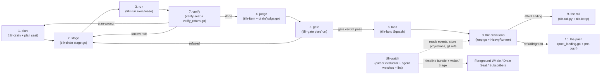
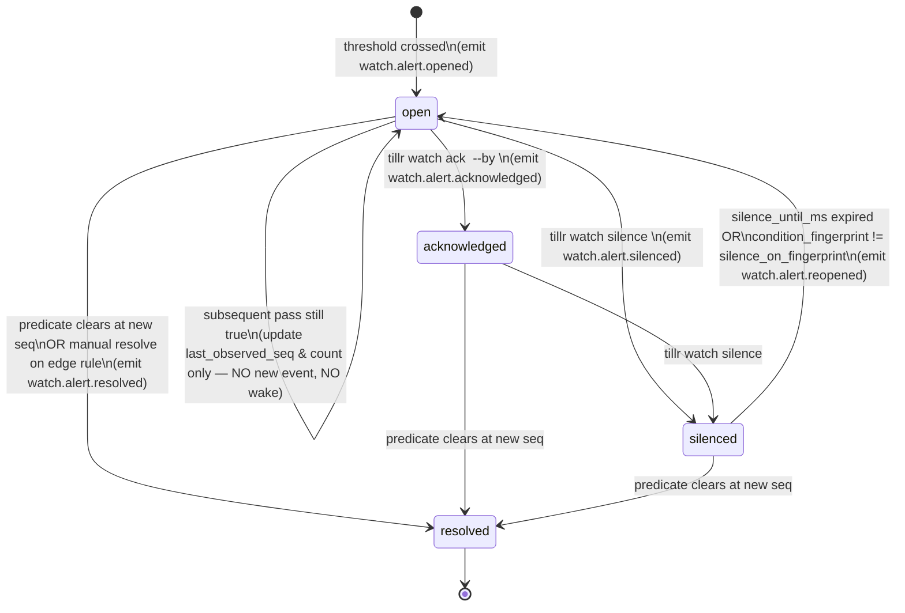

# Agent Alerting and Process Watchdog (`tillr-watch`)

**Status:** 2026-11-21 — the owner ruled all five questions on 2026-11-21 ([the Decision Ledger](#9-decision-ledger)); nothing is built. One piece of design is owed before a build: foreground delivery on the owner's existing background-watcher machinery ([OQ-TW3](#OQ-TW3)). Ten designer's decisions ([D-TW1](#D-TW1) through [D-TW10](#D-TW10)) await his review; D-TW7 is set aside by the ruling on [OQ-TW4](#OQ-TW4).

---

## 1. The Owner's Direction and What Runs by Hand Today

On 2026-11-20, reflecting on the single-entity state machine design (`item-request-b1d51332cd`, `docs/design/tillr-state-machines.md`), the owner stated the problem across two linked observations:

> "we have like this emergent design that is born out of the confluence of these multiple utilities that we're putting together. And nowhere is there any carefully thought out design or enforcement of things moving through that. And I suppose this may be a combination of tiller core stuff as well as The Charter can talk about the larger emergent behavior would be nice to have some sort of enforcement layer here, it can even be an entirely new tiller utility that's there as just like a watchdog for various things that can be interesting. Ultimately we're never going to get these things perfect and agents are going to be developing workflows here so, even if we have a week of tiller get landing working well the next tiller use may be different and agent needs to be able to debug this thing. both Git landing as well as whatever the new thing is they're making. So let's think real hard about what utility we could build to help enforce Lint, whatever setup, configure, think about the overall emergent process that is the confluence of these things working together."
>
> "The sort of thing I'm imagining is even if it can't be fully mechanical, if you could decide to find some sort of criteria like your looping request criteria or an item going back and forth between two states four times or who knows what, like a typical engineering alerting system where you have thresholds and guidance and you will constantly adjust these things, but the alerts go to either an agent in the drain system or to the foreground agent whale type of thing. but they should be able to be acted upon, watched on, and then easily acted upon without wasting lots of runs and stuff. So basically this is like an alerting system for agents or something."

Later on 2026-11-20, the owner clarified that the utility must serve two distinct agent needs — standing rules with optional mechanical answers inside `tillr`, and ad-hoc conditions a foreground agent registers for its own session:

> "there could be two ways to go here. One, we detect and then we have a mechanical answer within the Tiller system, but the other thing here is we can actually just be alerts that are meant to be read by an agent and not have some fixed process or even any intention of what to do with these. Like, this is you, the foreground session. you're like waiting for a condition to happen and it's hard for you to notice that and especially if you there's 10 conditions you care about persisting what those conditions are across sessions as well as noticing them efficiently is hard"

### 1.1 What exists today by hand

Today, cross-utility observation is manual polling. Every 15 minutes the foreground operator session exports the SQLite event stream (`tillr view events`), pipes it through three private ad-hoc scripts, and reads item and run timelines by hand to spot stalls, loops, silent rebuild failures, and orphaned leases. Between those 15-minute sweeps — or overnight and across foreground session handoffs — nobody watches the confluence:

- On 2026-11-20, an item bounced `plan -> design -> plan` **four times over 80 minutes** because its `allowed_paths` fence was too narrow, discovered only when the owner asked about it.
- On 2026-11-20, the post-landing binary rebuild (`tillr-roll`) failed **eight times in a row over 90 minutes** with a failure record naming no test, leaving **29 landed commits** un-deployed in the live `tillr-*` binaries.
- On 2026-11-20, trunk (`refs/heads/main`) stayed unproved (`refs/tillr/green` lagging behind) for **25 minutes and 7 landings** after a landed change broke another module's test (following an earlier overnight stall documented in [the 2026-11-19 unproved-trunk postmortem](../tillr/unproved-trunk-2026-11-19.md)).
- On 2026-11-20, **four items accumulated 18 to 62 attempts each** while each individual pass looked locally legal to the scheduler.

### 1.2 Terms used in this document

| Term | Meaning |
| :--- | :--- |
| **Standing rule** | A declarative, tunable threshold rule (`config/tillr/watch/*.toml` plus live store overrides) that continuously evaluates store events and projections, carrying structured `check`/`do` guidance, a target `receiver`. |
| **Agent watch** | A lightweight, ad-hoc condition registered in one command by an agent (`tillr watch add --when ... --note ...`) carrying a note to its future self and **no** prescribed workflow or fixed action, persisted in `.tillr/state.db` across session restarts and compactions. |
| **Alert episode** | One lifecycle instance (`open -> acknowledged -> silenced -> resolved`) keyed by `(rule_id, subject_key)`. While the condition remains true across arbitrarily many drain passes, the episode updates in place rather than opening a second alert. |
| **Condition fingerprint** | A deterministic digest of the specific evidence causing an episode (for example, the failing step + error signature on `tillr-roll`, or the colliding path outside `allowed_paths`). `--until-change` silences wake again only if this fingerprint changes. |
| **Timeline bundle** | A bounded (`<= 8 KiB`), read-only digest of the subject's recent state moves, runs, obstacles, verify/gate refusals, landings, and git/roll pointers attached directly to every delivered alert or fired watch so the receiver acts without running `tillr view events` or spawning an exploratory worker run. |
| **Charter** | The process-wide definition document ([`tools/tillr/definition/definition.go`](../../tools/tillr/definition/definition.go), such as [`landing.json`](../../tools/tillr/definition/landing.json) for `git-landing` or [`recorded-verdict/definition.json`](../../tools/tillr/examples/recorded-verdict/definition.json) for hook-completed workflows) governing item states, prerequisites, and completion semantics. |

---

## 2. The Whole Process Today and Where Nothing Owns the Hand-Off

Across the `tillr` suite, ten distinct steps move work from queue intake to deployed, pushed code: **`plan`**, **`stage`**, **`run`**, **`judge`**, **`gate`**, **`land`**, **`verify`**, **`the drain loop`**, **`the roll`**, and **`the push`**. Each utility enforces local invariants on its own inputs and outputs, yet no single component watches whether the hand-offs *between* them are converging.



### 2.1 Step-by-step ownership and unowned seams

Read at `HEAD` (`74106648b1f4`) on 2026-11-20:

| Step | Owning utility & code entrypoints | Records read & written | Where nothing owns the hand-off today |
| :--- | :--- | :--- | :--- |
| **1. `plan`** | **`tillr-drain`** ([`drain/plan.go`](../../tools/tillr-drain/drain/plan.go) `Plan()`, `planner.decide()`) for queue-level dispatch planning; **`plan` / `open` agent stages** in [`config/tillr/workflows/planned-build@v1.json`](../../config/tillr/workflows/planned-build@v1.json) and [`scouted-design@v1.json`](../../config/tillr/workflows/scouted-design@v1.json) for item decomposition (`graph.proposal`). | Reads `items`, `lane_leases`, `retries`, `item_faults`, `work_nodes`, `definition.Definition`, and `Policy`. Emits `drain.decision` (`record.Envelope`) with `run.Request` or `graph.proposal` (`drain.graph-changed`). | **Cross-seat bounce blindness:** When `plan` exits `OBSTACLE: definition` (`RESULT: blocked`), `drain/blocked.go` routes to `design`; when `design` finishes without widening `allowed_paths` (because the fence itself forbade editing the needed path or item metadata), `plan` runs again and hits the same wall. Each pass is locally valid; nothing notices the `plan <-> design` ping-pong. |
| **2. `stage`** | **`tillr-drain`** ([`drain/stage.go`](../../tools/tillr-drain/drain/stage.go) `LaneStager.Stage()`, `ensureWorktree()`, `ensureForkCheckout()`, `renderBriefWithEnding()`; [`drain/loop.go`](../../tools/tillr-drain/drain/loop.go) `stageDispatches()`). | Reads `items`, `allowed_paths`, `base_sha`, brief template. Writes `<LaneRoot>/<lane>/` (`worktree/`, `brief.md`, `fence.txt`, `base_sha`, `item_base_sha`, `item_fence.txt`, `session_id`, fork `target`). | **Fence & lane-rot seam:** `stage` stamps `fence.txt` faithfully from the item's `allowed_paths`, even when previous runs already proved that fence omits a required file. If per-item staging fails, `lane_rotation.go` (`drain.lane-refused`) rotates the lane out, and nobody correlates repeated staging or boundary refusals across runs. |
| **3. `run`** | **`tillr-run`** ([`tools/tillr-run/run/exec.go`](../../tools/tillr-run/run/exec.go) `Exec()`, [`lease.go`](../../tools/tillr-run/run/lease.go) `ReleaseLane()`); invoked by **`tillr-drain`** ([`drain/loop.go`](../../tools/tillr-drain/drain/loop.go) `runLane()`, `resumeAfterWall()`, and [`drain/failover.go`](../../tools/tillr-drain/drain/failover.go) `ClassifyAttempt()`). | Writes `runs` rows, `lane_leases` locks, `run.allocate`/`run.resume`/`run.progress` events, adapter transcripts, and commits in the lane worktree. | **Dead-process lease & instant-crash seam:** If `tillr-run exec` or its parent dies hard outside normal bracket close, `lane_leases` stays held by a non-live run until startup recovery (`end_unfinished_runs.go`) or manual `tillr run release`. Runs crashing in `< 5s` or failing over with backend failover suffixes (`drain.backend-outcome`) quietly burn capacity without alerting an operator. |
| **4. `judge`** | **`tillr-item`** ([`tools/tillr-item/judge.go`](../../tools/tillr-item/judge.go) `judgeFace()`, `judgeCommit()`) orchestrated by **`tillr-drain`** ([`drain/judge.go`](../../tools/tillr-drain/drain/judge.go) `judgeCandidate()`, `settleJudgeFailure()`, `recordLandedJudge()`). | Reads candidate commit, `JudgeOptions`, evaluator artifacts, and `gate.verdict`. Writes criterion verdicts (`done` / `not-done`), `drain.judge.request` / `drain.judge.landed` events, and `JudgeReceipt`. | **Pre-landing vs post-landing split:** `judgeCandidate()` evaluates criteria before `land`, while `recordLandedJudge()` commits final criterion state only after `land` succeeds. Repeated `not-done` returns whose reasons are empty or vague cycle back into build without surfacing degraded evaluator output. |
| **5. `gate`** | **`tillr-gate`** ([`tools/tillr-gate/change.go`](../../tools/tillr-gate/change.go), [`plan.go`](../../tools/tillr-gate/plan.go) `Plan()`, [`run.go`](../../tools/tillr-gate/run.go) `RunWith()`, [`gate.go`](../../tools/tillr-gate/gate.go) `RunGate()`). | Reads `base..head` diff, check manifests (`tools/gate/checks/`), and worktree blobs. Writes `gate.plan` and `gate.verdict` (bound to `(planID, treeSHA)`) plus check logs. | **Candidate-vs-trunk scope gap:** To keep landing latency low, `tillr-gate` runs change-scoped and fast checks on `(base_sha, head_tree)`, deferring cross-module heavy suites on the merged trunk tree to `HeavyRunner` *after* landing. And when `boundary.check` or `gate.verdict` refuses a candidate (`drain.refusal`), nothing aggregates recurring refusals across runs or items. |
| **6. `land`** | **`tillr-land`** ([`tools/tillr-land/land/landing.go`](../../tools/tillr-land/land/landing.go) `Land()`, [`land/trunk.go`](../../tools/tillr-land/land/trunk.go) `Trunk.Squash()`, `Trunk.LandLock()`, `Trunk.Move()`); called by **`tillr-drain`** (`landCandidate()`, `landWithActions()`). | Acquires `<git-common-dir>/land.lock`, verifies `gate.verdict`, squashes `base..head` onto `refs/heads/<trunk>`, writes `refs/tillr/landed/<runID>`, and inserts a `landings` row (`gated_tree`, `landed_tree`, `land.landing`). | **Multi-landing / unlanded-item drift:** Because design answers, doc updates, or reverted-and-retried commits can record `land.landing` rows referencing an item while the item's own build remains `in-queue`, `landings` can accumulate several commits for one item whose build still has not landed — invisible to `tillr-land`, which only checks one candidate at a time. |
| **7. `verify`** | **`tillr-drain`** ([`drain/verify_return.go`](../../tools/tillr-drain/drain/verify_return.go) `verifyBuildSession()`, `builderPlanWrong()`; [`drain/loop.go`](../../tools/tillr-drain/drain/loop.go) `Verify()`) running the **`verify` agent seat** in [`planned-build@v1.json`](../../config/tillr/workflows/planned-build@v1.json). | Reads joined piece diffs, producer outputs, and item criteria; pins candidate head (`pinCandidateHead()`) and writes `done` (`node:<id>`) or `not-done` (`uncovered:...` or `plan-wrong:...`). | **Unbounded `plan -> work -> verify -> plan` cycles:** `uncovered:` returns to `work`, while `plan-wrong:` returns all the way to `plan` to re-cut pieces. Each return works as designed for a single mistake, but nothing notices when an item completes multiple full `plan -> work -> verify` cycles without converging. |
| **8. `the drain loop`** | **`tillr-drain`** ([`drain/loop.go`](../../tools/tillr-drain/drain/loop.go) `Loop.Run()`, `settle()`; [`drain/heavy.go`](../../tools/tillr-drain/drain/heavy.go) `HeavyRunner.Run()`, `judgeTip()`, `attribute()`, `revert()`). | Coordinates `drain.pass` ticks, dispatches lanes, settles endings, and runs `HeavyRunner` asynchronously to advance `refs/tillr/green` or bisect and `drain.revert` offending commits. | **Trunk-ahead-of-green drift & zero-yield burn:** `Loop.Run()` purposefully keeps landing new commits onto `main` while `HeavyRunner` proves earlier trunk tips asynchronously. If `HeavyRunner` stalls (on a cleanup marker, lock, killed test shard, or cross-module breakage), landings pile up ahead of `refs/tillr/green` with nothing alerting until a human checks. Likewise, lanes can burn >3 worker-hours with zero landings while every individual tick succeeds. |
| **9. `the roll`** | **`tillr-roll`** ([`tools/tillr-roll/tillr-roll.py`](../../tools/tillr-roll/tillr-roll.py), [`tools/tillr-roll/tillr-keep`](../../tools/tillr-roll/tillr-keep)); triggered asynchronously by **`tillr-drain`** ([`drain/post_landing.go`](../../tools/tillr-drain/drain/post_landing.go) `submitPiRoll()`, [`drain/restart_rolling.go`](../../tools/tillr-drain/drain/restart_rolling.go) `rollingOwnership()`). | Reads `drain.build-started`, `refs/tillr/green`, and `landings`; builds the eight Go binaries (`MODULES`), updates `tillr-roll.commit`, handshakes `heavy.lock` for clean `tillr-keep` restart, or inserts `drain.roll-failed` (`record_failure()`). | **Fire-and-forget stale-binary gap:** `afterLandingCandidate()` submits `tillr-roll.py` asynchronously so landings never block on compilation. When `tillr-roll.py` fails, `record_failure()` appends `drain.roll-failed` (often with collapsed stderr naming no specific test) and exits; `tillr-drain` keeps running its **old** in-memory binary across 29 subsequent commits without pausing or raising an alarm. |
| **10. `the push`** | **`tillr-drain`** ([`drain/post_landing.go`](../../tools/tillr-drain/drain/post_landing.go) `pushGreen()`, `pushTrunk()`, `recordPush()`; [`drain/push_refused.go`](../../tools/tillr-drain/drain/push_refused.go) `healRefusedPush()`) plus **[`hooks/pre-push`](../../hooks/pre-push)** (`bin/patch-branches-publish`). | Reads `refs/tillr/green` (or `TrunkRef`), `yolo-packs/*/pack.json` `patch_branch` locators, and remote refs; runs non-forcing `git push` and logs `drain.post-landing-action`. | **Downstream starvation & unhealed refusals:** Because `pushGreen()` only publishes commits proved by `refs/tillr/green`, any stall in Step 8 silently freezes remote publication too; and if `hooks/pre-push` or a diverged remote refuses the push beyond what `healRefusedPush()` can repair, local commits diverge silently from the remote. |

### 2.2 Why every failure above escaped local error handling

Every utility in the table above behaved **within its local specification** during the 2026-11-20 incidents:

1. **Asynchronous decoupling hides lag.** Decoupling `HeavyRunner` (Step 8), `tillr-roll` (Step 9), and `pushGreen` (Step 10) from synchronous `land` (Step 6) is what lets `tillr-land` finish in milliseconds instead of minutes. The price of asynchronous decoupling is that **lag and repeated background failure are invisible to the synchronous caller**.
2. **Valid local retries compose into invalid global loops.** Returning `OBSTACLE: definition` from `plan` to `design`, or `plan-wrong:` from `verify` to `plan`, is the exact recovery move `planned-build@v1` was built to make. The defect only appears in the **trajectory** (`plan -> design -> plan -> design` four times on an unchanging `allowed_paths` fence).
3. **Silent degradation in metadata starves diagnosis.** When `tillr-roll.py` writes `drain.roll-failed` whose `detail` names no failing test, or a refusal/hold record carries an empty `reason`, downstream tools and operators lose the literal cause required by [failure diagnosed, not waited out](./failure-diagnosed-not-waited-out.md#31-the-four-tests) (`T1`).

---

## 3. Relation to State Machines, Existing Monitors, and the No-Cap Ruling

### 3.1 Prevention vs. detection: relation to `docs/design/tillr-state-machines.md`

`docs/design/tillr-state-machines.md` (`item-request-b1d51332cd`) and `tillr-watch` form complementary halves of process governance — **synchronous single-move prevention** versus **asynchronous multi-move detection**:

| Dimension | State machines (`docs/design/tillr-state-machines.md`) | Process watchdog & alerting (`tillr-watch`) |
| :--- | :--- | :--- |
| **Question answered** | *"Is this single state transition legal right now?"* | *"Is this sequence of legal transitions, elapsed silence, or cross-utility lag healthy?"* |
| **Where it runs** | Synchronously inside the mutating transaction (`store`, `item`, `run`, `land`, `drain`). | Asynchronously over the committed `events` cursor, store read projections, and git refs (plus statically at `lint` time). |
| **What happens when triggered** | **Refuses the write** before commit; the illegal state cannot exist in `.tillr/state.db`. | **Opens or updates one alert episode** (or fires an agent watch) with a timeline bundle, guidance; **never** rolls back or fails an item. |
| **2026-11-20 example** | Forbidding an item transition `in-queue -> landed` without a matching `land.landing` receipt or criterion verdict; forbidding two live runs from holding the same `lane_leases` row. | Catching `plan -> design -> plan` 4 times over 80m; catching `refs/tillr/green` lagging 7 landings / 25m behind `main`; catching 8 consecutive `drain.roll-failed` events leaving 29 commits un-rolled. |

**Boundary rule (`D-TW2`):** Neither layer may impersonate the other. If a condition is universally illegal at a single transition boundary (for example, writing a refusal record with an empty `reason` once the writer schema forbids it), it should become a synchronous refusal in `docs/design/tillr-state-machines.md`, keeping the corresponding `tillr-watch` rule (`empty-reason-record`) only as a defense-in-depth canary for raw external writers like Python scripts. Conversely, state machines must **never** grow numeric transition counters ("refuse `plan -> design` on the 4th transition"), because turning a count into a hard state-machine refusal violates the owner's standing no-cap ruling below.

### 3.2 Standing ruling: an alert never fails, benches, or caps work (`D-TW2`)

Four settled repository rulings forbid failing or stopping work on attempt counts, retry budgets, or wall timers:

1. **[Run-wall ruling (`D-RW1`–`D-RW4`)](./run-wall-ruling.md#1-should-the-wall-exist-at-all):** Removed default 1800-second run walls; a wall-clock duration is a resource signal, never a fault verdict, and committed candidates are always judged before wall status.
2. **[Failure diagnosed, not waited out](./failure-diagnosed-not-waited-out.md#34-admission-restated):** Eliminated the 30-minute cooldown, numeric retry budget, and `retry-exhausted` bench. Re-admission is governed by literal cause and input change ([Section 3.1](./failure-diagnosed-not-waited-out.md#31-the-four-tests)), never by counting failures.
3. **[Landing principles §5](./landing-principles.md#5-only-verdicts-charge) and [§6](./landing-principles.md#6-a-budget-escalates-it-does-not-loop):** Only verdicts charge, and repetition escalates to diagnosis rather than failing the item.
4. **[Judge and lifecycle (`D-JL9` and `D-JL10`)](./tillr-judge-and-lifecycle.md#44-how-a-worker-runs-ending-moves-its-item-d-jl10):** Worker endings and design runs are **never counted** to fail or bench an item; identical endings escalate to `design`, and only objections naming the owner hold for the owner.

`tillr-watch` obeys this ruling as an inviolable architectural constraint (**[D-TW2](#D-TW2)**):

- **Alerts notify; they never fail, close, cancel, or hold an item.** `tillr-watch` holds no capability to transition an item into `blocked`, `closed`, or any terminal failure state when a count (`>= 4` oscillations, `>= 8` attempts, `> 1` plan-verify cycle) or duration (`> 3` worker-hours, `> 25m` green lag) crosses a threshold.
- **How this handles the 18-to-62-attempt items from 2026-11-20:** Under a naive retry cap, an item at attempt 8 would have been benched as `retry-exhausted`, stranding legitimate complex items alongside stuck ones. Under `tillr-watch`, crossing `>= 8` attempts (`high-attempt-diagnostic`) leaves the item's execution untouched while delivering one deduplicated alert + compact timeline to the foreground whale (or one read-only diagnostic scout), making the trajectory visible in minutes instead of letting four items silently reach 18 to 62 attempts unnoticed.
- **Enforced statically in `tillr watch lint`:** Any rule file that declares a remedy of any kind is rejected ([OQ-TW2](#OQ-TW2)) at `lint` and load time (`watch-lint-forbidden-remedy`).

### 3.3 Relation to One-Breakage Dedup, Steering Timers, and Goal Monitors

- **Generalizes [the retired agent runtime design Section 20 ("One breakage, one investigation")](./agent-runtime-retirement.md#what-happened-to-each-section):** `D-OC1`–`D-OC8` established mechanical signature deduplication, transition-driven invocation, and the `D-OC5` precondition (*never dispatch a second investigation while an open breakage already has a non-terminal attempt*). `tillr-watch` lifts that exact episode discipline from gate check breakages to **all** cross-utility rules (`D-TW5`, `D-TW7`).
- **Replaces time-polling in [`steering-timer`](../reference/steering-timer.md) when waiting on state:** `steering-timer.ts` ([`handoff-items-and-steering-timer.md` Section 4.2](./handoff-items-and-steering-timer.md#42-the-mechanism-a-pi-extension-owning-a-durable-steering-record)) injects periodic clock-based check-ins (`every N minutes`) so a foreground whale keeps nudging a long goal. When an agent is instead waiting on *specific store/git conditions* ("tell me when `refs/tillr/green` catches up, or when `item-X` reaches `verify`, or if `tillr-roll` fails"), waking every 10 minutes on a timer wastes turns when nothing happened and lags up to 10 minutes when it did. `tillr-watch` provides **event-driven, zero-polling wakeups** using the same durable-record + `pi.sendMessage(..., { deliverAs: "followUp", triggerTurn: true })` harness primitive (`D-TW8`).
- **Complements [`tillr-goal-monitor.md`](./tillr-goal-monitor.md):** The iceboxed goal monitor evaluates high-level prose roadmap goals on a scheduled `due_at` cadence via an LLM node. `tillr-watch` is a **0-LLM-token mechanical evaluator** running continuously on event commits, invoking an agent *only* when a declared threshold or agent watch actually fires.

---

## 4. Utility Boundary and the Three-Layer Split: Core, Workflow, Charter

### 4.1 New utility (`tillr-watch`) vs. face of an existing utility ([D-TW1](#D-TW1), [OQ-TW1](#OQ-TW1))

The suite today splits responsibilities along sharp UNIX boundaries dispatched by [`tools/tillr-cli/main.go`](../../tools/tillr-cli/main.go): `store`, `item`, `run`, `gate`, `land`, `drain`, and `view` (plus read-only `tillr-trace` and supervisor scripts `tillr-roll` / `tillr-keep`).

Putting alerting and cross-system linting inside an existing binary has two structural flaws:

1. **A watchdog inside `tillr-drain` dies or stalls with the process it watches.** On 2026-11-19/2026-11-20, `tillr-drain` suffered 1-tick post-midnight crashes ([`unproved-trunk-2026-11-19.md`](../tillr/unproved-trunk-2026-11-19.md#verified-timeline)), ran 29 commits behind trunk while `tillr-roll` failed, and can be paused or stopped while foreground agents are still waiting on `item` or `store` events. A watchdog must stay alive and trustworthy when `tillr-drain` is wedged, restarting, or running stale code.
2. **`tillr-view` carries the Observatory HTTP/WebSocket server and embedded web bundle, while static linting belongs in CI/gate and headless agent shells.** Tying `watch` and `lint` to `tillr-view` couples headless rule evaluation and pre-flight linting to the UI server, whereas splitting `watch` into `tillr-view` and `lint` into `tillr-drain` scatters one rule schema across two binaries.

**Design choice ([D-TW1](#D-TW1), subject to owner confirmation in [OQ-TW1](#OQ-TW1)):** Build **`tools/tillr-watch`** (`tillr-watch`, registered as `"watch"` in `tools/tillr-cli/main.go` `nouns` and `tools/tillr-roll/tillr-roll.py` `MODULES` so `tillr watch <face>` works identically to `tillr gate` and `tillr view`), backed by a pure shared library package **`tools/tillr/watch`** that registers the watch SQLite DDL (`store.RegisterDDL`) and event kinds (`event.Register`) at `init()` time.

`tillr watch` exposes four cohesive command groups:

```text
# 1. Continuous or one-shot rule evaluation & status
tillr watch status [--json]                     # active alert episodes + armed agent watches
tillr watch eval [--once]                       # advance cursor once, update episodes, exit 0
tillr watch daemon                              # zero-polling follower supervised beside tillr-keep

# 2. Alert episode actions & live rule tuning (Mode A)
tillr watch ack <alert-id> --by <actor> [--note <text>]
tillr watch silence <alert-id> (--until <dur|ts> | --until-change) [--reason <text>]
tillr watch resolve <alert-id> --reason <text>
tillr watch rule list | show <id> | add <file> | tune <id> [--threshold ...] [--receiver ...] | export

# 3. Persistent foreground agent watches (Mode B — one command, no prescribed action)
tillr watch add --when <expr> --note <text> [--owner <id>] [--once | --recurring]
tillr watch list [--owner <id>] [--all]
tillr watch edit <watch-id> [--when <expr>] [--note <text>]
tillr watch drop <watch-id>
tillr watch wait [--owner <id>] [--timeout <dur>]  # blocks at 0% CPU until a watch/alert fires

# 4. External pub/sub & pre-flight configuration verification
tillr watch subscribe [--since-seq <n>] [--consumer <id>] [--kind alert|watch|all] [--receiver <r>]
tillr watch lint [<repo-or-dir>] [--charter <path>] [--workflows <dir>] [--rules <dir>]
```

### 4.2 What belongs in `tillr` core, in a workflow definition, and in the charter ([D-TW3](#D-TW3))

To support both `git-landing` today and arbitrary agent-authored workflows tomorrow (`recorded-verdict`, `AutoQA`, benchmark harnesses, synthesis pipelines), responsibilities divide cleanly across three layers:

| Layer | Where it lives | What belongs here (and nowhere else) | What must NOT leak into this layer |
| :--- | :--- | :--- | :--- |
| **1. `tillr` Core** | `tools/tillr/watch/`, `tools/tillr/store/`, `tools/tillr/event/`, `config/tillr/watch/core.toml` | - Incremental `events.seq` cursor engine & zero-polling `inotify` wakeup (`watch.wakeup` / WAL).<br>- `alert_episodes`, `agent_watches`, `watch_rule_overrides`, and `watch_consumers` SQLite tables.<br>- Generic predicate primitives (`count_in_window`, `consecutive_count`, `alternating_pair`, `lag_behind`, `duration_without_event`, `predicate_match`).<br>- `TimelineBundle` builder & NDJSON `subscribe` stream.<br>- `tillr watch lint` cross-artifact engine.<br>- **Core infrastructure rules** true of *every* `tillr` store: `< 5s` run crashes, failover suffixes, dead-PID lane leases, `SQLITE_BUSY` lock refusals, empty-reason records, operator holds, high-attempt diagnostics. | No hardcoded stage names (`"plan"`, `"verify"`), no Git ref names (`refs/tillr/green`), and no assumptions about `tillr-roll` or `git push`. |
| **2. Workflow Definition** | `config/tillr/workflows/*.json` (plus optional `watch` block per workflow) | - Stage graph topology (`stages`, `edges`, `exit`, `may_replace`, `outputs`/`inputs`, `seat`, `access`, `write_scope`).<br>- Optional declarative **`watch` metadata** on the workflow JSON: expected return pairs (`oscillation_pairs: [["plan", "design"], ["work", "verify"]]`), expected cycle bounds (`max_plan_verify_cycles: 1`), and stage-specific `guidance` hints telling receivers which stage output or fence caused a bounce. | No global trunk/git assumptions and no item state-machine definitions (`in-queue`, `landed`, `confirmed`). |
| **3. Charter Document** | `tools/tillr/definition/*.json` (e.g. `landing.json`, `recorded-verdict/definition.json`) + charter rule pack (`config/tillr/watch/charters/<name>.toml`) | - Whole-process item lifecycle (`states`, `ready`, `blocked`, `closed`, `finished`, `transitions`, `prerequisites`, `completes`: `"landing"` vs `"hook"`, `hooks`).<br>- **Charter observability bindings** (`observability` block on `Definition`): what event marks real forward throughput (`terminal_progress_kind`: `"land.landing"` vs `"item.verdict"`), plus charter-owned health invariants (`git-landing`: `refs/tillr/green` lag, `tillr-roll` rebuild parity, `git push` liveness, multiple landings on unlanded items; `recorded-verdict`: `complete-item` hook error rate). | No per-workflow stage topology (`planned-build` vs `scout-then-build` vs `doc-triage` can all run under the same charter). |

Concretely, a workflow JSON may carry an optional, backward-compatible `watch` object (validated by both `tillr drain workflow check` and `tillr watch lint`):

```json
{
  "name": "planned-build",
  "version": 1,
  "stages": ["..."],
  "edges": ["..."],
  "exit": { "requires_nodes": ["plan", "work", "verify"], "requires_candidate": "commit_required", "evaluator_slot": "verify" },
  "watch": {
    "cycle_anchor": { "from": "verify", "to": "plan", "max_cycles": 1 },
    "oscillation_pairs": [
      { "a": "plan", "b": "design", "threshold": 4, "hint": "Check whether item allowed_paths omits a path plan/work needs, or whether an open design question lacks a ruling." }
    ]
  }
}
```

And a charter `definition.json` declares its process-level progress signal in two optional lines:

```json
{
  "definition": "git-landing",
  "completes": "landing",
  "observability": {
    "progress_event": "land.landing",
    "rule_pack": "charters/git-landing.toml"
  }
}
```

---

## 5. Alert Rules as Tunable Data and the Starting Rule Catalog

### 5.1 Declarative rule schema ([D-TW4](#D-TW4), [OQ-TW5](#OQ-TW5))

An operator or foreground agent can add, threshold-tune, re-route, or silence any standing rule **without touching Go code or recompiling `tillr-watch`**. Rules are plain TOML documents loaded from three merged scopes in precedence order:

1. **Charter & workflow defaults:** `config/tillr/watch/core.toml`, `config/tillr/watch/charters/<definition>.toml`, and workflow `watch` blocks.
2. **Repository rule files:** `config/tillr/watch/rules.d/*.toml`.
3. **Live store overrides ([OQ-TW5](#OQ-TW5)):** `watch_rule_overrides` in `.tillr/state.db`, written via `tillr watch rule tune` so an agent adjusting a noisy threshold mid-incident does not dirty tracked files in the main checkout (which would cause `tillr-roll.py` to refuse post-landing rebuilds, as occurred on 2026-11-19). `tillr watch rule export` materializes live overrides back into TOML when ready to commit.

Every standing rule has five explicit data sections — **identity/scope**, **`reads`**, **`when` (subject + threshold)**, **`guidance` (`check` + `do`)**, and **delivery (`receiver`)**:

```toml
[[rule]]
id = "step-oscillation"
enabled = true
scope = "core"                                  # "core" | "charter:<name>" | "workflow:<name>"
severity = "warning"                            # "info" | "warning" | "high"

[rule.reads]
events = ["drain.decision", "drain.node-advanced", "drain.refusal", "boundary.check"]
projections = ["items", "work_nodes"]

[rule.when]
group_by = "item_id"                            # one episode per item
pattern = "alternating_pair"                    # A -> B -> A -> B ...
field = "seat"
pairs = [["plan", "design"], ["work", "verify"]] # extended automatically by workflow.watch.oscillation_pairs
threshold = 4                                   # 4 transitions between the pair (e.g. plan->design->plan->design)
window = "4h"
clear_when = "seat not in pair or item.state in charter.finished"

[rule.guidance]
summary = "Item {{subject}} bounced between {{pair_a}} and {{pair_b}} {{count}} times over {{elapsed}}."
check = [
  "Inspect the attached TimelineBundle obstacles and boundary.check / OBSTACLE: fence or OBSTACLE: definition lines.",
  "Compare the paths named in the planner/builder obstacle against the item's allowed_paths fence.",
  "Check whether the designer updated a design doc without widening the item's fence (which design runs cannot edit unless fenced)."
]
do = [
  "If allowed_paths is too narrow, widen the item fence (`tillr item update {{subject}} --add-path <path>`) or split a prerequisite item.",
  "If a design decision needs the owner, hold with the exact owner question rather than re-dispatching plan.",
  "Acknowledge this alert (`tillr watch ack {{alert_id}} --by <you>`) while acting."
]

[rule.delivery]
receiver = "foreground"                         # "foreground" | "subscribers"
also_notify = ["subscribers"]
```

A second example shows a `charter:git-landing` rule reading both store events and Git ref projections:

```toml
[[rule]]
id = "unproved-trunk-lag"
enabled = true
scope = "charter:git-landing"
severity = "high"

[rule.reads]
events = ["land.landing", "drain.revert", "drain.fixer-proved"]
projections = ["git_refs:refs/heads/main,refs/tillr/green", "heavy_lock_state"]

[rule.when]
group_by = "global"
pattern = "lag_behind"
leader = "git.ref('refs/heads/main')"
follower = "git.ref('refs/tillr/green')"
threshold_commits = 3                           # >= 3 unproved landings ahead of green
threshold_duration = "15m"                      # OR >= 15m with >= 1 unproved commit
mode = "any"                                    # fires when either threshold crosses
clear_when = "unproved_commits == 0"

[rule.guidance]
summary = "refs/tillr/green lags main by {{unproved_commits}} landings ({{oldest_unproved_age}} elapsed; green={{follower_short}}, main={{leader_short}})."
check = [
  "Check HeavyRunner status in the attached bundle: is .git/tillr-gate/heavy.cleanup-pending present, is heavy.lock held by a dead PID, or did a proof shard die on SIGTERM?",
  "Inspect the newest failing proof log or active fixer-main-* item in the bundle."
]
do = [
  "If heavy.cleanup-pending or a stale lock is blocking HeavyRunner with no live holder, clear the stale marker.",
  "If a cross-module test is red without an active fixer-main item, verify bisection/revert progress or dispatch targeted repair."
]

[rule.delivery]
receiver = "foreground"
```

**No arbitrary code execution in rules (`D-TW4`):** Predicates use a small, total, typed expression grammar over registered event payloads and store read-views (`==`, `!=`, `<`, `<=`, `>`, `>=`, `in`, `contains`, `matches`, `empty()`, `age()`, plus the six stateful window aggregators `predicate_match`, `count_in_window`, `consecutive_count`, `alternating_pair`, `lag_behind`, `duration_without_event`). Because rules are pure data with no shell or Turing-complete script execution, agents can create and edit rules safely, and `tillr watch lint` can statically type-check every field reference before the rule runs.

### 5.2 The 16 starting rules and the 2026-11-20 cases they catch

The catalog ships **all 15 rules** from the operator's manual script list plus **1 diagnostic milestone rule** (`high-attempt-diagnostic`) directly addressing the fourth 2026-11-20 test case (`18 to 62 attempts` without capping work):

| # | Rule ID & scope | Reads (events / projections) | Default threshold & subject | Receiver | Guidance (`check` -> `do`) | 2026-11-20 case caught & time before a person noticed |
| :--- | :--- | :--- | :--- | :--- | :--- | :--- |
| **1** | **`verify-refusal`**<br>`workflow:*` | `events`: `drain.node-advanced`, `drain.refusal`, `item_criteria` (`not-done` from `verify` seat) | `>= 1` verify refusal (`uncovered:` or `plan-wrong:`) per `(item_id, candidate_sha)` | `foreground` (or `subscribers`; builder already gets inline return) | **Check:** Read the attached `verify` criterion findings (`uncovered:` vs `plan-wrong:`).<br>**Do:** Verify whether `work` missed a criterion or `plan` cut narrow piece `write_scope`s; watch if a second refusal follows. | Verify refusals (`uncovered:` / `plan-wrong:`) routing items back into `work`/`plan` on 2026-11-20; previously invisible until the **up-to-15-minute** manual `tillr view events` script sweep (or longer when cascading into multi-attempt loops). |
| **2** | **`plan-verify-cycles`**<br>`workflow:*` | `events`: `drain.node-advanced`, `drain.graph-changed` (`verify -> plan` returns) | `> 1` full `plan -> ... -> verify` cycle (`>= 2` verify-to-plan cycles) per `item_id` | `foreground` | **Check:** Compare `graph.proposal` piece lists across cycle 1 and cycle 2 and read the `plan-wrong:` evidence.<br>**Do:** Fix ambiguous item criteria/design doc or widen piece scopes so `plan` stops re-proposing an unworkable split. | Multi-cycle `planned-build` items on 2026-11-20 that looped `plan -> work -> verify -> plan` repeatedly on the road to **18–62 attempts**, running **hours** before human timeline review (**>= 15m** per manual sweep). |
| **3** | **`worker-hours-without-completion`**<br>`charter:*` | `projections`: `runs` cumulative `duration_ms`; `events`: charter `progress_event` (`land.landing` or `item.verdict`) | `> 3` cumulative worker-hours across active lanes with `0` charter completions (`global`) | `foreground` | **Check:** Inspect top worker-hour consumers in bundle (slot-wait starvation, red trunk blocking landings, or looping items).<br>**Do:** Unblock the shared bottleneck (shard slot contention, gate stall, or broken trunk) burning fleet compute without throughput. | 2026-11-20 slot-contention & stall window where workers burned **> 3 worker-hours** (one `fixer-main` run alone spent **43 of 47m** waiting on test slots) with nothing landing; noticed only after **> 3 worker-hours** + **15m** script lag. |
| **4** | **`short-run-under-5s`**<br>`core` | `events`: `run.record` (`state == "exited"`, `ended_at - started_at < 5000ms`) | `>= 1` run `< 5s` (escalates to `high` at `>= 3` in `15m`) per `backend` / `item_id` | `foreground` | **Check:** Read adapter `exit_code`, stderr tail, and preflight failure in bundle (missing binary, bad CLI flag, expired auth token, broken worktree).<br>**Do:** Fix the broken adapter/auth/staging input before fast crashes spin through the queue. | Instant adapter/staging exits on 2026-11-20 and the four post-midnight `< 5s` 1-tick crashes in [`unproved-trunk-2026-11-19.md`](../tillr/unproved-trunk-2026-11-19.md#verified-timeline); went **15 minutes** on daytime script sweeps and **hours** overnight before a person noticed. |
| **5** | **`run-failover-suffix`**<br>`core` | `events`: `run.allocate`, `drain.backend-outcome` (run ID matching failover suffix or `ClassifyAttempt == AttemptInfrastructure`) | `>= 1` failover-suffixed run (or `>= 3` in `30m` fleet-wide) per `backend` | `foreground` | **Check:** Inspect primary backend quota/rate-limit window (`backend_quota`, `backend_window`) and HTTP/CLI error in bundle.<br>**Do:** Verify fallback model quality/cost for the seat (`tillr-seat-profiles`) or refresh degraded provider credentials. | Primary backend quota/infrastructure failovers on 2026-11-20 shifting runs onto failover-suffixed IDs; noticed up to **15 minutes** later on the manual `tillr view events` pass. |
| **6** | **`outside-allowed-paths-refusal`**<br>`core` | `events`: `boundary.check` (fail), `drain.refusal` (fence violation), or run ending `OBSTACLE: fence` | `>= 1` out-of-fence refusal or `OBSTACLE: fence` per `item_id` | `foreground` | **Check:** Read the exact forbidden path(s) attempted (`PATHS:` or `boundary.check` diff) vs `item_fence.txt` (e.g. forgotten `just pack-sync` mirror vs genuinely narrow item fence).<br>**Do:** Widen `allowed_paths` on the item or split a prerequisite item for the outside path. | Out-of-fence refusals on 2026-11-20, directly underlying the narrow-fence item that cycled for **80 minutes** before the owner asked (and up to **15 minutes** on ordinary script sweeps). |
| **7** | **`gate-refusal`**<br>`charter:git-landing` | `events`: `gate.verdict` (`pass == false`), `drain.refusal` (`stage == "gate"`) | `>= 2` consecutive gate refusals on one `item_id` (or `>= 1` on a `design` / `fixer` seat; tunable to `>= 1` globally) | `foreground` (single refusal already returns to warm worker session) | **Check:** Read named failing check IDs (`pack-sync`, `documents`, `citations`, or Go suite `FailingCase`) in the bundle.<br>**Do:** Confirm whether failure is candidate-caused (warm session fixing) or an unrecorded base trunk regression (`OBSTACLE: trunk`). | Repeated `gate.verdict` refusals on 2026-11-20 (including `pack-sync` and cross-module breaks); operator visibility lagged up to **15 minutes** per manual `tillr view events` sweep. |
| **8** | **`operator-hold`**<br>`core` | `events`: `drain.obstacle-hold` (`kind == "owner"`), `questions` (`answered_at IS NULL`), `holdrules` `"needs you"` | `>= 1` active hold naming the operator per `item_id` | `foreground` | **Check:** Read the exact `QUESTION:` and options extracted in the bundle (plus any design doc `OQ-*` anchor).<br>**Do:** Present the question concisely to the owner (or answer from an existing dated owner ruling per [`OQ-PR22`](../tillr/decision-provenance-review.md#OQ-PR22)), then record the answer to unblock. | Items entering `OBSTACLE: owner` / `"needs you"` holds on 2026-11-20 sat waiting silently until the next **15-minute** manual script check (or until the operator manually ran `tillr view waiting`). |
| **9** | **`unproved-trunk-lag`**<br>`charter:git-landing` | `events`: `land.landing`, `drain.revert`; `projections`: `refs/heads/main` vs `refs/tillr/green`, `heavy.cleanup-pending` | `>= 3` unproved landings ahead of `refs/tillr/green` OR `>= 1` unproved landing for `>= 15m` (`global`) | `foreground` | **Check:** Check `HeavyRunner` state, `heavy.cleanup-pending`, shard slot contention, or killed proof subtrees (`SIGTERM`), and inspect failing cross-module test.<br>**Do:** Unblock `HeavyRunner` or verify bisection/auto-revert (`drain.revert`) and `fixer-main` progress. | **2026-11-20 headline case:** Trunk stayed unproved for **25 minutes and 7 landings** after a change broke another module's test (and **8 hours** when worker `pkill -f go-test-shards` killed proof suites / overnight in `unproved-trunk-2026-11-19.md`). Caught at **landing #3 (~10m)** or **15m**. |
| **10** | **`post-landing-roll-failing`**<br>`charter:git-landing` | `events`: `drain.roll-failed`, `drain.build-started`, `land.landing`; `projections`: `tillr-roll.commit` vs `main` (`tools/tillr*` commits) | `>= 2` consecutive `drain.roll-failed` events OR `>= 5` `tools/tillr*` commits un-rolled for `> 15m` (`global`) | `foreground` | **Check:** Read `drain.roll-failed` `step` and `detail`, check `git status` on main checkout for dirty files refusing roll, and check live binary digest vs `tillr-roll.commit`.<br>**Do:** Fix the failing build/test or clean the dirty checkout, then run/trigger `tillr-roll` so live binaries catch up to `main`. | **2026-11-20 headline case:** `tillr-roll` failed **8 times in a row over 90 minutes**, leaving **29 landed commits** not running in live binaries before anyone noticed. Caught on **failure #2 (~20m)** while `<= 4` commits behind. |
| **11** | **`step-oscillation`**<br>`core` + `workflow:*` | `events`: `drain.decision`, `drain.node-advanced` | `>= 4` transitions (`A -> B -> A -> B`) between the same two seats/stages (e.g. `plan <-> design`) per `item_id` within `4h` | `foreground` | **Check:** Diff item `allowed_paths`, criteria, and design ledger across the 4 transitions in the bundle — what input failed to change between bounces?<br>**Do:** Widen `allowed_paths` (`tillr item update`), split an upstream item, or escalate to `owner` if fence/scope policy requires a ruling. | **2026-11-20 headline case:** An item went `plan -> design -> plan` **4 times over 80 minutes** because its `allowed_paths` were too narrow, found **only when the owner asked at 80m**. Caught immediately upon the 4th transition (and even earlier if paired with rule #6). |
| **12** | **`multiple-landings-build-unlanded`**<br>`charter:git-landing` | `projections`: `landings` (`result == 'landed'`) joined with `items` (`state NOT IN finished`) | `>= 2` recorded `landings` rows for one `item_id` while `item.state` is still non-terminal | `foreground` | **Check:** List the landed commits for `item_id` in the bundle (design amendments, reverts + retries, or partial commits that failed to advance item state).<br>**Do:** Verify why `recordLandedJudge` / item completion did not settle the item, or whether repeated trunk reverts (`drain.revert`) are undoing its landings. | 2026-11-20 items accumulating multiple `landings` rows (design/prep commits or reverted landings) while the item's build remained unlanded in queue; previously noticed only during manual timeline audits (**15m to hours**). |
| **13** | **`dead-run-holding-lane`**<br>`core` | `projections`: `lane_leases` joined with `runs` and OS process / run-bracket liveness (`kill(pid, 0)` + `runs.state`) | `>= 1` `lane_leases` row whose `run_id` is terminal in `runs` or whose local executor PID is dead for `> 30s` per `lane` | `foreground` | **Check:** Confirm `run_id` has exited (`runs.state` / PID gone) and inspect worktree cleanliness on `<lane>`.<br>**Do:** Release the orphaned lease (`tillr run release <lane>`) so the planner stops starving on a phantom busy lane. | Orphaned `lane_leases` rows on 2026-11-20 after abrupt worker/harness deaths starved lane capacity silently until the **15-minute** manual operator sweep noticed a lane stuck with no live process. |
| **14** | **`store-write-locked`**<br>`core` | `events` / sidecar telemetry: `watch.DiagLockRefused` / `SQLITE_BUSY` errors logged in `.tillr/loop/` or stderr streams | `>= 1` `SQLITE_BUSY` / `"database is locked"` write refusal (`global`, `10m` window) | `foreground` | **Check:** Identify which process bypassed `store.Open` `writeQueue` or held a long transaction on `.tillr/state.db` (e.g. raw `sqlite3` CLI or Python helper without `timeout` / read-only URI).<br>**Do:** Move reader to `?mode=ro` URI and route writes through `tillr store` / `busy_timeout` serialized transactions. | Store lock refusals on 2026-11-20 when external scripts/helpers contended with `.tillr/state.db` WAL writers, dropping best-effort records silently until manual log inspection (**15m+** lag). |
| **15** | **`empty-reason-record`**<br>`core` | `events`: `drain.refusal`, `drain.obstacle-hold`, `drain.roll-failed`, `gate.verdict`, `item.rejection`, `item_criteria` (`not-done`) | `>= 1` failure/hold/refusal record whose `reason` / `detail` is empty or omits a check/test identifier (`global` / `event_seq`) | `foreground` | **Check:** Inspect the raw event `seq` and producer binary/script named in the bundle (`tillr-roll.py`, judge, gate check, or obstacle parser).<br>**Do:** Inspect the underlying raw log immediately so the hidden failure is not missed, and file a defect item against the producer emitting blank reasons. | **2026-11-20 headline case:** `tillr-roll` failed 8 times over **90 minutes** with a record naming **no failing test**, hiding 29 un-rebuilt commits for **90 minutes** before human discovery. Caught on **failure #1 (~11m)**. |
| **16** | **`high-attempt-diagnostic`**<br>`core` | `projections`: `runs` / `drain.decision` attempt count per `item_id` (`item.state NOT IN finished`) | `>= 8` attempts on one `item_id` (re-notifies every `+8` if silenced; **never** caps or holds per [D-TW2](#D-TW2)) | `foreground` | **Check:** Read the compressed attempt history in the bundle (are attempts failing on distinct real sub-problems, slot/infra churn, or subtle non-identical repeats escaping `repeatedEnding`?).<br>**Do:** Let healthy multi-step progress run; if churning on an unstated obstacle or bad fence, intervene on the root cause. | **2026-11-20 headline case:** **Four items reached 18 to 62 attempts each** before human inspection. Caught at **attempt 8** (saving 10 to 54 uninspected attempts per item) while strictly honoring the no-cap ruling. |

### 5.3 Replay against the four 2026-11-20 benchmark incidents

Testing the catalog above against the four concrete 2026-11-20 failures from the request confirms both detection latency and run-spend discipline:

1. **Planner <-> designer 4x over 80 minutes (narrow `allowed_paths`):**
   - *What happened:* `plan` saw it needed a path outside `allowed_paths`, reported `OBSTACLE: definition`, `design` ran and returned without changing the item's `allowed_paths`, and the cycle repeated 4 times over 80 minutes until the owner asked.
   - *With `tillr-watch`:* Rule #6 (`outside-allowed-paths-refusal`) fires on the first fence collision (~15–20m), and Rule #11 (`step-oscillation`) fires deterministically on the 4th transition (`plan -> design -> plan -> design`), attaching the item's `allowed_paths` alongside the exact path named in `plan`'s obstacle and telling the receiver: *"widen `allowed_paths` via `tillr item update`."* Total extra worker runs spent to detect: **0**.
2. **`tillr-roll` failing 8 times over 90 minutes with no test named (29 commits un-running):**
   - *What happened:* `tillr-roll.py` inserted `drain.roll-failed` with no test name; `tillr-drain` kept running old binaries across 29 commits for 90 minutes.
   - *With `tillr-watch`:* Rule #15 (`empty-reason-record`) fires on **failure #1 (~11m)** because `drain.roll-failed` named no test/check, and Rule #10 (`post-landing-roll-failing`) escalates to `high` on **failure #2 (~22m)**, waking the foreground whale 68–79 minutes earlier with the commit range and `tillr-roll` stderr log path.
3. **Trunk unproved for 25 minutes and 7 landings:**
   - *What happened:* A landed change broke another module's test; `refs/tillr/green` froze while 7 more commits landed over 25 minutes.
   - *With `tillr-watch`:* Rule #9 (`unproved-trunk-lag`) fires at **landing #3 (~10m)** (and no later than `15m`), attaching `green` SHA, `main` SHA, the 3 unproved commits, and `HeavyRunner`'s current check status.
4. **Four items with 18 to 62 attempts each:**
   - *What happened:* Four items churned across 18–62 attempts without tripping identical-string `repeatedEnding`.
   - *With `tillr-watch`:* Rule #16 (`high-attempt-diagnostic`), Rule #2 (`plan-verify-cycles`), and Rule #12 (`multiple-landings-build-unlanded`) open one episode per item at attempt 8 / cycle 2, handing the whale a single 8 KiB timeline digest without ever failing, benching, or stopping the items.

---

## 6. Delivery, Lifecycle, and the Two Operating Modes

### 6.1 One record per condition, never per pass: the Alert Episode state machine ([D-TW5](#D-TW5))

If `tillr-drain` runs a pass every few seconds while `refs/tillr/green` lags for 25 minutes, a naive checker would emit hundreds of duplicate alerts and trigger hundreds of agent turns. Extending `D-OC1`–`D-OC5` in [the retired agent runtime design Section 20](./agent-runtime-retirement.md#what-happened-to-each-section), `tillr-watch` enforces **one active episode per `(rule_id, subject_key)`** in `.tillr/state.db`:

```sql
CREATE TABLE IF NOT EXISTS alert_episodes (
    alert_id               TEXT PRIMARY KEY,          -- e.g. "alrt-01948f..."
    rule_id                TEXT NOT NULL,
    subject_key            TEXT NOT NULL,             -- item_id, lane, backend, or "global"
    episode_num            INTEGER NOT NULL,          -- monotonic per (rule_id, subject_key)
    state                  TEXT NOT NULL CHECK (state IN ('open', 'acknowledged', 'silenced', 'resolved')),
    severity               TEXT NOT NULL,
    condition_fingerprint  TEXT NOT NULL,             -- SHA-256 of canonical cause facts
    opened_seq             INTEGER NOT NULL,          -- events.seq that crossed threshold
    opened_at              INTEGER NOT NULL,
    last_observed_seq      INTEGER NOT NULL,
    last_observed_at       INTEGER NOT NULL,
    observation_count      INTEGER NOT NULL DEFAULT 1,
    acked_by               TEXT,
    acked_note             TEXT,
    acked_at               INTEGER,
    silence_until_ms       INTEGER,                   -- NULL unless time-silenced
    silence_on_fingerprint TEXT,                      -- non-NULL when --until-change
    active_triage_run_id   TEXT,                      -- at most 1 drain triage run while active
    resolved_seq           INTEGER,
    resolved_at            INTEGER,
    resolved_reason        TEXT,
    bundle_json            TEXT NOT NULL              -- latest TimelineBundle snapshot
);

CREATE UNIQUE INDEX IF NOT EXISTS alert_episodes_one_active
    ON alert_episodes(rule_id, subject_key)
    WHERE state != 'resolved';
```



The four lifecycle operations behave deterministically:

1. **Deduplicated observation (`open -> open`):** On every subsequent cursor advance where `(rule_id, subject_key)` still satisfies `when`, `tillr-watch` increments `observation_count` and updates `last_observed_seq`/`last_observed_at` in `alert_episodes` **without** appending a `watch.alert.opened` event, waking `foreground`, or dispatching `drain:<seat>`.
2. **Acknowledge (`tillr watch ack <alert-id> --by <actor> [--note "..."]`):** Transitions `open -> acknowledged`, recording ownership and suppressing any pending wakeup or triage dispatch while keeping the episode visible on `tillr watch status` and Observatory.
3. **Silence (`tillr watch silence <alert-id> (--until <duration|timestamp> | --until-change)`):** Transitions `open|acknowledged -> silenced`. A time-bounded silence (`--until 1h`) re-opens only if the predicate is still true after expiry; a fingerprint-bounded silence (`--until-change`) stays muted while the *same* `condition_fingerprint` holds and immediately re-opens (`watch.alert.reopened`) if a *different* failure signature appears under the same rule and subject.
4. **Resolve (automatic and explicit):** Level-triggered rules (`unproved-trunk-lag`, `post-landing-roll-failing`, `dead-run-holding-lane`, `operator-hold`, `step-oscillation` once the item advances or finishes) transition `* -> resolved` **automatically** (`resolved_reason = "condition-cleared"`) on the exact `events.seq` / ref state that clears `clear_when`. Edge-triggered point events (`short-run-under-5s`, `empty-reason-record`) auto-resolve after their window expires with zero recurrences or immediately via `tillr watch resolve <alert-id> --reason "..."`. If the condition crosses the threshold again *after* `resolved`, `episode_num + 1` opens cleanly as a fresh episode.

### 6.2 How the receiver gets the item's timeline with the alert ([D-TW6](#D-TW6))

To prevent receivers from running `tillr view events` scripts or spawning worker sessions just to gather context, `tillr-watch` builds a self-contained **`TimelineBundle`** (`<= 8 KiB` JSON + rendered Markdown summary) in one read-only sidecar query (sharing projection semantics with [`tools/tillr-view/item_history.go`](../../tools/tillr-view/item_history.go) and `tools/tillr-trace`) at the moment an episode opens (or re-opens on fingerprint change):

- **Subject header:** `item_id`, title, charter `state`, `workflow` + current stage, `attempt` count, cumulative worker minutes, and exact `allowed_paths` fence (or `global` pointers: `main` SHA, `refs/tillr/green` SHA, `tillr-roll.commit` SHA).
- **Ordered state & stage transitions:** Compact chronological spine (`ts`, `seq`, `from -> to`, `actor`/`seat`, `reason`) showing the exact bounce or stall trajectory.
- **Recent runs table (last 10):** `run_id`, `node`/`seat`, `backend`, `duration`, `exit_code`, `result` (`done` / `blocked`), and parsed `OBSTACLE:` + `PATHS:` / `EVIDENCE:` / `QUESTION:` lines.
- **Refusal & failure digest:** Latest `verify` `not-done` reasons, `gate.verdict` failing check IDs + named `FailingCase` reproduce commands, `boundary.check` out-of-fence paths, or `drain.roll-failed` step/detail.
- **Landings & reverts for this subject:** Every `landings` row (`trunk_after`, `gated_tree == landed_tree`, `result`) and any `drain.revert` referencing it.
- **Rule guidance + ready-to-run commands:** The rule's `guidance.check` and `guidance.do` rendered with subject bindings, plus one-line `tillr watch ack` / `silence` commands.

### 6.3 Mode A: Mechanical answers inside `tillr` and non-wasting drain triage ([D-TW7](#D-TW7), [OQ-TW2](#OQ-TW2), [OQ-TW4](#OQ-TW4))

**Ruled by the owner on 2026-11-21: neither path of Mode A is built.**

1. **No automatic remedy ([OQ-TW2](#OQ-TW2)).** `tillr-watch` executes no action when a rule fires. It writes `watch.*` records and nothing else. The owner's words: "Every single one of these sounds like a fallback to cover an issue. We don't cover issues. We use this to find the issues and fix them." A rule has no `remedy` key, and `tillr watch lint` rejects a rule file that declares one. A condition such as a lease held by a dead process is an alert whose guidance names the defect to file; the fix is a change to the code that left the lease.
2. **No dispatch to a drain seat yet ([OQ-TW4](#OQ-TW4)).** Every alert goes to the foreground agent. `receiver = "drain:<seat>"` is not a legal value, and `tillr watch lint` rejects it. On each alert the foreground agent acts and records whether a better path existed; routing to a seat is designed from that record once the system is in use, not before. [D-TW7](#D-TW7) is set aside until then.

### 6.4 Mode B: Persistent, self-registered foreground agent watches ([D-TW8](#D-TW8), [OQ-TW3](#OQ-TW3))

Mode B solves the second problem the owner described on 2026-11-20: a foreground whale session is juggling 10 live concerns at once — waiting for one item to land before starting a follow-up, waiting for `refs/tillr/green` to prove a fix, watching whether `lane-4` finishes its long run, and watching if a flaky check fails again — and today it neither remembers all 10 conditions across context compactions / `/handoff` / session restarts nor notices them without polling `tillr view` by hand.

An agent registers, inspects, edits, or drops its own watches in one command, with **no fixed process and no prescribed action** — just a condition and a note to its future self:

```bash
# Register in one command (defaults to --once and --owner foreground)
tillr watch add \
  --when 'item("item-request-b1d51332cd").state in charter.finished' \
  --note 'State-machines design landed; check if docs/design/tillr-watch.md links can be promoted from inline code.'

tillr watch add \
  --when 'git.ref("refs/tillr/green") == git.ref("refs/heads/main")' \
  --note 'Trunk is proved green again; safe to run host binary rollout check.'

tillr watch add --recurring \
  --when 'event.kind == "drain.revert"' \
  --note 'HeavyRunner just auto-reverted a trunk commit; inspect whether it was one of today’s gate changes.'

# Inspect, edit, or drop across any session
tillr watch list
tillr watch edit wtch-01948f2a --note 'Updated note after scope change'
tillr watch drop wtch-01948f2a
```

#### Durable cross-session storage (`agent_watches` in `.tillr/state.db`)

Agent watches live in `.tillr/state.db` (`agent_watches` table), keyed by `watch_id` and `owner_handle` (default `"foreground"` for the workspace's foreground operator seat, or a named session/agent handle):

```sql
CREATE TABLE IF NOT EXISTS agent_watches (
    watch_id            TEXT PRIMARY KEY,             -- e.g. "wtch-01948f..."
    owner_handle        TEXT NOT NULL DEFAULT 'foreground',
    when_expr           TEXT NOT NULL,                -- validated predicate expression
    note                TEXT NOT NULL,                -- free-form note to future self
    repeat_mode         TEXT NOT NULL DEFAULT 'once' CHECK (repeat_mode IN ('once', 'recurring')),
    state               TEXT NOT NULL DEFAULT 'armed' CHECK (state IN ('armed', 'fired', 'dropped')),
    armed_at_seq        INTEGER NOT NULL,             -- events.seq at registration
    last_evaluated_seq  INTEGER NOT NULL,
    last_fired_seq      INTEGER,
    last_delivered_seq  INTEGER,                      -- cursor acked by foreground delivery
    created_at          INTEGER NOT NULL,
    updated_at          INTEGER NOT NULL
);
```

Because `agent_watches` lives in `.tillr/state.db` with an explicit `last_delivered_seq` cursor rather than in LLM context or `/tmp`:

- **Survives compactions, `/handoff`, crashes, and jail relaunches:** A new foreground session inherits all armed watches for `owner_handle = "foreground"` automatically, and any watch whose condition became true *between* sessions (while no foreground session was open) has `last_fired_seq > last_delivered_seq` and delivers immediately as a single coalesced catch-up notification when the next foreground session starts (matching `planStep` catch-up in [`steering-timer.ts`](../../yolo-packs/matt/files/extensions/steering-timer.ts)).
- **`--once` vs `--recurring`:** A `--once` watch (the default for *"tell me when X happens"*) transitions `armed -> fired` the moment `when_expr` evaluates true so it never nags twice; a `--recurring` watch fires once per distinct matching event/episode transition while armed until dropped via `tillr watch drop`.

#### Waking or notifying the foreground session without polling ([D-TW8](#D-TW8), [OQ-TW3](#OQ-TW3))

Polling `.tillr/state.db` on a short sleep loop wastes CPU and SQLite reads; polling on a slow timer introduces multi-minute latency. `tillr-watch` achieves **sub-second, zero-polling wakeups** across two layers:

1. **Store-level wakeup signal (`0%` idle CPU):** `event.Append` (and ref-moving helpers in `tillr-land` / `HeavyRunner`) touches a zero-byte wakeup file `.tillr/watch.wakeup` alongside `.tillr/state.db-wal` after commit. `tillr watch wait` and `tillr watch subscribe` register an OS `inotify` (`fsnotify`) watch on `.tillr/watch.wakeup` and `.tillr/state.db-wal` (with a 60-second safety fallback timer only for filesystems that drop `inotify` events), sleeping completely idle until a write occurs and then reading forward from `last_evaluated_seq` on `.tillr/state.db`'s read-only sidecar connection (`?mode=ro`).
2. **Foreground harness delivery ([OQ-TW3](#OQ-TW3), ruled 2026-11-21; design owed).** The owner ruled that delivery ties into machinery he already runs for a CI watcher, not into a new Pi extension: in Claude Code a background watcher that pings the session, which has to be restarted every two hours, and in Pi a similar watcher without that limit. `tillr watch wait` remains the primitive such a watcher runs: it sleeps until an armed watch or an unacknowledged `foreground` alert fires, prints the notes and each `TimelineBundle`, marks `last_delivered_seq` and exits `0`. Two things are not designed yet and are the designer's to work out, not the owner's to rule: how `tillr watch wait` plugs into that watcher in each harness, and what re-arms the Claude Code watcher at its two-hour limit so a fired watch is not missed. The owner's raw material on the CI watcher is in the repository at `scratch/ci-watcher-handoff.md`, copied untriaged on 2026-11-21. No `tillr-watch-bridge.ts` extension is built.

### 6.5 How other mechanisms subscribe to the same alerts ([D-TW9](#D-TW9))

Every episode state change and watch firing appends a typed `events` row (`watch.alert.opened`, `watch.alert.reopened`, `watch.alert.acknowledged`, `watch.alert.silenced`, `watch.alert.resolved`, `watch.fired`) and streams over `tillr watch subscribe`:

```bash
tillr watch subscribe --consumer observatory --kind all --since-seq 48210
```

Each line on stdout is a self-contained NDJSON envelope carrying `seq`, `ts`, `kind`, `alert_id` or `watch_id`, `rule_id`, `subject_key`, `severity`, `receiver`, `note` / `guidance`, and `bundle`:

- **Observatory (`tools/tillr-view/servews.go`):** Subscribes (or reads `alert_episodes` + `watch.alert.*` events already flowing through `.tillr/state.db` invalidation in [Observatory's WebSocket stream](../reference/observatory-design.md#websocket-invalidation-stream-servewsgo-and-socketts)) to surface active alerts, silence controls, and timeline bundles in the UI without polling.
- **`steering-timer` & supervisor hooks:** Can subscribe with `--severity high` or query `tillr watch status --json` during scheduled check-ins instead of running custom event-export scripts.
- **External webhooks, desktop notifications, or Slack/pager bridges:** Pipe `tillr watch subscribe --consumer desktop-notify --kind alert` into `jq` / `notify-send` / `curl` with lossless cursor resumption via `watch_consumers(consumer_id, last_seq)` across restarts.

---

## 7. Non-Git Workflows and `tillr watch lint`

### 7.1 Running the same rules against a non-Git workflow (`recorded-verdict`, `AutoQA`, custom loops)

As the owner noted, *"even if we have a week of tiller get landing working well the next tiller use may be different and agent needs to be able to debug this thing. both Git landing as well as whatever the new thing is they're making."*

Consider [`tools/tillr/examples/recorded-verdict/definition.json`](../../tools/tillr/examples/recorded-verdict/definition.json) and [`hook.py`](../../tools/tillr/examples/recorded-verdict/hook.py) — a non-Git investigation/AutoQA charter where `completes` is `"hook"` rather than `"landing"`, `finished` is `["confirmed", "rejected", "inconclusive", "repeat-of", "tooling-fault"]`, and completion invokes `hook.py complete-item` to record `item.verdict` with **no Git commits, no `tillr-gate`, no `refs/tillr/green`, and no `tillr-roll`**.

Because `tillr-watch` separates `core`, `workflow:*`, and `charter:*` scopes ([Section 4.2](#42-what-belongs-in-tillr-core-in-a-workflow-definition-and-in-the-charter-d-tw3)), switching a store's active definition from `git-landing` (`store.definition.set`) to `recorded-verdict` adapts the entire alerting system **with zero code changes**:

1. **All 9 `core` rules stay active unchanged:** `short-run-under-5s`, `run-failover-suffix`, `outside-allowed-paths-refusal`, `operator-hold`, `step-oscillation`, `dead-run-holding-lane`, `store-write-locked`, `empty-reason-record`, and `high-attempt-diagnostic` read `runs`, `lane_leases`, `drain.decision`, `drain.refusal`, and `questions` — all charter-independent.
2. **Workflow rules (`verify-refusal`, `plan-verify-cycles`, custom stage oscillation pairs) bind to whichever workflow JSON the non-Git project uses** (for instance `doc-triage@v1` or an `autoqa-investigate@v1` graph).
3. **Charter-parameterized rules rebind through `observability.progress_event`:** Rule #3 (`worker-hours-without-completion`) reads `charter.observability.progress_event` (`"item.verdict"` entering `definition.finished` instead of `"land.landing"`), immediately alerting if 3 worker-hours burn with zero verdicts recorded.
4. **Git-only rules deactivate cleanly, and charter-specific hook rules activate:** Rules scoped `charter:git-landing` (`unproved-trunk-lag`, `post-landing-roll-failing`, `gate-refusal`, `multiple-landings-build-unlanded`) do not run on `recorded-verdict`, while `charters/recorded-verdict.toml` activates `hook-completion-failing` (catching non-zero exits or invalid JSON/state transitions from `complete-item` hooks).
5. **Foreground agent watches (`tillr watch add`) work identically:** A foreground agent debugging a brand-new workflow registers `--when 'item("qa-42").state == "confirmed" or item("qa-42").state == "tooling-fault"' --note "Inspect hook output on first AutoQA trial"` in one command.

### 7.2 `tillr watch lint`: checking a workflow's whole configuration before it runs ([D-TW10](#D-TW10))

Today [`tools/tillr-drain/drain/workflow_check.go`](../../tools/tillr-drain/drain/workflow_check.go) (`tillr drain workflow check`, invoked by [`tools/gate/checks/workflows.py`](../../tools/gate/checks/workflows.py)) checks an individual workflow JSON file's schema, stage IDs, DAG acyclicity, argument expansion, and `outputs`/`inputs` wiring (`WorkflowRules`). What it **cannot** see is whether the charter, the workflow graph, the seat policy, the completion hook, and the alert rules actually fit together as a working process.

`tillr watch lint` loads the **four-part configuration tuple** `(definition.json, config/tillr/workflows/*.json, config/tillr/backend-policy.json, config/tillr/watch/*.toml)` without mutating `.tillr/state.db` or starting a run, and reports actionable refusal codes (`exit 1` on error, `exit 0` when clean):

| Lint rule ID | What it checks across the tuple | Defect caught before runtime |
| :--- | :--- | :--- |
| **`watch-lint-charter-candidate`** | Cross-checks `definition.completes` (`"landing"` vs `"hook"`) against workflow `exit.requires_candidate` (`"commit_required"` vs `"no_commit"` / `"commit_optional"`). | Agent authors a hook-completed `recorded-verdict` workflow that leaves `requires_candidate: "commit_required"` (every run fails candidate settlement) or a `git-landing` build workflow with `no_commit` (reaches `land` with nothing to squash). |
| **`watch-lint-hook-contract`** | When `definition.completes == "hook"`, executes `<hooks.argv> describe` (`tools/tillr/examples/recorded-verdict/hook.py`) read-only and verifies every named hook (`complete-item`) exists, accepts required `--item`/`--run`/`--store`/`--root` flags, and any transition states it declares belong to `definition.states`. | Missing executable bit, wrong hook path, or typoed terminal state in `hook.py` that would otherwise fail only at the end of a 20-minute worker run. |
| **`watch-lint-seat-unmapped`** | Verifies every `stage.seat` in workflows resolves to a non-empty backend list in `backend-policy.json`, and that `access: "write"` stages never target read-only seats (`scout`, `test-run`, `verify`, `review`). | Alert rule or new workflow routes to a seat with zero configured backends, silently dropping triage or stranding items at stage transition. |
| **`watch-lint-unbounded-return`** | Traces cross-stage and obstacle return edges (`verify -> plan` on `plan-wrong:`, `verify -> work` on `uncovered:`, `plan -> design` on `OBSTACLE: definition`) and warns/fails if a return cycle has no active `step-oscillation` / `plan-verify-cycles` watch rule covering its seats/stages. | Agent adds a new two-seat loop (`triage <-> reproduce`) with neither fence-escalation capability nor an oscillation rule watching it. |
| **`watch-lint-unknown-signal`** | Validates every event kind in `rule.reads.events` against `event.Kinds()` (plus charter hook events), every projection in `rule.reads.projections`, and every field in `rule.when` / `agent_watches` expressions; flags Git projections (`refs/tillr/green`, `tillr-roll`) used outside `scope = "charter:git-landing"`. | Typoed event kind (`"drain.roll_failed"` with underscore instead of `"drain.roll-failed"`) that would otherwise create a dead alert rule that **never fires** during an outage. |
| **`watch-lint-unknown-stage`** | Verifies every stage or seat name referenced in `workflow:<name>` rules and `workflow.watch` blocks exists in `<name>.json`. | Workflow renames stage `"work"` to `"implement"`, leaving its cycle/oscillation rule silently dead. |
| **`watch-lint-empty-guidance`** | Requires every standing rule to carry non-empty `guidance.summary`, at least one `guidance.check` step, and at least one `guidance.do` step, and validates `{{template}}` placeholders against the rule's output variables. | Half-written rule fires to an agent with blank instructions (`empty-reason-record` prevented at rule-authoring time). |
| **`watch-lint-forbidden-remedy`** | Rejects any rule that declares a `remedy` key at all ([OQ-TW2](#OQ-TW2)) or a `receiver` of `drain:<seat>` ([OQ-TW4](#OQ-TW4)) or whose `threshold` / `window` cannot be satisfied (e.g. `count_in_window` threshold `5` with `window = "0s"`). | Prevents retry/attempt kill switches from sneaking back into configuration disguised as alert remedies. |

Integrating `tillr watch lint` alongside `tillr drain workflow check` in [`tools/gate/checks/workflows.py`](../../tools/gate/checks/workflows.py) ensures neither an agent nor a human can land a broken workflow/charter/rule combination onto `main`.

---

## 8. Open Questions

None. The owner ruled all five on 2026-11-21; each is a row in [the Decision Ledger](#9-decision-ledger).

---

## 9. Decision Ledger

The `OQ-TW` rows are the owner's rulings of 2026-11-21, given as Vantage review comments. Every `D-TW` row is a designer's engineering decision made on 2026-11-20; none has been ruled by the owner, and he may overturn any of them. None of either kind is built.

| ID | Decision | Provenance & Date | Governing section |
| :--- | :--- | :--- | :--- |
| <a id="OQ-TW1"></a>**[OQ-TW1](#OQ-TW1)** | The watchdog and linter ship as a standalone `tillr-watch` binary (`tillr watch ...`) backed by `tools/tillr/watch`, so it keeps working when `tillr-drain` stalls or runs a stale build. | Owner ruling; Vantage `eb108def` (2026-11-21) | [Section 4.1](#41-new-utility-tillr-watch-vs-face-of-an-existing-utility-d-tw1-oq-tw1) |
| <a id="OQ-TW2"></a>**[OQ-TW2](#OQ-TW2)** | No standing rule executes any remedy. The utility finds issues so they are fixed at the cause; it never covers one. Neither offered option was taken. | Owner ruling; Vantage `6e60dbac` (2026-11-21) | [Section 6.3](#63-mode-a-mechanical-answers-inside-tillr-and-non-wasting-drain-triage-d-tw7-oq-tw2-oq-tw4) |
| <a id="OQ-TW3"></a>**[OQ-TW3](#OQ-TW3)** | Foreground delivery ties into the owner's existing CI-watcher machinery: a background watcher in Claude Code (restarted every two hours) and its Pi equivalent. How it ties in, and what re-arms it at two hours, is design still owed. No new Pi extension. | Owner ruling; Vantage `342ea999` (2026-11-21) | [Section 6.4](#64-mode-b-persistent-self-registered-foreground-agent-watches-d-tw8-oq-tw3) |
| <a id="OQ-TW4"></a>**[OQ-TW4](#OQ-TW4)** | Deferred. Every alert goes to the foreground agent, which records each time whether a better path existed. Dispatch to a drain seat is designed after the system is in use. | Owner ruling; Vantage `d1209edf` (2026-11-21) | [Section 6.3](#63-mode-a-mechanical-answers-inside-tillr-and-non-wasting-drain-triage-d-tw7-oq-tw2-oq-tw4) |
| <a id="OQ-TW5"></a>**[OQ-TW5](#OQ-TW5)** | Live tuning is stored as `watch_rule_overrides` in `.tillr/state.db` over git-tracked `config/tillr/watch/*.toml` baselines, with `tillr watch rule export` to promote settled values. | Owner ruling; Vantage `2e9a4d00` (2026-11-21) | [Section 5.1](#51-declarative-rule-schema-d-tw4-oq-tw5) |
| <a id="D-TW1"></a>**D-TW1** | Package the core schema, cursor evaluator, timeline bundler, and lint engine in `tools/tillr/watch`, exposed through a standalone `tools/tillr-watch` CLI binary (`tillr watch ...`, registered in `tillr-cli` and `tillr-roll.py` `MODULES`, subject to [OQ-TW1](#OQ-TW1)) so the watchdog stays independent of `tillr-drain` stalls/crashes and headless of `tillr-view`. | Designer's decision; the owner may overturn this (2026-11-20) | [Section 4.1](#41-new-utility-tillr-watch-vs-face-of-an-existing-utility-d-tw1-oq-tw1) |
| <a id="D-TW2"></a>**D-TW2** | Enforce a hard boundary with `docs/design/tillr-state-machines.md` and the standing no-cap rulings ([`run-wall-ruling.md`](./run-wall-ruling.md), [`failure-diagnosed-not-waited-out.md`](./failure-diagnosed-not-waited-out.md), [`tillr-judge-and-lifecycle.md`](./tillr-judge-and-lifecycle.md) `D-JL9`/`D-JL10`): synchronous single-move illegality belongs in state machines, emergent multi-step/cross-utility anomalies belong in `tillr-watch`, and an alert **never** fails, closes, benches, cancels, or caps an item. | Designer's decision; the owner may overturn this (2026-11-20) | [Section 3.1](#31-prevention-vs-detection-relation-to-docsdesigntillr-state-machinesmd), [Section 3.2](#32-standing-ruling-an-alert-never-fails-benches-or-caps-work-d-tw2) |
| <a id="D-TW3"></a>**D-TW3** | Split observability cleanly across three layers: (1) `tillr` core owns the domain-agnostic cursor evaluator, `alert_episodes`, `agent_watches`, `TimelineBundle`, `subscribe`/`wait`, `lint`, and infrastructure rules; (2) workflow JSON (`config/tillr/workflows/*.json`) owns stage topology and optional `watch` cycle/oscillation hints; (3) charter `definition.json` + charter rule packs own completion semantics (`observability.progress_event`) and charter-specific health rules (`git-landing` vs `recorded-verdict`). | Designer's decision; the owner may overturn this (2026-11-20) | [Section 4.2](#42-what-belongs-in-tillr-core-in-a-workflow-definition-and-in-the-charter-d-tw3) |
| <a id="D-TW4"></a>**D-TW4** | Represent standing alert rules as pure declarative TOML/JSON data (`id`, `scope`, `reads`, `when`, `guidance.check`, `guidance.do`, `delivery.receiver`) evaluated over a total, non-Turing-complete typed predicate and window-aggregator grammar (no shell eval), shipping the 16-rule starting catalog covering all 15 seed conditions plus high-attempt diagnostics. | Designer's decision; the owner may overturn this (2026-11-20) | [Section 5.1](#51-declarative-rule-schema-d-tw4-oq-tw5), [Section 5.2](#52-the-16-starting-rules-and-the-2026-11-20-cases-they-catch) |
| <a id="D-TW5"></a>**D-TW5** | Deduplicate standing-rule alerts to at most one non-resolved `alert_episodes` row per `(rule_id, subject_key)` (`open -> acknowledged -> silenced -> resolved`), updating `last_observed_seq` and `observation_count` silently on repeat passes, supporting both `--until <time>` and `--until-change` (`condition_fingerprint`) silences, and resolving automatically when `clear_when` holds. | Designer's decision; the owner may overturn this (2026-11-20) | [Section 6.1](#61-one-record-per-condition-never-per-pass-the-alert-episode-state-machine-d-tw5) |
| <a id="D-TW6"></a>**D-TW6** | Attach a deterministic `<= 8 KiB` `TimelineBundle` (assembled in one read-only SQLite sidecar query over item metadata, fence, stage moves, last 10 runs + obstacles, verify/gate refusals, landings, and git/roll refs) to every opened alert and fired watch so receivers act immediately without running `tillr view events` or exploratory worker runs. | Designer's decision; the owner may overturn this (2026-11-20) | [Section 6.2](#62-how-the-receiver-gets-the-items-timeline-with-the-alert-d-tw6) |
| <a id="D-TW7"></a>**D-TW7** | *Set aside on 2026-11-21 by the ruling on [OQ-TW4](#OQ-TW4); kept for when seat dispatch is designed.* Keep `tillr-drain` as the sole run dispatcher (`D-OC4`) and enforce a hard `active_triage_run_id IS NULL` precondition per `(alert_id, condition_fingerprint)` (`D-OC5`) whenever a rule routes to `drain:<seat>` ([OQ-TW4](#OQ-TW4)), guaranteeing at most one triage run per episode fingerprint. | Designer's decision; the owner may overturn this (2026-11-20) | [Section 6.3](#63-mode-a-mechanical-answers-inside-tillr-and-non-wasting-drain-triage-d-tw7-oq-tw2-oq-tw4) |
| <a id="D-TW8"></a>**D-TW8** | Provide one-command persistent self-registered agent watches (`tillr watch add|list|edit|drop|wait`) stored in `.tillr/state.db` (`agent_watches` with `last_delivered_seq`, `--once` default, and no prescribed workflow) backed by `inotify` wakeups on `.tillr/watch.wakeup` / `.tillr/state.db-wal` so foreground sessions wake at 0% idle CPU and inherit unfired/un-acked watches across compactions, handoffs, and restarts ([OQ-TW3](#OQ-TW3)). | Designer's decision; the owner may overturn this (2026-11-20) | [Section 6.4](#64-mode-b-persistent-self-registered-foreground-agent-watches-d-tw8-oq-tw3) |
| <a id="D-TW9"></a>**D-TW9** | Expose a cursor-resumable NDJSON pub/sub stream (`tillr watch subscribe --since-seq --consumer`) backed by `watch_consumers` checkpoints and `watch.*` store events so Observatory WebSockets, `steering-timer`, webhooks, and external supervisors subscribe uniformly without polling. | Designer's decision; the owner may overturn this (2026-11-20) | [Section 6.5](#65-how-other-mechanisms-subscribe-to-the-same-alerts-d-tw9) |
| <a id="D-TW10"></a>**D-TW10** | Provide `tillr watch lint` (wired into `tools/gate/checks/workflows.py` alongside `tillr drain workflow check`) to validate the combined `(charter, workflows, backend-policy, watch-rules)` tuple pre-flight, including `completes: "hook"` `describe` contract checks, seat mappings, unguarded oscillation cycles, signal/stage type-checking, non-empty guidance, and static rejection of item-failing remedies. | Designer's decision; the owner may overturn this (2026-11-20) | [Section 7.1](#71-running-the-same-rules-against-a-non-git-workflow-recorded-verdict-autoqa-custom-loops), [Section 7.2](#72-tillr-watch-lint-checking-a-workflows-whole-configuration-before-it-runs-d-tw10) |
